# On Demand Detection Component Design

> **Executive Summary**: The On Demand Detection component is a CA-only module that detects Web DDoS attacks using TLS fingerprinting. On each 10-second statistics window it applies the V4 reference-elevation-gap algorithm independently per policy, identifies attacker fingerprints, and notifies downstream consumers (FilterManager, ReportManager) via delta events. It is composed of five sub-components — Detector, Analyzer, FingerprintsStorage, Publisher, and ConfigurationAdapter — each with a single well-defined responsibility. It requires no shared memory, no IPC, and no engine-side logic.

---

## Table of Contents

- [§1 Introduction](#1-introduction)
  - [§1.1 Related Documents](#11-related-documents)
  - [§1.2 Motivation](#12-motivation)
  - [§1.3 Named Requirements](#13-named-requirements-high-level)
- [§2 Architecture Overview](#2-architecture-overview)
  - [§2.1 Component Role](#21-component-role)
  - [§2.2 Functional Architecture](#22-functional-architecture)
  - [§2.3 Data Flow](#23-data-flow)
  - [§2.4 Integration Points Summary](#24-integration-points-summary)
  - [§2.5 Design Principles](#25-design-principles)
- [§3 Key Design Decisions](#3-key-design-decisions)
  - [§3.1 CA-Only Execution](#31-ca-only-execution)
  - [§3.2 Analyzer Owns Its Per-Policy Algorithm State](#32-analyzer-owns-its-per-policy-algorithm-state)
  - [§3.3 Transition Detection Owned by Detector](#33-transition-detection-owned-by-detector-via-fingerprintsstorage)
  - [§3.4 Attack Lifecycle Detection Owned by Detector](#34-attack-lifecycle-detection-owned-by-detector-via-fingerprintsstorage)
  - [§3.5 Delta Semantics for Fingerprint Listener Notification](#35-delta-semantics-for-fingerprint-listener-notification)
  - [§3.6 Independence from Behavioral Detection](#36-independence-from-behavioral-detection)
  - [§3.7 Two Dedicated Listener Interfaces](#37-two-dedicated-listener-interfaces-instead-of-a-single-shared-one)
  - [§3.8 Analyzer Owns Algorithm Diagnostics — No Separate Diagnostic Store](#38-analyzer-owns-algorithm-diagnostics--no-separate-diagnostic-store)
  - [§3.9 Per-FP Retention Inside FingerprintsStorage](#39-per-fp-retention-inside-fingerprintsstorage)
  - [§3.10 Attack-Aging Grace Period in FingerprintsStorage](#310-attack-aging-grace-period-in-fingerprintsstorage)
  - [§3.11–§3.19 Additional Design Decisions](#311-internal-cli-parameter-support)
  - [§3.20 Internal CLI parameters persist in CDB via OnDemandParams](#320-internal-cli-parameters-persist-in-cdb-via-ondemandparams)
- [§4 Use Cases and Scenarios](#4-use-cases-and-scenarios)
  - [§4.1 Initialization](#41-initialization)
  - [§4.2 Normal Window — No Attack](#42-normal-window--no-attack)
  - [§4.3 Attack Detected — First Window](#43-attack-detected--first-window-with-blocked-fingerprints)
  - [§4.4 Attack Ongoing — Subsequent Windows](#44-attack-ongoing--subsequent-windows)
  - [§4.5 Fingerprint Expires from Retention](#45-fingerprint-expires-from-retention--delta-notification)
  - [§4.6 Policy / Profile Deactivated](#46-policy--profile-deactivated--silent-cleanup)
  - [§4.7–§4.13 Additional Scenarios](#47-error-initialization-failure)
- [§5 Components](#5-components)
  - [§5.1 Detector](#51-detector-orchestrator)
  - [§5.2 Analyzer](#52-analyzer)
  - [§5.3 FingerprintsStorage](#53-fingerprintsstorage)
  - [§5.4 Publisher](#54-publisher)
  - [§5.5 ConfigurationAdapter](#55-configurationadapter-configuration-lifecycle)
  - [§5.6 OnDemandParams](#56-ondemandparams)
- [§6 Data Flow and Interactions](#6-data-flow-and-interactions)
- [§7 Implementation Details](#7-implementation-details)
  - [§7.1 Sub-Component Dependency Diagram](#71-sub-component-dependency-diagram)
  - [§7.2 Data Structures and Memory Layout](#72-data-structures-and-memory-layout)
  - [§7.3 Interface Definitions](#73-interface-definitions)
  - [§7.4 Concrete Class Descriptions](#74-concrete-class-descriptions)
  - [§7.5 Full Class Diagram](#75-full-class-diagram)
  - [§7.6 Full Flows](#76-full-flows)
  - [§7.7 Memory Sizing Summary](#77-memory-sizing-summary)
  - [§7.8 Implementation Blueprint](#78-implementation-blueprint)
- [§8 Architect's Challenge (Self-Critique)](#8-architects-challenge-self-critique)
- [§9 Algorithm & Implementation Reference](#9-algorithm--implementation-reference)

---

## §1 Introduction

### §1.1 Related Documents
- **Feature Design**: TLS Fingerprint On Demand Detection (Web DDoS)
- **FRD**: [DP-111766 On Demand Detection FRD (JIRA)](https://rwrnd.atlassian.net/jira/software/c/projects/DP/boards/61?selectedIssue=DP-111766)
- **SRS**: [Web-DDoS Under Attack SRS (SharePoint)](https://radwareil.sharepoint.com/PM/DefensePro/DefensePro%20Documents/Forms/DocLibView50.aspx?id=%2FPM%2FDefensePro%2FDefensePro%20Documents%2F%5BSRS%5D%20Web%2DDDoS%20Under%20Attack%2Emd&parent=%2FPM%2FDefensePro%2FDefensePro%20Documents&p=true&ga=1)
- **Requirements**: Algorithm Spec (V4), HLD draft

### §1.2 Motivation

> **The problem**: When On Demand mode is active for a policy, behavioral detection is disabled. Without this component, there is nothing to identify which TLS fingerprints are attack traffic — and nothing to drive FilterManager to block them. This component fills that gap, operating entirely in CA on the statistics timer path without touching the engine packet path.

The On Demand Detection component is designed to provide adaptive, stateless, and robust detection of Web DDoS attacks using TLS fingerprinting. It implements the V4 reference-elevation-gap algorithm, enabling per-policy, CA-side detection with minimal latency and high reliability. The component must integrate seamlessly with the existing TLS Fingerprint infrastructure, support dynamic configuration, and ensure safe operation under all traffic conditions, including attack and normal load. Its design addresses the need for rapid, on-demand detection with strong safety checks, consuming all-hits TLS fingerprint statistics and providing clear integration points for reporting and mitigation.

### §1.3 Named Requirements (High-Level)

#### Functional Requirements

1. **Statistics Input & Windowing**
	- The component shall receive per-policy, all-hits TLS fingerprint statistics via the standard statistics listener interface, operating on a per-window basis.
	- *Source: SRS §2.3, §3; Algorithm §1*

2. **Per-Policy, Stateless Analysis**
	- Detection shall be performed independently for each policy, with no per-flow or per-session memory. The only state that persists across windows is owned internally by sub-components: the algorithm state (tracked reference, top-N hits, cut point) is owned by the Analyzer per policy; the retained attacker set and per-fingerprint retention counters are owned by FingerprintsStorage per policy.
	- *Source: SRS §1.2, §2.3, §3*

3. **Reference-Elevation-Gap Algorithm**
	- The component shall implement the V4 reference-elevation-gap algorithm to identify attacker fingerprints in each statistics window, using the tracked reference and elevation/gap logic as described in the algorithm specification.
	- *Source: SRS §2.4, §3; Algorithm §2 (high level)*

4. **Attack Lifecycle Management**
	- The component shall open an On Demand attack for a policy when ≥1 attacker fingerprint is detected.
	- A fingerprint shall remain in the blocked set for a configurable retention period (default 20 seconds) after the last statistics window in which the algorithm detected it. A fingerprint is removed only when its retention period expires, not when a single window misses it.
	- Once all fingerprints have been removed from the blocked set (via retention expiry), the attack ends immediately — `onAttackEnded` is fired as soon as the retained set becomes empty.
	- *Source: SRS §1.2, §2.3, §2.5, §2.7*

5. **Listener Notification**
	- The component shall notify registered consumers of two categories of event:
	  - Per-fingerprint changes (fingerprints added to or removed from the blocked set) per policy per window. Fingerprint-change notifications carry per-fingerprint identity (`MasterKey`). Hit-rate data for reporting is available via `IAlgorithmDiagnostics` and `IFingerprintsStorageDiagnostics` diagnostic queries.
	  - Attack open/close lifecycle events per policy.
	- Notification shall be delivered independently to each registered consumer; consumers register separately for fingerprint-change events and for lifecycle events.
	- *Source: SRS §2.7, §3, HLD §3.2.2-C*

6. **Profile-Driven Activation**
	- The component shall process a policy only if:
	  - The On Demand flag is enabled in the policy profile.
	  - Behavioral detection is disabled for that policy.
	- *Source: SRS §2.2, §2.3*

7. **Configuration Integration**
	- The component shall read all required configuration (the On Demand enable/disable flag) from the configuration manager via the standard viewer interface.
	- *Source: SRS §2.1, §2.2, §3*

8. **CA-Only Execution**
	- All detection logic shall execute in the Controller Agent (CA) process, on the statistics timer path. No engine-side packet path logic is permitted.
	- *Source: SRS §3*

9. **Immediate Activation/Deactivation**
	 - Enabling or disabling On Demand for a policy shall take effect on the next statistics window.
	 - *Source: SRS §3*

10. **Diagnostics & Observability**
	 - The component shall expose the following per-policy diagnostic data for CLI/UI display: current retained blocked fingerprints (retention-filtered), attack state (open/closed), top-N hits, cut point, current reference value, fingerprints trimmed by min-rate in the last window, fingerprints trimmed by min-elevation in the last window, extreme-elevation fingerprints detected in the last window, the final raw detection set (attacker FP list after all trims) from the last window, per-FP remaining retention time (windows until expiry) in the retained blocked set, and per-policy attack start time (timestamp when current attack opened).
	 - The CLI command name is `system internal security web-ddos-protection on-demand policy-data` (per SRS §2.8), exposing both detection diagnostics (from `Analyzer`) and mitigation/retention diagnostics (from `FingerprintsStorage`).
	 - *Source: SRS §2.8*

11. **Internal CLI Parameter Support**
	 - The component shall support runtime tuning of all algorithm parameters via an internal CLI sub-menu (`system internal security web-ddos-protection on-demand`), covering: elevation thresholds, gap factors, minimum rate table, minimum elevation table, window size, reference position, reference growth percentage, and fingerprint retention period. Parameters take effect on the next statistics window. Each parameter has a defined valid range and, where applicable, ordering constraints (e.g., elevation thresholds: low < med < high < extreme; gap factors: low > med > high). CLI handlers shall reject out-of-range or misordered values. See §7.2.11 for complete range specifications per SRS §2.6.
	 - *Source: SRS §2.6*

## §2 Architecture Overview

### §2.1 Component Role

The **On Demand Detection** component is a CA-only analysis module within the TLS Fingerprint module. It receives aggregated all-hits fingerprint statistics on each statistics window via the statistics listener interface, evaluates the V4 reference-elevation-gap algorithm independently per policy, and outputs fingerprint change events and attack lifecycle events to registered listeners via two dedicated interfaces: IOnDemandFingerprintListener and IOnDemandAttackListener.

The component is **separate from and independent of** the behavioral `Detection::Agent`. It shares no internal state, thresholds, or data structures with the behavioral detection path. The touchpoints with existing infrastructure are limited to:
- **IStatisticsListener** — implemented by this component (same interface as the behavioral Detection::Agent, but a separate instance registering on the same statistics feed).
- **IConfigurationListener** — implemented by `ConfigurationAdapter` to receive profile lifecycle events (`onAssociatedProfileAdded`, `onAssociatedProfileRemoved`, `onAssociatedProfileModified`) from the TLS-FP configuration infrastructure. This is the trigger for all policy activation and deactivation decisions.
- **IConfigurationViewer** — read-only access to profile configuration (On Demand enable flag, behavioral detection status), consumed by `ConfigurationAdapter` on each profile lifecycle event to evaluate the two activation conditions.

The component is **active only while** these conditions hold for a given policy: (1) the On Demand flag is enabled in the profile, and (2) behavioral detection is disabled. These conditions are evaluated by `ConfigurationAdapter` on profile lifecycle events (not per-window by `Detector`). When either condition ceases, `ConfigurationAdapter` calls `deactivatePolicy`, which silently resets all per-policy state (FingerprintsStorage and Analyzer reset) — no notifications fired.

**Boundaries**:
- The component **does** determine per-policy attack state (open/closed) and fire attack lifecycle notifications to registered listeners — consistent with the behavioral and randomized detection patterns.
- The component **does** maintain per-policy algorithm state (tracked reference, top-N hits, cut point) and per-policy retained attacker state (retention counters, retained set). Per-policy state is stored in `unordered_map<PolicyKey, T>` containers — entries are created on first use per policy and fully erased by `resetState()`. The per-analyze working buffer is reserved at construction. No unbounded heap allocation during normal operation.
- The component **does not** create or manage engine-side filters — listeners (e.g., FilterManager) act on the notification.
- The component **does not** send reports — listeners (e.g., ReportManager) handle reporting.
- The component **does not** touch the engine packet path — it runs entirely on the CA statistics timer callback.
- The component **does not** determine or propagate the mitigation action — `FilterManager` applies the profile-defined action independently when it receives `onFingerprintsChanged` notifications (SRS §2.2, §2.5).
- **Input assumption (SRS §2.3)**: The fingerprint hit map delivered by `StatisticsManager` contains only TLSFP hits that are **not already mitigated by manual filters or the reputation feed**. If this assumption does not hold, the `Detector` must filter out MasterKeys present in the active manual/reputation filter set before passing the hit map to `Analyzer`. Verify this contract with the `StatisticsManager` owner before implementation.
- **Behavioral attack closure (SRS §2.3)**: When On Demand is enabled for a policy, any related behavioral attacks must be closed. This is the responsibility of the configuration/profile management layer, not this component. ConfigurationAdapter reads the behavioral-disabled flag via IConfigurationViewer and takes no action on behavioral state itself.
- **SRS §2.8 expansion commands (out of scope)**: SRS §2.8 requires expanding three existing CLI commands to support On Demand data: statistics mitigation, statistics policy, and active-attacks. These expansions are the responsibility of the respective owning components (FilterManager, StatisticsManager, ReportManager), not this component. This component exposes the data they need via IAlgorithmDiagnostics, IFingerprintsStorageDiagnostics, and IOnDemandAttackListener.
- **Profile addition handling**: `ConfigurationAdapter` handles `onAssociatedProfileAdded` — it reads the profile from callback params and calls `activatePolicy(P)` if both activation conditions hold (On Demand enabled AND behavioral disabled). Analyzer and FingerprintsStorage self-initialize on first use when a policy first appears in the statistics hit map.
- **Configuration lifecycle**: All deactivation events route through either `removePolicy(P)` (profile removed) or `deactivatePolicy(P)` (profile modified or On Demand disabled). `removePolicy(P)` is not silent: it fires `notifyFingerprintsChanged(P, {}, retainedSet)` if the retained set is non-empty, then `notifyAttackEnded(P)` if an attack was open, then clears all per-policy state. Ordering mirrors the normal detection flow. `deactivatePolicy(P)` performs silent cleanup — it resets state without firing notifications; consumers (FilterManager, ReportManager) detect this transition via their own `IConfigurationListener` handlers and clean up On Demand artifacts independently.

### §2.2 Functional Architecture

> **Execution order per window** (statistics path): Detector receives callback → checks active policy set → calls Analyzer → calls FingerprintsStorage → calls Publisher (if delta). On the config path, ConfigurationAdapter fires independently and updates the active policy set.

The On Demand Detection component provides the following sub-components:

1. **Detector** (Orchestrator)
   - Top-level entry point. On each statistics window, iterates active policies (maintained in the active policy set by `ConfigurationAdapter`). For each active policy, invokes the Analyzer to produce a raw detection set, then passes the result to FingerprintsStorage to obtain the fingerprint delta and lifecycle transition outcome. Drives the Publisher to dispatch any resulting notifications. On each window, per policy:
     - Active policy, changes present: drives Publisher with the delta and lifecycle outcome returned by FingerprintsStorage.
     - Active policy, no changes: no notifications fired.

2. **Analyzer**
    - Computation module implementing the V4 reference-elevation-gap algorithm (pure at the interface level — the concrete class maintains per-policy cross-window state, see §7.4). Given a fingerprint hit map for a policy, produces the current window's **raw detection set** — the fingerprints identified as attackers by the algorithm in this window alone. Owns only the algorithm's per-policy state (see §7.4 for full list). Does not apply retention; does not determine what is "currently blocked." Implements the algorithm diagnostics interface to expose per-policy algorithm state (top-N hits, cut point, current reference, trim sets, and raw detection set) for CLI/UI queries.

3. **FingerprintsStorage**
   - Manages the **retained attacker set** per policy. Given the raw detection set from the Analyzer, applies per-fingerprint retention rules (a fingerprint remains in the retained set for a configurable number of windows after the algorithm last detected it) and computes the fingerprint delta (added/removed relative to the previous window). Returns the set-transition (`becameNonEmpty` / `becameEmpty` / `unchanged`) directly from `update()`; the fingerprint delta is available via `getNewFingerprints()` and `getRemovedFingerprints()`. Single source of truth for "is this policy currently under attack?"

4. **Publisher**
   - Manages two registered listener lists: fingerprint-change listeners (for per-fingerprint delta events) and attack-lifecycle listeners (for attack open/close events). Dispatches each event to all listeners of the appropriate type when called by the Detector. The ordering — fingerprint change notification before lifecycle notification — is enforced by the Detector's call sequence, not by Publisher internally.

5. **ConfigurationAdapter** (Configuration Lifecycle)
   - Translates profile addition, removal, and modification events into policy lifecycle calls on
     Detector and algorithm lifecycle calls on Analyzer. Holds no per-policy state and performs
     no detection logic. Reads configuration via the read-only config viewer to evaluate
     activation conditions.
     On profile addition: evaluates conditions and calls activatePolicy(P) on Detector if both are met.
     On profile removal: silent cleanup — calls removePolicy(P) on Detector, then resets Analyzer state for P.
     On profile modification: bidirectional — calls activatePolicy(P) if conditions are newly met,
     or calls deactivatePolicy(P) on Detector if conditions are no longer met.

### §2.3 Data Flow

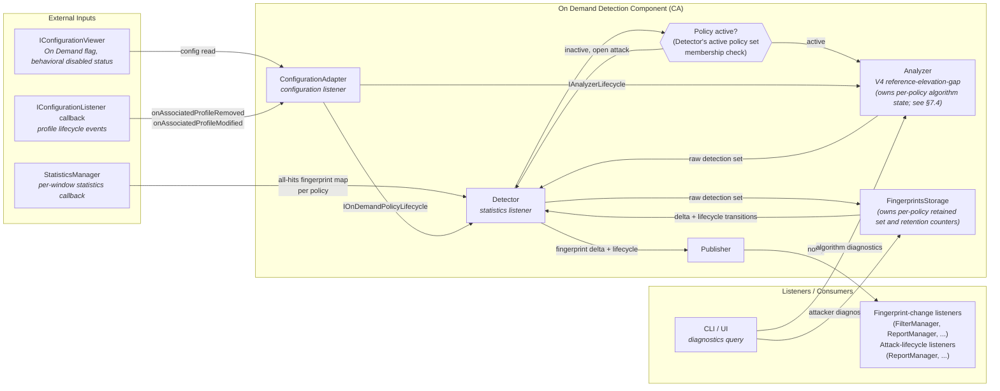

**Key Processing Flow**:
- **Input**: All-hits statistics arrive on each statistics window via the statistics listener callback
- **Processing**: Detector iterates all active policies, invokes Analyzer for the raw detection set, then FingerprintsStorage for retention/delta, and drives Publisher when changes occur
- **Output**: Publisher notifies fingerprint-change listeners with per-fingerprint delta (added/removed) per policy, and attack-lifecycle listeners with lifecycle events — only when changes occur (delta semantics)
- **Diagnostics**: Available on demand via CLI/UI queries

### §2.4 Integration Points Summary

| Component | Side | Integration Point | Purpose |
|-----------|------|-------------------|---------|
| **StatisticsManager** | CA | Statistics listener callback (per-window) | Delivers the all-hits per-policy fingerprint map on each statistics window. The Detector registers as a listener and is called on each window. |
| **TLS-FP Configuration Infrastructure** | CA | Configuration listener callback (profile lifecycle) | `ConfigurationAdapter` implements `IConfigurationListener` to receive `onAssociatedProfileAdded`, `onAssociatedProfileRemoved`, and `onAssociatedProfileModified` events. These are the sole triggers for all policy activation and deactivation decisions. |
| **IConfigurationViewer** | CA | Read-only config query | Read by ConfigurationAdapter to evaluate activation conditions (On Demand enable flag, behavioral detection status) on profile lifecycle events. Detector does not access this interface. (Prerequisite: the On Demand enable/disable flag must be added to the profile data model — see SRS §2.1 — before this component can query it via IConfigurationViewer.) |
| **IOnDemandFingerprintListener** | CA | Fingerprint-change listener (push) | Notified each window when the retained fingerprint set changes — carries per-fingerprint delta lists (newly added and removed fingerprints, identified by `MasterKey`). Per-FP hit rates are available separately via diagnostic interfaces. Consumers: FilterManager (applies delta to SHM), ReportManager (generates per-FP event reports and derives RTS data per SRS §2.7). |
| **IOnDemandAttackListener** | CA | Attack-lifecycle listener (push) | Notified on attack open and close transitions per policy. Attack closes when the grace period expires — i.e., when all per-FP retention counters have expired and the per-policy grace elapsed counter subsequently reaches the live `graceWindowCount` threshold (default 30 windows / 5 min). If new fingerprints are detected while in grace state the grace counter resets and the attack continues seamlessly without re-firing `notifyAttackStarted`. On deactivation via `removePolicy`, both `notifyFingerprintsChanged` and `notifyAttackEnded` fire if applicable (retained set non-empty or in grace state). On deactivation via `deactivatePolicy`, consumers clean up via their own `IConfigurationListener` handlers. Consumer: ReportManager (opens/closes attack reports; attack category "Web-DDoS", event "On-Demand", per SRS §2.7). FilterManager does not implement this interface. Grace-period aging is handled by `FingerprintsStorage` — see §3.10. |
| **CLI / UI** | CA | Algorithm diagnostics query (Analyzer) | Exposes per-policy algorithm internals (top-N hits, cut point, current reference, trim lists, raw detection set — see §7.2.10) for diagnostic display. Does **not** include the retained fingerprint set (owned by FingerprintsStorage). |
| **CLI / UI** | CA | Attacker-state diagnostics query (FingerprintsStorage) | Exposes the current retained fingerprint set (with per-FP remaining retention time) and attack start timestamp per policy for diagnostic display. Queried separately from algorithm diagnostics. |

### §2.5 Design Principles

| Principle | How it applies |
|-----------|----------------|
| **SRP** | Each sub-component has exactly one reason to change: algorithm (Analyzer), retention (FingerprintsStorage), dispatch (Publisher), orchestration (Detector), config translation (ConfigurationAdapter) |
| **OCP** | New consumers register via `IOnDemandFingerprintListener` or `IOnDemandAttackListener` — no existing class modified |
| **DIP** | Detector depends only on `IAnalyzer` and `IFingerprintsStorage` abstractions; ConfigurationAdapter depends on `IOnDemandPolicyLifecycle` and `IAnalyzerLifecycle` — no concrete class references |
| **ISP** | FilterManager gets fingerprint-delta interface only; ReportManager gets both; CLI/UI gets diagnostics facet only — no dead methods anywhere for external consumers (see Q13 for internal interface nuance) |
| **KISS / YAGNI** | No SHM, no IPC, no engine-side logic; five sub-components map 1-to-1 to five concerns; no abstractions beyond what is currently needed |

- **SRP (Single Responsibility)**: The design separates *detection* (identifying attackers from traffic data within a window) from *retention* (keeping detected fingerprints blocked across windows under policy-driven rules). These are independent concerns — the algorithm can change without affecting how long attackers are retained, and the retention policy can change without touching the algorithm. Each sub-component has exactly one reason to change. `Detector` orchestrates the per-policy cycle — its only reason to change is if the orchestration rules change (activation logic, notification ordering); `Analyzer` owns the V4 algorithm and its algorithm-specific per-policy state (see §7.4) — its reason to change is if the detection algorithm changes; `FingerprintsStorage` manages attack state (retained set, per-FP retention counters) — its reason to change is if the rules for what counts as "still under attack" change; `Publisher` handles only listener dispatch — its reason to change is if the fanout mechanism changes; `ConfigurationAdapter` translates configuration lifecycle events — its only reason to change is if the config event protocol changes. None of these five sub-components overlap.

- **OCP (Open/Closed)**: New listeners (e.g., a future telemetry consumer) can be added by implementing IOnDemandFingerprintListener, IOnDemandAttackListener, or both, and registering with the Publisher — no existing class needs modification.

- **DIP (Dependency Inversion)**: Detector does not depend on IConfigurationViewer. Its sole external touchpoint is StatisticsManager (listener registration). Configuration decisions are delegated to ConfigurationAdapter via the IOnDemandPolicyLifecycle interface. The DIP principle manifests in: Detector depends on abstract analysis and storage contracts; ConfigurationAdapter depends on IOnDemandPolicyLifecycle and IAnalyzerLifecycle abstractions — neither concrete class is directly referenced by its consumers. (Detector implements IStatisticsListener; it does not depend on it.) All sub-component dependencies are injected via constructor or init(), making the component testable in isolation with TestingEnvironment.

- **ISP (Interface Segregation)**: The notification contract is split into two purpose-built interfaces: `IOnDemandFingerprintListener` (carries per-fingerprint delta events) and `IOnDemandAttackListener` (carries attack lifecycle events). FilterManager implements only `IOnDemandFingerprintListener` — it only adds and removes filters in response to delta events and has no need for attack open/close semantics. ReportManager implements both. No consumer has dead methods. The algorithm diagnostics path is exposed through a separate `IAlgorithmDiagnostics` interface (owned by the Visibility logical component, implemented by `Analyzer`), not through either listener interface — CLI/UI uses only the iteration facet and never touches the algorithm or write paths. `FingerprintsStorage` is similarly split into `IFingerprintsStorage` (Detector-facing, write path) and `IFingerprintsStorageDiagnostics` (CLI-facing, read-only diagnostic path) — the same Role Interface pattern applied to `Analyzer`.

- **KISS (Keep It Simple)**: No shared memory, no engine-side logic, no IPC. The component is a pure CA-side analysis loop on a periodic statistics callback. The five sub-components map directly to five clearly separate concerns (orchestration, algorithm, attack-state management, dispatch, configuration lifecycle translation) — no artificial indirection. `FingerprintsStorage` is not over-engineering: per-FP retention counters are a simple flat array with a different reason to change than V4. `ConfigurationAdapter` is not over-engineering: it is a thin translation layer with no per-policy state whose single reason to change is if the config event protocol changes. Two diagnostic facets emerge naturally: Analyzer exposes algorithm internals (top-N hits, cut point) and FingerprintsStorage exposes attack state (retained set). No synchronisation needed since everything runs on the same CA timer thread.

- **YAGNI (You Aren't Gonna Need It)**: No abstractions beyond what is currently needed. No shared memory, no IPC, no engine-side components. Each sub-component is the simplest implementation that satisfies the requirements.

## §3 Key Design Decisions

> **At a Glance** — 15 decisions. Walk-through focuses on the architecturally significant ones; full rationale in each sub-section.

| # | Decision | One-liner rationale |
|---|----------|---------------------|
| §3.1 | CA-only execution | Statistics are already aggregated in CA; no engine-side work needed |
| §3.2 | Analyzer owns algorithm state | Keeps orchestrator closed to algorithm changes (OCP) |
| §3.3 | Transition detection via FingerprintsStorage | Notification dispatch is orchestration logic, not algorithm logic |
| §3.4 | Attack lifecycle owned by Detector | Single point of dispatch; consistent with behavioral detection pattern |
| §3.5 | Delta semantics for FP notifications | No SHM rewrites on quiet windows; zero listener traffic when nothing changes |
| §3.6 | Independence from behavioral detection | Separate algorithms, separate lifecycles, separate evolution paths |
| §3.7 | Two dedicated listener interfaces | FilterManager needs fingerprint delta only; ISP — no dead methods |
| §3.8 | Analyzer owns algorithm diagnostics | Natural output of V4 sort step; no separate store needed |
| §3.9 | Per-FP retention in FingerprintsStorage | Detection and retention have different reasons to change — SRP |
| §3.10 | Attack-aging grace period in FingerprintsStorage | Elapsed-counter pattern mirrors per-FP `absenceWindows`; config changes take effect immediately |
| §3.11 | Per-class parameter ownership | `OnDemandParams` owns all params; algorithm classes receive `shared_ptr<const OnDemandParams>` (`const` is the boundary). Note: this row captures the high-level intent; the concrete mechanism (shared `OnDemandParams` vs per-class structs) was decided in §3.20. |
| §3.12 | No mutex for algorithm parameters | CLI setter callbacks and statistics callback run on the same CA event loop thread |
| §3.15 | Immediate attack start | SRS §2.5 requires first-window start; V4 thresholds are the noise-rejection gate |
| §3.18 | ConfigurationAdapter as thin adapter | IConfigurationListener separate from IStatisticsListener — SRP |
| §3.19 | Active policy set driven by config events | No per-window config polling; config changes fire once and are cached |
| §3.20 | Internal CLI params persist in CDB via OnDemandParams | Single CDB row; setters do read-modify-write; load() on startup restores last-saved values |

---

### §3.1 CA-Only Execution
**Decision**: All detection logic runs exclusively in the Controller Agent process, triggered by the statistics window callback.

**Alternatives considered**: Running detection on the engine (per-packet or per-window). Rejected — On Demand operates on aggregated per-policy statistics, not individual packets. There is nothing to inspect on the engine side.

**Rationale**: The statistics aggregation already happens in CA. Running detection there eliminates any need for cross-process communication for analysis results, keeps engines free from detection overhead, and simplifies the design.

---

### §3.2 Analyzer Owns Its Per-Policy Algorithm State
**Decision**: `Analyzer` owns all per-policy algorithm state (tracked reference, top-N hits, cut point, and five diagnostic output fields — see §7.4). `Detector` does not hold or pass any algorithm state — it is entirely opaque to the algorithm's internals.

**Alternatives considered**: Passing `trackedReference` as an in/out parameter to each `analyze(hitMap)` call. Rejected — this leaks algorithm-specific concepts (the reference tracking mechanism) into the orchestrator, coupling it to V4 internals.

**Rationale**: If the algorithm is replaced entirely (e.g., V5 with no reference concept), `Detector` should require zero changes. Encapsulating algorithm state inside `Analyzer` enforces OCP: the orchestrator is closed to algorithm changes. It also satisfies SRP: `Analyzer` is solely responsible for algorithm execution and its supporting state; neither `Detector` nor `FingerprintsStorage` touches this data.

---

### §3.3 Transition Detection Owned by Detector (via FingerprintsStorage)
**Decision**: All retained-set transitions are detected by the `Detector`, using the lifecycle outcome returned by `FingerprintsStorage`. Neither `Analyzer` nor `FingerprintsStorage` fires external notifications; they return data and the `Detector` acts on it.

**Alternatives considered**: Having `Analyzer` or `FingerprintsStorage` detect the transition and call listeners directly. Rejected — firing external notifications (behavioral learning reset, attack open/close) is DP orchestration logic, not an algorithm or state-management concern.

**Rationale**: `Analyzer` is a pure computation module — it returns a raw detection set and holds no knowledge of DP policy logic. `FingerprintsStorage` is a pure state manager — it applies retention rules and returns the outcome. Decisions about what to do with that outcome — calling the Publisher — belong to the `Detector`. This keeps both `Analyzer` and `FingerprintsStorage` reusable and free from DP-specific side effects.

---

### §3.4 Attack Lifecycle Detection Owned by Detector (via FingerprintsStorage)
**Decision**: `Detector` fires fingerprint-change and attack lifecycle notifications to the `Publisher` based on the outcome returned by `FingerprintsStorage`. Reporting and filtering are listener responsibilities.

**Alternatives considered**: Listeners interpret retained-set transitions themselves (no attack state in the detector). Rejected — this would require every listener to independently track previous state, duplicating the transition logic.

**Rationale**: This is consistent with the behavioral and randomized detection patterns in the existing codebase. The `Detector` identifies "attack or no attack" per policy and acts as the single point of dispatch — that is its core orchestration responsibility. What happens as a result (report, filter, log) belongs to listeners; the `Detector` does not depend on any reporting or filtering infrastructure. Attack state (open/closed) is the authoritative output of `FingerprintsStorage`, not derived independently by the `Detector`. **Ordering constraint**: When firing both a fingerprint-change notification and a lifecycle event in the same window, `onFingerprintsChanged` is dispatched to all fingerprint listeners first, then the lifecycle event to all attack-lifecycle listeners — filters are in place before the attack report opens, and cleared before it closes.

---

### §3.5 Delta Semantics for Fingerprint Listener Notification
**Decision**: Each window, `IOnDemandFingerprintListener` instances receive **per-fingerprint delta lists** — `added` (fingerprints newly blocked) and `removed` (fingerprints no longer blocked) — rather than the complete blocked set. No callback is fired when both lists are empty (no change from the previous window).

**Alternatives considered**:
- **(a) Full refresh (`onFingerprintsUpdated(policyId, fullSet)`)**: Rejected — FilterManager must clear and re-add all filters every window even when nothing changed, wasting SHM writes. ReportManager must maintain its own copy of the previous set to detect per-FP events, duplicating transition logic the detector already has. Quiet windows (no attack, no change) still fire a callback with an empty set for every active policy — dead listener traffic.
- **(b) Per-FP individual callbacks (`onFingerprintAdded`, `onFingerprintRemoved`)**: Rejected — FilterManager receives N individual calls and must batch them internally, deferring the SHM swap until all calls for a window are complete. This requires either a flush/commit signal (adding coupling) or strict call-ordering guarantees. Higher listener-side complexity for no reliability benefit over batch delta lists.
- **(c) Single aggregated event per window across all policies (`onFingerprintsChangedBatch(map<policyId, delta>)`)**: Rejected — consumers (FilterManager, ReportManager) require per-policy granularity to apply changes to the correct SHM slot or report; an aggregated event moves that split-by-policyId work from the dispatcher to every consumer. Building a cross-policy aggregation map each window adds a temporary allocation with no reduction in consumer-side work. N per-policy calls (N = active policies with changes, typically 0–5 during an attack) is negligible overhead. Per-policy calls are structurally simpler and consistent with existing DP notification patterns.

**Rationale**: `FingerprintsStorage` computes the fingerprint delta (`added = retained_new \ retained_prev`, `removed = retained_prev \ retained_new`) as a natural byproduct of updating the retained set each window, and returns it directly to the `Detector`. The delta is computed **once** and delivered to all fingerprint listeners. FilterManager applies only the changes to SHM (no full rewrite on unchanged windows). ReportManager receives exact per-FP identity data (which fingerprints were added/removed) without needing to self-track the previous set. Hit-rate data is available via `IFingerprintsStorageDiagnostics`. When both lists are empty, `FingerprintsStorage` signals no change and the `Detector` skips notification — quiet windows generate zero listener traffic. The in-process, single-threaded CA timer path eliminates any risk of missed notifications or cumulative drift.

---

### §3.6 Independence from Behavioral Detection
**Decision**: The On Demand Detection component shares no internal state, data structures, or thresholds with the behavioral `Detection::Agent`. The only shared infrastructure touchpoint is the read-only `IConfigurationViewer` interface, consumed by `ConfigurationAdapter` (not by `Detector` or the behavioral agent's internal components).

**Alternatives considered**: Extending the existing behavioral detection agent with an On Demand mode. Rejected — the algorithms, statistics inputs, output semantics, and lifecycle are different.

**Rationale**: Independence allows the two detection paths to evolve separately. On Demand can be changed, disabled, or replaced without risk to behavioral detection.

---

### §3.7 Two Dedicated Listener Interfaces Instead of a Single Shared One
**Decision**: The On Demand Detection component defines two listener interfaces — `IOnDemandFingerprintListener` for per-fingerprint delta events and `IOnDemandAttackListener` for attack lifecycle events — rather than a single combined interface or extending the existing `IDetectionListener`.

**Alternatives considered**:
- **(a) Single combined `IOnDemandListener` with all methods**: Rejected — violates ISP. FilterManager only needs fingerprint change events — it adds and removes filters from the delta lists and has no use for attack open/close state. Forcing FilterManager to implement dead lifecycle methods couples unrelated concerns and increases the cost of changing either concern independently.
- **(b) Per-FP events via `IDetectionListener::onAttackStarted(FpAttackParams)`**: Rejected — behavioral's per-FP model carries behavioral-specific data (citizen status, baseline portion, thresholds) that has no meaning in On Demand. Notification semantics and data structures are incompatible.
- **(c) Per-policy events via `IDetectionListener::onPolicyAttackStarted(AttackType::OnDemand)`**: Rejected — covers lifecycle but not per-FP changes. Using half of `IDetectionListener` plus a custom extension produces a worse interface than a clean new one.
- **(d) Extending `IDetectionListener` with new methods**: Rejected — violates ISP for all existing listeners (FilterManager, ReportManager, FullString, RTS) who would inherit methods they don't implement. Each detection type's listener implementations are already separate classes; adding On Demand methods to the shared interface couples unrelated consumers.

**Rationale**: Two interfaces give each consumer exactly the contract it needs, with no dead methods. `IOnDemandFingerprintListener` carries `onFingerprintsChanged(policyId, added, removed)` where both `added` and `removed` are `FingerprintSet` — lists of `MasterKey` values. `IOnDemandAttackListener` carries `onAttackStarted(policyId)` and `onAttackEnded(policyId)`. FilterManager implements `IOnDemandFingerprintListener` only. ReportManager implements both. This is consistent with the existing DP pattern where each detection type has its own listener interface and with the ISP principle already applied across the module (e.g., `IStatisticsListener` and `IConfigurationListener` are separate). It also aligns with the codebase convention where each detection type has its own `DetectionListener` adapter class.

---

### §3.8 Analyzer Owns Algorithm Diagnostics — No Separate Diagnostic Store
**Decision**: `Analyzer` is the single source of truth for all seven per-policy algorithm diagnostic fields (see §7.2.10). No separate diagnostic storage object exists. The retained blocked set is owned by `FingerprintsStorage` (§5.3).

**Rationale**: The V4 sort step produces `topNHits` and `cutPoint` as direct outputs of `analyze()` — retaining them inside `Analyzer` costs nothing beyond what the algorithm already requires. A separate store would duplicate data already held by `Analyzer` and require an explicit write step after every dispatch loop to stay consistent. CLI/UI accesses all seven fields via the `IAlgorithmDiagnostics` facet implemented by the same `Analyzer` object (Role Interface pattern — `IAlgorithmDiagnostics` is owned by the Visibility logical component; `IAnalyzer` by the Detection component; both change together when the algorithm changes, so this is not an SRP violation). Keeping these fields off `IAnalyzer` ensures the strategy contract stays algorithm-agnostic: a V5 algorithm would implement its own diagnostics facet without touching `IAnalyzer`.

---

### §3.9 Per-FP Retention Inside FingerprintsStorage
**Principle**: Detection and retention are deliberately separated concerns. The algorithm answers a per-window question: *which fingerprints are attackers right now?* `FingerprintsStorage` answers a per-policy, cross-window question: *which fingerprints remain blocked under policy retention rules?* These questions have different reasons to change and belong to different components.

**Decision**: Per-fingerprint retention state (a per-FP window-counter per policy) lives inside `FingerprintsStorage`, not `Analyzer`. `IAnalyzer::analyze()` returns the **raw detection set** for the current window only — V4 output without any retention filter applied. `FingerprintsStorage` receives the raw set, updates retention counters, computes the retained attacker set, and returns the delta and lifecycle outcome to the `Detector`.

**Alternatives considered**:
- **(a) Retention inside `Analyzer`** (previous design): `analyze()` applied retention before returning, and `getBlockedSet()` exposed the retention-filtered set. Rejected — this violates SRP. `Analyzer` is responsible for one thing: executing the V4 algorithm. Retention is a separate concern (policy: how long to keep a fingerprint after the algorithm stops detecting it) that changes independently of the algorithm. Placing retention inside `Analyzer` means changing the retention policy requires touching the algorithm class, and changing the algorithm requires understanding the retention semantics embedded in it.
- **(b) Retention in `Detector`**: Detector maintains `retainedSet[maxPolicies]` with per-FP counters alongside the Analyzer call. Rejected — pollutes the orchestrator with state-management logic that belongs in a dedicated component. The Detector’s role is to coordinate calls and dispatch outcomes, not to manage per-FP counters.

**Rationale**: Moving retention to `FingerprintsStorage` satisfies SRP. `Analyzer` is a pure computation module: it receives a hit map and returns a raw detection set — no policy-level retention semantics, no mutable per-FP counters beyond the algorithm’s own tracked reference. `FingerprintsStorage` is the dedicated state manager for the retained attacker set: it applies retention rules and is the single source of truth for whether a policy is currently under attack. The algorithm and the retention policy can now evolve independently.

**Stability equivalence**: The `retentionWindowCount`-based counter in `FingerprintsStorage::retentionMap` is the on-demand equivalent of `SteadyTrigger::terminationTrigger` used in behavioral detection — both prevent premature dismissal of an attacker on a single clean window by requiring N consecutive absent windows before eviction. Resetting the counter to zero when the FP reappears is equivalent to `SteadyTrigger::reset()` on re-detection.

---

### §3.10 Attack-Aging Grace Period in FingerprintsStorage
**Decision**: A configurable per-policy **grace period** is implemented directly inside `FingerprintsStorage`, mirroring the per-FP `absenceWindows` elapsed-counter pattern. When all per-FP retention counters expire and the retained set drains to empty, `FingerprintsStorage` does **not** immediately return `becameEmpty`. Instead it enters a **grace state**: a per-policy `graceElapsedWindows` counter increments on each subsequent statistics window while the retained set remains empty. `becameEmpty` propagates to the Detector — and from there to Publisher and listeners — only when `graceElapsedWindows` reaches the live `graceWindowCount` threshold.

**Default threshold**: `graceWindowCount = max(1, attackAgingTimeSeconds / windowIntervalSeconds) = max(1, 300 / 10) = 30 windows` (5 minutes). `attackAgingTimeSeconds = 0` disables the grace period via an early-exit in `computeTransition()`: when `agingTime == 0` the method returns `becameEmpty` immediately without consulting or writing `m_graceElapsedWindows`, matching the original behaviour.

**Grace reset**: If `rawSet` is non-empty on any window while in grace state, the `graceElapsedWindows[P]` key is erased from `m_graceElapsedWindows` (not set to 0 — erased so that `m_graceElapsedWindows.count(P) == 0`), new FPs are inserted into the retained set (becoming non-empty again), and the transition is `unchanged` — the attack continues seamlessly without re-firing `becameNonEmpty`. This prevents a transient quiet window (where the algorithm momentarily finds nothing) from closing and then immediately re-opening the attack, which would cause unnecessary filter churn and spurious `onAttackStarted` / `onAttackEnded` listener calls.

**Elapsed-counter pattern** (mirrors per-FP retention): just as `absenceWindows` counts consecutive absent windows per FP and compares against `retentionWindowCount`, `graceElapsedWindows` counts consecutive empty-set windows per policy and compares against `graceWindowCount`. Both thresholds are re-read from `OnDemandParams` on every `update()` call (step 0 of §9.3), so a CLI change to `attackAgingTimeSeconds` or `retentionPeriodSeconds` takes effect on the very next statistics window with no restart.

**`isRetainedSetActive()` semantics**: Returns `true` if the retained set is non-empty **or** the policy is in grace state (`graceElapsedWindows > 0`). This ensures Detector's `prevSetActive` snapshot correctly reflects the broader "still active" state, which includes the grace window. The field name `isRetainedSetActive` is intentional — "attack" vocabulary is kept exclusively in Detector; FingerprintsStorage uses "active" / "grace" terminology.

**`getActiveSinceTime()` semantics**: Returns the epoch timestamp of the most recent `becameNonEmpty` transition for the policy. It remains non-zero throughout the grace period — the attack has not been declared closed yet. It is cleared to 0 only when `graceElapsedWindows` reaches `graceWindowCount` and `becameEmpty` is returned.

**`resetState()` contract**: Clears `graceElapsedWindows[P]` along with the retained set and `activeSinceTimestamp`. A policy that is reset exits grace state immediately.

**Rationale**: Placing the grace period inside `FingerprintsStorage` rather than `ReportManager` keeps all "is the retained threat set still active?" logic in the single component whose entire purpose is to track that state. It avoids a design where FingerprintsStorage signals `becameEmpty` while the rest of the system still considers the attack open — a semantic mismatch that would force ReportManager to maintain a shadow counter contradicting FingerprintsStorage's own view. The elapsed-counter approach (versus a wall-clock timer) is consistent with the per-FP retention mechanism and eliminates the need for a real-time timer or scheduler in a component that has none: `FingerprintsStorage` already runs one code path per statistics window and can count windows cheaply. Config changes take effect immediately on the next window for the same reason that `retentionPeriod` changes do.

**Alternatives considered**:
- **(a) Grace period in ReportManager**: Rejected — FingerprintsStorage would fire `becameEmpty` while ReportManager holds the attack open, creating a mismatch between FingerprintsStorage's "inactive" view and ReportManager's "still open" view. Any future consumer of `isRetainedSetActive()` or `getActiveSinceTime()` would get misleading answers during the grace window. FilterManager, which does not implement `IOnDemandAttackListener`, would remove all filters at the first `becameEmpty` regardless of the grace countdown in ReportManager — defeating the purpose.
- **(b) Immediate `becameEmpty` (previous design, §3.10 before this revision)**: Rejected — transient quiet windows or brief algorithm misses would close the attack, tear down all filters, fire `onAttackEnded`, and require a new `onAttackStarted` on the next window. SRS §2.7 maps each `onAttackStarted` / `onAttackEnded` pair to an attack report record; spurious pairs produce junk records.
- **(c) Wall-clock timer inside FingerprintsStorage**: Rejected — FingerprintsStorage has no timer infrastructure; adding one would introduce a new dependency and complicate testing. Window counting achieves the same result with zero new infrastructure.

---

### §3.11 Internal CLI Parameter Support
**Decision**: All algorithm tuning parameters (elevation thresholds, gap factors, minimum rate/elevation tables, window size, reference position, reference growth percentage, retention period) are owned by the sub-component that uses them: `Analyzer` owns all algorithm tuning parameters (`AnalyzerParams`, a private value member) and `FingerprintsStorage` owns the retention period (`RetentionParams`, a private value member). CLI handlers bound via `termgBind()` call the corresponding setter interfaces (`IAnalyzerParams` on `Analyzer`, `IRetentionParams` on `FingerprintsStorage`) under the `system internal security web-ddos-protection on-demand` sub-menu.

**Alternatives considered**: Hard-coded constants. Rejected — SRS §2.6 explicitly requires runtime configurability.

**Rationale**: Each class owns only the parameters it consumes — no shared struct, no cross-component dependency on a common parameter object. Changes take effect on the next statistics window with no restart. See §3.12 for the mutation-safety design. This follows the existing DP internal CLI pattern used by other modules.

---

### §3.12 Mutation Safety for Algorithm Parameters
**Decision**: `AnalyzerParams` and `RetentionParams` fields are plain scalar values (integers, floats). CLI handlers write individual fields directly without any locking mechanism. `Analyzer` and `FingerprintsStorage` read from their respective parameter structs on every statistics window without holding a lock.

**Alternatives considered**: Protecting all reads and writes with a mutex. Rejected — the CA is single-threaded in the relevant path. The CLI handler and the statistics window callback both run on the CA event loop; they cannot execute concurrently. A mutex would be a no-op and would add unnecessary complexity.

**Rationale**: In the DP CA, the statistics timer callback and all CLI handlers run sequentially on the same thread. A parameter change written by a CLI handler will be fully visible to the next statistics window callback with no torn reads possible. The "take effect on the next window" guarantee is a natural consequence of this single-threaded execution model, not a special synchronisation mechanism.

---

> **(§3.13 and §3.14 not assigned — numbering slots removed during design evolution.)**

---

### §3.15 Attack Start Is Intentionally Immediate — No Confirmation Windows
**Decision**: `becameNonEmpty` fires on the **first** statistics window that yields a non-empty retained set. There is no confirmation-window requirement (no N-consecutive-positive-window gate before the attack opens).

**Alternatives considered**: Requiring N consecutive windows with a non-empty detection set before firing `becameNonEmpty`, analogous to the behavioral detection multi-stage start (Learn → Detect → Alert → Attack). Rejected — On Demand operates on the out-of-path premise (SRS §2.1): when On Demand is enabled, behavioral detection is already disabled and the system is assumed to be under attack. A confirmation delay of N × 10 s = 30–50 s before the first filter is in place defeats the purpose of immediate out-of-path mitigation.

**Rationale**: SRS §2.5 is unambiguous: "an attack will start when we first add values to the list." The feature is designed to respond within a single statistics window. The V4 algorithm itself already applies elevation thresholds, gap factors, and min-rate/min-elevation trim — these are the noise-rejection mechanisms. Adding a temporal confirmation gate on top would delay mitigation with no safety benefit beyond what V4 already provides.

---

> **(§3.16 and §3.17 not assigned — numbering slots removed during design evolution.)**

---

### §3.18 Configuration Adapter — Thin Translation Layer, Not a Full Sub-Component
**Decision**: Configuration lifecycle events (profile removed, profile modified) are handled by a dedicated `ConfigurationAdapter` class that implements `IConfigurationListener` and translates events into `IOnDemandPolicyLifecycle` and `IAnalyzerLifecycle` calls. The adapter holds no per-policy state and performs no detection logic.

**Alternatives considered**:
- **(a) Detector implements IConfigurationListener directly**: Rejected — Detector already implements `IStatisticsListener`. Adding `IConfigurationListener` couples two unrelated event sources in one class: the statistics timer path and the configuration event path. This violates SRP — Detector's single reason to change is orchestration of the per-window detection cycle; adding config lifecycle responsibility introduces a second independent reason to change.
- **(b) Each sub-component registers its own IConfigurationListener**: Rejected — profile removal requires coordinated calls to Detector (`removePolicy`) and Analyzer (`resetState`) in a defined order. Distributed independent listeners cannot enforce call ordering. A race between two independent listener callbacks — even if both are on the same CA event loop — would be a fragile design. A single adapter owns the full protocol for each event type.

**Rationale**:
- **All other TLS-FP sub-components have their own IConfigurationListener** — this component follows the same pattern rather than coupling configuration events to the statistics path.
- **The adapter is genuinely thin**: no per-policy state, no algorithm, no data structures. It is a pure translation layer between two event systems — exactly the Adapter pattern.
- **`onAssociatedProfileAdded(P)` handler** reads the profile from callback params. If both activation conditions hold (On Demand enabled and behavioral detection disabled), calls `IOnDemandPolicyLifecycle::activatePolicy(P)` to add P to the Detector's active policy set. No per-policy state initialization is needed — per-policy state containers are empty at startup and will be populated lazily on first use (§4.1).
- **ConfigurationAdapter does not hold a pointer to `FingerprintsStorage`**: Detector calls `FingerprintsStorage::resetState(P)` internally as part of `removePolicy()` and `deactivatePolicy()`, preserving the existing architectural invariant that Detector is the sole coordinator for FingerprintsStorage. CLI consumers hold the `IFingerprintsStorageDiagnostics` pointer. No third caller needs a direct path to FingerprintsStorage.

---

### §3.19 Active Policy Set Driven by Configuration Events
**Decision**: `Detector` maintains an `m_activePolicies` set of policy IDs for which On Demand is currently active. This set is managed exclusively by `ConfigurationAdapter` via `IOnDemandPolicyLifecycle` (`activatePolicy`, `deactivatePolicy`, `removePolicy`). The `Detector`'s statistics-window main loop iterates `policyBhvrlHitsMap` and skips any policy not in `m_activePolicies`, without querying `IConfigurationViewer`. `Detector` does not hold `IConfigurationViewer`. The post-loop sweep over `m_policiesWithOpenAttack` (zero-traffic windows) processes only known-active open-attack policies — no activation check needed. Deactivation is exclusively config-driven.

**Alternatives considered**: (Option 2) Querying `IConfigurationViewer` on every statistics window for every policy in the hit map. Rejected — "is this policy active for On Demand?" is a configuration event that changes only when a profile is attached, modified, or removed. Polling it per-window treats a change event as state to re-derive repeatedly. This adds an external dependency (`IConfigurationViewer`) to Detector for data that is already known and stable between config events.

**Rationale**:
- Detector drops `IConfigurationViewer` — simpler dependency graph, easier to test. All config decisions flow through `ConfigurationAdapter`.
- The main loop becomes explicit: iterate `hitMap ∩ m_activePolicies`. The post-loop sweep is pure retention — no redundant activation check.
- `ConfigurationAdapter` already handles deactivation (`onAssociatedProfileModified`, `onAssociatedProfileRemoved`). Adding the activation path (`onAssociatedProfileAdded`, enable-branch of `onAssociatedProfileModified`) is a symmetric extension of the same pattern.
- Both activation conditions (On Demand flag enabled, behavioral detection disabled) are profile-driven. `ConfigurationAdapter`'s profile lifecycle callbacks catch all transitions — no separate event channel needed.
- Consistent with the existing TLS-FP codebase pattern where configuration-driven state changes are handled by `IConfigurationListener` callbacks (e.g., behavioral `Detection::ConfigurationListener` reads conditions from callback params and calls `addPolicy`/`removePolicy`), not by polling during statistics processing.

---

### §3.20 Internal CLI Parameters Persist in CDB via OnDemandParams
**Decision**: All on-demand internal CLI parameters (elevation thresholds, gap factors, minimum rate table, minimum elevation table, window size, reference position, reference growth percentage, and fingerprint retention period) are owned by a dedicated `OnDemandParams` class in `configuration-manager`, backed by a single packed struct `CDBOnDemandParams` stored in CDB. Algorithm classes (`Analyzer` and `FingerprintsStorage`) receive `shared_ptr<const OnDemandParams>` at construction — `const` prevents writes, so no separate viewer interfaces are needed. This matches the `GlobalParams` convention used elsewhere in the codebase. CLI receives the mutable `shared_ptr<OnDemandParams>` via `ConfigurationManager::getOnDemandParams()`. No listener is required — params take effect on the next statistics window via the read path in `analyze()` / `update()`. `OnDemandParams::load()` mirrors `GlobalParams::loadGlobalParams()` — on CDB miss all fields revert to `kXxxDefault` constants.

**Alternatives considered**:
- Per-class ownership (Analyzer owns AnalyzerParams; FingerprintsStorage owns RetentionParams) as in the initial design (§3.11). Rejected in Phase 0 — per-class ownership cannot persist across process restarts without each class independently managing its own CDB row, duplicating the load/store lifecycle code and coupling two algorithm classes to the configuration persistence infrastructure.
- Dedicated viewer interfaces (`IAnalyzerParamsViewer`, `IRetentionParamsViewer`). Rejected in Phase 0B — adds interface files, mock classes, and indirection with no benefit over `const`. The `GlobalParams` pattern already uses `shared_ptr<const ConcreteClass>` without viewer interfaces; `OnDemandParams` follows the same convention.

**Rationale**: A single `OnDemandParams` class is the natural analogue of `GlobalParams` for per-detect-params persistence. It consolidates all on-demand CLI parameter validation, CDB persistence, and default-value restoration into one class, leaving `Analyzer` and `FingerprintsStorage` as pure algorithm and state-management classes with no CDB dependency. The `shared_ptr<const OnDemandParams>` injection enforces that algorithm classes never write params — `const` is the boundary, not an interface. Writes go exclusively through `OnDemandParams` setters held by `ConfigurationManager`, which perform the CDB read-modify-write. The "params take effect on next window" guarantee follows naturally from the single-threaded CA event loop (same as §3.12). No listener is added because reading from `const OnDemandParams` at the start of each window is cheaper and simpler than a listener/callback chain for infrequently changed values.

---

## §4 Use Cases and Scenarios

> **Scenario Index** — 11 scenarios covering the full lifecycle.

| # | Scenario | Type | Key behavior |
|---|----------|------|--------------|
| §4.1 | Initialization | Startup | Working buffer reserved; per-policy state containers empty at startup |
| §4.2 | Normal window — no attack | Happy path | Algorithm finds nothing; no listeners called |
| §4.3 | Attack detected — first window | Happy path | Attack opens; FilterManager and ReportManager notified |
| §4.4 | Attack ongoing — subsequent windows | Happy path | Partial FP change; only delta dispatched |
| §4.5 | Fingerprint expires from retention | Happy path | Single FP removed; attack stays open |
| §4.6 | Policy / profile deactivated | Config lifecycle | Silent cleanup; all per-policy state reset; no notifications |
| §4.7 | Initialization failure | Error | Component not registered; CA continues |
| §4.8 | Zero-traffic window during attack | Edge case | Post-loop sweep increments counters; no filter leak |
| §4.9 | Diagnostics query | Observability | Read-only; stale-by-one-window acceptable |
| §4.10 | All FPs expire — attack ends | Happy path | Retained set empties; attack closed; grace period in ReportManager |
| §4.13 | On Demand enabled from profile | Config lifecycle | Policy added to active set; no notifications |

### §4.1 Initialization
**Scenario**: The On Demand Detection component starts up as part of the TLS Fingerprint module initialization.

**Actors**: Module factory (CA startup sequence)

**Flow**:
1. Factory constructs Analyzer — reserves the per-analyze working buffer (`m_workingBuffer`) at construction. Per-policy algorithm state containers (`unordered_map<PolicyKey, T>`) are empty at startup and grow lazily on first use.
2. Factory constructs FingerprintsStorage — computes `retentionWindowCount` from `retentionPeriodSeconds / windowIntervalSeconds`. Per-policy retention state containers are empty at startup and grow lazily on first use.
3. Factory constructs `Publisher` — ready immediately, no further initialization required.
4. Factory registers FilterManager and ReportManager with Publisher as fingerprint listeners; ReportManager also registered as an attack listener.
5. Factory constructs Detector — receives Analyzer, FingerprintsStorage, Publisher, and configuration parameters by injection. Constructor registers Detector as a statistics listener with StatisticsManager for fingerprint hit events.
6. Factory constructs ConfigurationAdapter — receives the policy lifecycle contract (implemented by Detector) and the analyzer lifecycle contract (implemented by Analyzer). Registers as a configuration listener with the TLS-FP configuration infrastructure. Constructed after Detector since it depends on the lifecycle contracts both implement.
7. Initialization complete — component is idle until the first statistics window callback.

**Expected Behavior**: Working buffer reserved; component registered and waiting for statistics. Per-policy state containers are empty at startup — entries are created on first use.

**Requirements**: §1.3 Req #1, #8

---

### §4.2 Normal Window — No Attack
**Scenario**: A statistics window arrives. For a given policy, the algorithm finds no attacker fingerprints and no attack is currently active.

**Actors**: StatisticsManager (timer-driven, external trigger)

**Flow**:
1. StatisticsManager delivers the statistics window to Detector.
2. `Detector` iterates active policies.
3. For policy P: checks if P is active for On Demand — yes, P is active.
4. Detector calls Analyzer with the hit map — returns raw detection set `{}` (no fingerprints above threshold).
5. Detector passes the raw detection set `{}` to FingerprintsStorage — no retention changes, no delta; FingerprintsStorage returns `transition=unchanged`.
6. Detector calls `getNewFingerprints()` and `getRemovedFingerprints()` on FingerprintsStorage — both return empty. `Detector` skips FP notification; `Publisher` is not called.
7. `transition=unchanged` — no attack lifecycle event dispatched.

**Expected Behavior**: No listener events fired. `Analyzer` and `FingerprintsStorage` internal state updated (algorithm reference tracked; retention counters incremented where applicable).

**Requirements**: §1.3 Req #1, #2, #3, #6, #7, #10

---

### §4.3 Attack Detected — First Window with Blocked Fingerprints
**Scenario**: A statistics window arrives and the algorithm identifies ≥1 attacker fingerprint for a policy. No attack was previously active.

**Actors**: StatisticsManager (timer-driven, external trigger)

**Flow**:
1. `StatisticsManager` calls `onStatisticsReady()`.
2. P is active for On Demand.
3. Detector calls Analyzer with the hit map — returns raw detection set `{FP_A, FP_B}`.
4. Detector passes raw detection set `{FP_A, FP_B}` to FingerprintsStorage — FP_A and FP_B added to retained set with retention counters initialised; attack transitions `closed → open`. FingerprintsStorage returns `transition=becameNonEmpty`.
5. Detector calls `getNewFingerprints()` and `getRemovedFingerprints()` on FingerprintsStorage — `getNewFingerprints()` returns `{FP_A, FP_B}`; `getRemovedFingerprints()` returns `{}`.
6. `added` non-empty — Detector dispatches fingerprint changes via Publisher: added={FP_A, FP_B}, removed={}.
7. `transition=becameNonEmpty` — Detector dispatches the attack-started event via Publisher.

**Expected Behavior**: FilterManager receives `onFingerprintsChanged` with `added={FP_A, FP_B}` and creates filters. ReportManager receives `onFingerprintsChanged` for per-FP reports and `onAttackStarted` to open an attack report.

**Requirements**: §1.3 Req #3, #4, #5, #10

---

### §4.4 Attack Ongoing — Subsequent Windows
**Scenario**: Attack is already active for a policy. The next window’s raw detection produces a partially different set — FP_A still detected, FP_B not detected (retention counter incremented but not yet expired), FP_C newly detected.

**Actors**: StatisticsManager (timer-driven, external trigger)

**Flow**:
1. `StatisticsManager` calls `onStatisticsReady()`.
2. P is active for On Demand.
3. Detector calls Analyzer with the hit map — returns raw detection set `{FP_A, FP_C}` (FP_B not detected in this window; FP_C newly detected).
4. Detector passes raw detection set `{FP_A, FP_C}` to FingerprintsStorage — FP_B counter incremented but not yet `>= retentionWindowCount` (still retained); FP_A counter reset to 0 (still detected); FP_C added to retained set. FingerprintsStorage returns `transition=unchanged`.
5. Detector calls `getNewFingerprints()` and `getRemovedFingerprints()` on FingerprintsStorage — `getNewFingerprints()` returns `{FP_C}`; `getRemovedFingerprints()` returns `{}`.
6. `added` non-empty — Detector dispatches fingerprint changes via Publisher: added={FP_C}, removed={}.
7. `transition=unchanged` — no lifecycle event.

**Expected Behavior**: FilterManager adds filter for FP_C. FP_B filter remains (retention keeps it in the blocked set). No `onAttackStarted`.

**Requirements**: §1.3 Req #3, #5, #10

---

### §4.5 Fingerprint Expires from Retention — Delta Notification
**Scenario**: Attack is active for policy P. FP_A is still detected in the current window. FP_B has not been detected for `retentionWindowCount` consecutive windows — its retention counter expires this window. FP_B is removed from the retained set. No attack lifecycle transition occurs.

**Actors**: StatisticsManager (timer-driven, external trigger)

**Flow**:
1. `StatisticsManager` calls `onStatisticsReady()`.
2. P is active for On Demand.
3. Detector calls Analyzer with the hit map — returns raw detection set `{FP_A}` (FP_B below threshold or absent).
4. Detector passes raw detection set `{FP_A}` to FingerprintsStorage — FP_B counter incremented and is now `>= retentionWindowCount` — retention expired, FP_B removed from retained set; FP_A counter reset to 0 (still detected). FingerprintsStorage returns `transition=unchanged`.
5. Detector calls `getNewFingerprints()` and `getRemovedFingerprints()` on FingerprintsStorage — `getNewFingerprints()` returns `{}`; `getRemovedFingerprints()` returns `{FP_B}`.
6. `removed` non-empty — Detector dispatches fingerprint changes via Publisher: added={}, removed={FP_B}.
7. `transition=unchanged` — retained set `{FP_A}` still non-empty; no lifecycle event.

**Expected Behavior**: FilterManager removes the filter for FP_B. ReportManager records FP_B removal. Attack report remains open. No `onAttackStarted` or `onAttackEnded` fired.

**Requirements**: §1.3 Req #4, #5, #10

---

### §4.6 Policy / Profile Deactivated — Conditional Notifications on removePolicy, Silent on deactivatePolicy
**Scenario**: A deactivation event occurs for policy P. Profile removal routes through `removePolicy(P)`; profile modification or On Demand disabled routes through `deactivatePolicy(P)`. The two paths differ in whether notifications are fired.

**Actors**: ConfigurationAdapter (profile lifecycle callback)

**Flow**:
1. TLS-FP infrastructure calls `onAssociatedProfileRemoved(P)` or `onAssociatedProfileModified(P)` (with OD flag disabled or behavioral re-enabled) on ConfigurationAdapter.
2. ConfigurationAdapter calls `removePolicy(P)` or `deactivatePolicy(P)` on Detector as appropriate.
3. **`removePolicy(P)` path**: Detector queries `getRetainedSet(P)` on FingerprintsStorage. If non-empty, fires `notifyFingerprintsChanged(P, {}, retainedSet)`. If P had an open attack, fires `notifyAttackEnded(P)`. Then resets FingerprintsStorage state and removes P from active-policy and open-attack tracking. Ordering mirrors the normal detection flow.
4. **`deactivatePolicy(P)` path**: Detector removes P from its active and open-attack tracking unconditionally and resets FingerprintsStorage state — no notifications fired.
5. ConfigurationAdapter calls `IAnalyzerLifecycle::resetState(P)` on Analyzer — clears tracked reference and all diagnostic fields. Rationale: the policy slot may be reused; stale algorithm state would corrupt the first analysis window after reactivation.

**Expected Behavior**: On profile removal (`removePolicy`): `notifyFingerprintsChanged(P, {}, retainedSet)` fired if retained set was non-empty; `notifyAttackEnded(P)` fired if attack was open; then all per-policy state cleared. On profile modification/OD-disabled (`deactivatePolicy`): no notifications fired; consumers (FilterManager, ReportManager) clean up their own On Demand artifacts via their own `IConfigurationListener` handlers. In both cases, P will not be processed in subsequent statistics windows. Since all `IConfigurationListener` callbacks for a given profile event are dispatched sequentially on the CA event loop before the next statistics window fires, all cleanup handlers are guaranteed to execute before any subsequent statistics processing for the now-deactivated policy.

**Requirements**: §1.3 Req #6, #7, #9

---

### §4.7 Error: Initialization Failure

**Scenario**: Analyzer construction fails during module factory initialization (e.g., memory allocation failure for the working buffer).

**Actors**: Module factory (CA startup sequence)

**Flow**:
1. Factory attempts to construct Analyzer — construction fails.
2. Factory logs `ON_DEMAND_DETECTION_INIT_FAILED` via `DIAG_LOGGER_INJECT`.
3. FingerprintsStorage, Publisher, Detector, and ConfigurationAdapter are NOT constructed.
4. `StatisticsManager::addListener()` is never called — no statistics callbacks will be received.

**Expected Behavior**: Component inactive. CA continues normal operation without On Demand Detection. No crash, no resource leak.

**Requirements**: §1.3 Req #8

---

### §4.8 Zero-Traffic Window During Attack
**Scenario**: A statistics window arrives. Policy P has an open attack, but the hit map contains no entry for P (zero traffic this window).

**Key behavior**: The post-loop sweep passes an empty raw set to FingerprintsStorage. Retention counters for all retained FPs are incremented. If any FP's counter reaches `retentionWindowCount`, that FP expires from the retained set and `onFingerprintsChanged` is dispatched. Attack remains open unless all FPs expire. See §6.7 (abstract sequence diagram) and Flow 5 (§7.6) for the full call sequence.

**Requirements**: §1.3 Req #4, #5

---

### §4.9 Diagnostics Query
**Scenario**: A CLI/UI operator queries per-policy algorithm and attacker-state diagnostics while the component is running.

**Key behavior**: `IAlgorithmDiagnostics::forEach()` on Analyzer returns algorithm internals (top-N hits, cut point, current reference, trim lists, raw detection set) — all data is from the most recently completed `analyze()` call and may be one window stale. `IFingerprintsStorageDiagnostics::getRetainedSetDiagnostics(P)` returns the retained FP set with per-FP remaining retention time. `IFingerprintsStorageDiagnostics::getActiveSinceTime(P)` returns the active-since timestamp (0 if no active set). No state changes occur. See §6.6 (abstract) and Flow 10 (§7.6) for the full query sequence.

**Requirements**: §1.3 Req #10

---

### §4.10 All FPs Expire — Attack Ends
**Scenario**: All retained fingerprints for policy P have been absent from the raw detection set for `retentionWindowCount` consecutive windows. Their retention counters all reach the expiry limit in the same window.

**Key behavior**: FingerprintsStorage evicts all retained FPs and returns `transition=becameEmpty`. Detector dispatches `notifyFingerprintsChanged(P, {}, {all expired FPs})` then `notifyAttackEnded(P)`. The retained set is now empty. FilterManager removes all filters for P; ReportManager closes the attack report (grace period handled by ReportManager). See §6.4 (abstract) and Flow 4 (§7.6) for the full call sequence.

**Requirements**: §1.3 Req #4, #5

> **§4.11 and §4.12** — not assigned. These numbering slots were reserved during earlier design evolution and subsequently removed. The covered scenario space is complete with §4.1–§4.10 and §4.13.

---

### §4.13 On Demand Enabled from Profile — Configuration Lifecycle Event
**Scenario**: A profile with On Demand enabled and behavioral detection disabled is associated with policy P (new association or profile modification enabling the flag).

**Actors**: ConfigurationAdapter (configuration lifecycle callback from TLS-FP infrastructure)

**Flow**:
1. TLS-FP infrastructure calls `onAssociatedProfileAdded(P)` (or `onAssociatedProfileModified(P)`) on ConfigurationAdapter.
2. ConfigurationAdapter reads profile conditions — On Demand enabled AND behavioral disabled.
3. ConfigurationAdapter calls activatePolicy(P) on Detector.
4. Detector adds P to the active policy set. No notifications fired. No state changes to Analyzer or FingerprintsStorage.

**Expected Behavior**: P will be processed in the next statistics window. Per-policy state self-initialises on first use. No immediate side effects.

**Requirements**: §1.3 Req #6, #7, #9


## §5 Components

The On Demand Detection component is logically divided into five sub-components (Detector, Analyzer, FingerprintsStorage, Publisher, ConfigurationAdapter), all running in the Controller Agent (CA) process on the statistics timer thread. There is no engine-side logic.

> **Terminology Note**: In §2–§4, "the component" refers to the entire On Demand Detection logical unit. In §5, each sub-component is described individually with its own responsibility, operating context, and dependencies. "Detector" refers specifically to the top-level orchestrator class that wires the other four together.

---

### §5.1 Detector (Orchestrator)

#### §5.1.1 Responsibility

The Detector is the **top-level entry point and orchestrator**. It implements `IStatisticsListener`, receives the all-hits statistics window, and drives the per-policy detection cycle: iterates active policies (from the active policy set) in the hit map → analysis → transition detection → notification dispatch.

**Primary Function**: For each active policy in each statistics window, invoke the Analyzer to obtain the raw detection set, pass the result to FingerprintsStorage to apply retention and compute lifecycle transitions, and delegate notification to the Publisher.

**Key Principles**:
- Detector **orchestrates** — it does not implement the algorithm (Analyzer), manage the retained attacker set (FingerprintsStorage), or manage listeners (Publisher).
- Detector holds no per-policy algorithm state. All per-policy algorithm and retention state is owned by Analyzer and FingerprintsStorage.

#### §5.1.2 Operating Context

- **Location**: Controller Agent (CA)
- **Execution**: Invoked on each statistics window by StatisticsManager (fingerprint hit events)
- **Performance Critical**: NO — runs off the packet processing path, on the CA timer thread
- **Threads**: Single-threaded — the CA statistics timer fires sequentially; no concurrent access

#### §5.1.3 Dependencies

- **StatisticsManager**: Registers as a statistics listener for fingerprint hit events (Event::Hits). **Verified behavior**: the hit map contains entries only for policies with non-zero behavioral hits in the current window. Policies with zero traffic are absent from the map — confirmed by the StatisticsManager implementation and unit tests. The post-loop sweep handles zero-traffic open-attack policies: any open-attack policy absent from the hit map receives an empty raw-set update, allowing retention counters to increment and FPs to expire naturally.
- **IAnalyzer** (Analyzer), **IFingerprintsStorage** (FingerprintsStorage — Detector-facing write interface only, not the diagnostics facet), **Publisher**: Internal sub-components (injected at construction).

> **Factory wiring note**: `Analyzer` and `FingerprintsStorage` each receive `shared_ptr<const OnDemandParams>` at construction, injected by the Factory. Read-only access is enforced by `const` — no viewer interfaces needed, consistent with the `GlobalParams` convention. These are dependencies of `Analyzer` (§5.2.3) and `FingerprintsStorage` (§5.3.3), not of the Detector.

---

### §5.2 Analyzer

#### §5.2.1 Responsibility

The Analyzer is a computation module implementing the V4 reference-elevation-gap algorithm (pure at the interface level — the concrete class maintains per-policy cross-window state, see §7.4). Given a per-policy fingerprint hit map, it produces the current window's **raw detection set** — the fingerprints identified as attackers by the algorithm in this window alone.

**Primary Function**: Execute the V4 reference-elevation-gap algorithm for a policy and return the **raw detection set**. On each analysis call the Analyzer computes the ranking and thresholds, updates its per-policy algorithm state and diagnostic outputs (reference value, fingerprint ranking, detection threshold and related diagnostics), and returns the raw set of detected fingerprints for this window without applying retention. Implements the algorithm diagnostics facet to expose per-policy algorithm state for CLI/UI queries — see §7.4 for the full field list and layout.

**Key Principles**:
- Analyzer **owns only the algorithm's per-policy state**: reference value, fingerprint ranking, detection threshold, and diagnostic outputs (see §7.4 for the full field list). It does not own retention counters or the retained attacker set — those belong to FingerprintsStorage.
- `analyze()` returns the raw single-window algorithm output. Retention filtering is the responsibility of FingerprintsStorage, not Analyzer.
- Replacing the algorithm (e.g., V5) requires changing only this class.

#### §5.2.2 Operating Context

- **Location**: Controller Agent (CA)
- **Execution**: Called synchronously by Detector during each per-policy iteration within `onStatisticsReady()`
- **Performance Critical**: LOW — runs off packet path. The algorithm operates on small sets (≤100 fingerprints per policy). Execution is bounded and fast.
- **Threads**: Single-threaded (CA timer thread, same as Detector)
- **Diagnostic thread safety**: `IAlgorithmDiagnostics::forEach()` may be called from a CLI/UI thread concurrently with `analyze()`. No lock is needed — diagnostic fields are written within the single computation pass in `analyze()`; concurrent reads are advisory and tolerate one-window-stale data (see §7.3, `IAnalyzer` rationale).

#### §5.2.3 Dependencies

- **OnDemandParams**: injected at construction as `shared_ptr<const OnDemandParams>` (read-only via `const`). `Analyzer` reads algorithm parameters (thresholds, table, window size, etc.) from this object on each `analyze()` call. No viewer interface needed — `const` is the boundary, matching the `GlobalParams` convention.

---

### §5.3 FingerprintsStorage

#### §5.3.1 Responsibility

FingerprintsStorage is the **retained attacker set manager** per policy. Given the raw detection set from the Analyzer, it applies per-fingerprint retention rules, computes the fingerprint delta, and returns the lifecycle outcome to the Detector.

**Primary Function**: On each invocation by the Detector: apply per-fingerprint retention rules (a fingerprint remains in the retained set for a configurable number of windows after the algorithm last detected it); compute the fingerprint delta (added/removed relative to the previous window); return the updated retained set, the delta, and any lifecycle transition (attack opened / attack closed) to the Detector. Single source of truth for "is this policy currently under attack?"

**Key Principles**:
- FingerprintsStorage **owns all per-policy retention and lifecycle state**: per-FP retention counters and retained attacker set.
- FingerprintsStorage exposes a `resetState(policyId)` method — clears retention map and retained attacker set so the policy starts fresh if reactivated. Called by Detector on deactivation.
- FingerprintsStorage does not implement the detection algorithm — it receives the raw detection set from the Analyzer and applies retention on top of it.
- Changing retention semantics (e.g., from window-count-based to time-based) requires changing only this class.
- FingerprintsStorage stores per-policy retention state in `unordered_map<PolicyKey, RetentionMap>` containers — entries are created lazily on the first `update()` call for a policy and fully erased by `resetState()`. Capacity, eviction policy, and overflow behavior are implementation details described in §7.4, FingerprintsStorage Internal State. The configured retention window count (the retention-window parameter) determines how many consecutive absent windows are required before a fingerprint is evicted — this remains a configurable parameter exposed via the OnDemand tuning interface.
- The FingerprintsStorage exposes both the detector-facing update/read control path and a separate diagnostics facet for CLI/UI queries; see §7.4, FingerprintsStorage Internal State for the implementation-level details of the retention structure and diagnostic layout.

#### §5.3.2 Operating Context

- **Location**: Controller Agent (CA)
- **Execution**: Called synchronously by Detector during each per-policy iteration within `onStatisticsReady()`
- **Performance Critical**: NO — runs off packet path. Operates on small per-policy sets.
- **Threads**: Single-threaded (CA timer thread, same as Detector)
- **Diagnostic thread safety**: `IFingerprintsStorageDiagnostics` query methods may be called from a CLI/UI thread concurrently with `update()`. No lock is needed — diagnostic fields are word-aligned and writes are structured so concurrent reads observe either complete previous-window data or a fully-reset state; reads are advisory and tolerate one-window-stale data.

#### §5.3.3 Dependencies

- **OnDemandParams**: injected at construction as `shared_ptr<const OnDemandParams>` (read-only via `const`). `FingerprintsStorage` reads `retentionPeriodSeconds` from this object at the start of each `update()` call (step 0 of §9.3). No viewer interface needed — `const` is the boundary, matching the `GlobalParams` convention.

---

### §5.4 Publisher

#### §5.4.1 Responsibility

The Publisher manages the **observer pattern** for On Demand Detection consumers. It maintains two separate listener registries (`IOnDemandFingerprintListener` and `IOnDemandAttackListener`) and dispatches each event type to its registered listener list when invoked by the Detector.

**Primary Function**: Receive delta and lifecycle events from the Detector and dispatch each to the appropriate registered listener list. Publisher dispatches unconditionally to its list when called — the ordering (`onFingerprintsChanged` before lifecycle events) is enforced by the Detector's call sequence.

**Key Principles**:
- Publisher **only dispatches** — it does not compute deltas, detect transitions, or hold per-policy state.
- Publisher is decoupled from Analyzer and FingerprintsStorage. It receives fully computed events from the Detector.

#### §5.4.2 Operating Context

- **Location**: Controller Agent (CA)
- **Execution**: Called synchronously by Detector during the per-policy iteration
- **Performance Critical**: NO — dispatches to a small number of listeners (2–3 typically)
- **Threads**: Single-threaded (CA timer thread)

#### §5.4.3 Dependencies

- **Detector**: Drives all dispatch calls.
- **Consumers**: FilterManager (registers as a fingerprint-change listener), ReportManager (registers as both a fingerprint-change listener and an attack-lifecycle listener).

---

### §5.5 ConfigurationAdapter (Configuration Lifecycle)

#### §5.5.1 Responsibility

ConfigurationAdapter is the **configuration lifecycle bridge**. It implements
`IConfigurationListener` to receive profile lifecycle events from the TLS-FP configuration
infrastructure and translates them into sub-component calls, enforcing the correct call
ordering and semantics for each event type.

**Primary Function**: Receive profile lifecycle events and translate them:
- `onAssociatedProfileAdded(P)`: reads the profile from callback params.
  If both activation conditions hold (On Demand enabled AND behavioral detection disabled):
  calls activatePolicy(P) on Detector to add P to the active policy set.
  Else: no action — policy not eligible for On Demand.
- `onAssociatedProfileRemoved(P)`: calls removePolicy(P) on Detector, then
  calls resetState(P) on Analyzer. Silent — no notifications fired.
- `onAssociatedProfileModified(P)`: reads the profile from callback params. Bidirectional —
  handles both activation and deactivation transitions:
  - If (OD flag disabled OR behavioral enabled): calls deactivatePolicy(P) on Detector,
    then resetState(P) on Analyzer — silently clears all per-policy state; safe no-op if P was
    not active. No notifications fired.
  - Else (OD enabled AND behavioral disabled): calls activatePolicy(P) on Detector
    — safe no-op if P is already active.
  - ConfigurationAdapter does **not** track per-policy active state. It reads profile conditions
    from callback params and calls activatePolicy() or deactivatePolicy() unconditionally.
    Both are safe to call when P is already in the target state: activatePolicy() is a no-op
    if P is already active; deactivatePolicy() is safe even when P has no open attack.
  - Analyzer state is reset on deactivation — same as profile removal. Stale algorithm state would corrupt the first window after reactivation.

**Key Principles**:
- ConfigurationAdapter **only translates** — it does not compute, store per-policy state, or
  dispatch to external listeners.
- ConfigurationAdapter does not hold a pointer to `FingerprintsStorage` — Detector calls resetState on FingerprintsStorage internally as part of `removePolicy()` and `deactivatePolicy()`.
- Handles `onAssociatedProfileAdded` to activate On Demand for newly associated profiles
  when both conditions hold (On Demand enabled AND behavioral detection disabled).
- Does not track per-policy active state — relies on idempotent semantics of `activatePolicy()`
  and `deactivatePolicy()`.

#### §5.5.2 Operating Context

- **Location**: Controller Agent (CA)
- **Execution**: Called by TLS-FP configuration infrastructure on profile lifecycle events
- **Performance Critical**: NO — runs on the configuration event path, not the statistics or
  packet path
- **Threads**: Single-threaded (CA event loop — same thread as statistics callbacks per §3.12; no concurrent execution with the statistics path)

#### §5.5.3 Dependencies

- **IOnDemandPolicyLifecycle** (implemented by Detector): Policy activation and cleanup contract — activation, removal, and deactivation entry points with distinct notification semantics.
- **IAnalyzerLifecycle** (implemented by Analyzer): Algorithm state reset contract — called on all deactivation paths (profile removal, profile disassociation, On Demand disabled).
- **IConfigurationViewer**: Read-only config query — reads On Demand enable flag and behavioral detection status to determine whether a profile modification requires activation or deactivation.

---

### §5.6 OnDemandParams

#### §5.6.1 Responsibility

`OnDemandParams` is a **plain concrete class** following the `GlobalParams` pattern. It is the configuration persistence manager for all on-demand internal CLI parameters. It owns the working copy of all algorithm and retention parameters, backs them by a single `CDBApiWrapper<CDBOnDemandParams>` row, and exposes mutable setter methods (`IAnalyzerParams`, `IRetentionParams`) for CLI handlers. Held by `ConfigurationManager`. Algorithm classes receive `shared_ptr<const OnDemandParams>` — read-only access enforced by `const`, with no separate viewer interfaces. CLI receives `shared_ptr<OnDemandParams>` via `ConfigurationManager::getOnDemandParams()`.

**Primary Function**: Accept CLI parameter changes via setters, validate them, update the working copy, and perform a read-modify-write of the single `CDBOnDemandParams` row. Expose `load()` for startup restoration — on CDB miss, all fields revert to `kXxxDefault` constants (mirrors `GlobalParams::loadGlobalParams()`).

**Key Principles**:
- `OnDemandParams` is the **single owner** of all algorithm and retention parameter working copies. Neither `Analyzer` nor `FingerprintsStorage` holds a mutable copy.
- `Analyzer` and `FingerprintsStorage` receive `shared_ptr<const OnDemandParams>` at construction and read parameters on each `analyze()` / `update()` call. The `const` qualifier enforces read-only access — no viewer interfaces needed, consistent with the `GlobalParams` convention.
- Each successful setter call performs one CDB read-modify-write — no deferred batch writes. On rejection the working copy and CDB are unchanged.
- No listener or callback mechanism is needed. The "take effect on next window" guarantee follows from the single-threaded CA event loop (§3.12, §3.20).
- `load()` is called once at startup (from `initController()`, same as `GlobalParams`). After `load()` the working copy reflects the last persisted state or all defaults if the CDB row is absent.

#### §5.6.2 Operating Context

- **Location**: Controller Agent (CA), `configuration-manager` sub-component
- **Execution**: Setters called from CLI handlers (CA event loop); reads by `Analyzer` / `FingerprintsStorage` from `OnDemandParams` on the statistics timer thread (same CA event loop — no concurrent access)
- **Performance Critical**: NO — CLI setter calls are rare; parameter reads are fast scalar or table reads off a stack-allocated struct
- **Threads**: Single-threaded (CA event loop — same as §3.12)

#### §5.6.3 Dependencies

- **`CDBApiWrapper<CDBOnDemandParams>`**: CDB backing store; one row per `OnDemandParams` instance.
- **No runtime algorithm dependencies**: `OnDemandParams` has no reference to `Analyzer` or `FingerprintsStorage`. It is pure state management.
- **No viewer interfaces**: `OnDemandParams` is a plain concrete class. Algorithm classes receive `shared_ptr<const OnDemandParams>` — `const` enforces read-only access, eliminating the need for `IAnalyzerParamsViewer` / `IRetentionParamsViewer` interfaces. This matches the `GlobalParams` convention and removes the reversed header dependency that viewer interfaces would have introduced between `configuration-manager` and `on-demand-detection`.

## §6 Data Flow and Interactions

> **Key diagrams for design review**: §6.2 (attack opens — first detection), §6.4 (attack ends — retention expires), §6.5 (policy / profile deactivated — silent cleanup), §6.6 (zero-traffic sweep — no filter leak). The remaining diagrams cover diagnostics and configuration lifecycle paths.

### §6.1 Normal Window — No Attack

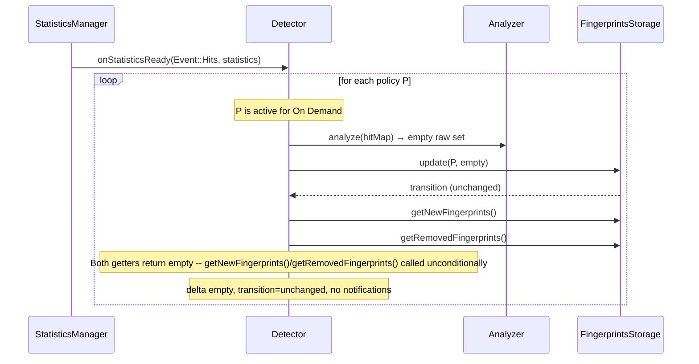

---

### §6.2 Attack Detected — First Window with Blocked Fingerprints

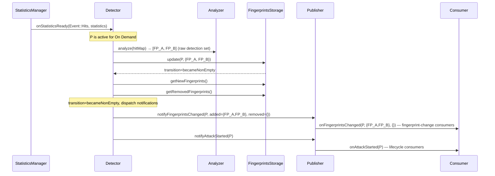

---

### §6.3 Attack Ongoing — Subsequent Windows

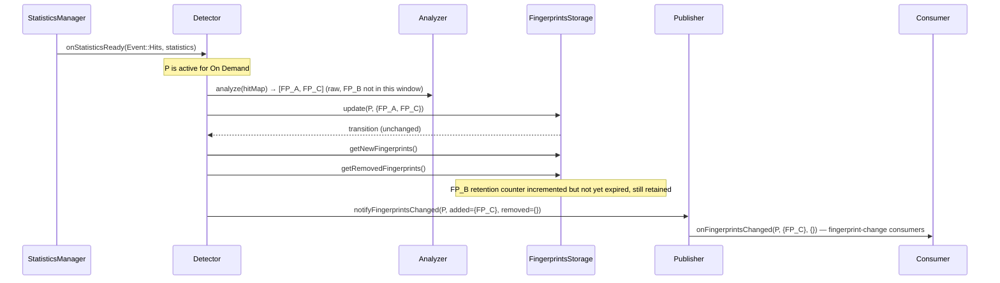

---

### §6.4 All Fingerprints Expire from Retention — Attack Ends

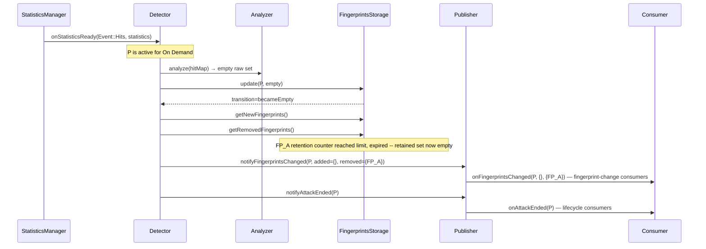

---

### §6.5 Policy / Profile Deactivated — Silent Cleanup

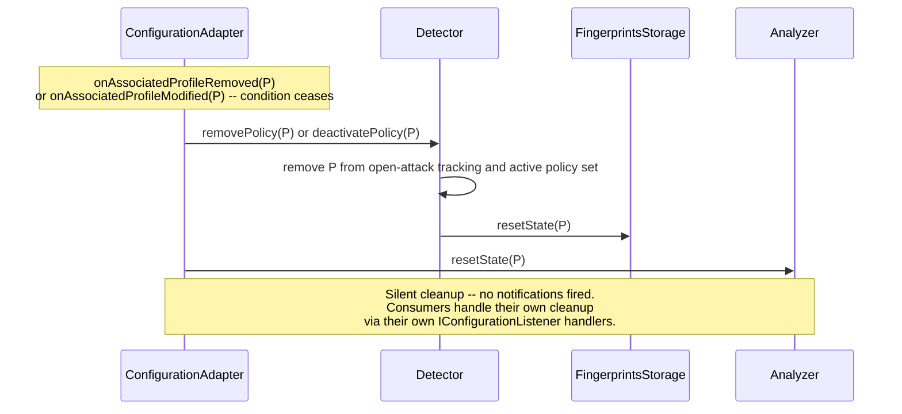

---

### §6.6 Diagnostics Query

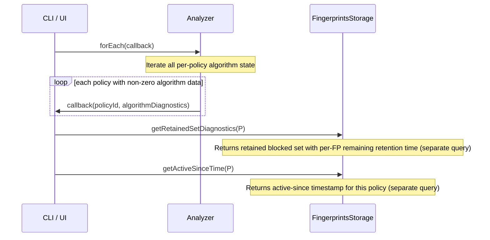

---

### §6.7 Zero-Traffic Window — Post-Loop Sweep

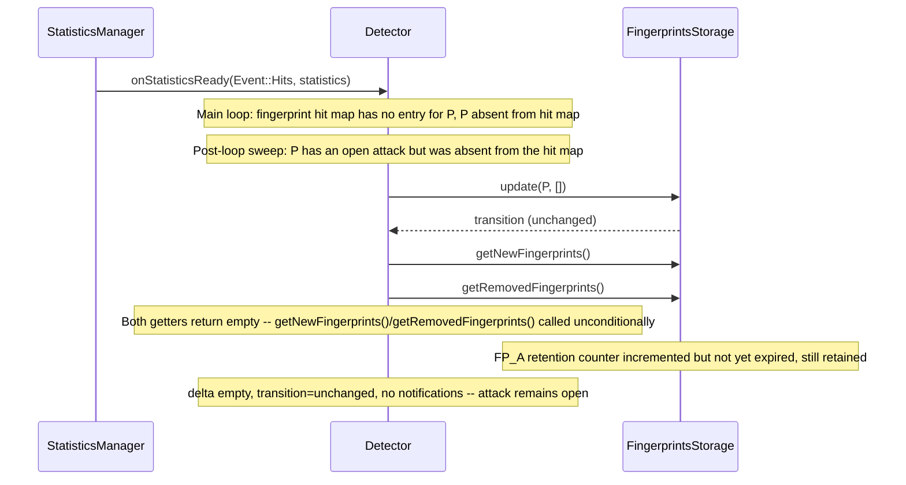

---

### §6.8 On Demand Enabled from Profile — Configuration Lifecycle

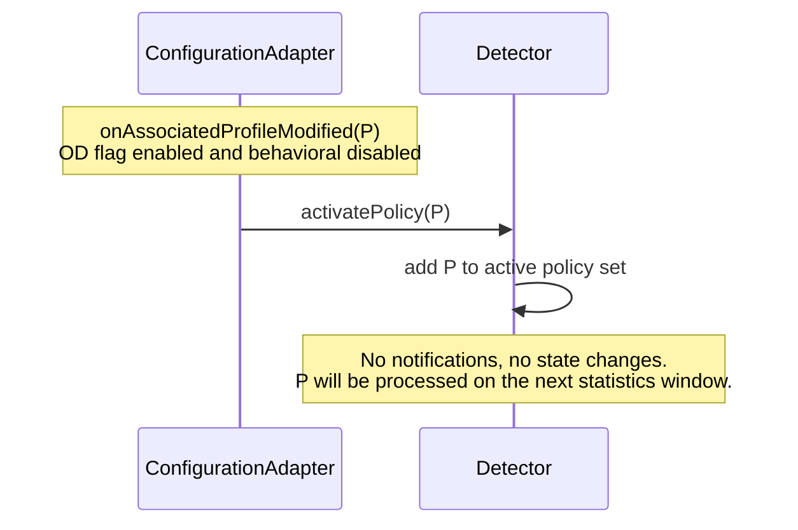

## §7 Implementation Details

### §7.1 Sub-Component Dependency Diagram

The diagram below shows all five classes and nine component-defined interfaces, plus two external interface touchpoints (`IConfigurationViewer`, `IConfigurationListener`), with directed, labeled edges indicating ownership and dependency type.

> **How to read this diagram**: Start at **Detector** (center) — it depends on `IAnalyzer` and `IFingerprintsStorage` (write facets only) and owns `Publisher`. **ConfigurationAdapter** (right) drives the policy lifecycle via `IOnDemandPolicyLifecycle` and `IAnalyzerLifecycle`. **CLI/UI** consumers use only the read-only diagnostics facets (`IAlgorithmDiagnostics`, `IFingerprintsStorageDiagnostics`). The concrete classes (`Analyzer`, `FingerprintsStorage`) implement multiple interfaces each — one per caller role.

```mermaid
classDiagram
    class Detector {
        -m_policiesWithOpenAttack~unordered_set~
        -m_activePolicies~unordered_set~
        +onStatisticsReady(event, statistics)
    }
    class IAnalyzer {
        <<interface>>
        +analyze(hitMap) RawDetectionSet
    }
    class IFingerprintsStorage {
        <<interface>>
        +update(policyId, rawSet) SetTransition
        +getNewFingerprints() vector~MasterKey~
        +getRemovedFingerprints() vector~MasterKey~
        +getRetainedSet(policyId) FingerprintSet
        +isRetainedSetActive(policyId) bool
        +resetState(policyId)
    }
    class IFingerprintsStorageDiagnostics {
        <<interface>>
        +getRetainedSetDiagnostics(policyId) DiagnosticRetainedSet
        +getActiveSinceTime(policyId) uint64_t
    }
    class IStatisticsListener {
        <<interface>>
        +onStatisticsReady(event, statistics)
    }
    class IAlgorithmDiagnostics {
        <<interface>>
        +forEach(callback)
    }
    class IConfigurationViewer {
        <<interface>>
    }
    class IAnalyzerParams {
        <<interface>>
        +setElevationThresholds(low, med, high, extreme) bool
        +setGapFactors(low, med, high) bool
        +setMinRateTable(entries) bool
        +setMinElevationTable(entries) bool
        +setWindowSize(n) bool
        +setRefPosition(pos) bool
        +setRefGrowthPercent(p) bool
        +setMaxAttackerPercent(pct) bool
    }
    class IRetentionParams {
        <<interface>>
        +setRetentionPeriod(seconds) bool
    }
    class Analyzer {
        -m_perPolicyTrackedRef~unordered_map~
        -m_perPolicyTopNHits~unordered_map~
        -m_perPolicyCutPoint~unordered_map~
        -m_perPolicyCurrentReference~unordered_map~
        -m_perPolicyMinRateTrimmed~unordered_map~
        -m_perPolicyMinElevationTrimmed~unordered_map~
        -m_perPolicyExtremeFPs~unordered_map~
        -m_perPolicyRawDetectionSet~unordered_map~
        +analyze(hitMap) RawDetectionSet
        +forEach(callback)
    }
    class FingerprintsStorage {
        -m_retentionMaps~unordered_map~
        -m_activeSinceTimestamps~unordered_map~
        +update(policyId, rawSet) SetTransition
        +getNewFingerprints() vector~MasterKey~
        +getRemovedFingerprints() vector~MasterKey~
        +getRetainedSet(policyId) FingerprintSet
        +isRetainedSetActive(policyId) bool
        +resetState(policyId)
        +getRetainedSetDiagnostics(policyId) DiagnosticRetainedSet
        +getActiveSinceTime(policyId) uint64_t
    }
    class Publisher {
        -fingerprintListeners
        -attackListeners
        +notifyFingerprintsChanged(policyId, added, removed)
        +notifyAttackStarted(policyId)
        +notifyAttackEnded(policyId)
        +registerFingerprintListener(listener)
        +unregisterFingerprintListener(listener)
        +registerAttackListener(listener)
        +unregisterAttackListener(listener)
    }
    class IOnDemandFingerprintListener {
        <<interface>>
        +onFingerprintsChanged(policyId, added, removed)
    }
    class IOnDemandAttackListener {
        <<interface>>
        +onAttackStarted(policyId)
        +onAttackEnded(policyId)
    }

    Detector ..|> IStatisticsListener
    Analyzer ..|> IAnalyzer
    Analyzer ..|> IAlgorithmDiagnostics
    FingerprintsStorage ..|> IFingerprintsStorage
    FingerprintsStorage ..|> IFingerprintsStorageDiagnostics : implements

    Detector *-- Publisher : owns
    Detector ..> IAnalyzer : uses
    Detector ..> IFingerprintsStorage : uses

    Publisher o-- IOnDemandFingerprintListener : dispatches to
    Publisher o-- IOnDemandAttackListener : dispatches to

    class IAnalyzerLifecycle {
        <<interface>>
        +resetState(policyId)
    }
    class IOnDemandPolicyLifecycle {
        <<interface>>
        +activatePolicy(policyId)
        +removePolicy(policyId)
        +deactivatePolicy(policyId)
    }
    class ConfigurationAdapter {
        +onAssociatedProfileAdded(params, isInit)
        +onAssociatedProfileRemoved(params)
        +onAssociatedProfileModified(params)
    }
    class IConfigurationListener {
        <<interface>>
    }

    Analyzer ..|> IAnalyzerLifecycle
    Detector ..|> IOnDemandPolicyLifecycle
    ConfigurationAdapter ..|> IConfigurationListener
    ConfigurationAdapter ..> IOnDemandPolicyLifecycle : uses
    ConfigurationAdapter ..> IAnalyzerLifecycle : uses
    ConfigurationAdapter ..> IConfigurationViewer : uses
    Analyzer ..|> IAnalyzerParams
    FingerprintsStorage ..|> IRetentionParams
```

### §7.2 Data Structures and Memory Layout

#### §7.2.1 `PolicyKey` — Policy Slot Identifier

`PolicyKey` is an unsigned integer (`uint32_t`) hash value — **not** a sequential slot index. Defined in the TLS Fingerprint common headers (`using PolicyKey = uint32_t`). Used throughout this component as the key into `unordered_map<PolicyKey, T>` per-policy containers.

---

#### §7.2.2 `MasterKey` — Composite Fingerprint Key

`MasterKey` is a composite key encoding three fields: `PolicyKey m_policyKey`, `size_t m_profileHash`, and `TLSFlow::Fingerprint m_fingerprint`. Provides `getPolicyKey()`, `getProfileHash()`, and `getFingerprint()` accessors. The equality operator supports partial match via a `NotRelevant` sentinel, allowing lookups that ignore one or more fields. A `std::hash<MasterKey>` specialization is provided for use in unordered containers. Defined in `tls-fingerprint/common/include/MasterKey.hpp`.

---

#### §7.2.3 `HitMapWrapper` — Per-Policy Fingerprint Map (External)

`HitMapWrapper` is the per-policy fingerprint hit map type defined by the Statistics infrastructure. It is a `SimpleMap<MasterKey, HitData>` where `HitData` holds a 64-bit packet count per fingerprint for the current statistics window. Instances are stored inside `Statistics::policyBhvrlHitsMap`, keyed by `PolicyKey`.

`HitMapWrapper` is an **external type** — defined and owned by the Statistics infrastructure, not by this component. This component consumes it read-only.

See §7.2.6 for why `RawDetectionSet` uses `std::vector<MasterKeyHitPair>` rather than `HitMapWrapper`.

---

#### §7.2.4 `HitMap` — Analyzer Input

The Analyzer's input — the `fingerprintMap` — is the `HitMapWrapper` (§7.2.3) stored inside `Statistics::policyBhvrlHitsMap` for a given `PolicyKey`. `Detector` passes a const reference to this map per policy.

The Analyzer reads this map during `analyze()` to:
1. Build an internal sorted list (fingerprints ordered by hit count, descending)
2. Apply the V4 reference-elevation-gap logic against the sorted list

The map is owned by `Statistics` and is read-only from the Analyzer's perspective. The policy ID required to index per-policy internal state is derived by calling `MasterKey::getPolicyKey()` on any entry in the map. If the map is empty, `analyze()` returns an empty raw detection set immediately without touching internal state.

---

#### §7.2.5 `TopNHits` — Extracted by Analyzer

`TopNHits` is a fixed-size ordered list of `(MasterKey, uint64_t)` pairs representing up to `MaxOnDemandFingerprints` (≤100) fingerprints with the highest hit counts in the current window's `HitMap`. `Analyzer` extracts this as part of the V4 sort step (the sort is already required by the algorithm) — O(F log F) where F ≤ 100, negligible cost. The result is stored in `perPolicyTopNHits[P]` and exposed via `IAlgorithmDiagnostics::forEach()`.

**C++ representation**: `using TopNHits = std::vector<MasterKeyHitPair>;` All instances are `reserve(MaxOnDemandFingerprints)`d in the owning class constructor — no heap allocation occurs after construction.

---

#### §7.2.6 `RawDetectionSet` — Analyzer Output

The raw detection set returned by `IAnalyzer::analyze()` is a fixed-capacity collection of `MasterKeyHitPair` values — each element carries the detected fingerprint key and its hit count from the current window. Maximum capacity: `MaxOnDemandFingerprints` (≤100 per policy per window). This is the unfiltered algorithm output: fingerprints identified as attackers by V4 in this window alone, before retention rules are applied.

**C++ representation**: `using RawDetectionSet = std::vector<MasterKeyHitPair>;` All instances are `reserve(MaxOnDemandFingerprints)`d in the owning class constructor — no heap allocation occurs after construction.

**Why `std::vector` and not `HitMapWrapper`**: The output of `analyze()` is an ordered sequence — V4 produces fingerprints ranked by hit count, descending. This order is meaningful: `FingerprintsStorage` stores `lastHitCount` per entry, and diagnostics expose the ranked list. `HitMapWrapper` is an unordered map (see §7.2.3) with no rank or index semantics. Using it here would couple `IAnalyzer`'s return type to the Statistics infrastructure layer — if `HitMapWrapper` changes, `IAnalyzer` would be forced to change too. `std::vector<MasterKeyHitPair>` is self-contained, ordered, and index-stable, carrying exactly what `FingerprintsStorage` needs with no external dependency.

The `Analyzer` pre-allocates this result buffer at construction and returns a const reference to the internal buffer. No heap allocation on the analyze call path. `FingerprintsStorage::update()` consumes this set to apply retention and to produce the retained set and delta; the `hitCount` field of each entry is stored in `RetentionEntry::lastHitCount` on detection and re-detection.

---

#### §7.2.7 `FingerprintSet` — Common Output Element Type

`FingerprintSet` is the shared output collection type used across multiple interfaces in this component:

| Interface / field | Usage |
|-------------------|-------|
| `IFingerprintsStorage::getRetainedSet()` return | Current retained set for diagnostic/deactivation queries |
| `IOnDemandFingerprintListener::onFingerprintsChanged()` — `added`, `removed` | Listener-facing delta notification |

**Element type**: Each element is a `MasterKey` — the fingerprint identifier.

**Ordering**: Entries are in the order determined by `FingerprintsStorage` during retention processing. No hitCount-based sort is defined — `MasterKey` has no natural comparison order for this purpose. Listeners must not assume a specific order.

**Capacity**: Up to `MaxOnDemandFingerprints` (100) entries per instance.

**C++ representation**: `using FingerprintSet = std::vector<MasterKey>;` All instances are `reserve(MaxOnDemandFingerprints)`d in the owning class constructor — no heap allocation occurs after construction.

For internal storage details of the retained set, see §7.4, FingerprintsStorage Internal State.

---

#### §7.2.8 `SetTransition` — Retained-Set Transition Enum

`SetTransition` is an enum representing the state transition that occurred as a result of processing a statistics window:

```cpp
enum class SetTransition { unchanged, becameNonEmpty, becameEmpty };
```

| Value | When Returned | Description |
|---|---|---|
| `unchanged` | No state transition occurred | Either an attack is already ongoing, or no attack is active and none started. |
| `becameNonEmpty` | Retained set transitioned from empty → non-empty | First fingerprint was detected and no prior open attack existed for this policy. |
| `becameEmpty` | Retained set became empty | All per-fingerprint retention counters expired simultaneously (or the last one expired). Attack ends immediately upon the set becoming empty. |

**Cross-reference**: Returned directly by `IFingerprintsStorage::update()`. Consumed by `Detector` to trigger `Publisher` attack-lifecycle notifications (`IOnDemandAttackListener`).

---

#### §7.2.9 `DiagnosticRetainedSet` — CLI Diagnostic Output Type

`DiagnosticRetainedSet` is a fixed-capacity collection of `(MasterKey, uint64_t lastHitCount, uint32_t remainingWindows)` triples.

**C++ representation**:

```cpp
struct DiagnosticRetentionEntry {
    MasterKey  key;
    uint64_t   lastHitCount;
    uint32_t   remainingWindows;
};

using DiagnosticRetainedSet = std::vector<DiagnosticRetentionEntry>;
```
All instances are `reserve(MaxOnDemandFingerprints)`d in the owning class constructor — no heap allocation occurs after construction.

**Capacity**: Up to `MaxOnDemandFingerprints` (100) entries.

**Semantics**: For each fingerprint present in the `retentionMap`, `remainingWindows = retentionWindowCount - counter`. This value represents how many more absent-windows must elapse before the fingerprint expires from retention.

**Returned by**: `IFingerprintsStorageDiagnostics::getRetainedSetDiagnostics()` — for CLI/UI display only. Never consumed by `Detector` or the per-window hot path.

**Ordering**: Descending `lastHitCount`; `MasterKey` ascending as tiebreaker.

> **Note**: `DiagnosticRetainedSet` must **not** be confused with `FingerprintSet` (§7.2.7). `FingerprintSet` stores `MasterKey` elements and is used on the hot path. `DiagnosticRetainedSet` stores 3-field elements (key + hitCount + remainingWindows) and is strictly a diagnostic/CLI construct.

---

#### §7.2.10 `AlgorithmDiagnosticsData` — Per-Policy Algorithm Diagnostics

`AlgorithmDiagnosticsData` is the unit of data exposed by `Analyzer` via `IAlgorithmDiagnostics::forEach()` per policy. It holds **seven** fields derived as natural outputs of the V4 algorithm steps:

| Field | Type | Description |
|-------|------|-------------|
| `topNHits` | `std::vector<MasterKeyHitPair>` — Ordered by descending hitCount (see `MasterKeyHitPair` definition below the table). All instances are `reserve(MaxOnDemandFingerprints)`d in the owning class constructor — no heap allocation occurs after construction. | Top-N highest-hit fingerprints from the statistics input for this policy. For CLI/UI display only. |
| `cutPoint` | `uint32_t` | The index into the sorted hit list where the V4 gap was detected. Zero if no algorithm run has completed for this policy. |
| `currentReference` | `uint64_t` | The reference value used in this window's V4 run (the sliding tracked reference after the growth rule was applied). Zero if no run has completed for this policy. |
| `minRateTrimmed` | `std::vector<MasterKey>` All instances are `reserve(MaxOnDemandFingerprints)`d in the owning class constructor — no heap allocation occurs after construction. | Fingerprints removed from the candidate attacker list during the min-rate trim step. Empty if no trim occurred. |
| `minElevationTrimmed` | `std::vector<MasterKey>` All instances are `reserve(MaxOnDemandFingerprints)`d in the owning class constructor — no heap allocation occurs after construction. | Fingerprints removed from the candidate attacker list during the min-elevation trim step. Empty if no trim occurred. |
| `extremeFPs` | `std::vector<MasterKey>` All instances are `reserve(MaxOnDemandFingerprints)`d in the owning class constructor — no heap allocation occurs after construction. | Fingerprints detected via the extreme-elevation fallback path (no gap found; top entry exceeds extreme threshold). Empty if fallback was not triggered. |
| `rawDetectionSet` | `std::vector<MasterKey>` All instances are `reserve(MaxOnDemandFingerprints)`d in the owning class constructor — no heap allocation occurs after construction. | The final attacker FP list from the last `analyze()` call — the algorithm output after gap-detection, min-rate trim, min-elevation trim, max-percentage cap, and extreme-elevation union. Stores the `MasterKey` values from the set returned by `analyze()` (keys only, without hit counts) for diagnostic display. Empty if no attackers detected. |

`MasterKeyHitPair` is a POD struct `{ MasterKey key; uint64_t hitCount; }` used as the element type for all `(MasterKey, hitCount)` pair collections in this component.

**Memory allocation**: `Analyzer` allocates per-policy map entries lazily on first `analyze()` call for each policy. The `m_workingBuffer` is reserved at construction. No other dynamic allocation at runtime.

**Note**: `AlgorithmDiagnosticsData` does not include a blocked/retained set — that is owned and exposed by `FingerprintsStorage` via `IFingerprintsStorageDiagnostics::getRetainedSetDiagnostics()`. CLI/UI consumers query the two components separately: `Analyzer` for algorithm internals, `FingerprintsStorage` for attack state.

---

#### §7.2.11 Tunable Parameter Structs (`AnalyzerParams` and `RetentionParams`)

These two internal structs replace the former monolithic `OnDemandParams`. Each is a private value member of the class that owns it; no struct is injected at construction or shared between classes. Parameters are mutated exclusively via the `IAnalyzerParams` and `IRetentionParams` setter interfaces (§7.3), which perform all validation.

##### `AnalyzerParams` — owned by `Analyzer`

| Field | Default | Description |
|-------|---------|-------------|
| `elevationThresholds[4]` | `{2^5, 2^6, 2^7, 2^9}` | Bit-shift values for low/med/high/extreme elevation. Must be powers of 2. Range [2–65536] (per SRS §2.6). Ordering constraint: low < med < high < extreme. |
| `gapFactors[3]` | `{8, 6, 4}` | Gap factor per elevation (low to high). Range [2–50] (per SRS §2.6). Ordering constraint: low > med > high. |
| `minRateTable[5][3]` | `{{20,200,200},{10,200,150},{0,150,100}}` | Min-rate entries: `{refThreshold, rateForLow, rateForHigh}`. Up to 5 entries. Reference range [0–500]; rate range [50–500] (per SRS §2.6). |
| `minElevationTable[3]` | `{{15,128},{0,64}}` | Min-elevation entries: `{refThreshold, minElevation}`. Up to 3 entries. Reference range [0–500] (per SRS §2.6). |
| `windowSize` | `100` | Max fingerprints to consider per window. Range [50–200, 0=all]. |
| `refPosition` | `5` | Reference position as top-N% index. Range [2–20]. |
| `refGrowthPercent` | `20` | Reference grow percentage P. Range [1–100]. |
| `maxAttackerPercent` | `15` | Max attacker list as % of window size. Range [5–30] (per SRS §2.6). |

**Why Analyzer owns these**: All eight fields are consumed exclusively inside `analyze()`. Placing them here is an SRP application — the algorithm's own tuning lives with the algorithm. No other class reads these fields.

##### `RetentionParams` — owned by `FingerprintsStorage`

| Field | Default | Description |
|-------|---------|-------------|
| `retentionPeriodSeconds` | `20` | Per-FP retention period in seconds. Range [10–60]; values must be multiples of 10 (the statistics window interval). Consumed by `FingerprintsStorage` to compute `retentionWindowCount = max(1u, retentionPeriodSeconds / m_windowIntervalSeconds)`. Updated via `IRetentionParams::setRetentionPeriod()`, which recomputes `retentionWindowCount` immediately. |

**`m_windowIntervalSeconds`** (constructor parameter, not a struct field): `FingerprintsStorage` receives the actual statistics window duration (default 10 s) from the factory at construction time. This value is read from `StatisticsManager` and is not CLI-tunable. It is stored as a `const uint32_t` member and used only to compute `retentionWindowCount`. Removing it from any tunable struct eliminates the divergence risk noted in the previous design.

**Why FingerprintsStorage owns these**: `retentionPeriodSeconds` and `m_windowIntervalSeconds` are consumed exclusively inside `update()` to compute how many windows a fingerprint persists. No other class reads these values.

---

#### §7.2.12 External Types Reference

The following types are defined outside this component and used throughout §7. They are listed here for cross-reference convenience.

| Type | Defined By | Description |
|---|---|---|
| `MasterKey` | TLS Fingerprint common | Composite key encoding a `PolicyKey` and a fingerprint hash value. Provides a `getPolicyKey()` accessor. |
| `PolicyKey` | TLS Fingerprint common | Unsigned integer (`uint32_t`) hash value obtained via `policy.getHash()`. **Not** a sequential slot index. Used as the key into `unordered_map<PolicyKey, T>` per-policy containers. |
| `HitData` | Statistics infrastructure | Holds a 64-bit packet count for a fingerprint within a statistics window. |
| `HitMapWrapper` / `SimpleMap<MasterKey, HitData>` | Statistics infrastructure | Per-policy fingerprint hit map sourced from `Statistics::policyBhvrlHitsMap`. Defined in §7.2.3. |
| `IConfigurationViewer` | TLS-FP configuration infrastructure | Read-only view of profile/policy configuration state. Used by `ConfigurationAdapter` to evaluate activation conditions. |
| `IConfigurationListener` | TLS-FP configuration infrastructure | Callback interface for profile lifecycle events (`onAssociatedProfileAdded`, `onAssociatedProfileRemoved`, `onAssociatedProfileModified`). Implemented by `ConfigurationAdapter`. |

---

### §7.3 Interface Definitions

##### `IStatisticsListener` (existing)

**Responsibility**: Entry point for statistics window events. Implemented by `Detector`.

**Methods**:

| Method | Semantics |
|--------|-----------|
| `onStatisticsReady(Event, const Statistics&)` | Called once per statistics window by `StatisticsManager`. The `Statistics` object carries the per-policy fingerprint hit map (`policyBhvrlHitsMap`) used as the Analyzer's input. `Event::Hits` is the relevant event type. |

**Rationale for interface**: Existing infrastructure contract — `StatisticsManager` dispatches to all registered `IStatisticsListener` instances.

---

##### `IAnalyzer`

**Responsibility**: Pure computation contract. Encapsulates the V4 reference-elevation-gap algorithm and its per-policy internal state. Returns only the **raw detection set** — the algorithm output for the current window before retention filtering.

**Methods**:

| Method | Semantics |
|--------|-----------|
| `analyze(const HitMap& hitMap)` | Given the all-hits fingerprint map for a policy (see §7.2.4), runs the V4 reference-elevation-gap algorithm and returns `const RawDetectionSet&` (§7.2.6) — the fingerprints identified as attackers in this window alone. Returns an empty set if no attackers detected. No retention filtering applied. Updates internal per-policy algorithm state. |

**Rationale for interface**: `Detector` depends on `IAnalyzer` so that the algorithm can be replaced (e.g., V5) without modifying the orchestrator. The interface decouples the caller from V4 internals. `getBlockedSet()` is not part of this interface — retention state is owned by `FingerprintsStorage`, not `Analyzer`. `Analyzer` returns only the raw single-window result from `analyze()`.

**Pure strategy interface, lifecycle-free**: `IAnalyzer` represents the detection *goal* — given a hit map, identify the attackers — not the algorithm mechanism. Algorithm-specific concerns (state shape, diagnostics, lifecycle) are kept off the strategy interface and exposed through dedicated facets: `IAnalyzerLifecycle` for config-driven slot resets, and `IAlgorithmDiagnostics` for CLI/UI observability. The strategy contract is stable across algorithm replacements; the facets absorb algorithm-specific change. `IAnalyzer` exposes only `analyze(hitMap)` — no `resetState()`, no `deactivate()`. Adding `resetState()` to the strategy interface would require callers to know that V4 maintains a stateful reference needing explicit clearing — a V5 algorithm may need no such reset at all. On re-activation after a policy deactivation gap, V4 naturally converges via its reference growth rule (`ref = old*(1-P%) + new*P%`): with the default P=20%, the reference is ~67% converged after 5 windows (50 s). Downward adjustments are instantaneous (see §9.2 step 3), making convergence even faster. This is the same Role Interface pattern as `IFingerprintsStorage` vs `IFingerprintsStorageDiagnostics`: callers see only the facet relevant to their role, and each facet changes only when its own concern changes.

---

##### `IAlgorithmDiagnostics`

**Responsibility**: Iteration over per-policy algorithm diagnostics (top-N hits, cut point). Used by CLI/UI consumers.

**Methods**:

| Method | Preconditions | Postconditions | Return |
|--------|--------------|----------------|--------|
| `forEach(callback)` | `callback` is a valid callable accepting `(PolicyKey, const AlgorithmDiagnosticsData&)`. | No state change. `callback` is invoked once per policy that has a non-zero top-N hit count. | void |

**Rationale for interface**: Owned by the Visibility logical component; `Analyzer` implements it as a second role facet (Role Interface pattern). CLI/UI is the sole consumer and never needs the write path or the `analyze()` path — ISP condition (c): distinct consumer from `IAnalyzer`'s users. This split also means CLI/UI code never accidentally calls `analyze()`. The retained blocked set and attack start time are exposed separately via `IFingerprintsStorageDiagnostics`, keeping algorithm diagnostics and attack-state queries on separate interfaces.

---

##### `IAnalyzerLifecycle`

**Responsibility**: Deactivation lifecycle facet for `Analyzer`. Called on all deactivation paths. Consumed exclusively by `ConfigurationAdapter` — `Detector` never calls it.

**Methods**:

| Method | Preconditions | Postconditions | Return |
|--------|--------------|----------------|--------|
| `resetState(PolicyKey policyId)` | None (unknown keys are a no-op). | All per-policy Analyzer state fields (§7.4) erased for this policy key. See §9.2 for the field-by-field list. | void |

**Rationale for interface**: The `IAnalyzer` interface is lifecycle-free by design — see §7.3, `IAnalyzer` rationale above. `IAnalyzerLifecycle` provides the slot-reset facet for all deactivation paths (profile removal, profile disassociation, On Demand disabled) — in all cases the policy slot must be fully cleared so that a fresh activation starts from a clean state. `IAnalyzer` itself gains no lifecycle methods. `Analyzer` implements all three of its roles: `IAnalyzer` (algorithm), `IAlgorithmDiagnostics` (visibility), `IAnalyzerLifecycle` (config).

---

##### `IAnalyzerParams`

**Responsibility**: CLI setter contract for `Analyzer` algorithm tuning parameters. Implemented by `Analyzer`. Used exclusively by the module factory's CLI binding functions (`termgBind()`). Never called by `Detector`, `FingerprintsStorage`, or `ConfigurationAdapter`.

**Methods**:

| Method | Preconditions | Postconditions | Return |
|--------|--------------|----------------|--------|
| `setElevationThresholds(uint32_t low, uint32_t med, uint32_t high, uint32_t extreme)` | All values must be powers of 2 in range [2–65536]; ordering constraint: low < med < high < extreme. | `elevationThresholds[4]` updated if valid. | `bool` — true if applied, false if invalid |
| `setGapFactors(uint32_t low, uint32_t med, uint32_t high)` | All values in range [2–50]; ordering constraint: low > med > high. | `gapFactors[3]` updated if valid. | `bool` |
| `setMinRateTable(entries)` | Up to 5 entries; each entry `{refThreshold, rateForLow, rateForHigh}`; refThreshold in [0–500]; rate in [50–500]. | `minRateTable` updated if valid. | `bool` |
| `setMinElevationTable(entries)` | Up to 3 entries; each `{refThreshold, minElevation}`; refThreshold in [0–500]. | `minElevationTable` updated if valid. | `bool` |
| `setWindowSize(uint32_t n)` | Range [50–200] or 0 (all). | `windowSize` updated. | `bool` |
| `setRefPosition(uint32_t pos)` | Range [2–20]. | `refPosition` updated. | `bool` |
| `setRefGrowthPercent(uint32_t p)` | Range [1–100]. | `refGrowthPercent` updated. | `bool` |
| `setMaxAttackerPercent(uint32_t pct)` | Range [5–30]. | `maxAttackerPercent` updated. | `bool` |

**Rationale**: Validation of algorithm parameter constraints (ordering of elevations, ordering of gap factors, power-of-2 requirement) belongs in the class that owns the algorithm, not in a CLI handler lambda. This interface gives `Analyzer` full control over what constitutes a valid configuration. The factory holds `IAnalyzerParams*` (the same object as `IAnalyzer*`) and passes it to the CLI registration function — no new object is created.

---

##### `IFingerprintsStorage`

**Responsibility**: Retained attacker set management contract (Detector-facing). Given the raw detection set from `Analyzer`, applies per-fingerprint retention rules, computes the fingerprint delta, and returns the lifecycle outcome to the `Detector`. Single source of truth for "is this policy currently under attack?"

**Methods**:

| Method | Preconditions | Postconditions | Return |
|--------|--------------|----------------|--------|
| `update(PolicyKey policyId, const RawDetectionSet& rawSet)` | `policyId` is valid; `rawSet` is the output of `IAnalyzer::analyze()` for this window; each element is a `MasterKeyHitPair` carrying the fingerprint key and its hit count from the current statistics window. | Per-FP retention counters updated; `lastHitCount` updated for all FPs present in `rawSet`; retained set recomputed; lifecycle transition determined; internal `getNewFingerprints()`/`getRemovedFingerprints()` buffers populated. | `SetTransition` — one of `{ unchanged, becameNonEmpty, becameEmpty }`. |
| `getNewFingerprints()` | Called unconditionally after every `update()` call; results are valid until the next `update()` or `resetState()` call. Returns an empty vector when no fingerprints were added. | No state change. | `const std::vector<MasterKey>&` — fingerprints newly added to the retained set in the most recent `update()` call. |
| `getRemovedFingerprints()` | Called unconditionally after every `update()` call; results are valid until the next `update()` or `resetState()` call. Returns an empty vector when no fingerprints were removed. | No state change. | `const std::vector<MasterKey>&` — fingerprints removed from the retained set in the most recent `update()` call. |
| `getRetainedSet(PolicyKey policyId)` | `policyId` is valid. | No state change. | `FingerprintSet` — the current retained fingerprint set for this policy. Empty (`FingerprintSet` with zero elements) when no fingerprints are currently retained. |
| `isRetainedSetActive(PolicyKey policyId)` | `policyId` is valid. | No state change. | `true` if the retained set is non-empty **or** the policy is in grace state. `false` otherwise. |
| `resetState(PolicyKey policyId)` | `policyId` is valid. | All per-policy retention counters, retained set, `activeSinceTimestamp`, and grace counter are cleared. | void |

**Rationale for interface**: `Detector` depends on `IFingerprintsStorage` so that the retention and aging implementation can evolve (e.g., window-count to time-based) without modifying the orchestrator. The interface decouples the orchestration logic from all per-policy retention and lifecycle semantics. This interface is split from `IFingerprintsStorageDiagnostics` following the same Role Interface pattern as `IAnalyzer`/`IAlgorithmDiagnostics`: `Detector` never calls diagnostic methods, and CLI consumers never call `update()` or `resetState()` — keeping both sides free of dead methods.

**Rationale for `getRetainedSet()` and `isRetainedSetActive()`**: These methods are not called on the config-driven deactivation path (§4.6 — silent cleanup calls resetState() directly). They remain on the interface for diagnostic/observability purposes and any future path that may require querying state before clearing.

**Rationale for `resetState()`**: Called on deactivation (by `Detector`) to clear all per-policy retention state, ensuring a clean start on reactivation.

**`getNewFingerprints()` and `getRemovedFingerprints()` replace the former struct-based return**: Rather than wrapping the fingerprint delta in a struct, `update()` returns `SetTransition` directly and populates internal delta buffers readable via `getNewFingerprints()` and `getRemovedFingerprints()`. The caller must read these before the next `update()` or `resetState()` call. Detector usage pattern per window: (1) call `update(P, rawSet)` → obtain `SetTransition`; (2) read `getNewFingerprints()` and `getRemovedFingerprints()` for the fingerprint delta; (3) dispatch Publisher notifications; (4) advance to the next policy.

**`SetTransition` return values**:
- `unchanged` — no state transition (attack continuing or no attack active)
- `becameNonEmpty` — retained set transitioned from empty to non-empty (first FP detected with no prior attack)
- `becameEmpty` — retained set became empty and grace period expired (or grace disabled) — active state ends

---

##### `IFingerprintsStorageDiagnostics`

**Responsibility**: CLI-facing read-only diagnostic query contract for `FingerprintsStorage`. Exposes per-policy retained-set diagnostics and attack start time for CLI/UI display paths. Never called by `Detector`.

**Methods**:

| Method | Preconditions | Postconditions | Return |
|--------|--------------|----------------|--------|
| `getRetainedSetDiagnostics(PolicyKey policyId)` | `policyId` is valid. | No state change. | `DiagnosticRetainedSet` — a collection of `(MasterKey, uint64_t lastHitCount, uint32_t remainingWindows)` triples. `remainingWindows = retentionWindowCount - counter` for each FP in the retentionMap. |
| `getActiveSinceTime(PolicyKey policyId)` | `policyId` is valid. | No state change. | `uint64_t` — timestamp when current active set was first detected; 0 if no active set. Non-zero throughout any grace period. |

**Rationale for interface**: CLI/UI query paths need only reading retained-set state; they never call `update()`, `resetState()`, or any write method. Segregating these two methods into a dedicated interface ensures CLI consumers have no dead methods and cannot accidentally reach the write path. `FingerprintsStorage` implements both `IFingerprintsStorage` and `IFingerprintsStorageDiagnostics` — the same concrete object serves both consumers via their respective interface pointers. CLI consumers derive active state (open/closed, per Req #10) from `getActiveSinceTime()`: a return value of zero means no active set (no attack or grace period active); a non-zero value is the timestamp when the current active set opened. No separate `isRetainedSetActive()` method is needed on this interface.

**Rationale for `getRetainedSetDiagnostics()`**: Used only on CLI/UI diagnostic query paths (§4.9), not on the per-window hot path. Enriches each retained FP with its remaining retention window count (per SRS §2.8: 'display the TLSFP on-demand attack list with related TLSFP aging time').

**Rationale for `getActiveSinceTime()`**: Used only on CLI/UI diagnostic query paths (§4.9). Returns the timestamp set when `transition=becameNonEmpty` was computed (per SRS §2.8: 'display the start time of the attack'). Remains non-zero during the grace period.

---

##### `IRetentionParams`

**Responsibility**: CLI setter contract for `FingerprintsStorage` retention period. Implemented by `FingerprintsStorage`. Used exclusively by the module factory's CLI binding. Never called by `Detector` or `Analyzer`.

**Methods**:

| Method | Preconditions | Postconditions | Return |
|--------|--------------|----------------|--------|
| `setRetentionPeriod(uint32_t seconds)` | Range [10–60]; value must be a multiple of 10 (the statistics window interval). | `retentionPeriodSeconds` updated; `retentionWindowCount` recomputed immediately as `max(1u, retentionPeriodSeconds / m_windowIntervalSeconds)`. | `bool` — true if applied, false if invalid |

**Rationale**: The retention period is the only externally tunable parameter for `FingerprintsStorage`. Placing validation here ensures the class invariant (`retentionWindowCount >= 1`) is never violated regardless of CLI input. `windowIntervalSeconds` is not exposed as a CLI setter — it is a fixed infrastructure value injected by the factory from `StatisticsManager` at construction and never changes at runtime.

---

##### `IOnDemandFingerprintListener`

**Responsibility**: Notified on per-fingerprint blocked-set changes per policy. Implemented by `FilterManager` and `ReportManager`.

**Methods**:

| Method | Semantics |
|--------|-----------|
| `onFingerprintsChanged(PolicyKey policyId, const FingerprintSet& added, const FingerprintSet& removed)` | Called when ≥1 fingerprint is added or removed from the blocked set for a policy. `FingerprintSet` is a list of `MasterKey` values. `added` contains fingerprints newly added to the blocked set. `removed` contains fingerprints removed from the blocked set. Both lists are non-empty together only in the mixed-change case. At least one is non-empty. Never called when both lists are empty. Order: called before `IOnDemandAttackListener` callbacks in the same window. |

---

##### `IOnDemandAttackListener`

**Responsibility**: Notified on attack lifecycle transitions per policy. Implemented by `ReportManager`.

**Methods**:

| Method | Semantics |
|--------|-----------|
| `onAttackStarted(PolicyKey policyId)` | Called when the retained set transitions from empty to non-empty (first FP detected for this policy with no prior attack open). Always preceded by `onFingerprintsChanged` in the same window cycle. |
| `onAttackEnded(PolicyKey policyId)` | Called when the attack closes for this policy: the grace period expires (the per-policy `graceElapsedWindows` counter reaches the live `graceWindowCount` threshold with the retained set still empty — §3.10). When `attackAgingTimeSeconds = 0`, fires immediately on the same window the retained set drains. `onFingerprintsChanged` is called in the window where FPs are removed (per-FP retention expiry), which is typically an **earlier** window than the one that fires `onAttackEnded`; the two calls are in the same window only when grace is disabled (`attackAgingTimeSeconds = 0`) and all FPs expire simultaneously. |

**Rationale for split from `IOnDemandFingerprintListener`**: Established in §3.7. `FilterManager` only needs fingerprint deltas — no lifecycle semantics. Dead methods in a listener interface is an ISP violation.

---

##### `IOnDemandPolicyLifecycle`

**Responsibility**: Policy lifecycle facet for `Detector`. Consumed exclusively by `ConfigurationAdapter` — no other component calls it.

**Methods**:

| Method | Preconditions | Postconditions | Return |
|--------|--------------|----------------|--------|
| `activatePolicy(PolicyKey policyId)` | `policyId` is valid. | `policyId` added to `m_activePolicies`. No notifications fired. No state changes to Analyzer or FingerprintsStorage — per-policy state containers are empty for this key; state is created lazily on first use. | void |
| `removePolicy(PolicyKey policyId)` | `policyId` is valid. | `getRetainedSet(P)` queried; if non-empty, `notifyFingerprintsChanged(P, {}, retainedSet)` fired. If P had an open attack, `notifyAttackEnded(P)` fired. Then `resetState(P)` called and P removed from active-policy and open-attack tracking. Ordering mirrors normal flow. See §9.1. | void |
| `deactivatePolicy(PolicyKey policyId)` | `policyId` is valid. Safe to call regardless of whether the policy has an open attack. | Silent cleanup: FingerprintsStorage reset, policy removed from active and open-attack tracking. No notifications fired. See §9.1 for the step-by-step sequence. | void |

**Rationale for `activatePolicy()`, `removePolicy()`, and `deactivatePolicy()`**: These three methods together manage the full `m_activePolicies` lifecycle. `activatePolicy()` adds a policy to `m_activePolicies` when On Demand becomes active — an activation event driven entirely by `ConfigurationAdapter`. `removePolicy()` handles profile removal — an infrastructure event. OnDemand is the source of truth for additions to FilterManager's rule set; it must therefore issue explicit removals on cleanup. `removePolicy()` fires `notifyFingerprintsChanged(P, {}, retainedSet)` (if the retained set is non-empty) then `notifyAttackEnded(P)` (if P had an open attack) before clearing state. Ordering mirrors the normal detection flow, keeping the notification contract symmetric. Consumers that also receive `onAssociatedProfileRemoved` via `IConfigurationListener` handlers may additionally clean up their own artifacts independently, but the fingerprint-removal notification from this component ensures FilterManager never holds stale filter rules. `deactivatePolicy()` performs silent internal cleanup (no notifications) — FingerprintsStorage is reset and the policy is removed from tracking without firing notifications. `ConfigurationAdapter` separately calls `IAnalyzerLifecycle::resetState(P)` (§9.4) to clear Analyzer state, so the full deactivation path resets all per-policy state across both sub-components. Consumers (FilterManager, ReportManager) detect On Demand deactivation via their own `IConfigurationListener` handlers on `onAssociatedProfileModified` and clean up independently. Both `removePolicy()` and `deactivatePolicy()` also remove the policy from `m_activePolicies`, ensuring the statistics-window main loop will not iterate it in subsequent windows. The call sequence inside `deactivatePolicy()` is identical to the deactivation sequence in §9.1.

---

### §7.4 Concrete Class Descriptions

##### `Detector`

**Namespace**: `TLSFingerprint::Controller::NSOnDemandDetection`

**Implements**: `IStatisticsListener` + `IOnDemandPolicyLifecycle`

**Lifecycle**:
- **Construction**: Receives collaborators by injection and registers with `StatisticsManager` as a listener for `Event::Hits`. Holds two per-policy tracked sets: `m_activePolicies` (policies for which On Demand is currently active) and `m_policiesWithOpenAttack` (policies with a currently open attack). All per-policy retention and attack-content state is owned by `FingerprintsStorage`. Field-level detail in §7.4, Detector Internal State; construction and per-window algorithm in §9.1.
- **Runtime**: Processes each `onStatisticsReady()` callback synchronously on the CA statistics timer thread. Runs indefinitely — the component has no shutdown path.

**Per-window orchestration**: For each active policy in `policyBhvrlHitsMap`, calls `IAnalyzer::analyze()` then `IFingerprintsStorage::update()` and dispatches Publisher notifications based on the lifecycle result. For open-attack policies absent from the hit map, a post-loop sweep passes an empty raw set to allow retention expiry. See Flows 1–5 (§7.6) for complete call sequences; full algorithm in §9.1.

**Members**:

| Member | Type | Why it lives here |
|--------|------|------------------|
| `m_analyzer` | `IAnalyzer*` | The algorithm executor. `Detector` calls `analyze()` on each active policy per window; the interface pointer allows the V4 algorithm to be replaced without touching the orchestrator. |
| `m_fingerprintsStorage` | `IFingerprintsStorage*` | The retention state manager. `Detector` calls `update()` to apply per-FP retention and receive the `SetTransition` outcome that drives all Publisher notifications. |
| `m_publisher` | `Publisher*` | The fanout dispatcher. `Detector` is the sole caller of `notifyFingerprintsChanged()`, `notifyAttackStarted()`, and `notifyAttackEnded()` — owning the dispatch ensures the invariant call ordering (fingerprint delta before lifecycle event) is enforced in one place. |
| `m_activePolicies` | `std::unordered_set<PolicyKey>` | The gate for the main loop. Only policies in this set are processed each window; absent policies are skipped with zero overhead and no config lookup. Populated by `ConfigurationAdapter` via `activatePolicy()` and cleared by `removePolicy()` / `deactivatePolicy()`. |
| `m_policiesWithOpenAttack` | `std::unordered_set<PolicyKey>` | Enables the post-loop sweep. Any policy with an open attack that was absent from the hit map must still receive an empty-set `update()` call so retention counters increment and the attack can close naturally. Without this set the zero-traffic window would silently freeze all retention timers. |

---

##### `Analyzer`

**Namespace**: `TLSFingerprint::Controller::NSOnDemandDetection`

**Implements**: `IAnalyzer` + `IAlgorithmDiagnostics` + `IAnalyzerLifecycle` + `IAnalyzerParams`

**Construction**: Takes `maxFingerprints` (`MaxOnDemandFingerprints`). No parameter struct is injected — `AnalyzerParams` is initialised to SRS defaults internally. The per-analyze working buffer is reserved at construction (`m_workingBuffer.reserve(maxFingerprints)`). Per-policy state containers are empty at startup.

**Internal state**: Eight per-policy state containers (`m_perPolicyTrackedRef`–`m_perPolicyRawDetectionSet` in the Members table below); update semantics in §9.2. `Analyzer` does not hold a retention map or a retained set — those belong to `FingerprintsStorage`.

**`IAnalyzerLifecycle::resetState(policyId)`**: Called by `ConfigurationAdapter` on all deactivation paths (profile removed, disassociated, or On Demand disabled) to clear per-policy state for clean slot reuse. `IAnalyzer` itself remains lifecycle-free — see §7.3 `IAnalyzer` rationale. Complete field list in §9.2.

**`analyze()`**: Runs the V4 reference-elevation-gap algorithm against the sorted hit map and returns the raw detection set. Full algorithm steps in §9.2.

**`IAlgorithmDiagnostics::forEach()`**: Iterates per-policy stored state and invokes the callback for each policy with a non-zero `topNHits`.

**Members**:

| Member | Type | Why it lives here |
|--------|------|------------------|
| `m_analyzerParams` | `AnalyzerParams` (private value member) | Owns all 8 algorithm tuning fields initialised to their SRS defaults. Mutated only via `IAnalyzerParams` setters. Held as a value (not a reference) so `Analyzer` is self-contained — no external struct to keep alive or inject at construction. |
| `m_perPolicyTrackedRef` | `std::unordered_map<PolicyKey, uint64_t>` | The V4 sliding reference per policy, persisted across windows. The growth rule (`ref = old*(1-P%) + new*P%`) requires the previous window's value; without this member there is no continuity between statistics windows. Erased by `IAnalyzerLifecycle::resetState()` on all deactivation paths. |
| `m_perPolicyTopNHits` | `std::unordered_map<PolicyKey, TopNHits>` | Top-N sorted hit list from the last `analyze()` call, keyed by PolicyKey. Retained here because the sort is a prerequisite for the V4 gap computation; keeping the result avoids re-sorting on every `forEach()` diagnostic query. |
| `m_perPolicyCutPoint` | `std::unordered_map<PolicyKey, uint32_t>` | The index into the sorted list where the V4 gap was detected, keyed by PolicyKey. Stored so that CLI/UI consumers can display exactly where the algorithm drew the boundary without re-running the algorithm. |
| `m_perPolicyCurrentReference` | `std::unordered_map<PolicyKey, uint64_t>` | The reference value actually used in the last run (after applying the growth rule), keyed by PolicyKey. Kept for diagnostics — the CLI shows this value alongside the top-N list so operators can see the threshold the algorithm applied. |
| `m_perPolicyMinRateTrimmed` | `std::unordered_map<PolicyKey, std::vector<MasterKey>>` | FPs discarded by the min-rate trim step, keyed by PolicyKey. Stored for diagnostic display only; an operator seeing no attack despite traffic can inspect this list to determine whether the min-rate threshold is filtering out candidates. |
| `m_perPolicyMinElevationTrimmed` | `std::unordered_map<PolicyKey, std::vector<MasterKey>>` | FPs discarded by the min-elevation trim step, keyed by PolicyKey. Same diagnostic rationale as `minRateTrimmed` — provides full visibility into why a fingerprint was excluded from the final raw detection set. |
| `m_perPolicyExtremeFPs` | `std::unordered_map<PolicyKey, std::vector<MasterKey>>` | FPs detected via the extreme-elevation fallback path (no gap found; top entry exceeds the extreme threshold), keyed by PolicyKey. Stored to distinguish the normal gap-detection path from the fallback path in CLI output. |
| `m_perPolicyRawDetectionSet` | `std::unordered_map<PolicyKey, RawDetectionSet>` | The final output of the last `analyze()` call, keyed by PolicyKey. Retained here so `forEach()` can expose it to CLI/UI consumers without requiring another `analyze()` invocation. |
| `m_workingBuffer` | `std::vector<MasterKeyHitPair>` (`reserve(MaxOnDemandFingerprints)` at construction; single instance, reused) | Single pre-allocated scratch buffer for sorting and intermediate algorithm steps within `analyze()`. Reused across all per-policy calls (single-threaded) to eliminate any heap allocation on the hot path. |

---

##### `FingerprintsStorage`

**Namespace**: `TLSFingerprint::Controller::NSOnDemandDetection`

**Implements**: `IFingerprintsStorage` + `IFingerprintsStorageDiagnostics` + `IRetentionParams`

**Construction**: Takes `windowIntervalSeconds` (from `StatisticsManager`). No parameter struct injected. `RetentionParams` initialised to SRS defaults internally. `retentionWindowCount` computed immediately from `retentionPeriodSeconds / windowIntervalSeconds`. Per-policy retention state containers are empty at startup.

**Internal state per policy**: see Internal State below.

**`update()`**: Ages absent fingerprints by incrementing retention counters, evicts expired entries, merges new detections from the raw set, computes the added/removed delta, and determines the attack lifecycle transition. Full sequence in §9.3.

**Members**:

| Member | Type | Why it lives here |
|--------|------|------------------|
| `m_retentionParams` | `RetentionParams` (private value member) | Owns `retentionPeriodSeconds` (default 20 s). Mutated only via `IRetentionParams::setRetentionPeriod()`. Held as a value — no external struct dependency. |
| `m_windowIntervalSeconds` | `uint32_t` (const after construction) | Statistics window duration in seconds. Injected by the factory from `StatisticsManager` at construction. Used to compute `retentionWindowCount = max(1u, retentionPeriodSeconds / m_windowIntervalSeconds)`. Never changes after construction — not a CLI-tunable parameter. |
| `m_retentionMaps` | `std::unordered_map<PolicyKey, RetentionMap>` | Per-FP window counters and last hit counts keyed by PolicyKey. Created lazily on first `update()` call for a policy; fully erased by `resetState()`. Without this, retention cannot function. |
| `m_activeSinceTimestamps` | `std::unordered_map<PolicyKey, uint64_t>` | The wall-clock timestamp when `transition=becameNonEmpty` was last returned for each policy. Stored here because `FingerprintsStorage` is the sole arbiter of active-set lifecycle state; the CLI/UI reads this value via `getActiveSinceTime()` to display attack duration and derive open/closed status. |
| `m_graceElapsedWindows` | `std::unordered_map<PolicyKey, uint32_t>` | Per-policy elapsed-windows counter for the grace period. Key inserted (value=1) on the first empty-set window after the retained set drains; incremented each subsequent empty-set window; key **erased** (not zeroed) on grace expiry, grace cancellation (FPs return), and `resetState()`. Key absence means not in grace state — used by `isRetainedSetActive()` via `count(P) > 0`. |
| `m_retentionViewer` | `std::shared_ptr<const OnDemandParams>` | Read-only view of `OnDemandParams`; used by `computeGraceWindowCount()` to read `attackAgingTimeSeconds` on every `update()` call. Injected at construction. |

**Internal State**

`FingerprintsStorage` maintains four units of per-policy internal state:

| Field | Type | Description |
|-------|------|-------------|
| `retentionMap` | `std::unordered_map<MasterKey, RetentionEntry>` where `RetentionEntry = struct { uint64_t lastHitCount; uint32_t absenceWindows; }` | Per-FP window counter and last hit count: how many consecutive windows since the algorithm last detected this FP, and the hit count recorded the last time it appeared in `rawSet`. Counter reset to 0 and `lastHitCount` updated when the FP appears in `rawSet`; counter incremented (and `lastHitCount` frozen) when absent. FP evicted when `absenceWindows >= retentionWindowCount` (default: 2 absent windows for 20 s retention / 10 s window). Map created lazily on first `update()` call; fully erased by `resetState()`. |
| `activeSinceTimestamp` | `uint64_t` (epoch seconds) | Set to the current wall-clock timestamp when `update()` returns `transition=becameNonEmpty`. Erased by `resetState()` and set to 0 when `update()` returns `transition=becameEmpty` (i.e., after grace expires). Non-zero throughout any grace period. Exposed via `getActiveSinceTime()`. |
| `graceElapsedWindows` | `uint32_t` (key in `m_graceElapsedWindows`) | Elapsed empty-set windows since the retained set drained. Key absent = not in grace state. Set to 1 on first empty window after drain; incremented each window; key **erased** on expiry, cancellation (FPs return), or `resetState()`. See §3.10 for full state-machine description. |
Per-policy entries are absent from the maps until the first `update()` call for that policy. All entries are fully removed by `resetState()` — no tombstones.

**`retentionMap` storage and overflow**: The per-policy retention map is an `unordered_map<MasterKey, RetentionEntry>` — O(1) average lookup, no reserved capacity. The `update()` sequence (§9.3) evicts stale entries (step 3) **before** adding new ones (step 4), maximising available slots each window. **Overflow policy**: If a `MasterKey` in `rawSet` is not currently in the retentionMap and the map already contains `MaxOnDemandFingerprints` entries after eviction, that FP is not inserted this window and will not appear in `added`. It becomes eligible on a subsequent window once a stale entry expires naturally (within `retentionWindowCount` windows). Overflow requires two consecutive windows with entirely disjoint fingerprint sets — atypical in Web DDoS traffic patterns — and is therefore rare in practice.

**Stability intent**: The counter-based eviction policy (rather than immediate expiry on a single missed window) is the on-demand component's primary termination-stability mechanism. It mirrors the role of `SteadyTrigger` in behavioral detection and is intentional — transient misses caused by packet loss, reordering, or brief traffic lulls do not prematurely clear active mitigation filters.

**Internal storage note**: `FingerprintsStorage` stores the retained set internally as a `MasterKey`-only flat array. `FingerprintSet` output (`getRetainedSet()`) is constructed on demand from the retained set. `getNewFingerprints()` and `getRemovedFingerprints()` return references to internal delta buffers populated during `update()`.

---

##### `Publisher`

**Namespace**: `TLSFingerprint::Controller::NSOnDemandDetection`

**No interface** — concrete class only (KISS: one implementation, one caller set).

**Construction**: No arguments. Holds two `std::vector` of registered listeners — one for `IOnDemandFingerprintListener*`, one for `IOnDemandAttackListener*`.

**Dispatch ordering** (enforced by `Detector`'s call sequence): `notifyFingerprintsChanged()` is always called before `notifyAttackStarted()` or `notifyAttackEnded()` within the same window cycle. This ordering is an invariant — it ensures filters are in place before the attack report opens, and cleared before it closes.

**Methods**:

| Method | Semantics |
|--------|-----------|
| `notifyFingerprintsChanged(PolicyKey, const FingerprintSet& added, const FingerprintSet& removed)` | Iterates `m_fingerprintListeners` and calls `onFingerprintsChanged()` on each. Called by `Detector` when ≥1 FP was added or removed from the retained set. At least one of `added` or `removed` is non-empty. Always called before any lifecycle notify in the same window cycle. |
| `notifyAttackStarted(PolicyKey)` | Iterates `m_attackListeners` and calls `onAttackStarted()` on each. Called by `Detector` when `FingerprintsStorage` returns `transition=becameNonEmpty`. Always called after `notifyFingerprintsChanged()` in the same window cycle. |
| `notifyAttackEnded(PolicyKey)` | Iterates `m_attackListeners` and calls `onAttackEnded()` on each. Called by `Detector` when `FingerprintsStorage` returns `transition=becameEmpty`. Always called after `notifyFingerprintsChanged()` in the same window cycle. |
| `registerFingerprintListener(IOnDemandFingerprintListener*)` | Appends the pointer to `m_fingerprintListeners`. Called by the factory at module initialization; never called by `Detector` or `ConfigurationAdapter`. The pointer must remain valid for the component lifetime. |
| `unregisterFingerprintListener(IOnDemandFingerprintListener*)` | Removes the matching pointer from `m_fingerprintListeners`. Provided for symmetry; not expected in normal operation. |
| `registerAttackListener(IOnDemandAttackListener*)` | Appends the pointer to `m_attackListeners`. Called by the factory at module initialization. |
| `unregisterAttackListener(IOnDemandAttackListener*)` | Removes the matching pointer from `m_attackListeners`. Provided for symmetry; not expected in normal operation. |

**Members**:

| Member | Type | Why it lives here |
|--------|------|------------------|
| `m_fingerprintListeners` | `std::vector<IOnDemandFingerprintListener*>` | The registry of consumers that need fingerprint-delta events (`onFingerprintsChanged`). Stored as a vector because the list is populated once at init and then iterated on every notification — random-access iteration over a contiguous array is optimal. Currently: `FilterManager` and `ReportManager`. |
| `m_attackListeners` | `std::vector<IOnDemandAttackListener*>` | The registry of consumers that need attack-lifecycle events (`onAttackStarted`, `onAttackEnded`). Kept separate from `m_fingerprintListeners` because `FilterManager` subscribes only to fingerprint changes — mixing both listener types into one list would require dynamic downcasts or dead method stubs. Currently: `ReportManager` only. |

---

##### `ConfigurationAdapter`

**Namespace**: `TLSFingerprint::Controller::NSOnDemandDetection`

**Implements**: `IConfigurationListener`

**Lifecycle**:
- **Construction**: Receives `IOnDemandPolicyLifecycle*`, `IAnalyzerLifecycle*`, `IConfigurationViewer*`. No per-policy state arrays. No dynamic allocation at construction.
- **Runtime**: Responds to TLS-FP configuration infrastructure callbacks. No shutdown path.

**Event handling**: Evaluates the two activation conditions (On Demand flag enabled AND behavioral detection disabled) on each profile lifecycle event and delegates to `IOnDemandPolicyLifecycle` and `IAnalyzerLifecycle` accordingly. Handler logic detailed in §9.4.

**Members**:

| Member | Type | Why it lives here |
|--------|------|------------------|
| `m_policyLifecycle` | `IOnDemandPolicyLifecycle*` | Entry point into `Detector` for policy activation/deactivation/removal. `ConfigurationAdapter` translates every profile lifecycle callback into one of these three calls; the interface pointer keeps it decoupled from `Detector`'s full surface. |
| `m_analyzerLifecycle` | `IAnalyzerLifecycle*` | Entry point into `Analyzer` for all deactivation-path state resets (profile removed, profile disassociated, On Demand disabled). Required because all deactivation paths must clear stale per-policy algorithm state — a responsibility that belongs to `ConfigurationAdapter`, not `Detector`. Held as a separate pointer so the call cannot accidentally reach any other `Analyzer` method. |
| `m_configViewer` | `IConfigurationViewer*` | Read-only access to the current profile configuration. Used inside each callback to evaluate the two activation conditions (On Demand flag enabled AND behavioral detection disabled) and determine whether to call `activatePolicy()` or `deactivatePolicy()`. Without this, `ConfigurationAdapter` would need to receive the full evaluation result from the caller, coupling the infrastructure to this component's activation logic. |

---

### §7.5 Full Class Diagram

```mermaid
classDiagram
    direction TB

    class IStatisticsListener {
        <<interface>>
        +onStatisticsReady(Event, Statistics) void
    }

    class IAnalyzer {
        <<interface>>
        +analyze(HitMap) RawDetectionSet
    }

    class IFingerprintsStorage {
        <<interface>>
        +update(PolicyKey, RawDetectionSet) SetTransition
        +getNewFingerprints() vector~MasterKey~
        +getRemovedFingerprints() vector~MasterKey~
        +getRetainedSet(PolicyKey) FingerprintSet
        +isRetainedSetActive(PolicyKey) bool
        +resetState(PolicyKey) void
    }

    class IFingerprintsStorageDiagnostics {
        <<interface>>
        +getRetainedSetDiagnostics(PolicyKey) DiagnosticRetainedSet
        +getActiveSinceTime(PolicyKey) uint64_t
    }

    class IAlgorithmDiagnostics {
        <<interface>>
        +forEach(callback) void
    }

    class IConfigurationViewer {
        <<interface>>
    }

    class IAnalyzerParams {
        <<interface>>
        +setElevationThresholds(low, med, high, extreme) bool
        +setGapFactors(low, med, high) bool
        +setMinRateTable(entries) bool
        +setMinElevationTable(entries) bool
        +setWindowSize(n) bool
        +setRefPosition(pos) bool
        +setRefGrowthPercent(p) bool
        +setMaxAttackerPercent(pct) bool
    }
    class IRetentionParams {
        <<interface>>
        +setRetentionPeriod(seconds) bool
    }

    class IOnDemandFingerprintListener {
        <<interface>>
        +onFingerprintsChanged(PolicyKey, FingerprintSet added, FingerprintSet removed) void
    }

    class IOnDemandAttackListener {
        <<interface>>
        +onAttackStarted(PolicyKey) void
        +onAttackEnded(PolicyKey) void
    }

    class Detector {
        -IAnalyzer~*~ m_analyzer
        -IFingerprintsStorage~*~ m_fingerprintsStorage
        -Publisher~*~ m_publisher
        -m_activePolicies~unordered_set~
        -m_policiesWithOpenAttack~unordered_set~
        +onStatisticsReady(Event, Statistics) void
    }

    class Analyzer {
        -m_perPolicyTrackedRef~unordered_map~
        -m_perPolicyTopNHits~unordered_map~
        -m_perPolicyCutPoint~unordered_map~
        -m_perPolicyCurrentReference~unordered_map~
        -m_perPolicyMinRateTrimmed~unordered_map~
        -m_perPolicyMinElevationTrimmed~unordered_map~
        -m_perPolicyExtremeFPs~unordered_map~
        -m_perPolicyRawDetectionSet~unordered_map~
        -m_workingBuffer~vector~
        -AnalyzerParams m_analyzerParams
        +analyze(HitMap) RawDetectionSet
        +forEach(callback) void
    }

    class FingerprintsStorage {
        -m_retentionMaps~unordered_map~
        -m_activeSinceTimestamps~unordered_map~
        -RetentionParams m_retentionParams
        -m_windowIntervalSeconds~uint32_t~
        +update(PolicyKey, RawDetectionSet) SetTransition
        +getNewFingerprints() vector~MasterKey~
        +getRemovedFingerprints() vector~MasterKey~
        +getRetainedSet(PolicyKey) FingerprintSet
        +isRetainedSetActive(PolicyKey) bool
        +resetState(PolicyKey) void
        +getRetainedSetDiagnostics(PolicyKey) DiagnosticRetainedSet
        +getActiveSinceTime(PolicyKey) uint64_t
    }

    class Publisher {
        -fingerprintListeners~IOnDemandFingerprintListener*[]~
        -attackListeners~IOnDemandAttackListener*[]~
        +notifyFingerprintsChanged(PolicyKey, FingerprintSet, FingerprintSet) void
        +notifyAttackStarted(PolicyKey) void
        +notifyAttackEnded(PolicyKey) void
        +registerFingerprintListener(IOnDemandFingerprintListener*) void
        +unregisterFingerprintListener(IOnDemandFingerprintListener*) void
        +registerAttackListener(IOnDemandAttackListener*) void
        +unregisterAttackListener(IOnDemandAttackListener*) void
    }

    Detector ..|> IStatisticsListener
    Analyzer ..|> IAnalyzer
    Analyzer ..|> IAlgorithmDiagnostics
    FingerprintsStorage ..|> IFingerprintsStorage
    FingerprintsStorage ..|> IFingerprintsStorageDiagnostics : implements

    Detector *-- Publisher : owns
    Detector ..> IAnalyzer : uses
    Detector ..> IFingerprintsStorage : uses

    Publisher o-- IOnDemandFingerprintListener : dispatches to
    Publisher o-- IOnDemandAttackListener : dispatches to

    class IAnalyzerLifecycle {
        <<interface>>
        +resetState(PolicyKey) void
    }
    class IOnDemandPolicyLifecycle {
        <<interface>>
        +activatePolicy(PolicyKey) void
        +removePolicy(PolicyKey) void
        +deactivatePolicy(PolicyKey) void
    }
    class ConfigurationAdapter {
        -m_policyLifecycle~IOnDemandPolicyLifecycle*~
        -m_analyzerLifecycle~IAnalyzerLifecycle*~
        -m_configViewer~IConfigurationViewer*~
        +onAssociatedProfileAdded(params, isInit) void
        +onAssociatedProfileRemoved(params) void
        +onAssociatedProfileModified(params) void
    }
    class IConfigurationListener {
        <<interface>>
    }

    Analyzer ..|> IAnalyzerLifecycle
    Detector ..|> IOnDemandPolicyLifecycle
    ConfigurationAdapter ..|> IConfigurationListener
    ConfigurationAdapter ..> IOnDemandPolicyLifecycle : uses
    ConfigurationAdapter ..> IAnalyzerLifecycle : uses
    ConfigurationAdapter ..> IConfigurationViewer : uses
    Analyzer ..|> IAnalyzerParams
    FingerprintsStorage ..|> IRetentionParams
```

---

### §7.6 Full Flows

The diagrams below mirror §6 but use concrete class names for all internal participants and qualify every inter-class call with the interface it is dispatched through (`Interface::method`). External participants (`StatisticsManager`, `FilterManager`, `ReportManager`) and the boundary interface (`IConfigurationViewer`) are shown as-is since they are not implemented by this component. `Publisher` carries no interface — its calls are shown with bare method names.

Flows are grouped by execution path: statistics window flows first, then configuration lifecycle flows, then initialization flows, and finally the diagnostics query.

---

#### Statistics Window Flows

---

##### Flow 1 — Normal Window (No Attack)

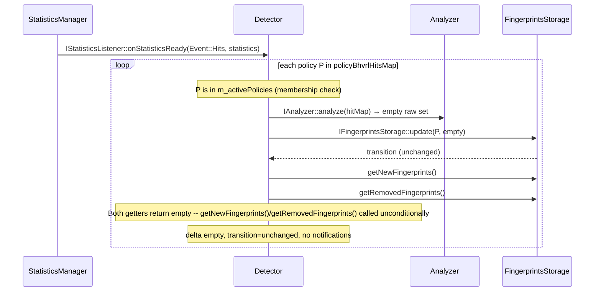

---

##### Flow 2 — Attack Detected (First Window)

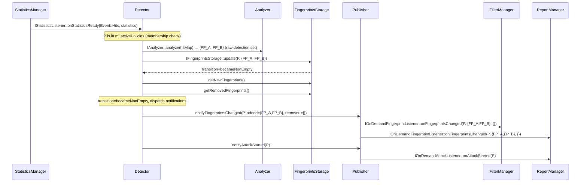

---

##### Flow 3 — Attack Ongoing (Subsequent Windows)

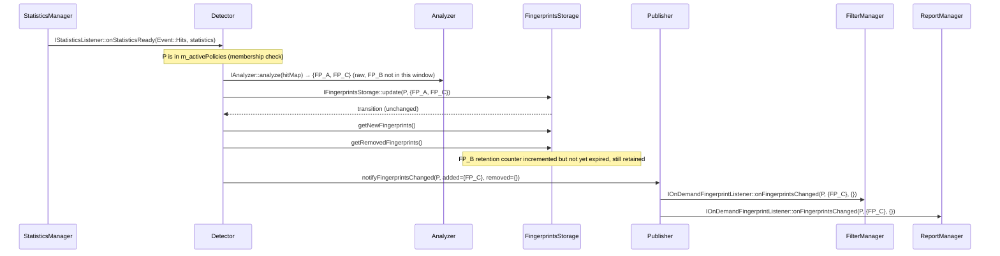

---

##### Flow 4 — All Fingerprints Expire from Retention (Attack Ends)

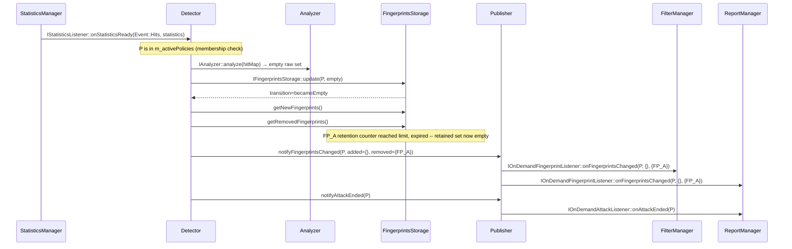

---

##### Flow 5 — Zero-Traffic Window (Post-Loop Sweep)

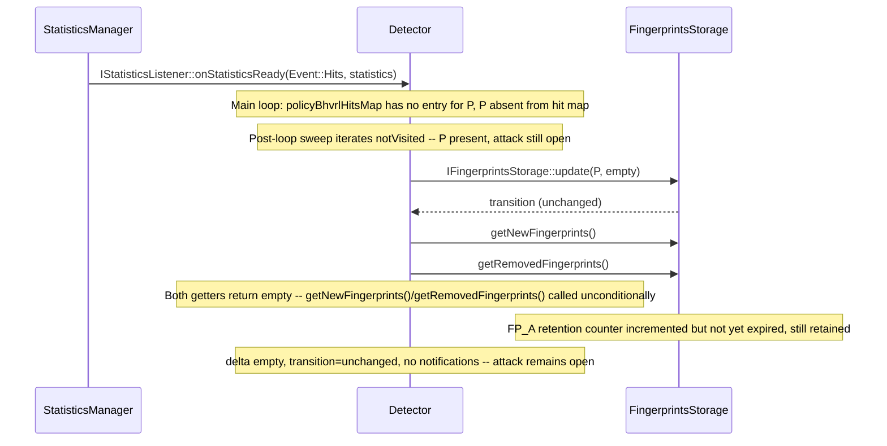

---

#### Configuration Lifecycle Flows

---

##### Flow 6 — Policy Activated (On Demand Enabled from Profile)

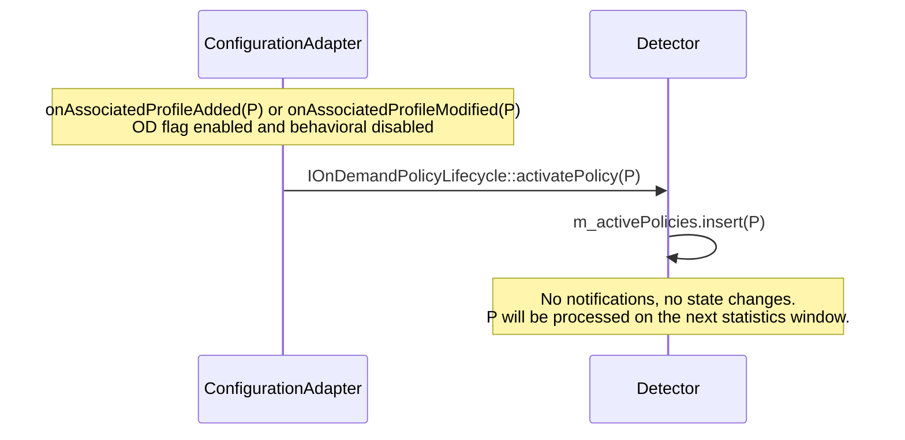

---

##### Flow 7 — Policy Deactivated — Silent Cleanup

Both `removePolicy` (profile removed / disassociated) and `deactivatePolicy` (OD flag disabled or behavioral re-enabled) follow the same internal sequence. The active-set erasure happens first so that no statistics window can process P between the activation check and the state reset.

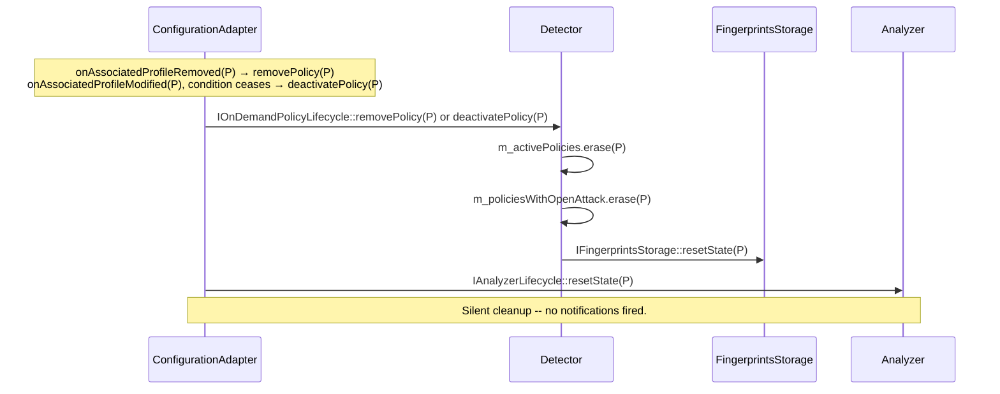

---

#### Initialization Flows

---

##### Flow 8 — Initialization

```mermaid
sequenceDiagram
    participant FAC as Factory
    participant AN as Analyzer
    participant FS as FingerprintsStorage
    participant PUB as Publisher
    participant OD as Detector
    participant SM as StatisticsManager
    participant FM as FilterManager
    participant RM as ReportManager
    participant CFG as ConfigurationAdapter

    FAC->>AN: Analyzer(MaxOnDemandFingerprints, params)
    Note over AN: Reserves working buffer; per-policy state containers empty at startup
    FAC->>FS: FingerprintsStorage(windowIntervalSeconds, params)
    Note over FS: Computes retentionWindowCount; per-policy retention containers empty at startup
    FAC->>PUB: Publisher()
    FAC->>PUB: registerFingerprintListener(filterManager)
    PUB-->>FM: (registered)
    FAC->>PUB: registerFingerprintListener(reportManager)
    PUB-->>RM: (registered)
    FAC->>PUB: registerAttackListener(reportManager)
    PUB-->>RM: (registered)
    FAC->>OD: Detector(analyzer, fingerprintsStorage, publisher, params)
    OD->>SM: StatisticsManager::addListener(Event::Hits, this)
    FAC->>CFG: ConfigurationAdapter(detector, analyzer, configViewer)
    Note over CFG: Registers as IConfigurationListener with TLS-FP config infrastructure
    Note over OD: Component active — awaiting first onStatisticsReady()
```

---

##### Flow 9 — Error: Initialization Failure

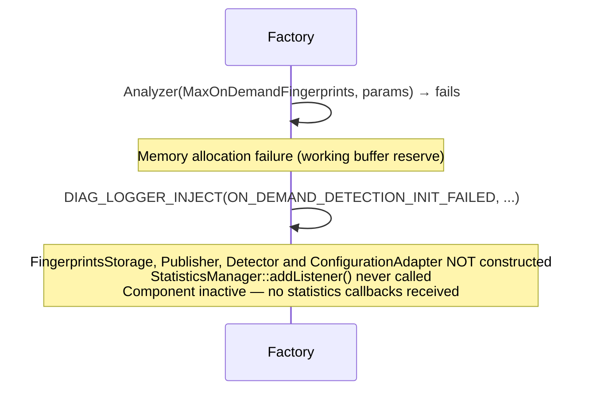

---

#### Diagnostics Flow

---

##### Flow 10 — Diagnostics Query

```mermaid
sequenceDiagram
    participant Caller as CLI / UI
    participant AN as Analyzer
    participant FS as FingerprintsStorage

    Caller->>AN: IAlgorithmDiagnostics::forEach(callback)
    Note over AN: Iterate all per-policy stored algorithm state
    loop each policy with non-zero topNHits
        AN->>Caller: callback(policyId, AlgorithmDiagnosticsData{topNHits, cutPoint, currentReference, minRateTrimmed, minElevationTrimmed, extremeFPs, rawDetectionSet})
    end
    Caller->>FS: IFingerprintsStorageDiagnostics::getRetainedSetDiagnostics(P)
    Note over FS: Returns retained blocked set with per-FP remaining retention time (separate query)
    Caller->>FS: IFingerprintsStorageDiagnostics::getActiveSinceTime(P)
    Note over FS: Returns active-since timestamp for this policy (separate query)
```

### §7.7 Memory Sizing Summary

> **Working buffer reserved at construction. Per-policy state allocated lazily on first use and freed on `resetState()`.**

| Structure | Owner | Growth | Max Elements | Notes |
|-----------|-------|--------|-------------|-------|
| `Analyzer::m_workingBuffer` | Analyzer | Reserved at construction | `MaxOnDemandFingerprints` | Sole allocation at construction time; reused across all per-policy `analyze()` calls |
| `Analyzer` per-policy maps (×8) | Analyzer | Lazy — entry inserted on first `analyze()` for each `PolicyKey` | Up to `MaxOnDemandFingerprints` values per key | Erased by `resetState()`; total live entries bounded by (active policies × `MaxOnDemandFingerprints`) |
| `FingerprintsStorage::m_retentionMaps` | FingerprintsStorage | Lazy — entry inserted on first `update()` for each `PolicyKey` | Up to `MaxOnDemandFingerprints` `RetentionEntry` values per key | Erased by `resetState()`; stale FP entries evicted each window |
| `FingerprintsStorage::m_activeSinceTimestamps` | FingerprintsStorage | Lazy — entry inserted when `becameNonEmpty` is returned | 1 `uint64_t` per active-attack `PolicyKey` | Erased by `resetState()` and on `becameEmpty` |
| `Publisher` listener vectors | Publisher | At registration (CA init only) | Bounded by number of registered consumers (≤5) | Heap-allocated once at startup |
| `Detector::m_activePolicies` | Detector | Entry inserted on policy activation | Up to active-policy count | `std::unordered_set<PolicyKey>`; typical size much smaller than max-policies |
| `Detector::m_policiesWithOpenAttack` | Detector | Entry inserted on `becameNonEmpty` | Up to active-policy count | `std::unordered_set<PolicyKey>`; typical size 0–5 |

**Capacity note (SRS §2.10)**: SRS §2.10 requires support for up to 10,000 on-demand attackers total. Each active policy contributes up to `MaxOnDemandFingerprints` (100) retention entries, so 100 active policies cover the 10,000-attacker requirement. SRS §2.4 states "support up to 50 TLSFP per policy for on demand mitigation" — this 50-per-policy figure is the *mitigation* limit (applied by FilterManager to SHM), not the detection window size. The detection component uses 100 per policy (the V4 algorithm's top-N window); FilterManager is responsible for capping at 50 when writing to SHM.

### §7.8 Implementation Blueprint

#### §7.8.1 New Files

All new files are placed under `vDP/application/tls-fingerprint/on-demand-detection/`:

```
on-demand-detection/
├── common/
│   └── include/
│       ├── Definitions.hpp                       # MaxOnDemandFingerprints, namespace aliases
│       ├── RawDetectionSet.hpp                   # Fixed-capacity raw detection set type (Analyzer output)
│       ├── AlgorithmDiagnosticsData.hpp          # AlgorithmDiagnosticsData struct (topNHits + cutPoint + currentReference + minRateTrimmed + minElevationTrimmed + extremeFPs + rawDetectionSet)
│       ├── TopNHits.hpp                          # TopNHits ordered list type
│       ├── FingerprintSet.hpp                    # Output type: list of MasterKey values (std::vector<MasterKey>)
├── controller/
│   ├── include/
│   │   ├── IAnalyzer.hpp                         # IAnalyzer interface (analyze)
│   │   ├── IFingerprintsStorage.hpp                 # IFingerprintsStorage interface (update + getRetainedSet + isRetainedSetActive + resetState)
│   │   ├── IFingerprintsStorageDiagnostics.hpp      # Retained-set diagnostic query interface (CLI-facing)
│   │   ├── IAlgorithmDiagnostics.hpp             # IAlgorithmDiagnostics interface (forEach)
│   │   ├── IOnDemandFingerprintListener.hpp      # Fingerprint delta listener interface
│   │   ├── IOnDemandAttackListener.hpp           # Attack lifecycle listener interface
│   │   ├── IAnalyzerLifecycle.hpp                # IAnalyzerLifecycle interface (resetState — all deactivation paths)
│   │   ├── IAnalyzerParams.hpp                       # IAnalyzerParams interface — CLI setter contract for Analyzer algorithm tuning (8 setters, all returning bool)
│   │   ├── IRetentionParams.hpp                      # IRetentionParams interface — CLI setter contract for FingerprintsStorage retention period (1 setter, returning bool)
│   │   └── IOnDemandPolicyLifecycle.hpp          # IOnDemandPolicyLifecycle interface (activatePolicy, removePolicy, deactivatePolicy)
│   └── src/
│       ├── Detector.hpp / .cpp                   # Orchestrator (drives analyze → update → publish; owns m_activePolicies and m_policiesWithOpenAttack)
│       ├── Analyzer.hpp / .cpp                   # V4 algorithm only (implements IAnalyzer + IAlgorithmDiagnostics + IAnalyzerLifecycle)
│       ├── FingerprintsStorage.hpp / .cpp           # Retention state manager (implements IFingerprintsStorage + IFingerprintsStorageDiagnostics)
│       ├── Publisher.hpp / .cpp                  # Listener dispatch
│       └── ConfigurationAdapter.hpp / .cpp       # IConfigurationListener implementation (thin translation layer)
├── documents/
│   └── DetectionDesign.md                        # This document
├── CMakeLists.txt
└── Makefile
```

---

#### §7.8.2 New Constant

Defined in `on-demand-detection/common/include/Definitions.hpp` (listed in §7.8.1):

```
MaxOnDemandFingerprints = 100    // Maximum blocked fingerprints per policy per window (V4 algorithm bound)
```

---

#### §7.8.3 `Detector` Registration

During module factory initialization:

1. Construct `Analyzer(MaxOnDemandFingerprints)` — reserves the per-analyze working buffer. Per-policy state containers are empty at startup. Default `AnalyzerParams` values are initialised internally to SRS defaults. CLI handlers update them later via `IAnalyzerParams`.
2. Construct `FingerprintsStorage(windowIntervalSeconds)` where `windowIntervalSeconds` is obtained from `StatisticsManager::getWindowIntervalSeconds()` — computes `retentionWindowCount` immediately. Per-policy retention containers are empty at startup. Default `RetentionParams` values are initialised internally.
3. Construct `Publisher`.
4. Register consumers with `Publisher`:
   - `Publisher::registerFingerprintListener(filterManager)`
   - `Publisher::registerFingerprintListener(reportManager)`
   - `Publisher::registerAttackListener(reportManager)`
5. Construct `Detector(analyzer, fingerprintsStorage, publisher)` — constructor registers with `StatisticsManager::addListener(Event::Hits, this)`.
6. Construct `ConfigurationAdapter(detector, analyzer, configViewer)` — registers itself as `IConfigurationListener` with the TLS-FP configuration infrastructure. Must be constructed **after** `Detector` since it receives `IOnDemandPolicyLifecycle*` (implemented by `Detector`) and `IAnalyzerLifecycle*` (implemented by `Analyzer`).
7. Factory obtains `IAnalyzerParams*` (same object as `Analyzer`) and `IRetentionParams*` (same object as `FingerprintsStorage`) and passes them to the CLI registration function to bind the `system internal security web-ddos-protection on-demand` sub-menu handlers.

---

#### §7.8.4 Log Events

Add to `GENERIC/diag/dicts/log_dict_events.txt`:

| Event ID | Severity | Flags | Message |
|----------|----------|-------|---------|
| `ON_DEMAND_DETECTION_INIT_FAILED` | ERROR | SCREEN | `"On Demand Detection failed to initialize: %s"` |
| `ON_DEMAND_DETECTION_ATTACK_OPEN` | INFO | NONE | `"On Demand attack opened for policy %u: %u fingerprints blocked"` |
| `ON_DEMAND_DETECTION_ATTACK_CLOSE` | INFO | NONE | `"On Demand attack closed for policy %u"` |
| `ON_DEMAND_DETECTION_FP_DELTA` | DEBUG | NONE | `"On Demand fingerprint delta for policy %u: %u added, %u removed"` |
| `ON_DEMAND_DETECTION_POLICY_DEACTIVATED` | DEBUG | NONE | `"On Demand deactivated for policy %u"` |

---

#### §7.8.5 Unit Test Files

Add to `vDP/unit_test/on-demand-detection/`:

| File | Coverage |
|------|----------|
| `AnalyzerTest.cpp` | V4 algorithm correctness: no attackers, attack detected, subsequent windows with set changes; `analyze()` returns raw detection set (no retention applied); `IAlgorithmDiagnostics::forEach()` emits correct `topNHits`, `cutPoint`, `currentReference`, `minRateTrimmed`, `minElevationTrimmed`, and `extremeFPs`; each diagnostic field is populated correctly and is empty when the corresponding code path is not exercised; convergence-after-gap: after N windows of inactivity, calling `analyze()` again converges the tracked reference toward the new traffic pattern within 5–10 windows via the V4 growth rule (not an abrupt reset); empty hit map returns empty raw set without touching internal state; `rawDetectionSet` stored after each `analyze()` call and exposed via `IAlgorithmDiagnostics::forEach()` with correct entries |
| `FingerprintsStorageTest.cpp` | Per-FP retention: counter reset when FP detected, counter incremented when absent, FP expelled from retained set when `counter >= retentionWindowCount`; attack lifecycle: `transition=becameNonEmpty` returned when retained set transitions from empty to non-empty, `transition=unchanged` while attack ongoing, `transition=becameEmpty` fires immediately when retained set becomes empty; delta: `added` and `removed` computed correctly each window; overflow: when all `MaxOnDemandFingerprints` retentionMap slots are occupied after eviction, new FPs from `rawSet` are not inserted and do not appear in `added`, while existing retained FPs are unaffected; runtime parameter recomputation: calling `IRetentionParams::setRetentionPeriod()` between `update()` calls takes effect immediately on the next call — verify updated `retentionWindowCount` (including the `max(1u, ...)` clamp) is used; `resetState()` clears retention map and retained set; `getRetainedSetDiagnostics()`: per-FP `remainingWindows` equals `retentionWindowCount - counter` for each retained FP; `getActiveSinceTime()`: returns correct timestamp when active set is open, returns 0 after `becameEmpty` or `resetState()` |
| `OnDemandDetectorTest.cpp` | Per-window orchestration: `m_activePolicies` membership checks gate entry to active/deactivation paths; active path calls `IAnalyzer::analyze()` then `IFingerprintsStorage::update()` in order; the `SetTransition` return value and `getNewFingerprints()`/`getRemovedFingerprints()` results drive Publisher calls (`added`/`removed` non-empty → `notifyFingerprintsChanged`; `becameNonEmpty` → `notifyAttackStarted`; `becameEmpty` → `notifyAttackEnded`); deactivation path calls `IFingerprintsStorage::resetState()` directly — no retained-set query, no Publisher calls, no notifications fired; Publisher call ordering verified (fingerprint before lifecycle); mock `IAnalyzer` and mock `IFingerprintsStorage` used to isolate orchestration logic |
| `PublisherTest.cpp` | Listener registration/unregistration, dispatch order (fingerprint before attack), multi-listener fanout |
| `ConfigurationAdapterTest.cpp` | Profile removed: `removePolicy` called on Detector then `resetState` called on Analyzer -- in that order; profile modified (OD disabled, policy active): `deactivatePolicy` called -- silent cleanup, no notifications fired; profile modified (OD disabled, policy inactive): `deactivatePolicy` called -- safe no-op, no notifications fired; profile modified (conditions unchanged): no call; profile added (both conditions met): `activatePolicy` called on Detector -- P added to `m_activePolicies`; profile added (conditions not met): no call |

All tests use `TestingEnvironment` from `vDP/unit_test/TestingEnvironment.hpp`.

---

#### §7.8.6 Internal CLI Handler Registration

Bind the following handlers in the Controller Factory under the `system internal security web-ddos-protection on-demand` sub-menu using `termgBind()`. Each handler calls the appropriate setter on `IAnalyzerParams` (implemented by `Analyzer`) or `IRetentionParams` (implemented by `FingerprintsStorage`). The factory passes these interface pointers to the CLI binding function. Validation is performed inside the implementing class — the handler simply stores the CLI input and calls the setter; if the setter returns `false`, the handler rejects the input with an error message.

| CLI Path | Get/Set | Interface and setter |
|----------|---------|---------------------|
| `detection elevation <low\|med\|high\|extr>` | get/set | `IAnalyzerParams::setElevationThresholds(low, med, high, extreme)` |
| `detection gap-factor <low\|med\|high>` | get/set | `IAnalyzerParams::setGapFactors(low, med, high)` |
| `detection min-rate ref <low\|med\|high> rate` | get/set/clear | `IAnalyzerParams::setMinRateTable(entries)` |
| `detection min-elevation ref <low\|med\|high>` | get/set/clear | `IAnalyzerParams::setMinElevationTable(entries)` |
| `detection window-size` | get/set | `IAnalyzerParams::setWindowSize(n)` |
| `detection ref-pos` | get/set | `IAnalyzerParams::setRefPosition(pos)` |
| `detection ref-grow-percentage` | get/set | `IAnalyzerParams::setRefGrowthPercent(p)` |
| `detection max-percentage` | get/set | `IAnalyzerParams::setMaxAttackerPercent(pct)` |
| `attack-term retention-period` | get/set | `IRetentionParams::setRetentionPeriod(seconds)` — recomputes `retentionWindowCount` immediately on success |
| `mitigation attack-aging-time` | get/set | **Out of scope for this component** — consumed by ReportManager. |

**CLI naming note**: SRS §2.6 uses the sub-menu `mitigation` with command `tlsfp-aging-time`. The design uses `attack-term retention-period`. The mapping is: SRS `mitigation tlsfp-aging-time` → Design `attack-term retention-period`. Implementers must ensure CLI help text documents both names if backward compatibility is required.

## §8 Architect's Challenge (Self-Critique)

> **Verdict**: All 26 questions answered. No open concerns — every identified edge case is either resolved in the design or explicitly delegated to an external component with a clear boundary. See individual entries for detail.

This section applies a structured set of design-quality questions to the On Demand Detection component. Each question identifies a potential weakness or omission; the response either acknowledges a real gap and proposes a resolution, or argues why the concern does not apply. The goal is to surface hidden assumptions before implementation begins.

---

### Q1 — Is any required behavior left unspecified?

No critical behavior is unspecified. §4 covers all use cases. The only intentional gap is the exact V4 algorithm formula, which is deferred to the Algorithm Spec (V4) referenced in §1.1.

---

### Q2 — Is the KISS principle violated by splitting into five sub-components?

**Challenge**: Adding `FingerprintsStorage` as a fourth component and `ConfigurationAdapter` as a fifth increases the class count. Is this over-engineering?

**Response**: No. Each addition is load-bearing:

- **Before the split**: `Analyzer` held per-FP retention counters, the retained set alongside algorithm state. These are two separate reasons to change: the algorithm changes if V4 is replaced; the retention window count changes if the retention policy changes. Placing both in one class violated SRP and made unit-testing each concern impossible without constructing the full algorithm.

- **After the split**: `Analyzer` is a pure function (input: hit map → output: raw detection set). `FingerprintsStorage` is a pure state manager (input: raw set → output: lifecycle transition + fingerprint delta via getter references). Each has exactly one reason to change and can be tested in isolation with a mock for the other. `update()` returns `SetTransition` directly; `getNewFingerprints()` and `getRemovedFingerprints()` expose the delta without heap allocation.

- **`ConfigurationAdapter` is not over-engineering**: it is a thin, stateless translation layer. Its single reason to change is if the config event protocol changes — completely independent of the statistics processing path. Without it, `Detector` would implement `IStatisticsListener` and `IConfigurationListener` simultaneously, coupling two unrelated event sources and violating SRP.

- **The five concerns are genuinely orthogonal**: orchestration (Detector), algorithm (Analyzer), state management (FingerprintsStorage), dispatch (Publisher), configuration lifecycle translation (ConfigurationAdapter). No pair overlaps. KISS is satisfied because each component is the simplest code that satisfies exactly its one concern.

---

### Q3 — Traceability: does every requirement map to a component?

| Req | Requirement Summary | Primary Component | Notes |
|-----|---------------------|-------------------|-------|
| #1 | Statistics input & windowing | Detector | Implements `IStatisticsListener`; iterates policies per window |
| #2 | Per-policy stateless analysis | Analyzer + FingerprintsStorage | Analyzer owns algorithm state; FingerprintsStorage owns retention state |
| #3 | V4 reference-elevation-gap algorithm | Analyzer | Sole owner of V4 logic |
| #4 | Attack lifecycle management | FingerprintsStorage + Detector | FingerprintsStorage determines lifecycle transitions (attack opens/ends immediately when retained set empties); Detector fires notifications |
| #5 | Listener notification | Publisher + Detector + FingerprintsStorage | Detector drives Publisher with `FingerprintSet` (`std::vector<MasterKey>`); delta (`added`/`removed`) computed by `FingerprintsStorage::update()` each window |
| #6 | Profile-driven activation | ConfigurationAdapter + Detector | Activation conditions evaluated by `ConfigurationAdapter` on profile lifecycle events (`onAssociatedProfileAdded`, `onAssociatedProfileModified`); `activatePolicy(P)` called when both conditions hold (On Demand flag enabled AND behavioral disabled); `m_activePolicies` membership check gates per-window processing in Detector |
| #7 | Configuration integration | Detector + ConfigurationAdapter | ConfigurationAdapter implements `IConfigurationListener` — translates profile lifecycle events into `IOnDemandPolicyLifecycle` and `IAnalyzerLifecycle` calls (§4.6, §4.13). |
| #8 | CA-only execution | All | No engine-side code; all runs on CA statistics timer thread |
| #9 | Immediate activation/deactivation | ConfigurationAdapter + Detector | Activation/deactivation take effect on the next statistics window: `ConfigurationAdapter` calls `activatePolicy(P)` or `deactivatePolicy(P)` on the config event path; deactivation silently resets both `FingerprintsStorage` and `Analyzer` state for P — no notifications fired; clean state on next activation. |
| #10 | Diagnostics & observability | Analyzer + FingerprintsStorage | Analyzer exposes all seven diagnostic fields (`topNHits`, `cutPoint`, `currentReference`, `minRateTrimmed`, `minElevationTrimmed`, `extremeFPs`, `rawDetectionSet`) via `IAlgorithmDiagnostics`; FingerprintsStorage exposes retained set with per-FP aging and active-since timestamp via `IFingerprintsStorageDiagnostics` (`getRetainedSetDiagnostics()` and `getActiveSinceTime()`) |
| #11 | Internal CLI parameter support | `IAnalyzerParams` (Analyzer) + `IRetentionParams` (FingerprintsStorage) | Setter interfaces; each class owns its parameter struct as a private value member |

**Gap identified**: None — the table above reflects the current design ownership.

---

### Q4 — Are all error paths specified?

§4.7 covers the only hard failure: `Analyzer` construction failure (memory allocation). The component aborts cleanly — `FingerprintsStorage`, `Publisher`, `Detector`, and `ConfigurationAdapter` are not constructed, no statistics listener is registered, and the system continues without On Demand active.

A soft failure path is not modelled: what if `IConfigurationViewer::getProfileByPolicyKey()` throws or returns an unexpected value? This is delegated to the existing DP defensive coding pattern (callers check return codes). No special handling is specified here because on the configuration event path, all config lookups are expected to succeed for valid policy keys.

---

### Q5 — Is the component safe to operate during traffic stress?

Yes. The component runs entirely on the CA statistics timer thread, not on any engine packet path. The V4 algorithm operates on sets bounded by `MaxOnDemandFingerprints = 100` per policy. `FingerprintsStorage::update()` is O(F) per policy (F ≤ 100). There are no locks, no dynamic allocations on the hot path, and no cross-thread dependencies within the component. The only mutable runtime state exposed to CLI is inside `Analyzer` (via `IAnalyzerParams`) and `FingerprintsStorage` (via `IRetentionParams`). CLI setter callbacks and the statistics callback run sequentially on the same CA event-loop thread — no locking is required.

---

### Q6 — Are there any race conditions?

No. The CA statistics timer callback, all CLI handler callbacks, and all `IConfigurationViewer` reads run sequentially on the same CA event loop thread. There is intentionally no parallelism within this component. The one acknowledged tolerable race is the `IAlgorithmDiagnostics::forEach()` diagnostic query, which may run on a different thread (CLI/UI) and can observe one-window-stale values for all seven diagnostic fields (`topNHits`, `cutPoint`, `currentReference`, `minRateTrimmed`, `minElevationTrimmed`, `extremeFPs`, `rawDetectionSet`). For the four list-type fields, `analyze()` writes entries before the count, so a concurrent reader sees at worst a stale snapshot. This is accepted because diagnostic queries are advisory and do not drive any control-plane decision (see §5.2.2 diagnostic thread safety note).

---

### Q7 — Is the component safe to add to an already-running system?

Yes. If `Detector` is constructed while policies are already active (e.g., after a module hot-reload), it starts with all `Analyzer` and `FingerprintsStorage` state zero-initialised. The first window for any policy will run as if the policy was freshly activated. The worst case is a spurious false positive on the first window if the reference is zero — this is an existing V4 algorithm property controlled by `refPosition` and is not specific to this component.

---

### Q8 — What happens if `StatisticsManager` delivers a window with no policies?

`Detector::onStatisticsReady()` iterates `policyBhvrlHitsMap` in its main loop. If the map is empty, the main loop body never executes. However, the post-loop sweep (§9.1 post-loop sweep step 3) still runs: if `m_policiesWithOpenAttack` is non-empty, the sweep calls `IFingerprintsStorage::update(P, {})` for each tracked policy — retention counters increment, and FPs that reach their retention limit are expired and notified normally. This ensures open attacks are not silently abandoned when all traffic stops. If both the map and `m_policiesWithOpenAttack` are empty, the function returns with no side effects — the steady-state no-traffic case.

---

### Q9 — What happens if the same policy appears twice in one window?

`policyBhvrlHitsMap` is a `SimpleMap<PolicyKey, HitMapWrapper>` — a map keyed by policy, so duplicate policy keys within one statistics delivery are structurally impossible. No guard is needed.

---

### Q10 — What is the worst-case memory footprint?

From §7.7: per-policy state is stored in `unordered_map<PolicyKey, T>` containers created lazily. Worst case occurs when all active policies have been seen at least once in a statistics window.

| Component | Per-active-policy allocation (worst case) |
|-----------|------------------------------------------|
| `Analyzer` per-policy maps (×8) | Up to 100 `MasterKeyHitPair` or `MasterKey` entries per map per policy + map overhead |
| `Analyzer::m_workingBuffer` | 100 `MasterKeyHitPair` entries (fixed, shared across polices) |
| `FingerprintsStorage::m_retentionMaps` | Up to 100 `(MasterKey → RetentionEntry)` entries per policy |
| `FingerprintsStorage::m_activeSinceTimestamps` | 1 `uint64_t` per policy with active set |

For 200 active policies (ht2 platform limit), with all policies seen at least once: the retention map entries contribute `200 × 100 × (sizeof(MasterKey) + sizeof(RetentionEntry)) = 200 × 100 × ~20 bytes = ~400 KB`. Analyzer per-policy maps add a similar per-entry overhead for the 8 containers combined (~600–800 KB worst case at 100 entries per policy per map). `m_workingBuffer` adds a fixed `100 × 16 = 1.6 KB`. `m_activeSinceTimestamps` is negligible. **Total worst-case memory footprint with 200 active policies is approximately 1–2 MB** — grown lazily as policies see traffic, with no unused allocation for inactive policies.

---

### Q11 — Is the component testable in isolation?

| Sub-component | Testable in isolation? | Mock needed | Test file |
|---------------|----------------------|-------------|-----------|
| `Analyzer` | Yes | None (pure function) | `AnalyzerTest.cpp` |
| `FingerprintsStorage` | Yes | None (pure state machine) | `FingerprintsStorageTest.cpp` |
| `Detector` | Yes | `MockIAnalyzer`, `MockIFingerprintsStorage`, `MockPublisher` | `OnDemandDetectorTest.cpp` |
| `Publisher` | Yes | Mock listener implementations | `PublisherTest.cpp` |
| `ConfigurationAdapter` | Yes | `MockIOnDemandPolicyLifecycle`, `MockIAnalyzerLifecycle`, `MockIConfigurationViewer` | `ConfigurationAdapterTest.cpp` | — they are self-contained. `Detector` tests can verify orchestration logic (call ordering, result routing) entirely via mock `IAnalyzer` and `IFingerprintsStorage` without running the actual V4 algorithm or retention logic. The 5-component split directly enables this separation.

---

### Q12 — Is there a risk of notification ordering bugs?

The invariant is: `onFingerprintsChanged` must be dispatched before `onAttackStarted` or `onAttackEnded` in the same window. This is enforced structurally by `Detector`'s call order (§9.1, active path), not by `Publisher` internally. `Publisher::notifyFingerprintsChanged()` is always called before `notifyAttackStarted()` / `notifyAttackEnded()` in the same per-policy iteration. Unit tests in `OnDemandDetectorTest.cpp` verify this ordering via a mock listener that records call sequence.

---

### Q13 — Does the ISP (Interface Segregation Principle) hold for all consumers?

| Consumer | Implements | Dead methods? |
|----------|------------|---------------|
| `FilterManager` | `IOnDemandFingerprintListener` only | None — uses only delta events |
| `ReportManager` | `IOnDemandFingerprintListener` + `IOnDemandAttackListener` | None — uses both delta and lifecycle events |
| `Detector` | `IStatisticsListener` + `IOnDemandPolicyLifecycle` | None — `onStatisticsReady` used by StatisticsManager; `activatePolicy()`, `removePolicy()`, and `deactivatePolicy()` used by ConfigurationAdapter |
| `Analyzer` | `IAnalyzer` + `IAlgorithmDiagnostics` + `IAnalyzerLifecycle` | None — algorithm callers use `IAnalyzer`; diagnostic callers use `IAlgorithmDiagnostics`; `IAnalyzerLifecycle::resetState()` is called by ConfigurationAdapter on profile removal — not a dead method |
| `FingerprintsStorage` | `IFingerprintsStorage` + `IFingerprintsStorageDiagnostics` | `update()` called on every active window; `resetState()` called on deactivation and reactivation; `getRetainedSetDiagnostics()` and `getActiveSinceTime()` called on CLI/UI diagnostic query path (§4.9). **`getRetainedSet()` and `isRetainedSetActive()`** are not called on any current deactivation path (see §7.3 `IFingerprintsStorage` rationale and Q22) — they are retained on the interface for future callers and observability use, and are therefore not dead methods by strict ISP, but are not actively invoked in the current design. |
| `ConfigurationAdapter` | `IConfigurationListener` | None -- `onAssociatedProfileAdded`, `onAssociatedProfileRemoved`, and `onAssociatedProfileModified` are all exercised |
| CLI / UI | `IAlgorithmDiagnostics` (on Analyzer) + `IFingerprintsStorageDiagnostics` (on FingerprintsStorage) | None — uses both interfaces; no dead methods on either: `IAlgorithmDiagnostics::forEach()` for algorithm internals (top-N hits, cut point, reference, trims); `IFingerprintsStorageDiagnostics` for attacker set and attack timing |

All consumers have zero dead methods. ISP holds completely.

---

### Q14 — Does the design handle both activation conditions correctly?

The two conditions (§2.1): (1) On Demand flag enabled in profile, (2) behavioral detection disabled. Both conditions are evaluated by `ConfigurationAdapter` on profile lifecycle events (`onAssociatedProfileAdded`, `onAssociatedProfileModified`). When either condition ceases, `ConfigurationAdapter` calls `deactivatePolicy(P)` — the policy is removed from `m_activePolicies` and subsequent windows will not process it. A policy can re-enter the active path only if both conditions hold again simultaneously on the next profile modification. There is no hysteresis or debounce — this matches §1.3 Req #9 ("take effect on the next statistics window").

---

### Q15 — Does the design genuinely satisfy SRP?

**Challenge**: Is `FingerprintsStorage` truly a single responsibility?

**Response**: Yes. `FingerprintsStorage` owns exactly one concern: the retained attacker set and the per-FP retention counters that govern it. Its single reason to change is: if the definition of "still under attack" changes — whether that means changing the retention window count, switching to time-based retention, or changing the eviction semantics. No other component needs to change for any of those modifications. This satisfies SRP by the "one reason to change" test.

**Original violation** (pre-redesign): `Analyzer` held both V4 algorithm state (reason to change: algorithm changes) and per-FP retention counters (reason to change: retention policy changes). Two independent reasons → SRP violation. The split resolves it.

---

### Q16 — Are the `SetTransition` enum values complete?

`IFingerprintsStorage::update()` returns a `SetTransition` value with three possible states: `unchanged`, `becameNonEmpty`, `becameEmpty`. This covers the full transition space:

| Retained set state | Prev attack open? | Outcome |
|-------------------|------------------|---------|
| Non-empty | No | `becameNonEmpty` |
| Non-empty | Yes | `unchanged` |
| Empty | Yes | `becameEmpty` (immediate) |
| Empty | No | `unchanged` |

No transition combination is unhandled. There is no `becameSomething` value because `unchanged` with non-empty `added`/`removed` implicitly signals an ongoing attack with changes — the `Detector` dispatches fingerprint notifications regardless of the lifecycle value.

---

### Q17 — Is there a risk that `FingerprintsStorage` and `Analyzer` can get out of sync?

No. `Detector` calls `IFingerprintsStorage::resetState(P)` on the deactivation path. `ConfigurationAdapter` calls `IAnalyzerLifecycle::resetState(P)` on all deactivation paths (profile removed, disassociated, or On Demand disabled). There is no cross-dependency between their internal states — `Analyzer` outputs a raw set; `FingerprintsStorage` consumes it. They do not share any data structure.

---

### Q18 — What happens if `MaxOnDemandFingerprints` is exceeded in a real traffic window?

`Analyzer` caps the input at `MaxOnDemandFingerprints = 100` entries during the V4 sort step (§9.2 step 2). Fingerprints ranked beyond position 100 are dropped from consideration for this window. This means an attacker using more than 100 distinct TLS fingerprints in a single window may have some fingerprints missed in that window. The retention mechanism in `FingerprintsStorage` ensures that previously-detected fingerprints remain blocked for `retentionWindowCount` windows even if they fall below the top-100 cutoff momentarily. This is a documented algorithmic trade-off from the V4 spec, not a design flaw introduced by this component.

---

### Q19 — Is parameter mutation safety guaranteed with the setter interface design?

Yes. `OnDemandParams` is removed from the design; each parameter group is now a private value member of the class that owns it. `IAnalyzerParams` setters mutate `Analyzer::m_analyzerParams`; `IRetentionParams::setRetentionPeriod()` mutates `FingerprintsStorage::m_retentionParams`. Both the CA statistics callback and the CLI setter callbacks run sequentially on the same CA event-loop thread — no lock is needed. Partial-update races cannot occur. No `std::atomic<>` fields are required.

---

### Q20 — Attack-Aging Grace Period Implemented in FingerprintsStorage

Attack aging is implemented inside `FingerprintsStorage` via the elapsed-counter grace period described in §3.10. `becameEmpty` is **not** fired immediately when the retained set drains; it is deferred until the per-policy `graceElapsedWindows` counter reaches `graceWindowCount` (default 30 windows / 5 min, configurable via `attackAgingTimeSeconds`). ReportManager receives `onAttackEnded` only after this full grace period has elapsed with no new detections.

The `attackAgingTimeSeconds = 0` edge case (grace disabled): `computeTransition()` takes an explicit early-exit — when `agingTime == 0` the method returns `becameEmpty` immediately without consulting or writing `m_graceElapsedWindows`. `computeGraceWindowCount()` is never called on this path (and if it were, `max(1u, 0 / safeWindowInterval()) = 1`, not 0). Behaviour is identical to the previous immediate-fire design.
---

### Q21 — What happens if `retentionPeriodSeconds < m_windowIntervalSeconds`?

`retentionWindowCount = 0` is **impossible** in the current design. `FingerprintsStorage::update()` step 0 computes:

```
retentionWindowCount = max(1u, m_retentionParams.retentionPeriodSeconds / m_windowIntervalSeconds)
```

The `max(1u, …)` clamp guarantees `retentionWindowCount ≥ 1` regardless of the ratio of the two values. The degenerate `retentionWindowCount = 0` scenario described in early drafts of this document cannot occur.

**Minimum-retention edge case (`retentionWindowCount = 1`)**: When `retentionPeriodSeconds < m_windowIntervalSeconds`, the clamp produces `retentionWindowCount = 1`. Tracing through `update()` with this value:
- Window N: FP detected → step 4 resets its counter to 0.
- Window N+1: FP absent from `rawSet` → step 2 increments counter from 0 to 1 → step 3 checks `1 >= retentionWindowCount (1)` → condition holds → FP evicted from retained set.

So **any fingerprint absent from `rawSet` for exactly one window is evicted** — the shortest possible retention. A fingerprint *re-observed* in `rawSet` has its counter reset to 0 and remains retained. FilterManager still receives monotonic add/remove notifications; there is no filter churn for continuously-observed fingerprints.

This behaviour is operationally reasonable. The CLI handler for `attack-term retention-period` enforces a minimum value of `m_windowIntervalSeconds` (the statistics window interval) to prevent user confusion, and §7.8.5 `FingerprintsStorageTest` includes a test case verifying the `max(1u, …)` clamp.

---

### Q22 — Is the `getRetainedSet()` return path safe on the deactivation path?

With the unified silent-cleanup design (§4.6), `deactivatePolicy()` calls `resetState()` directly without querying the retained set or firing notifications. The ordering concern from the previous design is moot — there is no `getRetainedSet()` call, no Publisher dispatch, and no ordering hazard. `getRetainedSet()` and `isRetainedSetActive()` remain on the interface for future paths or diagnostic use but are not called on the config-driven deactivation path.

---

### Q23 — Diagram completeness

| Scenario | §6 (abstract, bare names) | §7.6 (concrete, interface-qualified) | FingerprintsStorage shown? |
|----------|--------------------------|----------------------------------------|------------------------|
| Normal window — no attack | §6.1 | Flow 1 | Yes |
| Attack detected — first window | §6.2 | Flow 2 | Yes |
| Attack ongoing — subsequent windows | §6.3 | Flow 3 | Yes |
| All FPs expire — attack ends | §6.4 | Flow 4 | Yes |
| Zero-traffic window — post-loop sweep | §6.7 | Flow 5 | Yes |
| Policy / profile deactivated — silent cleanup | §6.5 | Flow 7 | Yes |
| On Demand enabled from profile — configuration lifecycle | §6.8 | Flow 6 | No (Detector only) |
| Diagnostics query | §6.6 | Flow 10 | Yes |
| FP expires mid-attack — delta notification | §4.5 (use case only) | — | N/A (covered by §6.3 retention semantics) |

---

### Q24 — Are listener registration and unregistration thread-safe?

`Publisher::registerFingerprintListener()` and `Publisher::registerAttackListener()` are called once at module factory initialization, before the `Detector` is constructed and before `StatisticsManager::addListener()` is called. No statistics callbacks can arrive before registration is complete. There is no runtime registration/unregistration of listeners during normal operation. This is safe.

---

### Q25 — Does the component handle policy ID 0 (global/broadcast policy) correctly?

The `Detector` iterates only policies present in `policyBhvrlHitsMap`. Policy ID 0 (if it exists in that map) is processed identically to any other policy — `m_activePolicies` membership check, analysis, storage update. There is no policy-ID-0 special case in `FingerprintsStorage` or `Analyzer`. Whether policy ID 0 is valid depends on the platform's policy allocation; this component does not need to know. Correct.

---

### Q26 — What happens if a policy's activation condition fails while the policy has zero traffic?

**Challenge**: Deactivation must take effect immediately regardless of traffic. With a per-window polling model (Option 2), policies with zero traffic are absent from `policyBhvrlHitsMap` — the activation check never runs for them, so a deactivating zero-traffic policy would remain in `m_policiesWithOpenAttack` indefinitely.

**Resolution**: This concern does not apply to the chosen design (§3.19, Option 1). Deactivation is exclusively config-driven — `ConfigurationAdapter` calls `removePolicy(P)` or `deactivatePolicy(P)` immediately on the profile lifecycle event, which runs the silent cleanup synchronously: state cleared, P removed from both `m_policiesWithOpenAttack` and `m_activePolicies`. This happens on the configuration event path, not the statistics path, so zero traffic is irrelevant — the cleanup fires instantly regardless of whether the statistics window has seen any traffic for P.

The post-loop sweep (§9.1 post-loop sweep step 3) performs **pure retention updates** for zero-traffic open-attack policies — no activation check, no deactivation logic. Its only purpose is incrementing retention counters and expiring FPs for policies that are still active but happen to have no traffic in a given window.

---

*End of §8 Architect's Challenge.*

---

## §9 Algorithm & Implementation Reference

> **Note**: This section is a non-normative implementation reference. It is not part of the design. It documents internal algorithmic steps, per-method sequencing, and field-level detail intended as a specification for the implementer. Reviewers and architects do not need to read this section unless they have specific questions about implementation mechanics.

---

### §9.1 `Detector` — Per-Window Algorithm

#### Construction — Internal Field Detail

`Detector` is constructed with `IAnalyzer*`, `IFingerprintsStorage*`, and `Publisher*` — injected. No parameter struct is passed; algorithm tuning belongs to `Analyzer` (via `IAnalyzerParams`) and retention configuration belongs to `FingerprintsStorage` (via `IRetentionParams`). It holds two `std::unordered_set<PolicyKey>` members:

- `m_activePolicies` — tracks policy keys for which On Demand is currently active. Managed exclusively by `ConfigurationAdapter` via `IOnDemandPolicyLifecycle`. Not modified by the statistics-window path.
- `m_policiesWithOpenAttack` — tracks policy keys with currently open On Demand attacks. Used by the post-loop sweep.

All per-policy retention and attack-content state is owned by `FingerprintsStorage`.

---

#### `IOnDemandPolicyLifecycle::removePolicy` — Postcondition Steps

1. Remove `policyId` from `m_activePolicies`.
2. Remove `policyId` from `m_policiesWithOpenAttack` unconditionally.
3. Call `IFingerprintsStorage::resetState(policyId)` — clears retention map and retained set.
4. Fire **no** notifications to Publisher, FilterManager, or ReportManager.

---

#### `IOnDemandPolicyLifecycle::deactivatePolicy` — Postcondition Steps

1. Remove `policyId` from `m_activePolicies`.
2. `m_policiesWithOpenAttack.erase(policyId)` unconditionally.
3. `IFingerprintsStorage::resetState(policyId)` — clears retention map and retained set.

> **Silent** — no notifications fired. Consumers clean up via their own `IConfigurationListener` handlers.

---

#### `onStatisticsReady()` — Per-Window Steps

**Map delivery behavior**: `policyBhvrlHitsMap` contains entries only for policies with non-zero behavioral hits. Policies with zero traffic in a given window are entirely absent from the map. The `Detector` handles this via the post-loop sweep — any policy in `m_policiesWithOpenAttack` absent from the hit map receives an empty-raw-set update (`IFingerprintsStorage::update(P, {})`), allowing retention counters to increment and FPs to expire naturally.

**Setup**: At the start of `onStatisticsReady()`, build `notVisited` as a local `std::unordered_set<PolicyKey>` copy of `m_policiesWithOpenAttack` (typically 0–5 entries). The main loop erases each visited P from `notVisited`; the post-loop sweep iterates `notVisited` directly — containing only the open-attack policies absent from this window's hit map. This mechanism is O(|m_policiesWithOpenAttack|) for both the copy and the sweep — proportional to the number of currently open attacks, not to `maxPolicies`.

**Main loop** — for each `PolicyKey P` with a corresponding entry in `policyBhvrlHitsMap`:

1. Call `notVisited.erase(P)` unconditionally — ensures the post-loop sweep cannot re-process P. Then: membership check — if P is not in `m_activePolicies`, skip (continue).
2. Active path:
   - `rawSet = IAnalyzer::analyze(hitMap)` — V4 raw detection set for this window (no retention applied)
   - `transition = IFingerprintsStorage::update(P, rawSet)` — applies retention, computes delta, returns transition
   - `added = IFingerprintsStorage::getNewFingerprints()`; `removed = IFingerprintsStorage::getRemovedFingerprints()`
   - If `added` or `removed` non-empty: `Publisher::notifyFingerprintsChanged(P, added, removed)`
   - If `transition == becameNonEmpty`: `m_policiesWithOpenAttack.insert(P)`; `Publisher::notifyAttackStarted(P)`
   - If `transition == becameEmpty`: `m_policiesWithOpenAttack.erase(P)`; `Publisher::notifyAttackEnded(P)`

**Post-loop sweep** — for policies absent from this window's `policyBhvrlHitsMap`:

3. For each `PolicyKey P` in `notVisited`:
   - `transition = IFingerprintsStorage::update(P, {})` — empty raw set; retention counters increment; FPs may expire
   - `added = IFingerprintsStorage::getNewFingerprints()`; `removed = IFingerprintsStorage::getRemovedFingerprints()`
   - If `added` or `removed` non-empty: `Publisher::notifyFingerprintsChanged(P, added, removed)`
   - If `transition == becameEmpty`: `m_policiesWithOpenAttack.erase(P)`; `Publisher::notifyAttackEnded(P)`

---

### §9.2 `Analyzer` — V4 Algorithm Steps (`analyze()` sequence)

#### `IAnalyzerLifecycle::resetState` — Fields Cleared

`resetState(policyId)` clears all eight per-policy Analyzer fields for the given `policyId`:

| Field | Cleared value |
|-------|--------------|
| `trackedReference` | 0 |
| `topNHits` | empty |
| `cutPoint` | 0 |
| `currentReference` | 0 |
| `minRateTrimmed` | empty |
| `minElevationTrimmed` | empty |
| `extremeFPs` | empty |
| `rawDetectionSet` | empty |

---

#### Internal State — Per-Policy Map Names

The eight per-policy state containers (`std::unordered_map<PolicyKey, T>`):

`m_perPolicyTrackedRef`, `m_perPolicyTopNHits`, `m_perPolicyCutPoint`, `m_perPolicyCurrentReference`, `m_perPolicyMinRateTrimmed`, `m_perPolicyMinElevationTrimmed`, `m_perPolicyExtremeFPs`, `m_perPolicyRawDetectionSet`.

Entries are inserted lazily on the first `analyze()` call for a given `PolicyKey` and removed by `resetState()`.

All eight fields are updated on each `analyze()` call on the full execution path (hit map has ≥2 entries). On the early-return path (step 1 below), seven of the eight fields are updated — `trackedReference` is intentionally preserved to enable faster convergence when traffic resumes within the same activation period.

`Analyzer` does not hold a retention map or a retained set — those belong to `FingerprintsStorage`.

---

#### `analyze()` — Step-by-Step Sequence

1. If hit map empty or fewer than 2 entries: clear this window's output diagnostic fields (`topNHits`, `cutPoint`, `currentReference`, `minRateTrimmed`, `minElevationTrimmed`, `extremeFPs`, `rawDetectionSet`) for this policy — do **not** update `trackedReference` (preserve existing value; the reference converges naturally when traffic resumes). Return empty raw detection set.

2. Sort entries by hit count descending (top-N cap applied, stored in `perPolicyTopNHits`).

3. Compute `trackedReference`: extract the reference-position value from the sorted list. If the new reference is **lower** than the stored `trackedReference`, update immediately (instantaneous drop). If the new reference is **higher**, apply the growth rule: `trackedReference = old*(1-P%) + new*P%` where P = `refGrowthPercent` (default 20%). This asymmetric rule is per SRS §2.4.

4. Run gap-detection and cut-point selection against the sorted list (V4 elevation + gap-factor logic + extreme elevation fallback). Store `cutPoint`.

5. Apply min-rate and min-elevation trim to the candidate attacker list (max `maxAttackerPercent`% cap, default 15%; see §7.2.11).

6. Return the resulting set as the **raw detection set** for this window.

**`IAlgorithmDiagnostics::forEach()`**: iterates the `m_perPolicyTopNHits` map and invokes the callback with `AlgorithmDiagnosticsData{topNHits, cutPoint, currentReference, minRateTrimmed, minElevationTrimmed, extremeFPs, rawDetectionSet}` for each policy key that has a non-zero `topNHits` (i.e., at least one `analyze()` call completed for that policy since construction or since the policy became active).

---

### §9.3 `FingerprintsStorage` — Retention Update Algorithm (`update()` sequence)

#### Construction — Derived Value and Internal Field Names

`FingerprintsStorage` is constructed with `windowIntervalSeconds`. Internal field names:

- `m_retentionMaps` — `std::unordered_map<PolicyKey, RetentionMap>` where `RetentionMap = std::unordered_map<MasterKey, RetentionEntry>`; entries created lazily on first `update()` call for each policy key
- `m_activeSinceTimestamps` — `std::unordered_map<PolicyKey, uint64_t>`; entry inserted when `becameNonEmpty`, erased on `becameEmpty` or `resetState()`
- `m_retentionParams` — `RetentionParams` value member (owns `retentionPeriodSeconds`, default 20 s)
- `m_windowIntervalSeconds` — `const uint32_t` injected from `StatisticsManager` at construction

Initial derived value computed at construction: `retentionWindowCount = m_retentionParams.retentionPeriodSeconds / m_windowIntervalSeconds` (default: 20 / 10 = 2). Recomputed at the start of each `update()` call (step 0 below).

---

#### `update()` — Step-by-Step Sequence

0. Recompute: `retentionWindowCount = max(1u, m_retentionParams.retentionPeriodSeconds / m_windowIntervalSeconds)`. Ensures CLI changes via `IRetentionParams::setRetentionPeriod()` take effect on the next window, with a minimum of one retention window.
1. Determine `prevAttackOpen`: retained set was non-empty.
2. For each FP in the retentionMap **not** in `rawSet`: increment its retention counter.
3. Remove from retained set any FP whose counter `>= retentionWindowCount` — fingerprint expired; free the slot. (`>=` is used for defensive correctness; counters increment by exactly 1 per absent window so `>=` and `==` are equivalent in practice.)
4. For each FP in `rawSet`: if already in retentionMap, reset counter to 0 and set `lastHitCount = entry.hitCount`; otherwise add a new entry with counter = 0 and `lastHitCount = entry.hitCount` if a slot is available — see §7.4, FingerprintsStorage Internal State overflow note.
5. Compute delta: `added = retainedSet_new \ retainedSet_prev`; `removed = retainedSet_prev \ retainedSet_new`.
6. Determine set transition:
   - `!prevAttackOpen && retainedSet_new.nonEmpty()` → `transition = becameNonEmpty`
   - `prevAttackOpen && retainedSet_new.nonEmpty()` → `transition = unchanged`
   - `prevAttackOpen && retainedSet_new.empty()` → `transition = becameEmpty`
   - `!prevAttackOpen && retainedSet_new.empty()` → `transition = unchanged`

6b. Update `activeSinceTimestamp`:
   - If `transition == becameNonEmpty`: set `activeSinceTimestamp` = current window timestamp.
   - If `transition == becameEmpty`: clear `activeSinceTimestamp` = 0.

7. Return `transition`.

---

### §9.4 `ConfigurationAdapter` — Event Handler Logic

#### `onAssociatedProfileAdded(params, isInit)`

1. Read profile from `params.getProfile()`.
2. If On Demand flag enabled AND behavioral detection disabled (`!getBehavioralParams().getStatus()`):
   `m_policyLifecycle->activatePolicy(params.getPolicyKey())` — adds P to Detector's active policy set; safe no-op if P is already active.
3. Else: no action — policy not eligible for On Demand.

---

#### `onAssociatedProfileRemoved(P)`

1. `m_policyLifecycle->removePolicy(P)` — clears Detector's open-attack tracking and FingerprintsStorage retention state (no notifications).
2. `m_analyzerLifecycle->resetState(P)` — clears all eight per-policy Analyzer fields for clean reuse.

---

#### `onAssociatedProfileModified(P)`

1. Read profile from `params.getProfile()`.
2. If OD flag disabled OR behavioral enabled:
   `m_policyLifecycle->deactivatePolicy(P)` — silently clears FingerprintsStorage and active-policy tracking; safe no-op if P was not active. No notifications fired.
   `m_analyzerLifecycle->resetState(P)` — clears all eight per-policy Analyzer fields for clean reuse.
3. Else (OD enabled AND behavioral disabled):
   `m_policyLifecycle->activatePolicy(P)` — safe no-op if P is already active.
