# MCP Statistics Design

## 1. Introduction

### 1.1 Related Documents

- [Cloud MCP Protection - FRD](https://bitbucket.org/rdwr/defensepro_docs/src/dev/10_15_0_0/FRD/cloud-mcp-protection/cloud-mcp-protection-frd.md)
- [Cloud MCP Protection CLI - FRD](https://bitbucket.org/rdwr/defensepro_docs/src/dev/10_15_0_0/FRD/cloud-mcp-protection/cloud-mcp-protection-cli-frd.md)
- [MCP Protection - SRS](https://bitbucket.org/rdwr/defensepro_docs/src/dev/10_15_0_0/SRS/mcp-protection-srs.md)
- [Cloud MCP Protection - HLD](https://bitbucket.org/rdwr/defensepro_docs/src/dev/10_15_0_0/Design/cloud-mcp-protection/HLD-MCPP.md)
- AX Statistics Reader Infrastructure Design

The FRD and SRS are the requirements baseline. The HLD is reviewed for consistency and is not a requirements authority.

### 1.2 Motivation

Cloud MCP Protection requires per-PSSLO visibility for Allow, Deny, and Fallback actions. AX runtime counters represent the currently active AX statistics interval rather than an authoritative completed one-second interval. At an AX interval boundary, AX adds runtime counters to total counters and clears runtime counters.

MCP Statistics therefore derives current-cycle statistics from consecutive aggregate effective totals. It retains separate current-cycle and locally accumulated total views while keeping AX coordinates and cumulative values internal.

### 1.3 Scope

This design covers source binding, reset-consistent AX runtime-and-total reads, cross-Engine collection and aggregation, current-cycle calculation, retained views, per-PSSLO lifecycle, visibility access, concurrency, and delivery to consumers.

It excludes source-counter generation, consumer-specific reporting, portal and CLI presentation details, AX restart recovery, shared-memory recreation, runtime replacement of registered AX shared-memory sources, and independent recovery from an Engine-local cumulative discontinuity hidden by aggregate growth in other Engines.

### 1.4 Requirements Summary

#### 1.4.1 Statistics Semantics

**REQ-MCP-STAT-1**

- The system SHALL provide Allow, Deny, and Fallback statistics.
- Statistics SHALL preserve the authoritative semantics of the corresponding source counters.
- The selected counters SHALL NOT overlap.
- When cumulative-sequence continuity is preserved, a statistics result SHALL represent activity accumulated since the previous successful collection for the same PSSLO.
- When no previous cumulative sequence exists, or when the underlying statistics binding changes, the current cumulative value SHALL be returned as the first result of the new cumulative sequence.
- The first result of a cumulative sequence MAY include activity accumulated before the current periodic collection cycle.
- Consumers SHALL NOT assume that every result represents exactly one second.
- A result following one or more failed collection attempts MAY include activity accumulated across multiple periodic collection cycles.

#### 1.4.2 Per-PSSLO Statistics

**REQ-MCP-STAT-2**

- Statistics SHALL be collected, maintained, exposed, and delivered independently per PSSLO.
- A periodic statistics collection cycle SHALL start once per second.
- Each successful PSSLO result SHALL aggregate the corresponding statistics from all required processing Engines.
- Processing-Engine topology and source-specific collection coordinates SHALL remain internal to the component.

#### 1.4.3 Collection Consistency

**REQ-MCP-STAT-3**

- A PSSLO collection SHALL succeed only when statistics are obtained successfully from every required processing Engine.
- The component SHALL use a reset-consistent source-reading mechanism.
- An inconsistent source snapshot SHALL cause the current PSSLO collection to fail.
- The component SHALL NOT construct a partial PSSLO result from only a subset of the required processing Engines.
- A failed collection SHALL NOT replace retained statistics or advance the state used for calculating the next result.
- When cumulative-sequence continuity is preserved, the next successful collection after a failure SHALL include activity accumulated since the previous successful collection.
- A change in the underlying statistics binding SHALL begin a new cumulative sequence.
- No immediate retry SHALL be required after a failed collection attempt. Collection MAY be attempted again during the next periodic collection cycle.

#### 1.4.4 Failure Isolation

**REQ-MCP-STAT-4**

- Collection, retention, and delivery SHALL be independent per PSSLO.
- A failure associated with one PSSLO SHALL NOT block collection, retention, or delivery for another PSSLO.
- No cycle-level acceptance gate SHALL be applied.
- The absence of successful results in a periodic collection cycle SHALL be treated as a valid no-op.

#### 1.4.5 Retained Views

**REQ-MCP-STAT-5**

- The component SHALL retain a current-cycle view and a locally accumulated total view for every tracked PSSLO.
- The current-cycle view SHALL contain the latest successfully retained collection result.
- The total view SHALL contain the sum of successfully retained current-cycle results since the PSSLO was added or its total was reset.
- A failed collection SHALL NOT replace either retained view.
- Visibility access SHALL NOT trigger a new source collection.
- Visibility access SHALL NOT expose internal source records, processing-Engine details, or source-specific collection coordinates.

#### 1.4.6 Lifecycle

**REQ-MCP-STAT-6**

- Statistics state SHALL be created when a PSSLO becomes active.
- New statistics state SHALL begin with zero-valued visible statistics.
- Statistics state SHALL be removed when the PSSLO becomes inactive.
- Adding an already tracked PSSLO SHALL preserve its existing state.
- Removing an unknown PSSLO SHALL have no effect.
- Re-adding a removed PSSLO SHALL create fresh statistics state.
- A state update for a PSSLO that is not tracked when the update is applied SHALL have no effect.

#### 1.4.7 Delivery

**REQ-MCP-STAT-7**

- Only successful PSSLO collection results SHALL be eligible for delivery.
- Delivery SHALL occur after retained-view update is attempted.
- Failure to retain a successful result SHALL NOT suppress its delivery.
- Delivered results SHALL preserve their PSSLO identity.
- Delivery payloads SHALL contain MCP-domain statistics only.
- Consumers SHALL NOT assume that every delivered result covers exactly one second.
- Source records, shared-memory references, processing-Engine details, and internal collection coordinates SHALL NOT be exposed through delivery payloads.

#### 1.4.8 Reset

**REQ-MCP-STAT-8**

- Reset operations SHALL clear only locally accumulated total statistics.
- Reset operations SHALL NOT change the latest current-cycle view.
- Reset operations SHALL NOT change tracked membership.
- Reset operations SHALL NOT change the state used to calculate the next collection result.
- Reset operations SHALL NOT reset source counters.
- Resetting an unknown PSSLO SHALL have no effect.
- Every global Enabled notification SHALL reset all locally accumulated totals.
- Repeated global Enabled notifications SHALL each reset all locally accumulated totals.
- Non-Enabled global status notifications SHALL NOT reset retained statistics.

#### 1.4.9 Concurrency and Performance

**REQ-MCP-STAT-9**

- Collection SHALL execute outside the packet-processing path.
- Collection work SHALL be bounded by the number of tracked PSSLOs, required processing Engines, and selected counters.
- Concurrent collection, configuration, visibility, and reset operations SHALL NOT corrupt statistics state.
- Concurrent operations for one PSSLO SHALL NOT corrupt statistics state associated with another PSSLO.
- External statistics-source access, publication, and consumer processing SHALL NOT compromise the safety or bounded progress of concurrent statistics-state operations.

#### 1.4.10 Counter Arithmetic

**REQ-MCP-STAT-10**

- Statistics counters SHALL use unsigned 64-bit arithmetic.
- Implementations SHALL avoid signed arithmetic and undefined signed overflow.
- Counter overflow within the supported process lifetime is outside the operational envelope.

#### 1.4.11 Open Issues

- Query-all visibility behavior.
- Final CLI terminology for the current-cycle view.
- Listener failure behavior.

### 1.5 Implementation Prerequisites

- AX confirms that runtime counters are active-interval counters and that an interval transition performs total plus-equals runtime followed by runtime clear.
- AX confirms that one source-level `update_id` covers the runtime and total arrays of that AX source, is odd while the transition is in progress, and changes at both transition boundaries.
- AX Statistics Reader exposes separate `readRuntime()` and `readTotal()` operations. Each successful operation returns a copied record and a `ReadResult` containing the accepted source-level `sourceUpdateId`.
- For each Engine, MCP Statistics accepts the runtime and total records only when both reads return `ReadStatus::Success` and the two returned `sourceUpdateId` values are equal.
- The source-level `update_id` protocol detects a record copy or separate-read pair that crosses an AX interval transition. It does not provide an atomic snapshot across normal live counter increments.
- MCP accepts the Reader's documented record-copy limitations.
- The fixed required Engine source set is complete and registered before periodic collection starts.

MCP Statistics does not depend on the AX reset interval being one second. The one-second DP collection period and the AX reset interval are separate concepts. A rejected inconsistent snapshot is retried naturally during the next periodic collection; no immediate retry is required by this design.

## 2. Architecture Overview

### 2.1 Role

For each tracked PSSLO, MCP Statistics obtains the previous statistics binding and aggregate effective total, resolves the current AX statistics binding, and reads reset-consistent runtime and total records from every required Engine using the current binding.

The Provider aggregates the current effective total across Engines, validates cumulative-sequence continuity between the previous and current bindings, derives current-cycle statistics, and updates the previous binding state. The Orchestrator then attempts the retained-view update and delivers every successful Provider result.

### 2.2 High-Level Architecture

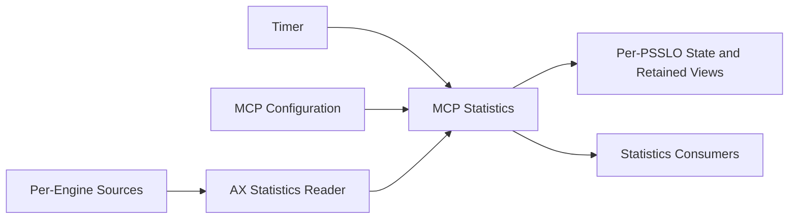

### 2.3 System Boundaries

MCP Statistics owns tracked membership, registered `SourceId` handles, previous `StatsId` values, previous aggregate effective totals, operation-local MCP-domain copies, retained current-cycle views, and local totals.

It does not own the shared `AxStatisticsReader`, AX shared memory, Reader source contexts, timer state, feature configuration, AX reset state, or consumer processing.

### 2.4 External Dependencies

- Timer Infrastructure
- AX Statistics Reader
- MCP Counter Contract
- Active Service and Protected-Object Configuration
- AX runtime, total, and source-level `update_id` contracts
- MCP service and global configuration notifications
- Visibility and statistics consumers

## 3. Responsibilities

### 3.1 Source Binding and Statistics Collection

MCP Statistics resolves the current statistics binding for each requested PSSLO and collects corresponding runtime and total statistics from every required processing Engine.

The current binding is resolved for each collection attempt. It is retained only as internal cumulative-sequence continuity state and is not used as the PSSLO identity or Storage key. A Provider operation uses the binding resolved during that operation for every required Engine read and for the subsequent effective-total state update.

Collection succeeds only when the PSSLO is tracked at the state lookup, the current binding is valid, every required Engine runtime and total read succeeds, and the two successful reads for each Engine return the same `sourceUpdateId`.

### 3.2 MCP Projection and Cross-Engine Aggregation

MCP Statistics copies approved source fields into DP-owned data, maps them to approved MCP counters, calculates each Engine effective total, and aggregates corresponding values across all required processing Engines before calculating current-cycle statistics.

The Provider compares the current aggregate effective total with the previous aggregate effective total only when `currentStatsId` matches `previousStatsId` and returns current-cycle statistics. AX-domain pointers, references, records, source handles, slots, effective totals, and Engine details remain internal.

### 3.3 Collection-Cycle Management

MCP Statistics runs the periodic collection cycle, takes an independent tracked-PSSLO snapshot, processes each PSSLO sequentially, and prevents failed or incomplete collections from changing previous effective-total state or retained views.

Failure affects only the corresponding PSSLO. A failure associated with one PSSLO does not prevent other PSSLOs from being collected, visibility-updated, or delivered. Timer cycles execute serially on the existing task thread and require no additional cycle guard.

### 3.4 Retained Views and Lifecycle

Statistics Storage is the authoritative owner of tracked PSSLO membership, previous `StatsId` values, previous aggregate effective totals, retained current-cycle values, and locally accumulated totals.

It creates zero-valued state when a PSSLO becomes active, removes the complete entry when the PSSLO becomes inactive, replaces current-cycle values only with successful Provider results, and accumulates the same values into the local total.

Reset operations affect only retained totals and do not modify previous statistics bindings, previous effective totals, current-cycle values, tracked membership, or AX counters.

### 3.5 Statistics Access and Delivery

MCP Statistics exposes retained per-PSSLO current-cycle and total statistics and delivers successful Provider results independently of visibility-retention success.

Visibility and delivery expose MCP-domain values only. Consumer-specific presentation and processing remain outside MCP Statistics.

## 4. Components

### 4.1 Decomposition

- Orchestrator
- MCP PSSLO Statistics Provider
- Statistics Storage
- Statistics Publisher
- Statistics Configuration Adapter

Cross-Engine effective-total aggregation and current-cycle calculation remain in the Provider because Engine topology and AX cumulative semantics are internal to providing a complete current-cycle PSSLO result.

### 4.2 Component Relationships

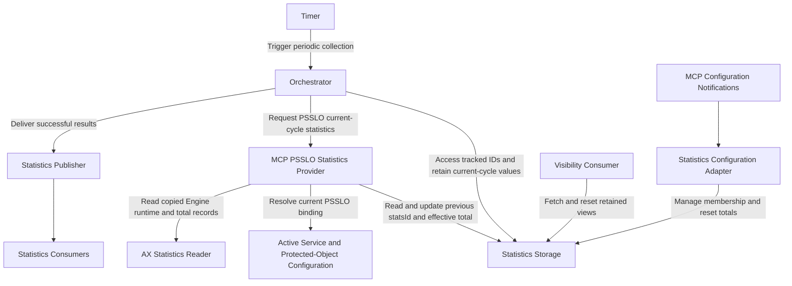

The Provider uses active service and protected-object configuration to resolve the current AX statistics binding. It uses a narrow Effective-Total State Access interface to obtain and replace the previous binding and aggregate effective total retained by Storage.

## 5. Main Flows

### 5.1 Periodic Collection

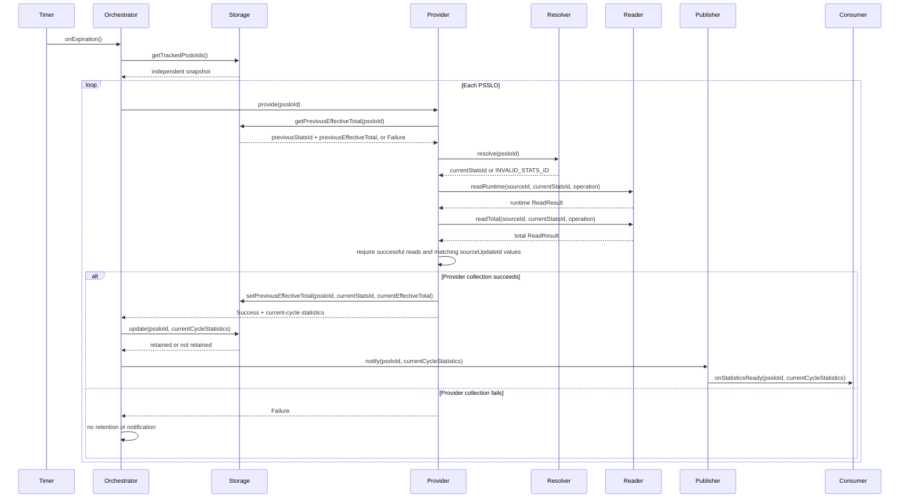

The Provider performs stats-ID resolution and all AX reads between the state get and set operations without holding a Storage lock. Collection, state access, visibility retention, and delivery are independent per PSSLO. Detailed paths are specified in Section 9.2.

### 5.2 Visibility and Configuration

Visibility consumers fetch or reset retained views directly through Storage. Configuration callbacks add and remove PSSLOs and invoke `resetAll()` for every Enabled notification. Storage synchronizes these operations with collection-time state access and retained updates. Detailed paths are specified in Sections 9.3 through 9.8.

## 6. Interfaces

### 6.1 Orchestrator

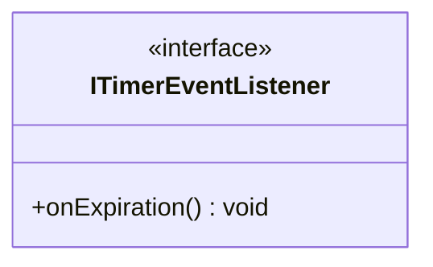

### 6.2 Provider

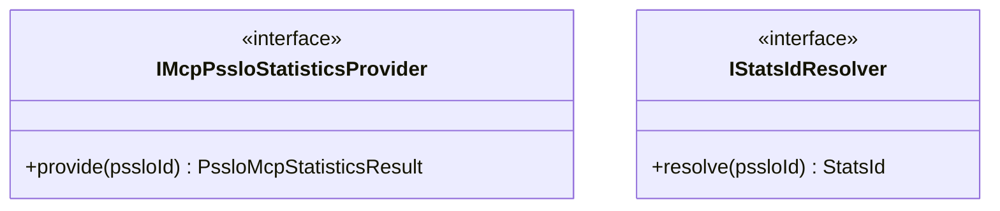

`provide(pssloId)` returns current-cycle MCP statistics on Success. Every implementation of this Strategy interface must preserve that semantic contract.

`StatsId` is the unsigned type accepted by AX Statistics Reader for its `statsId` parameter. `INVALID_STATS_ID` is `std::numeric_limits<StatsId>::max()`. `IStatsIdResolver::resolve()` returns the current Reader `statsId`, or `INVALID_STATS_ID` when resolution is not possible.

### 6.3 Storage

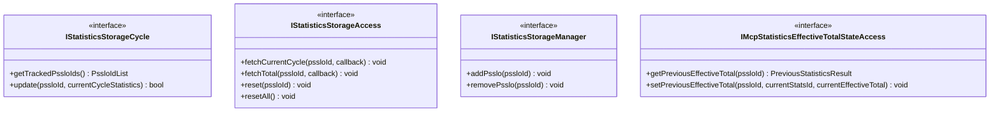

`getTrackedPssloIds()` returns an independent snapshot. `update()` receives current-cycle statistics, replaces the retained current-cycle view, and adds the same values to the local total. It does not calculate an effective total or a difference.

`getPreviousEffectiveTotal()` returns Failure only when the PSSLO is not tracked. On success it returns DP-owned copies of `previousStatsId` and `previousEffectiveTotal`. A newly added PSSLO returns `INVALID_STATS_ID` and zero.

`setPreviousEffectiveTotal()` stores the supplied `currentStatsId` and `currentEffectiveTotal` only when the PSSLO still exists. A missing entry produces a no-op. The operation never creates membership and never changes retained current-cycle or total views.

Fetch callbacks are synchronous and invoked exactly once for a tracked PSSLO and not invoked for an unknown PSSLO. They execute after the Storage lock is released.

### 6.4 Publisher and Listener

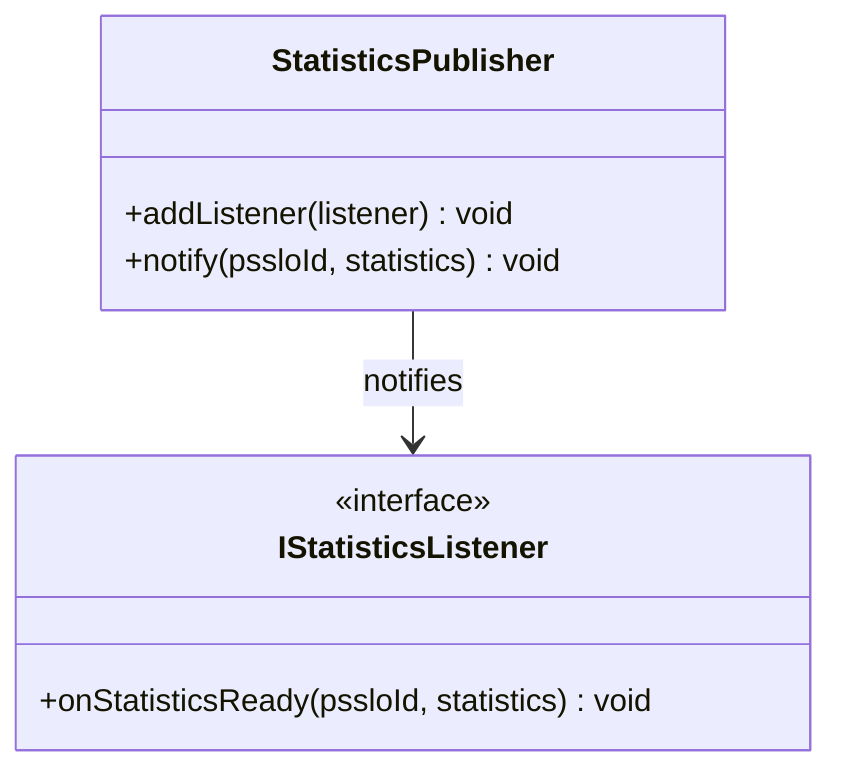

`StatisticsPublisher` is concrete. Registered listeners are non-owning and outlive the Publisher. They are registered before periodic collection and notified sequentially in registration order. Duplicate registration is a no-op, and dynamic removal is unsupported.

Publisher notifications contain successfully collected per-PSSLO current-cycle MCP statistics from the Provider. Retained totals are accessed separately through Statistics Storage. Consumers must not assume that each notification covers exactly one second.

Consumer-specific processing is outside the Publisher. Publisher behavior when a listener fails remains open.

### 6.5 Configuration Adapter Interfaces

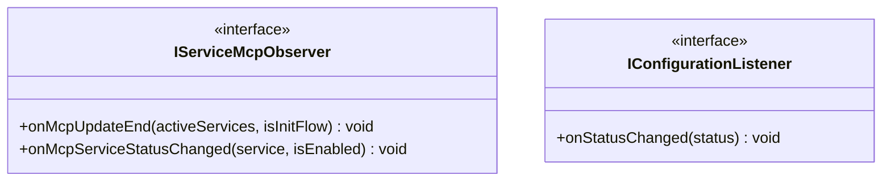

## 7. Data Model

### 7.1 Identity and Coordinates

`PssloId` is `DPServiceData::hashValue`. Storage uses `PssloId` as its key. `StatsId` is a transient binding coordinate. Storage retains `previousStatsId` only to validate continuity of `previousEffectiveTotal`; it is not a Storage key or public identity. Slots, `StatsId`, `SourceId`, `SourceUpdateId`, Engine identifiers, and AX `update_id` values are internal coordinates and are not exposed.

### 7.2 MCP Counter Set

The MCP statistics produced by this feature are Allow, Deny, and Fallback.

The approved AX-to-MCP mapping is:

```text
Allow    <- requests_sent_to_server
Deny     <- responses_to_client
Fallback <- sideband_failures
```

`requests_sent_to_server` includes requests modified by the Cloud before being sent to the server. `responses_to_client` represents blocked requests. `sideband_failures` includes timeouts, server resets, and other sideband failure events defined by the AX counter contract.

The selected counters do not overlap for MCPP. `client_connections_closed` is not used.

### 7.3 Collection Result

`PssloMcpStatisticsResult` is an alias for `std::pair<PssloMcpStatisticsResultStatus, McpStatistics>`.

The Provider input identifies the requested `PssloId`; the result does not repeat that identity. On Success, the second value is valid current-cycle statistics containing the approved MCP counters aggregated across all required Engines. On Failure, the second value is not a valid candidate and must not be consumed. The failure result carries no failure-reason field.

AX runtime and total fields used for calculation are copied into Provider-owned, operation-scoped values during Reader operations. AX shared-memory pointers, references, records, effective totals, and other AX-domain values are not part of `McpStatistics` or `PssloMcpStatisticsResult`.

### 7.4 Retained State

Each tracked PSSLO has:

```text
RetainedPssloState
    previousStatsId
    previousEffectiveTotal
    currentCycleStatistics
    totalStatistics
```

All statistics values contain only Allow, Deny, and Fallback. The previous effective total is one aggregate device-level value rather than per-Engine state.

Add initializes `previousStatsId` to `INVALID_STATS_ID` and creates zero counter values. Update replaces current-cycle statistics and adds them to total. Reset clears total only. Remove releases the complete entry.

Effective-total state access returns:

```text
PreviousStatisticsResult
    status
    previousStatsId
    previousEffectiveTotal
```

On Success, `previousStatsId` and `previousEffectiveTotal` are valid DP-owned values. On Failure, the PSSLO is not tracked and the remaining values must not be consumed. A newly added tracked PSSLO returns Success with `previousStatsId = INVALID_STATS_ID` and zero `previousEffectiveTotal`.

### 7.5 Notification Payload

Each notification delivers one successfully collected per-PSSLO current-cycle Provider result as the associated `PssloId` and MCP-domain Allow, Deny, and Fallback statistics. Notification does not depend on whether visibility retention succeeds.

Retained total statistics remain available through Statistics Storage visibility access and are not included automatically in listener notifications. A notification may cover multiple timer periods after failed collection attempts.

The payload does not expose AX records, source handles, statistics slots, Engine details, effective totals, or shared-memory references.

Consumer-specific enrichment, identity translation, reporting, trap generation, top-statistics presentation, and delivery formatting are outside MCP Statistics.

## 8. Detailed Design

### 8.1 Statistics Storage

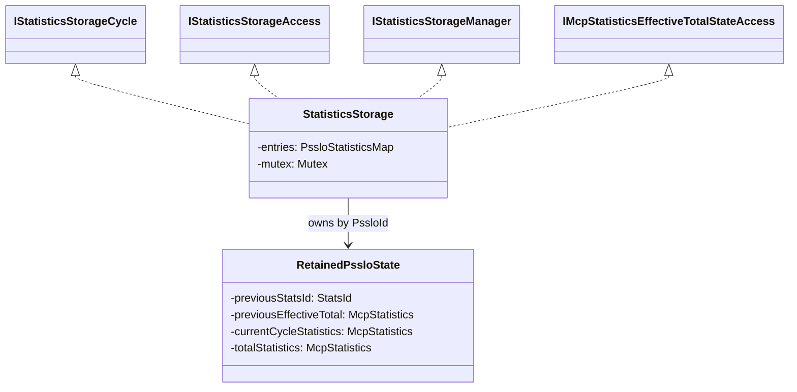

#### 8.1.1 State and Lifecycle

```cpp
using PssloStatisticsMap =
    std::unordered_map<PssloId, RetainedPssloState>;
using PssloIdList = std::vector<PssloId>;
```

`entries` is the authoritative membership set. `addPsslo()` creates `previousStatsId = INVALID_STATS_ID` and zero previous-effective-total, current-cycle, and total values if absent. `removePsslo()` removes the complete entry. Duplicate add and unknown remove are no-ops.

Re-add after removal creates fresh zero state. Storage membership is identified by the logical `PssloId` and does not maintain a separate entry-lifecycle identity. If the same `PssloId` is re-added while an earlier collection is still in progress, that collection may update the re-created entry if the entry exists when the Storage operations are applied. Cumulative-sequence continuity is evaluated by the Provider using the previous and current statistics bindings.

#### 8.1.2 Snapshot and Update

`getTrackedPssloIds()` copies map keys under the mutex and returns an independent vector. The mutex is released before the Orchestrator calls the Provider.

`update()` performs a fresh membership lookup. If the logical `PssloId` is tracked at that time, including after a remove and re-add, it replaces current-cycle statistics, adds the same values to total statistics, and returns `true`. If the lookup fails, Storage remains unchanged, creates no entry, and returns `false`.

The update result does not gate delivery of a successful Provider result.

#### 8.1.3 Visibility, Reset, and Consistency

`getPreviousEffectiveTotal()` copies `previousStatsId` and `previousEffectiveTotal` under the mutex. It fails only when the PSSLO is not tracked.

`setPreviousEffectiveTotal()` performs a fresh lookup under the mutex and stores the supplied `currentStatsId` and `currentEffectiveTotal` when the logical `PssloId` is tracked at that time. It is a no-op when the entry is absent and never creates membership. If the same logical `PssloId` has already been re-added, the operation may update the re-created entry.

Fetch operations copy the requested view under the mutex, release the mutex, and then invoke the callback. Unknown PSSLOs do not invoke the callback.

`reset()` clears one total and `resetAll()` clears every total. Reset does not alter previous `StatsId` values, previous effective totals, current-cycle values, membership, or source counters.

No Storage mutex is held during Provider resolution, AX Reader operations, Publisher notification, or consumer callbacks. Timer and configuration operations may execute on different threads and synchronize through the Storage mutex.

### 8.2 MCP PSSLO Statistics Provider

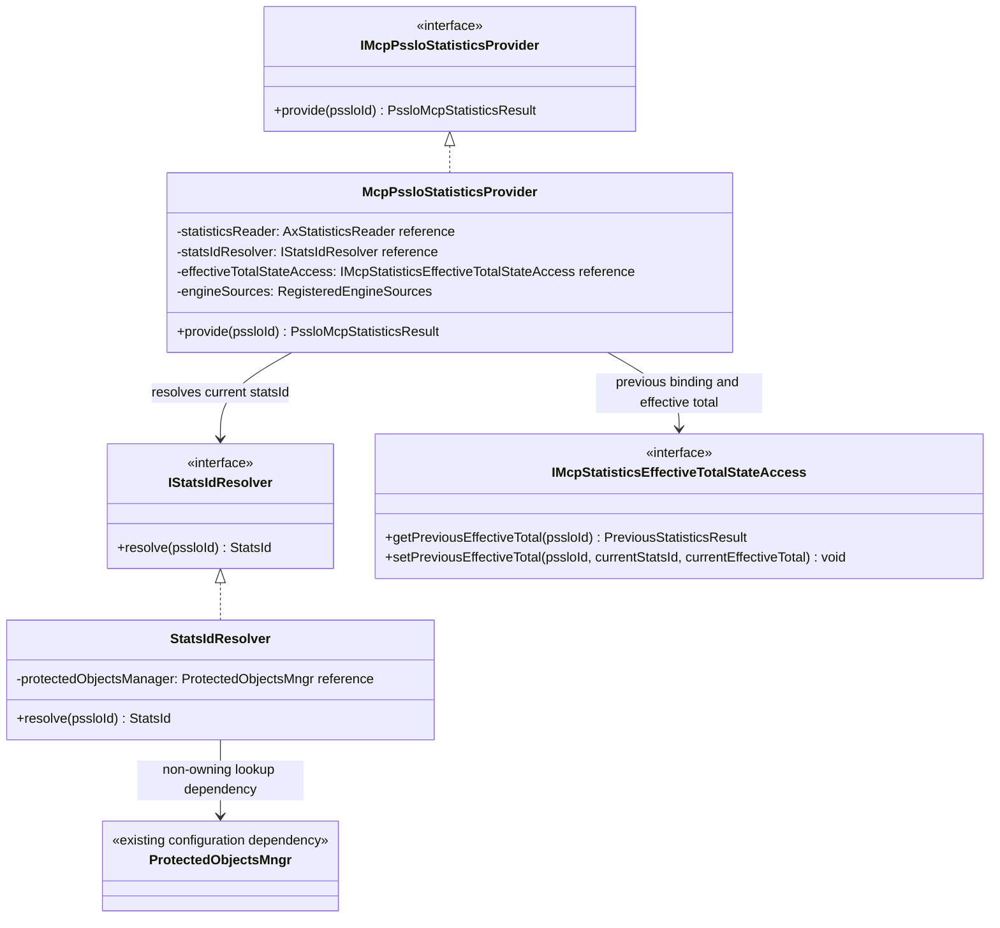

#### 8.2.1 Dependencies and Source Set

Reader, `IStatsIdResolver`, and `IMcpStatisticsEffectiveTotalStateAccess` are non-owning dependencies. Provider owns one `EngineId` and `SourceId` pair per required Engine. The source set contains at least one Engine, is complete before Provider construction, and remains fixed for the Provider lifetime.

System Composition owns the concrete `StatsIdResolver` and `StatisticsStorage` and ensures that both outlive the Provider. The Provider does not access Storage through manager, cycle, visibility, or reset interfaces.

#### 8.2.2 StatsId Resolution

`StatsIdResolver` is the concrete implementation of `IStatsIdResolver`. It wraps the existing active-service and protected-object lookup mechanism and resolves the current Reader `statsId` for a requested `PssloId`.

On every call, it performs:

```text
PssloId
-> active DPServiceData
-> service name
-> active ProtectedObjectValue
-> m_tunnel.m_statIndex
-> currentStatsId = m_statIndex
```

If any lookup or validation step fails, `resolve()` returns `INVALID_STATS_ID`. The Resolver performs this lookup on every call and retains no binding cache.

#### 8.2.3 Binding, Collection, and Result

On every `provide()` call, Provider first obtains `previousStatsId` and `previousEffectiveTotal` for `pssloId`. If the PSSLO is not tracked, Provider returns `{Failure, {}}` without resolving `statsId` or invoking AX Statistics Reader.

Provider then resolves `currentStatsId`. If it receives `INVALID_STATS_ID`, it returns `{Failure, {}}` and does not invoke AX Statistics Reader. Provider does not cache the binding.

For every required Engine, Provider invokes `readRuntime()` and then `readTotal()` separately using the same `SourceId` and `currentStatsId`. Each record-only operation copies its successful Reader-provided record into Provider-owned operation-local storage.

Each Reader call returns a `ReadResult`. Provider requires both results to contain `ReadStatus::Success` and accepts the record pair only when `runtimeReadResult.sourceUpdateId == totalReadResult.sourceUpdateId`. A read failure or identifier mismatch fails the current PSSLO collection.

The Reader independently validates each record copy against the source-level `update_id`. Matching identifiers establish that the AX source-update state did not change between the two accepted copies, subject to the Reader's documented wraparound assumption. They do not establish a non-torn record or an atomic snapshot across normal live counter increments. MCP accepts these Reader limitations.

Provider maps the approved fields, calculates each Engine effective total as AX total plus AX runtime, and aggregates corresponding effective counters across Engines. Every required Engine read must succeed. Provider retains no AX pointer or reference and exposes no effective total.

Provider calculates current-cycle statistics independently for each aggregate MCP counter:

```text
previousStatsId is invalid
    -> current-cycle counter = current effective counter

previousStatsId != currentStatsId
    -> current-cycle counter = current effective counter

previousStatsId == currentStatsId and current effective counter >= previous effective counter
    -> current-cycle counter = current effective counter - previous effective counter

previousStatsId == currentStatsId and current effective counter < previous effective counter
    -> current-cycle counter = current effective counter
```

The decrease case treats the current value as the activity observed in a new cumulative sequence. It prioritizes count completeness and may produce a larger first result after a discontinuity.

A Provider operation uses the `currentStatsId` resolved during that operation for all separate Reader calls and for the subsequent effective-total state update. If configuration replaces the underlying AX Tunnel after resolution, the in-flight operation may complete using the previously resolved binding. Provider does not resolve the binding again before commit. The next Provider operation resolves the current binding again and starts a new cumulative sequence if it changed.

After complete successful collection and calculation, Provider asks Storage to save `currentStatsId` and the current effective total. If the PSSLO was concurrently removed and remains absent, this state update is a no-op. If the same logical `PssloId` has already been re-added, the operation may update the re-created entry. In either case, the already calculated result remains valid and eligible for delivery.

Provider returns `{Success, currentCycleStatistics}`. If state lookup, resolution, or any required Engine read fails, Provider returns `{Failure, {}}`; `previousStatsId` and `previousEffectiveTotal` remain unchanged and the statistics value is not a valid candidate.

#### 8.2.4 Execution Model

`provide()` and the synchronous Resolver and Reader calls execute sequentially in the timer task flow for one PSSLO. Different Controller threads may concurrently add, remove, fetch, reset, or update Storage state.

Provider holds no Storage lock across resolution, AX access, aggregation, or result return. The two Effective-Total State Access operations acquire and release the Storage mutex independently. Concurrent operations are synchronized for data-race safety, while continuity remains associated with the logical `PssloId` rather than a separate Storage-entry lifecycle.

### 8.3 Orchestrator

#### 8.3.1 Dependencies and Cycle

Orchestrator holds non-owning references to Storage Cycle, Provider, and concrete Publisher. All cycle-specific data is local to `onExpiration()`.

`onExpiration()` obtains an independent snapshot of tracked IDs and processes each PSSLO independently. For each Provider Success, it attempts a visibility update and then notifies the Publisher. Provider Failure causes neither update nor notification.

#### 8.3.2 Storage and Delivery

Membership may change while `onExpiration()` processes its independent snapshot. Storage operations perform fresh lookups under the Storage mutex and never recreate membership except through `addPsslo()`.

For each Provider Success, Orchestrator calls Storage with the `PssloId` and current-cycle statistics and then calls Publisher with the same values. A failed visibility update does not suppress notification. One final notification after concurrent removal is acceptable.

#### 8.3.3 Execution Model

`onExpiration()` runs synchronously on the existing task thread. Provider calls within a cycle are sequential, and timer cycles do not overlap. No cycle guard or additional serialization mechanism is introduced.

Configuration callbacks may execute on another Controller thread and overlap `onExpiration()`. Storage synchronization is internal. All cycle-local state is released on return.

### 8.4 Statistics Configuration Adapter

#### 8.4.1 Responsibilities

Adapter holds non-owning Storage Manager and Access references. It stores no membership copy, statistics values, previous statistics binding, previous effective total, or previous global status.

- Init `onMcpUpdateEnd()` adds active services by `hashValue`; non-init calls are no-ops.
- `onMcpServiceStatusChanged()` adds enabled and removes disabled services.
- Every `onStatusChanged(Enabled)` calls `resetAll()`; Disabled is a no-op.
- Other configuration callbacks do not modify Storage.

#### 8.4.2 Execution Model

Adapter callbacks may execute on a different Controller thread from `Orchestrator::onExpiration()`.

Callbacks perform bounded Storage operations under Storage synchronization and never start collection. Adapter does not access Provider, Publisher, Reader, slots, Engine registrations, or effective totals.

### 8.5 Statistics Publisher

Publisher stores non-owning `IStatisticsListener*` values. Composition ensures listeners outlive Publisher. `addListener()` requires a valid pointer; duplicate registration is a no-op. Registration completes before collection and dynamic removal is unsupported.

`notify(pssloId, statistics)` forwards the PSSLO ID and successfully collected per-PSSLO current-cycle Allow, Deny, and Fallback statistics unchanged. It does not include retained totals. Consumers must not assume that the payload represents exactly one second.

Publisher invokes listeners sequentially in registration order and caller context. It performs no collection, aggregation, retention, reset, effective-total calculation, identity translation, reporting, trap generation, or consumer-specific processing.

Publisher behavior when a listener fails remains open.

## 9. Concrete Flows

### 9.1 Initialization and Composition

**Trigger:** System composition initialization.

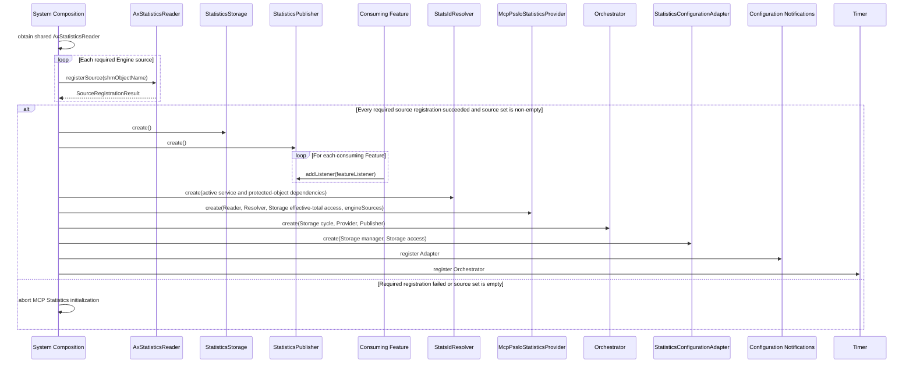

All required registrations must succeed and the final source set must be non-empty before Provider construction and Timer registration. Storage and Resolver outlive Provider. Provider, Storage, and Publisher outlive Orchestrator. Storage outlives Adapter. Registered listeners outlive Publisher. On initialization failure, Orchestrator is not registered and periodic collection does not start.

### 9.2 One-Second Statistics Collection

**Trigger:** `ITimerEventListener::onExpiration()`.

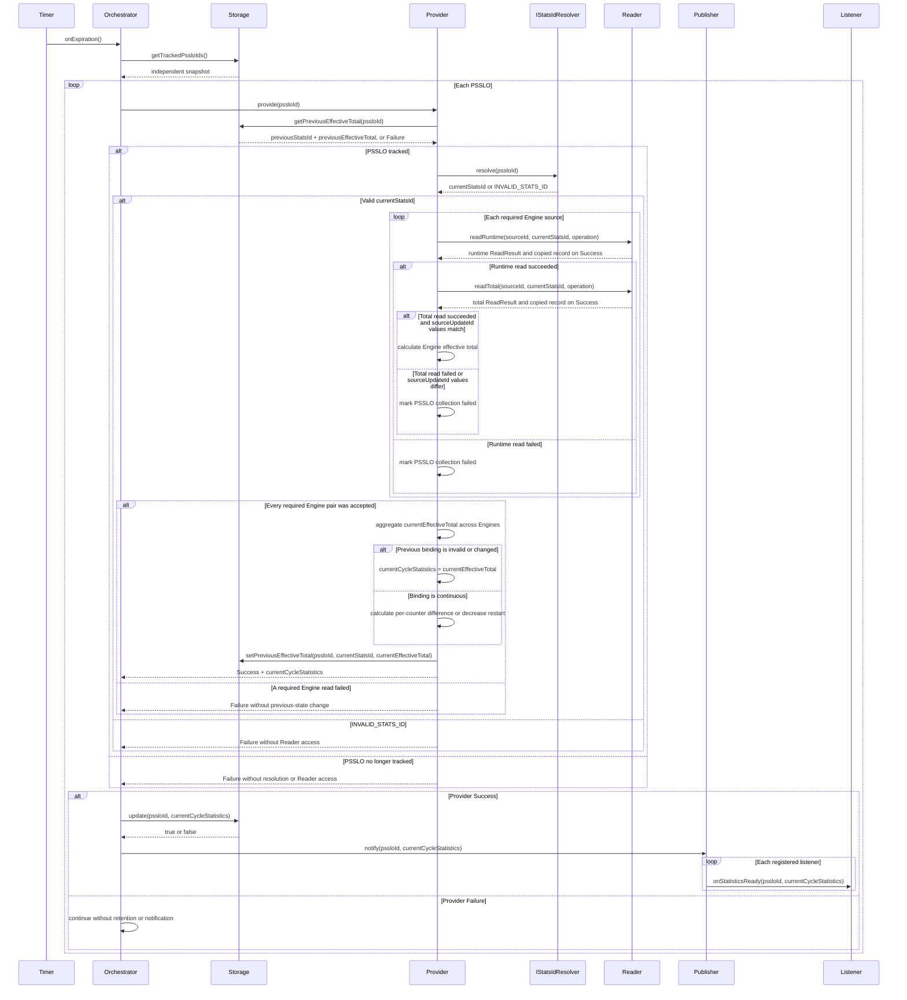

Every current AX read uses only `currentStatsId`, which was resolved during the same `provide()` call. `previousStatsId` is used only to validate continuity of `previousEffectiveTotal`. An invalid or changed binding starts a new cumulative sequence whose current-cycle result equals `currentEffectiveTotal`. For the same binding, the normal difference and counter-decrease rules apply.

For each Engine, Runtime and Total are read separately. Both reads must succeed and return the same `sourceUpdateId`; otherwise the entire PSSLO collection fails without state advancement, retained-view update, or notification. A collection may complete with the binding resolved for that operation even if configuration replaces the underlying AX Tunnel before completion. The next collection resolves the binding again.

State lookup, resolution, or required-Engine read failure changes neither previous field. Each PSSLO is processed independently. A failed retained update does not suppress notification. Empty snapshots, no successful results, and empty listener sets are valid no-ops.

### 9.3 Fetch Current-Cycle Statistics

**Trigger:** `fetchCurrentCycle(pssloId, callback)`.

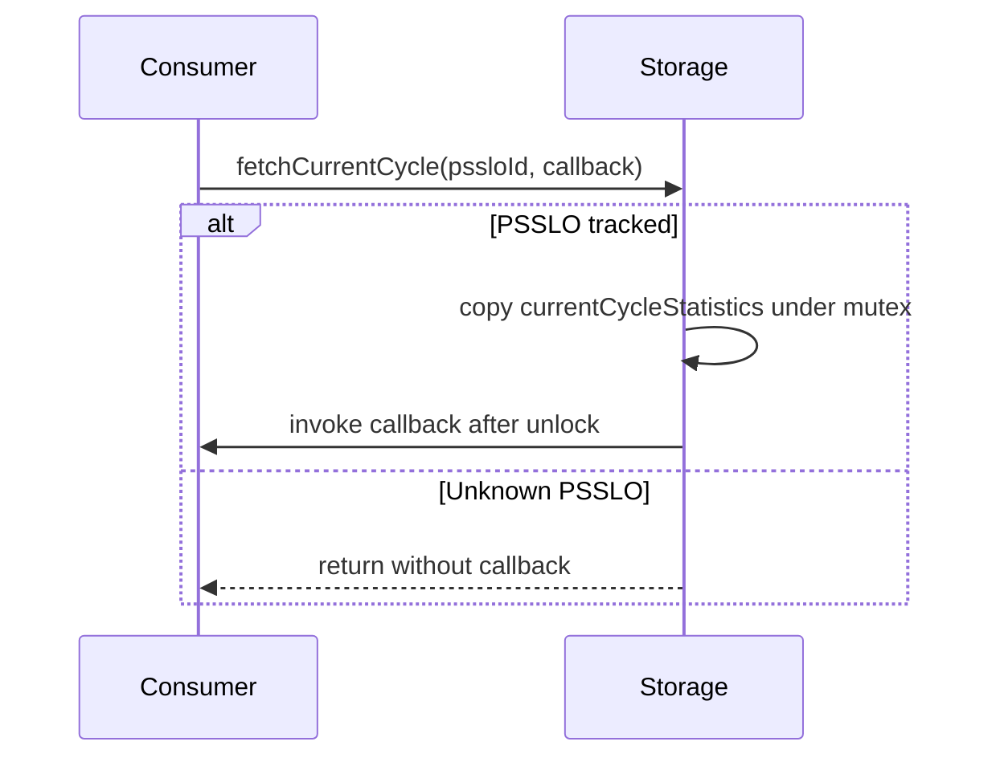

A newly added PSSLO returns zero. Storage exposes no internal reference. The retained value is the latest successfully retained Provider result and is not an authoritative completed one-second AX window.

### 9.4 Fetch Total Statistics

**Trigger:** `fetchTotal(pssloId, callback)`.

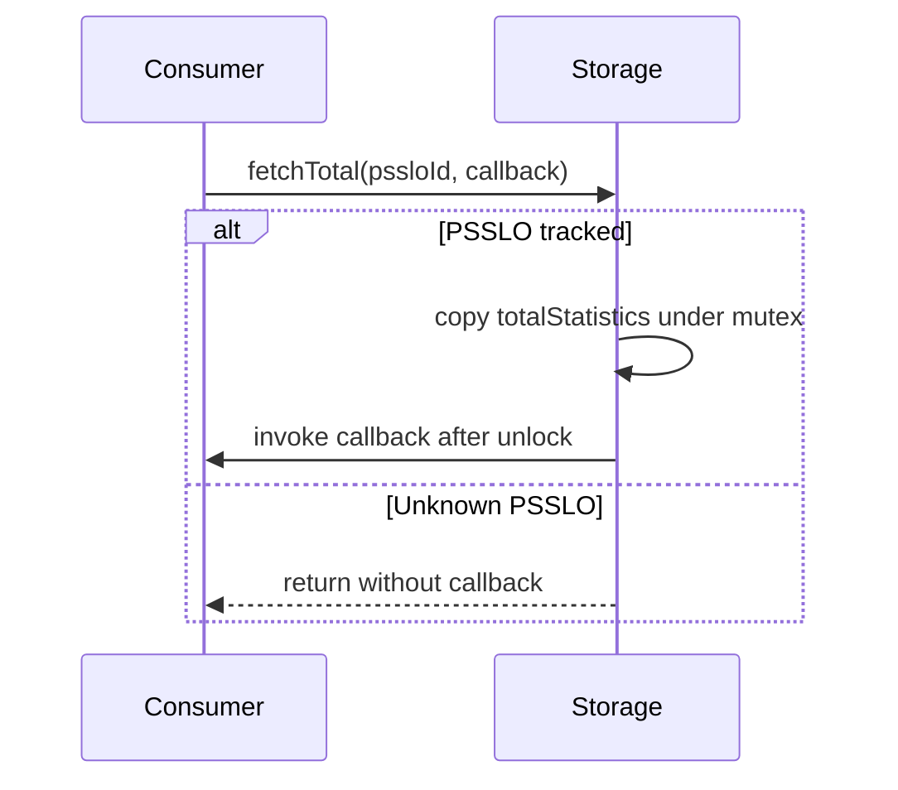

A newly added or reset PSSLO returns zero. Storage exposes no internal reference. The visibility path does not read AX total or any other AX state.

### 9.5 Reset PSSLO Total

**Trigger:** `reset(pssloId)`.

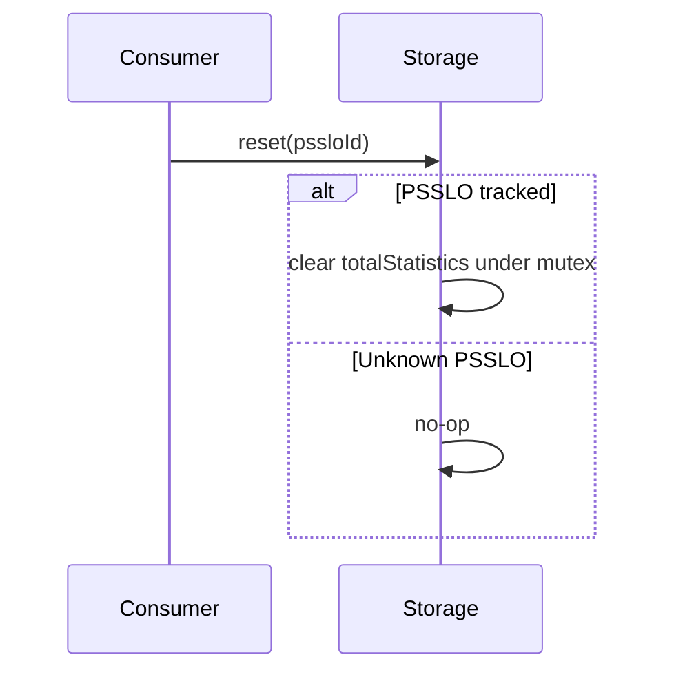

Reset changes only `totalStatistics`. It does not change `previousStatsId`, `previousEffectiveTotal`, `currentCycleStatistics`, membership, other entries, AX counters, or AX memory. MCP Statistics does not issue `DXP_STATS_COMMAND_RESET`.

### 9.6 Initial PSSLO Registration

**Trigger:** `onMcpUpdateEnd(activeServices, isInitFlow)`.

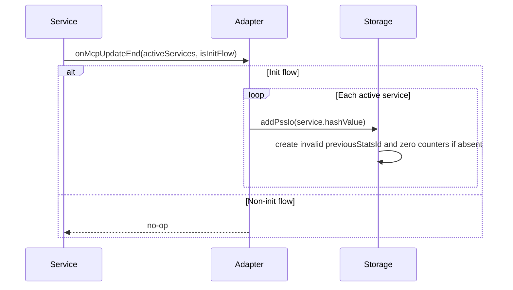

Empty input is a valid no-op. Duplicate add preserves the existing entry. Adapter maintains no parallel membership or statistics state and does not start collection.

### 9.7 Runtime PSSLO Status Change

**Trigger:** `onMcpServiceStatusChanged(service, isEnabled)`.

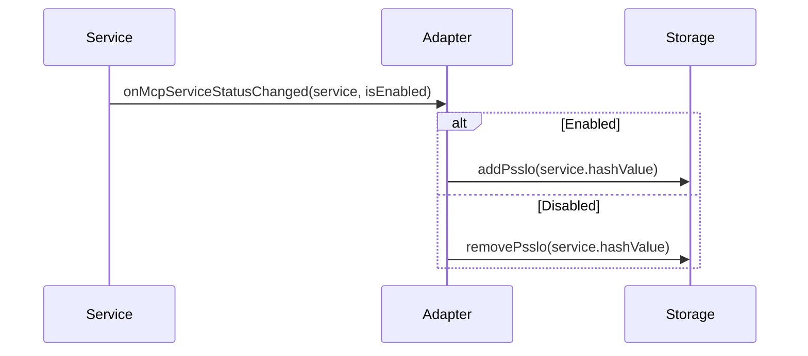

Duplicate enable preserves state. Unknown disable is a no-op. Removal deletes membership, `previousStatsId`, `previousEffectiveTotal`, `currentCycleStatistics`, and `totalStatistics`, but does not reset AX counters. Re-add creates `previousStatsId = INVALID_STATS_ID` and zero counters. If an earlier collection for the same logical `PssloId` completes after the re-add, its state and retained-view updates may apply to the re-created entry and its result may be delivered.

### 9.8 Global MCP Status Change

**Trigger:** `onStatusChanged(status)` through `AConfigurationListener`.

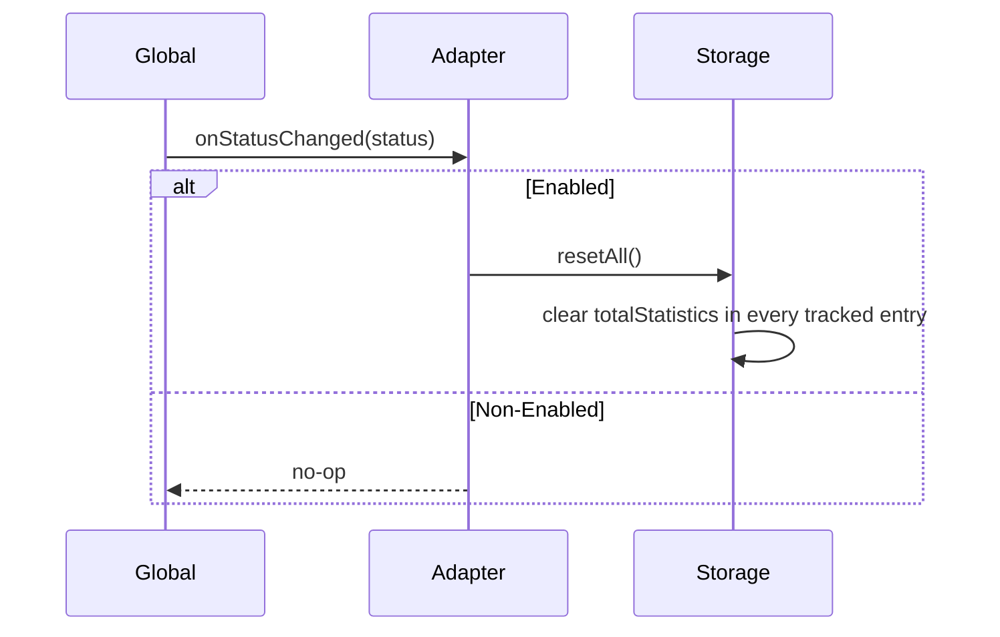

Every Enabled invocation calls `resetAll()`, including repeated Enabled notifications. Non-Enabled values are no-ops. Reset does not modify `previousStatsId`, `previousEffectiveTotal`, `currentCycleStatistics`, membership, Reader state, source counters, or AX memory.
