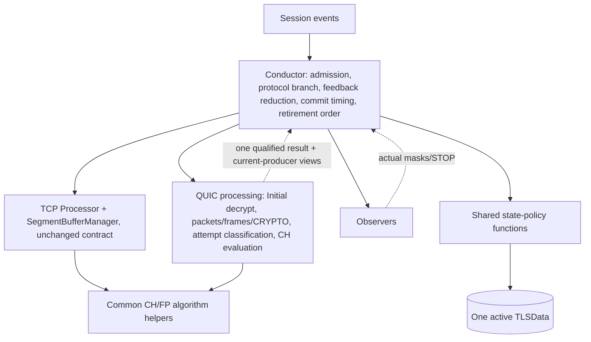

# Independent Architecture Review: QUIC Support in TLS-Flow

**Note:** Deep research needs the Copilot coding agent, which is not enabled for this repository. I did this review directly with file reads instead.

**Recommendation:** Keep the selected direction, R1. That is the existing Conductor with separate explicit TCP and QUIC processing paths, one set of shared state-policy functions, and ClientHello (CH) evaluation owned by each protocol. Make one refinement, R1′: the QUIC processing side should classify each attempt (retransmission, Retry-compatible restart, new attempt, retired, ambiguous) and hand back **one** qualified result. The Conductor should only decide when that result is applied, not reclassify it. R1 still leads under criteria I set and froze myself, but by less than the earlier Phase 6 scoring suggested. Its weakest point is that the Conductor takes on QUIC reset and replacement ordering.

The scores and gate results are my judgement. Nothing was executed, nothing is a measured or implementation PASS, and I wrote nothing to the repository.

---

## 1. Scope, sources and binding constraints

### Sources (repository commit `64500c0`)

| Input | Version used | Notes |
|---|---|---|
| Code | `Code/tls-flow/**` | Read `TLSFlowConductor.cpp` in full. The Processor and helpers were only read through the Phase 6/7 symbol maps. |
| Step 4.5 criteria | `phase6-step4.5-…-v4.md` | The only version present. |
| Phase 6 decision | `phase6-step5-…-v10.md` | Latest. Selects R1 (C1 + C4-P). |
| Candidates | `phase6-step3-…-v6.md` and the C1 v5, C2 V2, C3 v4, C4 **v4** proposals | C4 v1 is also in the folder; v4 is the active one (I-16). |
| State policy | `phase2-state-machine.md` | Accepted policy. Read in full. |
| Phase 7 | `phase7-pre-design-decision-package-v1.md` | A reviewed candidate. It is **not accepted or frozen**, and I don't treat it as passed. |
| FRD/SRS | `FRD_draft.md`, `SRS_draft.md` | Used through the Phase 7 mapping, including the U7-PARSE-01 parsing decision. **I did not independently re-read the SRS parsing section (I-17).** |

### Binding constraints

- Only client-to-server traffic is visible.
- QUIC scope is v1 Initial packet decryption plus CRYPTO and ClientHello processing.
- Memory is allocated at startup only. Nothing allocates or grows at runtime, including failure, aging and cleanup paths.
- Capacities stay symbolic.
- TCP behaviour is preserved except for authorized corrections: D6-01, D6-02 and D6-08.
- The fingerprint algorithm and output stay unchanged.
- Parser outcomes, observer STOP, violation masks, state changes and packet DROP stay separate.
- For a CH spanning datagrams, the timestamp is the arrival time of the datagram that completes the CH (U7-TIME-01).

---

## 2. Current behaviour (`TLSFlowConductor.cpp`)

### 2.1 Packet handling flow

**Admission (`prepareInboundExtension`, L73–106).** Only TCP SYN-without-ACK is special-cased:
- If no extension exists, one is built and the packet is consumed.
- An active, violation-free attempt keeps processing.
- Otherwise the extension is released, rebuilt, and the packet is consumed.
- Non-TCP packets go straight through with whatever extension already exists.

**Processing (`process`, L108–164):**
1. A TCP reset without ACK goes to the reset observers first. With a zero mask, the session's TLS data is cleared (`tlsData.clear()`).
2. Silent terminal state, then empty payload, then terminal payload are each checked and short-circuit.
3. Then `beginPacket`, followed by a record loop. The loop continues only while the result is `RecordParsed`, there is no STOP, and the state is still active.

**Per-record reduction (`analyzeProcessResult`, L194–265).**
- Observers run in a fixed order: parsing-error, then record, then ClientHello. ClientHello observers run only when the CH status is Complete.
- Violation masks are ORed from actual observer verdicts.
- STOP with a nonzero mask accumulated so far means immediate Error.
- STOP with a zero mask is remembered and the remaining event types still run.
- At the end: a nonzero mask with a remembered STOP gives Error; a nonzero mask alone gives a violation-only commit; a zero mask gives a normal commit, and the function **still returns STOP** if one was remembered.
- This matches the accepted two-level STOP contract (M04).

**Other paths:**
- **Parser Stop:** the anomaly verdict alone decides.
- **Unsupported (`commitUnsupported`):** only when there is a continuation gap, the state is PreHandshake, or the state is InProgress with a Partial CH.
- **Aging (`onAging`):** SessionEnd observers are notified, their verdict is ignored, then the extension is released.
- **Finished:** on a newly reached Finished, `markReclaimable` is called and its return value is ignored.

### 2.2 Completion heuristics: what is protocol fact and what is product inference

| Heuristic (code) | Protocol fact | Product inference / accepted policy | Gap |
|---|---|---|---|
| TLS ≤1.2: Handshake record after client CCS → Finished (L479) | RFC 5246 §7.1, §7.4.9: Finished is the first record after CCS and is encrypted | Treats the *client's* Finished as completion. This does not show the server verified it. | I-05 |
| TLS 1.3 offered: ApplicationData after CH, without early_data → Finished (L529) | RFC 8446 §5.1–5.2: all encrypted records use outer type 23, including the client's encrypted Finished | "Client started its encrypted flight" is used as completion | I-04 |
| TLS 1.3 offered: client CCS ignored (L524) | RFC 8446 §D.4 middlebox-compatibility CCS | Correct exclusion | — |
| early_data offered: ApplicationData never completes | RFC 8446 §4.2.10: 0-RTT records are indistinguishable | Conservative. The session stays InProgress until aging, which reduces coverage. | I-03 |
| Uses the *offered* version mask, not the negotiated version | Server choice is not visible | Accepted in Phase 3 | I-06 |
| QUIC: an associated client Handshake Long Header → Finished (Phase 2 §5.2) | RFC 9000 §17.2 and RFC 9001 §5.4.1: packet type and version are not header-protected. RFC 9001 §4.1.4 and §4.9.1: a client only sends Handshake packets after it has installed Handshake keys, which means it processed the server's Initial. | "Client progressed past ServerHello" is used as completion. It is *weaker* than TLS Finished; for example, ACK-only Handshake packets also count. | Accepted policy |
| QUIC: CONNECTION_CLOSE 0x1c with code 0x0100–0x01ff → TerminatedByAlert | RFC 9000 §20.1 and RFC 9001 §4.8 | Only readable when carried in an Initial | Accepted policy |
| QUIC: retained Initial keys apply despite a DCID change | RFC 9001 §5.2: keys come from the client's first DCID | Phase 2 "a changed DCID alone is not a new context" is consistent | — |
| QUIC: conflicting CRYPTO bytes are not merged | RFC 9000 §2.2: data must not change, but an observer cannot know which copy is right | No transition, no violation | — |

### 2.3 Preserved behaviour, suspected defects and approved changes

**Preserved:**
- SYN/RST/terminal ordering.
- U05: ClientHello callbacks repeat for later records once the CH is Complete.
- The local MultipleClientHello guard.
- The staged TCP continuation.
- Ignoring the `markReclaimable` return value.
- SessionEnd notification before release.

**Suspected or evidence gaps (not proven defects):** I-03 through I-05, and SD5/SD7, which stay deferred.

**Approved changes:** D6-01 (resumed-field restoration), D6-02 (safe retirement of the actual victim before table reset/erase), D6-08 (checked counters with no wraparound).

**Material code facts for QUIC:**
- **I-08:** The Conductor reads ClientHello, record and error data from single member viewers, including inside `commitUnsupported`. Each view must come from whichever processor produced the current result.
- **I-10:** Table `release`/`alloc` erase storage directly, so QUIC support would need a retirement hook that runs first.
- **I-11:** The normal reset path calls `tlsData.clear()`, which must never be reached from QUIC.
- **I-14:** `clientHelloTimeStamp` is set from `getLastPacketTimestamp()` at commit time. With a synchronous commit on the completing datagram, this already equals the required arrival timestamp, so no copied timestamp field is needed.

---

## 3. Criteria, fixed before scoring

### 3.1 Hard gates

These are kept from Step 4.5 G01–G07, unchanged in meaning. No weighted score can make up for a failed gate.

- **H1:** Protocol and visibility correctness.
- **H2:** TCP behaves the same, apart from authorized changes.
- **H3:** QUIC attempt and state correctness.
- **H4:** One state writer, and only real observer feedback is used.
- **H5:** Ownership, last use and failure safety.
- **H6:** Startup-only storage and bounded runtime work.
- **H7:** Integration is coherent and the evidence holds together.

### 3.2 Changes to the Step 4.5 weights

1. **Merged T01 and T06.** Both measure how much existing TCP code moves and the regression risk that follows.
2. **Merged T04 and T11.** Delivery scope and staging measure the same "what must ship" effect.
3. **Merged T05 and T09.** Contract quality and policy-drift control are both about how many places must change for one rule change.
4. **Reduced runtime and memory (T02, T08) from 29% to 25%.** In the Phase 6 scoring every candidate got the same score on both, so they did not separate anything. I keep them at 25% because they matter, but unmeasured claims cannot earn points there.
5. **Raised KISS.** End-to-end clarity of the QUIC attempt flows is the main design risk.

| ID | Criterion | Weight | Anchors (0 / 3 / 5) |
|---|---|---:|---|
| W1 | TCP regression exposure and existing-code impact | 20 | Broad TCP semantic movement / bounded and mapped / near-zero TCP movement with traceable changes |
| W2 | Runtime work: parsing, hashing, copies, trials, cleanup visits | 15 | Avoidable repeated work / bounded and justified / demonstrably minimal |
| W3 | Prepared storage and peak overlap | 10 | Duplicated backing / charged once, bounded overlap / avoids overlap |
| W4 | KISS: end-to-end flow clarity | 15 | Hidden control transfers / readable with explicit exceptions / minimal handoffs |
| W5 | YAGNI and delivery scope | 12 | Speculative frameworks / justified additions / every addition has a current use |
| W6 | Contract clarity and policy-drift control (single source of rules) | 15 | Duplicated or leaky rules / shared where meaning is shared / one change site per rule |
| W7 | Testability and diagnosability | 10 | Opaque fixtures only / practical seams / focused plus end-to-end traces |
| W8 | DTLS hard-coding avoidance | 3 | TCP/QUIC assumptions inside shared contracts / explicit qualification / cheap local seam |

---

## 4. Candidate comparison

All candidates are held to the same Phase 2 policy, one active TLSData, the same prepared-ownership model and the F1–F9 scenario families.

### 4.1 Hard gates

| Candidate | H1–H7 status | Evidence and conditions |
|---|---|---|
| **R1** C1 + C4-P (selected) | PASS at architecture level, conditional | H6 depends on the crypto provider and on startup capacities (DF01, DF04, DF05). H4 depends on producer routing (I-08). |
| **R2** C2 + C4-P (common processor contract) | Conditional PASS | The adapter must carry TCP parser-Stop/anomaly handling and SYN/RST/terminal paths **outside** the common loop. Otherwise H2 fails. |
| **R3** C3 (independent protocol flows) | Conditional PASS | H4 depends on the outer Conductor never committing again. Parity between the two flows must be proved. |
| **R4** C4-F (common CH evaluator) | Conditional PASS | H2 is at risk: the staged TCP CH evaluation and digest logic must move without behaviour change. |
| **R6** C3 + shared policy (hybrid) | Conditional PASS | Same as R3 minus the policy duplication. Adds a seam between flows and the shared policy. |

No candidate fails a gate on its design alone. Every PASS is static and conditional.

### 4.2 Weighted scores (my judgement, 0–5)

| | W1 (20) | W2 (15) | W3 (10) | W4 (15) | W5 (12) | W6 (15) | W7 (10) | W8 (3) | **Total** |
|---|---|---|---|---|---|---|---|---|---:|
| **R1** | 4 | 3 | 3 | 3 | 5 | 4 | 4 | 3 | **73.8** |
| R2 | 2 | 3 | 3 | 3 | 3 | 4 | 4 | 4 | 61.6 |
| R6 | 2 | 3 | 3 | 3 | 3 | 4 | 4 | 3 | 61.0 |
| R3 | 2 | 3 | 3 | 4 | 3 | 2 | 4 | 3 | 58.0 |
| R4 | 1 | 3 | 3 | 2 | 2 | 4 | 4 | 4 | 52.2 |

**Reasons for the scores:**
- **W1:**
  - R1 keeps `IProcessor`, `PayloadParams`, the TCP result type and the TCP loop. Code shows these used only on the TCP branch (L148–163).
  - R2 rewrites that contract.
  - R3 and R6 move TCP sequencing, including the reduction in L194–265, into a new flow.
  - R4 also moves staged TCP CH evaluation.
- **W2/W3:** Every candidate needs the same QUIC work: Initial decryption, CRYPTO range tracking, CH parsing and the fingerprint. I give equal scores rather than inventing a difference.
- **W4:**
  - R3 keeps each protocol's sequence in one place.
  - R1 puts the QUIC attempt ordering in the Conductor alongside the TCP SYN/RST special cases, which costs it a point.
  - R2 has one loop, but its exceptions leak through the adapter.
- **W5:** R1 adds no new interface or flow class. Phase 6 Step 5 §11.1 lists everything optional.
- **W6:** R3 duplicates the state-policy sequence across TCP and QUIC. The other candidates share one policy.

---

## 5. Recommended design: R1′

### 5.1 Responsibilities

**QUIC processing owns** everything about evidence:
- version and packet-type qualification;
- Initial key context and its trials;
- coalesced packets and the CRYPTO range set (gaps, duplicates, conflicts);
- **attempt classification**: retransmission, Retry-compatible restart, CH2, active or terminal new-attempt candidate, retired, or ambiguous;
- deferred Handshake evidence;
- CH parsing and the fingerprint through the common helpers.

**It returns exactly one of these per call:**
- **progressed/IGNORE:** work was done, but there is nothing for the Conductor to act on;
- **exhausted:** the input datagram has been fully consumed;
- **complete CH with findings:** blocking versus nonblocking findings are kept separate;
- **semantic-only disposition:** completion, close or replacement with nothing to show observers;
- **Unsupported, with a cause.**

**The Conductor** decides when results are applied:
- It reuses the existing two-level STOP reduction unchanged.
- QUIC has no record projection, so its observer order is: anomaly/finding observers, then CH observers.
- For a terminal-state candidate, it orders reset → parse → commit. For an active-state candidate, it orders evaluate in isolation → admit → reset → publish.

**The shared policy functions** are the only code that writes TLSData:
- CH publication: count, timestamp, version mask, fingerprint, early_data.
- Error, violation-only and Unsupported.
- Protocol-qualified completion: TCP keeps the CCS and ApplicationData predicates; QUIC uses the Handshake Long Header and the CRYPTO_ERROR close.

### 5.2 State and evidence policy

- Phase 2 applies as accepted.
- A QUIC Finished is product-level progress, not TLS Finished.
- 0-RTT and 1-RTT never change state.
- Ambiguity, missing evidence and local capacity loss never create a violation. They give no change, or Unsupported while InProgress.
- A nonblocking finding does not interrupt CH parsing or the fingerprint (U7-PARSE-01).
- **Where coverage is reduced:**
  - an InProgress session can stay InProgress forever when QUIC retired or association identity is lost (it becomes Unsupported);
  - a TLS 1.3 + early_data session over TCP never completes (I-03).

### 5.3 Ownership and bounds

- The QUIC support owner holds startup-prepared arenas: datagram plaintext, the range set, CH reassembly, Initial contexts, candidate, deferred and retired claims. All capacities are symbolic.
- The extension holds a borrowed binding only.
- Views stay valid through nested callback reads and the commit.
- Admission checks are charged for old + candidate + destination + temporary usage at the same time.
- Table `alloc`/`release` call a retirement hook **before** erase (I-10, D6-02).
- On aging: SessionEnd, then support retirement, then release.
- TCP `SegmentBufferManager` aging stays independent.

### 5.4 Impact on existing code

**Narrow changes:**
- `process` and `prepareInboundExtension`: choose the protocol before any TCP-only work.
- Add a QUIC disposition branch beside `dispatchStepResult`.
- Extract `updateTLSDataOn*` and the `commit*` functions into the shared policy functions.
- Route Factory/Application viewers to the current producer.
- Add the table retirement hook.

**Retained:** `notify`, the reduction order and the whole TCP Processor.

**Simplification (I-14):** no separate copied CH timestamp field is needed, because the commit runs synchronously on the completing datagram.

---

## 6. Trade-offs, weight sensitivity and what would reverse this

**Strongest disadvantage.** The Conductor becomes the place where both TCP and QUIC lifecycle exceptions live. R1′ limits this by moving attempt *classification* into QUIC processing, but the Conductor still owns the ordering.

**Why R2 loses.** It changes a working TCP contract and gains nothing current from it. Its single loop still needs the TCP exceptions outside the loop. It loses by about 12 points, mostly on W1 and W5.

**Weight sensitivity:**
- Changing any single weight by ±50% does not change the winner.
- Doubling KISS (W4) narrows R1's lead over R3 but does not reverse it.
- R2 overtakes R1 only if W1 and W5 are both set close to zero, which ignores TCP preservation.
- On score judgements: if R1 W4 drops to 2 and R2 W1 rises to 3, the totals are R1 70.8 and R2 65.6, so R1 still leads.

**Evidence that would reverse the recommendation:**
1. An R1 Conductor sketch that needs repeated QUIC-specific branches inside the shared policy, or hidden attempt state in the Conductor. That would favour **R6**.
2. An R2 adapter sketch that expresses TCP parser-Stop and SYN/RST paths without leakage, together with demonstrated TCP trace equality. That would favour **R2**.
3. Measured QUIC classification or ordering complexity that makes Conductor walkthroughs for active and terminal replacement unreadable. That would favour **R6**.

---

## 7. Blockers and focused validation

**No blocker prevents the ranking.** These items block activation, not the direction:

| ID | Issue | Effect |
|---|---|---|
| I-01 | The decision documents cite `TLS-Flow-All-Code.txt` line anchors (for example L3428). The repo has split files and the commit is unknown. | The D1 TCP reference traces must be re-anchored to `64500c0`. |
| I-02 | The Phase 6 EVAL file and the Phase 7 S1–S5/WF files are not in the repo. | Earlier scores and PASS results cannot be verified. I treated them as claims. |
| I-08 | Viewers assume a single producer. | Current-producer routing is required before QUIC is integrated (DF02). |
| I-10 | The table erases storage directly. | The retirement hook is required correctness work (D6-02, DF03). |
| I-17 | I did not independently re-read the SRS parsing section. | Confirm the CH-parsing outcomes in U7-PARSE-01 against `SRS_draft.md`. |
| DF01, DF04, DF05 | Crypto provider conformance, startup capacities, allocation audit | H6 stays conditional until these are shown. |

**Smallest useful validation, in order:**
1. A differential TCP trace oracle at `64500c0`, covering U05, M04 STOP combinations, SYN/RST/aging and the authorized changes.
2. The R1 Conductor sketch and the R2 adapter sketch, each run against the same S01–S15 traces (this is the reversal test).
3. QUIC traces for:
   - CRYPTO gaps, duplicates and conflicting bytes;
   - a CH spanning datagrams, checking the timestamp is the completing datagram's;
   - Retry-compatible restart versus a new attempt;
   - terminal versus active replacement;
   - retired and ambiguous input;
   - capacity at C−1, C and C+1, with no violation.
4. Allocation instrumentation on the packet, aging, retirement and failure paths.

I have not saved this report to the repository. It would go in a new file, for example `PreDesign Work Plan/independent-architecture-review-v1.md`, and I can push it there if you want.