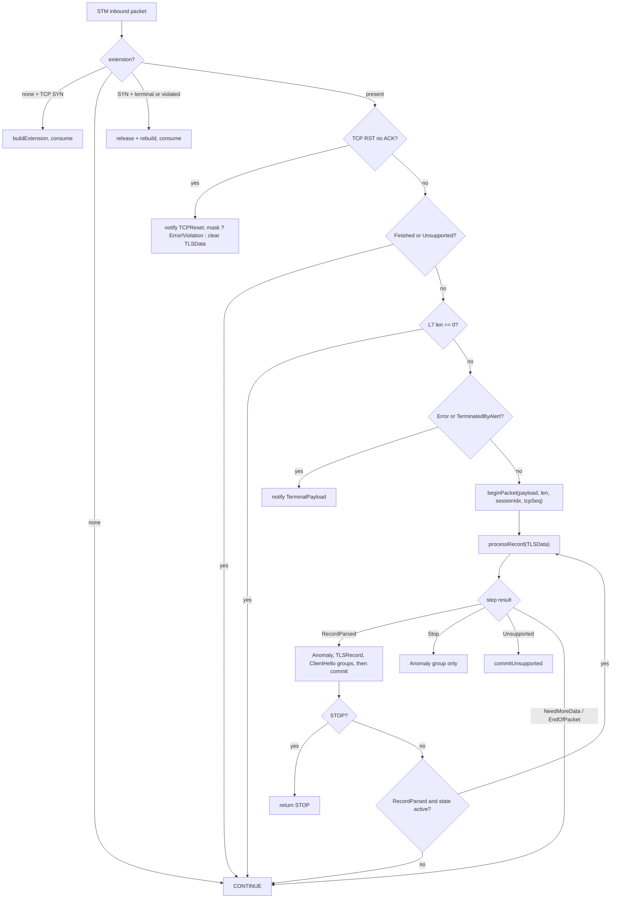

# Phase 1: Current behavior and required change (code only)

**Phase 1 is not formally PASS.** Gates 1, 2, 4 and 5 pass on code evidence. Gate 3 (requirement mapping) is not met because you deferred the FRD/SRS. Under §4 that makes the phase BLOCKED until the deferral is recorded as an accepted decision (proposed in §9).

This was static code reading only; nothing was built or run.

**Labels used below:**

| Label | Meaning |
|---|---|
| VCF | Verified code fact |
| RFC | Normative protocol fact. I added this label because the plan's label set has none for normative sources. |
| SD | Suspected defect, to be dispositioned separately |
| UQ | Unresolved question |
| P | Proposal, not decided |
| OWN | Your direction |

**Scope:**
- **OWN:** FRD and SRS are deferred. Code only; the TCP FRD and `Design.md` were not read.
- **Read:** the Conductor, Processor and IProcessor/PayloadParams, plus `TLSSessionExtension(Table)`, `TLSFeatureVerdict`, `TLSPriority` and `ITlsListener`.
- **Also read:** the three listeners, the fingerprint `PacketFlowManager`, the enforcement `Mitigator` (partly), and the session-table entry, observer list and DPFrame accessors.
- **Skipped:** `flow-sampler`, Factory full text, `Priorities.hpp`.

---

## 1. Current TCP runtime map

### 1.1 Wiring (VCF)
- **Startup** (`Factory.cpp:36-67`):
  - One `TLSFlowConductor` and one `Processor` per engine factory.
  - The conductor gets the Processor as its processor and as all three viewers.
  - The conductor registers as a global `NEW_SESSION` observer.
  - The extension table holds 200000 entries, half of which may be marked reclaimable.
- **Processor state:** one `SegmentBufferManager` (FIFO, 1000 buffers) and one parser container. Both are shared by every session on that engine.
- **Listeners** register with the conductor, one per priority, as `weak_ptr`. Each session's per-event observer list holds at most 3 entries.

| Priority (dispatch order) | Consumer | Event mask | Gate | Returns |
|---|---|---|---|---|
| 0 Enforcement | `TlsListener.cpp:41-58` | all 6 | feature on, HTTPS **port** list, profile | Stop+mask on BlockAndReport; empty verdict for TCPReset/SessionEnd |
| 1 Visibility | `TlsFlowListener.cpp:37-52` | ClientHello only | feature on, policy flag; **no port or transport check** | always `{}` |
| 2 Fingerprint | `TlsFlowListener.cpp:10-23` | ClientHello only | profile; **no port or transport check** | always `{}`; it blocks by setting a TCP RST packet action itself (`PacketFlowManager.cpp:146-165`) |

### 1.2 Per-packet control flow (VCF)

**First packet (verified):** `SessionTable::processPacket` runs `NEW_SESSION` and then calls `packetReceived` with the same packet (`SessionTable.cpp:574-598`). So the conductor's `onInbound` receives the session's first packet. This holds unless a pre-new-session observer rejects the packet or the packet is outbound.

Code for each step:
- SYN handling: `TLSFlowConductor.cpp:73-106`
- `process()`: `TLSFlowConductor.cpp:108-164`
- `dispatchStepResult`: `TLSFlowConductor.cpp:166-192`
- `analyzeProcessResult`: `TLSFlowConductor.cpp:194-265`

### 1.3 Feedback points between Processor and Conductor (VCF)
- **The Processor reads `TLSData` to decide how to parse** ([processNewRecord L809-L1083](vDP/application/tls-flow/processor/src/Processor.cpp#L809-L1083)):
  - `Unsupported` → EndOfPacket.
  - Which records are opaque depends on `hsState` and the TLS 1.3 bit (`Processor.cpp:872`).
  - Whether handshake records are parsed (`Processor.cpp:899`).
  - Whether an alert is readable as plaintext (`Processor.cpp:746`).
- **The Conductor reads from the Processor:** the step result, the last `Record`, ClientHello status, version mask, `earlyData`, fingerprint, SNI, counts, `getLastError`, `isContinuationGap`.
- **The loop runs on the committed state:** the commit after record N changes how record N+1 in the same packet is parsed. For example, a CCS moves to `ChangeCipherSpec`, which makes the next Handshake record opaque. This interleaving belongs to the TLS record stream.

### 1.4 Verdict accumulation and STOP (VCF)

`notify()` walks one event group in priority order. It ORs the violation masks together. **It returns at the first Stop**, so lower-priority listeners in that group are not called.

| Path | mask≠0 + Stop | mask≠0 + Continue | mask=0 + Stop | mask=0 + Continue |
|---|---|---|---|---|
| **Parsed record**: groups Anomaly → TLSRecord → ClientHello (ClientHello only if status is Complete) | `commitError` and **immediate STOP**. Later groups are skipped. This includes a mask from an *earlier* group with a later Stop that has no mask. | After all groups: `commitViolation` only. The **normal commit is skipped**, so state does not advance. | **Deferred STOP**: later groups still run. If no mask builds up, the normal commit still runs and STOP is returned at the end. If a later group adds a mask, `commitError` runs. | normal commit; at → Finished, `markReclaimable` |
| **Step Stop** (Processor failure) | `commitError`, STOP | `commitViolation`, CONTINUE | STOP, no commit | CONTINUE |
| **TCP RST without ACK** | `commitError`, STOP | `commitViolation` | STOP + `TLSData::clear()` | `clear()` |
| **Terminal payload** | `commitError`, STOP | `commitViolation` | STOP | CONTINUE |
| **Aging** | verdict ignored; SessionEnd, then `release()` | | | |

- **STOP's effect outside TLS-Flow** ([Session.hpp L90-L104](vDP/stm/include/Session.hpp#L90-L104)):
  - It ends the record loop, so the rest of the packet is not parsed.
  - It stops lower-priority STM inbound observers.
  - It does not drop the packet; dropping is done by consumers through `packetActionSet`.
- **Today's producers:** only Enforcement returns Stop, and always with a mask. So the deferred STOP without a violation is a contract with **no current producer**.
- **Enforcement Stop silences the other consumers:** when Enforcement Stops in the ClientHello group, Visibility and Fingerprint are not notified for that ClientHello.

### 1.5 Continuation, viewer reset, interleaving (VCF)
- **Continuation state** lives in a per-session `SegmentBuffer`, keyed by session index ([Processor.cpp L127-L207](vDP/application/tls-flow/processor/src/Processor.cpp#L127-L207)). Its rules use TCP sequence numbers:

  | Packet start vs. expected | Action |
  |---|---|
  | start == expected | resume |
  | end ≤ expected | treat as a retransmission and ignore |
  | partial overlap | trim the overlap, then resume |
  | anything else | gap → free the buffer → `Unsupported` |

- **Continuation modes:**
  - ClientHello reassembly covers **the extension block only** (≤3000 B). The ClientHello prefix must be in the first segment.
  - Opaque-record tracking.
  - Alert reassembly and alert alignment parity.
- **Viewers are packet-local Processor members**, shared across sessions. A non-resumed `beginPacket` resets them through `resetStepState` (`Processor.cpp:103-125`). The resumed path does not (SD1).
- **Code outside TLS-Flow reads the global viewer:**
  - Fingerprint reads `getFullString()` inside its `onClientHello` callback ([PacketFlowManager.cpp L99](vDP/application/tls-fingerprint/packet-flow/src/PacketFlowManager.cpp#L99)).
  - flow-sampler reads it at `DPESamplerSender.cpp` L357; I didn't read that code.

### 1.6 Lifecycle and cleanup (VCF)

| Trigger | Effect |
|---|---|
| `NEW_SESSION` | Extension created only if some listener's mask ≠ 0; then INBOUND and AGING observers are registered |
| Table full, no reclaimable entry | Session not tracked (FN) |
| SYN without ACK | Rebuild if the extension is terminal or violated; otherwise keep it |
| RST without ACK | Today `TLSData` is always cleared, because Enforcement returns an empty verdict for TCPReset |
| Reaching `Finished` | Entry marked reclaimable |
| Aging | Segment-buffer observer frees its buffer; conductor runs SessionEnd and releases the extension |

---

## 2. TCP behavior to preserve
1. The state model, transitions and heuristics from Step 1.
2. Observer order, per-group early stop, verdict accumulation and STOP behavior as in §1.4. That includes "a violation without Stop does not advance state".
3. Event order per record: Anomaly → TLSRecord → ClientHello, all before the commit. Detectors see the **pre-commit** `TLSData`.
4. Silent states are not parsed. The loop stops once the state leaves the active set.
5. Lifecycle: the SYN, RST, Finished and aging rules.
6. Continuation sequence-number rules.
7. **Fingerprint bytes for a TCP ClientHello**, plus full-string availability at `onClientHello` time.
8. `ClientHelloData` contents delivered to Visibility and Fingerprint.
9. The diagnostics inspector snapshot (`fetchSessionExtensions`).

## 3. Implementation coupling that may change
- **C1 – Conductor entry assumes TCP:** SYN/RST flags, `getTcpSeqNum`, and one `process()` that mixes lifecycle, terminal routing and the record loop.
- **C2 – Processor input is TCP-shaped:** `PayloadParams.tcpSeq`, and continuation is defined by TCP sequence numbers.
- **C3 – ClientHello parsing sits inside record processing:**
  - The ClientHello is parsed in place through record-payload pointers.
  - There is a record-layer version check and a handshake-length vs. record-length check.
  - Extension parsing uses TCP segment states (`FirstSegment`/`LastSegment`), and the digest and locators are swapped into the `SegmentBuffer`.
- **C4 – Viewers are the Processor's mutable members,** exposed through global accessors.
- **C5 – One Processor per engine** with shared parsers and packet-local state.
- **C6 – Step and error types are record-shaped:** `TLSStepResult`/`RecordProcessResult` are per record. `ParsingError` mixes client faults with internal resource failures.
- **C7 – Events and context are TCP-shaped:** `ITlsSubject::Event::TCPReset` is TCP-only, and `TLSRecordContext` wraps a TLS `Record`.

## 4. Suspected defects (separate disposition)

| ID | Finding (VCF trace) | Relevance to QUIC |
|---|---|---|
| SD1 | Resumed `beginPacket` skips the reset. Error, ClientHello status, version mask, earlyData and SNI carry over across sessions. | Any shared-instance reuse would inherit this |
| SD2 | Segmented ClientHello completion reads `m_parsers->clientHello->getVersion()` (`Processor.cpp:467`), which may hold another session's parser state | Same |
| SD3 | **No transport check.** UDP sessions are created with ports ([DPFrame.cpp L28-L90](vDP/parser/DPFrame.cpp#L28-L90)). Visibility and Fingerprint have no port check; Enforcement checks the port only. QUIC datagrams would be parsed as TLS records, with UDP header bytes used as the "sequence number" ([DPFrame.hpp L147](vDP/parser/DPFrame.hpp#L147)), leading to Enforcement MalformedHandshake. | High. Production may already be affected. Needs runtime confirmation. |
| SD4 | A retransmitted unsegmented ClientHello is parsed again, giving MultipleClientHello | QUIC Initial retransmissions and Retry need dedup by CRYPTO offset |
| SD5 | Non-ClientHello handshake records that span segments are not tracked | TCP only |
| SD6 | Internal resource errors count as client anomalies; FIFO eviction is silent | Same risk for any QUIC reassembly pool |
| SD7 | The 2^14 length limit is applied to encrypted records | TCP only |
| SD8 | `onClientHello` is re-sent for every record after a completed ClientHello in the same packet | Defines whether a ClientHello event is sent once per ClientHello |

## 5. External items and their impact on the design

| ID | Item | Status | Architectural impact |
|---|---|---|---|
| E1 | First packet delivered to `onInbound` | VCF for the `processPacket` path. Pre-new-session/`getSkipSession` filtering for UDP: UQ | The QUIC ClientHello is in the first datagram(s) |
| E2 | UDP payload = `pL7` to end of packet; one IP packet per DPFrame | VCF. Fragments: ports=0 when frag queueing is off (VCF). RFC 9000 §14 requires DF | Must walk **coalesced** QUIC packets within one datagram (RFC 9000 §12.2) |
| E3 | Session key = context+protocol+ports+IP ([DPESessionTable.cpp L48](vDP/DPEE/SessionTable/DPESessionTable.cpp#L48)) | VCF | No SYN-like boundary for QUIC (Retry, Version Negotiation, a new connection on the same 5-tuple). A rebuild trigger is needed (UQ). |
| E4 | Reclaim/release semantics | VCF | QUIC needs its own "done" and reclaim condition and a UDP aging value (UQ) |
| E5 | Only inbound packets reach TLS-Flow | VCF (`!getOutbound`) | Assumes a client Initial counts as inbound for UDP (UQ) |
| E6 | Crypto for Initial decryption in the Engine: HKDF-SHA256, AES-128-GCM, AES-ECB for header protection | wolfSSL exists in the tree; use in the Engine is not verified | Feasibility and per-packet cost |
| E7 | Consumers assume TCP: Fingerprint uses RST packet actions; Enforcement suspend key is TCP ([Mitigator.cpp L103](vDP/application/tls-enforcement/detection/engine/src/Mitigator.cpp#L103)) | VCF | Result contract may need a transport identity (UQ). Mitigation itself is out of scope. |
| E8 | flow-sampler reads the global viewer | Not read | Viewer freshness for QUIC |
| E9 | **The fingerprint hashes `quic_transport_parameters` content raw** ([Processor.hpp L233](vDP/application/tls-flow/processor/src/Processor.hpp#L233), `Processor.cpp:1272`) | VCF + RFC 9000 §18.2 (`initial_source_connection_id`, random per connection) | Unchanged, QUIC fingerprints would be unique per connection. Needs a requirement decision. Blocks the HLD of shared fingerprinting, not Phase 2. |

## 6. Where QUIC can't use the current mechanism (RFC)
- **No TLS record layer.** The ClientHello arrives in CRYPTO frames (offset+length, RFC 9000 §19.6) inside Initial packets.
  - It may span several Initial packets or datagrams.
  - Frames may arrive out of order, and retransmissions repeat offsets.
  - Only PADDING, PING, ACK, CRYPTO and CONNECTION_CLOSE are allowed in Initial (RFC 9000 §12.4).
- **Only Initial packets are readable.** Initial keys come from the client's *original* DCID and the v1 salt (RFC 9001 §5.2).
  - Later client Initials carry the server's chosen DCID but keep the original keys, so per-connection key context is needed.
  - After Retry, the DCID and keys change and the ClientHello is sent again (RFC 9000 §17.2.5.2).
  - Header protection covers the packet number and the low bits of the first byte (RFC 9001 §5.4). The header form and long-header type bits stay visible.
- **TLS 1.3 only** (RFC 9001 §4.2):
  - No CCS and no compatibility mode (§8.4).
  - No EndOfEarlyData (§8.3).
  - TLS alerts become CONNECTION_CLOSE with code 0x0100+alert (§4.8).

**What each current state could map to (inputs for Phase 2, all UQ):**

| State or transition | Possible QUIC source |
|---|---|
| PreHandshake → InProgress | Complete ClientHello from Initial CRYPTO data |
| InProgress → Finished | Candidate proxy: first client short-header packet, which is visible without keys |
| ChangeCipherSpec | Not applicable |
| TerminatedByAlert | CONNECTION_CLOSE in a client Initial |
| Early data | 0-RTT packet type is visible |
| TCPReset | No equivalent |

## 7. Requirement map
**Deferred by OWN.** No requirement was mapped or reinterpreted.

## 8. Exit gate

| # | Condition | Result |
|---|---|---|
| 1 | TCP flow and feedback points understood | **Met**: §1.2, §1.3 |
| 2 | Observer order, verdict accumulation, STOP, commit documented | **Met**: §1.4 |
| 3 | Requirements mapped | **Not met**: deferred by OWN |
| 4 | Unknowns explicit; none prevents candidate behavior in Phase 2 | **Met**: E1–E9 and §6 UQs. E9 and SD3 block the HLD, not Phase 2. |
| 5 | No broad or unrelated investigation | **Met**: reads limited to the contract files listed under Scope |

## 9. To advance
1. Record **AD-1 (P):** "Phase 1 requirement mapping deferred by the feature owner. Gate 3 reopens before Phase 2 exit / HLD." With that, Phase 1 can be marked PASS with that condition.
2. Runtime confirmation for **SD3 / E1 / E5**: does UDP/443 traffic in a TLS-enabled policy reach `TLSFlowConductor` today?
3. A decision on **E9**: what the QUIC fingerprint should cover.
