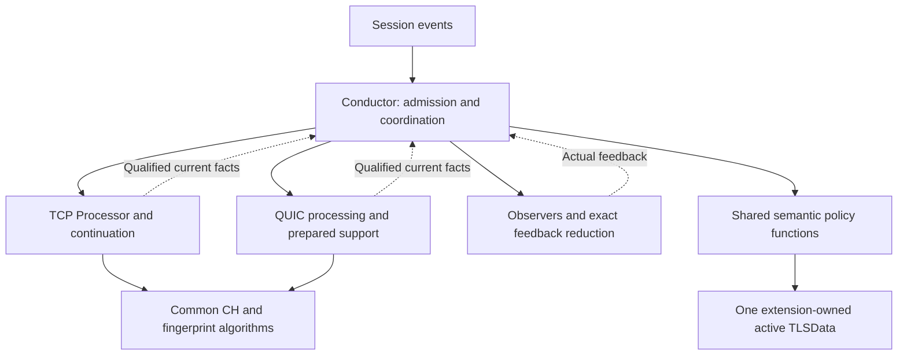

# Phase 6 Architecture-Selection Summary V1

## 1. Frozen decision and completion boundary

**Phase 6 architecture selection is COMPLETE at the document/architecture boundary defined by W, after the Step 7 review and external freeze record. EG1-EG8 pass with the evidence and limits in Section 13.** This is not a completed HLD, implementation-conformance certificate, measured-performance result or authorization to activate QUIC.

**Selected direction: R1, minimum C1 + C4-P.** Keep explicit TCP/QUIC processing paths under the existing Conductor. Use one shared semantic policy as cohesive functions, protocol-owned CH orchestration and common canonical CH/fingerprint algorithms. The Conductor owns traversal, actual feedback reduction and lifecycle timing; policy owns live semantic predicates/actions; processors own acquisition/qualified facts, never independent live TLSData commits. No mandatory new policy class, common processing interface, protocol Flow hierarchy or full common evaluator is selected. [D Sections 1/5-8]

The reference weighted result is R1 76.4 versus nearest R2 68.6. These are justified architecture judgments, not empirical superiority. R1's componentwise reference-score dominance means weight-only robustness cannot establish fair score assignment. Cost/ordinal uncertainty and evidence-triggered reconsideration remain binding. [D Section 4; VERIFY; Section 6]

This summary is the single active Phase 6 handoff narrative. Frozen source artifacts remain the detailed evidence and accepted-authority trail; this consolidation changes no accepted Phase 1-5 policy. If an original authority concretely conflicts with a reproduction, stop affected work and resolve it explicitly. The next stage must elaborate and validate the selected direction under Section 14; activation remains prohibited until its obligations pass.

## 2. Sources, provenance and active-narrative rules

### Active source identities

| Key | Frozen source | Use |
|---|---|---|
| W | `phase6-workflow-v1.md` | Phase 6 workflow and exact EG1-EG8 |
| S1 | `phase6-step1-authoritative-comparison-baseline-v2.md` | Available complete C01-C30 authority/constraint register |
| S2 | `phase6-step2-responsibility-and-semantic-sharing-assessment-v3.md` | Responsibility and D01-D28 transition assessment |
| S4 | `phase6-step4-candidate-comparison-v7.md` | Same-evidence S01-S15 comparison and cost model |
| F | `phase6-step4.5-selection-criteria-and-weights-v4.md` | Unchanged gates/preferences/weights, not the EG substitute |
| B1 | `candidate1-team-architecture-proposal-v5.md` | Candidate 1 definition |
| B2 | `Candidate2-V2.md` | Candidate 2 definition |
| B3 | `candidate3-team-architecture-proposal-v4.md` | Candidate 3 definition |
| B4 | `candidate4-team-architecture-proposal-v4.md` | Candidate 4 current definition |
| CODE | `TLS-Flow-All-Code.txt` | Supplied implementation snapshot, repository commit unknown |
| D | `phase6-step5-architecture-decision-and-delivery-scope-v10.md` | Selected R1 architecture and delivery packages |
| EVAL | `phase6-step5-evaluation-and-evidence-v1.md` | Detailed judgments, scenarios and sensitivity |
| VERIFY | `phase6-step5-v10-additional-verification-v1.md` | Additional targeted source/arithmetic verification |
| S6 | `phase6-step6-validation-plan-and-exit-gate-assessment-v2.md` | Validation plan and original exit-gate assessment |

Exact current file hashes are in `phase6-architecture-selection-provenance-v1.json`. A hash identifies bytes, not correctness or authority. The summary hash is external to avoid self-reference.

### Provenance and evidence limits

Original PLAN/P1-P5 and the separate consumer bundle are not currently available as local originals. S1/S2/S4 contain their accepted reproductions, precise locators and inherited inventory. We inspected the current available files, not the unavailable originals. The inherited source inventory and original-byte hashes below are reported by S1, not newly verified against original bytes. CODE is directly available; a complete repository/consumer/provider audit is not claimed.

Candidate 4 V4 is the current input. S4's B4 V3 filename/hash remains historical provenance and is not V4 identity. The exact current B4 digest is in the external record. D's statement that W was unavailable was true for its historical review only; W is now supplied. The Step 6 V1 missing-gate-text blocker B01 is resolved by W Section 3 and superseded in the active narrative by S6 V2. Old 4.5 M04 wording and historical candidate drafts are not active contracts. No preserved snapshot is deleted or edited.

The original Step 5 V9 and Step 3 V6 are not locally present. D reconciles the inherited V9 direction without claiming a line-by-line audit. Current B1-B4, S4, F, D and S6 identities are explicit; no unavailable original is claimed inspected.

Evidence kinds: **code fact** = supplied snapshot behavior; **accepted contract** = available authoritative reproduction; **architecture judgment** = placement/score/selection; **planned validation** = not executed. Architecture gate PASS is not a product-test PASS. Approved target corrections are distinct from current-code preservation.

### Reference convention

Local numbered sections are this summary's sections. Source-qualified references such as D Section 6.2, S6 Section 3 or S2 D18 always refer to the frozen source named above, not a local heading. Axx/Rxx/Dxx transition/source identifiers in the responsibility tables are S2 identifiers; D alone is the Step 5 source. Cxx is the S1 constraint ID. V01-V17 in the validation plan are S6 test-plan IDs; D Section 12 V01-V08 are a separate downstream-deferral namespace. P1-P5/PLAN/CONS in inherited rows are S1's underlying authority aliases, not claims of local availability.

### Inherited original source inventory

| Alias | File | Version / identity | Role | Bytes |
|---|---|---|---|---:|
| PLAN | `tls-flow-quic-pre-design-work-plan-v5.md` | V5 | Phase boundaries, four candidates and eight Phase 6 gates | 33724 |
| P1 | `phase1-copilot-report.md` | Supplied report; no filename revision | Current-behavior research leads; source inspection remains necessary | 17356 |
| P2 | `phase2-state-machine.md` | Supplied accepted state-machine document | State and attempt policy, subject to later accepted clarifications | 28114 |
| P3 | `phase3-semantic-processing-contract-review-v5.md` | V5 | Semantic contract, freshness, feedback and lifetime | 607365 |
| P4 | `phase4-runtime-orchestration-summary-v4.md` | V4 | Orchestration, verdict transaction, state commit and complete flows | 88921 |
| P5 | `phase5-ownership-lifecycle-runtime-bounds-summary-v7.md` | V7 | Ownership, lifecycle, bounded runtime and accepted capacity deferral | 197870 |
| CODE | `TLS-Flow-All-Code.txt` | Supplied snapshot; repository commit unknown | Current module source evidence, not proof of accepted target behavior | 332903 |
| CONS | `TLS-Consumers code.txt` | Supplied fragments; repository commit unknown | Consumer callback/integration evidence; incomplete repository paths | 33472 |

### SHA-256 of original bytes

- **PLAN** `55ea1536ac4913e3a4ce59cc717fc3f5e8752dcdddf51be66bed34b280c024fa`
- **P1** `9c25e615a26c28f65ddc3a26ee61c9e18ce90212c9ee0f9ca0b0506c8b840a69`
- **P2** `b2d0ae9254ed6e96c643281bfc09302dd8c8360b9672ff16611055820f02de77`
- **P3** `b3278e90d39b6e69396f4b87725e75aeac1aa9baa98f826001964cc16b46c438`
- **P4** `140c2ad934bf30def3f12137556d73f0ce5695b8f038bda3dce46ced9c182769`
- **P5** `8f0c3def3ce18217440fef1a7dfd7d6bea953f385328541afa3d16a9b13beba3`
- **CODE** `70f6f63926a6f9426033aec6903951cc804b2225b153d20d3a3b8e13d2808f5b`
- **CONS** `25719e413bd5aabb2947c79d86bb57ff35d6f75a1971e669697b6481b1af3a9d`

### Authority discipline

- **Current-code fact:** a directly inspected symbol or fragment describes the supplied implementation snapshot only. P1 is a research lead, not substitute source proof.
- **Accepted decision:** P2–P5 contracts and explicit user clarifications govern the target behavior. Later accepted clarifications supersede affected earlier wording only; they do not discard the earlier documents.
- **Candidate proposal:** future placement, sharing, strategy/base choice, component/interface shape and pattern selection remain unselected.
- **Evidence limitation:** missing external implementation or measurement is recorded with its consequence. It is not automatically an architecture blocker.
- P5 V7 S1 Sections 1, 2, 9.2 and 10.2 preserve the accepted completion policy and numerical deferral. An older conversational memory that completion remained blocked does not override these supplied accepted documents.
- PLAN Phase 6 is inspected directly. P5 10.2 is a corroborating reproduction, not the only available authority. Historical Phase 3/4/5 working artifacts cited by the summaries are not all supplied; their archival bytes and original review runs are not claimed inspected.

All inspection/authority statements inside this inherited inventory describe S1's evidence record, not a fresh inspection of unavailable originals in Step 7.

## 3. Complete constraint register and validation traceability

**Authority:** S1 Section 5; S6 Section 4. Every C01-C30 entry is retained, followed by its selected-design and validation mapping. All plan methods remain planned.

All entries are **ACCEPTED** constraints, not architecture proposals. CODE/CONS references identify current integration surfaces only. Pn section references resolve to the exact source files and section ranges in S1 Section 6 and the manifest.

| ID | Concern | Binding constraint | Authority | Comparison consequence |
|---|---|---|---|---|
| C01 | Scope/authority | Compare at least four genuinely different architectures before selection; Candidate 4 must investigate moving/generalizing TCP state logic into common semantic processing. Evaluation is mandatory, selection is not. | PLAN Phase 6; P5 10.2 | No current class boundary is a mandatory target boundary. |
| C02 | Observation boundary | QUIC v1, client-to-server observation and Initial protection processing only. Do not assume server Retry/HRR/Finished, decrypted Handshake, HANDSHAKE_DONE, or server transport parameters. Initial verification is not peer authentication. | P2 2; P4 Q01/Q11; P5 2 | Shared semantics must preserve unequal observable evidence. |
| C03 | Header interpretation | Interpret only visible/invariant fields without header unprotection. Protected reserved bits, packet-number length and packet number require Initial header protection removal; short-header key phase is not state evidence. | P2 2; P5 D6-06 | Do not confuse visible v1 Long Packet Type with protected packet-number fields. |
| C04 | Completion | An unambiguously associated client QUIC v1 Handshake Long Header is accepted product-level completion evidence, not observed TLS Finished. Before authoritative CH, retain only bounded deferred evidence; commit only under the accepted CH/feedback/state conditions. | P2 9; P4 Q11; P5 1 and 2 | Completion is accepted, not a reopened blocker or a proposal. |
| C05 | Semantic processing | Separate supported current-input syntax/encoding/protection findings from attempt-wide flow legality. TLS Enforcement owns flow-legality decisions and associated enforcement; TLS-flow/Processor do not independently drop. | P4 D4-01; P3 4 and 6 | STOP must not become an automatic network discard. |
| C06 | Fingerprint | Preserve the same fingerprint algorithm/output for the same complete CH across TCP and QUIC, including accepted legacy behavior; do not introduce an algorithm correction as part of this feature. | P4 D4-02; P3 4 | Sharing cannot change fingerprint semantics. |
| C07 | Freshness | Available retained result data is not automatically a new eligible observation. Dispatch only qualified fresh observations, with the explicit accepted TCP exception preserved. | P3 5; P4 4 and G05 | Viewer availability alone cannot trigger duplicate callbacks. |
| C08 | Unsupported | Apply the accepted pre-dispatch Unsupported exclusion: no consumer callbacks for the affected Unsupported unit. Support/resource exhaustion follows accepted Unsupported policy, not a synthetic protocol violation. | P4 Unsupported pre-dispatch contract and Q16; P5 D6-04 | Do not replace this with legacy dispatch ordering. |
| C09 | Feedback boundary | Resolve required current-unit feedback before accepting later semantic authority, mutating backing still in use, or proceeding to the next unit. Bounded read-only lookahead does not grant later authority. | P3 6; P4 4 and 5 | No speculative later-unit state commit. |
| C10 | Verdict reduction | Start the current-unit violation accumulator at zero, OR actual callback masks, and do not seed it with historical terminalViolationMask. Observer-list order and first-STOP behavior are preserved. | P4 4; CODE TLSFlowConductor::analyzeProcessResult and notify | Skipped/expired observers produce no synthetic verdict. |
| C11 | STOP without violations | A zero-mask STOP latches traversal stop; remaining applicable current-unit projections may run. A justified normal update remains permitted if the final mask is zero. No later unit is delivered. | P4 4; P3 FB-C | STOP alone is not Error and does not cancel every current-unit projection. |
| C12 | STOP with violations | STOP when the accumulated mask is nonzero causes immediate Error and stops remaining projections. A latched zero-mask STOP followed by a later violation resolves to Error under the accepted transaction rules. | P4 4; P3 FB-C | Preserve accumulated-mask semantics, not just the latest local verdict. |
| C13 | Commit authority | Keep one logical authority for accepted state disposition. Qualified normal commits follow permitted feedback; nonzero violations suppress normal updates. Parsers must not introduce competing state policy. | P4 5 G06-G08; P5 D6-07 | Logical authority does not require a new class. |
| C14 | Participation and terminal gates | Preserve extension/subscriber eligibility, TCP reuse/reset/terminal ordering and protocol-specific next-unit permission. QUIC terminal processing reopens only for an accepted new attempt, not late same-attempt evidence. | P4 5 G01-G04/G08 and T01/T07/T10/Q10/Q19 | Do not import QUIC candidate policy into TCP. |
| C15 | Attempt isolation | Maintain one active TLSData attempt context per DP Session. A qualified complete new attempt replaces the active attempt as session reuse; do not merge candidate and active state. | P2 10 and 14; P4 Q09/Q10; P5 5 | Candidate preparation is not active semantic authority. |
| C16 | Retry and HRR | Retry-compatible acquisition restart and HRR-compatible CH2 remain the same attempt and do not prove observation of server Retry or HRR. | P2 7 and 8; P4 Q07/Q08 | Do not invent observed server events. |
| C17 | Ambiguity and retired input | Retired-attempt suppression and ambiguous-association handling must not merge/reset active state. Missing or expired retired evidence alone proves neither retired identity nor newness. | P2 12; P4 Q06/Q19; P5 EV23 | Do not grow an unlimited history to avoid ambiguity. |
| C18 | 0-RTT and opaque traffic | 0-RTT does not change handshake state. Opaque 1-RTT or close evidence cannot substitute for accepted completion/alert evidence. | P2 11; P4 Q12/Q18; P5 2 | Shared state policy must not fabricate TCP-like records from opaque input. |
| C19 | Alert disposition | A readable associated Initial CRYPTO_ERROR close follows the accepted TerminatedByAlert policy, not Finished. Preserve protocol-specific evidence qualification. | P4 Q17/Q18; P5 2 | No generic synthetic completion from a close. |
| C20 | Ownership | Separate startup physical backing ownership from logical session/attempt/acquisition claims. Preserve the accepted resource ownership profiles; no Engine-global allocator service is preselected. | P5 3 and 5 | Do not turn a logical role into an automatically required component. |
| C21 | Borrow lifetime | Packet bytes, viewer results, nested full-string data and callback projections retain their specific borrow/validity boundaries. A copied wrapper is not owned backing. Finish all current uses before reuse/reset/release. | P3 5 L01-L14 and 8; P5 3 and 5 | Synchronous consumer use does not prove arbitrary downstream retention safe. |
| C22 | Replacement safety | Candidate preparation, acceptance, rollback and cleanup must preserve active authority and backing validity on failure. Bound admission, reservation and replacement peak. | P5 4; D6-02/D6-03/D6-05; 6.3 | Do not hide simultaneous active/candidate storage as routine tuning. |
| C23 | Reclaim | Request reclaim eligibility only after a newly committed Finished transition and current-unit last uses. Marking is not immediate release or proof marking succeeded; preserve required terminal identity and clear stale membership on accepted reuse. | P4 G09; P5 2 and 5 | Repeated/late evidence cannot repeat the transition or authorize new-lifecycle eviction. |
| C24 | Eviction | Resource eviction does not itself produce an Incomplete Handshake violation. Required context loss follows accepted lifecycle/Unsupported policy; it is not synthetic completion. | P2 13; P5 4 and 2 | Distinguish resource loss from observed protocol failure. |
| C25 | Allocation-free runtime | Allocate physical storage at Engine startup only. Packet processing and other Engine runtime work must not allocate dynamically or grow capacity, including indexes, listener slots and auxiliary bookkeeping. | P5 1, 5 and 6; user working rules | Runtime claim/recycle uses prepared storage; existing allocation-looking code is not a target exemption. |
| C26 | Bounded work | Enforce finite checked bounds for parsing, ranges/overlap, acquisition/context trials, reconstruction, retention and cleanup. Use the accepted symbolic storage/work dependencies and explicit exhaustion outcomes. | P5 6; D6-06/D6-08; 7 | No unbounded scan/retry/retention hidden behind a shared interface. |
| C27 | Numeric deferral | Numerical capacities may be selected after HLD presentation and architect decision. They must be finite, approved and prepared before enabling the path. Do not demand unavailable budgets or claim every value preserves identical traffic support. | P5 1 and 9.2 U8-CAP | A value requiring changed ownership, unbounded work or another mechanism reopens the affected design. |
| C28 | Current consumer boundary | Use the supplied Enforcement, Fingerprint and Visibility callbacks as integration evidence. Preserve accepted compatibility boundaries without certifying all helpers/storage/mitigation or QUIC support of existing consumer actions. | P3 8; P4 7; CONS callback fragments | No implicit approval of a QUIC TCP-reset mitigation path. |
| C29 | TCP preservation and fixes | Preserve accepted TCP observable behavior and staged evaluation; distinguish adopted TCP correction obligations from already applied patches. Do not require complete TCP handshake buffering solely for sharing. | P1 2-4; P4 10; P5 1 and V7-11; PLAN Phase 6 | Code differences from target policy are migration obligations, not silent policy replacements. |
| C30 | Proportionality and validation | Every new abstraction needs a current benefit. KISS/YAGNI, merge-before-split and limited DTLS hard-coding checks apply. Validate the selection with available or explicitly planned evidence; document review is not runtime proof. | PLAN Phase 6; P5 10.2; user working rules | No selection, pattern or final component split is made in Step 1. |

### Selected-design coverage

Each row has result **SUPPORTED AT SPECIFICATION LEVEL; implementation validation pending**. This means the selected definition has an explicit compatible mechanism at the cited D anchor, with no new contradiction identified in this focused review. It does not mean the original Phases 1-5 or future implementation were fully verified. C01 comparison evidence is inherited from EVAL/S4; this step does not rerun the candidate selection. The historical missing-gate-authority blocker B01 is resolved by W Section 3. The full EG1-EG8 assessment is in S6 Section 6.

| Constraint | Required concern | Selected evidence | Planned validation |
|---|---|---|---|
| C01 | Four architectures and C4 investigation | D 3/10; EVAL alternatives; S4 2-8 | V17 |
| C02 | Visibility and QUIC v1 scope | D 6.5 | V08 |
| C03 | Visible versus protected header fields | D 6.5; S1 C03 | V08 |
| C04 | Accepted product completion | D 6.5; S4 S09 | V08 |
| C05 | Local validity versus Enforcement legality | D 5/6.5/12 V07 | V04,V07,V16 |
| C06 | Same fingerprint algorithm/output | D 7 | V09 |
| C07 | Freshness and TCP exception | D 6.1/7; F M03 | V02,V09 |
| C08 | Unsupported pre-dispatch | D 6.3/8.2 | V04,V11 |
| C09 | Feedback before later authority | D 6.2-6.3 | V03,V05 |
| C10 | Actual masks and list ordering | D 6.2; CODE notify | V03 |
| C11 | Zero-mask STOP | D 6.2; CODE analyzer | V03 |
| C12 | STOP and accumulated violations | D 6.2; CODE analyzer | V03 |
| C13 | One semantic authority | D 5-7 | V01 |
| C14 | Participation and terminal gates | D 6.1/6.4/8.3 | V02,V04,V06,V13 |
| C15 | One active core and isolated candidate | D 6.4/8.1-8.2 | V06,V07 |
| C16 | Same-attempt restart/CH2 | D 6.5 | V07 |
| C17 | Ambiguity and retired suppression | D 6.4-6.5 | V07 |
| C18 | No 0-RTT/opaque completion | D 6.5 | V08 |
| C19 | Qualified alert disposition | D 6.5 | V16 |
| C20 | Physical ownership versus claims | D 8.1-8.3 | V10,V11,V12,V13 |
| C21 | Borrowed lifetime | D 5.2/8.2 | V10,V12 |
| C22 | Replacement safety/peak | D 6.4/8.2/8.4 | V06,V11,V12,V15 |
| C23 | Finished reclaim timing | D 8.2; B4 6.3 | V12 |
| C24 | Eviction is not handshake violation | D 8.2-8.3 | V11,V12,V13 |
| C25 | Startup-only allocation | D 8.4 | V14 |
| C26 | Bounded work | D 8.4 | V05,V15 |
| C27 | Authorized numeric deferral | D 8.4/12 V01 | V15 |
| C28 | Consumer compatibility boundary | D 5.2/12 V07 | V10,V16 |
| C29 | TCP preservation/corrections/staging | D 6.1/7/9 | V02,V09,V17 |
| C30 | Proportionality and honest validation | D 3-5/10-12 | V17 |

## 4. Current responsibilities and semantic-sharing assessment

**Classification:** X protocol extraction/protection/framing/reconstruction/association; S potentially shared semantics/state; O orchestration/feedback/lifecycle; I intentionally protocol-specific. U can move with preconditions preserved; G needs qualified generalization; P remains protocol-specific. These Step 2 classifications were comparison evidence, not mandatory classes. Final selected placement is Section 7.

### TCP entry-to-disposition map

| Stage | Current code behavior and control return | Accepted boundary / overlay |
|---|---|---|
| 1. Wiring | Engine Factory creates parser/Processor/viewer and Conductor wiring; Session events enter onEvent. | Startup construction is not proof all runtime paths are allocation-free. P5 5/7. |
| 2. New session | A01 calls A11; live listeners determine masks, absent eligibility/allocation returns Continue; successful creation registers inbound/aging observers. | Preserve participation; no semantic parsing without context. P4 G01/T01. |
| 3. Inbound reuse | A02 obtains extension and handles TCP SYN-without-ACK reuse before process; absent extension returns Continue. | TCP trigger retained; QUIC qualification differs. P4 T07/Q09/Q10. |
| 4. Early paths | A03 handles TCP reset, silent terminals, empty payload and terminal payload before normal stepping. | Preserve ordering and exception verdict semantics; QUIC terminal candidate gate precedes new CH parsing. P4 4/T10/Q10/Q19. |
| 5. Begin input | A20 receives payload/session/TCP sequence; prepares packet-local state and resumes/qualifies continuation. | TCP sequence logic remains specific; accepted restoration/isolation fixes are obligations, not applied patches. P5 D6-01. |
| 6. Process unit | A21/A22 select new record, CH extension continuation, opaque continuation or alert continuation; expose step outcome and viewers. | No automatic whole-handshake buffer; current-input validity differs from attempt legality. P3 4/5; P4 T03/T05. |
| 7. Outcome routing | A04 sends RecordParsed to A05; Stop to parsing-error feedback; NeedMoreData/EndOfPacket return; Unsupported commits accepted disposition. | Unsupported has no consumer dispatch. Parser Stop is distinct from observer Stop and drop. P4 4/T08/T09. |
| 8. Ordinary projections | A05 calls parsing-error list, record list, then CH list if Complete; A31 enforces priority/live listeners and within-list Stop. A07 builds callback-local CH data; nested viewer backing remains independently borrowed. | Preserve U05 retained-Complete callback exception for TCP, not a new QUIC CH event. P3 5/8; P4 D4-02/7. |
| 9. Feedback | A05 ORs actual masks; Stop+nonzero immediately commits Error; zero-mask Stop latches and permits remaining applicable current-unit projections. | No rollback of performed consumer side effects; no network drop implied. P4 4. |
| 10. State disposition | Nonzero masks suppress normal commit. Otherwise A12 applies record-specific state policy and A13-A16 field updates. | Const consumer TLSData is precommit live state, not immutable snapshot. P4 5. |
| 11. Reclaim/next | A05 marks newly Finished; A03 loops only on RecordParsed plus updated active state and no returned Stop. | Last uses and required identity must survive; mark failure is not success; no next authority before feedback. P4 G08/G09; P5 5. |
| 12. Lifecycle | A10 notifies SessionEnd then releases; A29 removes reclaim membership and resets/erases extension. SegmentBufferManager separately owns continuation cleanup. | Aging is not the ordinary transaction; resource eviction does not manufacture an Incomplete Handshake violation. P5 4/5. |

### Responsibility overlay

| ID | Responsibility | Current TCP evidence | Accepted QUIC responsibility | Class | Sharing assessment / reason | Contract anchors |
|---|---|---|---|---|---|---|
| R01 | Participation and session admission | A01/A11: gather live listener event masks and allocate an Extension only for participating sessions. | Apply accepted eligibility before semantic QUIC processing; do not infer a new port/profile policy. | O | Common participation intent; current listener masks and startup-prepared storage must be preserved. | P3 8; P4 T01/Q01, G01; P5 3/5 |
| R02 | Input framing and cursor | A03/A20/A23: packet payload, TCP sequence, record headers and continuation cursor. | UDP datagram/coalesced packet bounds, version/header parsing and packet-local protection bounds. | X | Different framing and reconstruction coordinates; a TLS record is not a QUIC packet. | P3 4; P4 T04/Q01/Q04; P5 D6-06 |
| R03 | Protection processing | No QUIC header-unprotection/Initial AEAD path exists in the supplied TCP Processor. | Initial key/context selection, header unprotection, PN reconstruction and AEAD verification within accepted bounds. | X | Protocol-specific cryptographic extraction; Initial verification is not peer authentication. | P2 2; P4 Q14; P5 D6-06 |
| R04 | Continuation and reconstruction | A20-A25: TCP sequence/retransmission handling, extension reassembly, opaque tracking and alert reassembly. | Initial CRYPTO offsets/ranges/gaps/overlap, bounded candidate acquisition and reconstruction. | X | Storage/lifetime discipline can align; byte-ordering and gap semantics cannot be equated. | P3 5; P4 T03/T05/Q03/Q05/Q06; P5 5/6 |
| R05 | Association and attempt qualification | A02: SYN-without-ACK reuse rule based on active state and stored violations. | Same DP tuple plus retained identity/association, retired suppression, ambiguity, Retry-compatible restart and complete-new-attempt qualification. | X | Wire-specific evidence must precede any shared accepted-reset action. | P2 8-10/12/14; P4 T07/Q08-Q10/Q19; P5 4/5 |
| R06 | CH semantic evaluation | A23/A24 plus CH/extensions parsers: fields, supported-version offer, SNI, early-data offer and fingerprint. | Evaluate qualified reconstructed CH with the same accepted algorithm/output and field meaning. | S | Strong sharing opportunity after qualified byte availability; preserve staged TCP access and legacy algorithm behavior. | P3 4/5; P4 D4-02/Q02; P5 D6-01 |
| R07 | Local validity versus flow legality | Processor local syntax/error outputs; CONS Enforcement Manager consumes current facts. | Supported packet/frame/CH encoding findings versus attempt-wide CH legality. | S | Share semantic findings where representable, not fabricated TLS-record errors; Enforcement remains flow-legality owner. | P3 4/6; P4 D4-01/Q15/Q16 |
| R08 | Observation eligibility | A05/A07 use Complete viewer status; accepted TCP U05 permits retained-Complete dispatch. | Fresh qualified observation only; duplicates/retired/ambiguous acquisition do not become new CH events. | S | Generalize eligibility/provenance while explicitly retaining TCP U05, not a universal once-only callback rule. | P3 5/8; P4 D4-02/G05; P5 D6-01 |
| R09 | Projection and observer delivery | A06-A08/A31: parsing error, record and CH lists, priority and weak-listener handling. | Deliver supported semantic projections to existing observers; no fake TCP record/CCS/reset event. | O | Shared delivery mechanics; event applicability and missing QUIC event representations remain explicit. | P3 6/8; P4 4/7 |
| R10 | Verdict transaction | A05/A31: actual masks, within-list Stop, latched zero-mask Stop and final disposition. | Same accepted feedback boundary before next semantic authority. | O | Reducer is shareable; parser Stop and terminal/reset exceptions cannot be flattened into it. | P3 FB-B/FB-C/FB-D; P4 4 |
| R11 | Normal CH state commit | A13: authoritative CH fields, count, timestamp and PreHandshake to InProgress. | Same logical commit for accepted CH; duplicate suppression/CH2/new-attempt qualification occurs first. | S | Share qualified field update and state meaning, not raw viewer availability or packet timestamp sourcing. | P4 5/Q02/Q07; P5 2/5 |
| R12 | Completion evidence and policy | A12/A14/A15: CCS, later handshake record, TLS13 ApplicationData and early-data-offer condition. | Unambiguously associated client v1 Handshake Long Header, possibly bounded deferred evidence before authoritative CH. | I | Evidence is intentionally separate; permitted Finished commit and lifecycle consequence can be shared. | P2 5/6/9; P4 T11/Q11; P5 1/2/5.0 |
| R13 | Alert interpretation | A26/A16: readable TCP alert qualification and terminating-alert policy. | Readable associated Initial CRYPTO_ERROR close follows accepted TerminatedByAlert disposition. | I | Share terminal meaning/commit guard, not plaintext alert framing, encryption assumptions or arbitrary close interpretation. | P4 T11/Q17/Q18; P5 2 |
| R14 | Error/violation/Unsupported disposition | A17-A19: stored mask, Error and current TCP Unsupported conditions. | Accepted resource/support exhaustion and context loss dispositions; Unsupported excludes consumer dispatch. | S | Mask/Error actions can share; cause qualification and TCP-specific Unsupported predicates need generalization. | P3 FB-D; P4 4/5; P5 D6-04/D6-07 |
| R15 | Terminal gating and late input | A03/A09 and TLSData predicates: silent Finished/Unsupported; terminal payload for Error/TerminatedByAlert. | Classify terminal candidates/retired input before new CH parsing; same-attempt terminal input cannot reopen state. | I | Share terminal-state meanings, not unconditional TCP entry/terminal-payload routing. | P2 12; P4 T10/Q10/Q19; P5 4/5 |
| R16 | Reclaim and cleanup | A05/A10/A29/A30: Finished marking, aging callback, extension release and table membership. | Eligible committed Finished plus last use, required terminal identity retention, stale membership clearing and bounded cleanup. | O | Common lifecycle coordination with resource-specific ownership and safe failure handling; no global allocator is implied. | P3 5; P4 G09; P5 3-6 |
| R17 | Reset and replacement | A02/A28/A29: clear TLSData and release/rebuild extension on qualified TCP reuse. | Isolated candidate acceptance, rollback, old/new ownership transfer and retired identity. | S | Default-value reset action can share; accepted replacement is not a blind clear or identical release/rebuild sequence. | P2 10/14; P4 T07/Q09/Q10; P5 D6-02/D6-05 |
| R18 | Startup and runtime bounds | Engine Factory/Application wiring, Extension/table, Processor/SegmentBufferManager ownership. | Prepare bounded keys, ranges, acquisition, canonical CH, result backing and indexes at startup. | O | Shared lifecycle/bound discipline; no runtime allocation/growth and no invented numeric capacities. | P5 3/5/6/9.2 |
| R19 | Consumer side effects | CONS Enforcement, Fingerprint and Visibility callbacks consume current fields and session/profile context. | Preserve accepted CH integration and explicit capability limitations. | I | Consumer mitigation/reporting storage is not automatically transport-neutral; no automatic QUIC TCP-reset action. | P3 8; P4 7; P5 3/5 |

### Transition-by-transition assessment

This inventory includes both writers and read-only state-dependent decisions in the Conductor, Processor and lifecycle path. It is not restricted to functions named state machine. U means semantic relocation is possible, not that callback timing, storage access or function signatures already match a shared interface.

| ID | Existing decision / anchor | Current behavior | Move | Boundary and reason | Accepted authority |
|---|---|---|---|---|---|
| D01 | A28 TLSData defaults/clear | All semantic fields return to defaults. | U | Same value-reset action; authorization and old-resource cleanup are outside this action. | P4 5; P5 5 |
| D02 | A27 active/terminal/silent predicates | PreHandshake/InProgress/ChangeCipherSpec active; Finished/Error/Unsupported/TerminatedByAlert terminal. | G | State meanings may share; ChangeCipherSpec is TCP-only and terminal input routing is protocol-specific. Do not depend on enum ordering as a universal protocol rule. | P2 4/5; P4 G04 |
| D03 | A02 SYN reuse | SYN without ACK rebuilds missing/eligible old extension; active/no-recorded-violation branch retains context. | P | Keep TCP trigger/predicate. QUIC candidate acceptance is different; share only the authorized reset/replacement consequence. | P4 T07; P2 10/14 |
| D04 | A03 TCP RST | Notify TCPReset; Stop+mask Error, Continue+mask stores mask, no-mask clears TLSData. | P | TCP reset event and no-mask clear are not QUIC close semantics. Shared verdict primitives may be reused without changing this exception. | P4 T10; P4 4 exceptions |
| D05 | A03/A09 terminal routes | Finished/Unsupported silent; Error/TerminatedByAlert terminal payload path before normal parsing. | G | Keep TCP behavior; QUIC must qualify new-attempt candidates and suppress retired/ambiguous input before equivalent terminal decisions. | P4 T10/Q10/Q19 |
| D06 | A13 CH completion guard | Commit CH only if current viewer reports Complete. | G | Use qualified authoritative CH readiness/provenance, not generic retained Complete. Preserve U05 callback behavior separately from CH commit. | P3 5/8; P4 5 |
| D07 | A13 CH field updates | Increment CH count, store timestamp/fingerprint/version mask/earlyDataOffered. | G | Field meanings share; valid current backing, duplicate qualification, CH2 and timestamp sourcing must remain correct. D-TIME is not upgraded from proposal to requirement. | P4 5; P5 D6-01 |
| D08 | A13 PreHandshake to InProgress | First permitted CH normal commit starts active handshake. | U | Same state transition after protocol-specific qualification and feedback. No need to keep this policy inside a TCP-only path. | P2 4/6; P4 Q02 |
| D09 | A14 pre-CH CCS | Increment preCcsSeen if CH count is zero. | P | No QUIC CCS surrogate or 0-RTT mapping. | P4 5/T11/Q12 |
| D10 | A14 InProgress to ChangeCipherSpec | After CH, non-TLS13 CCS enters ChangeCipherSpec. | P | TCP evidence and state branch; QUIC does not traverse it. A shared policy may contain a guarded TCP branch, not require separate policy classes. | P2 5; P4 T11 |
| D11 | A12 ChangeCipherSpec to Finished | A later handshake-content record completes this TCP branch. | G | Keep the TCP record/state evidence predicate; generalize only permitted completion disposition, not encrypted payload parsing. | P4 T11; P5 2 |
| D12 | A15 pre-CH ApplicationData | Increment earlyDataCount when CH count is zero. | P | TCP record observation only. QUIC 0-RTT changes no handshake state/counter by analogy. | P4 5/T11/Q12 |
| D13 | A15 TLS13 completion | InProgress + TLS13 ApplicationData + no earlyDataOffered enters Finished. | G | Keep TCP condition intact; QUIC completion uses associated Handshake evidence. Shared Finished action must not infer early-data acceptance or server Finished. | P2 5/9; P4 T11/Q11 |
| D14 | A16 TerminatedByAlert | Active + readable alert + terminating classification enters TerminatedByAlert. | G | Share qualified termination disposition; TCP plaintext visibility/alignment and QUIC associated Initial CRYPTO_ERROR extraction remain separate. | P4 T11/Q17/Q18 |
| D15 | A18 violation accumulation | OR actual violation mask into terminalViolationMask. | U | Same semantic storage action; reset on accepted new lifecycle and keep current accumulator separate. | P4 4/5 |
| D16 | A19 Error | Set Error and OR violations. | U | Same accepted Error action; invocation follows actual verdict contract, not parser Stop or resource exhaustion alone. | P3 FB-C/FB-D; P4 4 |
| D17 | A17 Unsupported | Current code tests continuationGap, PreHandshake, or InProgress with Partial CH. | G | Do not transplant this predicate to QUIC. Apply accepted D6-04 required-context/support exhaustion policy and preserve cause qualification; no callback on Unsupported. | P4 T09/Q16; P5 D6-04 |
| D18 | A05/A31 normal-commit permission | Nonzero accumulated mask suppresses normal commit; Stop+nonzero Error; Stop+zero can still permit normal update. | U | Reducer policy can move unchanged in meaning; adapters and exception paths remain distinct. | P3 FB-C; P4 4 |
| D19 | A03 next-record permission | Continue only on RecordParsed and updated active state; observer Stop returns immediately after resolved current unit. | G | Share feedback-before-next-authority discipline, not RecordParsed as a universal QUIC cursor. | P3 FB-B/FB-E; P4 G08 |
| D20 | A05/A30 Finished reclaim | Compare previous/current state, mark newly Finished; table API returns bool. | G | Share transition-triggered eligibility, honor last uses and marking failure, preserve required identity; marking is not release. | P4 G09; P5 2/5 |
| D21 | A10/A29 aging | Notify SessionEnd, ignore returned verdict at this caller, release extension. | G | Keep current TCP exception; coordinate QUIC cleanup and borrows. Resource eviction is not synthetic SessionEnd/Incomplete Handshake. | P4 4/T10; P5 4/5 |
| D22 | A23 Unsupported parser gate | processNewRecord returns EndOfPacket when state Unsupported. | G | Read-only policy gate may align with shared terminal permission, but must not bypass QUIC terminal candidate classification. | P4 G03/G04; P5 5 |
| D23 | A23 opaque-record selection | State/version plus record type selects opaque continuation for pre-CH ApplicationData, InProgress TLS13 ApplicationData/CCS, and post-CCS handshake. | P | Keep TCP record/visibility selection. QUIC ciphertext is not a record to track by TCP sequence. | P4 T03/T11; P5 D6-01 |
| D24 | A26 and startSegmentedAlert | PreHandshake/InProgress controls plaintext alert visibility and continuation mode. | P | TCP encryption/alignment decision; QUIC Initial readable-close extraction is a different proof. | P4 T11/Q17/Q18 |
| D25 | A20/A21 continuation decisions | Pending continuation sequence/gap/retransmission selects resume, NeedMoreData or Unsupported. | P | TCP gap is not QUIC CRYPTO gap. Share bounded failure vocabulary only where semantics match. | P3 4/5; P4 T05/Q03/Q05 |
| D26 | A04 parser Stop | Parsing-error callbacks and actual verdicts determine disposition; parser Stop itself is not observer Stop. | G | Preserve exception and distinct channels. Do not force a universal normal-record transaction on failed extraction. | P3 FB-D; P4 4/T08/Q15 |
| D27 | A23 same-input Complete guard, Processor.cpp extracted L947-952 | A later CH encountered while current CH status is Complete produces MultipleClientHello and Error parser result. | P | Preserve the accepted legacy TCP local guard. Do not add a QUIC datagram-local CH-count guard or an attempt-wide max-CH gate. Additional qualified QUIC CH, including third CH, remains subject to actual Enforcement feedback, not automatic Processor rejection. | P4 T06/Q07 and B01; P3 U05 |
| D28 | A23 shouldParseHandshake, Processor.cpp extracted L900-907 | Parse a TCP handshake header only in PreHandshake or InProgress and only for a handshake-content record. In ChangeCipherSpec the record is not parsed as plaintext handshake; A12 uses the record/state evidence for the accepted Finished transition. | P | Preserve this TCP plaintext/opaque selection independently of CH semantic evaluation. QUIC CH parsing requires qualified Initial CRYPTO bytes and accepted attempt/terminal gates, not this TCP state/record predicate. A shared evaluator must receive only bytes whose visibility and applicability have already been qualified. | P4 T11/Q02/Q10; P5 D6-01; P3 4/5 |

### QUIC-only policy that must be overlaid, not inferred from TCP

- **Deferred completion:** associate client Handshake Long Header evidence under P2 9/P5 5.0, retain a bounded idempotent fact before authoritative CH, and consume it only under permitted CH/feedback/commit conditions. It is not observed TLS Finished. TCP has no identical deferred-evidence mechanism.
- **Attempt replacement:** active candidate evaluation is isolated until accepted; terminal candidate classification precedes CH parsing. A complete new attempt replaces active state as session reuse. Retry-compatible restart and HRR-compatible CH2 remain the same attempt without proving server Retry/HRR. P2 7–10/14; P4 Q07–Q10; P5 4/5.
- **Ambiguity/retirement:** no merge/reset on ambiguity, retired suppression, or absence/expiry of retired identity alone. No unbounded identity history. P2 12; P4 Q06/Q19; P5 EV23.
- **0-RTT/opaque input:** no state change from 0-RTT, no surrogate CCS, no Finished inferred from opaque 1-RTT. P2 11; P4 Q12.
- **Resource/context loss:** use accepted Unsupported and lifecycle disposition; no synthetic completion, flow violation or incomplete-handshake event. P5 D6-04 and event matrix.

### Staged TCP preservation

### Existing stages to preserve

1. **Packet-local record framing:** A20/A23 operate on the current payload and record cursor. Unsupported/partial outcomes do not require retaining every handshake message.
2. **CH prefix and digest work:** current CH parsing obtains fixed fields/cipher/compression information and incrementally builds fingerprint state. The parser can consume qualified fields before all extension bytes arrive; this is evaluation progress, not an authoritative complete-CH dispatch or TLSData commit.
3. **CH extension continuation:** A24 copies only the supported continuation region into its owned buffer, restores counts/version/digest/locator state, evaluates extensions and finalizes when complete. P5 D6-01 requires mode-specific restoration and current-result isolation; do not treat the existing fallback version read as proof the adopted correction is implemented.
4. **Opaque record tracking:** A25 and A23 retain sequence/remaining-length/type metadata for supported opaque records instead of buffering/decrypting their entire payload. TCP state/version decides applicability. This mechanism is not QUIC CRYPTO reassembly.
5. **Alert continuation:** A26 and alert continuation helpers retain only the supported readable-alert/alignment state. This is not generic handshake buffering.
6. **Feedback and last use:** current views remain valid through callbacks, nested full-string reads and subsequent permitted commit. Reuse/reset/reclaim waits for last use. A callback-local wrapper copy is not an owned deep copy. P3 5 L01–L14; P5 3/5.

### Sharing implication

A common semantic evaluator may accept qualified staged field availability or equivalent bounded access to CH data; it need not demand a contiguous complete TCP handshake buffer. QUIC can satisfy its own accepted complete-CH reconstruction requirement without imposing that representation on TCP. This is an admissible comparison boundary, not a selected incremental-parser API.
Fingerprint finalization, complete-CH authority, callback eligibility and TLSData commit remain separate milestones. Staged evaluation cannot expose partial fields as an authoritative complete CH, merge attempts, dispatch a later observation before feedback, or alter the accepted TCP U05 exception. Full-string/digest backing required by consumers remains bounded and independently valid.
Any candidate that requires whole-message TCP buffering solely to fit its abstraction must justify a current requirement and regression/runtime cost; no such requirement is established by Phases 3–5. Conversely, sharing must not eliminate the QUIC reconstruction/association evidence required by those contracts.

## 5. Four candidates and useful hybrids

### Four candidate families

| Family | Real architectural distinction | Shared policy/evaluation and current trade-off |
|---|---|---|
| C1 | Shared Conductor, explicit protocol processing calls | Composition and shared semantic actions without mandatory TCP contract replacement; selected minimum realization R1 |
| C2 | Revised processing strategy contract and common pull loop | One input/outcome vocabulary; requires coherent TCP adapter/borrow/Factory migration; R2 |
| C3 | Protocol Flows below shared Conductor | Flow owns traversal/transaction/lifecycle sequence; moves TCP authority and needs policy parity; R3 |
| C4 | Protocol extraction feeding common semantics/state | Explicitly evaluated C4-F full staged evaluator and C4-P shared policy/canonical algorithms with protocol-owned orchestration; existing class boundaries are not constraints |

The concise comparison below defines concrete complete realizations, not parent-score averaging. Candidate 4 is evaluated rather than predetermined as winner. No full HLD for rejected alternatives is required. [B1-B4; S4; D Section 3]

**Source basis:** D Section 3.

The alternatives were defined and frozen before scoring. All use the same accepted scope, one active TLSData, prepared-storage ownership model, victim-aware retirement obligation and scenario expectations. These explicit assessment realizations resolve allowed architecture choices without editing the original candidate proposals. They are not claims that every possible implementation of a candidate passes.

| ID | Concrete realization | Distinct current benefit | Additional seam/cost to assess |
|---|---|---|---|
| R1 | C1 + C4-P, explicit calls, cohesive shared policy functions | Preserve TCP processing contract while sharing real semantic predicates/actions | Qualified QUIC facts, producer routing and required retirement integration |
| R2 | C2 + C4-P, revised common pull contract | One processing vocabulary and ordinary pull loop | TCP adapter/input/outcome/borrow contract and Factory migration |
| R3 | C3, independent protocol flows with common primitives | Protocol-local traversal and lifecycle sequencing | Relocate TCP transaction authority; maintain parity across two policy sequences |
| R4 | C1 + C4-F | Common staged CH evaluation as well as policy | Extract TCP staged digest/locator/cursor orchestration and valid access |
| R5 | C2 + C4-F | Common pull contract plus common evaluator | Combined strategy/evaluator adaptation and backing seams |
| R6 | New C3 + common semantic policy hybrid | Reduce R3 policy drift while retaining flow-local sequencing | TCP Flow relocation plus flow-to-policy seam; no Conductor semantic commit |

C1 permits shared semantic functions and C4-P does not require a separate policy object. Therefore a minimum conforming C1 realization and R1 can be the same design; they are not scored twice or artificially separated by file/class count. Similarly, C2 can organize its Conductor policy as cohesive functions without changing its required common processing boundary; R2 represents that strongest proportionate realization. C4-F and C4-P are sharing scopes, not additional complete processing architectures. [B1 Sections 1/8; B2 Section 1; B4 Sections 1/2; S4 Section 2]

R6 is a genuine new hybrid: the selected Flow coordinates, but common policy functions alone perform live semantic writes. It is not called unmodified C4, whose coordinator is the Conductor. A naive hybrid retaining both Flow commits and Conductor/policy commits is rejected at G04. A universal TLS-record wrapper fabricating QUIC observations is rejected at G01. A C3 + full-evaluator combination was screened but not expanded: no distinct present benefit beyond R6 policy sharing and R4 evaluator sharing was established. This is not an exhaustive combinatorial search. [F Section 2; S4 H01/H03, D Section 7]

## 6. Same-evidence comparison, scores and selection rationale

**Source basis:** D Section 4.

### Gates and common scenarios

All six explicitly defined realizations pass G01-G07 at the architecture-mechanism boundary. The evaluation contains 42 ordered gate assessments, 90 S01-S15 static walkthrough records, M01-M11 coverage for every realization, 66 criterion assessments and 25 computed weight-sensitivity cases. These are document/source-grounded architecture assessments, not compiled or packet-executed tests. Every gate retains its downstream implementation evidence obligation. [EVAL Sections 2-7]

No family is rejected as inherently incorrect. The selection is among coherent realizations, not a correctness score compensating for a failed gate. The two invalid constructions in D Section 3 are stopped at their first failed gate and are not ranked.

### Weighted reference scores

| Criterion | Weight | R1 | R2 | R3 | R4 | R5 | R6 |
|---|---:|---:|---:|---:|---:|---:|---:|
| T01 TCP assurance | 18 | 4 | 3 | 3 | 2 | 2 | 3 |
| T02 Runtime work | 20 | 3 | 3 | 3 | 3 | 3 | 3 |
| T03 KISS | 12 | 4 | 4 | 3 | 3 | 3 | 3 |
| T04 YAGNI | 8 | 5 | 4 | 4 | 3 | 3 | 4 |
| T05 Contract quality | 8 | 4 | 4 | 4 | 4 | 4 | 4 |
| T06 Necessary existing-code change | 5 | 5 | 3 | 3 | 2 | 2 | 3 |
| T07 Testability | 8 | 4 | 4 | 4 | 4 | 4 | 4 |
| T08 Prepared memory | 9 | 3 | 3 | 3 | 3 | 3 | 3 |
| T09 Policy maintenance | 7 | 4 | 4 | 3 | 4 | 4 | 4 |
| T10 Future locality | 2 | 3 | 3 | 3 | 3 | 3 | 3 |
| T11 Delivery organization | 3 | 4 | 3 | 3 | 3 | 3 | 3 |
| **Reference index /100** | **100** | **76.4** | **68.6** | **64.8** | **60.0** | **60.0** | **66.2** |

The score reasons and exact source/section anchors are in EVAL, not inferred from these numbers. T02/T08 are equal because the common bounded work/storage model provides no demonstrated material ordering. Equal architectural scores do not mean equal CPU time or RAM. No virtual-call penalty, copy cost, throughput, capacity or measured saving was invented. R4/R5 remain tied where the evidence cannot support a finer ordinal distinction.

The R1/R2 gap is entirely from T01 (3.6 points), T04 (1.6), T06 (2.0) and T11 (0.6). These are separate consequences: semantic migration exposure, necessity of new scope, existing API/symbol change and dependency/review organization. No extra KISS, SOLID, memory or DTLS bonus was added for fewer interfaces. This makes the migration-oriented preference visible rather than disguising it as performance superiority.

### Robustness, not certainty

All 22 individual weight perturbations and all three frozen grouped cases retain R1 as the reference leader. This tests weight sensitivity for the stated judgments; it does not validate those judgments as facts.

Using the plausible architecture-cost scoring interval [2,4] for both T02 and T08 gives R1 [70.6,82.2], R2 [62.8,74.4], R3 [59.0,70.6], R4/R5 [54.2,65.8], R6 [60.4,72.0]. These are scenario envelopes, not measured bounds or confidence intervals. Fully unknown provider-dependent performance must remain unknown; it is not guaranteed to fit that envelope. Independent adverse cost realizations can reverse the R1/R2 ordering. Common correlated cost changes cancel in their pairwise comparison. [EVAL Section 7]

Ordinal judgment sensitivity also matters: reducing R1 T01 by one and increasing R2 T01 by one leaves only 0.6 reference points; increasing R2 T03 by one then reverses the ranking. Thus this is not a claim of a universally optimal design. It is a justified present selection: no current requirement needs the broader TCP contract/evaluator/Flow migration, and no demonstrated operational benefit offsets that additional exposure.

**Decision-driving evidence action:** before final API/layout freeze, review the actual R1 coordinator and R2 adapter sketches against the same S01-S15 traces. If R1 requires repeated policy branches, hidden state or duplicate traversal that cannot remain cohesive, revise T03/T09 and reconsider R2. If provider/layout inspection demonstrates a material R1-specific work or backing disadvantage, update T02/T08 with evidence and rescore all affected alternatives under the same weights. Do not implement every candidate or tune weights to preserve this result.

## 7. Selected architecture direction

### Responsibilities and interfaces

**Source basis:** D Section 5.

#### Required responsibilities, not automatic classes

| Responsibility | Selected placement | Authority boundary |
|---|---|---|
| Session participation, subscriber order, extension lookup/build | Existing Conductor and SessionTable integration | No new direct Packet Flow registration |
| Protocol admission and traversal | Conductor explicit TCP/QUIC paths | Select before TCP-only parsing/terminal shortcuts; UDP/port is participation, not proof of QUIC |
| TCP acquisition and staged CH orchestration | Existing Processor and SegmentBufferManager | Preserve current processing contract and supported staging/visibility |
| QUIC acquisition and CH orchestration | Focused long-lived QUIC processing responsibility | Initial protection, packet/frame/CRYPTO and association; produces qualified facts, not state commits |
| Canonical CH/FP algorithms | Composed common helpers | Same canonical output; no forked normalization or fingerprint correction |
| Actual observer delivery/reduction | Existing Conductor/notifier and shared reducer logic | Actual masks only; no invented verdict or second reduction |
| Live semantic policy | Cohesive shared functions in existing TLS-Flow module | Own predicates/actions, not merely setters for decisions made elsewhere |
| Active semantic storage | Existing extension/table | One active TLSData; physical storage is not another policy writer |
| Prepared QUIC backing | QUIC processing/support owner, initialized through Engine startup wiring | Extension handle borrows a claim; no per-packet owner creation |
| Viewer facade | Factory/Application current-producer routing | Record view stays TCP-only; CH/error views carry valid producer/attempt qualification |
| Retirement and aging coordination | Conductor plus affected table/protocol owners | Use victim binding and last uses; no requester-owned cleanup |

A responsibility may be methods/functions in an existing module. A separate object is justified only by a concrete lifetime or test boundary. No StateMachineManager, VerdictManager, global allocator service or generic Flow base is selected. [S4 Section 7; B4 Sections 2/6/7]

#### Architecture-level interfaces

1. **TCP processing boundary:** retain the current TCP-oriented IProcessor, PayloadParams and TLSStepResult behavior. The Conductor continues to construct TCP input only on the TCP branch.
2. **QUIC processing boundary:** borrowed current datagram plus explicit required Session/attempt context; return a relevant qualified result, progressed IGNORE, exhaustion or accepted exception. No mandatory common C++ interface with TCP.
3. **Policy boundary:** qualified current evidence, actual feedback and current live TLSData. The policy owns applicability and action selection. The coordinator owns when it may be invoked, not a second copy of state predicates.
4. **View boundary:** current producer and valid CH/error/record capabilities. Reuse existing fields/viewers when sufficient; no owned CH copy or universal event object solely for symmetry.
5. **Retirement boundary:** table identifies the actual victim before destructive reset/erase; Conductor coordinates affected support last uses and detach; support owner returns claims; only then may storage be reused. A failed required detach prevents unsafe reuse.

These contracts fix control and ownership. Exact method signatures, member placement and provider-specific wrappers are downstream design, not permission to change these contracts.

The diagram shows logical responsibilities, not mandatory objects or complete lifecycle order. In particular, authorized terminal-candidate reset precedes CH parsing, rather than waiting for the ordinary observer path.

### Control and semantic contracts

**Source basis:** D Section 6.

#### TCP remains behaviorally anchored

Retain SYN-without-ACK missing-extension build/consume and reuse/rebuild predicates; do not add an extension-required gate before SYN preparation. RST without ACK precedes silent/payload gates. Actual violations produce Error on STOP or violation-only commit on Continue; zero-mask RST clears TLSData even on STOP. Finished/Unsupported silence precedes empty payload; Error/TerminatedByAlert nonempty payload uses TerminalPayload. [CODE prepareInboundExtension/process; S2 D02-D05]

Call beginPacket once. Process another record only after RecordParsed, no returned observer STOP and active resulting state. Parser Stop, NeedMoreData, Unsupported and exhaustion retain their distinct exits. Preserve full-continuation retransmission behavior, supported overlap/gap/alert modes, staged digest/locator restoration and retained Complete/U05. No new complete TCP handshake buffer is introduced. [CODE process/dispatchStepResult/Processor; S4 S01/S03/S14-S15]

For an ordinary parsed record, preserve parsing-error, TLSRecord and eligible CH event order. Capture TLSRecordContext after parsing-error reduction and before onRecord. Preserve commit-time viewer reads unless an explicitly equivalent snapshot is demonstrated. [CODE analyzeProcessResult; B4 Section 5]

#### Exact STOP and commit reduction

The current event notifier stops its listener list on the first STOP, even with zero mask. The current-unit accumulator starts at zero and ORs actual masks only. Immediate Error/STOP requires the **current event** to return STOP and the accumulator after OR to be nonzero. A prior zero-mask STOP is latched but does not replace that current-event predicate.

Remaining same-unit events may run after zero-mask STOP. Final nonzero mask suppresses normal updates and yields Error if STOP was latched, otherwise violation-only commit. Final zero mask permits the normal update even with latched STOP. Return STOP if latched; do not process a later unit. Parser Stop is a separate exception. STOP is not established packet DROP. [F M04; S4 S04-S05; CODE analyzeProcessResult/notify]

Earlier unit commits and observer effects are not rolled back after a later failure. No one-state-assignment-per-datagram restriction is introduced.

#### QUIC progress and return boundary

The QUIC processor may visit internal framing elements until a qualified result requires Conductor handling, a completed eligible unit can return progressed IGNORE, or permitted input is exhausted. Partial CH alone does not discard usable remaining input. IGNORE has no pending semantic disposition; zero callbacks do not imply IGNORE. Required support-loss Unsupported is resolved before affected-unit callbacks. [F M02/M03/M05; S4 S10/S15]

The selected boundary is the earliest relevant result before later feedback-dependent work. A direct synchronous return with a prepared cursor is sufficient; no coroutine framework is required. If a relevant result occurs inside a QUIC packet, the processor must preserve its current borrowed-input position and yield before dependent later frames; a whole-packet-only return is not allowed to precommit later authority. If no such dependency occurs, packet-boundary return is sufficient. Current frame pointers do not survive their valid input interval. This resolves the architecture control rule without imposing one universal wire unit or speculative continuation machinery. [B1 Section 4; B4 Sections 3.3/4; S1 C09/C21]

#### Active candidate versus terminal candidate

**Active candidate:** acquire and evaluate in isolated support while unrelated active TLSData remains authoritative. Complete qualifying evidence plus required admission, identity preservation and last uses precede accepted replacement/publication. Pre-acceptance failure cannot overwrite or terminalize unrelated active authority.

**Terminal candidate:** qualify accepted new-attempt evidence without CH parsing; satisfy required admission, old terminal/retired identity preservation and last uses; Conductor invokes the sole policy writer for the live reset; only then parse/evaluate the CH and resolve actual feedback. Do not wait for complete CH facts/callbacks to reset, reset twice or restore the old terminal attempt after post-reset CH failure. Same-attempt terminal, retired or ambiguous evidence grants neither reset nor CH parsing permission. [S4 S06-S07/H11; B4 Sections 3.3/3.5/6.2/8]

#### Shared state does not mean shared wire evidence

QUIC v1 and client-to-server visibility remain the scope. Initial protection/CRYPTO qualification precedes CH authority. Retry-compatible restart and HRR-compatible CH2 remain the same attempt and do not prove server Retry/HRR. Additional qualified QUIC CH, including a third CH, reaches actual Enforcement feedback; do not copy TCP's local MultipleClientHello guard into QUIC. [S1 C02-C05/C15-C19; S2 D27-D28; S4 S12]

Completion remains the inherited product policy: qualified unambiguously associated client QUIC v1 Handshake Long Header evidence, not observed TLS Finished or decrypted Handshake payload. Bounded same-attempt pre-CH evidence may produce permitted InProgress then Finished after authoritative CH in the same semantic cycle. Interpret protected fields only with required protection handling or trusted classification; do not infer server events or authority from protected bits. If required qualification is unavailable, do not manufacture Finished or Finished-based reclaim. [S1 C03-C04; S4 S09]

0-RTT and short-header 1-RTT do not advance state. A readable associated Initial CRYPTO_ERROR close follows accepted TerminatedByAlert, not Finished; opaque/arbitrary closes do not fabricate alert evidence. Required support loss follows accepted cause-specific Unsupported, including PreHandshake, before affected dispatch; optional retired-history expiry is not automatically that loss. [S4 S10-S11]

### Sharing and intentional separation

**Source basis:** D Section 7.

| Area | Share now | Keep separate and exact reason |
|---|---|---|
| CH canonical interpretation and fingerprint | Common algorithms and output contract | Acquisition/staged orchestration: TCP continuation versus QUIC CRYPTO reconstruction have different validity and support contracts |
| CH semantic publication | Qualified field/count/version/FP/early-data actions and applicable state transition | Freshness/attempt evidence; TCP retained Complete callback eligibility is not a new CH commit |
| Feedback | Actual-mask reduction and permitted normal/error/violation actions | Event applicability and parser/entry exceptions; QUIC has no synthetic TLSRecord/TCPReset |
| State policy | One implementation of shared predicates/actions with focused protocol qualification | Completion predicates: TCP CCS/handshake/ApplicationData versus qualified QUIC header evidence |
| Terminal/reuse | Single-writer reset/acceptance discipline | TCP SYN/RST/terminal payload versus active/terminal QUIC attempt sequences |
| Backing/lifecycle | Last-use, admission, detach-before-reuse and exactly-once release principles | Existing independent TCP continuation versus QUIC acquisition/candidate/retired/deferred claims |
| Viewer access | Public facade and current-producer discipline | TCP-only record capabilities and protocol-specific error/evidence qualification |
| Flow legality | Existing Enforcement integration | Enforcement remains attempt-wide legality authority; parser/policy must not replace it |

The departures from sharing are evidence and lifetime differences, not duplicated canonical algorithms or two complete copies of common state actions. The shared policy is not merely a state-enum setter selected by the coordinator. [S2 D01-D28; S4 Sections 3/7; B4 Sections 2/7/8]

A future DTLS boundary may add its own qualification/acquisition without inventing TCP records or QUIC packet evidence in common policy. No DTLS parser, state policy, completion rule, API or version support is implemented now. This is a hard-coding check, not an extensibility framework.

### Ownership, lifetime and bounded resources

**Source basis:** D Section 8.

#### Chosen ownership model

Use existing startup Factory/Engine wiring for long-lived processors. The QUIC processing/support responsibility owns its prepared physical arenas, slot metadata and bounded association structures. A participating extension stores a borrowed support handle and retained TCP/QUIC/unbound binding; it does not own a second TLSData or a dynamically allocated support object. Direct handle resolution avoids requiring a second Session-keyed support map. Any required CID/association index is separately prepared and bounded. Exact layouts are downstream, but owner and lookup responsibility are selected here. [J, permitted by B1/B4 Section 6; S1 C20-C22]

The Conductor owns admission/acceptance/retirement ordering; the support owner manages acquisition metadata and returns its claims. A copied wrapper/handle does not own bytes. Keep active, isolated candidate, required retired identity and deferred evidence in their accepted distinct logical roles; shared physical backing is legal only when live intervals permit it. A protocol-specific resource is not automatically a new component.

#### Replacement and victim handling

For every prepared resource dimension, checked admission must account for active usage including still-live old attempt, isolated candidate, separate destination and concurrent temporary claims. Use S4/P5 definitions without charging the old active attempt twice. Preparation failure follows accepted cause-specific disposition; it is not success or permission for heap fallback.

Table alloc/release currently reset/erase storage directly. Therefore add explicit **pre-destructive retirement integration**, not a post-erase cleanup guess. The table identifies the victim and retains its binding/handle; the Conductor orders required detach and last uses through the victim's support owner; only successful safe retirement permits destructive reset/erase/reuse. Do not rebind the current requester evaluator to clean another Session. Failed required detach cannot publish unsafe reuse. [F: CODE TLSSessionExtensionTable::alloc/release; A/J: S4 S13-S14; B4 Section 6.4]

Finished marking is not release or guaranteed insertion. Preserve current TCP unchecked markReclaimable return behavior; do not newly make its failure a client violation. QUIC reclaim eligibility follows newly committed qualified Finished and required last uses. Clear stale reclaimable membership on reuse. Resource eviction is not synthetic SessionEnd or Incomplete Handshake.

#### Aging and unbound entries

Retained binding, not a nonexistent aging packet or current configuration, selects cleanup responsibility. Conductor preserves SessionEnd notification before extension release and ignores its returned verdict for the existing TCP aging return/state behavior. An entry aged before first inbound may be unbound; it has no newly attached protocol support and uses common notification/release without selecting a parser.

Existing SegmentBufferManager continuation is independently owned/aged and can outlive extension eviction/rebuild. Do not newly deallocate it on SYN, RST, Finished, extension release or SessionEnd merely because policy is reorganized. [CODE onAging/SegmentBufferManager; S4 S14; B4 Section 6.4]

#### Runtime and memory ledgers

Use S4 Section 6's common symbolic work model: packets, nested frames, unlocked messages, retained visits, overlap comparisons, copied/rebased bytes, parsed/hashed CH bytes, locator/sort work, context trials/key derivations, callbacks and lifecycle visits. Add actual branch/access/policy-call work for R1. No asymptotic or measured advantage follows from function placement.

Prepared memory is fixed backing plus per-class startup capacities times charged slot bytes and overhead. Charge bytes once. Check replacement peak per dimension before mutation/publication. Bound ranges, contexts, reconstruction, retained/deferred evidence, indexes and cleanup visits. Every iteration progresses, produces a relevant result or follows an accepted explicit termination/failure path; do not introduce arbitrary tail truncation/replay to claim boundedness. [S4 Section 6; S1 C25-C27]

Allocation is permitted at Engine startup only. Packet, aging, retirement and failure paths use prepared storage without dynamic allocation, container growth or heap fallback. Crypto scratch, observer/viewer adapters, indexes and diagnostics are included in the audit. Numerical capacities remain deferred, but finite approved startup values and actual provider conformance are mandatory before enablement.

## 8. Existing-symbol impact map

**Source basis:** D Section 9.

Names identify the supplied source snapshot, not an assumed repository revision. New logical responsibility names are not claims that those classes/APIs already exist.

| Existing symbol/area | Action | Reason and preservation boundary |
|---|---|---|
| TLSFlowConductor::onNewSession, buildExtension, registerSessionObservers | Retain | Preserve participation masks, priority and SessionTable integration |
| TLSFlowConductor::onInbound, prepareInboundExtension, process | Change narrowly | Select protocol before TCP-only work; retain TCP SYN/RST/terminal and loop behavior; add explicit QUIC path |
| dispatchStepResult | Retain TCP behavior; add separate QUIC disposition routing | No universal record result or parser-STOP reinterpretation |
| analyzeProcessResult | Retain order/context/reduction; invoke cohesive policy actions | Preserve current-event predicate and precommit callback state |
| notify | Retain | Actual mask OR, live listener priority, first listener STOP; no VerdictManager |
| commitNormalCurrentRecord, updateTLSDataOnClientHello | Generalize/extract logical shared actions only | Qualified CH publication and field meanings shared; keep TCP record applicability explicit |
| updateTLSDataOnChangeCipherSpec/ApplicationData/Alert | Retain focused TCP predicates; add qualified QUIC policy branches separately | No common completion evidence or fake alert |
| commitUnsupported, commitViolation, commitError and RST live clear | Route through sole policy authority | Cause-specific Unsupported and actual-feedback guards preserved |
| IProcessor, PayloadParams, TLSStepResult | Retain TCP contract | No required C2 migration in selected scope |
| Processor::beginPacket/processRecord/processNewRecord/processSegmentedClientHelloContinuation | Retain orchestration | Staging, modes, retransmission, overlap/gap and support limits remain TCP-owned |
| Processor::processClientHello/processCiphers/processExtensions/feedExtensionsFP | Reuse/extract minimum canonical algorithm helpers | No full evaluator extraction or fingerprint correction; preserve staged backing and diagnostics |
| SegmentBufferManager::allocate/deallocate/onEvent | Retain independent ownership/lifecycle | No implicit flow-owned cleanup or new Session lookup assumptions |
| Factory::buildProcessor/init and Application getters | Change startup wiring/current-producer facade | Existing single producer is not sufficient for QUIC; retain public callback capability compatibility |
| TLSData/TLSSessionExtension | Retain one active semantic core; add minimal prepared binding/borrowed handle where needed | Do not embed all QUIC acquisition or duplicate semantic state |
| TLSSessionExtensionTable::alloc/release | Change before destructive operations | Victim-aware retirement must precede reset/erase; new integration, not current fact |
| TLSSessionExtensionTable::markReclaimable | Retain marking meaning; coordinate last uses | Not release or guaranteed insertion; stale membership cleared on reuse |
| Existing Enforcement/Fingerprint/Visibility callbacks | Retain contract; verify qualified routing | No fake records, stale producer, replacement of Enforcement legality or blanket consumer certification |
| New QUIC processing/support responsibility | Add | Initial protection, bounded packet/frame/CRYPTO, association/candidate/retired/deferred support and qualified CH evaluation |

Source anchors: CODE Conductor process L3428, analyzeProcessResult L3514, onAging L3669, commitNormalCurrentRecord L3788; Processor processRecord L5564 and processClientHello L6810; Factory buildProcessor L1561; extension table definition around L2799. Line numbers refer only to the supplied combined bundle. S2 D01-D28 and B4 Section 9 define the broader preservation inventory.

## 9. Rejected alternatives and reconsideration evidence

**Source basis:** D Section 10.

| Alternative | Semantic/observable suitability | Why less suitable for current delivery | Evidence that could justify reconsideration |
|---|---|---|---|
| R2 common processing contract | Can preserve exact feedback, no-projection results and terminal reset through a qualified adapter | Required TCP input/outcome/borrow/viewer migration has no demonstrated present benefit over cohesive explicit calls; KISS is tied, not assumed worse | Concrete R1 control duplication or a simpler proven R2 adapter/trace map |
| R3 independent flows | Real protocol sequencing differences justify a possible flow boundary; no inherent correctness failure | Moves existing TCP authority and requires parity across separate policy sequences | A current ownership/control problem that cannot remain cohesive in Conductor |
| R4 full common evaluator | Same CH algorithms are shareable; staged access can be correct | Moves TCP evaluation/digest/locator orchestration without proving benefit beyond shared algorithms | A source-backed extraction with valid mode/borrow restoration and concrete maintenance/work benefit |
| R5 common contract plus evaluator | Coherent if both seams are honest and single-writer | Combines two optional migrations; no evidence to award its parents' best scores | Both independent benefits plus integrated conformance and backing evidence |
| R6 flow plus common policy | Removes R3 policy drift without dual writers | Still relocates TCP sequencing and adds a flow-policy seam; common policy does not require flows | Demonstrated need for flow-local sequencing plus common policy |

C1 without a mandatory policy class is not rejected: its cohesive realization is the selected R1. C4-P is not awarded a second win under a different name. No alternative is rejected because of unknown server observations that another design can magically obtain; all have the same visibility boundary. No measured delivery time or staffing cost is claimed. [EVAL; S4 Sections 3/6-8]

## 10. Minimum coherent delivery and explicit deferrals

**Source basis:** D Section 11.

These are required work packages, not new components. Implementation may parallelize independent work, but enablement must satisfy all dependencies.

| Package | Required work | Depends on | Review/validation exit | Enablement |
|---|---|---|---|---|
| D1 | Freeze exact input identities, TCP reference traces and accepted correction deltas | This decision and F | S01-S15/M01-M11 trace oracle, consumer/viewer expectations, current-event STOP cases | No QUIC activation |
| D2 | Cohesive shared semantic actions and qualified applicability; retain TCP contract | D1 | Differential TCP traces including retained Complete, context capture, SYN/RST/aging and accepted restoration fixes | TCP refactor only after regression evidence |
| D3 | Prepared QUIC support ownership, binding/handle and victim-aware pre-erase retirement | D1 | Admission/rollback/last-use/detach/reuse and unbound aging tests; no requester workspace rebinding | No activation; numeric sizing still deferred |
| D4 | QUIC v1 protection/packet/frame/CRYPTO, association and protocol-owned CH evaluation using common algorithms | D1; D3 ownership contract | Provider conformance, progress/IGNORE, active/terminal candidate, ambiguity/retired and canonical FP tests | No activation |
| D5 | Conductor QUIC integration, policy disposition, current-producer Factory/Application routing and consumer compatibility | D2-D4 | Full callback/state/provenance traces; no-projection completion, required-loss Unsupported, third CH and close qualification | No activation |
| D6 | Actual layout/capacity approval, startup preparation, allocation/work audit and integrated validation | D2-D5 | Finite approved capacities; checked peak; actual API/provider conformance; runtime/consumer/regression evidence | Only after all exits pass and normal product authorization |

D3 and D4 can be developed against the same fixed ownership contract, but neither can enable a partial QUIC package. A prepared owner/retirement hook is not optional cleanup; a parser alone is not the feature. Numeric sizing may be decided at its authorized later point, but must precede D6 enablement. No CPU/RAM budget unavailable to the team is demanded.

### Explicitly optional, not prerequisites

- A common IProcessor/processUnit contract or borrowed-frame adapter for TCP.
- Full common CH evaluator extraction and universal staged-access facade.
- TcpFlow/QuicFlow classes or Template Method inheritance.
- A standalone StatePolicy class/interface, VerdictManager or allocator service.
- DTLS implementation or generic protocol plugin framework.
- New production logging framework, fingerprint algorithm correction or broader TCP fragmentation support.

An optional item becomes required only after a documented current requirement or correctness problem demonstrates necessity, followed by a new version/review. It cannot be smuggled into D1-D6 as cleanup.

### Downstream obligations

**Source basis:** D Section 12.

Ownership is by implementation responsibility, not an invented employee assignment.

| ID | Deferred item | Responsible workstream | Required evidence and blocking point |
|---|---|---|---|
| V01 | Numeric capacities and platform-fit approval | QUIC support/layout implementer with Engine integration/architecture review | Finite startup values and checked replacement peak before D6 activation; no invented values here |
| V02 | Crypto/header/packet provider API conformance | QUIC processing implementer | Actual protection/association access, scratch allocation and failure behavior; unavailable qualification cannot yield Finished |
| V03 | Exact borrowed-view and current-producer APIs | Factory/Application and protocol integration implementer | Nested digest/full-string/locator reads, valid lifetimes and no stale producer before D5 exit |
| V04 | Table retirement hook/provider conformance | Extension table and QUIC support implementer | Pre-erase victim identity, detach failure and exactly-once release before D3/D5 exit |
| V05 | TCP differential regression and accepted correction deltas | TCP/policy implementer | Same callback/state traces, U05, staging/modes and context capture; distinguish existing behavior from authorized fixes |
| V06 | Allocation-free bounded Engine runtime | All Engine-path implementers, integrated by Engine startup owner | Packet/aging/retirement/failure audit including dependencies, indexes and crypto scratch before activation |
| V07 | Consumer and Enforcement compatibility | TLS-Flow/consumer integration implementer | Real callback/provider contracts; Enforcement legality remains external; inherited consumer evidence is not blanket certification |
| V08 | Work/layout evidence that could change ranking | Selected design implementer with architecture review | Same ledger for any challenged alternative; revise scores only from concrete evidence, not post-hoc weights |

These are API, layout, numeric and implementation-evidence deferrals. Coordinator, semantic writer, physical support owner, active/terminal ordering, progress boundary and victim cleanup responsibility are decided now and are not deferred tuning.

## 11. Validation plan, expected results and responsible stages

**Source basis:** S6 Section 3.

**Every V01-V17 method is PLANNED / NOT EXECUTED.** Current evidence is the cited specified mechanism and focused source inspection, not a passing product test. Responsible roles are logical implementation/review responsibilities, not assignments to named employees. D1-D6 are the existing delivery packages in D Section 11; HLD and Step 7 consolidation are downstream review boundaries, not newly numbered project phases.

Before implementation, D1 records each test's input fixture, preconditions, ordered callback/state trace, actual masks/control result, provenance, backing/last use, exhaustion outcome and permitted delta from CODE. For shared scenarios use F M01-M11 and S4 S01-S15 consistently. Record build/commit, provider versions, configured finite capacities and actual observations when tests eventually run. A planned test is not PASS.

| ID | Architecture-sensitive risk | Validation method | Expected result / oracle | Responsible stage and role | Evidence anchor | Constraints |
|---|---|---|---|---|---|---|
| V01 | Competing policy writers | Inspect all live TLSData write sites and test allowed dispositions, including reset and Error | Exactly one logical policy authority; extraction and evaluators never publish live state | D2/D5; policy and integration implementers | D 5-7; S1 C13 | C13 |
| V02 | TCP migration changes observable behavior | Differential traces against CODE with accepted corrections in a separate delta oracle | Same listener order, masks, context capture, U05 retained Complete, state/counter/FP/timestamp and caller result; no whole-message buffering imposed | D1 oracle, D2 regression, D5 integration; TCP/policy implementer | D 6.1/9; S2 D01-D28 | C07,C14,C29 |
| V03 | STOP reduction flattened | Contract tests: zero STOP then Continue+mask then Continue; earlier mask then zero STOP; zero STOP only; expired listener; later current STOP | Stop current listener list immediately; current STOP plus accumulated nonzero mask exits immediately; otherwise finish permitted current-unit events, final reduction, no next unit after latched STOP | D1/D2/D5; coordinator implementer | D 6.2; F M04; B4 5.1-5.3; CODE analyzer/notify | C09,C10,C11,C12 |
| V04 | Parser/terminal exceptions conflated with ordinary transaction | Trace parser Stop, RST, Unsupported, empty terminal payload and aging separately | Actual feedback only; RST zero mask clears even on STOP; parser Stop ends local record loop even if caller Continue; Unsupported pre-dispatch exclusion; aging notify then release | D2/D5; TCP/coordinator implementer | D 6.1/6.2/8.3; S2 D04/D17/D21/D26 | C05,C08,C14 |
| V05 | Partial CH or IGNORE loses input or hides work | QUIC scenarios with partial CRYPTO then eligible later frame/packet; relevant result inside packet; final ignored unit | Progress to relevant feedback boundary, completed ignorable unit or exhaustion; no pending disposition under IGNORE; yield before dependent later work; no tail replay/truncation | D4/D5; QUIC and coordinator implementers | D 6.3; S4 S10/S15; F M02/M03/M05 | C09,C26 |
| V06 | Candidate reset occurs at wrong time | Active candidate failure/acceptance and terminal candidate pre/post-reset failure traces | Active candidate remains isolated until qualified acceptance; terminal qualification/admission/identity preservation/last uses then sole-writer reset BEFORE CH parsing; no duplicate reset or old-terminal rollback | D3-D5; support and policy implementers | D 6.4/8.2; S4 S06-S07; B4 3.3/6.2 | C14,C15,C22 |
| V07 | Association or CH legality invented | Restart/CH2/third CH, retired/ambiguous input and identity expiry scenarios | Same attempt for restart/CH2; no proof of server Retry/HRR; no ambiguous merge/reset or retired revival; third qualified QUIC CH reaches Enforcement, not TCP local guard | D4/D5; QUIC/Enforcement integration implementers | D 6.5; S2 D27/D28; S4 S12 | C05,C15,C16,C17 |
| V08 | Completion policy changed or evidence fabricated | Provider inspection plus same-attempt Handshake evidence before/after CH, duplicate and unqualified evidence scenarios | Only qualified associated client v1 Handshake Long Header supports accepted product completion; bounded deferred fact; ordered permitted CH then completion; no server Finished/0-RTT/opaque surrogate; no old-attempt carryover | D4/D5; QUIC provider and policy implementers | D 6.5; S1 C02-C04/C18; S4 S09 | C02,C03,C04,C18 |
| V09 | Fingerprint drift or false CH freshness | Common canonical CH corpus over staged TCP and reconstructed QUIC; retained TCP result versus duplicate QUIC scenarios | Identical accepted canonical bytes/FP; no algorithm fix; TCP U05 retained callbacks preserved; QUIC fresh qualified provenance only | D2/D4/D5; CH/helper and viewer implementers | D 7; S1 C06-C07; S2 6 | C06,C07,C29 |
| V10 | Wrong producer or dangling nested views | Nested full-string/digest/locator reads during callbacks and permitted policy reads; producer switch and replacement tests | Backing valid through last use; copied wrappers remain borrowed; no stale cross-session/protocol/attempt data; no reentrant workspace rebinding | D3/D5; Factory/Application and support implementers | D 5.2/8; S4 S13; B4 7 | C20,C21,C28 |
| V11 | Admission failure damages active state | Inject failure at each reservation/claim/admission/preservation step and check peak vector | Before acceptance preserve unrelated active authority; cause-specific support-loss disposition; rollback claims exactly once; no invented violation/drop | D3/D5; support/coordinator implementers | D 8.1-8.2; S4 S07/S10 | C08,C20,C22,C24 |
| V12 | Victim cleanup or reclaim violates lifetime | Inspect actual pre-erase table hook; test cross-session victim, detach failure, stale handle, marking failure and reuse | Victim binding used; no destructive reuse before last use; exactly-once release; newly committed Finished plus required last uses before eligibility; mark is not release/success; stale membership cleared | D3/D5; table/support implementers | D 8.2; S4 S13-S14; CODE table/markReclaimable | C20,C21,C22,C23,C24 |
| V13 | Aging depends on packet/configuration or destroys legacy continuation | Bound/unbound aging, configuration change and extension eviction/rebuild scenarios | Retained owner binding; common notification/release for unbound; no packet parsing at aging; independent legacy SegmentBufferManager not newly released by semantic reset | D3/D5; lifecycle implementer | D 8.3; S4 S14; CODE onAging/SegmentBufferManager | C14,C20,C21,C24 |
| V14 | Runtime allocation hidden in providers or failure paths | Audit dependency calls and allocation instrumentation after startup over packet/aging/retirement/failure paths | Zero dynamic allocation/growth/heap fallback, including crypto scratch, indexes, listeners, viewer adapters and diagnostics; claims use prepared storage | D3-D6; Engine startup owner and all path implementers | D 8.4/12 V06; S1 C25 | C25 |
| V15 | Unbounded work or invalid capacity/peak | Symbolic ledger review, finite-loop/progress proof, exhaustion injection and approved actual layout sizing | Finite context/range/overlap/copy/hash/sort/cleanup bounds; each iteration progresses/yields/terminates; checked simultaneous replacement peak; approved finite startup capacities before activation | D3-D6; QUIC layout and Engine integration implementers | D 8.4/12 V01; S4 6; S1 C26-C27 | C22,C26,C27 |
| V16 | Consumer mitigation/close semantics incorrectly generalized | Real callback/provider integration; readable associated Initial CRYPTO_ERROR close versus opaque/arbitrary close | Enforcement retains legality/mitigation authority; no automatic TCP-reset mitigation on QUIC; qualified close gives TerminatedByAlert, never synthetic Finished | D5/D6; consumer and QUIC integration implementers | D 6.5/12 V07; S1 C05/C19/C28 | C05,C19,C28 |
| V17 | Selection based on unsupported cost advantage or speculative framework | Inspect changed-symbol/necessity/dependency map and same work/layout ledger for R1 and any challenged alternative | Cohesive functions sufficient; no mandatory policy class/interface/DTLS framework; distinguish judgment from measured speed; reopen affected comparison on concrete contrary evidence | HLD and D6 architecture review; selected-design implementer | D 3-5/9-12; F T02-T11 | C01,C29,C30 |

### Staging and acceptance

- D1: freeze trace oracles and authorized TCP corrections separately from source-preserving relocation. Review fixture completeness before writing implementation.
- D2: shared-policy/TCP differential checks V01-V04/V09; a TCP-only refactor is not enabled merely because the design review passed.
- D3: prepared owner/binding/handle and retirement evidence V06/V10-V15; physical owner and victim-aware pre-erase coordination are decided, not deferred.
- D4: actual crypto/header provider, reconstruction, progress and association evidence V05-V09/V15-V16. No server visibility is assumed.
- D5: integrated traces, producer/viewer and consumer compatibility across D2-D4. No partial parser/support package is QUIC activation.
- D6: actual layout, approved finite capacities, replacement peaks, allocation audit, integrated regression/scenario evidence and normal product authorization before activation.

No unavailable CPU/RAM budget is demanded and no capacity or throughput is invented. A provider/API incompatibility that invalidates the chosen mechanism is not ordinary tuning: apply S6 Section 7's reopen rule.

## 12. Cross-document consistency and reopening rules

**Source basis:** S6 Section 5.

| Topic | Compared evidence | Finding at inspected boundary | Required implementation evidence |
|---|---|---|---|
| Completion | S1 C02-C04/C18; S2 D13 and QUIC overlay; S4 S09; B4 8; D 6.5 | Consistent accepted associated client v1 Handshake Long Header product policy; not TLS Finished. Pre-CH evidence is bounded/same-attempt. No old blocked-completion memory overrides it. Visible v1 Long Packet Type is not confused with protected PN/reserved/key-phase fields. | V08 |
| Freshness | S1 C07; S2 R08/D06/D27; S4 S02/S12; D 6.1/7 | TCP retained Complete callback exception is preserved separately from fresh QUIC publication. Viewer availability alone is not a new QUIC observation. | V02/V09/V10 |
| STOP/verdict | S1 C10-C12; S2 D18/D19; S4 S04-S05; F M04; B4 5; D 6.2; CODE analyzer/notify | Two levels agree: immediate stop inside event listener list; permitted later events in same unit after zero-mask STOP. Immediate Error uses CURRENT event STOP plus accumulated nonzero mask. Earlier STOP plus later Continue/mask is final Error, not automatically immediate exit. Final zero mask allows normal commit; no next unit. No inferred packet DROP. | V03/V04 |
| Attempt replacement | S1 C14-C17/C22; S4 S06-S07; B4 3.3/6.2; D 6.4 | Active isolated evaluation and terminal pre-CH reset are explicitly distinct. No duplicate reset, ambiguous revival or restoration of old terminal attempt after post-reset failure. | V06/V07/V11 |
| Reclaim | S1 C21-C24; S4 S13-S14; B4 6.3; D 8.2 | Newly committed qualified Finished and last-use discipline; marking is neither immediate release nor proof of insertion. Current TCP unchecked marking return remains a code fact; target new support integration must handle safe ownership separately. | V10-V13 |
| Allocation-free runtime | S1 C25-C27; S4 6; B4 6.3; D 8.4/12 | Startup physical allocation only, all Engine runtime paths included. Numeric values deferred, not ownership/peak mechanism. Current startup wiring alone does not prove dependency allocation freedom. | V14/V15 |

Focused source reinspection used CODE TLSFlowConductor::analyzeProcessResult, notify, process, dispatchStepResult, commitNormalCurrentRecord, onAging, table mark/release and SegmentBufferManager lifecycle surfaces. The analyzer's current-event predicate and final sawStop reduction support the STOP finding. No future QUIC implementation exists in this supplied source snapshot. Full parser, consumer and external provider correctness are not certified.

### Reopening and uncertainty

**Source basis:** S6 Section 7.

**No current architecture-closure blocker identified in this review.** Historical B01 (unavailable exact gate text) is resolved by the supplied W. That is an authority resolution, not a change to the chosen design or its scores. No Step 4/4.5/5 semantic correction or rescoring is justified merely by receiving the workflow.

The following remain open downstream obligations, not tests marked PASS: V01-V17 in S6 Section 3 and D Section 12 V01-V08. They cover actual APIs/providers, borrowed views, pre-erase hook conformance, finite capacities/peak, TCP regression, QUIC scenarios, consumer compatibility and allocation/work audit. Their planned status does not itself invalidate a coherent architecture; a concrete incompatibility that defeats its mechanism does.

1. Local implementation defect with unchanged architecture: fix and rerun affected tests in the implementation stage; preserve failure evidence.
2. Evidence contradicts a required protocol predicate, lifetime, ownership or control boundary: stop affected work, identify authority and revisit affected S1/S2/S4/D assessments in new versions, then restart Step 6 review. Do not change only the final conclusion.
3. Work/storage/provider evidence changes relative suitability: update the affected EVAL criteria and common ledgers, rerun sensitivity under the same accepted weights and reconcile Step 5 explicitly. No post-hoc weight tuning.
4. An original authority concretely conflicts with the available reproduction: resolve the authority conflict and rerun affected earlier steps and EG assessment; do not silently overwrite accepted contracts.
5. An authorized numerical value is selected without changing mechanism, ownership or supported scope: resolve at the approved sizing/activation stage; do not reopen architecture solely because the number was previously deferred.

### Score robustness limitation carried forward

R1's reference scores are not lower than its competitors on any criterion. Therefore the unchanged leader under positive weight perturbations is not independent proof of fair score assignment. D/EVAL/VERIFY disclose ordinal and independent-cost challenges that can reverse the ranking. V17 requires the source-level R1-coordinator versus R2-adapter review before final API/layout freeze. The present architecture decision remains a reasoned minimum-scope selection, not an empirical CPU/RAM optimum.

## 13. Original eight exit gates and final assessment

The predicates are copied exactly from W Section 3, not reconstructed from F G01-G07. Assess EG1 through EG8 in order and stop at the first FAIL/BLOCKED. Each PASS is an architecture-phase result under the available authority basis in S6 Section 2. It is not a runtime or implementation-conformance certificate.

### EG1: PASS

**Authoritative predicate:** The selected architecture satisfies the contracts and policies from Phases 1–5.

**Evidence:** S1 C01-C30, S6 Section 4; S2 D01-D28; S4 S01-S15/H01-H11; D Sections 5-9/12; S6 Section 5.

**Assessment:** The selected architecture preserves one active core, qualified evidence and freshness, exact actual-feedback reduction, protocol-specific completion/reset predicates, isolated active candidate and terminal reset-before-CH, safe ownership/retirement and prepared bounded runtime. All 30 available constraints map to selected mechanisms and validation methods. Current TCP facts and accepted corrections are kept separate; no new protocol evidence or failure policy is invented.

**Downstream obligations and limit:** V01-V16; D1-D6. Full provider, consumer, regression, layout and allocation evidence is required before activation; this PASS does not assert those tests ran.

### EG2: PASS

**Authoritative predicate:** The common TLS semantic processing/state candidate has been evaluated with evidence. Selection or rejection is justified by semantics, observable information, regression exposure, and delivery cost, not by attachment to existing classes.

**Evidence:** S2 sharing assessment/D01-D28; B4 Sections 1-9; S4 Sections 2-8; EVAL Sections 2-7; D Sections 3-4/7/10.

**Assessment:** C4-F and C4-P were evaluated as sharing scopes alongside concrete C1/C2/C3 realizations. R1 selects shared semantic policy and canonical algorithms, not full staged evaluator extraction. Rejection of wider migration is based on staged TCP/borrow exposure and current delivery necessity, not immutable existing classes. Policy may be cohesive existing functions. Score aliases are not separate candidates.

**Downstream obligations and limit:** V17; revisit affected Step 4/4.5/5 evidence if concrete adapter/evaluator work or layout evidence changes suitability. Weight robustness is not proof of score fairness.

### EG3: PASS

**Authoritative predicate:** Any departure from shared state processing identifies exactly which semantics cannot or should not be shared and why.

**Evidence:** D Sections 6-7; S2 D01-D28; S4 S01/S06-S07/S09/S12-S15.

**Assessment:** D Section 7 identifies exact intentional separations: TCP continuation versus QUIC CRYPTO acquisition/staging, freshness and attempt qualification, event applicability, TCP versus QUIC completion/terminal predicates, and distinct backing/lifecycle. Common CH publication/actions and canonical algorithms remain shared. Unlike wire evidence is not forced into one universal record.

**Downstream obligations and limit:** V02/V04-V10/V13/V16. Test both shared-action parity and protocol-specific applicability, not identical TCP/QUIC wire traces.

### EG4: PASS

**Authoritative predicate:** Every new component or abstraction has a concrete current responsibility and benefit.

**Evidence:** D Sections 5/8-9/11.1; S4 Section 7; B1/B4 responsibility maps.

**Assessment:** New QUIC processing/support has current protection/reconstruction/association ownership; producer routing protects real borrowed viewers; retained binding and pre-erase retirement protect actual victims. Shared policy and canonical helpers have two present consumers. No automatic policy class, Flow hierarchy, universal processing interface, allocator service or extra semantic core is required. Each selected addition has a current need and simpler placement is considered.

**Downstream obligations and limit:** V01/V10-V15/V17. Actual member/signature/layout design must preserve these owners and may not add unneeded wrappers as prerequisites.

### EG5: PASS

**Authoritative predicate:** No selected pattern is justified only by naming symmetry, DRY, or future DTLS.

**Evidence:** W working rules; D Sections 3/5/7/11.1; S4 Section 7.1; EVAL distinct-effect register.

**Assessment:** No inheritance/Template Method, generic protocol plugin, universal record or DTLS implementation is selected. Sharing is justified by current semantic actions and canonical output, not naming symmetry or DRY alone. DTLS is only a boundary hard-coding check. Logical responsibilities need not become objects.

**Downstream obligations and limit:** V17. Reject speculative pattern/framework work unless a current requirement or correctness issue establishes necessity.

### EG6: PASS

**Authoritative predicate:** Implementation and regression exposure are proportionate to the feature.

**Evidence:** D Sections 4/9-11; EVAL Sections 5-7; VERIFY; S4 Sections 6-8.

**Assessment:** R1 retains TCP processing contract and coordinator while making necessary policy/viewer/retirement changes explicit. The symbol map distinguishes retained behavior, canonical helper reuse and new QUIC work. Broader strategy/evaluator/Flow migrations are not current prerequisites. R1 leads the stated reference scores; overlapping cost/ordinal uncertainty and evidence-triggered reconsideration are disclosed, not claimed measured superiority.

**Downstream obligations and limit:** V02/V09/V17; D1/D2 and pre-API/layout review. A demonstrated R1 control/ownership problem or material independent cost disadvantage reopens the comparison and Step 5.

### EG7: PASS

**Authoritative predicate:** Optional refactors are not prerequisites unless a current requirement or correctness issue makes them necessary.

**Evidence:** D Section 11, especially 11.1; D Section 12; S4 Section 7.

**Assessment:** Required D1-D6 work is separated from optional common IProcessor, full evaluator, protocol Flows, standalone policy class, new logging framework, fingerprint correction and DTLS. Required retirement, provider integration and canonical reuse are not disguised as optional cleanup. An optional refactor cannot become a prerequisite without current requirement/correctness evidence and a new reviewed version.

**Downstream obligations and limit:** V17 plus D1-D6 delivery reviews. Record necessity before promoting optional scope; do not silently expand the minimum package.

### EG8: PASS

**Authoritative predicate:** The selected design can be validated with the available or explicitly planned evidence.

**Evidence:** S6 Sections 3-5; D Sections 11-12; F M01-M11; S4 S01-S15.

**Assessment:** V01-V17 connect architecture-sensitive risks to concrete methods, expected outcomes, responsible implementation roles and D1-D6 stages. C01-C30 have forward mapping, M01-M11/S01-S15 supply scenario coverage, and source/contract/differential/ownership/runtime evidence is explicitly separated into available versus planned. No selection-critical ownership/control choice is deferred as tuning.

**Downstream obligations and limit:** All V01-V17 remain planned. Provider/API or lifetime evidence contradicting a selected mechanism becomes a correctness blocker and triggers the S6 Section 7 reopen procedure; approved numeric deferral alone does not.

### Final gate disposition

EG1-EG8 all PASS at the architecture-review boundary with the evidence above. The final Step 7 review confirms coverage, active-source identity, internal/source references and explicit downstream obligations. No selection-invalidating contradiction was found. Phase 6 architecture selection is complete under the available authority basis, not implementation validated. A concrete new contradiction reopens the affected steps and gates; the freeze is not permission to ignore it.

## 14. Freeze, next-stage obligations and precise completion statement

**Phase 6 architecture selection is COMPLETE.** This means the reviewed authority/constraint basis, responsibility/sharing assessment, four candidate families and concrete hybrids, same-evidence comparison, selected R1 rationale, symbol map, minimum coherent delivery, validation plan and EG1-EG8 evidence have been consolidated and frozen. It does not mean a complete HLD, implementation compliance, executed product regression, provider certification or measured CPU/RAM performance.

### Required next-stage work

1. Elaborate R1 into the next authorized design/implementation planning stage without changing its selected coordinator, sole semantic writer, physical support owner, borrowed-result lifetimes, active/terminal ordering or victim-aware retirement. Exact members/signatures are not selected here.
2. Freeze actual TCP trace oracles and authorized correction deltas separately. Execute D1-D6 validation at their stages, including actual callback/state/FP/counter/context traces, QUIC association/restart/retired/terminal scenarios and consumer legality/mitigation contracts.
3. Confirm actual protection/header/provider APIs, current-producer viewers, nested borrows and pre-destructive table hooks. A concrete incompatible mechanism is a correctness blocker, not tuning.
4. Select authorized finite numeric capacities from actual layout/peak evidence at the approved downstream point. Audit all packet/aging/retirement/failure/provider work for startup-prepared storage, bounded work, no dynamic allocation/growth and no heap fallback. No unavailable CPU/RAM budget or invented value is required here.
5. Reconsider R1 versus R2 before final API/layout freeze if actual sketches expose hidden duplicated policy/control or independent material work/backing disadvantage. Keep the same accepted weights and revisit affected evidence/steps, not only the conclusion.
6. Do not activate QUIC until D1-D6 exits, numeric approval, provider/consumer conformance and normal product authorization are satisfied. Architecture completion alone is insufficient.

### Immutable handoff

The final summary is `phase6-architecture-selection-summary-v1.md`. Its exact SHA-256, source hashes, supersession context and review identity are in `phase6-architecture-selection-provenance-v1.json` and the concise external hash record. The hash is deliberately not embedded in the hashed document. Retain these reviewed bytes unchanged; any substantive correction creates a new version and restarts affected review.

Historical snapshots remain preserved. Only this summary is the consolidated active narrative; earlier step artifacts remain frozen evidence, not simultaneous contradictory completion statements. No original source, candidate, Step 5/6 artifact or prior manifest is overwritten. External review records distinguish executed static/structural checks from planned implementation tests. The two semantic review passes are by the same assistant, not independent reviewers.
