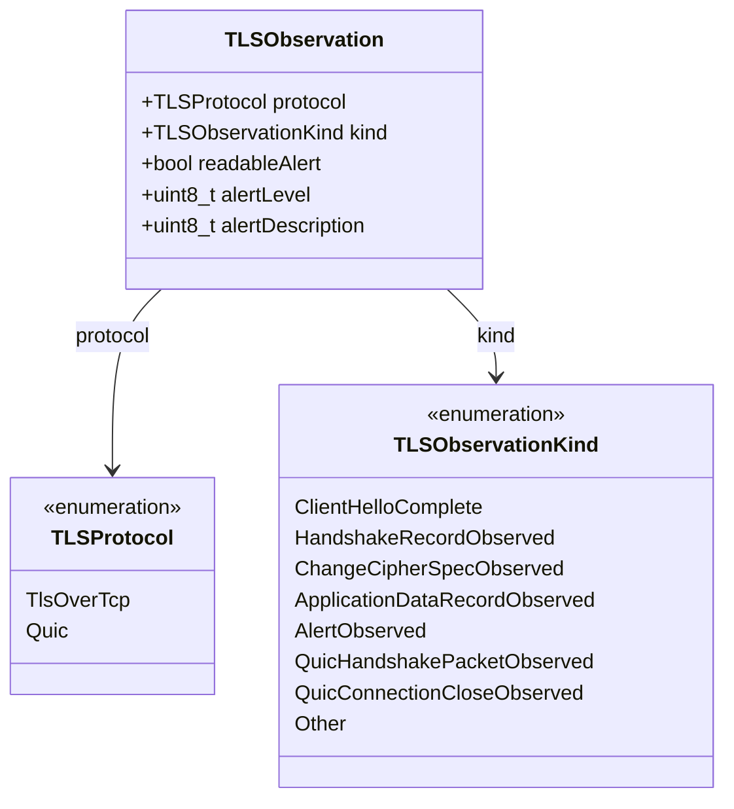
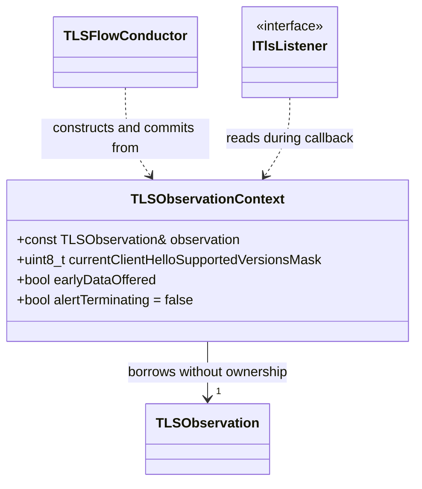

# TLSFlow: Record-to-Observation Migration

**Final | Scope-closed migration design.** Finalized from reviewed V13 without changing its design decisions. V13 is preserved without modification. This document is the final design baseline for the scope stated in Section 1; it is not evidence of implementation or runtime validation.

## 1. Purpose and Responsibility

Replace the shared `Record` contract with **`TLSObservation`**, representing evidence published by a protocol processor. Keep one Conductor flow and shared ClientHello consumers, while preserving explicit protocol differences where evidence and state policy differ.

| Responsibility | Owner |
|---|---|
| Parse supported input, validate evidence, reassemble CH | Protocol processor and existing CH infrastructure |
| Expose current observation and complete CH views | Processor/viewers |
| Interpret evidence against session state | Conductor |
| Dispatch consumers, combine verdicts, commit state | Conductor |
| Apply configured enforcement policy | TLS Enforcement |

The processor does not publish target states or a `completionSignal`. `Finished` remains a Conductor decision, potentially heuristic. Pools, binding, CH storage, and DTLS implementation are outside this migration. The known repeated-CH callback bug is a separate fix.

## 2. Shared Types and Interfaces

### 2.1 `TLSObservation`

Processor-owned value object in `TLSFlow::NSProcessor::Engine`, header `TLSObservation.hpp`. No owning payload buffer or per-observation heap allocation.

#### Fields

| Field | Type | Validity |
|---|---|---|
| `protocol` | `TLSProtocol` | Always assigned before publication |
| `kind` | `TLSObservationKind` | Always assigned before publication |
| `readableAlert` | `bool` | True only for `AlertObserved` with parsed alert contents; false otherwise |
| `alertLevel` | `uint8_t` | Readable `AlertObserved` only; zero otherwise |
| `alertDescription` | `uint8_t` | Readable `AlertObserved` only; zero otherwise |

`kind` and `readableAlert` determine field validity. Reset inapplicable fields for every publication. The parser validates the QUIC error code as part of frame parsing but does not retain or publish it: neither consumer uses it.

| Kind | Meaning |
|---|---|
| `ClientHelloComplete` | One complete CH available through the existing CH viewer |
| `HandshakeRecordObserved` | TLS handshake record identified, without claiming encrypted contents were decoded |
| `ChangeCipherSpecObserved` | TLS CCS record identified |
| `ApplicationDataRecordObserved` | TLS application-data record identified, without claiming the nature of encrypted contents |
| `AlertObserved` | TLS alert record identified; `readableAlert` indicates whether level and description are available |
| `QuicHandshakePacketObserved` | Client QUIC Handshake packet identified under supported validation rules, without payload decryption |
| `QuicConnectionCloseObserved` | Valid client CONNECTION_CLOSE type 0x1c read from a decrypted, integrity-checked Initial associated with the active attempt |
| `Other` | Safely identified item without a defined normal state action; consumers may still classify it |

TCP record kinds are not fabricated for QUIC. DTLS remains a future extension of the contract; do not add a `Dtls` enum value or inherit TCP rules before that implementation is designed. Retain raw `Record`/`TlsRecord` internally where needed. Audit other consumers before removing raw record APIs; the supplied Enforcement path does not require record length or raw type fields.

**DTLS extensibility:** The shared observation structures and interfaces must not assume TCP transport or TCP record layout. A future DTLS processor should reuse existing observation kinds where their meaning matches, without automatically inheriting TCP state or enforcement rules. DTLS-specific parsing, publication details, and version mapping remain outside this migration.

### 2.2 Publication and Viewer

`ITLSObservationViewer::getCurrentObservation() const` takes no input and returns `const TLSObservation&` for the current `ObservationReady`. The reference expires on the next processor advance, packet initialization, reset, or release. Do not retain it or advance the processor during dispatch/commit.

Initial is a packet type, not a completed CH. Initial processing may produce no observation. Publish one `ClientHelloComplete` only when CH is complete, with no intermediate CH-contributing record callbacks and no duplicate generic handshake observation. Do not publish incomplete TCP records. Do not add `QuicInitialPacketObserved` merely for symmetry.

A readable close is an independent termination observation, even if CH remains partial. Preserve processing order for multiple observations/packets; do not manufacture CH completion to publish a close. Do not process later observations after a terminal commit stops the active-handshake loop.

Do not add `getAllObservations()` without a consumer requirement. Audit existing `getAllRecords()` users separately.

### 2.3 `TLSObservationContext`

Replace `TLSRecordContext.hpp` with `TLSObservationContext.hpp` in `TLSFlow::PacketFlow::Engine`; replace the include of `Record.hpp` with `TLSObservation.hpp` under the same processor include directory.

| Existing field | Replacement | Contract |
|---|---|---|
| `record` | `observation`: `const NSProcessor::Engine::TLSObservation&` | Borrowed current publication |
| `currentClientHelloSupportedVersionsMask` | Same name, `uint8_t` | CH viewer value for `ClientHelloComplete`; zero otherwise |
| `earlyDataOffered` | Same name, `bool` | CH viewer value for `ClientHelloComplete`; false otherwise |
| `alertTerminating` | Same name, `bool`, default false | Existing policy for readable `AlertObserved`; false otherwise, including QUIC close |

The Conductor initializes defaults and populates applicable fields before callbacks, using pre-commit session state. It evaluates TLS alert termination only for `AlertObserved` with `readableAlert`; an unreadable alert remains identifiable as an alert and is never converted to `Other`. Context and observation remain valid through synchronous dispatch and normal commit; neither may be retained. CH fields preserve pre-commit visibility without duplicating CH payloads. No completion decision belongs in this context. QUIC close is not a fabricated TLS alert.

### 2.4 API Migration

| Existing | Replacement |
|---|---|
| `processRecord(tlsData)` | `nextObservation(tlsData)` |
| `TLSStepResult::RecordParsed` | `TLSStepResult::ObservationReady` |
| `IRecordsDataViewer` | `ITLSObservationViewer` |
| `Event::TLSRecord` | `Event::TLSObservation` |
| `onTLSRecord(...)` / Conductor `onRecord(...)` | `onTLSObservation(...)` / `onObservation(...)` with the new context |
| `commitNormalCurrentRecord(...)` | `commitCurrentObservation(...)` |

Keep the current `TLSData` input contract. `NeedMoreData`, `Unsupported`, `Stop`, and `EndOfPacket` remain control results and do not authorize reading a stale observation. Keep `IClientHelloDataViewer` and CH callback responsibility unchanged. Preserve event-mask bit positions during the rename and update all declarations, registrations, implementations, and tests consistently.

## 3. Required Protocol Distinctions

QUIC CONNECTION_CLOSE is not a TLS alert. In the supported Initial-only decryption path, publish `QuicConnectionCloseObserved` only after a valid close has actually been read from an Initial packet. No close can be inferred merely from an encrypted Handshake packet. See [RFC 9000, Section 19.19](https://www.rfc-editor.org/rfc/rfc9000.html#section-19.19) and [RFC 9001, Section 4.8](https://www.rfc-editor.org/rfc/rfc9001.html#section-4.8).

Keep `QuicHandshakePacketObserved` and `QuicConnectionCloseObserved` separate: the first supplies completion-heuristic evidence; the second supplies explicit termination evidence. No QUIC error code or synthetic TLS alert fields are required by the supplied consumers.

Packet validation, crypto, parsing-failure policy, and attempt association remain governed by the existing processor contracts; this document does not redesign them.

## 4. Conductor State and Dispatch

For `ObservationReady`: check parsing errors, construct context, notify observation consumers, notify current completed-CH consumers, then apply existing verdict and normal-commit rules. Preserve callback ordering, early returns, and pre-commit state. Accumulated violations prevent normal commit; a stop without violation preserves the existing path that can commit before returning STOP.

### State Mapping

| Evidence | Normal action, subject to existing terminal guard |
|---|---|
| TCP `ClientHelloComplete` | Preserve existing precedence: in `ChangeCipherSpec`, enter `Finished` without CH-data update; otherwise update CH data |
| QUIC `ClientHelloComplete` | Update CH data for the active attempt, without a CCS prerequisite |
| TCP `HandshakeRecordObserved` | Enter `Finished` only from `ChangeCipherSpec` |
| TCP `ChangeCipherSpecObserved` | Before CH increment `preCcsSeen`; otherwise enter CCS only for non-TLS-1.3 `InProgress` |
| TCP `ApplicationDataRecordObserved` | Before CH increment `earlyDataCount`; otherwise finish only for TLS-1.3 `InProgress` without early-data offer |
| `AlertObserved` with `readableAlert` and `alertTerminating` | From an active handshake state, enter `TerminatedByPeer` |
| `QuicConnectionCloseObserved` | From an active handshake state, enter `TerminatedByPeer`, regardless of error code |
| `QuicHandshakePacketObserved` | Enter `Finished` only from `InProgress` after completion of the active attempt's CH |
| Nonterminating or unreadable `AlertObserved` | No normal state action; Manager excludes all alerts from WrongOrder |
| `Other` | No normal state action; consumer classification still applies |

CH-data update preserves count, timestamp, fingerprint, supported versions, early-data offer, and `PreHandshake -> InProgress`. TCP CH-after-CCS precedence is preservation of supplied code, not a protocol recommendation or an approved semantic fix.

Rename `HsState::TerminatedByAlert` to **`TerminatedByPeer`**, preserving its numeric value and existing terminal behavior. Update direct references, state switches, predicates, inspection labels, and tests. This is a shared name for observed explicit termination, not a new lifecycle policy.

The accepted QUIC completion heuristic is unchanged: a Handshake packet after CH can contain ACK only or even encrypted CONNECTION_CLOSE. Without Handshake decryption these cannot be distinguished. `Finished` proves neither TLS completion nor absence of closure. Do not invent a readable close from encrypted evidence. Preserve the existing active-attempt and publication-order contracts.

## 5. TLS Enforcement Consumer Migration

### 5.1 Reuse the Existing Termination Detector

Rename `AlertDetector` to **`HandshakeTerminationDetector`**. Reuse the same instance and active-state check for terminal TLS alerts and readable QUIC closes. Do not add a QUIC detector, a new detector hierarchy, or a generic termination framework.

Leave `IncompleteHandshakeDetector` unchanged: it checks the matched rule, the incomplete-handshake enable flag, and the derived predicate, then produces the existing violation and classification diagnostic.

**Product policy:** explicit readable close during an active handshake triggers the same configured incomplete-handshake check, including `NO_ERROR`, transport errors, and CRYPTO_ERROR. This is not an RFC requirement and does not classify every close as malformed or as a TLS error. In terminal states the predicate returns false, including renamed `TerminatedByPeer`.

### 5.2 Manager Routing and Listener Behavior

| Observation | Manager action |
|---|---|
| Readable terminating TLS alert | Run shared termination detector |
| Readable nonterminating TLS alert | Return `NoViolation`; do not run WrongOrder |
| Opaque TLS alert | Return `NoViolation`; do not run WrongOrder |
| Readable QUIC close | Run shared termination detector; do not run WrongOrder |
| Other evidence | Run only applicable WrongOrder rules |

Preserve the current termination route exactly: invoke `handleEvent(detector, session, nullptr, tlsData)`, discard its returned violation at this callback boundary, and return `NoViolation`. Mitigation and classification inside `handleEvent` remain intact. The Conductor can then commit normal termination without converting this route into `Error`. Do not accidentally introduce packet mitigation/reporting through the listener's ordinary violation-return path.

`TlsListener` otherwise changes names/context types only; preserve reporting, statistics, verdict conversion, and CH handling. Update direct uses of the renamed terminal state without introducing new aging behavior.

### 5.3 Debug Diagnostics

Preserve the three existing TLS `AlertDuring...` events, labels, and numeric values. Append these two entries immediately before `ObservedTrafficEvent::Count`, after all existing events:

| New event | Matching entry appended to `ObservedTrafficEventNames` |
|---|---|
| `QuicConnectionCloseDuringPreHandshake` | "QUIC Connection Close During PreHandshake" |
| `QuicConnectionCloseDuringInProgress` | "QUIC Connection Close During InProgress" |

No QUIC CCS event is needed. Existing event values remain unchanged; `Count` increases by two. Preserve array order and the existing enum/label-count `static_assert`. Leave `EnforcedClassificationEvent` and its labels unchanged, including shared `IncompleteHandshake`.

Keep observed-event increments inside `HandshakeTerminationDetector::isIncompleteHandshake`, after the existing matched-rule and incomplete-handshake-enabled checks in the base class. Do not move counting into Manager.

For diagnostic selection only, Manager sets the existing `TLSObservationKind` value on the shared detector immediately before synchronous `handleEvent`: `AlertObserved` selects the existing TLS counters, and `QuicConnectionCloseObserved` selects the new QUIC counters. Use a small value setter consistent with the current detector input style; no new cause enum, context field, borrowed pointer, or detector class is needed. Assign the kind on every invocation, with no reliance on the previous invocation's value. QUIC close is applicable only in `PreHandshake` or `InProgress`; the CCS branch retains its existing TLS event.

This input does not change classification or state policy. Preserve the existing rule gating. Increment exactly one matching observed-event counter when the predicate identifies an incomplete handshake in an applicable active state. In terminal or unsupported states, return false without incrementing an observed-event counter. The base class continues to record the common enforced `IncompleteHandshake` event when classification occurs.

#### Detector Input API

**`HandshakeTerminationDetector::setCurrentObservationKind`**

- Input: `TLSObservationKind`; accepted values are `AlertObserved` and `QuicConnectionCloseObserved` only.
- Output: `void`.
- Caller: Manager sets the value before every synchronous `handleEvent` invocation of this detector.
- Storage: store the enum value only, not an observation pointer or context reference.
- Effect: select the matching debug counter only; do not change classification or session-state policy.
- Lifetime: no reset between calls is required because Manager assigns the value on every invocation. The detector must not be invoked before the value has been assigned.

### 5.4 WrongOrder Compatibility

| Existing TCP predicate | Observation equivalent |
|---|---|
| `isClientHello()` | `ClientHelloComplete` |
| `isApplicationData()` | `ApplicationDataRecordObserved` |
| `isChangeCipherSpec()` | `ChangeCipherSpecObserved` |
| `isHandshake()` | Both `HandshakeRecordObserved` and `ClientHelloComplete` |
| `isAlert()` | `AlertObserved`, regardless of readability, already excluded by Manager |

Preserve TCP PreHandshake fallback classification, thresholds, diagnostics, CH-count checks, and CH-after-CCS acceptance. `Other` is not automatically ignored by Enforcement. Counts supplied to detectors contain previously committed observations only, not the current one.

Do not automatically apply TCP WrongOrder rules to QUIC. Route QUIC close to the shared termination detector; do not pass QUIC Handshake, CH, or `Other` observations through TCP fallback or thresholds without a separately defined applicability rule. This migration adds no QUIC WrongOrder policy and does not change CH rule-based detection through `onClientHello`.

Keep the existing setter-based detector input style if convenient; changing the classification signature is not required. Rename the record setter as appropriate and clear its borrowed observation pointer after synchronous use, including all return paths. The new observation reference must not be retained beyond dispatch.

## 6. Migration and Focused Acceptance

Introduce the shared structures, adapt TCP publication and the supplied Conductor/Enforcement uses together, then add the two required QUIC evidence kinds. Do not dispatch old and new callbacks for the same publication. Audit other users before removing record-specific APIs.

Out of scope: packet admission/input design, subscriptions and extension allocation, SYN/RST handling, crypto and parsing-error policy, packet validation, lifecycle/reclaim redesign, and DTLS implementation. Preserve the relevant existing contracts; do not make their redesign a prerequisite for this structural migration.

Required checks:

- Field tables, enums, and both Mermaid diagrams agree; no unused QUIC error code, premature DTLS enum value, or new context fields are introduced.
- TCP predicate mapping is preserved, including `isHandshake()` accepting both completed CH and generic handshake observations.
- Callback order, pre-commit data, verdict handling, and TCP state precedence remain unchanged except explicitly approved changes.
- Unreadable and nonterminating alerts remain identifiable as alerts and never enter WrongOrder.
- Terminal TLS alert and readable QUIC close use the same detector, base-class gating, and existing termination callback route.
- TLS alerts retain their existing debug counters; QUIC close selects the two new counters without changing classification or gating.
- Existing diagnostics enum values and labels remain intact; appended entries and updated `Count` satisfy the existing static assertion.
- QUIC Handshake applies only the accepted completion heuristic; QUIC close applies explicit termination. No encrypted close is inferred.
- Renamed terminal-state references preserve existing behavior; no lifecycle policy is added.
- Observation references remain valid through dispatch/commit and are not retained; no new per-observation allocation or collection API is introduced.

**Result:** generalized structures and direct consumer uses, two necessary QUIC evidence kinds, one reused termination detector, and separate debug visibility without broader subsystem redesign.

## 7. Behavioral Changes

This section identifies the observable effects already specified in Sections 1-6. It is not an additional change request. The comparison is against the existing TCP-oriented flow; previously accepted TCP publication and QUIC decisions are identified separately. The behavioral summary documents the selected design; it does not introduce additional runtime policy.

### 7.1 Behavior Affecting Publication and Consumers

**Completed-CH publication (Section 2.2; previously accepted).** Publish one `ClientHelloComplete` when the CH is complete. Do not invoke consumers for intermediate CH-contributing records, publish incomplete TCP records, or emit a duplicate generic handshake observation for that same CH completion. This is a semantic publication contract, not merely a callback rename: consumers no longer receive intermediate contributing-record callbacks. The existing CH viewer and CH callback responsibility remain unchanged. This section does not reopen reassembly, storage, or the separate repeated-CH callback bug.

**QUIC evidence through the shared flow (Sections 2-4; protocol extension).** A complete QUIC CH supplies the active attempt's CH data without a TCP CCS prerequisite. Initial packets do not themselves imply CH completion and need not produce an observation. TCP record kinds are not fabricated for QUIC. This extends the shared consumer flow to QUIC; it does not change the existing TCP state mapping.

### 7.2 QUIC State and Enforcement Behavior

**Handshake completion heuristic (Section 4; previously accepted).** A client QUIC Handshake packet moves `InProgress` to `Finished` only after completion of the active attempt's CH. An earlier Handshake packet does not satisfy that condition. The packet payload is not decrypted; ACK-only or encrypted-close contents do not change this heuristic. `Finished` is a product completion signal, not proof of TLS completion. The migration preserves this decision rather than introducing a new completion policy.

**Explicit close (Sections 2.2, 3-5; QUIC extension).** A valid `QuicConnectionCloseObserved` from the supported Initial processing path is independent of CH completion and can therefore be published while CH remains partial. From an applicable active handshake state, normal commit enters `TerminatedByPeer`, subject to the existing verdict and terminal guards. Publication order is preserved, and processing stops when a terminal commit stops the active-handshake loop. No close is inferred from encrypted Handshake contents.

**Incomplete-handshake check for close (Sections 5.1-5.2; product policy).** Route readable QUIC close to the reused `HandshakeTerminationDetector`, including closes with `NO_ERROR`, transport errors, or `CRYPTO_ERROR`. Preserve the existing matched-rule and incomplete-handshake-enabled gating. The predicate applies to QUIC `PreHandshake` and `InProgress`, not terminal or unsupported states. This extends the existing check to QUIC close; it does not classify every close as malformed or as a TLS error.

The Manager uses the existing termination route: `handleEvent(detector, session, nullptr, tlsData)`, discards the returned violation at this callback boundary, and returns `NoViolation`. Classification and mitigation inside `handleEvent` remain intact. The QUIC extension must not introduce the listener's ordinary violation-return path or force normal termination into `Error`.

**WrongOrder applicability (Section 5.4; protocol boundary).** Do not apply TCP fallback classification or thresholds to QUIC CH, Handshake, or `Other` observations without a separately defined applicability rule. QUIC close takes the termination route. This migration adds no QUIC WrongOrder policy; CH rule-based detection through `onClientHello` remains unchanged.

### 7.3 Diagnostic Behavior

**Two additional observed events (Section 5.3).** Add `QuicConnectionCloseDuringPreHandshake` and `QuicConnectionCloseDuringInProgress` after the existing events. This is an observable diagnostic extension even though it does not introduce a new enforcement classification. Existing TLS event values and labels remain unchanged; `Count` increases by two. The common enforced classification remains `IncompleteHandshake`.

Manager assigns `setCurrentObservationKind` before every synchronous invocation of the shared detector. The value selects the TLS or QUIC debug counter only. After the existing base-class gating, increment exactly one matching observed-event counter when the predicate identifies an incomplete handshake in an applicable active state; increment none in terminal or unsupported states. The explicit setter contract and precise gating wording document the selected design, not additional classification or state changes.

### 7.4 Changes That Do Not Introduce New Runtime Policy

- Replacing the shared `Record` representation with `TLSObservation`, adapting viewers and contexts, and renaming callbacks are structural changes. They require compatibility checks but do not independently authorize changed TCP decisions.
- Renaming `TerminatedByAlert` to `TerminatedByPeer` preserves its numeric value and terminal behavior. Updating inspection labels changes terminology, not lifecycle policy. Renaming `AlertDetector` and reusing its instance does not by itself change detection behavior; the QUIC close extension is described above.
- TCP state precedence, alert readability and termination policy, exclusion of all alerts from WrongOrder, applicable WrongOrder thresholds, pre-commit visibility, verdict handling, and existing TLS diagnostics remain as specified in Sections 4-5. The approved completed-CH publication contract is the explicit publication distinction described in Section 7.1.
- API removal requires the consumer audit already specified in Sections 2 and 6. Removing an unused collection API or keeping record length internal does not authorize removal of required parser behavior or test coverage.
- Mermaid formatting and editorial changes are cosmetic. Packet admission, crypto, parsing-error policy, subscriptions, allocation, lifecycle/reclaim, and DTLS implementation remain outside this migration.

**Boundary:** behavioral effects are limited to the publication contract and QUIC integration already described in this document, including their diagnostic visibility. This summary adds no new parsing, security, enforcement, or lifecycle policy.

## 8. Scope Closure

The design scope is closed: replace the shared `Record` contract with `TLSObservation`, retain one Conductor flow and shared ClientHello consumers, and preserve explicit protocol differences where evidence and state policy differ.

The final baseline includes:

- The observation fields, kinds, viewer, context, and direct API migrations in Section 2.
- Behavior-preserving TCP adaptations and the explicitly identified publication contract.
- The accepted QUIC Handshake completion heuristic and readable Initial close termination route.
- Reuse of the existing incomplete-handshake infrastructure, with separate QUIC debug events and unchanged base-class gating.
- DTLS extensibility at the shared-contract boundary, without implementing DTLS or inheriting TCP policy automatically.

No additional fields, classes, or policy are required to close this design scope. Implementation must follow the focused acceptance checks in Section 6. This closure does not claim that code has been migrated, compiled, runtime-tested, or that Mermaid diagrams have been rendered.

Changes to the decisions in this baseline require an explicit follow-up change; they are not implicit requirements of this migration. The out-of-scope boundaries in Section 6 remain unchanged.
