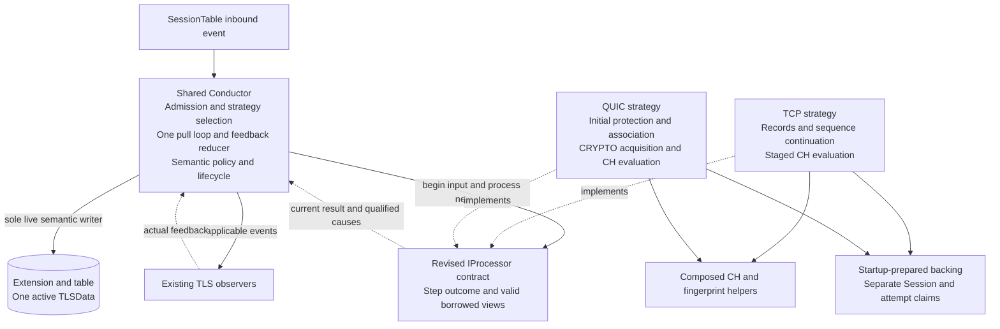
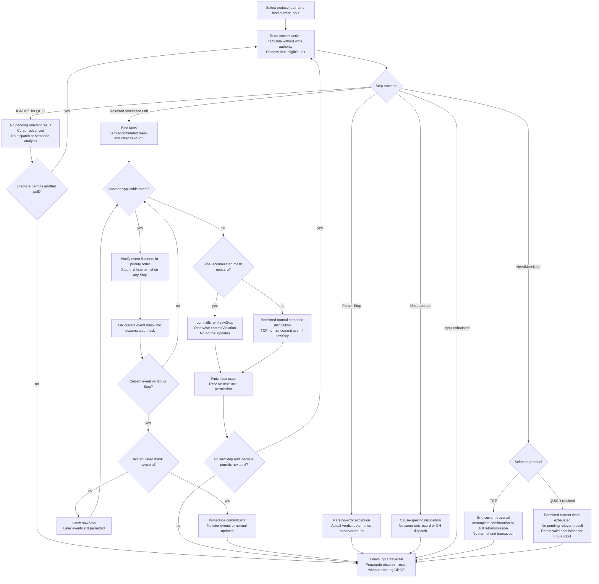
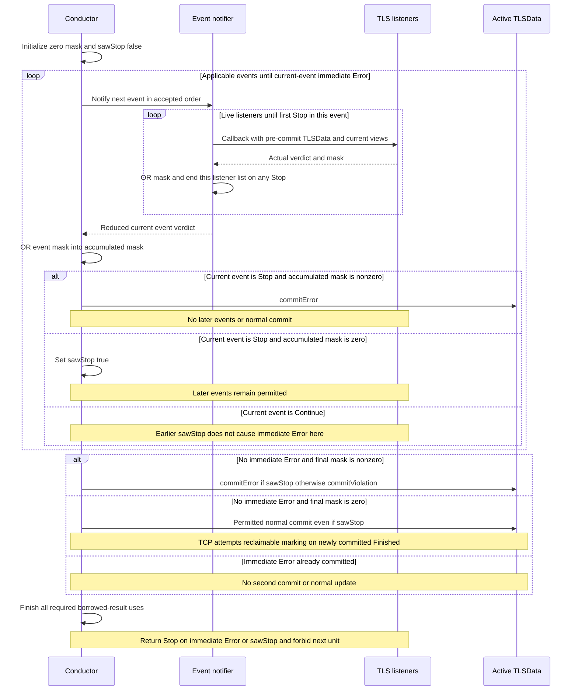

# Candidate 2: Processor Strategies Behind a Shared Processing Contract

**Version:** V2  
**Audience:** TLS-Flow engineering team  
**Status:** architecture proposal for discussion and comparison, not a selected implementation.

## 1. Architecture at a glance

Keep one TLSFlowConductor responsible for Session integration, observer transactions, semantic TLSData updates and lifecycle coordination. Place separate TCP and QUIC processors behind a **required common processing contract**. The Conductor selects the participating protocol strategy and uses one synchronous pull loop to begin input, request the next result, resolve feedback and commit permitted state changes before requesting another result.

The common boundary is the defining difference from Candidate 1. It is not an optional refinement here. Merely renaming processRecord to processUnit while retaining two unrelated processing loops would not realize this candidate.

A straightforward realization uses two long-lived Engine-level objects, TcpProcessor and QuicProcessor, implementing a revised IProcessor. These names are illustrative. Shared interface inheritance is compatible with composition of CH/fingerprint helpers; it does not require an algorithm base class, Template Method, runtime-created strategy or universal TLS-record representation.

State policy stays in the Conductor, including explicit protocol applicability predicates. Moving it to an independent common semantic responsibility would be a Candidate 2/C4-P hybrid and must be identified as such.

Boxes identify responsibilities, not automatically separate classes. The contract box is a boundary, not a third runtime processor or queue. The selected strategy runs synchronously; only the Conductor writes active TLSData. Physical storage remains Extension/table-owned.

## 2. Responsibility split

| Responsibility | Placement |
|---|---|
| Session participation, admission and strategy selection | Conductor and existing integration |
| Input traversal at the semantic-result level | One Conductor pull loop |
| Protocol framing and internal cursor advancement | Selected strategy |
| TCP sequence, continuation, record visibility and staged CH evaluation | TCP strategy and existing support |
| QUIC protection, packet/frame qualification, association and CRYPTO reconstruction | QUIC strategy and attempt/acquisition support |
| CH fields, canonicalization and fingerprint algorithm reuse | Composed helpers used by both strategies |
| Applicable observer delivery and actual-verdict reduction | Conductor |
| Live TLSData commits, completion and violation/Error policy | Conductor with explicit protocol predicates |
| Candidate acceptance, replacement and lifecycle authorization | Conductor, coordinated with strategy support owners |
| Physical semantic storage | Existing Extension/table |
| Current-result backing and Session/attempt support | Actual protocol/evaluator owners with distinct lifetimes |

Strategy instances are not per Session. Per-Session/attempt storage is claimed from prepared capacity. Sharing algorithms does not automatically share mutable workspaces; workspace reuse depends on overlapping live intervals.

## 3. Inbound processing

### 3.1 Admission and selection

onInbound remains a SessionTable-based entry. The Conductor obtains the extension and context, applies participation and protocol-specific entry rules, and selects a strategy before TCP-only sequence extraction or lifecycle shortcuts can run on QUIC input. UDP alone is not QUIC admission or trusted classification.

SYN/RST, terminal payload and aging remain explicit lifecycle/exception paths. A common ordinary-input loop does not require these paths to become synthetic processUnit results. In particular, QUIC terminal input must undergo the accepted attempt classification before CH parsing; do not blindly apply TCP terminal-payload bypass to every QUIC datagram.

### 3.2 Begin the input

**Working proposal:** beginPacket receives a borrowed DPFrame and explicit required context. Each strategy extracts its own metadata. TCP extracts payload and sequence; QUIC obtains its datagram and relevant context. This replaces Conductor construction of TCP-oriented PayloadParams at the shared boundary.

Exact signatures, constness and the minimum Session/attempt context remain open. Do not introduce hidden lookups merely to keep a single parameter. Passing DPFrame creates deliberate coupling to the Engine packet representation, not ownership transfer. No pointer into a frame may survive its valid interval.

### 3.3 Pull, resolve and resume

1. Bind the selected strategy and current input once.
2. Request its next result through the common processing operation, provisionally processUnit.
3. Handle the outcome using the shared control contract in Section 4.
4. For a relevant result, expose only its permitted views and run the applicable transaction in Section 5.
5. Resolve permitted state changes, required strategy bookkeeping and all borrowed-result last uses.
6. Request the next result only when feedback, lifecycle and input progress allow it.
7. On exit, preserve valid cross-input acquisition and complete required input-finalization/cleanup without processing later semantic units.

The strategy may traverse several internal framing elements to produce a result, but cannot precommit later semantic authority, calculate later feedback-dependent semantic work speculatively, or invalidate live result backing. Nested viewer reads do not authorize reentrant processing or rebinding another input to the same workspace.

### 3.4 What remains protocol-specific

TCP retains record framing, continuation, opaque/plaintext applicability and staged CH behavior. QUIC retains packet protection, frame parsing, CRYPTO ranges, attempt association and candidate qualification. Both compose common CH/FP algorithms where practical.

The Conductor can retain TCP CCS/ApplicationData/Alert predicates and QUIC completion/association dispositions. A shared traversal contract does not promise a branch-free Conductor. The architectural benefit must be assessed against actual removed traversal duplication, not against a claim that all protocol policy disappears.

## 4. Common processing and result contract

The following is the proposed control vocabulary, not final C++ signatures or an already implemented enum. Keep the enum small and separate progress from optional data access. A heap-owned event, queued result list or union of every protocol detail is not required.

| Proposed outcome | Shared meaning and Conductor action |
|---|---|
| UnitProcessed | A relevant current result is available. Resolve applicable projections and qualified dispositions. A result may have zero callbacks. |
| IGNORE | No current result requires Conductor dispatch or semantic analysis. Internal progress has occurred. Pull again only while permitted. |
| EndOfPacket | No permitted work remains in the input bound by beginPacket. Here input means the current frame payload/datagram, not an individual inner QUIC packet. |
| NeedMoreData, if retained | End the current input traversal without a normal-unit transaction. Protocol support may await future input. Preserve TCP's existing additional uses described below. |
| Unsupported | Take the accepted cause-specific disposition before consumer dispatch for the affected unit. Do not invent a generic violation. |
| Stop | Parser-stop exception, not an observer verdict. Apply its qualified error handling and leave current traversal. Actual feedback determines the observer return. |

### 4.1 TCP outcome translation must preserve behavior

The compatibility starting point maps RecordParsed to UnitProcessed while retaining TCP-specific record views and existing dispatch eligibility. NeedMoreData, Unsupported, EndOfPacket and parser Stop retain their current control effects. Do not replace the loop with a condition that continues only after UnitProcessed and therefore accidentally terminates on IGNORE.

In the inherited TCP description, NeedMoreData also covers a full continuation retransmission without consuming the current cursor. Therefore the shared outcome must not universally promise that it means only incomplete CH or cursor exhaustion. Ending traversal is safe without cursor progress; a repeatable IGNORE is not.

For QUIC, an input-ending NeedMoreData may be returned only after permitted current-input work is exhausted and no relevant result is pending. Whether this adds useful Conductor behavior beyond EndOfPacket remains open. If one shared enum cannot express the distinction cleanly, refine the minimal contract explicitly rather than silently changing TCP behavior.

### 4.2 Partial CH and unit boundaries

**Continue within current input until a result requires Conductor handling, an eligible completed unit can return IGNORE, or permitted input work is exhausted. Partial CH alone does not justify discarding remaining input or waiting for a future datagram.** Parser exceptions, bounded-work dispositions, observer feedback and lifecycle gates take precedence.

A QUIC packet boundary is a possible unit boundary, not a mandatory semantic boundary. A strategy can traverse frames internally; if a result requires feedback before later semantic work within that packet, it must yield and retain a bounded cursor/backing for safe resumption. Do not add a suspension framework without a concrete case. CRYPTO acquisition progress and semantic authority are distinct.

| Situation | Required behavior |
|---|---|
| Partial CH with permitted frames or packets remaining | Continue internally or return IGNORE at an eligible progressed boundary, then resume. |
| Relevant CH/result ready before later work | Yield before crossing the required feedback boundary. |
| Acquisition-only progress | IGNORE is allowed only if no semantic disposition is pending. |
| Qualified completion evidence with no callback | UnitProcessed or equivalent relevant-result handling, not IGNORE. |
| Input exhausted with incomplete acquisition | Retain valid prepared support for future input and end traversal. |
| IGNORE on the final eligible unit | Next pull reports exhaustion, not the same unit again. |
| Attempt acceptance/reset or required support loss | Surface to Conductor authority, never hide under IGNORE. |

### 4.3 Current-result access

The contract must identify the current producer, applicable views, relevant cause/eligibility information and the backing interval. This can be a small result context plus viewers, or another bounded representation; the exact shape is open. It need not copy the CH body or fingerprint strings.

A TLS record view is optional and TCP-specific. A QUIC result does not implement record getters with dummy values. CH facts must distinguish qualified publication from retained compatibility viewer status. No result can borrow unrelated data from the other strategy. Unsupported and IGNORE do not expose a stale prior result as a new event.

### 4.4 Feedback without a mandatory acknowledgement API

Each pull must read the current active TLSData through read-only access, after the preceding permitted Conductor commits and lifecycle resolution. This preserves the role of processRecord(const TLSData&) in the existing code. A packet-start snapshot must not replace this per-pull state visibility. Exact signatures remain open; neither strategy receives authority to write the active semantic core. A borrowed reference must be rebound if accepted replacement changes its backing. The next pull can read resolved TLSData under the serial contract. Do not copy observer verdicts into a second independent reducer inside the strategy. Add explicit disposition notification only if a concrete support-bookkeeping need cannot be met by existing synchronous coordination.

Resolved TLSData alone does not necessarily encode candidate acceptance, a support claim transfer or the final use of a borrowed result. These still require explicit lifecycle coordination where needed. If traversal stops and there is no next pull, required cleanup must still occur; it cannot depend on a future packet arriving.

## 5. Observer transaction and semantic commit

A projection is an observer event/view of the current unit. **There are two distinct reduction levels:** listeners within one event, and events within one record. Preserving only the final Error state is insufficient; callback delivery and commit timing must also match.

### 5.1 Listeners within one event: immediate STOP

The existing notify helper visits live listeners in priority order, ORs their actual violation masks, and returns immediately on the first Stop, even with a zero mask. Remaining listeners of that event are not called. Expired weak listeners are skipped. The resulting event verdict contains only feedback from listeners actually invoked.

### 5.2 Events within one parsed TCP record

The existing order is parsing-error handling, TLSRecord handling, then ClientHello handling when the CH viewer reports Complete. Each event's verdict is reduced before the next event.

1. Start with zero accumulated violation mask and sawStop=false for this record.
2. OR the current event verdict's mask into the accumulated mask.
3. If the **current event verdict** is Stop and the accumulated mask is nonzero, commitError and return RET_OBSERVER_STOP immediately. Do not deliver later events or apply normal updates.
4. If the current event verdict is Stop with a zero accumulated mask, set sawStop=true and continue to the next event. Continue never clears sawStop.
5. A later Continue with violations does **not** trigger the immediate-exit condition merely because sawStop is already true. Remaining applicable events still run.
6. After all applicable events, if the accumulated mask is nonzero, commitError when sawStop is true, otherwise commitViolation. Do not apply normal updates in either case.
7. If the accumulated mask is zero, perform the normal current-record commit, even when sawStop is true. If this newly reaches Finished, attempt markReclaimable.
8. Return RET_OBSERVER_STOP if sawStop is true, otherwise RET_OBSERVER_CONTINUE.

The next record is not processed after RET_OBSERVER_STOP. Even with Continue, the current TCP loop advances only after RecordParsed and while the resulting handshake state is active. A violation-only Continue does not itself stop an active flow. The stored terminalViolationMask is not a generic terminal-state predicate.

| Event feedback sequence | Remaining events of this record | Commit and return |
|---|---|---|
| Stop with zero accumulated mask | Continue applicable later events, but not remaining listeners of the stopped event | Resolve final mask, then return Stop |
| Current Stop with nonzero accumulated mask | None | Immediate Error and Stop |
| Earlier zero-mask Stop, then Continue with violations | Continue applicable later events | Final Error and Stop unless a later current Stop triggers immediate Error |
| Earlier violations, then current Stop with zero new mask | None | Immediate Error and Stop |
| Violations and no Stop | Continue applicable later events | Final commitViolation and Continue, no normal updates |
| No violations, with or without earlier zero-mask Stop | Continue applicable later events | Normal commit, then return according to sawStop |

This preserves even combinations whose practical reachability is unknown. Do not remove a path based on an unproven assumption that a listener cannot return that combination.

### 5.3 Parser outcomes and no-projection QUIC results

Parser Stop is not observer Stop. In the existing TCP dispatchStepResult, parser Stop invokes parsing-error handling, commits any actual violation according to that event's verdict, and returns toObserverResult(verdict). If no listener returns Stop, the result can be RET_OBSERVER_CONTINUE, but the record loop still ends because the parser result was not RecordParsed. NeedMoreData, Unsupported and EndOfPacket also end that loop; they do not automatically stop subsequent SessionTable observers.

Unsupported follows commitUnsupported's existing state/cause predicate and performs no same-unit record/CH dispatch. It is not an unconditional Unsupported state transition.

QUIC can yield a qualified result with no projections. Initialize the actual mask to zero, fabricate no callback or verdict, and apply only its qualified protocol-specific disposition. This is an addition, not a path present in the current record-only TCP analyzer. IGNORE yields no semantic transaction at all.

STOP is a traversal-control result, not DROP. TLS-Flow propagates RET_OBSERVER_STOP to its caller; the available inherited review does not establish the SessionTable dispatcher implementation. The surrounding system's observer-chain behavior must not be presented as a verified packet-drop operation.

### 5.4 Proposed traversal view

processUnit is the proposed common pull operation. The flow shows shared traversal and a transaction reduction preserving the current TCP event semantics. IGNORE is initially a QUIC outcome. NeedMoreData ends traversal for both protocols, with different qualified reasons: TCP includes full continuation retransmission, whereas QUIC must first exhaust permitted current-input work. Neither case creates a normal-unit transaction. TCP compatibility requirements are specified in Section 9, not replaced by this generic drawing. Error paths and parser exceptions must complete required last uses before any new support is recycled.

### 5.5 Parsed-unit transaction sequence

The inner listener-list reduction occurs inside event notification. The outer event loop ends early only on the current-event Stop plus nonzero accumulated mask condition. A previously latched Stop alone is not its loop-exit condition.

Callbacks may perform nested reads through the public viewers. Keep their backing valid for the required interval. This sequence describes callback/state ordering, not a guarantee that a migrated Processor already satisfies every proposed QUIC backing-lifetime requirement. Earlier committed units are not rolled back by a later failure.

## 6. TLSData, support storage and lifecycle

### 6.1 Shared semantic core

Keep one active semantic TLSData context per DP Session. Shared state, published CH versions/count/time, fingerprint, early-data offer and actual violations remain semantic data. A new QuicInProgress state is not required merely because the transport differs.

### 6.2 Separate QUIC support

Keep QUIC CRYPTO bytes/ranges, CID/association context, Initial support, candidate backing, retired identities, deferred evidence and parsing cursors outside the common semantic core. A prepared-support handle in the Extension or a Session-keyed lookup are alternatives, not both mandatory. A handle is not backing ownership. Exact layout changes remain open.

The Conductor authorizes candidate acceptance/reset and live publication. Strategies may mutate acquisition/support state, never active TLSData. Candidate preparation must remain isolated from the active attempt; only accepted replacement changes active authority. Retry-compatible restart and HRR-compatible CH2 do not prove observed server Retry/HRR or a new attempt. Ambiguous and retired evidence cannot merge or reset the active state.

### 6.3 Lifetime and cleanup

Preserve required terminal identity and satisfy required admission before destructive cleanup. Finish callbacks, nested reads, permitted producer commit and all last uses before returning backing. Detach references before returning claims; return each claim once. Table victim selection/release must not bypass this coordination. Finished marking is not release or proof that marking succeeded; clear stale reclaimable membership on reuse. Resource eviction is not a synthetic Incomplete Handshake violation.

All Engine runtime work, including aging and cleanup, must use startup-prepared finite storage with no dynamic allocation or capacity growth. Bound scans, crypto/context trials, ranges, reconstruction, candidates, retention, replacement peak and cleanup. Numerical capacities remain deferred under the accepted policy; finite approved startup values are required before enablement. No CPU/RAM budget or capacity number is invented here.

## 7. Viewer and algorithm integration

| Concern | Treatment |
|---|---|
| Shared processing interface | Required architectural boundary; not a requirement for an algorithm base class. |
| CH viewer | Share genuinely common semantics. Resolve isSegmented and full-string/digest/locator lifetime before final signatures. |
| Record viewer | TCP-specific optional capability. Record/TLSRecordContext do not become universal result shapes. |
| Error access | Share equivalent meanings only. Decryption, association and resource failures are not automatically parsing violations. |
| Public Application/Factory getters | Route to the correct strategy/view context, with defined availability outside callbacks. Adding a QuicProcessor alone is insufficient. |
| CH/FP reuse | Compose canonical field/fingerprint algorithms. Preserve staged TCP evaluation and same-CH output. |

Direct viewer inheritance by both strategies is optional. A composed adapter/facade may expose the read contract without enlarging IProcessor. Do not force all viewers into one interface or duplicate the entire mutable evaluator solely for symmetry.

The inherited TCP analyzer tests CH viewer Complete without a current-record freshness predicate. Preserve that retained-Complete callback behavior and the local MultipleClientHello guard as TCP compatibility behavior; do not export either as QUIC freshness/count policy. Adding a per-unit reset or current-record-only gate would be an explicit change, not equivalence. New QUIC results still require qualified provenance.

## 8. Protocol policy and lifecycle exceptions

The common contract does not flatten all lifecycle into ordinary units:

- TCP SYN/RST, terminal payload and aging retain their accepted paths and callback/commit ordering.
- Parser Stop and Unsupported remain explicit exceptions, not generic observer Stop or automatic Error.
- QUIC attempt classification, candidate acceptance and terminal replacement remain protocol-specific and Conductor-authorized.
- A no-projection result can require a qualified disposition. Callback absence does not authorize completion.
- A semantic cycle can contain ordered CH and completion dispositions where the accepted qualification and feedback rules allow them. No whole-input atomicity or rollback of earlier committed units/observer effects is introduced.

The strategy contract does not choose or reopen the product completion policy. Step 3 V6 describes qualified associated client QUIC v1 Handshake Long Header evidence as product-level completion, with bounded deferred pre-CH evidence. This is not observed TLS Finished. Apply the currently accepted qualification/ordering contract, including trusted decoding or the required protection handling; do not infer authority from protected packet-type bits. If that qualification cannot be established, do not manufacture Finished or Finished-based reclaim. 0-RTT does not advance state, and server-side handshake visibility is not assumed.

State policy remains Conductor functions or existing helpers under its authority. An independently extracted common policy would be an explicit C4-P combination, not a benefit silently attributed to pure Candidate 2.

## 9. TCP preservation and migration surface

The common-interface migration must preserve the TCP behavior mapped below. These are source-inspected preservation obligations, not executed equivalence tests of a new implementation. QUIC support and coordinated cleanup remain additions.

Required migration work:

1. Revise IProcessor input, progress and current-result access into the common boundary.
2. Adapt the existing Processor directly or through a narrow TCP adapter. Do not retain an unnecessary permanent wrapper merely to avoid a small justified change.
3. Implement QuicProcessor and prepared acquisition/attempt support.
4. Avoid introducing duplicated protocol traversal by extending the existing TCP loop into the shared Conductor loop while retaining protocol-specific applicability and exceptions.
5. Adapt Factory/Application strategy selection and public viewer routing.
6. Extract/reuse CH/FP helpers without duplicating canonicalization or changing staged TCP behavior.
7. Coordinate attempt acceptance, table eviction/release, backing and last-use cleanup.
8. Validate observable TCP equivalence and QUIC contract behavior before implementation acceptance.

### 9.1 Current TCP preservation map

These are the supplied implementation's observable gates, not QUIC policy inferred from TCP.

| Area | Current behavior to preserve or explicitly distinguish |
|---|---|
| Startup and viewers | Factory builds one Processor and injects it as processing/CH/record/error interfaces. Public Application getters delegate to Factory. Adding QUIC requires wiring changes, not just another class. |
| Session participation | buildExtension queries live subscribers in priority order and allocates only when an event mask is nonzero. Successful new-session setup registers inbound and aging observers. |
| SYN without ACK | Missing extension is built and this packet is consumed. Existing active state with no recorded violations is retained. Other existing states or recorded violations cause release/rebuild and consumption. |
| RST without ACK | Before silent-terminal and payload gates, notify TCPReset. Actual violations commit Error on Stop or commitViolation on Continue. Without violations, clear TLSData even on Stop. Return the actual dispatch verdict. |
| Entry state gates | Finished/Unsupported are silent. Empty payload returns before terminal-payload dispatch. Nonempty Error/TerminatedByAlert input uses TerminalPayload instead of the Processor. |
| Record loop | beginPacket once, processRecord repeatedly only after RecordParsed and while state remains active. In Candidate 2, map RecordParsed to UnitProcessed and preserve the same TCP continuation gate. Any returned observer Stop exits immediately. Other parser outcomes end this loop even if observer return is Continue. |
| Parser Stop | Check parsing-error observers only. Commit actual violations according to the returned verdict. No normal record/CH dispatch. No automatic Error solely because the parser stopped. |
| NeedMoreData | No Conductor semantic commit. Also used for full continuation retransmission. Do not force cursor consumption or future-acquisition meaning onto this existing TCP outcome. |
| Unsupported | No same-unit record/CH callbacks. State becomes Unsupported for a continuation gap, PreHandshake, or InProgress with a Partial CH viewer. Other cases retain their state. |
| RecordParsed | Parsing-error, record and conditional CH events, with two-level feedback reduction exactly as Section 5. |
| Normal CH commit | For a CH record with Complete viewer, unless the higher-priority ChangeCipherSpec-to-Finished handshake branch applies: increment count, publish timestamp/FP/versions/early-data offer, and move PreHandshake to InProgress. No independent live commit in Processor. |
| CCS and ApplicationData | Before CH, update their respective counters. Non-TLS13 InProgress can reach ChangeCipherSpec on CCS. TLS13 InProgress with no early-data offer can reach Finished on ApplicationData. |
| Handshake after CCS | Normal handshake record processing in ChangeCipherSpec reaches Finished. This is not QUIC completion logic. |
| Alert | A readable, qualifying terminating Alert changes an active handshake to TerminatedByAlert. Terminal-payload states do not receive normal-record updates. |
| Violation-only commit | OR terminalViolationMask without changing hsState. A stored violation alone does not select TerminalPayload or prevent active parsing. |
| Finished marking | After a normal commit newly reaches Finished, call markReclaimable. Its return value is not checked by the caller. Marking is not release or guaranteed successful insertion. |
| Aging | Notify SessionEnd using current TLSData, then release the extension. The Conductor ignores that notification's returned verdict and returns Continue. Continuation support has its own aging observer. |
| Table storage | Existing alloc can reset/erase a reclaimable victim internally. Existing release resets/erases directly. Coordinating these operations with new QUIC support is required new integration, not existing behavior. |

The existing Processor also has protocol-specific continuation limits, retransmission/overlap/gap handling, alert reassembly/alignment and record-view capacity outcomes. Reusing CH helpers must preserve those TCP paths and the canonical FP byte sequence, not silently expand supported TCP fragmentation or reinterpret resource failures. The current code does not establish that a proposed refactor is already regression-tested.

### 9.2 Source anchors and compatibility boundary

Source basis: TLS-Flow-All-Code.txt as supplied, not an inferred repository revision. Direct inspection covered the following source sections and symbols:

| Source path | Inspected anchors and relevance |
|---|---|
| packet-flow/src/TLSFlowConductor.cpp | prepareInboundExtension, process, dispatchStepResult, analyzeProcessResult, commitNormalCurrentRecord, updateTLSDataOnClientHello/ChangeCipherSpec/ApplicationData/Alert, commitUnsupported, onAging and buildExtension: entry, loop, verdict and state ordering. |
| packet-flow/src/TLSFlowConductor.hpp | notify: immediate listener-list Stop and actual-mask accumulation. |
| processor/include/IProcessor.hpp and PayloadParams.hpp | beginPacket, processRecord(const TLSData&), TLSStepResult and TCP sequence/context input. |
| processor/src/Processor.cpp | beginPacket, resumeOrDiscardStepContinuation, processRecord, processNewRecord, processSegmentedClientHelloContinuation and viewer getters: continuation, retransmission, retained Complete and staged evaluation. |
| processor/src/Processor.hpp | Processor implements processing and three viewer interfaces; mutable evaluator and continuation ownership. |
| context/engine/src/Factory.cpp and Application.cpp | init, buildProcessor and public processing/viewer getters: existing dependency injection and required routing migration. |
| common/include/TLSData.hpp | semantic fields and active/silent-terminal/terminal-payload predicates. |
| extension/include/TLSSessionExtensionTable.hpp | alloc, release and markReclaimable: destructive internal eviction and release, marking versus physical reclamation. |

The existing interface, pull loop, read-only per-step state and separate viewers support the proposed architectural extension. The revised interface, shared TCP/QUIC loop and QUIC strategy are not already implemented. Source inspection establishes a compatibility basis, not future implementation equivalence, allocation freedom or measured performance. Section 5 preserves the exact current-event Stop predicate; a prior latched Stop alone does not cause immediate Error on a later Continue.

## 10. Benefits, risks and open decisions

### Benefits

- One traversal and feedback boundary for both protocols.
- One semantic authority with no second strategy-side verdict reducer.
- Protocol-specific parsing behind a replaceable contract.
- CH/FP reuse without universal TLS records or an algorithm inheritance hierarchy.

### Risks and costs

- Interface and viewer migration can regress TCP continuation, retained data and lifetimes.
- A broad result contract can become a collection of unrelated protocol fields.
- Common traversal may save little if protocol-specific branches still duplicate most work.
- Frame coupling, virtual calls, adapters and result translation have costs to inspect, not presumed performance benefits.
- A serial interface does not itself prove bounded runtime, safe reentrancy or allocation freedom.

### Decisions for team review

1. What minimum result/view contract exposes relevance and provenance without a large event model?
2. Does NeedMoreData need to remain separate, and what precise common meaning preserves TCP uses?
3. Which concrete QUIC cases require yielding inside a packet?
4. What exact frame/context signatures avoid hidden dependencies?
5. Which viewer capabilities are shared, and what do public reads mean outside a current callback?
6. Can next-pull state reading suffice, or does a specific lifecycle operation need disposition notification?
7. Which Conductor branches remain, and is actual traversal simplification worth TCP migration?
8. What support access and cleanup coordination are required without duplicating ownership?

These questions are explicit design choices, not evidence that Candidate 2 is selected or fully implemented. Candidate 1 remains the explicit-path alternative; Candidate 2 makes the common contract mandatory. No Phase 6 selection or baseline is superseded by this proposal.

## 11. Validation expectations and evidence boundary

Source documents used for this proposal:

- phase6-step3-four-architecture-candidates-v6.md: Section 4 defines Candidate 2; Sections 2, 7 and 8 establish inherited constraints and candidate boundaries.
- candidate1-team-architecture-proposal-v5.md: reviewed TCP preservation description, precise observer reduction and shared acquisition/lifetime discussion.
- TLS-Flow-All-Code.txt: direct source inspection of the anchors in Section 9.2, including the exact STOP predicate and record-loop exit. The supplied discussion snippets agree with those functions.

Step 3's shorthand about Stop plus accumulated violations must be read with the precise current-event predicate in Section 5, not as a new early-exit rule based only on a prior latched Stop. No upstream document is silently edited here.

Planned evidence, not executed product tests:

| Check | Expected result |
|---|---|
| TCP trace comparison | Same callbacks/order, actual masks, commit timing and ObserverResult for the preserved behavior. |
| TCP continuation and viewers | Same segmentation/retransmission/gap behavior, staged FP output and retained-Complete visibility. |
| Common-loop outcomes | IGNORE progresses, input-ending results terminate, parser Stop does not become observer Stop, no stale dispatch. |
| QUIC acquisition | Partial CH does not skip remaining permitted input; ranges remain isolated by attempt/context. |
| Feedback and completion | No next unit after observer STOP, while preserving Section 5 current-unit event/commit rules; zero-projection evidence is not ignored; only qualified completion commits. |
| Replacement and cleanup | No active mutation before acceptance, no stale references or double-return, no eviction-induced handshake violation. |
| Bounds and allocation | Prepared finite backing, bounded scans/cleanup and no runtime allocation or growth across packet and aging paths. |

The supplied code bundle was available and the relevant anchors in Section 9.2 were directly inspected for this revision. This is a targeted static review, not a full audit of every dependency. Prior extracted-code test results belong to their earlier review and are not claimed as newly executed Candidate 2 tests. This document is a team-facing architecture proposal, not proof of implementation equivalence, a final API specification, enablement authorization or final Phase 6 PASS.
