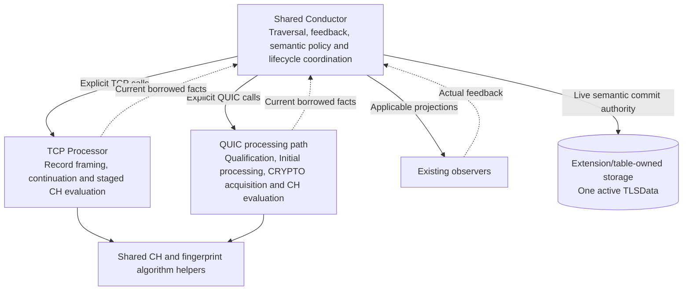
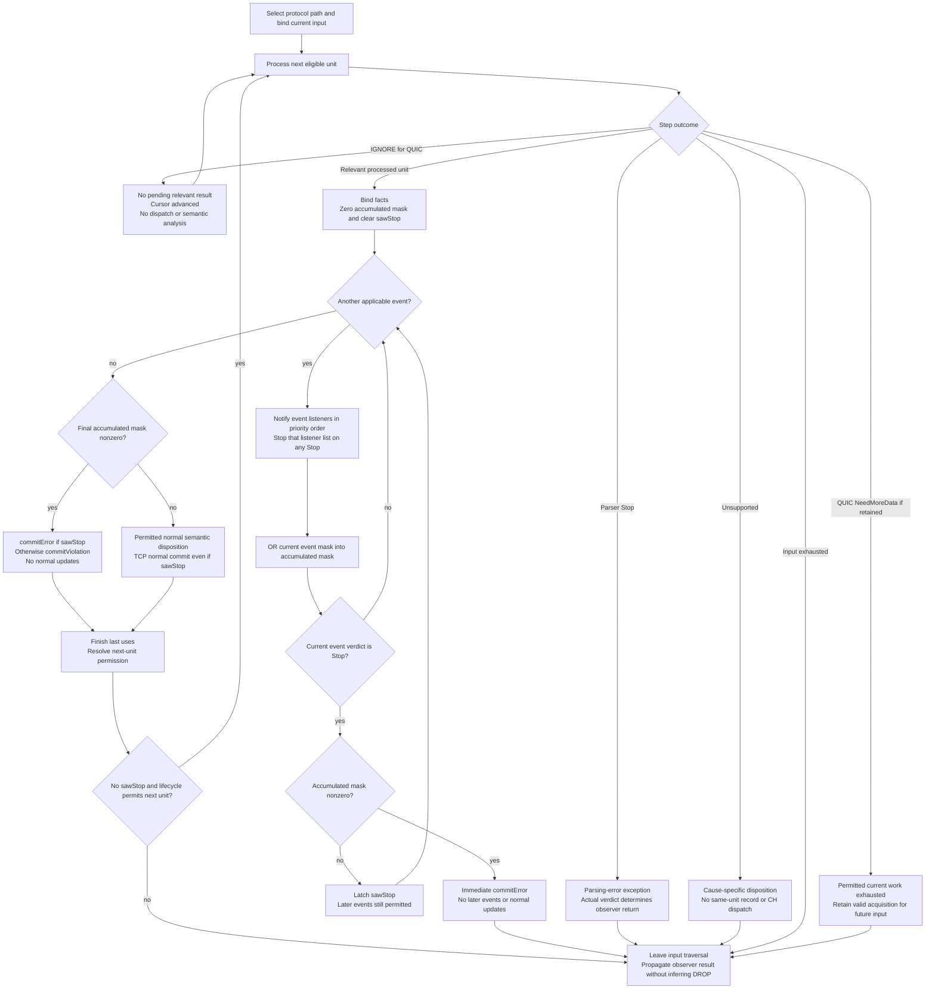
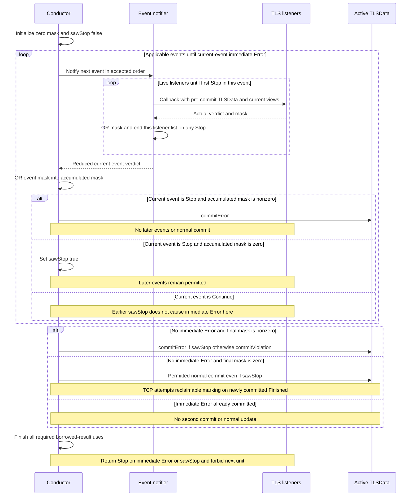

# Candidate 1: Shared Conductor with Separate TCP and QUIC Processing Paths

**Version:** V5  
**Audience:** TLS-Flow engineering team  
**Status:** architecture proposal for technical discussion. TCP preservation requirements are grounded in the supplied implementation; QUIC additions and optional refinements are identified separately.

## 1. Architecture at a glance

Keep one Conductor responsible for traversal, observer transactions, semantic state updates and lifecycle coordination. Add a QUIC processing path alongside the existing TCP Processor. Reuse ClientHello (CH) and fingerprint (FP) algorithms through composition, without forcing QUIC through TLS-record framing.

**Compatibility scope:** this is an extension proposal, not a claim that QUIC already exists or that a document proves runtime equivalence. Preserve the current TCP callback trace, verdict reduction, commit timing and step termination. New QUIC support, stronger ownership coordination and any separately authorized corrections are changes, not descriptions of current code. No TCP semantic correction is silently approved by this proposal.

The defining boundary is **shared orchestration and state authority, separate protocol processing**. The Conductor explicitly selects the TCP or QUIC path. A common processing interface is optional, not a prerequisite of Candidate 1. Section 8 describes that refinement separately so it is not confused with the minimum design.

No protocol-flow object, universal record representation or separate semantic-policy class is required. Shared policy can remain Conductor functions. A logical responsibility does not automatically require a new class.

The diagram shows responsibilities, not mandatory class names or final APIs. The Extension/table owns storage; the Conductor authorizes live semantic changes and coordinated inactive reset/reuse.

## 2. Responsibility split

| Responsibility | Placement |
|---|---|
| Select protocol path and authorize the next semantic unit | Conductor |
| Deliver applicable observer projections and reduce actual verdicts | Conductor |
| Apply permitted live TLSData updates | Conductor |
| Coordinate attempt acceptance, replacement, retirement and reclaim | Conductor with protocol support owners |
| TLS-record framing, TCP sequence handling and continuation | TCP Processor and existing continuation support |
| QUIC packet qualification, supported Initial protection/decryption and frame parsing | QUIC processing path |
| CRYPTO acquisition, association evidence and isolated candidate backing | QUIC attempt/acquisition responsibility |
| CH field parsing, canonicalization and fingerprint algorithm | Reusable helpers composed by both paths |
| Physical active semantic storage | Existing Extension/table |

A straightforward realization has two long-lived Engine-level processing objects: the existing Processor, optionally renamed TcpProcessor, and a QuicProcessor. They are not allocated per packet or per Session. Per-session/attempt support has separate prepared storage and lifetime.

## 3. Inbound processing

### 3.1 Integration with the existing entry path

The existing design participates through SessionTable. The Conductor receives Session events, obtains subscriber participation and uses the TLS extension before processing inbound traffic. This remains Session-based integration, not a new direct Packet Flow registration.

The existing processing interface is TCP-oriented: beginPacket accepts PayloadParams, processRecord reads const TLSData, and TLSStepResult contains RecordParsed, NeedMoreData, Unsupported, EndOfPacket and Stop. Current results are accessed through viewers rather than carried entirely by the enum.

Protocol selection must occur before TCP sequence extraction, TLS-record framing and TCP-only lifecycle shortcuts. UDP transport alone is not QUIC admission or trusted packet classification. Apply the configured participation and qualification rules before giving input semantic authority.

### 3.2 TCP path

1. Apply the relevant TCP lifecycle and entry rules.
2. Bind the current input to the existing Processor.
3. Process the next eligible TLS record or continuation step.
4. Use the existing TCP viewer and dispatch predicates as the compatibility baseline. Distinguish retained viewer data from fresh facts; see Section 7.
5. Dispatch applicable projections, reducing feedback after each projection.
6. Apply permitted state dispositions and finish borrowed-result uses.
7. Request another unit only if allowed.

Retain staged CH evaluation, continuation and existing visibility behavior. A separately authorized restoration/cleanup or freshness correction must be tracked and tested as an explicit change, not described as exact preservation of the supplied code. Section 9.1 identifies the current-code preservation points.

### 3.3 QUIC path

1. Bind the datagram and required Session/attempt context.
2. Qualify packet boundaries, supported version and association evidence.
3. Perform supported Initial processing and parse applicable frames.
4. Acquire CRYPTO data in prepared support associated with the correct attempt.
5. Evaluate CH when sufficient valid input is available, reusing CH/FP algorithms.
6. Yield relevant facts to the Conductor before crossing a required feedback boundary.
7. Continue remaining permitted input only after the current result is resolved.

The QUIC path supplies facts and qualification. It does not independently commit the active TLSData. It must not fabricate TLS records to use TCP-only record callbacks.

## 4. Processing units, partial CH and step outcomes

The following is the proposed QUIC traversal contract and possible common vocabulary. It is not a replacement specification for the current TCP enum. TCP keeps its existing result handling unless an explicit migration proves the same observable behavior. Shared outcome meanings do not require a shared C++ interface.

**Continue within the current input until a result requires Conductor handling, an eligible completed unit can return IGNORE, or permitted input work is exhausted. Partial CH alone does not justify discarding remaining input or waiting for a future datagram.** Explicit parser Stop, Unsupported, observer feedback and lifecycle dispositions still take precedence.

The exact QUIC unit boundary remains open. One call may correspond to a packet where that preserves the required feedback boundaries. Intra-packet suspension should be required only by a concrete semantic dependency, not merely because CH acquisition is incomplete. No new suspension framework is assumed.

| Proposed outcome | Meaning and Conductor action |
|---|---|
| UnitProcessed | Qualified current facts are available. Handle applicable projections and permitted semantic dispositions. Zero callbacks are possible. |
| IGNORE | No current result requires Conductor handling. Skip dispatch and semantic analysis, then advance if permitted. |
| EndOfPacket | No permitted work remains in the input bound by beginPacket. |
| NeedMoreData, if retained as input-ending | Current work is exhausted, no relevant result is pending, and valid acquisition awaits future input. |
| Unsupported | Follow the accepted cause-specific pre-dispatch disposition, not a generic violation. |
| Stop | Follow the explicit parser-Stop exception. This is distinct from observer STOP. |

These names are provisional. In the existing TCP Processor, NeedMoreData also covers a detected full continuation retransmission, without consuming the current cursor. Thus the proposed exhaustion/acquisition wording must not be applied retroactively to TCP. Whether QUIC needs a separate NeedMoreData outcome remains open. Do not add a Conductor-side has-more-input query merely to repair an ambiguous return contract.

### 4.1 IGNORE is not equivalent to no callback

- Acquisition-only work may update prepared CRYPTO support without producing a result for the Conductor.
- A qualified semantic result, such as applicable completion evidence, can require state handling without any observer callback. It is not IGNORE.
- Attempt acceptance/reset, required support loss or another disposition requiring Conductor authority must not be hidden under IGNORE.
- IGNORE must make real progress. It must not redispatch stale facts, repeat the same unit indefinitely or cross an unresolved feedback boundary.

### 4.2 Partial-input examples

| Situation | Behavior |
|---|---|
| Partial CH and more permitted work in the current input | Continue internally or yield IGNORE at an eligible completed unit boundary, then resume on the next call. |
| CH becomes ready before later semantic work | Yield the relevant result and resolve its feedback/commit before later authority. |
| Current input exhausted with incomplete acquisition | Retain valid prepared support for future input and report exhaustion under the chosen outcome contract. |
| IGNORE on the final eligible unit | The next call reports exhaustion rather than repeating the unit. |
| Qualified semantic evidence with no projections | No synthetic callback, but perform the permitted semantic disposition. |

## 5. Observer transaction and semantic commit

A projection is an observer event/view of the current unit. **There are two distinct reduction levels:** listeners within one event, and events within one record. Preserving only the final Error state is insufficient; callback delivery and commit timing must also match.

### 5.1 Listeners within one event: immediate STOP

The existing notify helper visits live listeners in priority order, ORs their actual violation masks, and returns immediately on the first Stop, even with a zero mask. Remaining listeners of that event are not called. Expired weak listeners are skipped. The resulting event verdict contains only feedback from listeners actually invoked.

### 5.2 Events within one parsed TCP record

The existing order is parsing-error handling, TLSRecord handling, then ClientHello handling when the CH viewer reports Complete. Each event's verdict is reduced before the next event.

1. Start with zero accumulated violation mask and sawStop=false for this record.
2. OR the current event verdict's mask into the accumulated mask.
3. If the **current event verdict** is Stop and the accumulated mask is nonzero, commitError and return RET_OBSERVER_STOP immediately. Do not deliver later events or apply normal updates.
4. If the current event verdict is Stop with a zero accumulated mask, set sawStop=true and continue to the next event. Continue never clears sawStop.
5. A later Continue with violations does **not** trigger the immediate-exit condition merely because sawStop is already true. Remaining applicable events still run.
6. After all applicable events, if the accumulated mask is nonzero, commitError when sawStop is true, otherwise commitViolation. Do not apply normal updates in either case.
7. If the accumulated mask is zero, perform the normal current-record commit, even when sawStop is true. If this newly reaches Finished, attempt markReclaimable.
8. Return RET_OBSERVER_STOP if sawStop is true, otherwise RET_OBSERVER_CONTINUE.

The next record is not processed after RET_OBSERVER_STOP. Even with Continue, the current TCP loop advances only after RecordParsed and while the resulting handshake state is active. A violation-only Continue does not itself stop an active flow. The stored terminalViolationMask is not a generic terminal-state predicate.

| Event feedback sequence | Remaining events of this record | Commit and return |
|---|---|---|
| Stop with zero accumulated mask | Continue applicable later events, but not remaining listeners of the stopped event | Resolve final mask, then return Stop |
| Current Stop with nonzero accumulated mask | None | Immediate Error and Stop |
| Earlier zero-mask Stop, then Continue with violations | Continue applicable later events | Final Error and Stop unless a later current Stop triggers immediate Error |
| Earlier violations, then current Stop with zero new mask | None | Immediate Error and Stop |
| Violations and no Stop | Continue applicable later events | Final commitViolation and Continue, no normal updates |
| No violations, with or without earlier zero-mask Stop | Continue applicable later events | Normal commit, then return according to sawStop |

This preserves even combinations whose practical reachability is unknown. Do not remove a path based on an unproven assumption that a listener cannot return that combination.

### 5.3 Parser outcomes and no-projection QUIC results

Parser Stop is not observer Stop. In the existing TCP dispatchStepResult, parser Stop invokes parsing-error handling, commits any actual violation according to that event's verdict, and returns toObserverResult(verdict). If no listener returns Stop, the result can be RET_OBSERVER_CONTINUE, but the record loop still ends because the parser result was not RecordParsed. NeedMoreData, Unsupported and EndOfPacket also end that loop; they do not automatically stop subsequent SessionTable observers.

Unsupported follows commitUnsupported's existing state/cause predicate and performs no same-unit record/CH dispatch. It is not an unconditional Unsupported state transition.

QUIC can yield a qualified result with no projections. Initialize the actual mask to zero, fabricate no callback or verdict, and apply only its qualified protocol-specific disposition. This is an addition, not a path present in the current record-only TCP analyzer. IGNORE yields no semantic transaction at all.

STOP is a traversal-control result, not DROP. TLS-Flow propagates RET_OBSERVER_STOP to its caller; the supplied bundle does not contain the SessionTable dispatcher implementation. The surrounding system's observer-chain behavior must not be presented as a verified packet-drop operation.

### 5.4 Proposed traversal view

The generic operation name processUnit is conceptual; separate protocol entry points can realize it. The flow shows the proposed QUIC input loop and a transaction reduction that preserves the current TCP event semantics. TCP's actual step and lifecycle gates are specified in Section 9.1, not replaced by this generic drawing. Error paths and parser exceptions must complete required last uses before any new support is recycled.

### 5.5 Parsed-unit transaction sequence

The inner listener-list reduction occurs inside event notification. The outer event loop ends early only on the current-event Stop plus nonzero accumulated mask condition. A previously latched Stop alone is not its loop-exit condition.

Callbacks may perform nested reads through the public viewers. Keep their backing valid for the required interval. This sequence describes callback/state ordering, not a guarantee that the current Processor already satisfies every proposed QUIC backing-lifetime requirement. Earlier committed units are not rolled back by a later failure.

## 6. TLSData, support storage and lifecycle

### 6.1 Shared semantic core

Keep one active TLSData per DP Session. Reuse semantic fields such as handshake state, published CH versions, CH count/time, fingerprint, early-data offer and violation mask. A transport-specific InProgress state is not needed solely because the input is QUIC.

Do not start by moving all QUIC support into TLSData. TCP-specific fields such as CCS information can initially retain explicit protocol applicability. Do not duplicate a transport discriminator if it is reliably available elsewhere. Exact field/layout changes remain open.

### 6.2 Separate QUIC support

Keep CRYPTO bytes/ranges, association/CID context, Initial cryptographic support, isolated candidate backing, required retired identities, bounded deferred evidence and parsing/evaluation backing outside the shared semantic core.

A Session-keyed lookup or a small prepared-support handle in the Extension are possible access patterns. Neither is selected, and both are not automatically needed. A handle does not transfer backing ownership to TLSData.

### 6.3 Lifetime and cleanup

- The current frame and result views are borrowed, not ownership transfers.
- Support required across inputs must use prepared storage, not retained packet pointers beyond their valid interval.
- Isolated candidate evaluation must not overwrite unrelated active authority. The Conductor authorizes accepted replacement/reset.
- Preserve required identity and complete required admission before destructive cleanup.
- Complete required detach before returning still-referenced claims. Return claims exactly once after last use.
- Only then approve inactive reset, erase or reuse. Table eviction/release must not silently bypass this coordination.
- Reclaim follows permitted Finished and last use. Resource eviction is not a synthetic SessionEnd or Incomplete Handshake violation.

**Target constraint:** all Engine runtime paths must use finite storage prepared at startup, without dynamic allocation, container growth or heap fallback. This is not a claim that every existing dependency has already been allocation-audited. Sharing evaluator backing depends on overlapping live intervals, not merely protocol names. Two processing paths do not require two complete evaluator workspaces.

## 7. Viewer integration

| Viewer concern | Proposed treatment |
|---|---|
| ClientHello data | Share genuine CH semantics. Resolve isSegmented and full-string backing/lifetime before finalizing the contract. |
| TLS records | Keep TCP-specific. No fabricated QUIC records or dummy getters for inheritance symmetry. |
| Parsing errors | Share only equivalent meanings. Do not automatically turn QUIC decryption, association or resource failures into parsing violations. |
| Public consumer reads | Route to the current qualified producer, preserving provenance and backing through nested reads. |

Direct viewer inheritance by QuicProcessor is optional; a composed adapter can provide the same read contract. Adding a viewer implementation alone does not update Application/Factory getters that currently expose the TCP Processor. A current-producer facade or equivalent routing is needed to expose QUIC through those same public viewer entry points. Separate protocol-specific public access would be a different API choice, not an already selected requirement.

**TCP compatibility caveat:** the current analyzer checks CH viewer Complete without a current-record freshness predicate. The Processor manages CH reset/restore at packet and continuation boundaries, not unconditionally before every record. A retained Complete status can therefore affect later record dispatch. Do not silently add a current-record-only CH gate or clear all viewers per unit and call it equivalent. Preserve the supplied behavior for the TCP compatibility baseline; any separately authorized freshness correction needs its own explicit delta and regression evidence. New QUIC facts must still have qualified provenance and must not borrow unrelated TCP results.

Sharing CH/FP algorithms does not require sharing the same mutable parser workspace. Reuse the algorithm without forcing TCP framing or invalidating a live borrowed result.

## 8. Optional refinement: common processing interface

The minimum candidate uses explicit TCP/QUIC calls. A separate refinement can make both processors implement a revised IProcessor with beginPacket and processUnit. This is the common-contract direction associated with Candidate 2, not a prerequisite or silently selected part of Candidate 1.

Under that refinement, beginPacket could accept the borrowed dpFrame and explicit context rather than TCP-oriented PayloadParams. Each processor extracts its relevant metadata. Confirm actual frame accessors, constness and Session/attempt context before finalizing signatures. Do not hide a lookup merely to keep one parameter.

A shared processing interface does not require a shared algorithm base class or identical viewer inheritance. The trade-off is less duplicate traversal against interface migration and frame coupling. Compare this refinement separately rather than attributing its benefits to the minimum explicit-path design.

## 9. Required changes to the existing design

- Add QUIC admission and explicit routing before TCP-specific extraction and lifecycle behavior.
- Add the QUIC processing/acquisition responsibility and its prepared support.
- Retain the TCP Processor contract where practical; change it only for justified reuse or the optional common-interface refinement.
- Extract reusable CH/FP algorithm operations without duplicating canonicalization or introducing a fake TLS-record layer.
- Adapt current-result access and public viewer routing to the active producer.
- Extend Conductor branches for protocol-specific association, completion and lifecycle policy while retaining one semantic authority.
- Coordinate table eviction/release with support ownership and last-use cleanup.
- Preserve TCP staged evaluation, continuation, viewer retention, visibility and feedback behavior through regression checks. Track any separately authorized freshness/restoration/cleanup correction as an explicit behavioral or lifecycle delta.

Protocol rules remain inherited constraints, not new choices made by this candidate: supported client-side QUIC v1/Initial capabilities, qualified completion rather than observed TLS Finished, no 0-RTT state advancement, no inferred server Retry/HRR, and no authority from ambiguous/retired evidence. The candidate must implement the accepted completion qualification and ordering, not invent a trigger from packet arrival or callback absence.

### 9.1 Current TCP preservation map

These are the supplied implementation's observable gates, not QUIC policy inferred from TCP.

| Area | Current behavior to preserve or explicitly distinguish |
|---|---|
| Startup and viewers | Factory builds one Processor and injects it as processing/CH/record/error interfaces. Public Application getters delegate to Factory. Adding QUIC requires wiring changes, not just another class. |
| Session participation | buildExtension queries live subscribers in priority order and allocates only when an event mask is nonzero. Successful new-session setup registers inbound and aging observers. |
| SYN without ACK | Missing extension is built and this packet is consumed. Existing active state with no recorded violations is retained. Other existing states or recorded violations cause release/rebuild and consumption. |
| RST without ACK | Before silent-terminal and payload gates, notify TCPReset. Actual violations commit Error on Stop or commitViolation on Continue. Without violations, clear TLSData even on Stop. Return the actual dispatch verdict. |
| Entry state gates | Finished/Unsupported are silent. Empty payload returns before terminal-payload dispatch. Nonempty Error/TerminatedByAlert input uses TerminalPayload instead of the Processor. |
| Record loop | beginPacket once, processRecord repeatedly only after RecordParsed and while state remains active. Any returned observer Stop exits immediately. Other parser outcomes end this loop even if observer return is Continue. |
| Parser Stop | Check parsing-error observers only. Commit actual violations according to the returned verdict. No normal record/CH dispatch. No automatic Error solely because the parser stopped. |
| NeedMoreData | No Conductor semantic commit. Also used for full continuation retransmission. Do not force cursor consumption or future-acquisition meaning onto this existing TCP outcome. |
| Unsupported | No same-unit record/CH callbacks. State becomes Unsupported for a continuation gap, PreHandshake, or InProgress with a Partial CH viewer. Other cases retain their state. |
| RecordParsed | Parsing-error, record and conditional CH events, with two-level feedback reduction exactly as Section 5. |
| Normal CH commit | For a CH record with Complete viewer, unless the higher-priority ChangeCipherSpec-to-Finished handshake branch applies: increment count, publish timestamp/FP/versions/early-data offer, and move PreHandshake to InProgress. No independent live commit in Processor. |
| CCS and ApplicationData | Before CH, update their respective counters. Non-TLS13 InProgress can reach ChangeCipherSpec on CCS. TLS13 InProgress with no early-data offer can reach Finished on ApplicationData. |
| Handshake after CCS | Normal handshake record processing in ChangeCipherSpec reaches Finished. This is not QUIC completion logic. |
| Alert | A readable, qualifying terminating Alert changes an active handshake to TerminatedByAlert. Terminal-payload states do not receive normal-record updates. |
| Violation-only commit | OR terminalViolationMask without changing hsState. A stored violation alone does not select TerminalPayload or prevent active parsing. |
| Finished marking | After a normal commit newly reaches Finished, call markReclaimable. Its return value is not checked by the caller. Marking is not release or guaranteed successful insertion. |
| Aging | Notify SessionEnd using current TLSData, then release the extension. The Conductor ignores that notification's returned verdict and returns Continue. Continuation support has its own aging observer. |
| Table storage | Existing alloc can reset/erase a reclaimable victim internally. Existing release resets/erases directly. Coordinating these operations with new QUIC support is required new integration, not existing behavior. |

The existing Processor also has protocol-specific continuation limits, retransmission/overlap/gap handling, alert reassembly/alignment and record-view capacity outcomes. Reusing CH helpers must preserve those TCP paths and the canonical FP byte sequence, not silently expand supported TCP fragmentation or reinterpret resource failures. The current code does not establish that a proposed refactor is already regression-tested.

### 9.2 Source anchors and compatibility boundary

Source basis: the supplied TLS-Flow-All-Code.txt bundle, not a repository commit inferred from a filename. Relevant locators:

- packet-flow/src/TLSFlowConductor.cpp: prepareInboundExtension, process, dispatchStepResult, analyzeProcessResult, state helpers, onAging.
- packet-flow/src/TLSFlowConductor.hpp: notify.
- processor/include/IProcessor.hpp and PayloadParams.hpp: existing step and input contracts.
- processor/src/Processor.cpp: beginPacket, processRecord, continuation and CH/FP processing, viewer getters.
- context/engine/src/Factory.cpp and Application.cpp: construction and public viewer routing.
- common/include/TLSData.hpp: state predicates and semantic fields.
- extension/include/TLSSessionExtensionTable.hpp: allocation, release and reclaimable marking.

Sections 5 and 9.1 specify preservation of the current TCP control/state contract. QUIC, IGNORE, protocol routing, support lifetime coordination and the optional common interface are proposed additions. They cannot be called equivalent to a QUIC implementation that is absent from the supplied bundle. Runtime allocation freedom, complete refactor equivalence and external SessionTable dispatch require their own implementation evidence. No source change is authorized by this document alone.

## 10. Benefits, risks and open decisions

### Benefits

- Explicit control flow and a single semantic authority.
- Localized extension of the existing Conductor/Processor structure.
- No mandatory polymorphic processing framework or new policy class.
- Algorithm reuse without forcing identical transport framing or storage.

### Risks and costs

- Conductor protocol branches can grow and shared/separate policy can drift.
- Viewer routing and coordinated retirement are real integration work.
- TCP still needs migration/regression checks and accepted cleanup fixes.
- Structural simplicity is a hypothesis, not measured CPU, memory or delivery evidence.

### Decisions for team review

1. Which protocol-specific decisions should remain explicit Conductor branches, and is their size manageable?
2. What concrete cases require yielding inside a QUIC packet rather than at its end?
3. Can the small step enum plus current-result access represent all relevant facts without a larger event model?
4. Does NeedMoreData need to remain distinct from input exhaustion?
5. Which viewer capabilities are genuinely shared, and how are current producer and lifetime enforced?
6. Does QUIC support use Session lookup or an Extension handle, and what exact cleanup coordination is required?
7. Is the optional common processing interface simpler overall than explicit separate calls?

This proposal is ready for comparison with Candidate 2. Its remaining questions concern implementation choices, not a reason to change the preserved TCP STOP contract. It is not an implementation specification, proof of a future refactor, measured performance result or approval to activate the feature.
