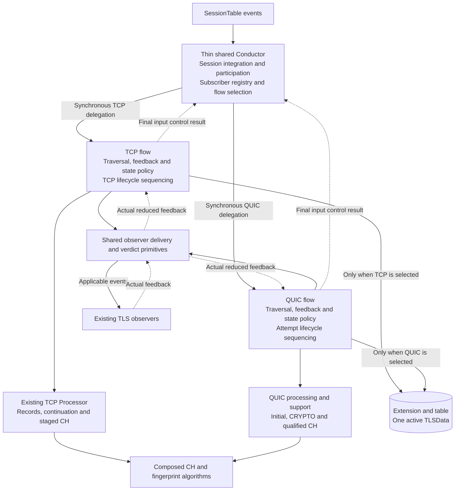
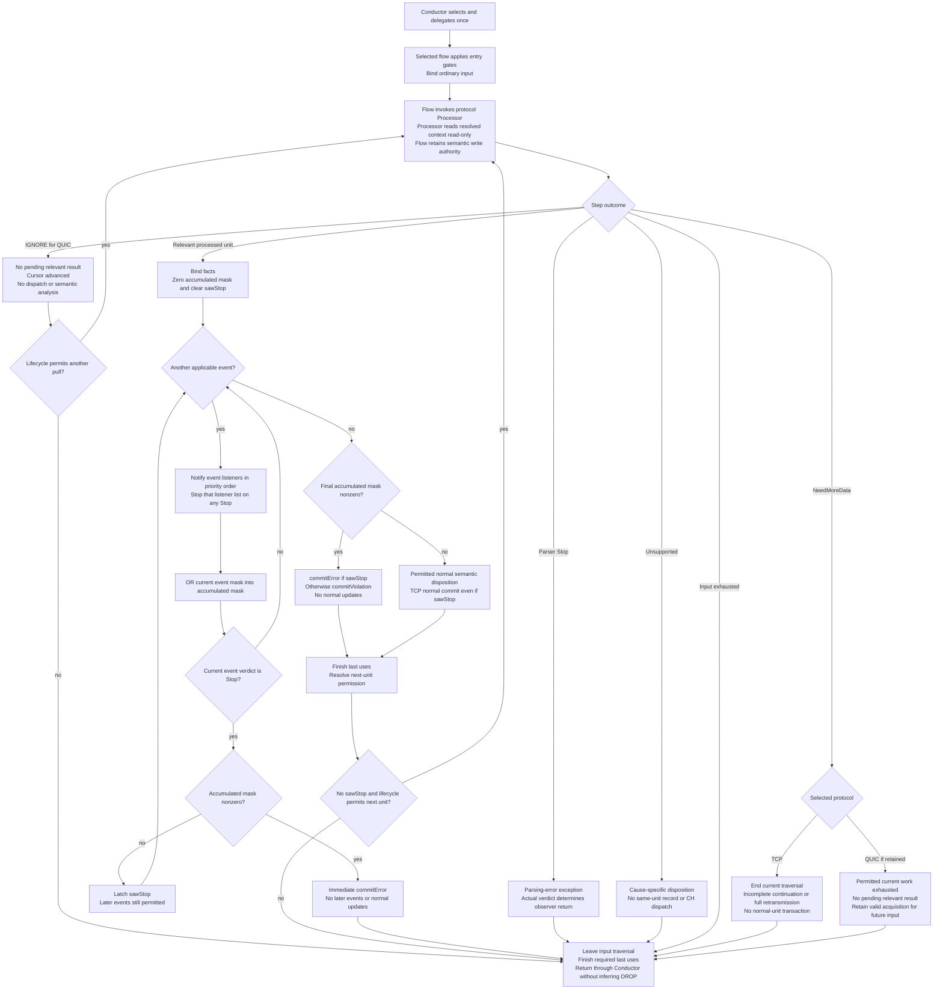
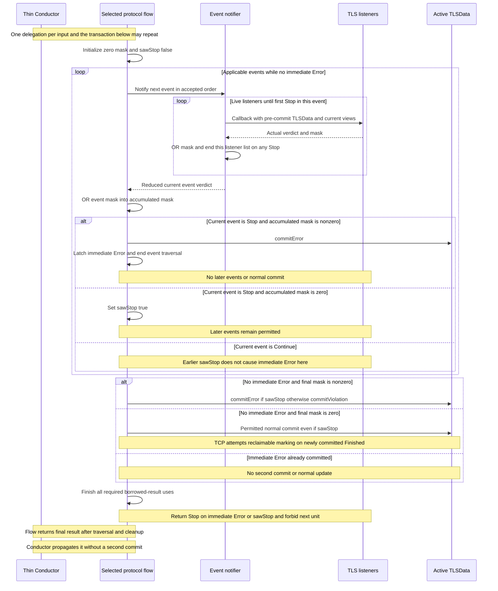

# Candidate 3: Protocol Flows Below a Shared Conductor

**Version:** V4
**Audience:** TLS-Flow engineering team
**Status:** architecture proposal for discussion and comparison, not a selected implementation.

## 1. Architecture at a glance

Keep a thin TLSFlowConductor for Session integration, subscriber registration, participation and protocol-flow selection. Delegate protocol-dependent processing to a TCP flow or a QUIC flow. **The selected flow owns traversal, observer-transaction sequencing, semantic commit authority and protocol lifecycle sequencing.** For inbound processing, the Conductor receives the final synchronous control result and propagates it without a second reduction or semantic commit. Lifecycle routing and the unbound-entry exception are explicit in Section 6.4.

This is the defining difference from Candidates 1 and 2: those candidates retain semantic sequencing and live state authority in the Conductor. Candidate 3 moves that authority into the selected protocol flow. It does not merely put two parser strategies behind a common processUnit interface.

A straightforward realization uses long-lived Engine-level TcpFlow and QuicFlow responsibilities, each composing its protocol processor/support and common observer-delivery, verdict and CH/fingerprint primitives. Names are illustrative. A logical flow can be a cohesive set of methods or a composed object; separate classes, an IFlow hierarchy and a new base class are not prerequisites. No per-packet or per-Session flow object is created.

**Compatibility scope:** preserve the existing TCP observable behavior while relocating responsibility. QUIC is an addition, not an implementation present in the supplied code. Stronger cleanup coordination and any separately authorized TCP corrections are explicit changes, not evidence of exact preservation. No TCP semantic correction is silently approved here. Source inspection establishes preservation obligations, not executed equivalence of a future refactor.

The two write arrows are alternatives, not concurrent writers. Only the selected flow has logical authority during its serial invocation. Extension/table retains physical ownership. The helper boxes are reusable operations, not mandatory services, queues or independent semantic-policy authorities. The outer Conductor does not run a parser-result loop.

## 2. Responsibility split

| Responsibility | Placement |
|---|---|
| SessionTable registration, subscriber registry and participation | Thin Conductor and existing integration |
| Select the participating protocol flow | Thin Conductor before protocol-specific processing |
| Protocol input traversal and next-unit permission | Selected flow |
| TCP entry gates, SYN/RST, terminal input and state sequence | TCP flow, preserving existing ordering |
| TCP record framing, continuation and staged CH evaluation | Existing TCP Processor and continuation support |
| QUIC admission details, protection, association and CRYPTO acquisition | QUIC flow with its processing/acquisition owners |
| Attempt acceptance, replacement and semantic publication | QUIC flow as the sole selected authority |
| Observer delivery and actual-mask reduction mechanics | Shared primitives invoked synchronously by the selected flow |
| Decide applicable events and resolve the current transaction | Selected flow, using the shared precise reducer |
| Live TLSData updates, completion and violation/Error decisions | Selected flow, optionally invoking simple qualified action helpers |
| Aging, retirement and release sequencing | Bound protocol flow, coordinated with table/support owners; unbound entries without new flow-owned claims entries use the common notification/release path in Section 6.4 |
| Physical semantic storage and table bookkeeping | Existing Extension/table |
| CH field parsing, canonicalization and fingerprint algorithm | Composed reusable helpers |
| Public current-result access | Existing public entry points with producer-aware viewer routing |

Sharing a reducer does not make it a second authority: it may compute a decision for the flow to apply. Simple state-action helpers execute only the flow-authorized action; they do not independently choose protocol transitions. Complete TCP/QUIC state-policy sequencing stays in the flows. Extracting an independent common semantic-policy authority would be an explicit Candidate 3/C4-P hybrid, not pure Candidate 3.

## 3. Inbound processing

### 3.1 Admission and selection

Keep SessionTable-based integration, not a new direct Packet Flow observer. The Conductor maintains subscriber participation and selects the protocol flow before TCP sequence extraction, record framing or TCP-only lifecycle shortcuts. UDP alone is not QUIC admission or trusted packet classification.

Preserve participation timing. In the supplied code, onNewSession can build an extension from subscriber event masks before inbound processing. TCP SYN can also trigger build/rebuild. Moving those paths must not add a universal extension-required gate ahead of the TCP SYN path: a missing extension is one of the cases that path handles.

The minimum delegation therefore carries the borrowed Session/frame and access to existing extension lookup/build services, with the extension allowed to be absent at TCP entry. The TCP flow applies the inherited prepareInboundExtension semantics before requiring an extension for ordinary processing. The Conductor may execute the common physical allocation/registration service at the flow's request, but does not decide a competing protocol reset policy. Exact signatures remain open.

### 3.2 TCP flow

1. Apply the existing SYN-without-ACK preparation/rebuild rules, including their consume/continue behavior.
2. If ordinary processing has no extension, return Continue as today.
3. Apply RST-without-ACK handling before silent-terminal and payload gates.
4. Preserve Finished/Unsupported silence, the empty-payload gate and Error/TerminatedByAlert terminal-payload handling in their current order.
5. Extract TCP payload/sequence and call the existing Processor beginPacket once.
6. Pull processRecord with read-only current TLSData, resolve the step and complete the current observer transaction before another record.
7. Advance only after RecordParsed, with an active resulting state and no returned observer Stop.
8. Return the actual final ObserverResult to the Conductor. The Conductor propagates it unchanged.

The existing TCP IProcessor, PayloadParams and viewers can remain TCP-oriented. No common processor interface is required. Keep staged CH/FP evaluation and existing continuation/visibility behavior. Relocation does not authorize a new freshness gate or changed retransmission policy.

### 3.3 QUIC flow

1. Apply configured participation and protocol admission before granting semantic authority.
2. Qualify supported packet boundaries, version and association/attempt evidence using the accepted trust contract.
3. Resolve retired/ambiguous evidence without merging or resetting active authority. Apply terminal-attempt classification before deciding whether CH parsing is allowed.
4. Perform supported Initial processing and frame parsing; acquire CRYPTO bytes/ranges in prepared support for the correct attempt.
5. Evaluate a qualified CH using shared CH/FP algorithms. Keep a candidate isolated from unrelated active state until accepted replacement.
6. At each feedback-relevant boundary, bind current views, dispatch applicable projections and resolve the transaction inside the QUIC flow.
7. Apply only qualified state/attempt dispositions. Resume remaining permitted input only after feedback and required last uses are resolved.
8. Preserve valid cross-input support, finish required exit cleanup and return the actual control result to the Conductor.

The QUIC processor supplies facts and mutates its acquisition/support state; it does not independently write active TLSData. The QUIC flow owns the semantic decision. Do not fabricate TLS records, TCP reset events or completion callbacks to reuse TCP paths.

### 3.4 What remains protocol-specific

TCP retains record/sequence continuation, CCS/ApplicationData/Alert applicability and its current completion predicates. QUIC retains packet protection, CRYPTO reconstruction, association, candidate acceptance and qualified completion/retirement rules. Share algorithms and mechanics where meanings actually match, not complete state-policy sequencing merely because state names match.

Delegation is synchronous. A flow resolves callbacks, commits and required cleanup before returning. There is no coroutine, asynchronous event queue, heap-owned event stream or deferred outer-Conductor commit. Nested viewer reads are allowed; reentrant processing/rebinding of the same workspace is not implied.

### 3.5 TCP flow versus QUIC flow: what actually differs

The distinction is not just TCPReset or processor selection. Separate **processor work** from **flow decisions**: cryptography, wire parsing and byte acquisition belong below the flow; choosing callbacks, accepting an attempt, applying state policy and coordinating retirement belong to the flow. Different parsers alone do not justify two flow managers.

#### 3.5.1 Detailed responsibility comparison

| Concern | TCP flow: preserve supplied behavior | QUIC flow: proposed protocol-specific behavior | Why this matters at flow level |
|---|---|---|---|
| Entry and reset | SYN-without-ACK preparation can build a missing extension or release/rebuild and consume the input. RST-without-ACK precedes silent/payload gates. | UDP/port admission selects a path for qualification, not proof of QUIC. Association evidence controls active/candidate/retired handling. No synthetic TCP reset. | Entry ordering and permission to touch semantic state differ. |
| Processor work | Processor parses TLS records and uses sequence-based continuation with existing support limits. | QUIC processing handles supported Initial protection, packet/frame parsing and CRYPTO ranges for the correct attempt. | These are processor differences. They do not alone require separate orchestration. |
| Feedback boundary | A RecordParsed step enters the exact current-record transaction; other outcomes leave that record loop. | The processor yields at a relevant semantic boundary; packet/frame boundaries need not each produce a transaction. | The flow must not advance past feedback-dependent work, but need not dispatch for every wire unit. |
| Incomplete CH | Existing NeedMoreData ends this input's record loop. It also represents full continuation retransmission. | Partial CH does not end permitted current-input work. Continue across remaining eligible frames/packets, internally or through progressed IGNORE results. | Do not copy TCP's loop-exit interpretation into QUIC acquisition. |
| Events | Parsing-error event when applicable, TLSRecord, then CH if the retained CH viewer is Complete, in that order. | Only accepted applicable projections. No fabricated TLSRecord event. A qualified result can require a disposition without any callback. | Event applicability and state relevance are not the same as wire parsing success. |
| Feedback mechanics | Immediate listener-list Stop; current-event Stop plus nonzero accumulated mask triggers immediate Error; earlier zero-mask Stop alone does not suppress later current-record events. | Reuse actual-verdict mechanics for accepted projections, without inventing extra events or protocol violations. Protocol-specific dispositions remain qualification-gated. | Share exact mechanics. Do not infer a new QUIC event order or TCP-style normal-record commit from that sharing. |
| CH publication | Normal CH commit requires a CH record and Complete viewer, unless the higher-priority handshake-after-CCS branch applies. Retained Complete can still cause CH callbacks on later records without a new CH commit. | Publish only qualified authoritative CH facts. A complete candidate does not overwrite unrelated active TLSData before acceptance. | TCP viewer retention is not QUIC attempt authority. |
| Finished | Existing TLS13-bit/ApplicationData and no-early-data-offer predicate, or a handshake record in ChangeCipherSpec. Preserve all guards and precedence. | Only the inherited qualified same-attempt completion policy in Section 8, including bounded deferred evidence where authorized. No observed server Finished is assumed. | Different transition predicates, not different meanings of the Finished state. |
| Terminal input | Finished/Unsupported are silent; empty payload precedes Error/TerminatedByAlert TerminalPayload dispatch. | Apply accepted attempt classification and terminal gates before CH parsing. Do not globally silence every datagram solely by copying TCP entry shortcuts. | Old/ambiguous evidence and a qualified new attempt must not be conflated. This is not permission to reopen every terminal attempt. |
| Replacement | Preserve the existing SYN-driven extension rebuild rules; do not invent a TCP attempt layer. | Flow authorizes accepted new-attempt replacement in the same DP Session. Candidate isolation, retired suppression and same-attempt restart/CH2 rules apply. | Acceptance/reset is a semantic lifecycle decision, not an independent parser write. |
| Aging | SessionEnd notification, extension release, Continue; ignore the notification verdict for state/return. Existing continuation manager ages independently. | Use the retained flow binding, deliver accepted SessionEnd behavior and coordinate QUIC-owned support last uses/detach/release. | No inbound packet is available for rediscovery. Do not double-release TCP continuation or invent SessionEnd commits. |
| Resource pressure | Preserve current TCP parser/table outcomes unless an explicit authorized change is isolated. | Bound acquisition/candidate/retired/deferred support. Apply accepted cause-specific resource disposition without inventing a violation or fallback. | Cleanup/admission can be semantic work even with zero callbacks. |

TCP facts in this table are anchored in Section 9.2 and the supplied Conductor/Processor/SegmentBufferManager implementations. QUIC entries are architecture obligations inherited from the project baseline, not behavior implemented in the supplied TCP code.

#### 3.5.2 Concrete control-flow examples

**TCP CH followed by another record:** after RecordParsed, the TCP flow performs parsing-error, record and eligible CH delivery with pre-commit TLSData. It applies the exact Section 5 reduction, then normal commit only if the final mask is zero. It asks the Processor for another record only if no observer Stop was returned and the resulting state remains active. A retained Complete CH viewer may cause another CH callback on a later record; it does not automatically cause another CH state publication.

**QUIC partial CH followed by more eligible input:** the processor acquires part of CRYPTO without a publishable CH. The QUIC flow continues permitted work instead of treating incomplete CH as end-of-datagram. IGNORE is allowed only after real progress with no pending flow disposition. When qualified CH facts become available, the flow resolves callbacks and publication before later feedback-dependent semantic work.

**QUIC accepted replacement:** the processor supplies isolated candidate facts and association evidence. The QUIC flow verifies the accepted replacement/admission conditions, preserves required old identity, completes old last uses and performs the authorized replacement/reset/publication sequence. Candidate acquisition is not permission to write active TLSData. Failure cannot justify destructive reset, mixing attempts or borrowing old deferred completion evidence.

**Aging or table pressure:** the Conductor routes a real Session event using retained lifecycle binding; the selected flow owns its notification/cleanup sequence. Table pressure routes retirement using the victim's binding, not the requesting packet. Resource eviction does not synthesize SessionEnd. TCP's separate continuation-aging observer remains separate.

#### 3.5.3 What stays shared, and what justifies the split

Share subscriber integration, physical Extension storage, actual listener-delivery/reduction mechanics, qualified primitive state actions and CH/FP algorithms where their meanings match. Do not duplicate them merely to make two flow classes look symmetric. Protocol flows need not inherit from Session Observer or share a processor base interface.

The architectural case for two flows is **different entry, event applicability, attempt acceptance, terminal and cleanup sequencing**, not different wire formats or a single Finished predicate. If concrete design shows that only a few predicates remain after factoring out processors and common primitives, Candidate 2 may be simpler. This proposal explains Candidate 3; it does not claim that the split is already the best choice.

## 4. Flow boundary and internal processing outcomes

The common architectural boundary is **delegate input, complete protocol-local work, return final control**. It is not Candidate 2's common parser-result pull boundary. An interface is optional; explicit TCP/QUIC calls can implement the same boundary.

| Boundary concern | Contract |
|---|---|
| Input | Borrowed Session/frame, required context and extension/service access, including the TCP missing-extension SYN case. No ownership transfer. |
| Invocation | Exactly one selected flow handles the inbound input synchronously. Victim-retirement services may additionally act on a different entry, without recursively processing another packet or rebinding a live workspace. |
| Internal processing | The flow drives its processor, dispatch, semantic updates and cleanup. |
| Return | Final ObserverResult for the caller. Continue can mean parser exhaustion/exception ended local traversal; it does not mean more local work must run. |
| Outer action | Propagate the returned result; do not replay events, reduce feedback again or commit state again. |
| Lifetime | Finish all required borrowed-result uses before invalidation or claim return. Retain only valid prepared cross-input support. |

### 4.1 TCP outcomes stay internal to the TCP flow

Keep RecordParsed, NeedMoreData, Unsupported, EndOfPacket and parser Stop with their existing effects. The flow can use the existing processRecord(const TLSData&) contract. Read current committed TLSData on each step, not a packet-start snapshot. Rebind any borrowed reference if an authorized replacement changes its backing.

NeedMoreData also covers a full continuation retransmission without consuming the current cursor. It ends the existing loop without a normal semantic commit. Do not reinterpret it as necessarily incomplete CH, cursor exhaustion or observer Stop. A source-preserving extraction must retain the actual retransmission/overlap/gap behavior; a newly approved bypass optimization is a separately identified delta.

### 4.2 QUIC outcomes and partial CH

A QUIC processor may use the vocabulary below internally. Names are provisional and need not be shared with TCP or exposed to the Conductor.

| Internal outcome | QUIC flow behavior |
|---|---|
| Relevant processed unit | Resolve applicable projections and qualified semantic dispositions. Zero callbacks are possible. |
| IGNORE | No pending result requires dispatch or semantic analysis; real internal progress occurred. Continue only while permitted. |
| Input exhausted | No permitted work remains in the bound datagram. Retain valid acquisition for future input. |
| NeedMoreData, if retained | End traversal only after permitted current-input work is exhausted and no relevant result is pending. |
| Unsupported | Apply the accepted cause-specific pre-dispatch disposition; no same-unit consumer dispatch or generic violation. |
| Parser Stop | Apply the qualified parser exception and leave traversal. Actual feedback determines observer return. |

**Partial CH alone does not justify discarding remaining permitted input.** Continue internally or yield an eligible progressed IGNORE boundary, then resume. When a relevant result needs feedback before later semantic work, resolve it first. A QUIC packet boundary may be sufficient; do not require an intra-packet suspension framework without a concrete dependency.

IGNORE is not synonymous with no callback. Qualified completion, attempt acceptance/reset or required support-loss disposition can require semantic handling with zero projections. Such work must not be hidden under IGNORE. An IGNORE on the final eligible unit must lead to exhaustion, not repeat the same unit indefinitely.

### 4.3 Current-result access

Identify the current producer, applicable views, qualification/cause and backing interval. Keep protocol result representations narrow. TCP record views remain TCP-specific; QUIC has no dummy record getters. A current result cannot borrow unrelated retained facts from the other producer.

For TCP compatibility, retained Complete CH viewer status can still affect later record callbacks as in the supplied analyzer. Do not conflate that inherited behavior with qualified current QUIC publication. Unsupported/IGNORE must not accidentally redispatch an old QUIC result.

### 4.4 Feedback and lifecycle resolution

The selected flow is the only semantic authority. The processor sees read-only resolved state; shared delivery/reducer primitives return actual feedback/decisions to the flow. Neither processor nor outer Conductor repeats the reduction.

No mandatory acknowledgement API is introduced. Add explicit support bookkeeping coordination only where a concrete acceptance, claim-transfer or last-use requirement needs it. Cleanup on Stop, Unsupported, exhaustion or failure cannot depend on a next pull or a future packet. The flow-entry return does not itself transfer support ownership.

## 5. Observer transaction and semantic commit

A projection is an observer event/view of the current unit. **For the ordinary TCP record path there are two distinct reduction levels:** listeners within one event, and events within one record. QUIC reuses actual-feedback mechanics for its accepted applicable projections, not a mandatory TCP event set or normal-record state policy. Preserving only the final Error state is insufficient; callback delivery and commit timing must also match.

### 5.1 Listeners within one event: immediate STOP

The existing notify helper visits live listeners in priority order, ORs their actual violation masks, and returns immediately on the first Stop, even with a zero mask. Remaining listeners of that event are not called. Expired weak listeners are skipped. The resulting event verdict contains only feedback from listeners actually invoked.

### 5.2 Events within one parsed TCP record

The existing order is parsing-error handling, TLSRecord handling, then ClientHello handling when the CH viewer reports Complete. Each event's verdict is reduced before the next event.

1. Start with zero accumulated violation mask and sawStop=false for this record.
2. OR the current event verdict's mask into the accumulated mask.
3. If the **current event verdict** is Stop and the accumulated mask is nonzero, commitError and return RET_OBSERVER_STOP immediately. Do not deliver later events or apply normal updates.
4. If the current event verdict is Stop with a zero accumulated mask, set sawStop=true and continue to the next event. Continue never clears sawStop.
5. A later Continue with violations does **not** trigger the immediate-exit condition merely because sawStop is already true. Remaining applicable events still run.
6. After all applicable events, if the accumulated mask is nonzero, commitError when sawStop is true, otherwise commitViolation. Do not apply normal updates in either case.
7. If the accumulated mask is zero, perform the normal current-record commit, even when sawStop is true. If this newly reaches Finished, attempt markReclaimable.
8. Return RET_OBSERVER_STOP if sawStop is true, otherwise RET_OBSERVER_CONTINUE.

The current code constructs TLSRecordContext after parsing-error reduction and before onRecord: current-CH version/early-data scalars and readable-alert termination qualification are captured there. Preserve that capture point and use the same context for normal commit; do not move it before parsing-error handling or recompute it after callbacks as an unlabelled refactor.

The next record is not processed after RET_OBSERVER_STOP. Even with Continue, the current TCP loop advances only after RecordParsed and while the resulting handshake state is active. A violation-only Continue does not itself stop an active flow. The stored terminalViolationMask is not a generic terminal-state predicate.

| Event feedback sequence | Remaining events of this record | Commit and return |
|---|---|---|
| Stop with zero accumulated mask | Continue applicable later events, but not remaining listeners of the stopped event | Resolve final mask, then return Stop |
| Current Stop with nonzero accumulated mask | None | Immediate Error and Stop |
| Earlier zero-mask Stop, then Continue with violations | Continue applicable later events | Final Error and Stop unless a later current Stop triggers immediate Error |
| Earlier violations, then current Stop with zero new mask | None | Immediate Error and Stop |
| Violations and no Stop | Continue applicable later events | Final commitViolation and Continue, no normal updates |
| No violations, with or without earlier zero-mask Stop | Continue applicable later events | Normal commit, then return according to sawStop |

This preserves even combinations whose practical reachability is unknown. Do not remove a path based on an unproven assumption that a listener cannot return that combination.

### 5.3 Parser outcomes and no-projection QUIC results

Parser Stop is not observer Stop. In the existing TCP dispatchStepResult, parser Stop invokes parsing-error handling, commits any actual violation according to that event's verdict, and returns toObserverResult(verdict). If no listener returns Stop, the result can be RET_OBSERVER_CONTINUE, but the record loop still ends because the parser result was not RecordParsed. NeedMoreData, Unsupported and EndOfPacket also end that loop; they do not automatically stop subsequent SessionTable observers.

Unsupported follows commitUnsupported's existing state/cause predicate and performs no same-unit record/CH dispatch. It is not an unconditional Unsupported state transition.

QUIC can yield a qualified result with no projections. Initialize the actual mask to zero, fabricate no callback or verdict, and apply only its qualified protocol-specific disposition. This is an addition, not a path present in the current record-only TCP analyzer. IGNORE yields no semantic transaction at all.

STOP is a traversal-control result, not DROP. TLS-Flow propagates RET_OBSERVER_STOP to its caller; the available inherited review does not establish the SessionTable dispatcher implementation. The surrounding system's observer-chain behavior must not be presented as a verified packet-drop operation.

### 5.4 Proposed traversal view

The flow below is a comparison view of ordinary input handling **inside the selected protocol flow**, not a shared outer-Conductor loop or a required common processor API. TCP uses its existing processRecord outcomes; QUIC may use the internal vocabulary in Section 4. Entry/reset/terminal/aging exceptions remain separate. The exact TCP gates are in Section 9.1.

The selected flow resolves every relevant unit before advancing. The outer Conductor delegates once and propagates the final result without another commit. Error paths must finish required last uses before new support can be recycled.

### 5.5 Ordinary TCP record transaction sequence

The inner listener-list reduction occurs inside event notification. For the ordinary TCP record transaction, the outer event loop ends early only on the current-event Stop plus nonzero accumulated mask condition. A previously latched Stop alone is not its loop-exit condition. The loop guard below excludes further iterations after immediate Error. This is not the separate parser-Stop, RST, terminal-payload or aging path.

Callbacks may perform nested reads through the public viewers. Keep their backing valid for the required interval. This sequence describes one current-unit callback/state transaction inside a delegated input, not a guarantee that a migrated Processor already satisfies every proposed QUIC backing-lifetime requirement. Earlier committed units are not rolled back by a later failure.

## 6. TLSData, support storage and lifecycle

### 6.1 Shared semantic core

Keep one active semantic TLSData context per DP Session. Shared state, published CH versions/count/time, fingerprint, early-data offer and actual violations remain semantic data. A transport-specific InProgress state is not needed merely because QUIC differs from TCP.

Physical storage remains Extension/table-owned (the current Conductor owns the table object). The selected protocol flow is the sole logical protocol-state writer during its serial operation, not a second TLSData owner. Processors/evaluators supply facts; the Conductor handles integration. Do not keep duplicate authoritative TLSData copies in both flows or require a per-Session flow object.

### 6.2 Separate QUIC support

Keep CRYPTO bytes/ranges, CID/association context, Initial support, isolated candidate backing, retired identities, bounded deferred evidence and evaluation cursors outside the shared semantic core. A prepared-support handle in the Extension or a Session-keyed lookup are alternatives; both are not automatically needed. A handle is not ownership.

The QUIC flow authorizes accepted replacement/reset and publication. Preparation must not overwrite unrelated active authority. A complete accepted new attempt replaces the active attempt as Session reuse within the same DP Session. Retry-compatible restart and HRR-compatible CH2 remain the same attempt and do not prove observed server Retry/HRR. Ambiguous and retired evidence cannot merge or reset active state.

Sharing algorithms does not require sharing mutable evaluator backing. Reuse workspaces only when live intervals do not overlap; do not allocate two complete workspaces merely because there are two protocols.

### 6.3 Lifetime and cleanup

- Preserve required terminal/retired identity and satisfy required admission before destructive cleanup.
- Complete callbacks, nested viewer reads, permitted producer/state work and all last uses before returning backing.
- Detach applicable references/registrations before returning still-referenced claims; return each claim exactly once.
- Authorize inactive reset, erase or reuse only after required preservation, admission and detach succeed. Failure does not authorize unsafe reuse or a synthetic protocol violation.
- Table victim selection/release must route through the affected protocol's retirement coordination before destructive reset. A victim can belong to a different Session/protocol than the requesting input; do not run the requester's cleanup against the victim.
- The Conductor may route an aging/retirement request to the correct flow, but does not become a second semantic authority. No nested rebinding of a live evaluator is authorized by that routing.
- Preserve the existing TCP markReclaimable call point for exact TCP compatibility. For new QUIC support, reclaim eligibility follows a newly committed qualified Finished and required last uses. Marking is not physical release or proof of successful insertion. Clear stale membership on reuse.
- Resource eviction is not a synthetic SessionEnd or Incomplete Handshake violation. Real Session aging retains its accepted notification-before-release semantics.

**Runtime constraint:** all Engine paths, including packet processing, aging, retirement and failure cleanup, use finite storage prepared at startup, without dynamic allocation, container growth or heap fallback. Bound traversal, crypto/context trials, ranges, reconstruction, candidates, deferred/retired retention, replacement peak and cleanup. Numerical capacities remain deferred under the accepted policy; finite approved startup values are required before enablement. No capacity number or unavailable CPU/RAM budget is invented here. This is a target obligation, not an allocation audit of all existing dependencies.

### 6.4 Lifecycle routing without an inbound packet

**Proposed architectural contract for Candidate 3:** retain a bounded protocol-flow binding for each participating entry before attaching any new flow-owned support. The Conductor integration layer retains this routing metadata in existing/prepared extension-associated storage; it is not another semantic TLSData copy. The binding is TCP, QUIC or not-yet-bound. Exact field placement and access signatures are downstream layout/API work, not an unresolved routing policy.

Inbound may establish the binding using trusted transport metadata and configured participation, before protocol support is claimed. Qualification failure does not prove another protocol or authorize trial parsing through both flows. The binding records the responsible lifecycle path, not a claim that every payload is valid TLS/QUIC. Do not switch an entry's cleanup owner merely because configuration changes or a later input is unsupported.

For Aging, use the stored binding and Session identity, not a nonexistent DPFrame or current port-group re-evaluation. The bound flow owns SessionEnd delivery and protocol-specific cleanup through extension release. The outer Conductor does not release the same entry again. An entry aged before first inbound can be not-yet-bound; by invariant it has no new flow-owned support claims. Independently retained legacy TCP continuation may still exist after extension eviction/rebuild; that support remains owned and aged by SegmentBufferManager, not by this binding. In that case the Conductor invokes a common notification-then-release operation, preserving the existing SessionEnd/Continue behavior without choosing a parser or making a protocol-state commit.

For table retirement, use the victim's stored binding and Session index. The new support-retirement contract must be callable using retained victim identity/binding, without requiring a packet, live victim Session lookup or synthetic SessionEnd. This is a proposed requirement for new support, not a claim about SegmentBufferManager, whose current deallocate implementation does look up Session. Unbound entries have no new flow-owned claims; this does not assert absence of independently retained legacy TCP continuation. Erase/reset/reuse must clear the old binding; a replacement entry receives its own binding. Missing or corrupt binding for an entry with new flow-owned live support is a lifecycle invariant failure, not permission to release through the requester's flow or invent a fallback policy.

**TCP compatibility boundary:** keep SegmentBufferManager's existing independent Aging registration and cleanup. The TCP flow does not newly call its deallocate operation on SYN, RST, Finished, extension release or SessionEnd merely because orchestration moved. Such a change can alter future continuation behavior, diagnostics or observer registration. If a separate accepted fix requires it, identify and validate that delta explicitly. No numeric aging-priority ordering is inferred from the supplied priority names.

## 7. Viewer and algorithm integration

| Concern | Treatment |
|---|---|
| Flow entry boundary | Synchronous input/disposition boundary; not a common parser interface. |
| Existing TCP Processor | Retain its processing and viewer contracts where practical; extraction need not rename processRecord. |
| CH viewer | Share genuine CH semantics; resolve isSegmented and full-string/digest/locator backing before final signatures. |
| Record viewer | TCP-specific. No synthetic QUIC record or dummy inheritance methods. |
| Parsing errors | Share only equivalent meanings. QUIC decryption, association and resource failures are not automatically parsing violations. |
| Public Application/Factory getters | Route CH/error access to the qualified current producer, preserving nested reads and defined availability outside callbacks. |
| CH/FP algorithms | Compose common field parsing, canonicalization and fingerprint primitives without changing staged TCP evaluation or canonical bytes. |
| Shared observer mechanics | Reuse priority order, weak-listener handling and the exact two-level reducer, without creating a policy owner. |

The current Factory constructs one Processor and injects it as processing/CH/record/error interfaces; Application getters delegate to Factory. Adding flows or another viewer implementation does not update that wiring automatically. Use a producer-aware facade or equivalent routing where the existing public entry points must serve QUIC. Separate protocol-specific public access would be a different API choice, not an assumed requirement.

The current TCP analyzer checks CH viewer Complete without a current-record freshness predicate. Preserve retained-Complete callbacks and the local MultipleClientHello guard as TCP compatibility behavior. A per-unit reset or fresh-current-record-only gate is an explicit change, not equivalent extraction. Do not export these TCP retention/count rules as QUIC publication policy.

The flow binds producer provenance before applicable callbacks and keeps backing valid through nested reads and semantic last use. It must not clear every TCP viewer per unit merely to simplify routing. Algorithm reuse does not require an algorithm base class, a common mutable parser workspace or whole-TCP-handshake buffering.

## 8. Protocol policy and lifecycle exceptions

Candidate 3 places protocol-policy sequencing in the flows. Sharing a few qualified actions does not centralize that sequencing. The outer Conductor must not retain a hidden second completion/reset/violation decision path.

| Exception or policy | Selected-flow treatment |
|---|---|
| TCP SYN | Preserve missing-extension build, active/no-violation retention and release/rebuild/consumption cases before ordinary processing. |
| TCP RST | Preserve notification, actual feedback, clear/violation/Error decisions and returned verdict before silent/payload gates. |
| TCP terminal input | Preserve empty-payload-before-TerminalPayload order and state-based applicability. A stored mask alone is not a terminal predicate. |
| Parser Stop | Error-projection exception, not observer Stop or automatic Error. |
| Unsupported | Cause-specific disposition and no affected-unit consumer dispatch. |
| QUIC terminal input | Classify attempt evidence before CH parsing. Do not blindly apply TCP's terminal-payload bypass to all QUIC datagrams. |
| QUIC replacement | Isolate candidates; accept/reset only under inherited qualification/admission and last-use rules. |
| Aging | Conductor routes by retained lifecycle binding; bound flow sequences notification/release. Unbound entries without new flow-owned claims use common notification/release. Preserve TCP ignoring SessionEnd feedback and returning Continue, and independent continuation aging. |
| Table retirement | Route to the victim's protocol/support owner and complete safe detach before erase/reuse. |

**Completion policy is inherited, not selected by this architecture.** The active Phase 6 Step 3 V6 and Step 5 V9 baselines describe qualified associated client QUIC v1 Handshake Long Header evidence as product-level completion, with bounded same-attempt pre-CH evidence. Candidate 2 V2 describes the same policy. This is not observed TLS Finished. Preserve accepted qualification and ordering, including trusted decoding or required protection handling. Do not infer authority from protected packet-type bits, packet numbers or key phase without the required handling or trusted upstream classification.

If the required qualification cannot be established, do not manufacture Finished or Finished-based reclaim; retain InProgress absent another accepted lifecycle disposition. 0-RTT does not advance state. No server Retry, HRR, Finished, HANDSHAKE_DONE, server 1-RTT or server transport-parameter visibility is assumed.

A permitted authoritative CH and eligible same-attempt deferred completion evidence can produce ordered InProgress then Finished dispositions in the same semantic cycle only under the accepted feedback/qualification conditions. Callback absence is not completion evidence. No synthetic completion callback, whole-input atomicity or rollback of earlier commits/observer effects is introduced. Replacement cannot inherit old-attempt deferred completion evidence.

This proposal does not reopen completion policy or supersede the active Phase 6 architecture selection. Any earlier shorthand about Stop plus accumulated violations must be read with Section 5's precise **current-event** predicate, not a new immediate-exit rule based only on a prior latched Stop.

## 9. TCP preservation and migration surface

The proposed change is responsibility relocation, not a new TCP algorithm. Preserve observable callback trace, actual masks, commit timing, viewer visibility, loop exits and caller result. Existing Processor contracts can remain intact, but moving Conductor behavior still requires regression evidence.

Required migration work:

1. Keep subscriber registry, participation and SessionTable registration in the outer integration layer.
2. Extract TCP preparation, ordinary traversal, dispatch/state sequencing and lifecycle exceptions into the TCP flow responsibility, preserving the order in Section 9.1.
3. Share notify/verdict primitives without moving semantic authority back to the Conductor or introducing an independent policy writer.
4. Add QUIC flow, protocol processing and startup-prepared acquisition/attempt support.
5. Reuse CH/FP algorithms without duplicating canonicalization or changing staged TCP continuation.
6. Wire Factory/Application, flow selection and current-producer viewer access. Do not allocate flows at runtime.
7. Route aging, release, reclaimable victim retirement and support cleanup through the correct protocol coordination, including the missing-extension SYN path and cross-protocol table victims.
8. Compare TCP traces before/after extraction and test QUIC independently. Record separately authorized corrections as explicit deltas.

### 9.1 Current TCP preservation map

These are the supplied implementation's observable gates, not QUIC policy inferred from TCP.

| Area | Current behavior to preserve or explicitly distinguish |
|---|---|
| Startup and viewers | Factory builds one Processor and injects it as processing/CH/record/error interfaces. Public Application getters delegate to Factory. Adding QUIC requires wiring changes, not just another class. |
| Session participation | buildExtension queries live subscribers in priority order and allocates only when an event mask is nonzero. Successful new-session setup registers inbound and aging observers. |
| SYN without ACK | Missing extension is built and this packet is consumed. Existing active state with no recorded violations is retained. Other existing states or recorded violations cause release/rebuild and consumption. |
| RST without ACK | Before silent-terminal and payload gates, notify TCPReset. Actual violations commit Error on Stop or commitViolation on Continue. Without violations, clear TLSData even on Stop. Return the actual dispatch verdict. |
| Entry state gates | Finished/Unsupported are silent. Empty payload returns before terminal-payload dispatch. Nonempty Error/TerminatedByAlert input uses TerminalPayload instead of the Processor. |
| Record loop | beginPacket once, processRecord repeatedly only after RecordParsed and while state remains active. In Candidate 3, the TCP flow retains this loop and its current outcomes. Any returned observer Stop exits immediately. Other parser outcomes end this loop even if observer return is Continue. |
| Parser Stop | Check parsing-error observers only. Commit actual violations according to the returned verdict. No normal record/CH dispatch. No automatic Error solely because the parser stopped. |
| NeedMoreData | No flow semantic commit (currently no Conductor commit). Also used for full continuation retransmission. Do not force cursor consumption or future-acquisition meaning onto this existing TCP outcome. |
| Unsupported | No same-unit record/CH callbacks. State becomes Unsupported for a continuation gap, PreHandshake, or InProgress with a Partial CH viewer. Other cases retain their state. |
| RecordParsed | Parsing-error, record and conditional CH events, with two-level feedback reduction exactly as Section 5. |
| Normal CH commit | For a CH record with Complete viewer, unless the higher-priority ChangeCipherSpec-to-Finished handshake branch applies: increment count, publish timestamp/FP/versions/early-data offer, and move PreHandshake to InProgress. No independent live commit in Processor. |
| CCS and ApplicationData | Before CH, update their respective counters. With a nonzero CH count, InProgress and the TLS13 bit absent, CCS reaches ChangeCipherSpec. With a nonzero CH count, InProgress, the TLS13 bit present and no early-data offer, ApplicationData reaches Finished. These are bit predicates, not proof of a negotiated version. |
| Handshake after CCS | Normal handshake record processing in ChangeCipherSpec reaches Finished. This is not QUIC completion logic. |
| Alert | A readable, qualifying terminating Alert changes an active handshake to TerminatedByAlert. Terminal-payload states do not receive normal-record updates. |
| Violation-only commit | OR terminalViolationMask without changing hsState. A stored violation alone does not select TerminalPayload or prevent active parsing. |
| Finished marking | After a normal commit newly reaches Finished, call markReclaimable. Its return value is not checked by the caller. Marking is not release or guaranteed successful insertion. |
| Aging | Notify SessionEnd using current TLSData, then release the extension. The current Conductor ignores that notification's returned verdict and returns Continue; the extracted TCP flow must do the same. Continuation support has its own aging observer and is not newly deallocated by the flow. |
| Table storage | Existing alloc can reset/erase a reclaimable victim internally. Existing release resets/erases directly. Coordinating these operations with new QUIC support is required new integration, not existing behavior. |

The existing Processor also has protocol-specific continuation limits, retransmission/overlap/gap handling, alert reassembly/alignment and record-view capacity outcomes. Reusing CH helpers must preserve those TCP paths and the canonical FP byte sequence, not silently expand supported TCP fragmentation or reinterpret resource failures. The current code does not establish that a proposed refactor is already regression-tested.

### 9.2 Source anchors and compatibility boundary

Source basis: TLS-Flow-All-Code.txt as supplied, not an inferred repository revision. The following source locations define the extraction/preservation map:

| Source path | Anchors and Candidate 3 relevance |
|---|---|
| packet-flow/src/TLSFlowConductor.cpp | onNewSession, onInbound, prepareInboundExtension, process: preserve participation, missing-extension SYN, RST and ordinary-loop ordering while relocating protocol sequencing. |
| packet-flow/src/TLSFlowConductor.cpp | dispatchStepResult, analyzeProcessResult, commitNormalCurrentRecord, commitUnsupported and updateTLSDataOnClientHello/ChangeCipherSpec/ApplicationData/Alert: preserve step exceptions, event ordering and state predicates inside TCP flow. |
| packet-flow/src/TLSFlowConductor.cpp | buildExtension, registerSessionObservers, subscribe/unsubscribe: retain shared integration services and subscriber authority. onAging: route to protocol-local notification/release sequence. |
| packet-flow/src/TLSFlowConductor.hpp | notify: live-listener priority, OR of actual masks and immediate listener-list Stop. Share this mechanic, not a second policy decision. |
| processor/include/IProcessor.hpp and PayloadParams.hpp | beginPacket, processRecord(const TLSData&) and TLSStepResult: existing TCP contract can remain internal to TCP flow. |
| processor/src/Processor.cpp and Processor.hpp | beginPacket, processRecord, resumeOrDiscardStepContinuation, processNewRecord, processSegmentedClientHelloContinuation and viewer getters: preserve continuation, retransmission, staged CH and retained Complete. |
| context/engine/src/Factory.cpp and Application.cpp | init, buildProcessor and public viewer getters: existing injection must be adapted for flow dependencies and current producer. |
| processor/src/SegmentBufferManager.cpp and SegmentBufferManager.hpp | allocate/deallocate/onEvent: preserve independent continuation Aging registration, support removal and return behavior. |
| common/include/TLSData.hpp | Shared fields and active/silent-terminal/terminal-payload predicates. Storage does not move into a flow. |
| extension/include/TLSSessionExtensionTable.hpp | alloc, release and markReclaimable: destructive internal eviction/release must be coordinated with new support owners. |

Direct static reinspection for this proposal focused on the Conductor's entry, loop, dispatch/reducer, state helpers, notify and aging, with Processor/interface, Factory/Application, TLSData, table and SegmentBufferManager sections checked as migration dependencies. Section 9.1 retains the reviewed current-code preservation map from Candidate 2; relocation changes its future placement, not the listed current behavior.

The supplied bundle does not establish an existing QUIC implementation or the external SessionTable dispatcher's packet-drop behavior. No new implementation, product test run, complete allocation audit or measured performance result is claimed. No source change is authorized by this proposal alone.

## 10. Benefits, risks and open decisions

### Benefits

- Protocol traversal, feedback and lifecycle sequencing stay cohesive within each flow.
- QUIC attempt/acquisition complexity does not dominate the outer Conductor or TCP path.
- Existing TCP Processor/result/viewer contracts can remain TCP-specific.
- Shared algorithms and exact observer mechanics avoid unnecessary duplication without forcing a universal parser result or TLS record.

### Risks and costs

- Complete state-policy sequencing is separate, so CH/violation/completion rules can drift despite shared helpers. This is a real cost relative to common semantic policy.
- TCP extraction can regress entry ordering, current-event STOP, retained views, continuation or aging even when no algorithm was intentionally changed.
- Viewer routing, support lifetime and victim-aware retirement remain integration work; a thin Conductor does not remove them.
- A flow hierarchy, context object or helper service can become unnecessary framework overhead. Prefer explicit methods/composition unless a concrete boundary justifies more.
- Less Processor-interface churn is a delivery hypothesis, not measured CPU, RAM, code size or schedule evidence.

### Decisions for team review

1. Which cohesive flow responsibilities justify objects, and which can remain methods without retaining hidden Conductor policy?
2. What minimum borrowed context/service access handles SYN with no extension without hidden lookups or a large context bag?
3. Which exact observer/reducer primitives should be shared to prevent STOP drift while keeping flow authority explicit?
4. What concrete QUIC dependency requires a feedback boundary inside a packet?
5. Which CH/error viewer capabilities are genuinely common, and what do public reads mean outside callbacks?
6. Which support-access alternative and victim-aware cleanup contract avoid duplicate ownership?
7. Is separate state-policy sequencing worth the extraction and drift risk compared with Candidates 1/2 or an explicitly labelled C4-P hybrid?

Candidate 1 retains explicit protocol paths under Conductor authority. Candidate 2 requires a common processor pull contract under that authority. Candidate 3 delegates complete protocol sequencing and semantic authority to the selected flow. None of these structural choices proves correctness or changes the accepted protocol constraints. No active Phase 6 decision or baseline is superseded here.

## 11. Validation expectations and evidence boundary

The section order follows Candidate 2 V2, with Candidate 1 V5's common comparison topics retained. The three Mermaid views correspond to the same views in those proposals: architecture, ordinary traversal and the ordinary TCP record transaction. The last view is not a generic lifecycle transaction. Their authority labels and delegation boundary are adapted to Candidate 3; the observer-reduction semantics are not simplified.

### Source and authority map

| Source | Use and authority boundary |
|---|---|
| phase6-step3-four-architecture-candidates-v6.md, Section 5 | Candidate 3 identity: thin Conductor, protocol-local traversal/policy/lifecycle and synchronous delegation. Section 2 supplies inherited invariants. |
| phase6-step4-candidate-comparison-v2.md | Preserved comparison baseline; no new ranking or selection is claimed. |
| phase6-step5-architecture-decision-and-delivery-scope-v9.md | Active decision/delivery baseline remains unchanged. This standalone alternative does not replace its selected direction. |
| candidate1-team-architecture-proposal-v5.md | Common team-facing structure, explicit-path contrast and reviewed preservation/lifetime discussion. |
| Candidate2-V2.md, available full local copy candidate2-team-architecture-proposal-v2.md | Eleven-section structure, exact two-level reduction, preservation map and comparison boundary. The attached parsed content supplies the Candidate2-V2 text. |
| TLS-Flow-All-Code.txt | Current TCP source authority for compatibility. Source anchors are in Section 9.2; QUIC is proposed, not source-implemented. |

### Required implementation evidence, not executed product tests

| Check | Expected result |
|---|---|
| Delegation and authority | One selected flow per inbound input; no outer parser loop, replayed callback, second reduction or second semantic commit. Lifecycle binding and unbound entries without new flow-owned claims cleanup follow Section 6.4. |
| Participation and SYN | Same subscriber priority/event masks, registration and build timing; missing-extension SYN still reaches preparation. |
| TCP entry and lifecycle | Same SYN/RST, silent-terminal, empty-payload, terminal-input and aging behavior/order. |
| TCP observer traces | Same callbacks/order, actual masks, pre-commit views, commit timing and ObserverResult. Include all Section 5.2 feedback combinations. |
| TCP step outcomes | Same RecordParsed/active-state continuation gate; parser Stop, NeedMoreData, Unsupported and EndOfPacket end local traversal without invented observer Stop. |
| TCP continuation and FP | Same retransmission/overlap/gap limits, alert handling, staged evaluation, canonical fingerprint bytes and retained-Complete behavior. |
| QUIC acquisition and progress | Partial CH does not skip remaining permitted input; IGNORE progresses and never hides a pending semantic disposition. |
| QUIC association and replacement | One active context; isolated candidate; retired/ambiguous suppression; no old-attempt deferred evidence leaks into replacement. |
| Feedback and completion | No later unit after observer Stop; preserve current-unit rules. No callback-free completion inference; qualified completion only. |
| View backing and cleanup | Nested reads remain valid; no stale producer, double-return, unsafe erase or cleanup dependent on a future packet. |
| Victim-aware retirement | Correct protocol/support owner for the victim, including cross-Session/cross-protocol pressure; no workspace reentrancy or eviction-induced violation. |
| Runtime bounds and allocation | Startup-prepared finite backing, bounded packet/aging/failure paths, no runtime allocation/growth; approved numeric capacities before enablement. |

Document-level consistency checks do not execute these tests. This proposal is not proof of future implementation equivalence, final API/layout specification, runtime performance, feature enablement or final Phase 6 PASS. Any later correction must be a new version; all input baselines remain unchanged.
