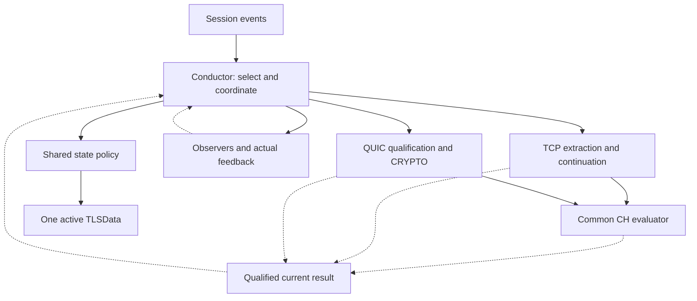
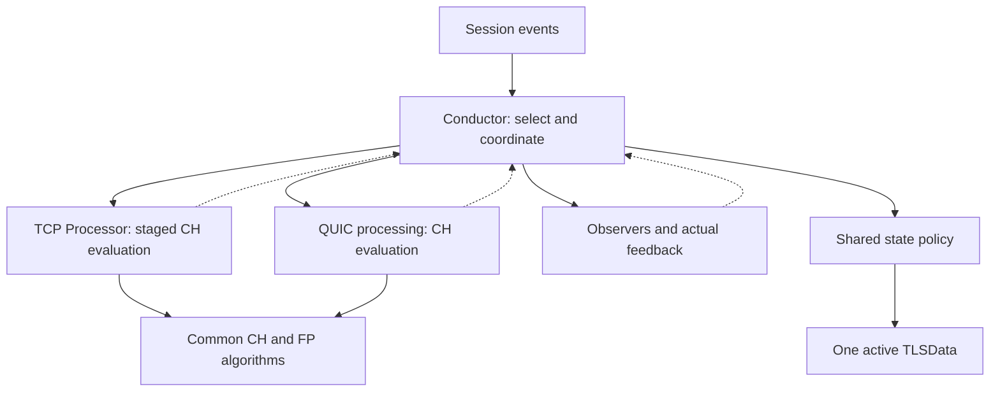
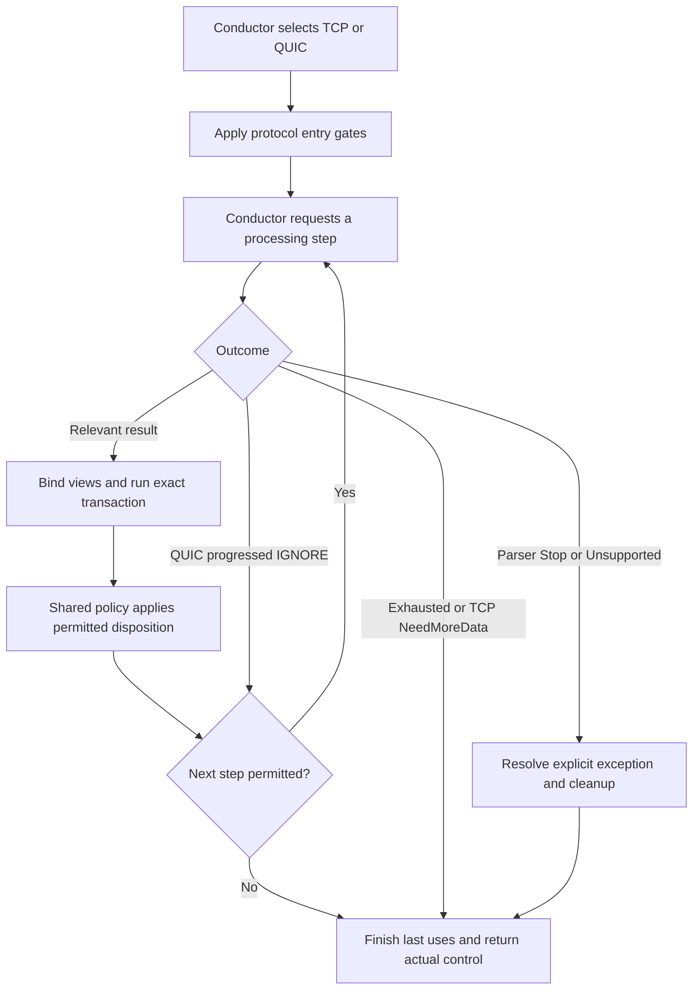
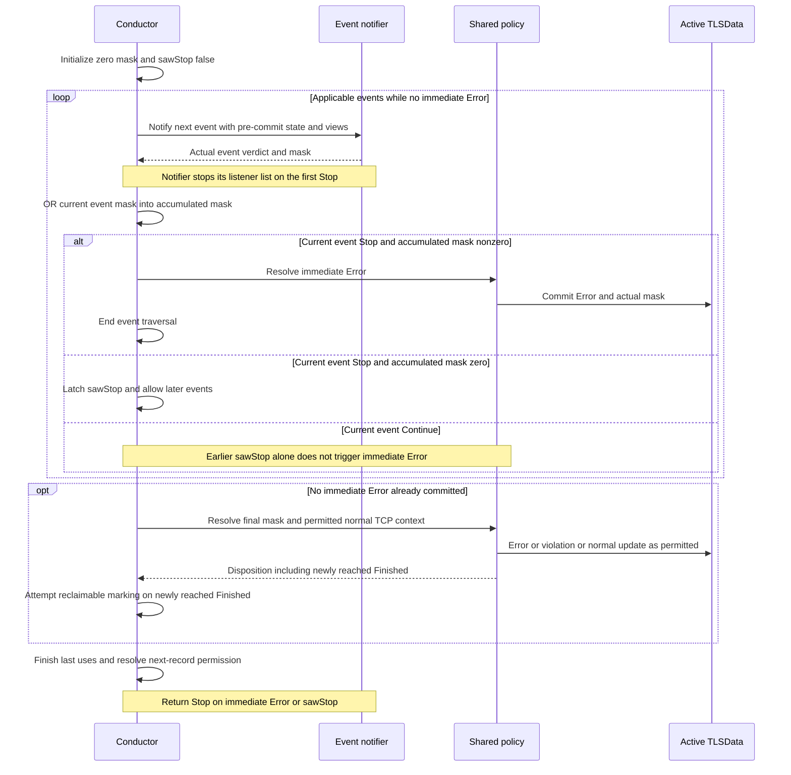

# Candidate 4: Protocol Extraction with Shared TLS Semantics

**Version:** V1  
**Audience:** TLS-Flow engineering team  
**Status:** architecture proposal for discussion and comparison. No implementation or new architecture selection is approved by this document.

## 1. Architecture at a glance

Candidate 4 separates protocol extraction from shared TLS semantic policy. The existing Conductor remains the transaction coordinator: it selects a protocol path, drives progress, dispatches applicable observer events, reduces actual feedback and invokes the permitted policy disposition. **Only the shared policy writes live semantic TLSData.** Protocol processors and CH evaluators provide qualified facts, not independent state commits.

Two variants belong to this candidate. They are alternatives, not components to deploy together:

| Variant | CH evaluation orchestration | Live state policy | Main migration difference |
|---|---|---|---|
| **C4-F: full common evaluation** | One common logical CH evaluator used by TCP and QUIC | Shared policy | Extract staged CH evaluation from the TCP Processor as well as state policy from the Conductor |
| **C4-P: policy first** | Remains protocol-owned, with composed common CH/FP algorithms | Same shared policy | Keep more of the current TCP Processor intact and extract state policy |

A CH evaluator means CH field interpretation, normalization, extension/cipher handling and fingerprint production. It is not a QUIC decryptor, a TLS record parser, an observer, or the state machine. In C4-F it serves **both TCP and QUIC**. In C4-P there is no mandatory standalone common evaluator.

A concrete realization has **two long-lived protocol processing responsibilities per Engine**, TCP and QUIC, and one shared policy responsibility. C4-F adds one common evaluation responsibility. These are not required class counts: methods/functions and composition can implement the boundaries. Workspace count follows overlapping live intervals, not the number of boxes. No per-packet or per-Session processor/evaluator object is created.

### 1.1 C4-F logical architecture

Arrows below show calls or returned information, not asynchronous messages. The Conductor owns the serial transaction. The common evaluator may be called synchronously by the selected adapter within the Conductor-driven processing step, so TCP need not gain a new externally visible yield for every CH stage.

Only eligible CH work invokes E. Other TCP records and QUIC evidence bypass CH evaluation and still return relevant results. The result box is a logical borrowed-result boundary, not a mandatory allocated result object or universal record type. E cannot write D. The policy call is at the permitted disposition point, including immediate Error, not necessarily after every possible event has run.

### 1.2 C4-P logical architecture

Both variants share policy authority. C4-P does not authorize two forked fingerprint algorithms or two independent semantic state machines. Candidate 3 instead delegates traversal, transactions and complete policy sequencing to protocol flows. Candidate 4 does not.

**Compatibility scope:** preserve the supplied TCP observable behavior while relocating responsibilities. QUIC is new behavior, not an existing implementation in the supplied bundle. Architectural preservation obligations are not executed equivalence proof. Accepted corrections and new support-retirement integration must be identified separately from exact TCP preservation. The active Step 5 V9 direction, C1 + C4-P, is unchanged; C4-F is documented for comparison, not silently selected.
## 2. Responsibility split

| Responsibility | Placement in both variants | C4-F versus C4-P |
|---|---|---|
| SessionTable registration, subscribers and participation | Existing Conductor/integration | No difference |
| Select TCP or QUIC before protocol-only work | Conductor | No difference |
| Input traversal and next-step permission | Conductor transaction coordinator | No complete protocol-flow delegation |
| TCP SYN/RST and terminal-input ordering | Explicit TCP branch in coordinator | Shared policy applies qualified live-state consequences |
| TCP record framing, visibility and sequence continuation | TCP processing/extraction | C4-F removes CH semantic orchestration, not TCP acquisition rules |
| QUIC packet protection, frames, CRYPTO and association evidence | QUIC processing/support | No difference |
| CH evaluation orchestration | Common evaluator in C4-F; protocol-owned in C4-P | Defining variant difference |
| CH normalization and fingerprint algorithm | Composed common implementation | No algorithm fork in either variant |
| Choose applicable projections and capture current context | Coordinator using qualified producer facts | TCP record projection remains TCP-only |
| Listener delivery and actual-feedback reduction | Coordinator and reusable notifier/reducer | Exact two-level TCP rules remain unchanged |
| Choose and apply live semantic state disposition | Shared policy invoked by coordinator | Sole logical live-state writer |
| Candidate acceptance/replacement | Coordinator orders admission and last use; policy decides/applies semantic acceptance/reset/publication from qualified evidence | Processor cannot replace active TLSData |
| Physical active TLSData storage | Extension/table, currently owned through Conductor | Not moved into policy/evaluator |
| Aging, retirement and support release | Coordinator plus affected protocol support/table owners | Use retained lifecycle binding without a packet |
| Public current-result access | Producer-aware Factory/Application wiring | CH backing differs by variant |

The policy is not merely a setter for a state enum selected elsewhere. It owns semantic predicates and consequences, including protocol-specific branches. The coordinator owns invocation timing, feedback and traversal, not a hidden second state machine. A notifier/reducer may compute actual masks and control decisions without becoming another semantic writer.

Initialization and destruction of inactive table storage may clear values after authorized last use. This does not make the table an independent live-state policy authority. No new policy interface, inheritance tree, queue, global allocator service or large context bag is required.
## 3. Inbound processing

### 3.1 Admission and selection

Keep SessionTable integration and one Conductor observer. New Session participation still queries live subscribers in priority order and builds an extension only for nonzero event interest. Select the protocol path before TCP sequence extraction, TLS record parsing, or TCP-only terminal shortcuts. Configured QUIC Application Port participation and trusted transport metadata select a path for qualification; UDP/port membership is not proof of valid QUIC.

**Do not add a universal extension-required gate before TCP SYN preparation.** Existing SYN without ACK can build a missing extension and consume the input. The coordinator retains extension lookup/build services and applies the inherited TCP preparation semantics before requiring an extension for ordinary TCP processing.

The branch is principally entered from Inbound, but protocol-specific ownership also matters during Aging and table retirement. New Session registration remains shared. Lifecycle routing does not rediscover the protocol by parsing an aging packet that does not exist.

### 3.2 TCP path

1. Apply existing SYN-without-ACK preparation: build missing extension and consume; retain active/no-recorded-violation extension; otherwise release/rebuild and consume.
2. If ordinary processing has no extension, return Continue.
3. Handle RST without ACK before silent-state and payload gates. Dispatch TCPReset, then invoke shared policy for the exact feedback-dependent consequence.
4. Preserve Finished/Unsupported silence, then empty payload, then Error/TerminatedByAlert TerminalPayload handling.
5. Extract TCP payload/sequence and call beginPacket once.
6. Ask TCP processing for one record step using **current committed TLSData read-only**. C4-P retains current CH evaluation here. C4-F invokes the extracted common evaluator at the equivalent internal CH stages.
7. On RecordParsed, return control to the Conductor for the exact current-record observer transaction and policy disposition in Section 5. Other outcomes use their explicit exception path.
8. Ask for another record only after RecordParsed, no returned observer Stop and an active resulting state. Return the actual ObserverResult.

The Conductor does not leave the entire packet to an independent TCP Flow. TCP processing does not dispatch listeners or commit active TLSData. In C4-F, evaluator invocation can be internal to the adapter step; the return boundary to the Conductor remains a feedback-relevant result, not every byte fragment.

### 3.3 QUIC path

1. Apply configured participation and qualify supported packet boundaries/version and attempt association.
2. Classify active/candidate/retired/ambiguous evidence before granting semantic authority or allowing CH parsing. Do not merge/reset on ambiguity or revive retired evidence.
3. Perform supported QUIC v1 Initial processing and frame parsing. Acquire CRYPTO in prepared support for the correct attempt.
4. Continue permitted remaining input when CH is partial. Partial CH is not end-of-datagram.
5. Evaluate qualified CH: common evaluator in C4-F, protocol-owned orchestration with common algorithms in C4-P. Keep candidate facts isolated from unrelated active TLSData.
6. Return at a relevant feedback/disposition boundary. The Conductor binds views, dispatches applicable events, resolves actual feedback and invokes shared policy for permitted dispositions.
7. Complete acceptance/replacement or other lifecycle work only after required admission, preservation and last uses. Resume remaining permitted input only after feedback-dependent work is resolved.
8. Finish required exit cleanup and return actual control. Retain only valid prepared cross-input support.

A relevant result can have **zero callbacks**. Completion evidence, accepted replacement or required support-loss disposition must still reach policy handling. No fake TLS record, TCPReset, server observation or completion callback is created to reuse TCP code.

### 3.4 What remains protocol-specific

| Concern | TCP | QUIC |
|---|---|---|
| Wire acquisition | TLS records and TCP sequence continuation | Initial protection, packet/frame parsing and CRYPTO ranges |
| CH input to C4-F | Qualified staged availability with existing TCP limits | Qualified reconstructed CH with attempt provenance |
| Incomplete CH | NeedMoreData ends current TCP record loop | Continue other permitted frames/packets before input exhaustion |
| Ordinary callbacks | Parsing error if present, TLSRecord, retained-Complete CH | Only accepted applicable projections, no synthetic TLSRecord |
| Completion predicate | Existing CCS/handshake and TLS13-bit/ApplicationData rules | Inherited qualified same-attempt product completion evidence |
| Reset/reuse | Existing SYN rebuild and RST feedback rules | Qualified candidate acceptance and same-DP-Session replacement |
| Terminal handling | Existing silent and TerminalPayload gates | Attempt classification before CH permission and terminal disposition |
| Retained support | Existing independent SegmentBufferManager | Prepared acquisition/candidate/retired/deferred support |

Shared state names do not imply identical evidence or event sets. The policy may contain focused TCP-only and QUIC-only branches. That is still one shared policy implementation, not two complete policies hidden behind a common interface.

### 3.5 Concrete examples and variant comparison

**TCP CH followed by ApplicationData:** TCP processing completes the first record and CH evaluation. The Conductor dispatches parsing-error/record/eligible CH events with pre-commit TLSData. Shared policy performs the permitted commit. Only then may the next record be processed with the new state. Retained Complete can cause another CH callback on a later record without another CH publication. C4-F must preserve this retention behavior rather than clearing the evaluator on every record.

**QUIC partial CRYPTO followed by another eligible packet:** acquisition proceeds without authoritative CH publication. Continue internally or return a progressed IGNORE if no disposition is pending. When a qualified CH or other relevant result becomes available, return to the Conductor before later work that depends on feedback. A packet boundary may suffice; no intra-packet coroutine framework is required without a concrete dependency.

**QUIC candidate replacement:** acquisition/evaluation can complete candidate facts without changing the active core. The coordinator checks required support admission and orders old last uses; shared policy applies accepted replacement/reset/publication only with qualified evidence. Old deferred completion cannot migrate into the new attempt.

**C4-F extraction cost:** move staged evaluation, digest/locator access and evaluation cursors without moving TCP sequence/reassembly authority. **C4-P extraction cost:** retain that orchestration and instead adapt qualified CH facts to common state policy. C4-P still changes state-policy call sites and provenance. Neither variant is automatically faster, smaller or preferable.
## 4. Flow boundary and internal processing outcomes

The boundary is **Conductor-driven processing step, applicable dispatch, actual feedback, policy disposition, then permission for the next step**. It is not Candidate 3's one delegation of complete protocol transaction ownership. A common processor interface is optional: explicit TCP/QUIC calls are sufficient. A Candidate 2 strategy contract would be an explicitly labelled combination, not a prerequisite of Candidate 4.

| Boundary | Contract |
|---|---|
| Input | Borrowed Session/frame and required protocol context. No ownership transfer |
| Extraction | Protocol qualifies bytes/evidence and maintains acquisition support. Reads resolved state but cannot commit live TLSData |
| C4-F evaluation | Common evaluator consumes qualified staged/complete access and produces CH facts. No independent dispatch or semantic commit |
| C4-P evaluation | Protocol-owned evaluation produces facts using common algorithms. Same no-commit rule |
| Current result | Narrow facts/views plus producer, qualification/cause and attempt provenance where relevant. Not a mandatory heap object |
| Transaction | Coordinator chooses applicable projections and resolves actual feedback before dependent later work |
| Disposition | Shared policy decides/applies only permitted semantic updates. No duplicate coordinator/processor write |
| Lifetime | All borrowed views and backing survive required callbacks, nested reads and permitted policy use |
| Return | Actual caller control. Local exhaustion or parser exception can return Continue without another local pull |

### 4.1 TCP outcomes

Retain RecordParsed, NeedMoreData, Unsupported, EndOfPacket and parser Stop with their current effects. NeedMoreData also covers full continuation retransmission without consuming the current cursor. It is not necessarily incomplete CH and is not observer Stop. Read current resolved state on each step, not a packet-start snapshot. Rebind borrowed state references if authorized replacement changes backing.

The current full-continuation retransmission path avoids record/CH parsing and FP work after detection. A broader newly approved retransmission bypass must be a separately traced delta; this proposal does not silently change overlap/gap or non-continuation behavior.

### 4.2 QUIC outcomes and partial CH

| Logical outcome | Coordinator treatment |
|---|---|
| Relevant result | Dispatch applicable projections and apply qualified policy disposition. Zero projections are allowed |
| IGNORE | Real progress, no pending relevant result or semantic work. Continue only while lifecycle permits |
| Input exhausted | No permitted work remains in the datagram. Retain valid cross-input support |
| NeedMoreData, if retained | End only after current permitted work is exhausted and no relevant result is pending |
| Unsupported | Cause-specific pre-dispatch disposition. No affected-unit record/CH dispatch or invented generic violation |
| Parser Stop | Qualified parsing-error exception. Actual feedback determines caller result, not the parser label alone |

IGNORE is not a synonym for zero callbacks. It cannot hide completion, replacement or required support-loss handling. The final eligible ignored unit must lead to exhaustion, not repeated processing of the same cursor.

### 4.3 Current-result access

Bind current producer and qualified views before applicable callbacks. TCP record views remain TCP-specific. CH/error access must not borrow unrelated retained facts from another protocol/Session/attempt. Preserve TCP retained-Complete callback behavior while enforcing QUIC current-result provenance. Unsupported/IGNORE cannot redispatch an old QUIC CH.

### 4.4 Feedback and lifecycle resolution

The coordinator orders policy invocation; the policy is the sole live semantic writer. Processors/evaluators cannot call it independently. Support ownership does not transfer merely because a step returns. No mandatory acknowledgement API, event queue or deferred commit is introduced. Cleanup on Stop, Unsupported, exhaustion and failure must not depend on a next pull or future packet. Nested public-viewer reads are supported; reentrant processing/rebinding of a live workspace is not implied.
## 5. Observer transaction and semantic commit

The coordinator retains observer ordering and exact reduction mechanics. Every live semantic action named below is executed through the shared policy at the same permitted point. A helper name such as commitError describes the action, not permission for the coordinator to bypass policy. C4-F CH evaluation is already available when its applicable transaction begins; evaluation is not state publication.

### 5.1 Listeners within one event: immediate STOP

The existing notify helper visits live listeners in priority order, ORs their actual violation masks, and returns immediately on the first Stop, even with a zero mask. Remaining listeners of that event are not called. Expired weak listeners are skipped. The resulting event verdict contains only feedback from listeners actually invoked.

### 5.2 Events within one parsed TCP record

The existing order is parsing-error handling, TLSRecord handling, then ClientHello handling when the CH viewer reports Complete. Each event's verdict is reduced before the next event.

1. Start with zero accumulated violation mask and sawStop=false for this record.
2. OR the current event verdict's mask into the accumulated mask.
3. If the **current event verdict** is Stop and the accumulated mask is nonzero, invoke shared policy to commitError and return RET_OBSERVER_STOP immediately. Do not deliver later events or apply normal updates.
4. If the current event verdict is Stop with a zero accumulated mask, set sawStop=true and continue to the next event. Continue never clears sawStop.
5. A later Continue with violations does **not** trigger the immediate-exit condition merely because sawStop is already true. Remaining applicable events still run.
6. After all applicable events, if the accumulated mask is nonzero, commitError when sawStop is true, otherwise commitViolation. Do not apply normal updates in either case.
7. If the accumulated mask is zero, perform the normal current-record commit, even when sawStop is true. If this newly reaches Finished, attempt markReclaimable.
8. Return RET_OBSERVER_STOP if sawStop is true, otherwise RET_OBSERVER_CONTINUE.

The current code constructs TLSRecordContext after parsing-error reduction and before onRecord: current-CH version/early-data scalars and readable-alert termination qualification are captured there. Preserve that capture point and use the same context for normal commit; do not move it before parsing-error handling or recompute it after callbacks as an unlabelled refactor.

The next record is not processed after RET_OBSERVER_STOP. Even with Continue, the current TCP loop advances only after RecordParsed and while the resulting handshake state is active. A violation-only Continue does not itself stop active traversal. The stored terminalViolationMask is not a generic terminal-state predicate.

| Event feedback sequence | Remaining events of this record | Commit and return |
|---|---|---|
| Stop with zero accumulated mask | Continue applicable later events, but not remaining listeners of the stopped event | Resolve final mask, then return Stop |
| Current Stop with nonzero accumulated mask | None | Immediate Error and Stop |
| Earlier zero-mask Stop, then Continue with violations | Continue applicable later events | Final Error and Stop unless a later current Stop triggers immediate Error |
| Earlier violations, then current Stop with zero new mask | None | Immediate Error and Stop |
| Violations and no Stop | Continue applicable later events | Final commitViolation and Continue, no normal updates |
| No violations, with or without earlier zero-mask Stop | Continue applicable later events | Normal commit, then return according to sawStop |

This preserves even combinations whose practical reachability is unknown. Do not remove a path based on an unproven assumption that a listener cannot return that combination.

### 5.3 Parser outcomes and no-projection QUIC results

Parser Stop is not observer Stop. In the existing TCP dispatchStepResult, parser Stop invokes parsing-error handling, commits any actual violation according to that event's verdict, and returns toObserverResult(verdict). If no listener returns Stop, the result can be RET_OBSERVER_CONTINUE, but the record loop still ends because the parser result was not RecordParsed. NeedMoreData, Unsupported and EndOfPacket also end that loop; they do not automatically stop subsequent SessionTable observers.

Unsupported follows commitUnsupported's existing state/cause predicate and performs no same-unit record/CH dispatch. It is not an unconditional Unsupported state transition.

QUIC can yield a qualified result with no projections. Initialize the actual mask to zero, fabricate no callback or verdict, and apply only its qualified protocol-specific disposition. This is an addition, not a path present in the current record-only TCP analyzer. IGNORE yields no semantic transaction at all.

STOP is a traversal-control result, not DROP. TLS-Flow propagates RET_OBSERVER_STOP to its caller; the available inherited review does not establish the SessionTable dispatcher implementation. The surrounding system's observer-chain behavior must not be presented as a verified packet-drop operation.

### 5.4 Simple ordinary traversal view

This deliberately omits entry/reset/terminal/aging exceptions, which are specified in Sections 3, 8 and 9. It does not simplify the exact current-record reducer in Section 5.2.

E can invoke policy immediately for current-event Stop plus nonzero accumulated mask and terminate that transaction. F means remaining permitted final disposition, not a second commit after immediate Error. TCP next-step permission requires RecordParsed, no observer Stop and active resulting state. QUIC permission also respects attempt/lifecycle authority. QUIC NeedMoreData, if used, means permitted current work is already exhausted.

### 5.5 Ordinary TCP record transaction sequence

The same sequence applies to both variants after TCP processing has produced the current record. The notifier contains the inner listener loop. This view shows the outer event loop without repeating all listener details. It is not the parser-Stop, RST, TerminalPayload or Aging path.

The Finished marking message is conditional on the policy result, not on every final disposition. No normal commit follows an actual violation mask. Zero mask permits normal commit even with sawStop. Capture TLSRecordContext after parsing-error reduction and before onRecord, as in the source, and preserve commit-time viewer reads unless an explicit equivalent snapshot is justified. Backing remains valid through all nested reads and policy last uses. Earlier units are not rolled back by a later failure.
## 6. TLSData, support storage and lifecycle

### 6.1 Shared semantic core

Keep one active TLSData per DP Session, physically owned by Extension/table. The shared policy has logical authority for live state, CH count/time/version/FP/early-data publication and actual violation/Error updates. The coordinator owns transaction timing. Neither an evaluator nor a protocol processor holds a second authoritative core. A QUIC-specific InProgress enum is not needed merely because its evidence differs.

### 6.2 Separate protocol support and evaluator backing

QUIC CRYPTO ranges/bytes, Initial context, association, isolated candidate, retired identity, bounded deferred evidence and evaluation cursors remain outside the shared core. A prepared handle in the extension or a Session-keyed lookup are alternatives, not two automatically required stores. A handle is not ownership.

C4-F shares evaluation logic, not all mutable state. TCP staged digest/locator state must survive continuation; a QUIC candidate may coexist with active attempt identity. Workspace reuse is legal only after all required live intervals end. Do not allocate duplicate full workspaces solely for symmetry, and do not overwrite retained TCP/QUIC backing to claim a single evaluator object.

C4-P retains protocol evaluation/backing and composes common algorithms. It does not authorize duplicated CH bodies or forked normalization. Candidate completion alone cannot overwrite active TLSData. Shared policy accepts complete new-attempt replacement as Session reuse only under inherited qualification/admission. Retry-compatible restart and HRR-compatible CH2 stay in the same attempt and do not prove server Retry/HRR. Ambiguous/retired evidence cannot merge/reset active authority.

### 6.3 Lifetime and cleanup

- Preserve required old terminal/retired identity and satisfy support admission before destructive replacement.
- Complete callbacks, nested reads, permitted evaluation/policy use and all other last uses before returning backing.
- Detach references/registrations before returning still-referenced claims. Return each claim exactly once.
- Policy-authorized reset and physical erase/reuse are separate steps. Inactive initialization/destruction is not another semantic decision.
- Coordinate table victim retirement before destructive reset/erase, using the victim identity and protocol owner, not the requesting input.
- Do not rebind a live evaluator during cross-Session victim cleanup.
- Preserve TCP markReclaimable timing and its unchecked return. For QUIC, marking follows newly committed qualified Finished and required last uses. Marking is not release or guaranteed insertion. Clear stale membership on reuse.
- Resource eviction does not synthesize SessionEnd or an Incomplete Handshake violation. Real Session aging preserves accepted notification-before-release behavior.

**Runtime constraint:** all Engine packet, aging, retirement and failure paths use finite storage prepared at startup, with no runtime dynamic allocation, container growth or heap fallback. Bound acquisition, crypto/context trials, ranges, reconstruction, candidates, retired/deferred retention, replacement peak and cleanup. Numerical capacities remain deferred under the accepted policy, but finite approved startup values are required before enablement. No unavailable CPU/RAM budget or invented capacity is introduced. This is a target constraint, not a complete allocation audit of current dependencies.

### 6.4 Lifecycle routing without an inbound packet

Retain bounded TCP/QUIC/not-yet-bound routing metadata in prepared extension-associated storage before attaching new protocol-owned support. The coordinator owns routing; the binding identifies cleanup responsibility, not payload validity or a second TLSData copy. Do not switch cleanup owner on configuration changes or an unsupported input.

On Aging, use retained binding and Session identity. The coordinator notifies SessionEnd, ignores its verdict for TCP state/return, coordinates protocol-owned last uses and releases the extension once. Return Continue as today. An entry aged before first inbound may be unbound and must have no new protocol-owned support claims; use the same common notification/release path without selecting a parser or committing state.

Legacy TCP continuation can outlive extension eviction/rebuild and remains independently owned/aged by SegmentBufferManager. Do not newly deallocate it on SYN, RST, Finished, extension release or SessionEnd just because policy moved. No numeric ordering between aging priority names is inferred.

For table retirement, use the victim's binding/index without requiring an inbound frame or live victim Session lookup for new support. Current table alloc/release reset storage directly, so adding this coordination is explicit new integration. Current SegmentBufferManager deallocate does look up Session and is not evidence that the proposed new contract already exists. Missing/corrupt binding with new live support is an invariant failure, not permission for requester-owned cleanup or a fabricated fallback. Erase/reuse clears old binding. Unbound does not imply absence of independently retained legacy TCP continuation.
## 7. Viewer and algorithm integration

| Concern | C4-F | C4-P |
|---|---|---|
| CH evaluator | Common logical evaluation implementation used by both protocols | Protocol-owned orchestration with common algorithms |
| TCP CH stages | Extract without whole-message buffering or expanded support | Preserve existing orchestration and support limits |
| Fingerprint | Same canonical bytes and output contract | Same common algorithms and output contract |
| Record viewer | TCP-specific | TCP-specific |
| CH/error public access | Producer-aware facade over common evaluator and protocol errors | Producer-aware facade over selected protocol views |
| Backing | Explicit borrowed byte, locator, digest and full-string intervals | Explicit protocol backing and fact-to-policy intervals |
| Semantic state | Shared policy only | Shared policy only |

The current Factory creates one Processor and injects it as processing/CH/record/error interfaces. Application getters delegate to Factory. Adding another processor or extracting evaluation does not update that wiring automatically. Preserve public entry points with qualified current-producer routing where required. Define availability outside callbacks without inventing a universal per-unit reset or borrowing another producer's data. QUIC has no dummy record getters.

**C4-F staged contract:** TCP may parse a CH prefix/body and hash version/ciphers before extensions finish. Its continuation retains selected scalars, digest and extension backing. The common evaluator must support equivalent qualified staged availability; it must not require a contiguous complete TCP handshake just to fit the abstraction. QUIC retains its own accepted reconstruction requirement. Fingerprint finalization, complete-CH qualification, callback eligibility and TLSData publication remain separate milestones.

Keep TCP plaintext/opaque visibility and local MultipleClientHello guard in the TCP path. A common evaluator cannot infer plaintext from a handshake-looking record or turn the local TCP guard into a universal QUIC attempt rule. Preserve current reset/retention behavior: retained Complete may cause CH callbacks on later TCP records without a fresh CH commit. C4-F must retain or restore the correct evaluation context; C4-P must not accidentally add a fresh-only gate while translating facts.

Preserve extension sorting, deGREASE, included-content rules, cipher/version ordering, digest/full-string bytes, error/status outcomes and diagnostics where exact compatibility is claimed. Current segmented completion copies digest backing and can release continuation before returning; do not claim that source behavior already proves every proposed borrowed-view lifetime. Accepted backing/cursor restoration corrections remain separately traced deltas.
## 8. Protocol policy and lifecycle exceptions

The shared policy may contain explicit protocol-specific predicates. Sharing does not mean forcing TCP evidence into QUIC or vice versa. The coordinator retains ordering; protocol extraction qualifies facts; policy decides and writes live semantic consequences.

| Path | Coordinator action | Shared policy consequence |
|---|---|---|
| TCP SYN | Preserve preparation/build/retain/rebuild order and consume behavior | Authorize any live reset under inherited predicate before inactive storage reuse |
| TCP RST | Notify TCPReset before silent/payload gates | Actual Stop plus mask gives Error, Continue plus mask stores violations, zero mask clears even on Stop |
| TCP terminal payload | Preserve silent states and empty-payload precedence | Actual violations only, no normal-record update |
| Parser Stop | Parsing-error projection only, then end local traversal | Actual feedback controls violation/Error, not automatic Error |
| Unsupported | No affected-unit record/CH dispatch | Preserve TCP state/cause predicate; use accepted QUIC cause-specific disposition |
| QUIC replacement | Qualified evidence, admission, preservation and last-use sequence | Accept/reset/publish only authorized candidate, no independent processor reset |
| QUIC completion | Qualified same-attempt evidence and actual feedback | Inherited product completion only, never callback absence |
| Aging | SessionEnd then coordinated release, TCP ignores returned verdict | No new SessionEnd state commit |
| Resource retirement | Victim-aware detach/recycle | No synthetic SessionEnd or Incomplete Handshake violation |

**Completion policy is inherited, not selected by this architecture.** The active Phase 6 Step 3 V6 and Step 5 V9 baselines describe qualified associated client QUIC v1 Handshake Long Header evidence as product-level completion, with bounded same-attempt pre-CH evidence. Candidate 2 V2 describes the same policy. This is not observed TLS Finished. Preserve accepted qualification and ordering, including trusted decoding or required protection handling. Do not infer authority from protected packet-type bits, packet numbers or key phase without the required handling or trusted upstream classification.

If the required qualification cannot be established, do not manufacture Finished or Finished-based reclaim; retain InProgress absent another accepted lifecycle disposition. 0-RTT does not advance state. No server Retry, HRR, Finished, HANDSHAKE_DONE, server 1-RTT or server transport-parameter visibility is assumed.

A permitted authoritative CH and eligible same-attempt deferred completion evidence can produce ordered InProgress then Finished dispositions in the same semantic cycle only under the accepted feedback/qualification conditions. Callback absence is not completion evidence. No synthetic completion callback, whole-input atomicity or rollback of earlier commits/observer effects is introduced. Replacement cannot inherit old-attempt deferred completion evidence.

This proposal does not reopen completion policy or supersede the active Phase 6 architecture selection. Any earlier shorthand about Stop plus accumulated violations must be read with Section 5's precise **current-event** predicate, not a new immediate-exit rule based only on a prior latched Stop.
## 9. TCP preservation and migration surface

This proposal preserves TCP observable semantics, not existing class boundaries. C4-P mainly relocates Conductor state helpers. C4-F additionally relocates CH evaluation from Processor. Neither is a no-op and neither is proven equivalent by a diagram.

| Existing area | Candidate 4 migration |
|---|---|
| onInbound / prepareInboundExtension / process | Keep coordinator traversal and TCP entry order, add protocol selection before TCP-only work |
| analyzeProcessResult | Keep dispatch/context capture/reduction timing, replace live writes with policy calls |
| commitNormalCurrentRecord and updateTLSDataOn* | Extract/generalize semantic predicates and actions into shared policy with qualified inputs |
| commitUnsupported / commitViolation / commitError | Move actual semantic decisions/actions into same policy, retain cause/feedback guards |
| RST clear | Route live clear through policy, preserve zero-mask behavior even on Stop |
| Processor CH evaluation | Retain in C4-P; extract staged evaluation in C4-F without changing acquisition/visibility |
| notify and subscriber integration | Retain exact delivery and registration behavior |
| Factory/Application | Startup wiring for both paths, shared policy and qualified current viewers |
| Table/support lifecycle | Add victim-aware new-support retirement without changing independent TCP continuation cleanup implicitly |

### 9.1 Current TCP preservation map

The map below preserves the reviewed Candidate 3 V4 source-behavior inventory. Placement changes to coordinator plus shared policy, not the listed TCP semantics.

These are the supplied implementation's observable gates, not QUIC policy inferred from TCP.

| Area | Current behavior to preserve or explicitly distinguish |
|---|---|
| Startup and viewers | Factory builds one Processor and injects it as processing/CH/record/error interfaces. Public Application getters delegate to Factory. Adding QUIC requires wiring changes, not just another class. |
| Session participation | buildExtension queries live subscribers in priority order and allocates only when an event mask is nonzero. Successful new-session setup registers inbound and aging observers. |
| SYN without ACK | Missing extension is built and this packet is consumed. Existing active state with no recorded violations is retained. Other existing states or recorded violations cause release/rebuild and consumption. |
| RST without ACK | Before silent-terminal and payload gates, notify TCPReset. Actual violations commit Error on Stop or commitViolation on Continue. Without violations, clear TLSData even on Stop. Return the actual dispatch verdict. |
| Entry state gates | Finished/Unsupported are silent. Empty payload returns before terminal-payload dispatch. Nonempty Error/TerminatedByAlert input uses TerminalPayload instead of the Processor. |
| Record loop | beginPacket once, processRecord repeatedly only after RecordParsed and while state remains active. In Candidate 4, the Conductor retains this loop and its current outcomes. Any returned observer Stop exits immediately. Other parser outcomes end this loop even if observer return is Continue. |
| Parser Stop | Check parsing-error observers only. Commit actual violations according to the returned verdict. No normal record/CH dispatch. No automatic Error solely because the parser stopped. |
| NeedMoreData | No live semantic commit. Also used for full continuation retransmission. Do not force cursor consumption or future-acquisition meaning onto this existing TCP outcome. |
| Unsupported | No same-unit record/CH callbacks. State becomes Unsupported for a continuation gap, PreHandshake, or InProgress with a Partial CH viewer. Other cases retain their state. |
| RecordParsed | Parsing-error, record and conditional CH events, with two-level feedback reduction exactly as Section 5. |
| Normal CH commit | For a CH record with Complete viewer, unless the higher-priority ChangeCipherSpec-to-Finished handshake branch applies: increment count, publish timestamp/FP/versions/early-data offer, and move PreHandshake to InProgress. No independent live commit in Processor. |
| CCS and ApplicationData | Before CH, update their respective counters. With a nonzero CH count, InProgress and the TLS13 bit absent, CCS reaches ChangeCipherSpec. With a nonzero CH count, InProgress, the TLS13 bit present and no early-data offer, ApplicationData reaches Finished. These are bit predicates, not proof of a negotiated version. |
| Handshake after CCS | Normal handshake record processing in ChangeCipherSpec reaches Finished. This is not QUIC completion logic. |
| Alert | A readable, qualifying terminating Alert changes an active handshake to TerminatedByAlert. Terminal-payload states do not receive normal-record updates. |
| Violation-only commit | OR terminalViolationMask without changing hsState. A stored violation alone does not select TerminalPayload or prevent active parsing. |
| Finished marking | After a normal commit newly reaches Finished, call markReclaimable. Its return value is not checked by the caller. Marking is not release or guaranteed successful insertion. |
| Aging | Notify SessionEnd using current TLSData, then release the extension. The current Conductor ignores that notification's returned verdict and returns Continue; the Candidate 4 coordinator must do the same. Continuation support has its own aging observer and is not newly deallocated by the flow. |
| Table storage | Existing alloc can reset/erase a reclaimable victim internally. Existing release resets/erases directly. Coordinating these operations with new QUIC support is required new integration, not existing behavior. |

The existing Processor also has protocol-specific continuation limits, retransmission/overlap/gap handling, alert reassembly/alignment and record-view capacity outcomes. Reusing CH helpers must preserve those TCP paths and the canonical FP byte sequence, not silently expand supported TCP fragmentation or reinterpret resource failures. The current code does not establish that a proposed refactor is already regression-tested.

### 9.2 Source anchors and compatibility boundary

Source basis is the supplied TLS-Flow-All-Code.txt, not an inferred repository revision. Function names below identify the direct static review surface.

| Source | Anchors and migration obligation |
|---|---|
| packet-flow/src/TLSFlowConductor.cpp | onNewSession, onInbound, prepareInboundExtension, process: participation, SYN/RST and exact entry/loop order |
| Same source | dispatchStepResult, analyzeProcessResult: exceptions, event order, context capture and current-event STOP predicate |
| Same source | commitNormalCurrentRecord, updateTLSDataOnClientHello/ChangeCipherSpec/ApplicationData/Alert, commitUnsupported/Violation/Error: policy extraction |
| Same source | onAging, buildExtension, registerSessionObservers: shared integration and release behavior |
| packet-flow/src/TLSFlowConductor.hpp | notify: actual mask OR, expired weak listeners and immediate listener-list Stop |
| processor/src/Processor.cpp and Processor.hpp | beginPacket, processRecord, processNewRecord, processSegmentedClientHelloContinuation, processClientHello, processCiphers, processExtensions, feedExtensionsFP, viewer getters: staged extraction and retention |
| processor/include/IProcessor.hpp and PayloadParams.hpp | Existing TCP beginPacket/processRecord contract and copied scalar packet context |
| processor/src/SegmentBufferManager.cpp | allocate/deallocate/onEvent: independent continuation lifecycle, eviction and Session lookup |
| context/engine/src/Factory.cpp and Application.cpp | buildProcessor, init and getters: current single-producer wiring |
| common/include/TLSData.hpp and TLSAlert.hpp | State predicates/fields and readable Alert termination rules |
| extension/include/TLSSessionExtensionTable.hpp | alloc/release/markReclaimable: destructive storage operations and new retirement integration |

Direct reinspection covers the Conductor's entry, traversal, analyzer, commit helpers, notifier and aging, plus Processor CH/continuation/viewer paths, Factory/Application and table/support dependencies. Source code, not stale comments, governs behavior. In particular, prepareInboundExtension rebuilds more cases than just Finished, and current continuation supports repeated extension-byte continuation.

The bundle contains no existing QUIC implementation and does not establish the external SessionTable dispatcher's packet-drop semantics. No product regression run, full allocation audit or measured CPU/RAM result is claimed. Source changes are not authorized by this proposal.
## 10. Benefits, risks and open decisions

### Benefits

- One actual semantic policy reduces complete TCP/QUIC state-machine duplication while retaining different evidence predicates.
- Coordinator transaction order remains close to the existing Conductor rather than moving into two flow managers.
- C4-P tests policy sharing without requiring full CH-evaluator extraction.
- C4-F can centralize CH evaluation as well as state policy when a real staged boundary is justified.
- Protocol acquisition and support remain explicit instead of hiding QUIC behind synthetic TLS records.

### Risks and costs

- A nominal common policy with state decisions still duplicated in coordinator/processors is not Candidate 4's intended separation.
- C4-F has a wider regression surface: staged evaluation, digest/locator backing, visibility, continuation and retained viewers.
- C4-P can introduce fact-translation/provenance errors despite retaining more parser code.
- Shared policy can become a large generic framework. Prefer focused functions/composition and explicit protocol branches.
- Viewer routing, candidate isolation and victim-aware cleanup remain necessary in both variants.
- No measured performance or delivery advantage follows from fewer logical boxes or classes.

### Decisions for team review

1. Is common policy useful enough to justify the actual extraction, rather than merely moving setters to another file?
2. For C4-F, what minimal staged-access boundary preserves TCP evaluation without whole-message buffering or per-field external transactions?
3. Which facts are captured before callbacks and which remain commit-time reads to preserve current behavior?
4. Which responsibilities need an object at all, and which can remain cohesive functions?
5. What concrete QUIC dependency requires a feedback yield inside a packet rather than at a packet boundary?
6. Which prepared support access and viewer facade avoid duplicate ownership and stale provenance?
7. How will victim-aware retirement be integrated without rebinding live evaluator workspaces?

Candidate 1's explicit processing paths and Candidate 2's strategy contract are alternative processing-boundary choices. Candidate 4 investigates semantic sharing scope. Candidate 3's independent flow transaction authorities are a different placement. The active Step 5 V9 combination C1 + C4-P remains unchanged. This document does not rank or select C4-F over it, and future DTLS does not justify a new framework now.
## 11. Validation expectations and evidence boundary

The eleven-section order and comparison topics mirror Candidate 3 V4. Its precise TCP reduction and current-behavior preservation map are retained with authority/placement adaptations. Four small Mermaid views replace the dense architecture/traversal views: separate C4-F and C4-P architectures, ordinary traversal, and the ordinary TCP transaction. Diagrams show logical responsibilities, not mandatory classes or complete lifecycle algorithms.

### Source and authority map

| Source | Use |
|---|---|
| candidate3-team-architecture-proposal-v4.md | Requested structure, exact reviewed TCP reduction/preservation inventory and inherited project constraints |
| TLS-Flow-All-Code.txt | Current TCP implementation authority and direct static compatibility checks |
| phase6-step3-four-architecture-candidates-v6.md, Section 6 and shared invariants | Candidate 4 identity, C4-F/C4-P distinction and qualified staged evaluation boundary |
| phase6-step2-responsibility-and-semantic-sharing-assessment-v3.md | Semantic refactoring assessment, visibility/local TCP guard and staged CH obligations |
| phase6-step4-candidate-comparison-v2.md | Preserved comparison baseline, no new ranking |
| phase6-step5-architecture-decision-and-delivery-scope-v9.md | Active C1 + C4-P direction, sole policy writer and inherited completion/lifecycle constraints |

### Required implementation evidence, not executed product tests

| Check | Expected result |
|---|---|
| Authority | Coordinator orders transactions, policy alone writes live core, no independent processor/evaluator commit or duplicate reduction |
| Variant fidelity | C4-F actually shares evaluation; C4-P retains protocol orchestration with common algorithms. No accidental hybrid description |
| Participation and SYN | Same subscriber masks/priority, registration/build timing and missing-extension SYN behavior |
| TCP entry/lifecycle | Same SYN/RST, silent/empty/terminal gates, reset consequences and Aging return behavior |
| TCP observer traces | Same callbacks/order, actual masks, pre-commit state, context capture, commit timing and caller result |
| TCP feedback combinations | All Section 5.2 cases, including prior zero-mask Stop followed by Continue with violations |
| TCP step outcomes | RecordParsed/active-state/no-observer-Stop gate, exact parser Stop/Unsupported/NeedMoreData/exhaustion behavior |
| TCP CH/FP | Same staged fields, canonical/full-string bytes, errors, diagnostics and retained-Complete callbacks |
| TCP continuation | Same full retransmission, overlap/gap, visibility, Alert reassembly/alignment and support limits unless separately approved delta |
| QUIC progress | Partial CH does not skip remaining eligible input; IGNORE progresses and hides no disposition |
| QUIC attempts | Isolated candidate, one active core, retired/ambiguous suppression, same-attempt restart/CH2 and accepted replacement |
| Completion | Qualified same-attempt evidence only, correct deferred ordering, no 0-RTT advancement or old-attempt evidence leakage |
| Views and last use | Nested reads valid, correct producer, no dangling backing or workspace reentrancy |
| Retirement | Victim binding used across Sessions/protocols, safe detach/recycle, no eviction-induced violation |
| Runtime | Startup-prepared finite backing, bounded packet/aging/failure paths, no runtime allocation/growth |

### Review scope

Document review must cross-check architecture labels, flows, authority, TCP preservation, QUIC obligations, lifecycle and diagrams against the sources. A separate delivery review records input/output digests and checks actually executed, including diagram rendering when available. Do not infer implementation PASS from document PASS.

This proposal is not an implementation, final API/layout specification, product test result, measured performance claim, enablement authorization or final Phase 6 PASS. The architectural contracts are intended to permit TCP-equivalent refactoring, but equivalence of a future implementation requires trace/regression evidence. All input baselines remain unchanged. Any later correction is a new version.
