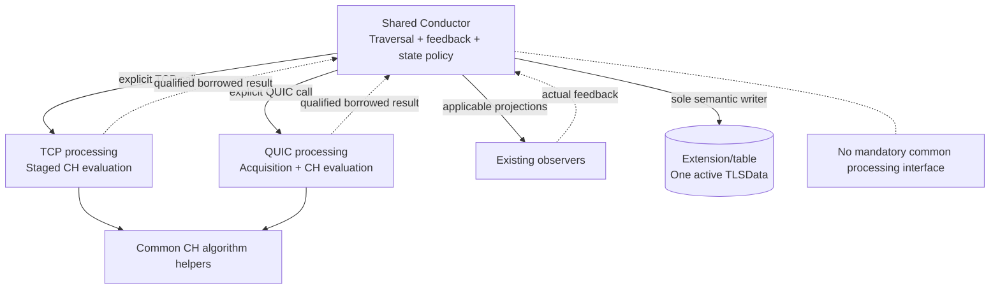
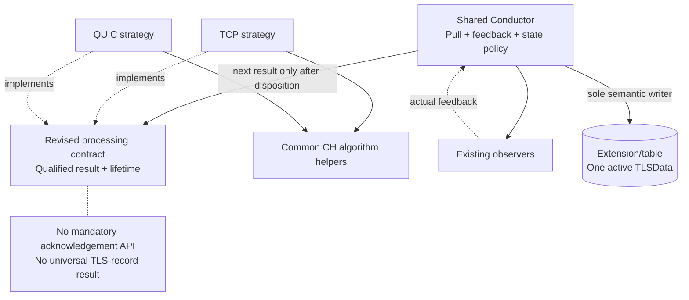
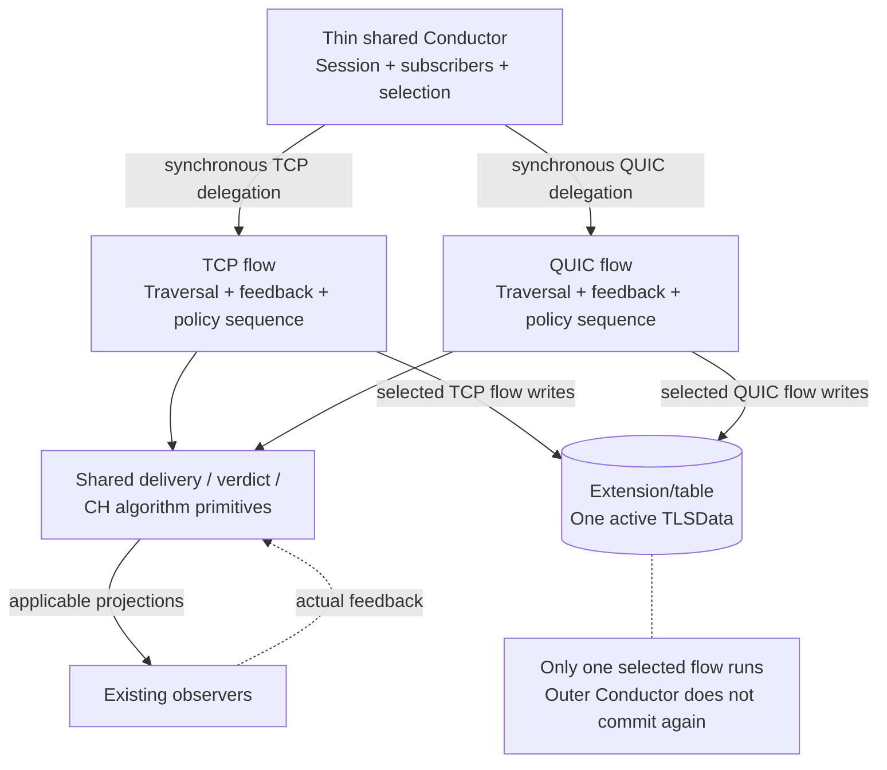
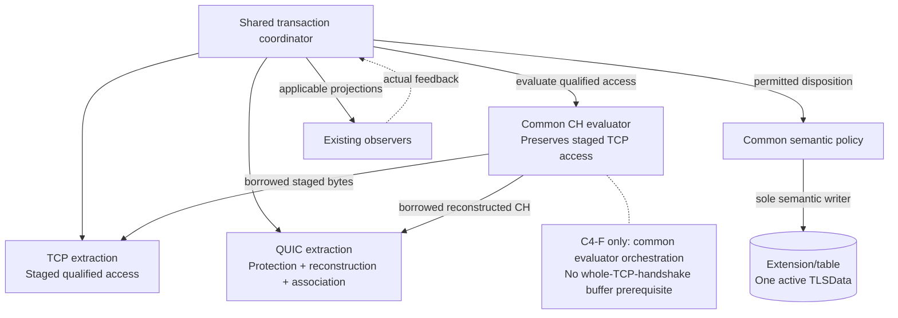
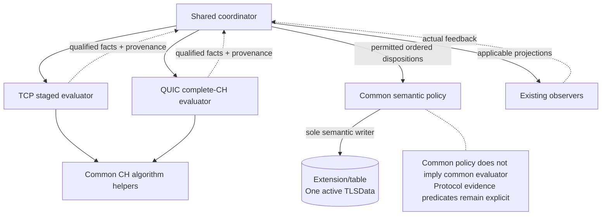

# Phase 6 Step 3: Four Architecture Candidates V6

## 1. Scope and evidence boundary

Define four genuinely different candidates for subsequent comparison. No candidate is selected, ranked, or rejected here. Names below denote logical responsibilities, not mandatory new classes. Interface descriptions identify required boundaries, not final signatures.

Direct input: `phase6-step2-responsibility-and-semantic-sharing-assessment-v3.md` (S2). Its R01-R19 responsibility map, D01-D28 decision assessment, A01-A31 source anchors, and Sections 5-7 provide the evidence used here. References to P2-P5 and source symbols below are inherited through S2, not a claim that their original files were independently reopened during this step. The original source bundles and earlier manifests are not physically present in this execution workspace; no new code fact or independent source-conformance claim is made. This limits validation depth, not the ability to define candidates from the accepted assessment.

**Classification:** S2's accepted contracts remain binding. Every placement, boundary, reuse approach and effort assessment in this document is a candidate proposal. Effort and regression statements are qualitative hypotheses to test in Step 4, not measurements or a selection rationale.

## 2. Invariants applying to all four candidates

1. Preserve participation, accepted TCP behavior and the explicitly adopted correction obligations. Preserve TCP U05 retained-Complete callbacks and the local MultipleClientHello guard; do not export either as QUIC freshness/count policy. S2 R01/R08, D06/D27.
2. Separate extraction/protection findings from attempt-wide flow legality. Enforcement owns its applicable flow-legality decisions and mitigation; Processor/TLS-flow do not independently drop. No synthetic QUIC TLS-record, CCS, reset or completion callback is assumed. S2 R07/R09/R19.
3. Resolve each current feedback-relevant unit before later semantic authority. Actual masks start at zero and are ORed; within-list Stop ends that list. Zero-mask Stop latches traversal stop but can allow remaining applicable current-unit projections and permitted normal commit. Stop with accumulated violations produces Error and stops remaining projections. Nonzero violations suppress normal updates. Parser Stop, reset, terminal payload and aging remain explicit exception paths. S2 R10, D04/D15-D19/D21/D26.
4. Unsupported excludes consumer dispatch for the affected unit. A unit with no projections may still justify a qualified disposition. Qualified associated client QUIC v1 Handshake Long Header evidence is accepted product-level completion, not observed TLS Finished; pre-CH evidence is bounded and deferred. S2 R12/R14, D17 and QUIC overlay.
5. Keep one active TLSData attempt context per DP Session. Candidate evaluation remains isolated; only accepted replacement changes active authority. Ambiguity/retired evidence cannot merge or reset state. Retry-compatible restart and HRR-compatible CH2 do not prove server Retry/HRR or a new attempt. S2 R05/R17 and QUIC overlay.
6. Preserve callback/nested-view backing through last use and permitted producer commit. Borrowed wrappers are not owned data. Request reclaim only after newly committed eligible Finished and last use; marking is not release or proof marking succeeded. Clear stale membership on reuse and preserve required terminal identity. Resource eviction is not an Incomplete Handshake violation. S2 R16, D20/D21, Section 6.
7. Allocate physical backing at startup only. All Engine runtime work uses prepared storage without allocation or capacity growth. Bound input traversal, crypto/context trials, ranges, reconstruction, candidates, retention, replacement peak and cleanup. Numeric capacities remain deferred under accepted policy; finite approved startup values are required before enablement. No unavailable CPU/RAM budget is required here. S2 R18, Section 7.2.
8. Preserve staged TCP evaluation; do not require complete TCP handshake buffering solely to fit a shared abstraction. QUIC reconstruction and association requirements remain unchanged. S2 Section 6 and D28.
9. One semantic authority does not mean one state assignment or one commit for an entire input. With accepted deferred QUIC completion, a permitted authoritative CH can pass through InProgress and then Finished in the same semantic cycle. Each transition must satisfy its accepted qualification/feedback conditions; reclaim follows the eligible committed Finished transition and last use. No whole-input atomicity or observer-side-effect rollback is introduced. S2 Section 4 QUIC-only overlay; D08/D18/D20.

> Diagram convention: boxes are logical responsibilities, not required classes. Solid arrows are synchronous calls/access; dashed arrows are borrowed results or dependencies as labelled. These are candidate proposals, not inspected implementation. Only the designated coordinator/flow/policy writes live TLSData; physical storage remains Extension/table-owned. Diagrams summarize their cited sections and do not replace exception, lifetime or boundedness rules. Editable Mermaid diagrams are embedded in this Markdown document. A Mermaid-capable preview is required to render them; plain Markdown readers show their complete source.

## 3. Candidate 1: Shared Conductor, separate processing paths, composition

### Placement and minimum boundaries

Keep the Conductor as the explicit owner of input traversal, observer transactions, semantic TLSData commits and lifecycle coordination. It selects a TCP or QUIC processing path using explicit protocol branches. The existing TCP Processor retains record framing, continuation and staged CH evaluation. A QUIC path handles packet protection, CRYPTO acquisition and association evidence. Both compose the same fingerprint/CH field helpers where practical.

Minimum additions are a QUIC processing responsibility and the result/borrow access needed by its Conductor branch. No common polymorphic Processor interface, protocol-flow object or new semantic-policy class is required. Protocol-specific entry points may remain deliberately different.

### Shared versus separate behavior

Share observer delivery, actual-verdict reduction, violation/Error primitives, qualified CH field updates and reclaim coordination in the Conductor. TCP CCS/ApplicationData/alert rules and QUIC deferred completion/association rules remain explicit branches there. CH algorithm helpers can be composed without extracting the entire TCP state machine. S2 R06/R09-R17; D08-D18.

### Control, STOP and commit

The Conductor requests one eligible unit from the selected path, dispatches applicable projections and resolves the permitted ordered state dispositions under one semantic authority. It alone authorizes the next semantic unit. A zero-projection QUIC completion can reach qualified commit without a fake record callback. Unsupported and parser-Stop take their explicit routes. Processing paths cannot commit TLSData independently.

### Ownership, lifetime and bounds

Existing Extension/table owns the active semantic core; TCP continuation remains manager-owned. QUIC support backing is claimed by the corresponding attempt/acquisition responsibility. The Conductor authorizes candidate acceptance/reset, while the path supplies isolated qualification and backing. Current results remain borrowed until the Conductor finishes all uses. Prepare bounded workspaces and protocol-specific support slots at startup. Workspace sharing versus separation follows overlapping live intervals and actual backing needs, not protocol names alone; this candidate does not require two full evaluator workspaces. No queued result list or runtime allocation is required.

### Symbols and delivery exposure

Retain the general shape of `TLSFlowConductor::process`, `dispatchStepResult`, `analyzeProcessResult`, state helpers and `buildExtension`; add protocol branches and QUIC-specific calls. Keep `IProcessor::beginPacket/processRecord` TCP-specific if that is simplest. Compose existing CH/fingerprint helpers rather than duplicating their algorithm. S2 A01-A26/R06.

**Current benefit:** localized extension with visible control flow and limited interface churn. **Effort/delivery hypothesis:** relatively contained structural migration, but QUIC implementation remains substantial. **Principal risk:** the Conductor accumulates protocol branches, and shared versus separate state decisions can drift. Existing TCP paths still require regression tests and accepted restoration/cleanup fixes; this is not a zero-change TCP option.

### Candidate 1: UML responsibility view

Basis: Section 3; inherited S2 responsibility and decision references in that section. This view does not select or rank the candidate.

## 4. Candidate 2: Processor strategies behind a revised contract

### Placement and minimum boundaries

The Conductor owns a protocol-neutral pull loop, observer transaction, semantic commit policy and lifecycle coordination. TCP and QUIC strategies implement a revised processing boundary: begin an input, produce the next qualified result, expose its valid views and cause/eligibility information, and resume only after the coordinator has resolved the current disposition. An explicit feedback method is optional: the next pull may instead read resolved state under the serial lifetime contract; do not add a mandatory acknowledgement API without a concrete need.

The required distinction from Candidate 1 is a common replaceable processing contract, not merely renamed TCP/QUIC helpers. It must represent incomplete acquisition, no-projection evidence, Unsupported, parser stop and current-result lifetime without pretending every unit is a TLS record. A strategy can internally traverse several framing elements, but cannot precommit later semantic authority or overwrite live backing.

### Shared versus separate behavior

Strategies compose common CH/fingerprint evaluation. Shared Conductor policy handles qualified CH commits, violation/Error actions, completion disposition and reclaim. Strategies retain TCP framing/visibility/continuation and QUIC protection/reconstruction/association. The Conductor may retain explicit protocol applicability predicates for TCP CCS and QUIC deferred evidence; this is not yet a separate common semantic layer. S2 R02-R14; D09-D14/D23-D28.

### Control, STOP and commit

The Conductor pulls a result, resolves all applicable current projections, then performs the permitted ordered state dispositions and makes resolved state available before the next pull. Explicit disposition notification is used only if strategy bookkeeping requires it. A latched Stop prevents the next pull; immediate Error ends remaining projections. Strategies read resolved state but never write TLSData. Feedback need not be copied into a second independent reducer. The revised contract must keep parser-Stop/reset/aging exceptions explicit rather than flattening them.

### Ownership, lifetime and bounds

Extension/table retains the active semantic core. Strategy instances are long-lived; their physical workspace is startup-prepared. Session/attempt support claims remain distinct from shared current-result backing. A strategy returns borrowed views pinned by the serial current-unit interval, not a heap-owned event. QUIC candidate preparation stays isolated; acceptance is authorized by the Conductor, followed by safe strategy bookkeeping and cleanup. Bound strategy scans and result preparation as well as backing capacity.

### Symbols and delivery exposure

Revise `IProcessor`, `PayloadParams`, step outcomes and relevant viewer access; adapt `Processor::beginPacket/processRecord` and the Conductor loop. Keep `Record`/`TLSRecordContext` as TCP-specific projections rather than mandatory common result shapes. Engine Factory/Application wiring must select and expose the correct strategy/view context. S2 A03-A08/A20-A26 and initialization map.

**Current benefit:** one traversal/feedback contract with interchangeable processing paths and reusable CH evaluation. **Effort/delivery hypothesis:** the common contract adds TCP adapter and viewer migration work; compare that concrete scope against Candidate 1 and both Candidate 4 variants rather than assuming a fixed effort ordering. **Principal risk:** an over-broad result contract either hides protocol distinctions or becomes a union of unrelated details; changes to viewers and continuation translation can regress TCP freshness and lifetimes. No inheritance base is justified yet; composition is sufficient for this candidate definition.

### Candidate 2: UML responsibility view

Basis: Section 4; inherited S2 responsibility and decision references in that section. This view does not select or rank the candidate.

## 5. Candidate 3: Protocol flows below a shared Conductor

### Placement and minimum boundaries

Keep a thin shared Conductor for Session integration, subscriber registry, participation and selection of a TCP or QUIC flow. Each protocol flow owns its traversal, applicability gates, feedback-relevant unit sequence, semantic commit authority and lifecycle sequencing for its protocol.

The required boundary is a synchronous flow entry/disposition boundary, not a common parser-result pull contract. The Conductor delegates an input and receives its final control result. Flows compose shared observer-delivery/verdict helpers and CH/fingerprint evaluation. Logical flow responsibilities may be methods or composed objects; separate classes are justified only if needed by the selected design.

### Shared versus separate behavior

Share CH evaluation, listener mechanics, verdict reduction and simple qualified state actions through helpers. Keep complete TCP and QUIC state-policy sequencing in their flows, including their distinct completion, reset, terminal and acquisition rules. Thus state-policy sharing is intentionally lower than Candidate 4; any duplicated CH/violation policy must be visible in Step 4, not disguised by helper reuse. S2 R09-R17; D01/D08/D15/D16/D18.

### Control, STOP and commit

The selected flow drives processing and synchronous observer dispatch, resolves feedback, commits the active TLSData and decides whether to continue. The outer Conductor does not perform a second semantic commit or re-run verdict reduction. The shared delivery helper returns actual feedback to the flow; it does not autonomously traverse later units. Stop returns through the flow to the Conductor after the required current-unit disposition. Reset/terminal/aging exceptions remain protocol-local.

### Ownership, lifetime and bounds

Extension/table remains the physical semantic-core owner; the selected flow is the sole logical writer during its serial invocation. TCP/QUIC support resources retain their accepted owners. A QUIC flow manages isolated candidate preparation and accepted replacement under those ownership rules. Flow-local current views remain live through callbacks/commit; delegation does not transfer borrowed ownership. Flow instances/workspaces and per-session support are prepared at startup. No coroutine, asynchronous event queue or runtime-created flow object is required; all flow traversal and cleanup are bounded.

### Symbols and delivery exposure

Move or delegate the protocol-dependent portions of `TLSFlowConductor::process`, `dispatchStepResult`, state helpers and lifecycle sequencing into TCP/QUIC flow responsibilities. Retain subscriber/Session integration and share `notify`/verdict helpers without competing commit authorities. Existing Processor/viewer contracts can remain TCP-oriented. S2 A01-A19/A31.

**Current benefit:** protocol sequencing is cohesive and the outer Conductor stays small; QUIC acquisition complexity does not dominate TCP orchestration. **Effort/delivery hypothesis:** meaningful extraction of existing Conductor behavior, but potentially less Processor contract churn than Candidate 2. **Principal risk:** duplicated state policy and subtle divergence of feedback/cleanup rules between flows. Moving TCP code without changing its behavior still requires regression evidence. A flow is not a second TLSData owner.

### Candidate 3: UML responsibility view

Basis: Section 5; inherited S2 responsibility and decision references in that section. This view does not select or rank the candidate.

## 6. Candidate 4: Extraction adapters, common TLS semantics and shared state policy

### Placement and minimum boundaries

Protocol-specific extraction responsibilities qualify bytes/evidence and expose bounded access to them. A common semantic responsibility evaluates CH fields/fingerprint and applies shared TLS state policy. A shared transaction coordinator delivers existing observer projections, resolves actual feedback and invokes the permitted semantic commit. The coordinator may remain part of the existing Conductor; semantic evaluation/policy may be functions or composition rather than a new class hierarchy.

Minimum logical boundaries are qualified extraction/access, common semantic evaluation/state policy, and observer transaction/disposition. These are not three automatically required components. In the full form (C4-F), the common layer owns CH semantic evaluation and the state-machine implementation itself; processing adapters do not each carry their own complete CH evaluator/state policy. The policy-first form (C4-P) below deliberately retains protocol-owned CH evaluation. Candidate 2 as defined keeps policy in the Conductor; moving that policy into a common semantic responsibility creates an explicit hybrid with Candidate 4, even if no new class is introduced. Unlike Candidate 3, protocol flows do not own separate complete semantic transactions.

### Explicit TCP state-machine refactoring assessment

Use the S2 classification, not existing class ownership, as the starting point:

| Treatment | S2 decisions | Candidate placement and limit |
|---|---|---|
| Unchanged semantic actions | D01, D08, D15, D16, D18 | Move default-value reset, qualified first-CH transition, violation/Error actions and normal-commit permission into common policy/transaction helpers. Existing authorization, callback timing and cleanup preconditions remain binding; literal source reuse is not promised. |
| Generalized semantic decisions | D02, D05-D07, D11, D13-D14, D17, D19-D22, D26 | Replace record/viewer-only assumptions with qualified evidence, provenance, current disposition and lifecycle access. Common policy commits authoritative CH and qualified completion/termination; transaction/lifecycle coordination handles STOP, last use and reclaim. TCP and QUIC applicability remain explicit. |
| Intentionally protocol-specific predicates/mechanisms | D03-D04, D09-D10, D12, D23-D25, D27-D28 | Keep SYN/RST, CCS, pre-CH record counters, opaque/plaintext selection, sequence continuation and local MultipleClientHello guard specific to TCP. QUIC retains protection, association, CRYPTO reconstruction, deduplication, retired/candidate qualification and deferred evidence acquisition. No surrogate TCP record is invented. |

The TCP CCS transition and pre-CH counters can be guarded TCP-only branches within common policy if that is simpler. Protocol-specific meaning does not require a separate policy class. Extraction must still know whether TCP handshake bytes are visible/applicable (D28); moving semantic state policy does not permit parsing ciphertext as CH. A read-only applicability query or qualified-input decision can connect these responsibilities without a second state writer; its exact interface remains unselected.

### Shared versus separate behavior

Share CH field interpretation, accepted fingerprint algorithm, authoritative CH updates, common state meanings, violation/Error policy and qualified completion/termination consequences. Keep different evidence predicates and protocol-only branches explicit. QUIC associated Handshake evidence may have zero observer projections; common policy can consume bounded deferred evidence only after permitted authoritative CH/feedback/commit. No completion observer is added. S2 R06/R11-R17, Section 5 and QUIC overlay.

Preserve TCP staged prefix/digest/extension evaluation through bounded field/byte access and prepared evaluator state. Do not make the common evaluator require a complete contiguous TCP handshake. QUIC can supply its required reconstructed CH without forcing that representation on TCP. TCP U05 dispatch and CH commit eligibility remain separate decisions. S2 Sections 6-7, D06/D07/D27/D28.

### Control, STOP and commit

The coordinator selects the protocol extraction path, qualifies the current attempt/result, invokes common semantic evaluation, delivers applicable existing projections, reduces feedback and authorizes common-policy commit. Common policy is the sole semantic TLSData writer; adapters mutate only their protection/acquisition/support state. The coordinator prevents later authority until disposition and last use. Unsupported is excluded before dispatch; parser-Stop and lifecycle exceptions remain explicit. No observer side effect is rolled back.

For active replacement, candidate evaluation uses isolated prepared backing without changing active TLSData; only accepted replacement authorizes reset and publication. For terminal input, attempt classification precedes CH parsing. Shared semantics does not collapse these two paths.

### Ownership, lifetime and bounds

Extension/table retains the active core. Extraction support is owned by the accepted protocol/session/attempt responsibilities; common evaluator workspace is startup-prepared and serially bound through callbacks and producer commit. Nested full-string/digest/locator backing follows its actual owner, not a copied projection. Candidate backing must survive acceptance/rollback and last use; do not assume a second evaluator or full duplicate core unless overlapping live intervals require it. No Engine-global allocator service is selected.

Prepare bounded access metadata, evaluator state, reconstruction support and indexes at startup. Share workspace only where S2's lifetime intervals permit; bound any added translation/copying work and active/candidate peak. Numerical capacities remain deferred, not implicitly free or unlimited.

### Symbols and delivery exposure

Reorganize CH evaluation currently intertwined with `Processor::processNewRecord`, CH continuation and extension/fingerprint work; preserve TCP framing/visibility/sequence mechanisms. Refactor `TLSFlowConductor::commitNormalCurrentRecord`, `updateTLSDataOnClientHello`, completion/alert helpers, `commitUnsupported`, `commitViolation` and `commitError` into common semantic policy or its qualified branches. Adjust viewer provenance and Conductor transaction wiring; retain existing observer interfaces where their accepted projections suffice. S2 A03-A26/A31, D01-D28.

**Current benefit:** direct reuse of existing TCP semantic/state logic for QUIC, with one semantic authority and explicit evidence differences. **Effort/delivery hypothesis:** the full common-evaluation form has a broad semantic extraction surface, potentially offset by less duplicated policy. Its scope must be assessed separately from the policy-first variant below; no fixed cost ranking is established. **Principal risk:** separating currently interleaved parsing, digest, viewer and state logic can change staged TCP behavior, U05 dispatch, fallback/restoration or borrow validity. Additional access/translation can add runtime cost; no performance advantage is asserted. This candidate is mandatory to evaluate, not predetermined to win. Its value must justify its current delivery/regression cost in Step 4.

### Candidate 4: UML responsibility view

Basis: Section 6; inherited S2 responsibility and decision references in that section. This view does not select or rank the candidate.

### 6.1 Policy-first variant: common state policy, protocol-owned CH evaluation (C4-P)

**Why include it:** S2 distinguishes shareable state actions from staged CH parsing and evaluator backing (R06/R11, D06-D08, Section 6). Refactoring the TCP state machine need not be coupled to relocating the entire CH evaluator. Omitting this intermediate scope could unfairly make shared state policy appear to require the largest parser migration.

- **Placement/minimum boundary:** retain TCP staged CH evaluation and QUIC-specific complete-CH evaluation paths, composing the same fingerprint/field algorithm where practical. Both supply qualified facts/provenance to one common state policy. The existing Conductor coordinates dispatch and invokes that policy. A policy function or composed helper can suffice; no new policy interface/class is automatically required.
- **Sharing:** share the D01-D28 state-policy actions and generalized consequences described above; retain protocol-specific evidence predicates and the accepted TCP-only branches. Unlike full C4, CH evaluator orchestration and backing remain protocol-owned. This is not permission to fork fingerprint algorithms or change the same-CH output contract.
- **Control/feedback:** the coordinator resolves actual feedback and invokes the sole policy writer for permitted ordered dispositions. Protocol evaluators cannot independently commit TLSData. Preserve zero-projection/deferred completion, Unsupported exclusion and the explicit exception paths. No additional callback or feedback protocol is implied.
- **Ownership/bounds:** Extension/table keeps the active core; protocol paths keep their evaluator/support backing. Borrow qualified facts through last use, preserve isolated candidate evaluation, and prepare finite backing at startup. Do not assume that two independent full evaluators or duplicate CH bodies are necessary; compare actual live intervals and canonical/full-string access needs.
- **Affected symbols:** extract/generalize Conductor state helpers and their input provenance while retaining more of Processor CH/continuation evaluation. Adjust CH-to-policy access and existing dispatch wiring. The D28 visibility gate and D27 local TCP guard remain protocol-specific.
- **Benefit/exposure:** tests whether common state authority can be delivered with less CH-parser movement. It still changes TCP state-policy call sites and can introduce fact-translation/provenance errors; it is not automatically cheaper, faster or preferable. Shared CH evaluation may be a later optional refactor only if current correctness and output contracts are already satisfied.

**Comparison treatment:** carry C4-P and the full common-evaluation form (C4-F) as explicit variants under mandatory Candidate 4 in Step 4. Compare both against Candidates 1-3. Do not count this orthogonal sharing-scope choice as an automatically independent fifth architecture. C4-P can be implemented with Candidate 1's explicit processing entry points or Candidate 2's strategy contract; record the chosen combination if it is later selected. Candidate 4's defining investigation is actual refactoring of TCP state policy, not the existence or name of a separate semantic class.

### C4-P: policy-first UML responsibility view

Basis: Section 6.1. Processing entry points may follow C1 or C2; the diagram does not mandate either contract.

## 7. Why these are four different candidates

| Candidate | Who drives units and feedback? | Where is state policy? | Required architectural distinction |
|---|---|---|---|
| 1 | Explicit protocol branches in shared Conductor | Shared Conductor, with protocol branches | Different processing entry points; composition without mandatory common strategy contract |
| 2 | Shared Conductor pulls from common strategy contract | Shared Conductor policy | Protocol-neutral processing result/lifetime/disposition boundary |
| 3 | Selected protocol flow | Protocol flow, using shared primitives | Flow owns transaction sequencing and commit; outer Conductor does not |
| 4 | Shared coordinator over qualified protocol evidence | Common semantic policy, independent of extraction | Refactor TCP state policy; C4-F also centralizes CH evaluation, while C4-P retains protocol-owned CH evaluation |

The alternatives can share helpers without becoming identical. If later refinement gives Candidate 2 a common semantic policy responsibility, it forms a Candidate 2/C4-P hybrid; if CH evaluation also moves there, it forms the full C4-F combination. Record this convergence instead of claiming another independent alternative merely because its interfaces have different names. If Candidate 3 leaves all unit/commit decisions in the Conductor, it is no longer the defined flow-owned alternative.

## 8. Template Method and proportionality

S2 demonstrates a recurring ordinary-unit transaction, but also parser-Stop, reset, terminal, aging, candidate and zero-projection exceptions. It does not establish a sufficiently uniform complete lifecycle with stable, meaningful inheritance hooks. Therefore no Template Method candidate/base is introduced at this stage. Common transaction functions and composition are sufficient to define all four alternatives. Revisit inheritance only if concrete implementation evidence later justifies its hooks and benefit; do not require it for symmetry or DTLS.

Future DTLS is used only to check that names/contracts do not unnecessarily hard-code TCP record framing as universal TLS semantics. No DTLS implementation, universal transport framework or extra event model is required.

## 8.1 Additional design search and removal assessment

| Design considered | Disposition for Step 3 | Reason and Step 4 consequence |
|---|---|---|
| Common state policy without mandatory common CH evaluator | Add as C4-P above | A useful narrower sharing scope grounded in S2; compare explicitly so C4 is not evaluated only in its broadest form. |
| Common policy called from protocol-owned flows | Record as Candidate 3/C4 hybrid, not a fifth baseline | Combines flow-owned traversal with shared policy. It is coherent if the flow calls the sole policy writer and does not perform a second commit. Revisit if comparison shows flow cohesion and shared policy are both beneficial; do not build another complete HLD now. |
| Synchronous visitor/push delivery instead of pull | Contract variant of Candidate 2, not an extra architecture | A synchronous return value can preserve STOP and borrowed lifetimes without a queue. No current evidence establishes a benefit over pull. If considered later, the producer must stop before later authority and cannot invalidate backing before callback/commit last use. |
| Separate complete TCP/QUIC Conductors | Not promoted to an additional candidate | Not intrinsically incorrect, but duplicates Session integration/dispatch/commit responsibilities already covered by Candidate 3's protocol flows plus a shared outer entry. No concrete need for separate registration/subscriber owners is established by S2. Revisit only with such evidence, not naming symmetry. |
| Queued/asynchronous semantic-event pipeline | Not promoted under the present evidence | Adds result ownership, retention, STOP cancellation and backing costs with no current concurrency requirement. Preallocation alone does not resolve semantic feedback ordering. Not declared impossible, but no current benefit justifies expanding the candidate set. |
| Table-driven FSM, variant dispatch, inheritance or Template Method | Representation choices, not independent architecture candidates | They do not by themselves place extraction, evaluation, commit authority or lifecycle. Compare only if a concrete responsibility/hook need emerges. |

**Removal assessment:** none of the four required candidate families has a demonstrated inherent contract violation after the clarifications in V2. Candidate 1 and Candidate 2 are close but differ in the processing boundary and resulting migration/test exposure; Candidate 3 changes transaction ownership; Candidate 4 changes semantic/state responsibility. Retain all four. This is a candidate-definition judgment, not a finding that all four already satisfy every contract in implementation. Reject or merge an actual variant in Step 4 if evidence shows incompatibility or convergence; do not remove a required investigation merely because another option looks simpler.

### Review corrections and comparison fairness

V1 remains unchanged. V2 removes the ambiguous single-commit wording, avoids mandatory duplicate evaluator workspace and mandatory strategy acknowledgement, and makes effort statements conditional on actual scope. It adds the explicitly requested additional-design assessment and C4-P scope variant. No accepted policy or source code is changed, no candidate is selected, and no measured cost or complete implementation feasibility is claimed.

## 9. Step 3 completion boundary

- Four candidates differ in control/responsibility placement, not names alone.
- Each specifies minimum boundaries, shared/separate semantics, feedback/STOP and commit authority, ownership/lifetime/isolation, startup/bounded work, affected symbols and qualitative delivery exposure.
- Candidate 4 explicitly covers all D01-D28 classifications and staged TCP preservation, with C4-F/C4-P compared as scope variants; neither is selected by default.
- No implementation code, full rejected-candidate HLD, new numerical capacity or runtime certification is supplied. UML responsibility views supplement the control-placement table without requiring speculative classes. The four candidate families and C4-F/C4-P scope distinction are unchanged.
- Evidence limitation: the definitions use the accepted S2 assessment and its source anchors. Step 4 must inspect original source/contracts where a candidate-specific dependency or cost claim needs deeper evidence. Such inspection is not silently represented as completed here.

**Disposition:** Step 3 complete at the candidate-definition boundary after the companion V2 static review. Proceed to Step 4 for evidence-backed comparison; do not select an architecture in this step.

## 10. V3 diagram-only revision

V2 is preserved. Added five logical UML views adjacent to their candidate definitions. No candidate is selected, no authority is changed, and no additional component/interface is required by a diagram. Historical V2 review statements remain historical.

## Markdown delivery and review revision

This V5 preserves the supplied V4 HTML and Markdown baselines without overwriting them. All diagram sources are embedded as Mermaid blocks, so no image files, HTML page, SharePoint access or ZIP extraction is needed to retain the complete document. Rendering diagrams requires a Mermaid-capable Markdown preview.

No architectural or product-policy change was required in this candidate-definition document. Candidate proposals remain proposals; Step 5 selection does not retroactively rank or select candidates within Step 3.

Review boundary: document consistency, HTML-to-Markdown content preservation and diagram/prose alignment. This is not implementation validation, runtime proof, enablement authorization or final Phase 6 PASS. Historical source-review statements remain historical, not a claim of a new full source audit.

## Mermaid conversion revision

All 5 diagrams in this document were converted from the preserved prior version to inline Mermaid. Component views use flowcharts with labeled edges; sequence views use sequenceDiagram; activity views use explicit decision/merge edges. Ownership labels, feedback, state authority, failure paths and delivery dependencies are preserved. Diagram nodes represent logical responsibilities, not mandatory new classes. No architecture or accepted policy was changed. Rendering requires a Mermaid-capable Markdown viewer. This conversion is not runtime or implementation certification.
