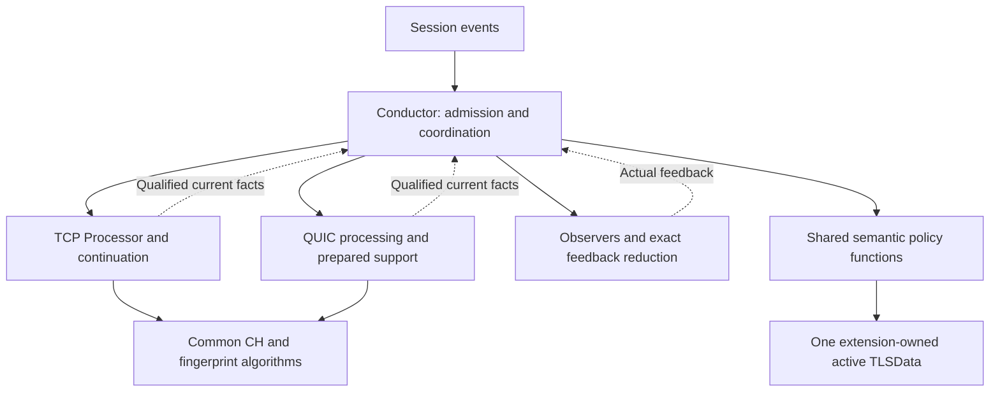

# Phase 6 Step 5: Architecture Decision and Minimum Coherent Delivery Scope V10

## 1. Decision

**Select R1: explicit TCP/QUIC processing paths under the existing Conductor, with one shared semantic policy implemented as cohesive functions and protocol-owned CH evaluation.** This is the minimum coherent **C1 + C4-P** realization. It does not require a new policy class, common processing interface, protocol Flow hierarchy, universal record, or full common CH evaluator.

The Conductor owns traversal, actual-feedback reduction, transaction timing and lifecycle coordination. Shared semantic policy functions own live TLSData predicates and consequences. TCP and QUIC processors own acquisition and qualified CH facts, never live semantic commits. The policy may remain in the existing module, including cohesive Conductor methods; logical authority does not require physical relocation to a new object. [B1 Sections 1-8; B4 Sections 1-9; S4 Sections 6-8]

**Decision basis:** the Step 4.5 V4 framework was applied to six distinct concrete realizations covering all four candidates, both C4 scopes, and useful hybrids. R1 has the strongest reference preference index, 76.4/100, versus 68.6 for the nearest alternative R2. It remains the reference leader in all 25 prescribed weight-sensitivity cases. This is an architectural judgment, not a measured performance result or a statistically certain winner. Cost-score intervals overlap; Section 4 explains why selection is still justified and what evidence could reopen it. [EVAL Sections 3-7]

**Status:** architecture direction selected by this assessment for user review. No implementation activation, product-test PASS, provider-conformance PASS or numeric sizing approval is granted. The current request to run the attached framework and select a design is treated as authorization to apply its unchanged weights for this assessment, not authorization to modify accepted protocol contracts.

## 2. Authority, frozen inputs and historical reconciliation

The source keys below resolve to exact file names and SHA-256 values in the delivery manifest and evaluation report:

| Key | Current input |
|---|---|
| F | phase6-step4.5-selection-criteria-and-weights-v4.md |
| S4 | phase6-step4-candidate-comparison-v7.md |
| S1 | phase6-step1-authoritative-comparison-baseline-v2.md |
| S2 | phase6-step2-responsibility-and-semantic-sharing-assessment-v3.md |
| B1 | candidate1-team-architecture-proposal-v5.md |
| B2 | Candidate2-V2.md |
| B3 | candidate3-team-architecture-proposal-v4.md |
| B4 | candidate4-team-architecture-proposal-v4.md |
| CODE | TLS-Flow-All-Code.txt, supplied snapshot, repository commit unknown |
| EVAL | phase6-step5-evaluation-and-evidence-v1.md and packaged machine-readable records |

Candidate 4 V4 is the explicit evaluation input, SHA-256 `c2d5f558e4fcf1ae3722af2ca29e25239c71ed6dd0cbdbe411dad9fbf55700bb`. S4 B4 still records historical Candidate 4 V3 and its different digest. That historical provenance is not rewritten or represented as V4 identity. S4's accepted semantic contracts remain binding. All existing baseline files are preserved unchanged.

Evidence kinds are **F** inspected code fact, **A** inherited accepted contract, **J** architecture judgment/decision and **V** required downstream validation. Scores are J. Static walkthrough PASS means a coherent mechanism is specified, not that the future implementation executed it.

### 2.1 Existing Step 5 V9

The available candidate baselines identify the existing V9 direction as C1 + C4-P. This reassessment reaches the same direction independently under F; the incumbent received no bonus. V10 makes the minimum realization, input substitution, assessment, ownership and activation obligations explicit. It does not silently revoke V9 or any accepted Phase 1-5 contract. [B4 Sections 1/10; B3 inherited selection boundary; F Sections 1/8]

The original V9 file, Step 3 V6, the full workflow file and original Phase 1-5 archives are not present among the current local inputs. Their inherited contracts are available through S1/S2/S4 and the candidate proposals; this is not a fresh audit of those archives or a line-by-line V9 reconciliation. No claim of a newly accepted completion policy, capacity number or API follows from this document. A concrete conflict with an accepted source must stop the affected implementation work and be resolved explicitly, not treated as tuning.

## 3. Alternatives and normalization

The alternatives were defined and frozen before scoring. All use the same accepted scope, one active TLSData, prepared-storage ownership model, victim-aware retirement obligation and scenario expectations. These explicit assessment realizations resolve allowed architecture choices without editing the original candidate proposals. They are not claims that every possible implementation of a candidate passes.

| ID | Concrete realization | Distinct current benefit | Additional seam/cost to assess |
|---|---|---|---|
| R1 | C1 + C4-P, explicit calls, cohesive shared policy functions | Preserve TCP processing contract while sharing real semantic predicates/actions | Qualified QUIC facts, producer routing and required retirement integration |
| R2 | C2 + C4-P, revised common pull contract | One processing vocabulary and ordinary pull loop | TCP adapter/input/outcome/borrow contract and Factory migration |
| R3 | C3, independent protocol flows with common primitives | Protocol-local traversal and lifecycle sequencing | Relocate TCP transaction authority; maintain parity across two policy sequences |
| R4 | C1 + C4-F | Common staged CH evaluation as well as policy | Extract TCP staged digest/locator/cursor orchestration and valid access |
| R5 | C2 + C4-F | Common pull contract plus common evaluator | Combined strategy/evaluator adaptation and backing seams |
| R6 | New C3 + common semantic policy hybrid | Reduce R3 policy drift while retaining flow-local sequencing | TCP Flow relocation plus flow-to-policy seam; no Conductor semantic commit |

C1 permits shared semantic functions and C4-P does not require a separate policy object. Therefore a minimum conforming C1 realization and R1 can be the same design; they are not scored twice or artificially separated by file/class count. Similarly, C2 can organize its Conductor policy as cohesive functions without changing its required common processing boundary; R2 represents that strongest proportionate realization. C4-F and C4-P are sharing scopes, not additional complete processing architectures. [B1 Sections 1/8; B2 Section 1; B4 Sections 1/2; S4 Section 2]

R6 is a genuine new hybrid: the selected Flow coordinates, but common policy functions alone perform live semantic writes. It is not called unmodified C4, whose coordinator is the Conductor. A naive hybrid retaining both Flow commits and Conductor/policy commits is rejected at G04. A universal TLS-record wrapper fabricating QUIC observations is rejected at G01. A C3 + full-evaluator combination was screened but not expanded: no distinct present benefit beyond R6 policy sharing and R4 evaluator sharing was established. This is not an exhaustive combinatorial search. [F Section 2; S4 H01/H03, Section 7]

## 4. Assessment result and uncertainty

### 4.1 Gates and common scenarios

All six explicitly defined realizations pass G01-G07 at the architecture-mechanism boundary. The evaluation contains 42 ordered gate assessments, 90 S01-S15 static walkthrough records, M01-M11 coverage for every realization, 66 criterion assessments and 25 computed weight-sensitivity cases. These are document/source-grounded architecture assessments, not compiled or packet-executed tests. Every gate retains its downstream implementation evidence obligation. [EVAL Sections 2-7]

No family is rejected as inherently incorrect. The selection is among coherent realizations, not a correctness score compensating for a failed gate. The two invalid constructions in Section 3 are stopped at their first failed gate and are not ranked.

### 4.2 Weighted reference scores

| Criterion | Weight | R1 | R2 | R3 | R4 | R5 | R6 |
|---|---:|---:|---:|---:|---:|---:|---:|
| T01 TCP assurance | 18 | 4 | 3 | 3 | 2 | 2 | 3 |
| T02 Runtime work | 20 | 3 | 3 | 3 | 3 | 3 | 3 |
| T03 KISS | 12 | 4 | 4 | 3 | 3 | 3 | 3 |
| T04 YAGNI | 8 | 5 | 4 | 4 | 3 | 3 | 4 |
| T05 Contract quality | 8 | 4 | 4 | 4 | 4 | 4 | 4 |
| T06 Necessary existing-code change | 5 | 5 | 3 | 3 | 2 | 2 | 3 |
| T07 Testability | 8 | 4 | 4 | 4 | 4 | 4 | 4 |
| T08 Prepared memory | 9 | 3 | 3 | 3 | 3 | 3 | 3 |
| T09 Policy maintenance | 7 | 4 | 4 | 3 | 4 | 4 | 4 |
| T10 Future locality | 2 | 3 | 3 | 3 | 3 | 3 | 3 |
| T11 Delivery organization | 3 | 4 | 3 | 3 | 3 | 3 | 3 |
| **Reference index /100** | **100** | **76.4** | **68.6** | **64.8** | **60.0** | **60.0** | **66.2** |

The score reasons and exact source/section anchors are in EVAL, not inferred from these numbers. T02/T08 are equal because the common bounded work/storage model provides no demonstrated material ordering. Equal architectural scores do not mean equal CPU time or RAM. No virtual-call penalty, copy cost, throughput, capacity or measured saving was invented. R4/R5 remain tied where the evidence cannot support a finer ordinal distinction.

The R1/R2 gap is entirely from T01 (3.6 points), T04 (1.6), T06 (2.0) and T11 (0.6). These are separate consequences: semantic migration exposure, necessity of new scope, existing API/symbol change and dependency/review organization. No extra KISS, SOLID, memory or DTLS bonus was added for fewer interfaces. This makes the migration-oriented preference visible rather than disguising it as performance superiority.

### 4.3 Robustness, not certainty

All 22 individual weight perturbations and all three frozen grouped cases retain R1 as the reference leader. This tests weight sensitivity for the stated judgments; it does not validate those judgments as facts.

Using the plausible architecture-cost scoring interval [2,4] for both T02 and T08 gives R1 [70.6,82.2], R2 [62.8,74.4], R3 [59.0,70.6], R4/R5 [54.2,65.8], R6 [60.4,72.0]. These are scenario envelopes, not measured bounds or confidence intervals. Fully unknown provider-dependent performance must remain unknown; it is not guaranteed to fit that envelope. Independent adverse cost realizations can reverse the R1/R2 ordering. Common correlated cost changes cancel in their pairwise comparison. [EVAL Section 7]

Ordinal judgment sensitivity also matters: reducing R1 T01 by one and increasing R2 T01 by one leaves only 0.6 reference points; increasing R2 T03 by one then reverses the ranking. Thus this is not a claim of a universally optimal design. It is a justified present selection: no current requirement needs the broader TCP contract/evaluator/Flow migration, and no demonstrated operational benefit offsets that additional exposure.

**Decision-driving evidence action:** before final API/layout freeze, review the actual R1 coordinator and R2 adapter sketches against the same S01-S15 traces. If R1 requires repeated policy branches, hidden state or duplicate traversal that cannot remain cohesive, revise T03/T09 and reconsider R2. If provider/layout inspection demonstrates a material R1-specific work or backing disadvantage, update T02/T08 with evidence and rescore all affected alternatives under the same weights. Do not implement every candidate or tune weights to preserve this result.

## 5. Selected responsibility and interface architecture

### 5.1 Required responsibilities, not automatic classes

| Responsibility | Selected placement | Authority boundary |
|---|---|---|
| Session participation, subscriber order, extension lookup/build | Existing Conductor and SessionTable integration | No new direct Packet Flow registration |
| Protocol admission and traversal | Conductor explicit TCP/QUIC paths | Select before TCP-only parsing/terminal shortcuts; UDP/port is participation, not proof of QUIC |
| TCP acquisition and staged CH orchestration | Existing Processor and SegmentBufferManager | Preserve current processing contract and supported staging/visibility |
| QUIC acquisition and CH orchestration | Focused long-lived QUIC processing responsibility | Initial protection, packet/frame/CRYPTO and association; produces qualified facts, not state commits |
| Canonical CH/FP algorithms | Composed common helpers | Same canonical output; no forked normalization or fingerprint correction |
| Actual observer delivery/reduction | Existing Conductor/notifier and shared reducer logic | Actual masks only; no invented verdict or second reduction |
| Live semantic policy | Cohesive shared functions in existing TLS-Flow module | Own predicates/actions, not merely setters for decisions made elsewhere |
| Active semantic storage | Existing extension/table | One active TLSData; physical storage is not another policy writer |
| Prepared QUIC backing | QUIC processing/support owner, initialized through Engine startup wiring | Extension handle borrows a claim; no per-packet owner creation |
| Viewer facade | Factory/Application current-producer routing | Record view stays TCP-only; CH/error views carry valid producer/attempt qualification |
| Retirement and aging coordination | Conductor plus affected table/protocol owners | Use victim binding and last uses; no requester-owned cleanup |

A responsibility may be methods/functions in an existing module. A separate object is justified only by a concrete lifetime or test boundary. No StateMachineManager, VerdictManager, global allocator service or generic Flow base is selected. [S4 Section 7; B4 Sections 2/6/7]

### 5.2 Architecture-level interfaces

1. **TCP processing boundary:** retain the current TCP-oriented IProcessor, PayloadParams and TLSStepResult behavior. The Conductor continues to construct TCP input only on the TCP branch.
2. **QUIC processing boundary:** borrowed current datagram plus explicit required Session/attempt context; return a relevant qualified result, progressed IGNORE, exhaustion or accepted exception. No mandatory common C++ interface with TCP.
3. **Policy boundary:** qualified current evidence, actual feedback and current live TLSData. The policy owns applicability and action selection. The coordinator owns when it may be invoked, not a second copy of state predicates.
4. **View boundary:** current producer and valid CH/error/record capabilities. Reuse existing fields/viewers when sufficient; no owned CH copy or universal event object solely for symmetry.
5. **Retirement boundary:** table identifies the actual victim before destructive reset/erase; Conductor coordinates affected support last uses and detach; support owner returns claims; only then may storage be reused. A failed required detach prevents unsafe reuse.

These contracts fix control and ownership. Exact method signatures, member placement and provider-specific wrappers are downstream design, not permission to change these contracts.

The diagram shows logical responsibilities, not mandatory objects or complete lifecycle order. In particular, authorized terminal-candidate reset precedes CH parsing, rather than waiting for the ordinary observer path.

## 6. Selected control flow and semantic contracts

### 6.1 TCP remains behaviorally anchored

Retain SYN-without-ACK missing-extension build/consume and reuse/rebuild predicates; do not add an extension-required gate before SYN preparation. RST without ACK precedes silent/payload gates. Actual violations produce Error on STOP or violation-only commit on Continue; zero-mask RST clears TLSData even on STOP. Finished/Unsupported silence precedes empty payload; Error/TerminatedByAlert nonempty payload uses TerminalPayload. [CODE prepareInboundExtension/process; S2 D02-D05]

Call beginPacket once. Process another record only after RecordParsed, no returned observer STOP and active resulting state. Parser Stop, NeedMoreData, Unsupported and exhaustion retain their distinct exits. Preserve full-continuation retransmission behavior, supported overlap/gap/alert modes, staged digest/locator restoration and retained Complete/U05. No new complete TCP handshake buffer is introduced. [CODE process/dispatchStepResult/Processor; S4 S01/S03/S14-S15]

For an ordinary parsed record, preserve parsing-error, TLSRecord and eligible CH event order. Capture TLSRecordContext after parsing-error reduction and before onRecord. Preserve commit-time viewer reads unless an explicitly equivalent snapshot is demonstrated. [CODE analyzeProcessResult; B4 Section 5]

### 6.2 Exact STOP and commit reduction

The current event notifier stops its listener list on the first STOP, even with zero mask. The current-unit accumulator starts at zero and ORs actual masks only. Immediate Error/STOP requires the **current event** to return STOP and the accumulator after OR to be nonzero. A prior zero-mask STOP is latched but does not replace that current-event predicate.

Remaining same-unit events may run after zero-mask STOP. Final nonzero mask suppresses normal updates and yields Error if STOP was latched, otherwise violation-only commit. Final zero mask permits the normal update even with latched STOP. Return STOP if latched; do not process a later unit. Parser Stop is a separate exception. STOP is not established packet DROP. [F M04; S4 S04-S05; CODE analyzeProcessResult/notify]

Earlier unit commits and observer effects are not rolled back after a later failure. No one-state-assignment-per-datagram restriction is introduced.

### 6.3 QUIC progress and return boundary

The QUIC processor may visit internal framing elements until a qualified result requires Conductor handling, a completed eligible unit can return progressed IGNORE, or permitted input is exhausted. Partial CH alone does not discard usable remaining input. IGNORE has no pending semantic disposition; zero callbacks do not imply IGNORE. Required support-loss Unsupported is resolved before affected-unit callbacks. [F M02/M03/M05; S4 S10/S15]

The selected boundary is the earliest relevant result before later feedback-dependent work. A direct synchronous return with a prepared cursor is sufficient; no coroutine framework is required. If a relevant result occurs inside a QUIC packet, the processor must preserve its current borrowed-input position and yield before dependent later frames; a whole-packet-only return is not allowed to precommit later authority. If no such dependency occurs, packet-boundary return is sufficient. Current frame pointers do not survive their valid input interval. This resolves the architecture control rule without imposing one universal wire unit or speculative continuation machinery. [B1 Section 4; B4 Sections 3.3/4; S1 C09/C21]

### 6.4 Active candidate versus terminal candidate

**Active candidate:** acquire and evaluate in isolated support while unrelated active TLSData remains authoritative. Complete qualifying evidence plus required admission, identity preservation and last uses precede accepted replacement/publication. Pre-acceptance failure cannot overwrite or terminalize unrelated active authority.

**Terminal candidate:** qualify accepted new-attempt evidence without CH parsing; satisfy required admission, old terminal/retired identity preservation and last uses; Conductor invokes the sole policy writer for the live reset; only then parse/evaluate the CH and resolve actual feedback. Do not wait for complete CH facts/callbacks to reset, reset twice or restore the old terminal attempt after post-reset CH failure. Same-attempt terminal, retired or ambiguous evidence grants neither reset nor CH parsing permission. [S4 S06-S07/H11; B4 Sections 3.3/3.5/6.2/8]

### 6.5 Shared state does not mean shared wire evidence

QUIC v1 and client-to-server visibility remain the scope. Initial protection/CRYPTO qualification precedes CH authority. Retry-compatible restart and HRR-compatible CH2 remain the same attempt and do not prove server Retry/HRR. Additional qualified QUIC CH, including a third CH, reaches actual Enforcement feedback; do not copy TCP's local MultipleClientHello guard into QUIC. [S1 C02-C05/C15-C19; S2 D27-D28; S4 S12]

Completion remains the inherited product policy: qualified unambiguously associated client QUIC v1 Handshake Long Header evidence, not observed TLS Finished or decrypted Handshake payload. Bounded same-attempt pre-CH evidence may produce permitted InProgress then Finished after authoritative CH in the same semantic cycle. Interpret protected fields only with required protection handling or trusted classification; do not infer server events or authority from protected bits. If required qualification is unavailable, do not manufacture Finished or Finished-based reclaim. [S1 C03-C04; S4 S09]

0-RTT and short-header 1-RTT do not advance state. A readable associated Initial CRYPTO_ERROR close follows accepted TerminatedByAlert, not Finished; opaque/arbitrary closes do not fabricate alert evidence. Required support loss follows accepted cause-specific Unsupported, including PreHandshake, before affected dispatch; optional retired-history expiry is not automatically that loss. [S4 S10-S11]

## 7. Shared policy and intentional separation

| Area | Share now | Keep separate and exact reason |
|---|---|---|
| CH canonical interpretation and fingerprint | Common algorithms and output contract | Acquisition/staged orchestration: TCP continuation versus QUIC CRYPTO reconstruction have different validity and support contracts |
| CH semantic publication | Qualified field/count/version/FP/early-data actions and applicable state transition | Freshness/attempt evidence; TCP retained Complete callback eligibility is not a new CH commit |
| Feedback | Actual-mask reduction and permitted normal/error/violation actions | Event applicability and parser/entry exceptions; QUIC has no synthetic TLSRecord/TCPReset |
| State policy | One implementation of shared predicates/actions with focused protocol qualification | Completion predicates: TCP CCS/handshake/ApplicationData versus qualified QUIC header evidence |
| Terminal/reuse | Single-writer reset/acceptance discipline | TCP SYN/RST/terminal payload versus active/terminal QUIC attempt sequences |
| Backing/lifecycle | Last-use, admission, detach-before-reuse and exactly-once release principles | Existing independent TCP continuation versus QUIC acquisition/candidate/retired/deferred claims |
| Viewer access | Public facade and current-producer discipline | TCP-only record capabilities and protocol-specific error/evidence qualification |
| Flow legality | Existing Enforcement integration | Enforcement remains attempt-wide legality authority; parser/policy must not replace it |

The departures from sharing are evidence and lifetime differences, not duplicated canonical algorithms or two complete copies of common state actions. The shared policy is not merely a state-enum setter selected by the coordinator. [S2 D01-D28; S4 Sections 3/7; B4 Sections 2/7/8]

A future DTLS boundary may add its own qualification/acquisition without inventing TCP records or QUIC packet evidence in common policy. No DTLS parser, state policy, completion rule, API or version support is implemented now. This is a hard-coding check, not an extensibility framework.

## 8. Physical ownership, prepared storage and retirement

### 8.1 Chosen ownership model

Use existing startup Factory/Engine wiring for long-lived processors. The QUIC processing/support responsibility owns its prepared physical arenas, slot metadata and bounded association structures. A participating extension stores a borrowed support handle and retained TCP/QUIC/unbound binding; it does not own a second TLSData or a dynamically allocated support object. Direct handle resolution avoids requiring a second Session-keyed support map. Any required CID/association index is separately prepared and bounded. Exact layouts are downstream, but owner and lookup responsibility are selected here. [J, permitted by B1/B4 Section 6; S1 C20-C22]

The Conductor owns admission/acceptance/retirement ordering; the support owner manages acquisition metadata and returns its claims. A copied wrapper/handle does not own bytes. Keep active, isolated candidate, required retired identity and deferred evidence in their accepted distinct logical roles; shared physical backing is legal only when live intervals permit it. A protocol-specific resource is not automatically a new component.

### 8.2 Replacement and victim handling

For every prepared resource dimension, checked admission must account for active usage including still-live old attempt, isolated candidate, separate destination and concurrent temporary claims. Use S4/P5 definitions without charging the old active attempt twice. Preparation failure follows accepted cause-specific disposition; it is not success or permission for heap fallback.

Table alloc/release currently reset/erase storage directly. Therefore add explicit **pre-destructive retirement integration**, not a post-erase cleanup guess. The table identifies the victim and retains its binding/handle; the Conductor orders required detach and last uses through the victim's support owner; only successful safe retirement permits destructive reset/erase/reuse. Do not rebind the current requester evaluator to clean another Session. Failed required detach cannot publish unsafe reuse. [F: CODE TLSSessionExtensionTable::alloc/release; A/J: S4 S13-S14; B4 Section 6.4]

Finished marking is not release or guaranteed insertion. Preserve current TCP unchecked markReclaimable return behavior; do not newly make its failure a client violation. QUIC reclaim eligibility follows newly committed qualified Finished and required last uses. Clear stale reclaimable membership on reuse. Resource eviction is not synthetic SessionEnd or Incomplete Handshake.

### 8.3 Aging and unbound entries

Retained binding, not a nonexistent aging packet or current configuration, selects cleanup responsibility. Conductor preserves SessionEnd notification before extension release and ignores its returned verdict for the existing TCP aging return/state behavior. An entry aged before first inbound may be unbound; it has no newly attached protocol support and uses common notification/release without selecting a parser.

Existing SegmentBufferManager continuation is independently owned/aged and can outlive extension eviction/rebuild. Do not newly deallocate it on SYN, RST, Finished, extension release or SessionEnd merely because policy is reorganized. [CODE onAging/SegmentBufferManager; S4 S14; B4 Section 6.4]

### 8.4 Runtime and memory ledgers

Use S4 Section 6's common symbolic work model: packets, nested frames, unlocked messages, retained visits, overlap comparisons, copied/rebased bytes, parsed/hashed CH bytes, locator/sort work, context trials/key derivations, callbacks and lifecycle visits. Add actual branch/access/policy-call work for R1. No asymptotic or measured advantage follows from function placement.

Prepared memory is fixed backing plus per-class startup capacities times charged slot bytes and overhead. Charge bytes once. Check replacement peak per dimension before mutation/publication. Bound ranges, contexts, reconstruction, retained/deferred evidence, indexes and cleanup visits. Every iteration progresses, produces a relevant result or follows an accepted explicit termination/failure path; do not introduce arbitrary tail truncation/replay to claim boundedness. [S4 Section 6; S1 C25-C27]

Allocation is permitted at Engine startup only. Packet, aging, retirement and failure paths use prepared storage without dynamic allocation, container growth or heap fallback. Crypto scratch, observer/viewer adapters, indexes and diagnostics are included in the audit. Numerical capacities remain deferred, but finite approved startup values and actual provider conformance are mandatory before enablement.

## 9. Existing-symbol impact map

Names identify the supplied source snapshot, not an assumed repository revision. New logical responsibility names below are not claims that those classes/APIs already exist.

| Existing symbol/area | Action | Reason and preservation boundary |
|---|---|---|
| TLSFlowConductor::onNewSession, buildExtension, registerSessionObservers | Retain | Preserve participation masks, priority and SessionTable integration |
| TLSFlowConductor::onInbound, prepareInboundExtension, process | Change narrowly | Select protocol before TCP-only work; retain TCP SYN/RST/terminal and loop behavior; add explicit QUIC path |
| dispatchStepResult | Retain TCP behavior; add separate QUIC disposition routing | No universal record result or parser-STOP reinterpretation |
| analyzeProcessResult | Retain order/context/reduction; invoke cohesive policy actions | Preserve current-event predicate and precommit callback state |
| notify | Retain | Actual mask OR, live listener priority, first listener STOP; no VerdictManager |
| commitNormalCurrentRecord, updateTLSDataOnClientHello | Generalize/extract logical shared actions only | Qualified CH publication and field meanings shared; keep TCP record applicability explicit |
| updateTLSDataOnChangeCipherSpec/ApplicationData/Alert | Retain focused TCP predicates; add qualified QUIC policy branches separately | No common completion evidence or fake alert |
| commitUnsupported, commitViolation, commitError and RST live clear | Route through sole policy authority | Cause-specific Unsupported and actual-feedback guards preserved |
| IProcessor, PayloadParams, TLSStepResult | Retain TCP contract | No required C2 migration in selected scope |
| Processor::beginPacket/processRecord/processNewRecord/processSegmentedClientHelloContinuation | Retain orchestration | Staging, modes, retransmission, overlap/gap and support limits remain TCP-owned |
| Processor::processClientHello/processCiphers/processExtensions/feedExtensionsFP | Reuse/extract minimum canonical algorithm helpers | No full evaluator extraction or fingerprint correction; preserve staged backing and diagnostics |
| SegmentBufferManager::allocate/deallocate/onEvent | Retain independent ownership/lifecycle | No implicit flow-owned cleanup or new Session lookup assumptions |
| Factory::buildProcessor/init and Application getters | Change startup wiring/current-producer facade | Existing single producer is not sufficient for QUIC; retain public callback capability compatibility |
| TLSData/TLSSessionExtension | Retain one active semantic core; add minimal prepared binding/borrowed handle where needed | Do not embed all QUIC acquisition or duplicate semantic state |
| TLSSessionExtensionTable::alloc/release | Change before destructive operations | Victim-aware retirement must precede reset/erase; new integration, not current fact |
| TLSSessionExtensionTable::markReclaimable | Retain marking meaning; coordinate last uses | Not release or guaranteed insertion; stale membership cleared on reuse |
| Existing Enforcement/Fingerprint/Visibility callbacks | Retain contract; verify qualified routing | No fake records, stale producer, replacement of Enforcement legality or blanket consumer certification |
| New QUIC processing/support responsibility | Add | Initial protection, bounded packet/frame/CRYPTO, association/candidate/retired/deferred support and qualified CH evaluation |

Source anchors: CODE Conductor process L3428, analyzeProcessResult L3514, onAging L3669, commitNormalCurrentRecord L3788; Processor processRecord L5564 and processClientHello L6810; Factory buildProcessor L1561; extension table definition around L2799. Line numbers refer only to the supplied combined bundle. S2 D01-D28 and B4 Section 9 define the broader preservation inventory.

## 10. Why the other directions are not selected now

| Alternative | Semantic/observable suitability | Why less suitable for current delivery | Evidence that could justify reconsideration |
|---|---|---|---|
| R2 common processing contract | Can preserve exact feedback, no-projection results and terminal reset through a qualified adapter | Required TCP input/outcome/borrow/viewer migration has no demonstrated present benefit over cohesive explicit calls; KISS is tied, not assumed worse | Concrete R1 control duplication or a simpler proven R2 adapter/trace map |
| R3 independent flows | Real protocol sequencing differences justify a possible flow boundary; no inherent correctness failure | Moves existing TCP authority and requires parity across separate policy sequences | A current ownership/control problem that cannot remain cohesive in Conductor |
| R4 full common evaluator | Same CH algorithms are shareable; staged access can be correct | Moves TCP evaluation/digest/locator orchestration without proving benefit beyond shared algorithms | A source-backed extraction with valid mode/borrow restoration and concrete maintenance/work benefit |
| R5 common contract plus evaluator | Coherent if both seams are honest and single-writer | Combines two optional migrations; no evidence to award its parents' best scores | Both independent benefits plus integrated conformance and backing evidence |
| R6 flow plus common policy | Removes R3 policy drift without dual writers | Still relocates TCP sequencing and adds a flow-policy seam; common policy does not require flows | Demonstrated need for flow-local sequencing plus common policy |

C1 without a mandatory policy class is not rejected: its cohesive realization is the selected R1. C4-P is not awarded a second win under a different name. No alternative is rejected because of unknown server observations that another design can magically obtain; all have the same visibility boundary. No measured delivery time or staffing cost is claimed. [EVAL; S4 Sections 3/6-8]

## 11. Minimum coherent delivery scope and dependency order

These are required work packages, not new components. Implementation may parallelize independent work, but enablement must satisfy all dependencies.

| Package | Required work | Depends on | Review/validation exit | Enablement |
|---|---|---|---|---|
| D1 | Freeze exact input identities, TCP reference traces and accepted correction deltas | This decision and F | S01-S15/M01-M11 trace oracle, consumer/viewer expectations, current-event STOP cases | No QUIC activation |
| D2 | Cohesive shared semantic actions and qualified applicability; retain TCP contract | D1 | Differential TCP traces including retained Complete, context capture, SYN/RST/aging and accepted restoration fixes | TCP refactor only after regression evidence |
| D3 | Prepared QUIC support ownership, binding/handle and victim-aware pre-erase retirement | D1 | Admission/rollback/last-use/detach/reuse and unbound aging tests; no requester workspace rebinding | No activation; numeric sizing still deferred |
| D4 | QUIC v1 protection/packet/frame/CRYPTO, association and protocol-owned CH evaluation using common algorithms | D1; D3 ownership contract | Provider conformance, progress/IGNORE, active/terminal candidate, ambiguity/retired and canonical FP tests | No activation |
| D5 | Conductor QUIC integration, policy disposition, current-producer Factory/Application routing and consumer compatibility | D2-D4 | Full callback/state/provenance traces; no-projection completion, required-loss Unsupported, third CH and close qualification | No activation |
| D6 | Actual layout/capacity approval, startup preparation, allocation/work audit and integrated validation | D2-D5 | Finite approved capacities; checked peak; actual API/provider conformance; runtime/consumer/regression evidence | Only after all exits pass and normal product authorization |

D3 and D4 can be developed against the same fixed ownership contract, but neither can enable a partial QUIC package. A prepared owner/retirement hook is not optional cleanup; a parser alone is not the feature. Numeric sizing may be decided at its authorized later point, but must precede D6 enablement. No CPU/RAM budget unavailable to the team is demanded.

### 11.1 Explicitly optional, not prerequisites

- A common IProcessor/processUnit contract or borrowed-frame adapter for TCP.
- Full common CH evaluator extraction and universal staged-access facade.
- TcpFlow/QuicFlow classes or Template Method inheritance.
- A standalone StatePolicy class/interface, VerdictManager or allocator service.
- DTLS implementation or generic protocol plugin framework.
- New production logging framework, fingerprint algorithm correction or broader TCP fragmentation support.

An optional item becomes required only after a documented current requirement or correctness problem demonstrates necessity, followed by a new version/review. It cannot be smuggled into D1-D6 as cleanup.

## 12. Deferrals with ownership and activation consequences

Ownership below is by implementation responsibility, not an invented employee assignment.

| ID | Deferred item | Responsible workstream | Required evidence and blocking point |
|---|---|---|---|
| V01 | Numeric capacities and platform-fit approval | QUIC support/layout implementer with Engine integration/architecture review | Finite startup values and checked replacement peak before D6 activation; no invented values here |
| V02 | Crypto/header/packet provider API conformance | QUIC processing implementer | Actual protection/association access, scratch allocation and failure behavior; unavailable qualification cannot yield Finished |
| V03 | Exact borrowed-view and current-producer APIs | Factory/Application and protocol integration implementer | Nested digest/full-string/locator reads, valid lifetimes and no stale producer before D5 exit |
| V04 | Table retirement hook/provider conformance | Extension table and QUIC support implementer | Pre-erase victim identity, detach failure and exactly-once release before D3/D5 exit |
| V05 | TCP differential regression and accepted correction deltas | TCP/policy implementer | Same callback/state traces, U05, staging/modes and context capture; distinguish existing behavior from authorized fixes |
| V06 | Allocation-free bounded Engine runtime | All Engine-path implementers, integrated by Engine startup owner | Packet/aging/retirement/failure audit including dependencies, indexes and crypto scratch before activation |
| V07 | Consumer and Enforcement compatibility | TLS-Flow/consumer integration implementer | Real callback/provider contracts; Enforcement legality remains external; inherited consumer evidence is not blanket certification |
| V08 | Work/layout evidence that could change ranking | Selected design implementer with architecture review | Same ledger for any challenged alternative; revise scores only from concrete evidence, not post-hoc weights |

These are API, layout, numeric and implementation-evidence deferrals. Coordinator, semantic writer, physical support owner, active/terminal ordering, progress boundary and victim cleanup responsibility are decided now and are not deferred tuning.

## 13. Completion check and handoff

| Step 5 workflow obligation | Delivery evidence |
|---|---|
| Select architecture based on Step 4 | Sections 1-4; EVAL gates/preferences/sensitivity |
| Responsibilities/components/interfaces at architecture level | Sections 5-8, no premature member/signature specification |
| Existing symbols retained/changed/extracted | Section 9 |
| Shared versus intentionally separate semantics | Section 7 and protocol contracts in Section 6 |
| Rejected alternatives with current reasons | Sections 3/10 and EVAL |
| Minimum coherent scope and dependency order | Section 11, required versus optional work explicit |
| Authorized capacities and actual provider checks carried forward | Sections 8/12, activation not implied |

The selected direction is implementable at architecture level: one coordinator, one policy authority, explicit physical ownership, valid borrowed-result intervals, bounded prepared support, resolved terminal-candidate ordering and victim-aware retirement. It is proportionate because it does not require the broader TCP interface/evaluator/Flow migrations to deliver current QUIC behavior.

The assessment and document review do not prove the implementation. The next work is the required delivery packages and their evidence, not automatic activation. Preserve this document, EVAL, the manifest and review evidence as new immutable outputs; later corrections require a new version. Do not reopen accepted Phase 1-5 semantics without a concrete contradiction or new correctness issue.
