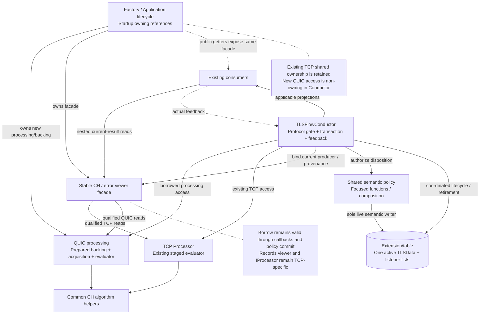
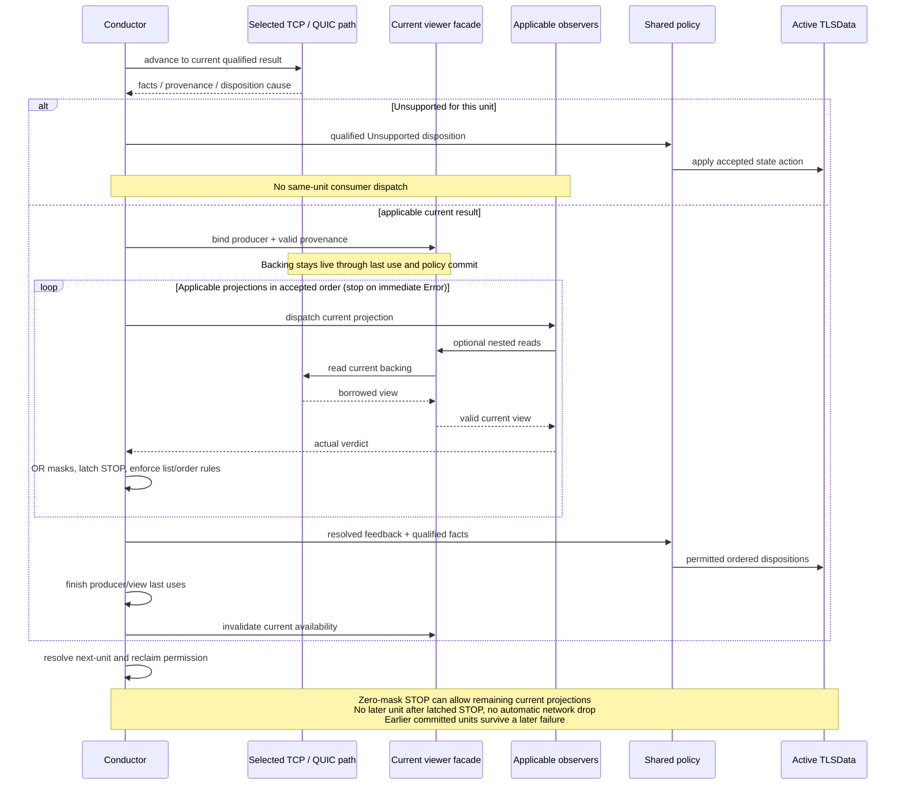
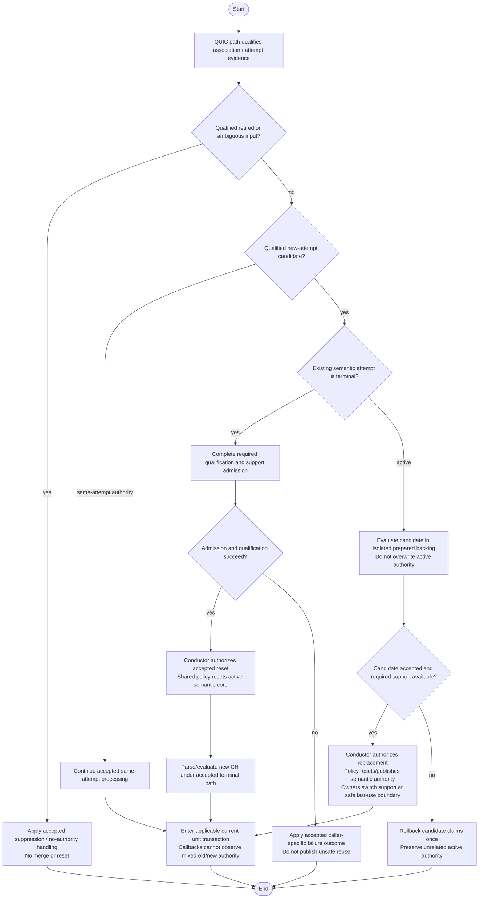
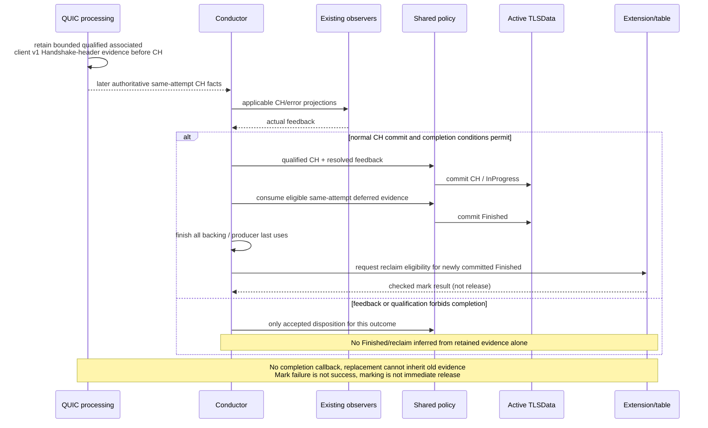
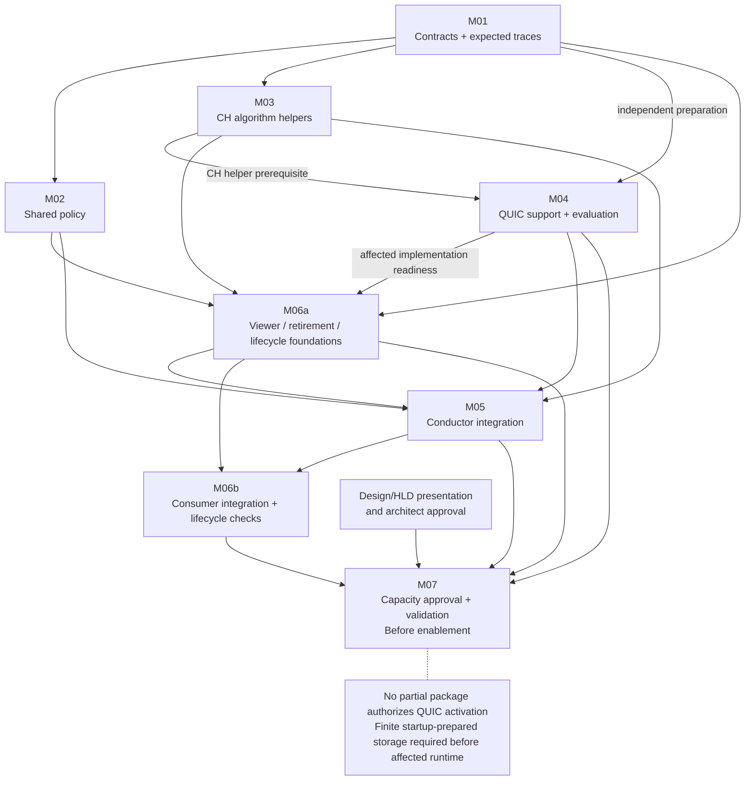
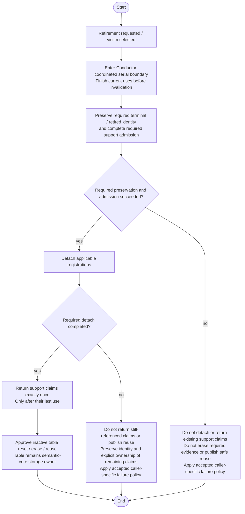

# Phase 6 Step 5: Architecture Decision and Minimum Delivery Scope V9

## 1. Decision and readiness boundary

**Select C1 + C4-P:** a shared Conductor with explicit TCP/QUIC processing paths, composed common CH algorithm helpers, and one shared semantic state policy. Retain protocol-owned CH evaluation orchestration and backing. Do not introduce a mandatory common Processor strategy contract, protocol-flow transaction owners, a complete common CH evaluator, or an inheritance framework.

This is one concrete combination already compared in Step 4, not a new fifth architecture. Common state policy is a logical responsibility implemented through focused shared functions/composition; it need not be a new class. The Conductor owns transaction ordering and authorizes policy invocation; only that policy performs live semantic state dispositions, including protocol-specific qualified branches and accepted lifecycle reset actions. Table/Extension construction and destruction may initialize/clear inactive storage after coordinated last use; they are not independent semantic decision makers.

**Status:** selected architecture direction for downstream design and validation, not a user-approved implementation, complete HLD, activation authorization, measured performance result or completion of Phase 6. Step 6 must define validation evidence and assess the decision against the eight Phase 6 gates.

### Authority and evidence

Direct inputs are Step 4 V2 (S4), Step 3 V2 (S3), Step 2 V3 (S2), the original work-plan V5, and supplied Phase 1/2 documents. P3-P5 contract anchors remain inherited through reviewed S4 E01-E17 and S2. The supplied original TLS-Flow-All-Code.txt is now directly inspected for this V3 review; Section 11 records exact source anchors and current-versus-target distinctions. P3-P5 originals and the consumer source bundle are not physically available in this workspace; no independent reinspection of those files is claimed. The architecture is reassessed using S4 and the directly inspected module code, not merely the earlier PASS. Earlier files remain unchanged.

References below such as S4 E13 identify the exact original file/section/line locator in S4 Section 9. Accepted Phase 1-5 contracts remain binding. This document's placement/scope choices are **SELECTED DESIGN**, not newly discovered source facts or replacement product policies. Exact APIs/layouts and execution tests are **DOWNSTREAM VERIFICATION**, not already proven.

## 2. Why this combination now

| Decision | Current reason | Evidence and trade-off |
|---|---|---|
| Retain one Conductor transaction coordinator | Existing dispatch, actual verdict reduction, next-unit permission and Session entry already have a coherent integration point. Do not move complete TCP sequencing merely to create symmetric flows. | S4 K02/K03/K05/K08, E18/E25; S2 A01-A10. More protocol branches remain a maintainability cost. |
| Use explicit protocol processing entry points | TCP record/sequence/continuation and QUIC protection/CRYPTO/association differ. No current requirement establishes a common replaceable processing contract as necessary. | S4 K01/K05/K08, S01/S06/S08, E20-E24. Explicit calls must still obey the same feedback/borrow boundaries. |
| Extract/generalize shared semantic policy | CH updates, first-CH transition, violation/Error actions and qualified completion/termination consequences have shared meaning. Retaining two complete policies would add avoidable drift. | S2 D01-D28; S4 K04, S05/S09, E06/E19/E26. Qualified applicability remains protocol-specific. |
| Retain protocol-owned CH evaluator orchestration | TCP staged prefix/digest/extensions and continuation restoration are intertwined with record processing. Full evaluator migration is not required to share state policy or preserve same-CH fingerprint output. | S4 K05/K08, S01/S03/S13, E13/E21/E22/E27. Fact/access translation still needs provenance tests. |
| Reuse CH field/fingerprint algorithm helpers by composition | Same complete CH must produce the same accepted output; separate transport evaluation is not permission to fork the algorithm. Extract the necessary transport-independent helpers rather than copying algorithm implementations. | S4 E01/E04/E09, S01/S03/S12. Helper extraction required for correct reuse is required scope; full evaluator orchestration extraction is optional. |

This selection avoids a mandatory universal processing contract and full CH evaluator relocation. It does not prove a globally minimal number of changed contracts: public viewer routing and table retirement coordination are required changes identified by the direct source review. No measured CPU, RAM, effort or risk advantage is claimed. It accepts explicit branching and a qualified-fact boundary in exchange for avoiding a mandatory IProcessor redesign and whole-evaluator migration. If concrete implementation evidence shows these boundaries cannot preserve staging, lifetime or same-CH output, reopen the affected mechanism; do not silently expand scope or exempt a path.

## 3. Required responsibilities and minimum boundaries

| Responsibility | Selected placement | Required boundary / prohibition |
|---|---|---|
| Session entry, participation and protocol routing | Existing TLSFlowConductor integration | Preserve listener eligibility and TCP SYN/RST/empty/terminal/aging ordering. QUIC terminal association gate precedes CH parsing. |
| TCP extraction and staged evaluation | Existing Processor/parser/continuation responsibilities | Keep IProcessor TCP-oriented. Preserve record/sequence/visibility and local MultipleClientHello rules, with accepted restoration/cleanup fixes. |
| QUIC acquisition and evaluation | One composed QUIC processing responsibility under the TLS-Flow Engine initialization/lifecycle | v1 Initial unprotection, bounded context trials, packet/frame/CRYPTO parsing, association, reconstruction, qualified CH evaluation and progress/close evidence. No semantic TLSData writes. Exact class name is not prescribed. |
| Common CH algorithm helpers | Existing parser/algorithm code extracted only where needed for reuse | Same fields/fingerprint output, including accepted legacy behavior. Protocol orchestration and buffer ownership stay separate. |
| Current projection delivery and actual verdict reduction | Conductor and existing notify/listener infrastructure | Existing applicable observers; no fake TCP record/CCS/reset/completion event. No second reducer in QUIC processing. |
| Semantic state policy | Shared functions/composition in TLS-Flow, invoked only through the Conductor's disposition path | Sole logical semantic writer. Common actions plus explicit qualified TCP/QUIC predicates. Policy has no independent Session registration, resource pool or event loop. |
| Candidate admission/replacement and reclaim coordination | Conductor, cooperating with protocol support owners | Qualification is produced by QUIC processing; acceptance/publication/reset is authorized by Conductor and performed through policy. Resource owners execute safe cleanup. |
| Active semantic core and observer lists | Existing Extension/table | One active TLSData per DP Session. No strategy/flow/evaluator copy becomes a second active core. |

### Architecture-level interfaces, not final signatures

1. **TCP processing boundary:** retain current beginPacket/processRecord and viewer use for TCP. Adapt call sites only where shared policy or accepted corrections require it.
2. **QUIC processing boundary:** synchronous input binding and bounded advancement to the next feedback-relevant qualified result, incomplete acquisition, no-authority outcome, parser finding, Unsupported cause, or zero-projection progress/close evidence. The Conductor controls further authority; no precomputed event queue is required.
3. **Qualified semantic access:** borrowed current facts plus explicit protocol/applicability, association and observation provenance. Separate retained availability, new observation eligibility and authoritative CH commit readiness. Do not require a new owned union/event object if existing viewers plus a small qualified context suffice.
4. **Policy disposition boundary:** resolved actual feedback and qualified evidence authorize normal updates, violations/Error, Unsupported, accepted reset, termination or completion. This is not one assignment per input. Protocol processing cannot invoke it independently.
5. **Lifecycle boundary:** Conductor requests acceptance/reclaim/release only at permitted serial last-use boundaries; table and support owners perform checked claims, detach and recycle. No new global allocator service or asynchronous acknowledgement is required.

No exact method signatures, class members, numeric capacities or container APIs are invented here. The decisions about who qualifies, who authorizes, who writes and who owns are fixed above; representation is later detail, not deferred authority.

### 3.1 Selected architecture: logical UML view

Basis: Sections 1, 3, 4.4 and 11.1/11.5. Selected target, not current-code implementation. Functions may realize the policy/helper boxes; no new class hierarchy is implied.

## 4. Selected control and ownership contracts

### 4.1 Ordinary current-unit sequence

Conductor qualifies participation/protocol/attempt; the selected processing path supplies valid current facts; Conductor delivers applicable projections and reduces actual feedback; shared policy performs permitted ordered dispositions; all producer/view uses finish; Conductor resolves next-unit permission and reclaim eligibility. Incomplete acquisition need not open a successful CH transaction. Unsupported excludes same-unit consumer dispatch. [S4 S01-S05/S10/S13; E02-E06]

The current accumulator starts zero and ORs actual called observers only. A zero-mask Stop ends its list and latches traversal Stop; remaining applicable current-unit projections may run. Stop with accumulated nonzero violations gives immediate Error and ends remaining projections. If a later Continue adds violations after a latched zero-mask Stop, remaining applicable projections still follow the accepted ordering, final disposition is Error and no normal update is permitted. Continue with violations suppresses normal updates. No later unit is admitted after latched Stop. Parser Stop, reset, terminal payload and aging retain their explicit accepted exceptions. No automatic drop or observer-side-effect rollback is introduced.

### 4.1a Current-unit sequence and borrow interval

Basis: Section 4.1 and 11.1; S4 S02-S05/S13. Ordinary feedback-relevant path only. Parser Stop, reset, terminal and aging exceptions remain separate. The processing lifeline is the selected path, not a new common interface.

### 4.2 Attempt authority and replacement

- QUIC processing owns association/acquisition qualification, retired suppression and ambiguity handling; it does not reset or merge active semantic state.
- Active candidate evaluation uses isolated prepared support/backing and may complete CH evaluation before acceptance. Failure rolls back candidate claims without terminalizing unrelated active authority.
- Terminal candidate qualification and accepted reset precede CH parsing as required by the accepted contract. Do not substitute the active-candidate sequence for this path.
- Conductor authorizes accepted replacement only after required support is available and qualification succeeds. Shared policy resets the semantic core; protocol owners switch/retire support at safe boundaries. No callback can observe mixed old/new authority.
- Retry-compatible restart and HRR-compatible CH2 remain the same attempt without proving server events. Missing/expired retired identity alone does not establish newness. [S4 S06-S08/S12; E03/E08/E12/E13]

### 4.2a QUIC attempt-authority flow

Basis: Section 4.2; S4 S06-S08. This is an authority-order summary, not a complete association classifier or a new failure policy.

### 4.3 Completion, termination and reclaim

Qualified associated client QUIC v1 Handshake Long Header evidence is the accepted product-level completion signal, not observed TLS Finished. Before authoritative CH, keep the accepted bounded same-attempt deferred fact. Consume it only after required evaluation/feedback and permitted CH commit; eligible ordered InProgress then Finished can occur in that cycle. After CH, qualified completion may have zero projections and neutral feedback. No new completion callback is added. Replacement does not inherit old deferred evidence. [S4 S09; E10/E13]

Shared policy commits the semantic transition; Conductor requests reclaim eligibility only after a newly committed eligible Finished and last uses. Marking is not release or proof marking succeeded. Preserve required terminal identity and clear stale membership before reuse. Associated readable Initial CRYPTO_ERROR close follows TerminatedByAlert, not Finished; arbitrary opaque close/0-RTT/short-header 1-RTT cannot substitute. Resource eviction does not create an Incomplete Handshake violation or synthetic SessionEnd. [S4 S09-S11/S14]

### 4.3a Deferred completion sequence

Basis: Section 4.3; S4 S09. Illustrates the accepted same-attempt pre-CH evidence case, not proof of observed TLS Finished or decrypted Handshake payload.

### 4.4 Physical owners, logical claims and lifetime

| Resource | Selected owner / claim discipline | Last-use / failure rule |
|---|---|---|
| Active TLSData and observer lists | Existing Extension/table owns the active core; Conductor alone authorizes shared policy writes | Borrow through synchronous callbacks and producer commit; table cleanup cannot race that interval. |
| TCP continuation support | Existing Processor/SegmentBufferManager ownership preserved | Apply accepted rollback/detach/index-reuse corrections; no unrelated reset of opaque/alert modes. |
| QUIC support backing | The Engine-local TLS-Flow application lifecycle owner creates and destroys the composed QUIC processing responsibility; that responsibility owns its startup-prepared backing; session/attempt/acquisition records hold logical claims under the inherited P5 resource profiles | One owner returns each claim; isolated candidate and still-live active backing are charged simultaneously. No per-packet heap object. |
| QUIC current plaintext/evaluation workspace | QUIC processing owns its prepared workspace and binds it to the current input/attempt | Keep live through nested consumer reads and policy commit. It is not borrowed from live TCP continuation state. Sharing physical backing later requires nonoverlap evidence, not a runtime ownership change. |
| TCP evaluator backing | Existing Processor/parser ownership retained | Rebind current provenance and apply D6-01 mode-specific restoration. |
| Common algorithm helpers and semantic policy | Stateless code, or caller-owned prepared evaluation state; no independent resource ownership | Helpers cannot retain borrowed facts or mutate another attempt. |
| Candidate/retired/terminal support | Logical claims owned by the corresponding QUIC support records; physical backing remains QUIC-processing-owned | Reserve before publication, preserve required identity, roll back once, recycle only after last use and safe registration disposition. |

This is a selected physical-owner direction consistent with S4 E11-E14 and its existing-owner/composed-path approach. Exact prepared container/provider representations must conform to the inherited P5 profiles. No Engine-global allocator is selected. Conductor borrows the long-lived QUIC processing access and does not destroy it. Shutdown stops new input, ends current uses, detaches registrations and returns logical claims before the lifecycle owner destroys processing/backing. This is a selected ownership requirement, not a claim about a newly inspected existing member. Startup construction failure prevents enabling the affected path; it is not a client violation. Runtime required support loss follows accepted cause-specific Unsupported, while failed unaccepted candidate/optional retired-history loss follows its distinct policy. No heap fallback, runtime growth, unbounded failed-detach list or success-on-failed-mark assumption is allowed.

Prepared memory and admission remain governed by P5's symbolic model reproduced in S4 Section 6: M_prepared = F + sum_j(C_j * s_j + O_j), and checked A_j + K_j + D_j + T_j <= C_j. D_j is a separate destination. No values are selected. Serial execution does not remove replacement peak; separate responsibilities do not require duplicate full evaluators. Numeric layout decisions cannot change the above authority/ownership contracts without reopening the design.

## 5. Shared semantics and justified departures

| Scope | Selected treatment | Exact reason / evidence |
|---|---|---|
| Default semantic reset, first-CH InProgress, mask accumulation, Error and commit permission | Share actions through policy/transaction helpers | Same qualified semantic consequences; S2 D01/D08/D15/D16/D18. Authorization remains separate. |
| CH count/time/fingerprint/version/early-data offer updates | Share qualified field-update policy | Same meanings, but readiness/provenance/timestamp sourcing differ; S2 D06/D07. Do not turn D-TIME proposal into a new requirement. |
| Completion/termination consequences | Share qualified disposition; retain protocol-specific predicates | TCP CCS/handshake/ApplicationData/alert evidence differs from QUIC associated Handshake/Initial close; S2 D11/D13/D14, S4 S09/S11. |
| Active/terminal/silent predicates and terminal traversal | Share state meanings with explicit protocol applicability; retain protocol-specific terminal routing | TCP silent/terminal payload paths cannot skip QUIC terminal candidate qualification; S2 D02/D05, S4 S06. |
| Unsupported and next-unit/reclaim decisions | Share semantic actions/coordination with qualified cause/applicability | TCP continuation predicates are not QUIC required-loss policy; S2 D17/D19-D22/D26. |
| TCP CCS state, pre-CH record counters and reset exception | Explicit TCP-only policy branches and entry path | No QUIC CCS, TCP RST or equivalent pre-CH record observation; S2 D03/D04/D09/D10/D12. Branches may live in shared policy without a new class. |
| Framing/protection/sequence/ranges/association/visibility | Keep protocol-specific processing | TCP records/sequence and QUIC Initial protection/CRYPTO offsets/identity are different mechanisms; S2 R02-R05/D23-D25/D28. |
| CH evaluator orchestration/backing | Retain protocol-owned evaluation, reuse common algorithm helpers | TCP staged continuation and QUIC complete reconstruction have different access/lifetime requirements. Sharing is possible, not forbidden, but moving all orchestration now is not needed for state sharing and broadens regression scope; S4 K05/K08/S01/S13. |
| Observation eligibility and local CH guard | Keep qualified protocol rules | TCP U05 retained-Complete dispatch and D27 local guard are accepted exceptions, not universal freshness/count policy; S4 S03/S12. |
| Attempt candidate/deferred/retired acquisition | QUIC-specific support; common policy consumes qualified authority | No corresponding TCP association mechanism; no fabricated Retry/HRR/server Finished. S4 S06-S09/S12. |
| Consumer enforcement/reporting side effects | Existing consumer responsibility, capability-specific integration | Sharing CH semantics does not certify QUIC mitigation, nested storage or allocation-free helpers. No automatic TCP-reset mitigation for QUIC; S4 E09/E28. |

All S2 D01-D28 decisions are covered by these groups. Departure from full CH evaluator sharing is a delivery/proportionality choice, not a claim it cannot be shared. Shared algorithm reuse and same-CH output remain required; a later full evaluator refactor is optional only after these correctness contracts are satisfied.

## 6. Existing-symbol impact map

Symbols below are checked against the supplied code in V3, with direct anchors C01-C22 in Section 11. S2/S4 retain the accepted semantic interpretation; exact source facts and required changes are distinguished.

| Symbols / source surface | Action | Reason and constraint |
|---|---|---|
| TLSFlowConductor::onNewSession, buildExtension, registerSessionObservers | Retain; adapt protocol eligibility/binding only as needed | One Session entry/subscriber owner; preserve actual masks/order and prepared registration. |
| prepareInboundExtension, process | Change | Retain TCP SYN/RST/empty/terminal exceptions; add explicit QUIC path and association/terminal gates. No universal terminal shortcut. |
| dispatchStepResult, analyzeProcessResult | Retain reducer semantics; change applicability/routing | TCP RecordParsed remains TCP; QUIC can have CH/error or zero-projection evidence. Shared actual-feedback ordering, no fake record. |
| notify, onRecord, onClientHello, checkForParsingError | Retain interfaces/priority mechanics; adapt qualified viewer binding where necessary | Preserve U05, nested backing and existing observer capability limits. No new completion observer. |
| commitNormalCurrentRecord, updateTLSDataOnClientHello, updateTLSDataOnChangeCipherSpec, updateTLSDataOnApplicationData, updateTLSDataOnAlert | Extract/generalize policy logic; retain qualified TCP-only branches | Common semantic writer consumes protocol-qualified evidence rather than assuming a universal TLSRecordContext. Existing names may remain wrappers; no mandatory rename/class. |
| commitUnsupported, commitViolation, commitError | Extract/reuse shared semantic actions | Qualified cause/feedback determines invocation; Unsupported is not a generic malformed/drop outcome. |
| dispatchTerminalPayload, onAging | Retain explicit exception behavior; coordinate safe support cleanup | No second reducer, synthetic SessionEnd or invalidating release during listener use. |
| TLSData and state predicates | Retain semantic model; qualify protocol applicability | One active core; ChangeCipherSpec remains TCP-only. No second semantic context per strategy. |
| IProcessor::beginPacket/processRecord, PayloadParams and TCP step outcomes | Retain TCP contract | Avoid mandatory strategy migration; no QUIC implementation forced into record/sequence fields. |
| Processor::processNewRecord, processSingleRecord, processSegmentedClientHelloContinuation, processSegmentedOpaqueContinuation, processAlert | Retain protocol mechanisms; narrow accepted fixes and helper extraction | Preserve staging, D27/D28 and D6-01 restoration; no whole-TCP-message buffer requirement. |
| CH/extensions/fingerprint parser helpers | Extract only transport-independent algorithm operations needed by QUIC | One accepted algorithm/output; preserve incremental digest semantics and no double prefix hashing. No full evaluator move required. |
| IClientHelloDataViewer, IRecordsDataViewer, IParsingErrorViewer, ClientHelloData, FullStringData, TLSRecordContext | Retain applicable projection interfaces; change public viewer routing as required by Section 11.1 | Records remain TCP-specific; qualified facts may borrow existing fields. Callback wrapper is not owned backing. |
| TLSSessionExtension, TLSSessionExtensionTable, SegmentBufferManager allocate/deallocate/access/onEvent | Retain owners; change required prepared claims/cleanup/reclaim integration | Preserve rollback, mark result, detach and index reuse; add coordinated table retirement before erase/reuse under Section 11.2. No runtime growth or duplicate owner. |
| Engine Factory::init/buildProcessor/buildTLSFlowConductor; Application::init/getters | Change initialization/wiring | Construct QUIC support/backing at startup, inject borrowed access into Conductor, preserve owner shutdown order. No runtime strategy creation. |
| Enforcement/Fingerprint/Visibility listeners and downstream helpers | Retain contracts; targeted integration changes only where required | Same-CH output, actual verdicts, valid nested access and allocation-free affected paths must be verified. No blanket consumer redesign or assumed QUIC mitigation support. |

## 7. Why other options are not selected now

These are proportionality decisions, not claims that alternatives inherently violate contracts. All candidates share the same limited client-only evidence; none can create missing server observations. [S4 K01-K08, Sections 4-8]

| Alternative | Why less suitable for this delivery | What would justify reconsideration |
|---|---|---|
| C1 without explicit common policy extraction | Keeps useful explicit processing calls, but does not make shared semantic decision implementation a clear deliverable. The selected combination retains C1 control and adds actual shared policy, not merely similar TCP/QUIC branches. | If existing shared functions already implement the selected policy, this is convergence rather than a separate alternative. |
| C2 revised strategy contract | Adds result/viewer/continuation adaptation without a current need for interchangeable processors. It must represent unequal evidence and exception paths; that contract migration is not needed for selected state sharing. | Concrete integration/test needs showing a coherent common processing boundary outweighs migration scope. |
| C3 protocol-owned flows | Moves existing TCP transaction sequencing and risks duplicated policy/exception ordering. Current Conductor already provides one serial integration point; no need for two complete transaction owners is established. | Actual protocol complexity makes Conductor sequencing incoherent; a flow/common-policy hybrid can then be assessed without duplicate commit. |
| C4-F full common evaluator | Valuable potential reuse, but relocates staged CH/digest/viewer orchestration beyond what shared policy requires. Same-CH algorithm reuse can be achieved by required helpers without that full move. | Evidence that helper reuse cannot preserve output/lifetime or that full evaluator extraction has a concrete present benefit exceeding its migration exposure. |
| Template Method base | A virtual-hook shared algorithm is correctly understood, but no inheritance lifecycle/hook need is established for the selected explicit paths. Shared transaction/policy functions suffice. | A concrete narrow stable skeleton and meaningful hooks improve current correctness/clarity over composition, without bypassing feedback/ownership. |

No claimed benchmark, score or fixed effort ranking supports this choice. The rationale is the specific required versus avoidable migration surfaces identified in S4. Future DTLS is not a selection driver.

## 8. Minimum coherent delivery and dependency order

The following are delivery work packages, not extra Phase 6 steps. No implementation is performed by this document.

| Package | Required work | Depends on | Completion evidence / owner role |
|---|---|---|---|
| M01 | Lock qualified facts, policy applicability and S4 S01-S14 regression traces; map all selected D01-D28 behavior | Selected direction | TLS-Flow design owner and test owner: authority-backed expected traces, no new product rules |
| M02 | Extract shared policy actions and qualified TCP branches; preserve TCP call order and exception paths | M01 | TLS-Flow implementer/test owner: TCP behavior comparison including U05, STOP, reset/aging and completion |
| M03 | Extract/reuse required CH field/fingerprint algorithm helpers; preserve staged digest/restoration and accepted legacy output | M01 | Parser/TLS-Flow implementer: same-CH differential tests and staged/partial/continuation tests |
| M04 | Prepare QUIC backing/provider contexts and support ownership; implement bounded v1 Initial/CRYPTO/association/candidate processing | M01; helper reuse from M03 for CH evaluation | QUIC implementer/runtime owner: checked claims, provider/API conformance, finite work and failure isolation |
| M05 | Integrate explicit QUIC Conductor path with shared policy, qualified projections, deferred completion and safe replacement/reclaim | M02-M04; M06a integration-ready foundations | TLS-Flow implementer: S01-S14 cross-protocol traces, no competing writer or fake callbacks |
| M06a | Prepare the Section 11 viewer facade/public getter wiring, coordinated retirement boundary, prepared subscription slots and accepted lifecycle/registration/rollback/no-wrap corrections needed by integration | M01; M02-M04 contracts and affected implementations | Runtime/TLS owners: integration-ready foundations with isolated lifetime, failure and reuse checks; no dependency on completed M05 |
| M06b | Complete affected consumer integration and integrated lifecycle/borrow/mitigation checks | M05; M06a | Runtime/TLS/consumer owners: safe detach/reuse, nested borrows, actual mitigation capability, no orphan or runtime allocation |
| M07 | Approve finite numerical capacities/layout and validate prepared startup; execute integration/allocation/boundedness tests before enabling QUIC | Design/HLD presentation and architect approval; M04, M05, M06a and M06b | Architect/design, runtime and QA owners: U8-CAP/V7-01..12 evidence, successful-support effects and activation gate |

M02/M03 and the independent portions of M04 can proceed in parallel after M01 establishes their shared fact/ownership contracts; M04 CH evaluation requires the actual M03 reusable helper boundary. M06a prepares the mandatory Section 11 foundations before M05 consumes them. M05 then connects the QUIC path to those foundations; M06b completes the affected consumer integration and end-to-end checks. M06a does not depend on completed M05: producer/retirement contracts are fixed in M01 and its foundations can be checked in isolation. These are work-package boundaries, not new components or a requirement to complete unrelated cleanup first.

The dependency order is M01 -> M02/M03 -> completed M04 -> M06a -> M05 -> M06b -> M07, with independent preparation allowed in parallel. Section 11 viewer and retirement decisions remain mandatory M01 design and M06a/M05 implementation scope, not post-integration tuning. No affected runtime path may execute until its cleanup and borrow preconditions are satisfied; no QUIC enablement is authorized by a partial package. Required accepted TCP fixes cannot be relabeled optional simply because their code is old. Numeric values may be deferred through design as authorized, but actual prepared storage must exist before affected runtime executes.

### Required versus optional

**Required:** current-protocol viewer facade, explicit protocol gate, coordinated table retirement, prepared subscriber slots where runtime subscription is supported, common semantic policy; algorithm reuse needed for same-CH correctness; QUIC qualification/reconstruction/evaluation; actual feedback and existing observer integration; safe ownership/rollback/reclaim; startup-prepared finite backing; accepted narrow TCP corrections; affected provider/consumer conformance; regression and activation evidence.

**Optional, not prerequisites:** complete common CH evaluator; revised common IProcessor strategies; protocol-flow classes; Template Method hierarchy; generic semantic-event bus; universal DTLS framework; global allocator service; broad parser cleanup, renamed state types or unrelated consumer redesign. A formerly optional refactor becomes required only for a concrete current correctness/contract issue, recorded with evidence and minimal scope.

### 8.1 Delivery dependency flow

Basis: Section 8. Arrows mean prerequisite, not runtime calls. Independent preparation may overlap; M04 CH evaluation needs M03 helpers. M06a does not depend on completed M05.

## 9. Deferrals, downstream owners and enablement conditions

| Deferred item | Responsible role | Must be resolved by / evidence |
|---|---|---|
| Numerical capacities, byte/range/context/candidate/retention dimensions and successful-support effects | Architect/design owner with product reviewer | After design/HLD presentation as authorized by P5 U8-CAP; before startup/enablement. Fixed finite values, boundary tests and joint replacement peak. No unavailable CPU/RAM budget demanded. |
| Exact prepared containers, provider APIs/context initialization and error behavior | TLS/QUIC implementer and runtime/provider owner | Before affected integration: startup preparation, no hidden first-use/runtime allocation, bounded trials and correct failures. P5 V7-01/02/06/08. |
| Exact observer removal, mark failure and index-reuse API conformance | TLS/runtime infrastructure owner | Before actual recycle/reuse: checked failure and safe serial detach, no stale registrations/reclaim. P5 V7-08. |
| Consumer nested storage, reporting/mitigation and affected-path allocation behavior | Respective Enforcement/Fingerprint/Visibility owners | Before affected integration/enablement: actual supported QUIC actions, no invented reset mapping, valid borrows and no attributable runtime allocation. P5 V7-07. |
| Exact helper/policy access signatures and file/class placement | TLS-Flow design/implementation owner | Detailed design: preserve the fixed logical authorities/owners above; no duplicate active core or mandatory heap-owned facts. |
| Runtime timing/high-water and mixed TCP/QUIC/aging/churn characterization | Runtime/performance QA and TLS owner | Integration: P5 V7-09/10; descriptive measured results only, no unsupported SLA/throughput/platform-fit claim. |
| Complete semantic/regression execution | TLS/QUIC QA and implementation owners | P5 V7-03..05/11 and S4 S01-S14 before enabling the affected path. |

These roles assign responsibility, not invented named people. Exact representations/values are legitimately deferred; who qualifies, reduces feedback, writes state, owns backing, authorizes replacement and coordinates cleanup is not deferred. A provider/container/consumer that cannot meet the affected-path contract is not exempt: adapt the minimal affected path or reopen the mechanism. No activation is allowed merely because this ADR passes document review.

### Review correction history

V1 and V2 remain preserved. V2 fixed D02/D05 coverage. The direct-code review of V2 stopped first at missing public viewer routing: existing getters return the TCP Processor even when Conductor dispatch would be QUIC. V3 adds the selected source-backed integration requirements in Section 11, including coordinated retirement and live-writer versus administrative-reset scope. Review restarts from authority/integrity and architecture justification on V3. The architecture combination is retained only after reassessing these added mandatory costs.

### V4 review correction

V3 remains unchanged. The renewed review stopped at Section 8: M05 required integration-ready viewer/retirement foundations assigned to M06, while M06 depended on M05. V4 splits that package into M06a (pre-integration foundations) and M06b (post-integration consumer and lifecycle checks), and updates M05/M07 dependencies. The architecture, accepted semantics, source anchors, ownership decisions, required scope and authorized numerical deferrals are unchanged. Review restarts from integrity on V4.

## 10. Step 5 completion and handoff

The selected direction is implementable at architecture level: explicit processing paths supply qualified evidence, Conductor resolves the transaction, shared policy writes the single active semantic core, and existing/composed owners retain prepared backing through last use. No authority/ownership decision is hidden as numeric tuning. The selected scope is justified by S4's migration surfaces, not DRY or speculative performance.

The V4 companion review records the restarted review of the seven Step 5 requirements, source-reference discipline, symbol coverage, required/optional dependencies and adversarial control/lifetime cases. It does not award final Phase 6 exit-gate PASS or implementation compliance.

**Disposition: V4 is the corrected architecture direction after the restarted static review and dependency-order correction. Ready to begin Step 6 validation planning and exit-gate assessment; this is not final Phase 6 PASS, implementation activation, or runtime/external integration compliance. V5 adds explanatory UML/flow views without changing the selected direction or readiness boundary.** The selection is C1 + C4-P; user approval and actual activation are not claimed.

## 11. Direct-code feasibility review and mandatory integration decisions

This section supersedes any earlier suggestion that adding a QUIC call plus changing a local viewer pointer is sufficient. These are required changes to support the selected architecture in the supplied implementation, not claims that QUIC already exists.

### 11.1 One stable current-protocol CH/error viewer facade

**Fact:** Factory injects Processor as all viewers and its public getters return Processor. Application forwards those getters. Conductor's CH callback copies fingerprint/SNI locally, but getFullString remains an independent viewer call. [C01-C03,C20]

**Selected change:** provide one startup-created, long-lived current-protocol facade for IClientHelloDataViewer and applicable IParsingErrorViewer access. Both Conductor and Application/Factory public getter consumers must use the same facade identity. It forwards to the TCP or QUIC producer bound by Conductor for the qualified current input/unit. Keep IRecordsDataViewer and getProcessor TCP-specific; do not invent QUIC records or change IProcessor into a strategy interface.

Bind producer plus valid provenance before projections; retain binding through all nested reads and policy commit. Invalidate/clear availability at the end of the qualified interval and before another input can expose stale producer data. Within TCP, preserve accepted retained-Complete/U05 behavior: binding validity and observation freshness are separate. An unbound facade must not return stale TCP/QUIC facts. The public viewer remains a borrowed-current-result interface, not an asynchronous result cache. The facade does not own/reparse/copy the CH, write TLSData, or allocate at runtime. It is a concrete required access adapter, not a universal semantic-event framework.

This does not require a common processing strategy: only the existing read interfaces are shared. The full consumer bundle is absent, so exact consumer retention and mitigation compatibility are not certified. Affected consumer call sites must be checked before integration; their absence does not excuse the public getter wiring gap.

### 11.2 Coordinated table retirement, including implicit victims

**Fact:** TLSSessionExtensionTable::alloc can choose a reclaimable victim, reset it and erase it internally. release also resets/erases. Neither path notifies an external QUIC support owner or preserves required terminal identity by itself. [C08-C10]

**Selected change:** every affected retirement path must pass through one Conductor-coordinated retirement boundary before semantic entry erase/reuse. This includes table-full victim eviction, explicit release, accepted replacement, Session aging and shutdown. The table may select a victim, but must not silently finalize it. A synchronous retirement approval/handoff from the existing table to its coordinator is sufficient; no new allocator service or queued callbacks are required.

At that boundary, finish current uses; preserve any required QUIC terminal/retired identity in its prepared owner. **Verify required preservation and support admission before destructive detach or support return. If either fails, retain existing support ownership and required evidence; do not publish safe reuse.** After successful preservation/admission, detach applicable registrations. **Return support claims exactly once only after their last use and successful required detach; if detach fails, do not return still-referenced claims, and retain explicit ownership of remaining claims.** Then approve table reset/erase/reuse. If required preservation/admission/detach cannot be completed, do not publish the victim slot as safely reusable or silently erase required evidence. The requesting allocation fails through its accepted caller-specific admission/failure policy. This is not a new protocol violation, synthetic SessionEnd, heap fallback or a new global Unsupported rule.

The table remains the semantic-core storage owner; QUIC processing remains its support-backing owner. Physical ownership is not merged. Shared policy remains the sole live semantic disposition authority; inactive default construction/reset by the table is permitted only after coordinated retirement. TCP RST's current direct tlsData.clear must route through the selected policy reset action while preserving its existing verdict exception. [C07-C10]

### 11.2a Coordinated retirement flow

Basis: Section 11.2. Applies to implicit table victims, release, replacement, aging and shutdown. Retirement is not a synthetic SessionEnd or an Incomplete Handshake violation.

### 11.3 Protocol gate and actual QUIC implementation scope

**Fact:** prepareInboundExtension has a TCP-specific SYN branch, but process later reaches getTcpSeqNum and TCP beginPacket after generic terminal handling. There is no QUIC decryptor/reassembler/association implementation in the supplied bundle. [C04,C14,C22]

**Selected change:** classify admitted protocol before TCP-only sequence/framing and before applying TCP silent-terminal shortcuts to QUIC. Only qualified QUIC traffic reaches the new QUIC processing responsibility; unrelated UDP does not enter either TLS parser merely because an Extension exists. Preserve accepted participation/port-group rules through actual Session/packet integration. The supplied bundle does not include the external classifier/SessionTable implementation, so its exact API is a downstream conformance check, not an invented upstream guarantee.

QUIC protection, reconstruction, candidate/retired support and associated progress/close evidence are new required work. The existing code supports the insertion direction, not a claim that these mechanisms are already implemented. Do not infer protected fields or broaden completion policy from this architectural gate.

### 11.4 Real helper extraction and state-dependent TCP reads

**Fact:** feedExtensionsFP, feedSuppVersionsFP, feedSuppGroupsFP, processCiphers, deGrease/inclusion rules and calcHash depend on Processor-private parser/digest/locator/error state. They are not already callable transport-neutral helpers. Existing byte parsers are separately constructed and can be composed, but are stateful and have uint16 input lengths. [C11-C16,C21]

**Selected change:** M03 must extract the canonicalization/serialization operations and their explicit caller-owned prepared context so both protocol evaluators invoke one accepted algorithm. Do not instantiate a fake TCP record/Processor to reuse them, share one mutable parser across simultaneously live attempts, or duplicate the fingerprint algorithm. Preserve current operation order, legacy behavior, digest failure semantics and staged continuation state. SNI/version/early-data facts remain correctly qualified; no duplicate prefix hashing or stale fallback reads.

State-policy extraction changes writers, not every read of state: processRecord(const TLSData&) and TCP visibility/opaque gates may continue reading resolved semantic state. Moving policy does not require relocating TCP framing or parsing encrypted bytes as plaintext. Exact helper signatures are detailed design; the required extraction and caller-state ownership are not optional.

Existing uint16 parser lengths and fixed digest/locator envelopes are current support constraints, not selected QUIC numeric capacities. Map them to the accepted bound/support register before reuse; do not silently truncate a reconstructed CH or claim unlimited support. If a required supported envelope cannot fit an existing helper, adapt the affected representation with explicit support/correctness evidence, rather than forcing a full evaluator rewrite or inventing a capacity here.

### 11.5 Allocation-free subscription and real lifetime ownership

**Fact:** the Conductor subscriber registry is std::map keyed by the finite TLSPriority slots; subscribe inserts map nodes. Per-session lists are already fixed-capacity. Factory and Conductor currently retain shared_ptr references to the TCP Processor, and Application owns Factory. Default destruction does not prove Session/IPC observer detachment. [C01,C18-C19; TLSSessionExtension::ListenerVec]

**Selected change:** represent the finite priority registry with startup-prepared slots, preserving priority order, replacement/unsubscribe semantics and weak-listener behavior. This removes map-node allocation if subscribe/unsubscribe occurs during Engine runtime without inventing a new numerical capacity: the existing TLSPriority::Max contract supplies the slot domain. External registration/helper allocations still require conformance checks.

For the new QUIC processing/facade objects, Factory/Application lifecycle holds the owning startup references; Conductor holds non-owning access. Do not relabel existing TCP shared_ptr ownership as a raw borrow or require a broad pointer-model rewrite. Before destroying new backing, quiesce input and all facade/consumer uses, detach applicable registrations and ensure no surviving shared owner of Conductor can invoke its borrowed QUIC access. Shutdown API availability is not proven by default destructors; implement/verify the required safe order before teardown is supported.

### 11.6 Reassessment of the architecture after these findings

C1 + C4-P remains justified, but not as a trivial branch addition. The viewer facade and retirement boundary are real mandatory costs. They are not evidence that a common processing strategy, two flow owners, or a full common CH evaluator is required: each alternative with separate producer backing would still need correct public-result routing and retirement coordination. C2 could package the facade under a revised strategy contract, but that does not eliminate the need or prove the broader migration preferable. C3 could own cleanup in flows, but the table still must coordinate its implicit victim. C4-F could centralize evaluation, but active/candidate lifetime and table retirement remain.

Direct source supports retaining the existing Conductor reducer, extracting its named state helpers, keeping const state reads in TCP Processor, composing byte parsers and adding startup wiring. It does not prove QUIC runtime correctness, external Session eligibility, consumer integration, provider allocation behavior or a performance advantage. With the explicit mandatory corrections above, no source-level structural contradiction forces rejection of the selected direction. The earlier V2 readiness claim was too broad because these integration decisions were not stated; V3 is the corrected basis, not a retroactive claim V2 was complete.

### 11.7 Direct source evidence register

All lines below refer to the supplied TLS-Flow-All-Code.txt bytes, not inferred repository revisions. Local line numbers refer to the byte-preserving file-section working copies.

| ID | Module-relative path | Symbol / token | Local line | Bundle line | Directly observed fact |
|---|---|---|---:|---:|---|
| C01 | `context/engine/src/Factory.cpp` | `void Factory::init()` | 34 | 1500 | Factory wires all Conductor viewers to the same Processor |
| C02 | `context/engine/src/Factory.cpp` | `Factory::getProcessorViewer()` | 51 | 1517 | Application-facing CH viewer is the TCP Processor |
| C03 | `context/engine/src/Application.cpp` | `Application::getClientHelloDataViewer()` | 58 | 1445 | Public getter delegates to Factory, not Conductor current-path selection |
| C04 | `packet-flow/src/TLSFlowConductor.cpp` | `uint32_t seq = packet.getTcpSeqNum()` | 149 | 3468 | Existing ordinary processing reaches TCP sequence and Processor after generic terminal checks |
| C05 | `packet-flow/src/TLSFlowConductor.cpp` | `TLSFlowConductor::analyzeProcessResult(` | 195 | 3514 | Actual feedback reducer and current commit boundary already exist |
| C06 | `packet-flow/src/TLSFlowConductor.cpp` | `TLSFlowConductor::updateTLSDataOnClientHello(` | 501 | 3820 | CH policy currently reads member viewer and record context |
| C07 | `packet-flow/src/TLSFlowConductor.cpp` | `tlsData.clear();` | 128 | 3447 | TCP reset writes state outside named commit helpers |
| C08 | `extension/include/TLSSessionExtensionTable.hpp` | `const int victimSessionId = *oldest;` | 86 | 2860 | Table chooses victim and resets/erases it without protocol-support coordination |
| C09 | `extension/include/TLSSessionExtensionTable.hpp` | `void release(int sessionId)` | 124 | 2898 | Explicit release also resets/erases semantic entry |
| C10 | `extension/include/TLSSessionExtension.hpp` | `void resetValue()` | 49 | 2706 | Administrative initialization/reset owns default-value construction |
| C11 | `processor/src/Processor.cpp` | `Processor::feedExtensionsFP()` | 1221 | 6575 | FP algorithm is embedded in Processor methods |
| C12 | `processor/src/Processor.cpp` | `Processor::processCiphers()` | 1422 | 6776 | Cipher canonicalization is embedded in Processor, not already reusable API |
| C13 | `processor/src/Processor.hpp` | `bool isExtensionContentIncludedInFp(` | 219 | 7243 | FP inclusion/GREASE/digest helpers have private mutable dependencies |
| C14 | `processor/src/Processor.cpp` | `const bool shouldParseHandshake` | 900 | 6254 | TCP plaintext visibility remains protocol-qualified |
| C15 | `processor/src/Processor.cpp` | `Processor::processSegmentedClientHelloContinuation()` | 426 | 5780 | Continuation carries parser/digest/locator backing and fallback dependencies |
| C16 | `processor/src/TlsParser.hpp` | `class ClientHelloParser :` | 167 | 8148 | Existing byte parsers are composable, stateful, and use uint16 lengths |
| C17 | `processor/src/SegmentBufferManager.cpp` | `SegmentBufferManager::allocate(` | 23 | 7797 | Current allocation/registration failure and victim cleanup need accepted corrections |
| C18 | `packet-flow/src/TLSFlowConductor.hpp` | `std::map<TLSPriority` | 49 | 3955 | Subscriber registry currently uses dynamic map nodes |
| C19 | `context/engine/include/Factory.hpp` | `shared_ptr<NSProcessor::Engine::Processor> processor` | 41 | 1224 | Factory and Conductor share existing Processor lifetime; raw-borrow ownership is a target for new QUIC access, not current TCP fact |
| C20 | `processor/include/IClientHelloDataViewer.hpp` | `virtual FullStringData getFullString()` | 61 | 4327 | Nested full-string reads are outside CH callback payload |
| C21 | `processor/src/Md5Digest.hpp` | `static constexpr uint32_t s_max_buffer_size` | 37 | 5315 | Digest canonical string storage has an existing fixed envelope, not a QUIC capacity decision |
| C22 | `processor/include/IProcessor.hpp` | `virtual TLSStepResult processRecord(const TLSData &data)` | 53 | 4470 | Existing Processor reads semantic state through const reference; it need not own the policy writer |

Source bundle SHA-256: `70f6f63926a6f9426033aec6903951cc804b2225b153d20d3a3b8e13d2808f5b`.

## 12. V5 diagram-only revision and review boundary

V4 remains preserved. Added six UML/flow views next to the selected responsibilities, current-unit transaction, attempt replacement, completion, delivery dependencies and retirement contract. The selected C1 + C4-P direction, source anchors, ownership, semantics, capacities/deferrals and required scope are unchanged. References to the V3/V4 source reviews remain historical; adding diagrams is not a new source audit, implementation test or final Phase 6 PASS. Diagram boxes/lifelines are logical roles, not mandatory new classes or method signatures.

## Markdown delivery and review revision

This V7 preserves the supplied V6 HTML and Markdown baselines without overwriting them. All diagram sources are embedded as Mermaid blocks, so no image files, HTML page, SharePoint access or ZIP extraction is needed to retain the complete document. Rendering diagrams requires a Mermaid-capable Markdown preview.

The retirement flow in Section 11.2/11.2a now checks preservation/admission before destructive cleanup and checks detach before returning referenced claims. This clarifies the existing failure-safety obligation; it does not change the selected architecture, completion policy, numeric-capacity deferrals or delivery dependencies.

Review boundary: document consistency, HTML-to-Markdown content preservation and diagram/prose alignment. This is not implementation validation, runtime proof, enablement authorization or final Phase 6 PASS. Historical source-review statements remain historical, not a claim of a new full source audit.

## Mermaid conversion revision

All 6 diagrams in this document were converted from the preserved prior version to inline Mermaid. Component views use flowcharts with labeled edges; sequence views use sequenceDiagram; activity views use explicit decision/merge edges. Ownership labels, feedback, state authority, failure paths and delivery dependencies are preserved. Diagram nodes represent logical responsibilities, not mandatory new classes. No architecture or accepted policy was changed. Rendering requires a Mermaid-capable Markdown viewer. This conversion is not runtime or implementation certification.

## V9 Mermaid syntax correction

Replaced the semicolon in the Section 4.1a loop label and semicolons in sequence message/note text with parser-safe wording. This avoids interpreting label text as separate Mermaid statements. No control flow, architecture, ownership, accepted policy or non-diagram technical content was changed. V8 remains preserved.
