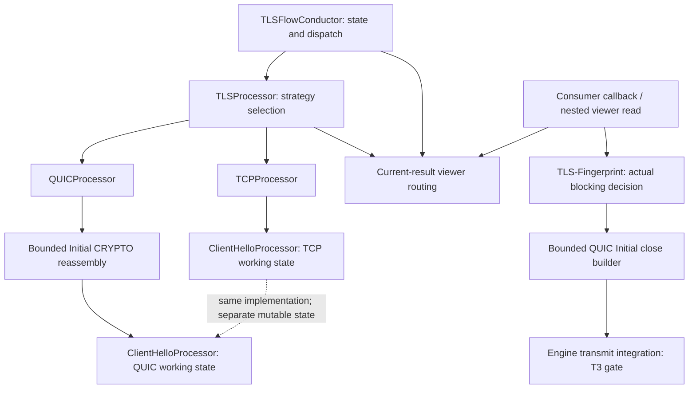
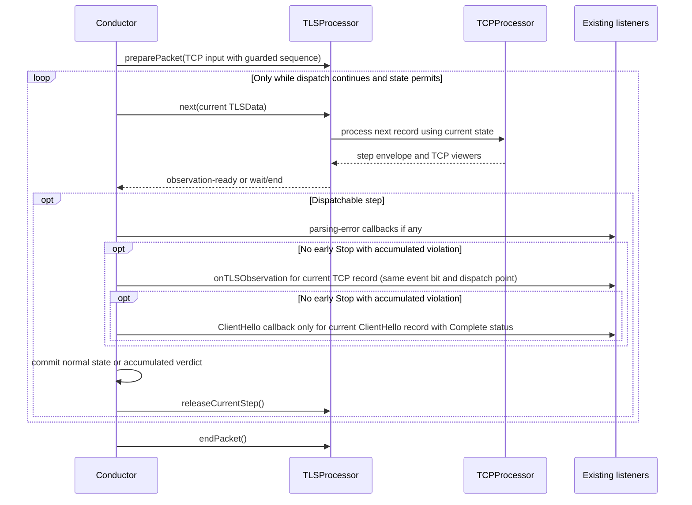

# TLS-Flow QUIC Integration - Design Decisions

**Status:** T2 working draft with established user-directed contracts and remaining proposals; drafting does not itself approve a proposal. Section 16 consolidates authority, remaining choices, and verification gates.
**Date:** 2026-10-21
**Scope:** QUIC integration into TLS-Flow, preserving existing TCP behavior.
**Companion:** [T1 design skeleton](TLSFlow_QUIC_Design_Skeleton.md).

## 1. Purpose and Review Rules

This T2 draft contains an evidence/outcome matrix for all 15 use cases and selected contracts plus remaining proposals DD-01 through DD-09. Strategy/composition, v1-only release, compact CH1 length/digest identity, conservative different-random restart, attempt-level sticky blocking, same-STM Handshake continuation and TCP-compatible current viewers are selected. DD-04/DD-05/DD-06/DD-08 develop bounded reassembly, protection, resources and lifecycle; DD-09 separates debugging findings from mitigation. The user-provided SRS section 4.3.3 adds a narrow outgoing TLS-Fingerprint QUIC close requirement, not QUIC TLS-Enforcement or server receive processing. This is not T3 or authorization to modify production code. Digest algorithm/width, physical metadata/CID placement, configuration and target feasibility remain explicit gates; section 16 lists genuine remaining choices.

Use the following distinctions throughout review:

- **Established decision/constraint:** A scope or behavior contract explicitly aligned for this work; not blanket approval of its containing DD.
- **Verified fact:** A property supported by the cited code or protocol specification; not a product decision.
- **Proposed:** A recommendation awaiting review, including all provisional requirements below.
- **Open:** An outcome, interface, algorithm, or bound that has not been selected.

Reference SRS/FRD drafts, the previous design, migration proposals and pattern studies remain inputs, not blanket binding specifications. The explicit exception is the user-supplied SRS section 4.3.3 close excerpt recorded in section 2.2. No document revision or unavailable source link is inferred for that excerpt. Record other adopted requirements and their exact revisions in T3.

### 1.1 Established Constraints

1. Incoming observation is client-to-server only. The selected TLS-Fingerprint blocking action may send a server Initial close back to the client under section 11.5; it does not enable server receive inspection.
2. Only QUIC Initial payloads are decrypted in this scope. Other encryption levels may provide header-level evidence, not readable TLS messages.
3. Engine runtime processing must use bounded, preallocated resources; no runtime heap allocation, unbounded growth, or heap fallback.
4. Reassemble a complete QUIC ClientHello before parsing it; do not incrementally reparse partial ClientHello bytes.
5. Use DD-03's selected conservative local restart predicate. Once it identifies a new attempt, reset TLS-Flow state regardless of the previous state, including Finished. This is bounded local tracking, not peer authentication or universal restart detection; metadata, promotion feasibility and comparison coverage remain explicit implementation/coverage work.
6. Keep TCP SYN/RST handling and TCP sequence extraction in the Conductor. Preserve their current semantics and do not extract a TCP sequence number for UDP.
7. Preserve existing TCP capabilities and limits, including current fragmentation support. Do not add DTLS or QUIC TLS-Enforcement implementation. TLS-Enforcement must remain TCP-only.
8. Keep future DTLS and QUIC Enforcement extension possible without implementing speculative behavior now.
9. Follow the many-session-summaries/few-reassembly-buffers memory model. TLSData is embedded in the TLS session extension and holds session-lifetime TLS information. Justify every added persistent field by its cross-packet requirement and quantified size/alignment cost across the full extension capacity. Moving a field into the containing extension does not avoid that cost. QUIC reassembly/candidate buffers are scarce preallocated resources for incomplete messages, not retained completed-message history; release them after completion, dispatch, and required result-consumer handling. Persistent metadata placement remains subject to DD-06's field inventory; no separate tracking table is approved by implication.
10. Implement QUIC v1 only for this release; v2 is deferred. Use Strategy for protocol selection and Composition for shared ClientHello implementation, preserving TCP staged processing without a processor base/Template Method now. Use processor-owned current results through synchronous callbacks/commit under the existing single-thread execution model; preserve legacy TCP viewer availability without new synchronization machinery.
11. Only an actual TLS-Fingerprint blocking decision sets attempt-level sticky `TLSFingerprintViolation` in `TLSData`. Retransmissions are not reevaluated; an unblocked attempt evaluates each distinct CH2 once. A CH2 block also covers CH1 retransmissions. Initial-only conservative restart assessment precedes sticky disposition; accepted restart clears it. Section 7.4 separates persistent block, current policy/profile applicability, listener Stop and actual engine packet action.
12. Retain CH1 encoded length and collision-resistant comparison digest, calculated once while its complete four-byte TLS handshake header and body are live, then release the body. CH1 end equals its encoded length; reuse that representation. Digest equality is bounded identity evidence, not exact byte equality, a TLS fingerprint or authentication. Algorithm/width are T3 choices; original CH1 random remains required by the unchanged restart predicate pending C1.
13. Mimic TCP viewers and sampling: processor-owned current values, existing start-of-packet/reset/resume and terminal bypass behavior, existing sampling calls and callback/result replacement order. No history, snapshots, per-completion queue or new sampling route. EndOfPacket, reassembly return and later non-ClientHello observations do not clear the current ClientHello result; own required values rather than pointers into released bodies.

## 2. Evidence Baseline

Source links describe the inspected implementation, not proposed types or interfaces.

| Evidence ID | Source and anchor | Verified relevance |
|---|---|---|
| SRC-01 | [IProcessor.hpp](../processor/include/IProcessor.hpp), `IProcessor::beginPacket`, `processRecord`, `TLSStepResult`, `ContinuationMode` | The current step API is TLS-record-oriented and exposes TCP-related continuation modes. |
| SRC-02 | [Processor.hpp](../processor/src/Processor.hpp), `Processor` | One concrete class implements processing and all three viewers; mutable members include parser, digest, record, continuation, and ClientHello result state. |
| SRC-03 | [Processor.cpp](../processor/src/Processor.cpp), `Processor::processNewRecord`, `processClientHello` | Parsing decisions use `TLSData::hsState` and version information. ClientHello parsing, hashing, and extension handling are coupled to record framing and TCP continuation. |
| SRC-04 | [TLSFlowConductor.cpp](../packet-flow/src/TLSFlowConductor.cpp), `prepareInboundExtension`, `process`, `analyzeProcessResult`, `onAging` | The Conductor owns SYN/RST handling, terminal short circuits, record-driven dispatch, state commits, and extension cleanup. TCP sequence extraction currently follows the protocol-specific RST block without a UDP guard. |
| SRC-05 | [Factory.cpp](../context/engine/src/Factory.cpp), `Factory::init`, `buildProcessor`, viewer getters | Factory creates one processor and supplies it as the processing object and each viewer. A protocol facade must preserve consistent producer/viewer routing. |
| SRC-06 | [PacketFlowManager.cpp](../../tls-fingerprint/packet-flow/src/PacketFlowManager.cpp), `Application::getInstance().getClientHelloDataViewer()->getFullString()` call | A consumer performs an additional viewer read while processing the current result. Callback data alone is not the entire compatibility contract. |
| SRC-07 | [TLSData.hpp](../common/include/TLSData.hpp), `HsState`, `isSilentTerminalState`, `usesTerminalPayloadPath`, `TLSData::clear` | `Finished` and `Unsupported` short circuit processing; other terminal states take a separate payload path. Reset detection cannot depend solely on the normal active-state parser loop. |
| SRC-08 | [ITlsListener.hpp](../packet-flow/include/ITlsListener.hpp), `onClientHello`, `onTLSRecord`, `onParsingError`, `getSessionEventMask` | Existing listener signatures have no observation identity. Participation is selected per session; ClientHello and record callbacks are separate. |
| SRC-09 | [ITlsSubject.hpp](../packet-flow/include/ITlsSubject.hpp), `Event`; [TLSFeatureVerdict.hpp](../packet-flow/include/TLSFeatureVerdict.hpp), `Dispatch`, `violationMask` | Six event ordinals occupy a uint8_t mask. Stop and violation are independent; adapting the API must preserve that distinction and existing event values. |
| SRC-10 | [TLSFlowConductor.hpp](../packet-flow/src/TLSFlowConductor.hpp), `notify`; [TLSFlowConductor.cpp](../packet-flow/src/TLSFlowConductor.cpp), `analyzeProcessResult`, `commitNormalCurrentRecord`, `updateTLSDataOnClientHello` | Notification stops within a listener list on Stop. A Stop without violations can still allow subsequent callback categories and a normal commit; accumulated violations suppress that normal commit. ClientHello summary fields currently describe the latest committed message, not necessarily the first. |
| SRC-11 | [IClientHelloDataViewer.hpp](../processor/include/IClientHelloDataViewer.hpp), result getters and `ClientHelloParsingStatus` | The existing viewer exposes completion status, offered-version information, and borrowed full-string data, but no session/attempt/message identity. |
| SRC-12 | [SegmentBuffer.hpp](../processor/src/SegmentBuffer.hpp), `SegmentBuffer`; [SegmentBufferManager.hpp](../processor/src/SegmentBufferManager.hpp), `SegmentBufferManager`; [Definitions.hpp](../processor/include/Definitions.hpp), SegmentBufferSize/MaxNumberOfSegmentBuffers | Existing fixed TCP continuation storage is record/sequence-oriented; its capacities are not QUIC offset/window limits. |
| SRC-13 | [TLSSessionExtensionTable.hpp](../extension/include/TLSSessionExtensionTable.hpp), `alloc`, `release`; [TLSSessionExtension.hpp](../extension/include/TLSSessionExtension.hpp), `resetValue` | Internal victim reclamation and explicit release reset entries. Current reset clears summary/listeners, not a separate QUIC store. Caller serialization is required, not established by the table. |
| SRC-14 | [SessionTable.cpp](../../../stm/src/SessionTable.cpp), `processNewSession`, `processPacket`, `clear`, `runAging`; [Session.cpp](../../../stm/src/Session.cpp), `packetReceived`, `clear` | Common source path delivers the creating packet after NEW_SESSION; normal aging notifies before session reuse, but bulk clear does not notify aging observers. No verified incarnation API is assumed. |
| SRC-15 | [DPETrafficAnalysisSamplerManager.cpp](../../../TrafficAnalysis/DPETrafficAnalysisSamplerManager.cpp), `enable`, `treatPacket`; [DPESamplerSender.cpp](../../flow-sampler/DPESamplerSender.cpp), `sendAttackSample`, `fillAnalyseAppData` | Production sampling has packet-disposition handlers and obtains SNI/fingerprint through the global viewer outside the ClientHello listener route. Complete timing/provenance still needs target verification. |
| SRC-16 | [hmac.h](../../../../artifacts/wolfssl/libwolfssl/wolfssl/wolfcrypt/hmac.h), `wc_HKDF_Extract`, `wc_HKDF_Expand`; [kdf.h](../../../../artifacts/wolfssl/libwolfssl/wolfssl/wolfcrypt/kdf.h), `wc_Tls13_HKDF_Expand_Label`; [aes.h](../../../../artifacts/wolfssl/libwolfssl/wolfssl/wolfcrypt/aes.h), `wc_AesGcmDecrypt`, `wc_AesEcbEncrypt` | Candidate build-conditional provider declarations; not proof of target availability, allocation behavior, or output behavior on failure. |
| SRC-17 | Root [CMakeLists.txt](../../../../CMakeLists.txt), DP-external-libs-list; [vDP/CMakeLists.txt](../../../CMakeLists.txt), vDP link target; [options.h](../../../../artifacts/wolfssl/libwolfssl/wolfssl/options.h), WOLFSSL_USER_SETTINGS | One local build path references the wolfSSL archive. Target settings/symbols and other production build variants remain unverified. |
| SRC-18 | [DiagnosticsCounters.hpp](../diagnostics/common/include/DiagnosticsCounters.hpp), DiagnosticsEvents/MaxEventId; [Engine counter implementation](../diagnostics/engine/src/DiagnosticsCounters.cpp), incEvent; [Controller counter implementation](../diagnostics/controller/src/DiagnosticsCounters.cpp), get/reset; [diagnostic UI](../ui/diagnostics/src/UI.cpp), printEventsStatistics | TLS-Flow owns processor event counters with Engine increments, Controller aggregation/reset, and positional UI labels. Current increments require an initialized counter manager; diagnostic purpose does not prove debug-build-only availability. |
| SRC-19 | [TLS-Enforcement diagnostic events](../../tls-enforcement/diagnostics/common/include/DiagnosticsCounters.hpp), ObservedTrafficEvent/EnforcedClassificationEvent; [Engine counter implementation](../../tls-enforcement/diagnostics/engine/src/DiagnosticsCounters.cpp), incrementObservedTrafficEvent/incrementEnforcedClassificationEvent | TLS-Enforcement owns separate observed/enforced diagnostic tables. They are not the TLS-Flow processor event vocabulary and do not authorize QUIC detector participation. |
| SRC-20 | [PacketFlowManager.cpp](../../tls-fingerprint/packet-flow/src/PacketFlowManager.cpp#L132), blocking branch through `setAgingTimeout(1)` | Current blocking path selects TCP reverse/bidirectional reset actions and timeout 1, then returns Stop. No end-to-end QUIC close sender is verified. Effective filter/profile action and policy action govern first detection. |
| SRC-21 | [SharedProfile.hpp](../../tls-fingerprint/configuration-manager/common/include/SharedProfile.hpp), `SharedProfile` | Inspected shared profile contains hash, action and active only; it has no QUIC-enable flag. Flag existence, configuration scope and propagation remain open. |
| SRC-22 | [DPFrame.hpp](../../../parser/DPFrame.hpp), packet action/length/checksum interfaces; [DPEEngine.cpp](../../../DPEE/DPEEngine.cpp), reverse-RST/send-back handling | Candidate packet mutation/transmit integration patterns, not a verified QUIC sender or proof of writable capacity, UDP checksums, tunnel/NAT or AX compatibility. |
| SRC-23 | [aes.h](../../../../artifacts/wolfssl/libwolfssl/wolfssl/wolfcrypt/aes.h), `wc_AesGcmEncrypt`, `wc_AesEcbEncrypt` | Conditional encryption/header-protection declarations for a candidate close builder; target symbols, allocation and execution behavior remain unverified. |
| RFC-01 | [RFC 9000](https://www.rfc-editor.org/rfc/rfc9000.html), sections 7.5, 12.2, 12.4, 14.1, 17.1, 17.2.2, 17.2.5, 19.3, 19.6, 19.19, Appendix A.3 | Coalescing, frame/encryption-level restrictions, client Initial datagram minimum, packet-number reconstruction, Retry without packet-number reset, CRYPTO buffering, and close framing. |
| RFC-02 | [RFC 9001](https://www.rfc-editor.org/rfc/rfc9001.html), sections 4, 4.1.3, 4.7, 5.1 through 5.4, Appendix A | Encryption-level streams, HRR at Initial level, version-specific Initial secrets, packet/header protection, and test vectors. Section 4's table maps packet types to keys and packet-number spaces, not individual TLS messages to packet types. |
| RFC-03 | [RFC 8446](https://www.rfc-editor.org/rfc/rfc8446.html), sections 2.1, 4.1.2, 4.1.4 | HRR leads to a second updated ClientHello. Its random is preserved, so ClientHello random alone cannot distinguish CH1 from CH2. |
| RFC-04 | [RFC 9369](https://www.rfc-editor.org/rfc/rfc9369.html), sections 3 and 4, Appendix A | QUIC v2 changes wire version, type mapping, Initial salt, and key labels; compatible version negotiation does not itself imply a new TLS attempt. |

### 2.1 Protocol Facts That Bound Decisions

- A client's HRR-response ClientHello is carried at Initial encryption level. It is in scope when its Initial protection context and CRYPTO bytes are available. Server HRR is unavailable because of packet direction, not because CH2 is at Handshake level.
- CRYPTO offsets address bytes within an encryption-level stream, not packet-local messages. Later Initial-level handshake bytes append to that stream; HRR does not restart its offsets. Retry resends the cryptographic handshake under updated Initial keys, rather than constituting a new TLS attempt by itself.
- Initial secrets do not change merely because the client adopts a server-selected DCID after a server Initial. They do change for Retry. Re-deriving solely from every observed DCID is incorrect (RFC 9001 section 5.2).
- Because Retry is not observed, a changed DCID or a nonempty client token is not proof that a valid Retry occurred. Previously issued address-validation tokens can also appear in Initial packets. Any alternative key-context trial needs authentication, explicit bounds, and a separate decision.
- Initial protection is not peer authentication: its keys can be derived from public information. Successful decryption does not prove server participation, a valid Retry, or an authenticated TLS handshake.
- Seeing a client Handshake packet header does not reveal Finished, prove a valid Handshake payload, or establish cryptographic handshake completion.
- RFC 9001 sections 4.1.4 and 4.9.1 distinguish early Handshake-level ACKs from TLS completion, but require a conforming client to discard Initial keys when first sending a Handshake packet. DD-07 uses this as an end-of-Initial-phase tracking heuristic, not authenticated completion; delayed Initial packets can still reach this observer afterward.

### 2.2 User-Provided SRS Close Authority

The supplied SRS section 4.3.3 excerpt requires that a TLSFP manual/behavioral/ondemand attack requiring block closes QUIC: DP sends a server Initial containing transport CONNECTION_CLOSE with CONNECTION_REFUSED (`0x02`); response DCID is the SCID from the original client hello packet, and response SCID is set by DP (CH first received). This is user-provided excerpt evidence, without an invented revision or document link. The user additionally explicitly retains `setAgingTimeout(1)` for UDP. Section 11.5 preserves this requirement while gating packet construction, CID provenance and delivery feasibility; section 16 records the CH2/server-selected-CID clarification still needed. It does not import other SRS mitigation or configuration proposals.

## 3. Provisional Named Requirements

These IDs are local T2 proposals for traceability, not accepted additions to skeleton section 1.4. Review their wording before incorporating them into T3. Established individual contracts in DD-02/DD-07 remain established; the wider envelope, identity and implementation proposals are not approved by association. Section 16 identifies the boundary.

| Requirement ID | Proposed requirement | Use cases | Candidate owners |
|---|---|---|---|
| NR-Q-01 | Recognize supported QUIC packet boundaries and process coalesced datagrams within explicit bounds; do not route unsupported or unrelated UDP into the TCP parser. | UC-Q-01, UC-Q-03, UC-Q-08, UC-Q-12 | TLSProcessor, QUICProcessor, QuicPacketReader |
| NR-Q-02 | Obtain Initial plaintext only after successful protection processing using an applicable retained or explicitly selected Initial context. | UC-Q-01, UC-Q-02, UC-Q-05, UC-Q-08, UC-Q-11 | QUICProcessor, QuicInitialProtection, QUIC storage owner (placement open) |
| NR-Q-03 | Reassemble Initial CRYPTO data by offset within bounded storage and invoke complete-ClientHello parsing once per distinct completed message, not once per fragment or retransmission. | UC-Q-01, UC-Q-02, UC-Q-03, UC-Q-04, UC-Q-06 | CryptoStreamReassembler, ClientHelloProcessor |
| NR-Q-04 | Distinguish byte retransmission from a later ClientHello and from restart evidence; do not classify Retry or CH2 as a new TLS attempt solely because a ClientHello is seen again. | UC-Q-04, UC-Q-05, UC-Q-06, UC-Q-11 | QUICProcessor, CryptoStreamReassembler, QUIC storage owner (placement open) |
| NR-Q-05 | Report only available evidence: distinguish non-blocking QUIC TLS-version findings, readable Initial CONNECTION_CLOSE, and opaque Handshake-level packet evidence from validated handshake completion. Mark/count a missing usable offer or any recognized older-version offer, including mixed offers, and continue fingerprinting a safely parseable ClientHello; diagnostics are not Enforcement violations. | UC-Q-07, UC-Q-09, UC-Q-10 | QUICProcessor, TLSFlowConductor, observation interface |
| NR-Q-06 | Once DD-03's selected conservative predicate identifies a new QUIC attempt, reset shared and protocol-specific state consistently regardless of the previous TLS-Flow state. | UC-Q-11 | TLSFlowConductor, QUICProcessor, QUIC storage owner (placement open) |
| NR-Q-07 | Release partial QUIC state on aging and on the selected reset/reclamation paths; session-index reuse must not expose old state. | UC-Q-11, UC-Q-13 | TLSFlowConductor, QUIC storage owner (placement open) |
| NR-Q-08 | Preserve TCP behavior, callback ordering, verdict propagation, and current supported/unsupported fragmentation cases under interleaved TCP/QUIC traffic. | UC-Q-14 | TLSFlowConductor, TLSProcessor, TCPProcessor, Factory |
| NR-Q-09 | Keep processing results attributable to the current session and producer, including nested viewer reads during callbacks; prevent stale result reuse. | UC-Q-01, UC-Q-03, UC-Q-04, UC-Q-06, UC-Q-14 | TLSProcessor, ClientHelloProcessor, Application/viewers |
| NR-Q-10 | Bound parsing, key-context work, reassembly, storage, and diagnostics without runtime allocation or heap fallback; define every exhaustion outcome before implementation. | UC-Q-01, UC-Q-02, UC-Q-03, UC-Q-08, UC-Q-13 | QUICProcessor and helpers, Factory, Diagnostics |
| NR-Q-11 | For a selected actual TLS-Fingerprint QUIC block, discard the original, request one server Initial transport CONNECTION_CLOSE with CONNECTION_REFUSED (`0x02`) using SRS CID provenance, and call `setAgingTimeout(1)`. Retain attempt sticky block; silently reuse applicable disposition without repeated close/report/sample. Wire/CID/engine feasibility is gated, not verified. | UC-Q-04, UC-Q-06, UC-Q-11, UC-Q-15 | TLS-Fingerprint, TLSFlowConductor, QUIC close helper, engine transmit owner |

## 4. Use-Case Evidence and Outcome Matrix

The outcome column is the proposed TLS-Flow behavior, not consumer policy. DD-02/DD-03 recommend one ClientHello completion callback per distinct completed message, including a later ClientHello; retransmitted bytes cause neither parsing nor notification again. This recommendation is not approval of consumer policy changes. Later-message coverage ends at DD-07's committed heuristic Finished cutoff; UC-Q-06 does not promise delivery of CH2 Initial packets observed after that boundary.

| Use case | Available client-side evidence | Proposed TLS-Flow outcome | Cannot conclude / decision still needed | Traceability |
|---|---|---|---|---|
| UC-Q-01 - Single Initial | Supported Initial header; authenticated Initial plaintext under the selected context; complete CRYPTO-carried ClientHello. | Parse the complete message once and make its result available for one completion dispatch under the agreed callback contract. | Does not prove server receipt, identity, negotiated version, or completion. DD-08 verifies the common source delivery path; actual target/alternate paths remain gated. | NR-Q-01, NR-Q-02, NR-Q-03, NR-Q-09, NR-Q-10; DD-01, DD-02, DD-05, DD-06, DD-08 |
| UC-Q-02 - Fragmented/out-of-order ClientHello | Initial CRYPTO ranges with explicit offsets, potentially arriving with gaps or overlaps. | DD-04 proposes a fixed byte window/coverage bitmap; compare overlaps before writes, frame sequentially, and evaluate once after full coverage. | No incomplete semantic parse. DD-03 ambiguity precedes attributable conflict; numeric window/message/deadline values and target sizing remain DD-06 gates. | NR-Q-02, NR-Q-03, NR-Q-10; DD-04, DD-06 |
| UC-Q-03 - Coalesced packets | Header-derived packet boundaries; decryptable Initial packets; opaque packets at other levels. | Advance by checked supported packet boundaries; resume frame traversal one envelope at a time without reading opaque payload as frames. | DD-04 stops at malformed boundaries or a short-header suffix. DD-06 defines aggregate datagram budgets; numeric limits remain open. | NR-Q-01, NR-Q-03, NR-Q-09, NR-Q-10; DD-02, DD-04, DD-06 |
| UC-Q-04 - Retransmission/duplicates | Repeated packet numbers or CRYPTO positions in an established context; packet number may differ. | Suppress consumed-range semantic parsing/callbacks using dispositions, release bodies, and reuse attempt sticky block only where current policy/profile gates permit. No new close/report/sample. Split completed CH1 prefix from missing CH2 suffix; an ensuing CH2 block drops this current packet. | Completed boundaries do not prove post-release byte equality or that CH1 reached the server. A new context needs bounded CH1 length/digest comparison. | NR-Q-03, NR-Q-04, NR-Q-09, NR-Q-11; DD-03, DD-04, DD-06, DD-08 |
| UC-Q-05 - Retry | Unseen Retry; verified isolated Initial context can carry repeated offset-zero CH1. | Compare candidate encoded length/digest with retained CH1 identity before optional semantic evaluation. Equality permits bounded Retry-compatible association without reparse/redelivery and enables later CH2 under that context. Preserve packet-number continuity and release bodies. | Digest collisions remain theoretically possible; no Retry/server authentication. Mismatch with equal random stays ambiguous under the preserved restart predicate, pending C1. | NR-Q-02, NR-Q-04; DD-03, DD-05, DD-06, DD-08 |
| UC-Q-06 - HRR/second ClientHello | Distinct later-offset CH2 appends to Initial CRYPTO stream; server HRR is unseen. | When unblocked, evaluate new CH2 once even if fingerprints match. CH2 block makes the entire attempt sticky, including old CH1 retransmissions. Already blocked attempts do not reevaluate CH2. Release completed bodies. | HRR CH2 is not QUIC Retry repeating CH1. No inference that CH1 reached the server; no HRR validation or automatic two-maximum-message buffer. CH2 close CID interoperability remains gated. | NR-Q-03, NR-Q-04, NR-Q-09, NR-Q-11; DD-02, DD-03, DD-04, DD-06 |
| UC-Q-07 - Missing/prohibited TLS-version offer | A safely parsed complete ClientHello with absent supported_versions or any recognized older-version offer, including mixed TLS 1.3/lower or lower/unknown offers; unknown-only offers retain uncertainty. | DD-02/DD-07/DD-09 propose a typed non-blocking version finding and its processor diagnostic once per evaluated message/reason, then normal fingerprint/completion and InProgress summary commit where permitted. The finding alone never causes Unsupported or Error. | Offered version is not negotiation evidence; legacy_version `0x0303` alone is not a violation. Unknown/GREASE values do not prove a lower offer or erase a recognized prohibited offer. No QUIC Enforcement diagnostics or violation bits. | NR-Q-05; DD-02, DD-07, DD-09 |
| UC-Q-08 - Malformed/undecryptable Initial | Header/bounds failure, invalid protection, unreadable frames, or malformed handshake bytes, depending on the stage reached. | Stop the affected processing safely with bounded diagnostic evidence; never publish a complete ClientHello from unauthenticated or incomplete bytes. | A failed decrypt does not by itself prove malicious input; visibility/key-context limitations remain possible. Recoverability and shared-state effects must be distinguished by failure class. | NR-Q-01, NR-Q-02, NR-Q-10; DD-05, DD-06, DD-07, DD-09 |
| UC-Q-09 - Client CONNECTION_CLOSE | A transport CONNECTION_CLOSE frame is readable inside verified Initial plaintext; opaque post-Initial packets do not reveal frames. | DD-07 proposes TerminatedByPeer without a synthetic TLS Alert; DD-08 cleans up remaining incomplete buffers after required pins/results. Completed buffers were already released. | No opaque close reason. Approved persistent identity and production-result lifetimes are independent of temporary buffers; placement/cleanup integration remain gates. | NR-Q-05; DD-02, DD-07, DD-08 |
| UC-Q-10 - Handshake packet evidence | Structurally checked v1 client Handshake header in the same STM session; no payload decrypt. | Treat as continuation of the current accepted attempt without new SCID matching. Only InProgress after complete CH can normally commit Finished. PreHandshake is unchanged; never retain/replay early evidence. Initial alone can initiate restart assessment. | An old/unexpected header in this session may heuristically finish the current attempt. No proof of Finished, server acceptance or Handshake payload validity. Preserve the accepted delayed Initial/CH2 cutoff. | NR-Q-05; DD-02, DD-07, DD-08 |
| UC-Q-11 - New attempt/same 5-tuple | Distinct verified isolated v1 Initial context plus a complete valid offset-zero different-random ClientHello, compared with retained prior CH1 identity. | Use DD-03's selected conservative local tracking heuristic and no-fail coordinated promotion before publication from every old state, including Finished. Insufficient evidence preserves the accepted attempt. | Not authentication or universal restart detection. Same-context/same-random and missing-identity cases remain uncovered; metadata cost/placement, bounded context trials and promotion feasibility still require implementation evidence, not a new serialization contract. | NR-Q-02, NR-Q-04, NR-Q-06, NR-Q-07; DD-03, DD-05, DD-06, DD-08 |
| UC-Q-12 - Non-QUIC UDP | Datagram bytes may fail supported-QUIC recognition; QUIC-like headers alone are not proof of a valid connection. | V1-only release with checked boundaries; non-v1 input, including deferred v2, is not decoded as v1 or routed to TCP. Client Initial datagram admission details remain reviewable. | V2 implementation is deferred, not forbidden permanently; no speculative version framework. Target complete-datagram evidence, admission details and concrete DD-09 event integration remain gated. | NR-Q-01; DD-02, DD-05, DD-09 |
| UC-Q-13 - Aging/partial ClientHello | Session aging event and locally retained incomplete CRYPTO coverage. | DD-08 proposes owner-coordinated release on aging, reclaim/reset, bulk clear, and teardown; no incomplete completion or synthetic SessionEnd. | Common aging/clear and extension reset paths are verified; actual clear integration, generation/reuse safety, expiry hook, and pool accounting must be proven. | NR-Q-07, NR-Q-10; DD-06, DD-08 |
| UC-Q-14 - Interleaved TCP/QUIC regression | Existing TCP records, sequence/continuation state and verdicts, interleaved with QUIC sessions and callbacks. | Selected Strategy/composition with isolated mutable state and processor-owned current results; preserve current TCP results/ordering and nested producer reads under the existing single-thread model. Keep TLS-Enforcement TCP-only. | Shared implementation does not authorize shared unrelated mutable state. Verify TCP regressions, participation and actual post-callback consumer lifetime without a new broad serialization approval gate. | NR-Q-08, NR-Q-09; DD-01, DD-02, DD-08 |
| UC-Q-15 - TLS-Fingerprint blocking close | A complete accepted CH evaluated by existing policy/filter selection requires an actual block. | Retain attempt sticky violation, discard original packet, request one SRS server Initial close (`0x1c`, code `0x02`), and set UDP aging timeout 1. Use existing sampling/current viewer semantics; no repeated close/report/sample on sticky retransmissions. | Exact transmit action, source CIDs across fragments/Retry/CH2, server PN nonce safety, client acceptance and AX/NAT/tunnel/checksum integration remain gates. This is not QUIC TLS-Enforcement. | NR-Q-11; DD-01, DD-02, DD-05, DD-06, DD-08, DD-09 |

## 5. Decision Register

DD-01 through DD-09 combine selected contracts with remaining proposals; no complete layout is approved by inclusion. Strategy/composition, the unchanged conservative restart predicate, length/digest association, attempt sticky block, same-STM Handshake heuristic, TCP-compatible current viewers, v1 scope and callback migration are resolved. The SRS close responsibility is selected; its CID/wire/engine feasibility and metadata placement are gated. Numeric target evidence is not a blanket bar to T3 drafting.

| Decision ID | Topic | Status | Required output / next evidence |
|---|---|---|---|
| DD-01 | Processor selection and shared ClientHello responsibilities | Strategy/composition selected; no processor base/Template Method now | Preserve TCP staged processing, state feedback and isolated mutable state; verify extraction and viewer routing without reopening the pattern choice. |
| DD-02 | Observation, callback, viewer, and consumer compatibility contract | Callback migration, attempt sticky block and TCP-compatible current viewers selected | Preserve bit 4, six events, existing sampling and result replacement. Finalize interfaces and focused equivalence tests; no snapshots or per-message Allow/Block cache. |
| DD-03 | Retransmission, Retry, CH2, and new-attempt identity | CH1 length/digest association and different-random restart selected | Retain original random pending C1; select digest algorithm/width in T3. Initial assessment precedes sticky path; blocked pending-candidate disposition still needs confirmation. |
| DD-04 | CRYPTO stream reassembly and message delivery | Proposed; sizing gated | Section 10 proposes temporary message-relative bitmap windows for incomplete input, workspace-only complete-input processing, completion-time release, and sequential CH1/CH2 without retained completed bodies. |
| DD-05 | QUIC recognition, Initial protection and SRS close construction | V1-only release and narrow TLS-Fingerprint close selected; v2 deferred; provider/context/transmit feasibility gated | Section 11 localizes v1 receive/close protection without a version framework. Context/replay ceilings remain proposals. Verify client/server v1 vectors, negative non-v1 handling and G-09 close safety/integration; no v2 implementation gate. |
| DD-06 | Crypto provider, preallocation, capacities, and work limits | Proposed model; provider/field placement/numeric values open | Section 12 inventories persistent fields with size/lifetime/omission costs, leaves metadata placement/table selection open, and separately budgets scarce incomplete-message buffers, workspace/results and aggregate work. |
| DD-07 | Evidence-to-state mapping and failure semantics | Finished heuristic/R05b and reviewed version/close corrections established; enum/layout integration gated | Section 9 retains the previously described late-Initial cutoff separately from R05b, explicit peer-close verdict handling, and local stopped disposition. Concrete enum/consumer integration and remaining taxonomy are not approved by association. |
| DD-08 | Lifecycle, first-packet delivery, and state ownership | Existing current-viewer/sampling model and UDP timeout 1 selected; physical metadata/lifecycle integration gated | Preserve start/reset/resume and terminal bypass, return completed buffers independently of current results, and verify actual target cleanup/aging without assuming timeout means exactly one second. |
| DD-09 | Diagnostics and bounded failure visibility | Proposed; event integration/cost gated | Section 14 separates processor and Enforcement debugging diagnostics, defines blocking scope versus non-blocking findings, preserves safe version-finding fingerprints, and proposes fixed counter categories/counting units without per-session diagnostic history. |

## 6. DD-01 - Processor Selection and Shared ClientHello Processing

**Status:** Strategy selection and composed shared ClientHello processing are selected by the user's direction to apply the reviewed response. No processor base or Template Method now. Concrete interfaces, extraction details and storage layouts remain implementation design/verification work, not a reopened pattern choice.
**Related requirements:** NR-Q-01, NR-Q-03, NR-Q-08, NR-Q-09, NR-Q-10, NR-Q-11.
**Related use cases:** UC-Q-01, UC-Q-02, UC-Q-03, UC-Q-06, UC-Q-12, UC-Q-14, UC-Q-15.
**Affected skeleton sections:** 4, 5, 6.1 through 6.7, 6.13 through 6.15, 7, 9, 10, 11, 12.

### 6.1 Problem and Local Hypothesis

TCP's current `processRecord(TLSData)` is not a transport-neutral algorithm: it combines record framing, state-dependent interpretation, continuation, and ClientHello evaluation (SRC-01 through SRC-04). QUIC instead needs packet protection, frame parsing, and offset-based CRYPTO reassembly; it has no TLS record layer.

**Selected direction and implementation hypothesis:** A small selection facade with separate TCP/QUIC strategies and a composed ClientHello-processing implementation can preserve TCP semantics without forcing QUIC into fabricated records or a shared record-processing template. The pattern choice is resolved; extraction feasibility and compatibility still require focused checks.

**Cheap discriminating review:** Compare SRC-03's state/record-dependent branches with the complete-ClientHello boundary in UC-Q-01/02/06 and SRC-06's nested viewer read. Reject or revise this architecture if it requires synthetic TCP records, removal of TCP's state feedback, new TCP reassembly capability, or a viewer that cannot retain the producing result through callback completion.

### 6.2 Selected Decision

1. Introduce a `TLSProcessor` facade that selects `TCPProcessor` or `QUICProcessor` using the packet/session transport context. Selection does not itself classify arbitrary UDP as supported QUIC.
2. Use Strategy for the protocol processing responsibility. `IProtocolProcessor` is a candidate abstraction, not a renamed copy of `IProcessor`: DD-02 must define its step/result contract without requiring TLS records or meaningless TCP sequence values for QUIC.
3. Preserve TCP's state feedback between processing steps. Do not move the entire packet loop into the facade or precompute all packet observations if doing so changes state-dependent parsing or listener verdict ordering.
4. Keep TCP record/sequence-continuation behavior in `TCPProcessor`, and QUIC packet/protection/frame/CRYPTO behavior in `QUICProcessor` and its helpers. Keep TCP SYN/RST decisions and guarded TCP sequence extraction in the Conductor as already aligned.
5. Extract reusable ClientHello parsing, extension interpretation, fingerprint construction, and result formatting through composition in `ClientHelloProcessor`. Share implementation, not mutable state across unrelated sessions or protocols. Preserve the existing TCP staged/continuation path alongside QUIC's complete-message entry; identical feeding APIs are not required. Do not require complete-message TCP reassembly or expand TCP fragmentation support.
6. Give QUIC a complete-message entry boundary after bounded CRYPTO reassembly. Input includes the complete TLS handshake message, without a fabricated TLS record; internal header/body representation and exact signatures remain DD-02/DD-04 work. Invoke this boundary once per distinct completed message, not for each arriving fragment.
7. Keep separate protocol-owned working state; keep persistent continuation/reassembly state attributable to its session. A separate instance per protocol alone does not solve interleaved-session state isolation. Do not add per-session heap objects or assume a processor instance per session.
8. Route viewers to the actual current producer through callbacks, commit and existing sampling. Mimic TCP current-result replacement/reset/resume and terminal bypass; never resurrect stale cross-protocol values. Own necessary output values without retaining CH bodies. Silent candidates stay private until promotion; no snapshot/history/per-completion route (sections 7.5 and 13).
9. Do not introduce `ProtocolProcessorBase` or a processor-level Template Method now: no stable shared framing/reassembly algorithm has been established. Skeleton section 6.4 stays conditional. Reconsider a narrow common base only if implementation reveals a concrete shared algorithm that benefits from it, not merely similar method names.

All new class names above are design candidates, not existing repository APIs. This decision assigns responsibility; it does not approve a concrete interface layout, allocation scheme, or observation enum.

### 6.3 Responsibility and Pattern Map

| Component | Selected responsibility | Must not own |
|---|---|---|
| TLSFlowConductor | Shared TLS-Flow state, lifecycle coordination, ordered listener dispatch/verdicts, existing TCP SYN/RST and guarded sequence handling | QUIC cryptography, CRYPTO range manipulation, or inference of unavailable server messages |
| TLSProcessor | Strategy selection and consistent routing to the current result producer | TCP/QUIC parsing rules or a second shared-state machine |
| TCPProcessor | Current record parsing, TCP continuation, state-sensitive record interpretation | QUIC packet or key-context handling |
| QUICProcessor and helpers | Supported-QUIC recognition, bounded Initial processing, CRYPTO message delivery, protocol-specific evidence and state | Fabricated TLS records, TLS-Enforcement policy, or claims that opaque Finished was validated |
| ClientHelloProcessor | Shared ClientHello semantic parsing and result construction with isolated working state | Transport reassembly, QUIC key derivation, or shared handshake-state transitions |
| Factory / Application / viewer routing | Initialization-time wiring and access to the correct current result | Runtime fallback allocation or silent conversion of QUIC evidence into TCP records |
| TLS-Fingerprint mitigation / QUIC close helper / engine transmit | Feature selects actual policy-authorized block and close; QUIC helper constructs bounded protected server Initial using verified-context input; engine owns real transmit integration | Parser-selected policy, Handshake decrypt, guessed writable capacity, or treating listener Stop as a transmitted close |

Conceptual diagram only; arrows do not define final interfaces or instance cardinality:



### 6.4 SOLID Rationale

| Principle | Application | Review risk |
|---|---|---|
| Single Responsibility | Protocol framing/protection and ClientHello semantics have separate owners; the Conductor remains the shared state/dispatch owner. | A facade that also owns protocol state transitions would duplicate the Conductor. |
| Open/Closed | Another protocol can supply processing through the selected boundary and reuse applicable ClientHello logic. | A small explicit selection/wiring change for future DTLS is acceptable; do not build a runtime registry for a hypothetical extension. |
| Liskov Substitution | Strategies must obey the same selected step, lifetime, and validity contract. | Renaming record results while requiring QUIC to emulate records is not valid substitution. DD-02 must resolve this before implementation. |
| Interface Segregation | Separate processing and viewer responsibilities; TCP-specific continuation details need not become mandatory QUIC methods. | Avoid a large interface filled with protocol-specific no-ops or fields with unclear validity. |
| Dependency Inversion | The Conductor and consumers depend on agreed processing/result contracts, while Factory wires concrete processors. | Exact interfaces remain open; adding abstractions without removing concrete coupling would not achieve this. |

### 6.5 Alternatives

| Alternative | Benefit | Reason not recommended at this stage |
|---|---|---|
| Add UDP/QUIC branches throughout the current Processor | Minimizes initial extraction. | Mixes incompatible framing, reassembly, and result models in an already stateful record processor; worsens isolation and future extension. |
| Generate a synthetic TLS record and invoke the current TCP Processor | Reuses today's public entry point. | Imports TCP record validation, sequence/continuation assumptions, and state-dependent interpretation into QUIC. An internal ClientHello adapter is preferable to transport emulation. |
| Introduce a shared base with Template Method immediately | Can centralize a genuinely common sequence. | The shared sequence has not been demonstrated: TCP state feedback/continuation and QUIC protection/CRYPTO reassembly differ. A base now would dictate unverified hooks. |
| Separate processors with duplicated ClientHello logic | Strong protocol isolation and a smaller initial extraction. | Duplicates parsing/fingerprint semantics and invites drift. Retain as a fallback if focused extraction would break TCP compatibility; review that evidence explicitly. |
| Share one mutable ClientHello processor/result object across protocols | Reduces object count. | Risks cross-protocol/session continuation and result contamination even with single-thread execution. Share implementation with isolated working state; synchronous execution is not permission to reuse unrelated live state. |

### 6.6 Consequences and Boundaries

- Extraction will touch existing Processor responsibilities, so TCP regression evidence is a prerequisite, not a later cleanup. Existing anomalies observed during research are not authorization for unrelated fixes.
- Shared parsing may need a narrow complete-message path for QUIC alongside TCP-compatible staged operation. Their exact boundary must be demonstrated in DD-02 before implementation; do not redesign TCP fragmentation to fit QUIC.
- The Conductor's current record dispatch and terminal short circuits need explicit adaptation. DD-02 decides observation mapping; DD-03/DD-08 decide where bounded restart detection runs so terminal state cannot hide a new attempt.
- Viewer routing must preserve both direct Conductor reads and Application-mediated consumer reads. A selector pointer alone is insufficient without result lifetime and reentrancy guarantees.
- TLS-Enforcement remains TCP-only. Its participation must be verified before QUIC publication is enabled. Any necessary mechanical gating/API adaptation must be explicitly scoped; QUIC enforcement policy is excluded.
- A future DTLS processor may reuse ClientHello semantics, but no DTLS framing, timers, retransmission, or message-sequence interfaces are added now.
- Future QUIC Enforcement can consume an explicitly designed protocol/evidence contract; this draft does not add policy rules or convert all QUIC evidence into TCP-style violations.

### 6.7 Acceptance Checks Before Implementation

| Check | Discriminating scenario | Required evidence |
|---|---|---|
| TCP state feedback | Several records in one packet cause a state transition or listener stop before the next processing step. | Existing dispatch/verdict order and next-step interpretation remain unchanged. |
| Existing TCP fragmentation boundary | Current supported continuation and unsupported early-body/record-fragmentation cases. | Same results, continuation ownership, and limits; no accidental capability expansion. |
| QUIC complete-message boundary | Out-of-order fragments complete CH1; later Initial bytes complete CH2. | No semantic parsing before completion; one invocation per distinct message; no synthetic TLS record. |
| Duplicate handling | The same CRYPTO bytes arrive in different packets before and after completion. | No repeated parsing/completion solely from retransmission. |
| Viewer correctness | TCP and QUIC sessions alternate, and the callback invokes Application's ClientHello viewer. | Each read corresponds to the current producer/session and remains valid through callback completion. |
| State isolation and bounds | Interleaved partial sessions plus bounded-pool exhaustion. | No old result leakage, runtime allocation, unbounded work, or cross-session continuation reuse. |
| Terminal restart visibility | A new attempt is detected after each existing terminal state. | Detection is not skipped by the terminal path; shared/protocol reset is coordinated under DD-03/DD-08. |

These are design acceptance criteria and future focused tests, not claims of tests already executed.

## 7. DD-02 - Observation, API, and Viewer Contract

**Status:** In-place callback/event migration, attempt sticky block and TCP-compatible processor-owned current viewers/sampling are selected. Concrete pull-step/context/action encodings remain T3 work; no snapshots, history, extra sampling routes or new synchronization contract.
**Related requirements:** NR-Q-01, NR-Q-03, NR-Q-05, NR-Q-08, NR-Q-09, NR-Q-10, NR-Q-11.
**Related use cases:** UC-Q-01 through UC-Q-15.
**Affected skeleton sections:** 5, 6.1 through 6.7, 6.13 through 6.15, 7, 8, 9.3, 10, 11.

### 7.1 Context, Recommendation, and Alternatives

SRC-01/SRC-04 expose records and poll shared viewers; SRC-06/SRC-11 require a nested ClientHello read to remain valid. SRC-08 through SRC-10 show that replacing the whole listener API or treating every Stop as an immediate abort would change TCP behavior.

**Recommendation:** Use a pull-step processing envelope and a typed `TLSObservationContext`, rather than making a QUIC frame look like a TLS record. An envelope groups the error, observation, and optional newly completed ClientHello that belong to one processing step. Keep the Conductor responsible for ordered dispatch, verdict accumulation, and the subsequent state commit. The callback/event migration is established by explicit user direction: replace `onTLSRecord` with `onTLSObservation` and rename the existing subscription event in place. Adapt the TCP record context without changing its information or publication timing; migrate existing overrides and event references together, with no permanent parallel callback path or new opt-in subscription. Envelope/interface layouts remain proposals.

The TCP migration preserves existing parser, continuation, commit, and legacy-viewer behavior, except for the explicitly scoped ClientHello callback eligibility correction in section 7.4. QUIC's distinct-message completion token is not a new TCP deduplication rule.

Except for the established callback/event names and preserved event ordinal in section 7.4, operation/type names in this group are design candidates, not existing APIs or final ABI layouts. Reject a record-shaped common interface because QUIC has no TLS records. Reject a push callback directly from the parser because it obscures Conductor-owned verdict/state sequencing. Consumer migration includes the mechanical callback/context/event adaptation, required TCP-only Enforcement gate, and the user-directed TLS-Fingerprint verdict retention/reuse below. Do not import unrelated consumer policy.

### 7.2 Candidate Processing Operations

These are operation sketches, not compilable declarations. `PacketInput` carries a borrowed payload, validated payload length, transport, session identity, and TCP metadata only when transport is TCP. The Conductor extracts that metadata inside a TCP guard. `AttemptView` is read-only protocol identity, separate from shared `TLSData`.

Throughout this draft, pinned/unpinned describes required live storage, not a pinning API, reference count, queue or deferred-release mechanism. Current results follow existing single-thread callback/commit and TCP viewer replacement rules. Section 13.5/G-07 contains focused equivalence tests only, not a snapshot architecture or new lifetime-policy choice.

| Candidate operation | Inputs and result | State and ownership rule |
|---|---|---|
| `preparePacket(PacketInput, AttemptView)` | Classifies input; only eligible Initial permits bounded Same, CandidatePending, LocallyDetectedRestart or Ambiguous assessment. | Follow existing start/reset/resume and terminal bypass semantics, select the actual producer, and assess Initial restart before sticky/terminal filtering. Non-Initial does not initiate restart. Candidate work remains private and cannot clear TLSData or public results. |
| `acceptRestart(candidateHandle)` | Conductor accepts an assessment satisfying DD-03; the selected candidate becomes the new protocol attempt. | Used only outside callbacks. Shared clear and protocol promotion form one coordinated operation; no old/new state mixture may be visible. If promotion cannot be guaranteed, do not clear the old attempt. |
| `next(const TLSData&)` | Returns an observation-ready step, NeedMoreData, EndOfPacket, UnsupportedInput, or ProcessingStopped; each result may carry a typed failure/limit reason. | Reads the state committed after the previous step. At most one dispatch envelope is outstanding. Internal work must advance a cursor, record a wait, or stop within DD-06 bounds. NeedMoreData and EndOfPacket expose no completion in the new context; legacy TCP result lifetime is governed separately by section 7.5. |
| `currentStep()` / `ITLSObservationViewer` | Borrowed envelope/observation and optional complete ClientHello result for the current step. | Valid only while that step is pinned. It identifies the producing protocol, session generation, local attempt, and message where applicable. No consumer owns parser buffers. |
| `releaseCurrentStep()` | Ends borrowed step scope after callbacks and state handling, not current ClientHello output lifetime. | Retire new-context data before further parser work without clearing TCP or QUIC current ClientHello viewers. Preserve existing result replacement/reset/resume. DD-03 delivery/suppression markers survive Stop independently of summary commit. |
| `endPacket()` | Ends normal, empty, error, or early-stop processing. | Retire borrowed input/context/cursor, preserve bounded continuation/candidates and the current ClientHello viewer under existing TCP semantics. Never clear that result just because packet processing or reassembly ended. |
| `releaseSession(sessionIdentity)` | Aging, reset, or approved reclamation notification. | Invalidates all matching attempt/candidate state and delivery markers; exact hooks and storage are DD-08 work. Never reclaim a pinned result. |

`UnsupportedInput` is classification, not automatically `HsState::Unsupported`; a recognized attempt that exceeds processing capability is distinguished by its typed reason. `ProcessingStopped` similarly does not imply a violation or shared Error state. DD-07 determines the state effect from attribution, evidence, and failure class.

The existing EndOfPacket return status is not a cleanup operation and currently leaves legacy results readable. The proposed `endPacket()` operation is a separate lifecycle boundary; returning EndOfPacket must not silently change that legacy contract.

### 7.3 Envelope, Observation Kinds, and Field Validity

The candidate envelope carries a validity-tagged processing issue, zero or one principal observation, and zero or one newly completed ClientHello result. It also carries a step-local identity and evidence provenance. Failure-only envelopes are allowed; NeedMoreData without an issue is not a dispatchable observation. DD-09's fixed-size finding data distinguishes blocking parsing failures from non-blocking RFC findings, with an explicit affected scope. A non-blocking ClientHello version finding accompanies successful parsing/fingerprinting without becoming a format error, terminal state, or Enforcement violation; normal progress/uncertainty need not be classified as a failure.

**Terminal-step restriction:** PeerClose and attempt-fatal failure envelopes must not carry a ClientHello completion. QUIC yields these as separate ordered steps at their frame/message positions, with state feedback between steps. If completing CRYPTO data precedes a close, publish/commit the completion before processing the close; if close precedes the completing data, commit the close and do not publish a later same-attempt ClientHello. Apply the same ordering to a fatal framing/message failure. A non-blocking version finding is not terminal evidence: it stays with successful completion and the ordinary permitted InProgress commit. Do not reorder an entire datagram to put completions before terminal evidence.

`TLSObservation` is a tagged payload, not a bag of always-valid TCP and QUIC fields. `TLSObservationContext` adds correlation, optional ClientHello association, and evidence validity. Present/absent tags are mandatory; zero values must not stand for unknown versions, missing packet numbers, or absent errors. Candidate storage must be fixed/bounded; this table does not select a union layout or add heap-backed variants.

| Candidate kind or facet | Valid payload / evidence | Invalid inference and compatibility route |
|---|---|---|
| `TLSRecord` (TCP-only observation kind, not a subscription event) | Actual record metadata and current readable alert/handshake facts; optional ClientHello association only if completed in this step. | Preserve all applicable `TLSRecordContext` information through `onTLSObservation` at the existing per-record dispatch point. Preserve readable/opaque distinctions. QUIC never produces this kind. |
| `ClientHelloComplete` (QUIC principal observation; optional TCP envelope result) | Message identity, parsed ClientHello viewer, offered-version mask, early-data offer, fingerprint/SNI/counts, complete-message provenance. | Not negotiation or peer authentication. Adapt the completion facet once to `onClientHello`; do not also issue a second completion via the observation callback. |
| `PeerClose` (QUIC Initial only) | Readable transport CONNECTION_CLOSE code and validity-tagged triggering-frame field, if present, after successful Initial protection processing. | Not a TLS Alert. Raw reason text need not be retained; any retained bytes must be explicitly bounded by DD-06. Route only to the renamed observation callback. |
| `HandshakePacketObserved` (QUIC) | Supported version, header packet type, and validated packet boundary associated with the tracked attempt; provenance is header-only. | No readable Finished, protected packet number, authenticated Handshake payload, or validated completion assertion. Route to the observation callback; DD-07 permits an inferred InProgress -> Finished normal commit, not a ClientHello completion callback. |
| Processing issue facet | Stage, category/reason, blocking/non-blocking impact, stop scope when blocking, attribution, recoverability, and evidence level; examples are Initial protection failure, malformed associated CRYPTO message, unsupported QUIC profile, or resource limit. | Do not translate QUIC failures into existing TCP ParsingError values. Route to the observation callback as a typed issue-only context when needed; adapt only original TCP ParsingError to `onParsingError`. Blocking is a parsing stop, not a packet-drop verdict. |
| Non-blocking finding facet | Fixed-size reviewed conformance findings for a safely parsed QUIC ClientHello, including absent supported_versions or any recognized older-version offer, even in mixed lists; separate compatible-offer uncertainty. | Not malformed ciphertext or TLSViolationMask. Notify observation subscribers before the one ClientHello callback; count once per evaluated message/reason under DD-09 and normally commit InProgress under DD-07. Findings are step/result-scoped, not new persistent TLSData violation fields. |

A completed ClientHello may have both a finding and a completion facet, but each facet is dispatched once. Normal QUIC completion is delivered through the existing ClientHello callback only, not broadcast a second time through `onTLSObservation`. A context query remains available during that callback for consumers that need identity/provenance. TLS-Fingerprint additionally participates in the retained-verdict/retransmission route below; that route is not another completion notification.

### 7.4 Callback Migration, Ordering, and Verdicts

**Established callback/event contract:** Replace `onTLSRecord` with `onTLSObservation` and rename `Event::TLSRecord` to `Event::TLSObservation` at ordinal 4, preserving event-mask bit `1u << 4`. Keep the other event ordinals unchanged and `MaxTypes = 6`. Do not append an event, add per-kind subscription bits, require new opt-in subscriptions, or retain a permanent second callback path. Existing listeners keep their participation masks, transport gates, priorities and dispatch positions; migrate their overrides, subject dispatch and event references together so an old override cannot silently fall through to a default no-op. The replacement keeps the existing default-no-op and `noexcept` behavior. Candidate context signature: `onTLSObservation(Session&, DPFrame&, const TLSObservationContext&, const TLSData&)`; its concrete layout must preserve the TCP record facts consumed today. This is a source migration, not a claim of binary compatibility with unchanged listener objects.

For TCP, context adaptation and the in-place rename preserve existing semantics except for the explicit callback eligibility correction below. Incremental parser feeding and record publication remain separate: preserve every observation the current path publishes at its existing dispatch point, including intermediate ClientHello-contributing records wherever they are currently published. Do not create an observation on NeedMoreData where none exists today, defer/combine/suppress existing observations pending ClientHello completion, or expand TCP fragmentation support. Preserve all current supported/unsupported fragmentation cases.

1. Parsing-error callbacks, then `onTLSObservation` for the current TCP record at the former `onTLSRecord` dispatch point, then the ClientHello callback only when the current record satisfies `record.isClientHello()` and its parsing status is Complete, all against pre-commit TLSData. Maintain existing priorities within each list.
2. Within a list, Stop prevents lower-priority listeners from running. Stop with an accumulated violation commits Error and returns immediately; Stop without accumulated violations can still allow later categories to run. Accumulate violation bits across categories.
3. At the end of the step, any accumulated violation suppresses normal commit: Stop plus violations commits Error; Continue plus violations records them without a normal commit. With no violations, normal commit still occurs even if dispatch is Stop. The outer packet loop then stops as currently implemented.
4. The current completion-only poll can fire ClientHello callbacks on later non-ClientHello records in the same packet. Correct it with `record.isClientHello() && parsingStatus == Complete`, including when a segmented ClientHello completes. This is an intentional production behavior correction, not a reason to clear ClientHello data after every record. Preserve actual subsequent-ClientHello handling, parser/continuation rules, normal commits, and callback/verdict ordering. A newly completed-message token is mandatory for QUIC only; do not add TCP retransmission deduplication or one-completion-per-attempt semantics. Section 7.8 requires production regression evidence for this declared exception.

For QUIC, order typed issues/findings first, then other principal observation callbacks, then one newly completed ClientHello callback if present. Do not send a plain ClientHelloComplete principal observation to both routes. Reuse the above verdict accumulation and early-return rules. A processing issue is not a fabricated `TLSViolationMask`; without a consumer violation, DD-07's typed state effect is applied at normal commit. Non-blocking findings alone do not suppress fingerprint completion/commit. Built-in debug counting returns no Stop/violation; any explicit consumer verdict remains independent. A listener Stop with no violation does not veto that commit. No further processing step is requested after Stop, even when state handling completed.

QUIC peer close is an explicit exception to normal state-commit suppression: after callbacks, an attributable readable Initial CONNECTION_CLOSE commits TerminatedByPeer even for Continue plus accumulated violations, retaining those violation bits without committing a ClientHello summary. Stop plus accumulated violations retains the existing Error outcome; Stop without violations commits TerminatedByPeer. Every such close records a local terminal disposition independently of shared-state commit and prevents later same-attempt parsing or close redelivery. Attempt-fatal parsing failures likewise retain a local stopped disposition even if their normal Error commit is suppressed. These rules do not alter TCP verdict handling or manufacture a packet-drop verdict.

Callbacks see the old summary and receive current parsed data through the result/viewer; the Conductor commits afterward. For a confirmed local restart, clear/promote first, so its callbacks see a fresh PreHandshake summary, never the previous attempt's fields. Mark a dispatched QUIC message consumed even when a listener suppresses its summary commit or stops the packet; retransmission must not retry delivery to lower-priority listeners. If an earlier finding/issue callback returns Stop with accumulated violations before completion dispatch, retire that step's completion token as suppressed, not pending; the same message must not trigger parsing or delivery retries.

**Established TLS-Fingerprint attempt sticky block:** Only actual blocking sets persistent `TLSFingerprintViolation` in `TLSData`. There is no per-message Allow/Block cache or allow-validity requirement. Evaluated/delivered/suppressed markers independently prevent callback retries; absence of block is not evidence that a suppressed listener approved the message. The current listener returns an empty verdict: this behavior is required work, not an existing capability.

- On a new accepted CH, use existing policy/profile/filter selection. Preserve effective filter-versus-profile action and policy BlockAndReport on first detection. Recommend returning Stop plus `TLSFingerprintViolation` only when actual blocking occurs; report-only must not add a blocking violation and thereby suppress an otherwise permitted normal summary commit. Persist block before early return, independent of that commit. Existing 32-bit `terminalViolationMask` has vocabulary space beyond the 13 Enforcement bits; audit the definition and allocate no invented bit number here. Error plus the bit is a recommended encoding, not the semantic contract itself.
- Once blocked, the accepted attempt remains sticky through CH body/result release and terminal states until accepted restart or retirement. Do not reevaluate retransmissions or new CH2 under an already blocked attempt. While unblocked, each distinct accepted CH2 evaluates once; if it blocks, the entire attempt is blocked, including old CH1 retransmissions. HRR CH2 differs from Retry repeating CH1. A mixed completed-CH1/new-CH2 range is split: process missing CH2 bytes, and if its decision blocks, discard the current packet too. Neither suppression nor forwarding proves CH1 reached the server.
- Only Initial triggers limited conservative restart assessment, before sticky disposition and all terminal short circuits. Never early-drop solely on the old five-tuple before this assessment. Accepted restart clears the old block and promotes the candidate before normal dispatch. Non-Initial cannot restart. For pending/ambiguous candidates under an old block, isolated byte accumulation while discarding input until acceptance is a recommendation pending explicit confirmation (section 16); do not silently treat it as approved.
- For later sticky disposition, retrieve applicable policy/profile through the existing mechanism, without retaining/reconstructing a filter or adding a policy-reevaluation mechanism. Discard only when a profile exists, QUIC is enabled, `profileAction == BlockAndReport` and `policyAction == BlockAndReport`. Otherwise do not discard through this route, but retain the sticky bit until restart/retirement. The user accepts these two current action gates because no filter is retained. SharedProfile currently has no QUIC flag: its existence/configuration scope is open, not a fabricated API.
- Known limitation: a filter-specific BlockAndReport first detection under a ReportOnly profile can block initially yet have forwarded retransmissions under the selected profile/policy replay gates. Optional two-bit action-origin encoding could preserve filter/profile origin; it is open and not selected. Do not quietly change first-detection effective-action semantics to hide this limitation.
- Reuse disposition silently: no new semantic parse, classification, ClientHello callback, new-message count, close, detection report or attack sample for every retransmission. Do not add a new sampling route. Existing packet-disposition infrastructure remains; it is not a requirement to invoke fresh detection side effects. The selected first block requests the SRS close and UDP `setAgingTimeout(1)` under section 11.5; Stop alone is not a transmit/drop action.

Keep TCP `onTCPReset`, `onTerminalPayload` and `onSessionEnd` semantics unchanged. Reusing existing `Event::TerminalPayload` at ordinal/bit 5 for the bounded UDP sticky route is a recommended scoped adaptation, not automatic TCP semantics or a seventh event. Ensure applicable sticky disposition remains reachable from every required terminal state, independently of `usesTerminalPayloadPath`'s TCP gates. QUIC aging uses existing SessionEnd before release; accepted reset is not STM aging. Exact action/callback encoding is T3 work.

TLS-Enforcement must remain excluded from UDP participation across all callbacks, including the renamed observation callback and ClientHello callback. Preserve its TCP event-mask bit while mechanically migrating its override/context access; verify its concrete TCP-only session gate before enabling QUIC. Prefer that gate and context adaptation over rewriting enforcement detectors. Any such source edit remains a separately identified implementation touchpoint, not QUIC enforcement policy.

### 7.5 Viewer Lifetime, Isolation, and Compatibility

- Mimic TCP viewers: Factory/Application facades route to the actual current producer, with processor-owned current parsed/fingerprint/SNI/full-string values and required live backing. Preserve current callback order, result replacement, existing start-of-packet reset/resume and terminal bypass behavior. A protocol switch must not resurrect an older result from another concrete processor.
- A borrowed step context expires after dispatch/commit; the current ClientHello viewer does not expire merely with that context, EndOfPacket, `endPacket()`, reassembly-buffer return, or a later non-CH observation. Own the needed values before returning body/workspace storage; never preserve locators into released bytes. Retaining current output is not retaining completed CH bodies.
- Keep existing sampling invocation and current-viewer reads, including nested Fingerprint `getFullString()` and post-processing sampler SNI/fingerprint. No result history, sample snapshots, per-completion queues, per-session parsed-result cache or new sampling route. No locks, pinning APIs or deferred-release facility.
- Multiple completions in one processing round replace the current result in existing order. Each callback sees its producing completion; sampling sees the last/current result at its existing call, not one sample per completion. Thus CH1 report-only followed by newer CH2 may sample CH2 metadata for the frame marked by CH1. This is the accepted TCP-compatibility consequence, not a new sampling policy or guaranteed historical attribution.
- Silent candidate evaluation remains private and cannot overwrite/rebind public viewers until accepted promotion. Account for bounded candidate/current coexistence only, not snapshots. Sticky retransmissions do not reevaluate or resurrect session-specific viewer data to generate new samples.
- Preserve TCP record collections and error viewers under existing lifetimes; QUIC record collections are explicitly empty, never synthetic. NeedMoreData/error must not expose a stale new-context completion or manufacture a new legacy reset. If bounded current-result storage cannot produce valid output, report the capability limit instead of presenting truncation or stale values as success. Focused G-07 equivalence tests verify this selected model; physical layout remains T3 work, not an architectural retention choice.

### 7.6 TCP State-Feedback Sequence



The loop is not a batch parser: each call receives the newly committed state. A no-violation Stop can still commit the current record, then exits before the next iteration.

### 7.7 QUIC Completion and Nested Viewer Sequence

```mermaid
sequenceDiagram
    participant C as Conductor
    participant F as TLSProcessor and viewer facade
    participant Q as QUICProcessor
    participant H as ClientHelloProcessor
    participant L as ClientHello listener
    participant A as Application viewer access
    C->>F: preparePacket(UDP input, attempt identity)
    F->>Q: classify; Initial-only bounded restart assessment before sticky path
    Q-->>C: same, pending, ambiguous, or detected restart
    opt Detected restart accepted outside callbacks
        C->>C: clear shared summary
        C->>F: promote retained candidate as new attempt
    end
    opt Accepted attempt still sticky blocked
        C->>L: existing policy/profile applicability; silent disposition
        Note over C,Q: Pending blocked-candidate discard remains proposed
    end
    C->>F: next(current TLSData) only if normal processing permitted
    F->>Q: process supported Initial / resume CRYPTO coverage
    opt Complete distinct message not already evaluated
        Q->>H: evaluate complete ClientHello once
        H-->>Q: retained parsed result
    end
    Q-->>F: completion envelope with message identity
    F-->>C: pinned current result
    C->>C: dispatch optional typed finding / accumulate verdicts
    opt Verdict rules allow ClientHello callback
        C->>L: onClientHello(current data, pre-commit TLSData)
        L->>A: getClientHelloDataViewer().getFullString()
        A->>F: read pinned result from current producer
        F-->>L: borrowed full string for the same message
        L-->>C: verdict
    end
    C->>C: commit summary/state or verdict and consume delivery token
    C->>F: releaseCurrentStep()
    C->>F: endPacket() on exit
```

For a restart candidate already evaluated during preparation, reuse that retained result; do not invoke ClientHelloProcessor again after promotion. A normal datagram can produce further envelopes after release and fresh state feedback; this diagram shows one completion, not an unconditional end after the first message.

### 7.8 Consequences and Acceptance Checks

This is an in-place callback/event rename with context adaptation, not removal of all record-oriented viewers or addition of another subscription. It replaces the existing record event with the protocol-neutral observation event at the same bit, while keeping actual record semantics TCP-only. Additional provenance/identity fields must not change the existing fingerprint algorithm. DTLS can later supply its own evidence; no DTLS kinds are introduced now. Future QUIC Enforcement would require explicit participation and evidence handling, not another event bit or automatic reuse of TCP detectors.

Validate the mechanical migration separately from the ClientHello eligibility bug fix: assert `TLSObservation = 4`, `MaxTypes = 6`, unchanged other ordinals and participation masks, and no remaining production dispatch to `onTLSRecord`. Compare before/after TCP callback traces after normalizing only the renamed callback/event/context: same record count and facts, priorities, parsing-error -> observation -> eligible ClientHello order, pre-commit summary, verdict accumulation, commits and packet disposition. Include intermediate ClientHello-contributing records and every currently supported/unsupported fragmentation case; no deferred publication or new reassembly capability is permitted. Migrate existing listener overrides and tests together, including TCP-only Enforcement. These checks do not authorize a production implementation in this documentation task.

Production automation is the TCP compatibility acceptance gate, supported by focused unit tests and before/after callback-and-state traces. Unaffected scenarios must remain baseline-equivalent. The declared exception is removal of spurious ClientHello callbacks on non-ClientHello records and their resulting side effects; record any expected changes in fingerprint statistics, reports/samples, enforcement actions, and packet verdicts explicitly rather than weakening unrelated assertions.

Acceptance scenarios must include ClientHello plus one or several 0-RTT ApplicationData records, compatibility ChangeCipherSpec, and segmented ClientHello completion followed by other records. Require exactly one ClientHello callback for the actual completion, none for the subsequent non-ClientHello records, and unchanged per-record `onTLSObservation` callbacks, verdict handling, and state commits subject to existing Stop/state rules. Preserve genuine subsequent-ClientHello handling and TCP retransmission behavior. Compare production fingerprints, SNI/full-string sampling metadata, counters/timestamps, violation masks, states, and pass/drop outcomes, allowing only the documented correction.

Also require TCP Stop/violation ordering; no QUIC records; QUIC CH1/CH2 once-only evaluation; mixed old/new ranges with current-packet CH2 block; attempt-wide CH1 retransmission block after CH2; profile/policy inapplicability without sticky-bit loss; first-detection filter action versus replay limitation; accepted restart before sticky drop; and no repeated close/report/sample. Compare current viewers at callbacks and existing sample calls for interleaved protocols, same-round CH1 report-only then CH2, later Handshake/close, EndOfPacket, buffer return, start/reset/resume and terminal bypass. Verify candidate privacy and no stale cross-protocol resurrection, no snapshots/history and last/current sampling rather than per-completion samples. G-07 is focused equivalence testing only. None has been executed by this documentation change.

## 8. DD-03 - Message, Context, and Attempt Identity

**Status:** Retained CH1 length/digest comparison and the existing different-random conservative restart predicate are selected. Digest algorithm/width, metadata placement, context ceilings and promotion layout remain T3 work. C1's recommendation to replace the random predicate with digest difference is not approved; retain the original random meanwhile.
**Related requirements:** NR-Q-02, NR-Q-03, NR-Q-04, NR-Q-06, NR-Q-07, NR-Q-09, NR-Q-10.
**Related use cases:** UC-Q-02, UC-Q-04, UC-Q-05, UC-Q-06, UC-Q-11, UC-Q-13, UC-Q-14.
**Affected skeleton sections:** 1.5, 5, 6.1, 6.7, 6.11, 6.12, 7.3, 8, 9.2, 9.5.

### 8.1 Identity Model and Recommendation

**Recommendation:** Track distinct local identities for STM session incarnation, observed TLS attempt, Initial protection context, and CRYPTO-carried handshake message. They solve different problems; do not use the fingerprint, current DCID, packet number, or ClientHello random as a universal identity.

The restart, duplicate, and delivery rules in this decision apply to QUIC only. They do not change TCP SYN/RST handling, retransmission behavior, or genuine subsequent-ClientHello handling; DD-02's mechanical callback/event migration is behavior-preserving, with its explicitly scoped callback eligibility correction treated separately.

| Identity | Candidate key / meaning | Lifetime and validity |
|---|---|---|
| Session incarnation | STM session index plus a local generation, or a verified equivalent STM lifetime token. | Must distinguish index reuse. No existing generation API is assumed; DD-08 selects the concrete mechanism. |
| Local attempt | Session incarnation plus monotonically advanced local attempt generation. | Advances only on coordinated accepted restart, not HRR, retransmission, or a retained Retry relationship. Counter width/wrap handling is DD-06 work. |
| Initial protection context | Local context identity, supported version, derivation basis, packet-number reconstruction state, and its relationship to the local attempt. | Not keyed just by current packet DCID. A trial context starts isolated; associate it with an attempt only after validation/assessment. Retry can change this identity without changing the attempt. |
| Logical handshake message | Local attempt, Initial encryption level, handshake start offset and encoded length; retain CH1 length/digest separately from latest fingerprint. | Later offsets distinguish CH2 even with equal fingerprints. Boundaries suppress consumed positions, not post-release byte equality. Length/digest comparison supports bounded new-context association with theoretical collision risk, not authentication. |
| Delivery state | Message identity plus locally completed/evaluated/dispatched status. | Separate from TLSData counters and listener verdicts. Need not retain a list of every packet number; bounded representation/coverage is DD-04/DD-06 work. |

Header-level packet identity is useful for replay checks but cannot replace byte-range coverage. Crypto context changes do not reset message delivery markers automatically. Distinct connection IDs and local generations are correlation evidence, not proof of peer identity.

### 8.2 Duplicate, Retry, and Later-ClientHello Rules

**Selected comparison contract:** Hash the complete encoded TLS ClientHello, including its four-byte handshake header, once while all bytes are live. Retain CH1 encoded length (also its exclusive end from offset zero), digest and explicit validity; release the body after result values are secured. For a complete isolated context candidate, compare length/digest before optional semantic evaluation. Equal comparison material permits Retry-compatible association within the context/work ceilings and reuse of consumed-message markers; it does not cause a second CH1 callback. This supports subsequent CH2 under that associated context even after original CH1 storage has returned.

Digest material must be collision-resistant: it distinguishes differing bodies with equal random/length except for theoretical collisions. It is neither the existing TLS fingerprint nor exact equality or peer authentication. Do not automatically reuse MD5. Recommend at least 128 output bits from a collision-resistant construction (for example truncated SHA-256), subject to T3 algorithm/width/provider/cost audit. This recommendation does not claim 128-bit collision security. Retain original CH1 random while section 8.3 still requires it. Missing/invalid comparison material means insufficient evidence, not permission to merge.

| Scenario | Selected interpretation | Publication, summary and packet effect |
|---|---|---|
| Identical retained unfinished overlap | Duplicate bytes, possibly with a different packet number. | Compare/merge coverage; no repeat semantic evaluation or callback. |
| Input wholly within completed positions in an established context | Consumed-range suppression, not proof of post-release byte equality. | No reparse/redelivery; applicable attempt sticky block governs silent disposition. Boundaries cannot detect arbitrary changed completed bytes after release. |
| Mixed completed CH1 prefix and new CH2 suffix | Split at checked CH1 end; missing successor bytes remain useful when the attempt is unblocked. | Ignore consumed prefix, reassemble/evaluate complete CH2 once. If CH2 blocks, discard this current packet, including the old prefix; do not infer that CH1 previously reached the server. |
| Later-offset CH2 in an unblocked attempt | HRR-compatible new message; server HRR is unseen. | Evaluate/callback once even if fingerprints match. Normally replace latest summary. Actual CH2 block makes the entire attempt sticky, including CH1 retransmissions. |
| Later CH2 when the accepted attempt is already blocked | No new policy evaluation or completion delivery for blocked accepted input. | Reuse current policy/profile-gated silent disposition, without another close/report/sample. |
| Complete offset-zero CH1 under verified isolated context, equal length/digest | Retry-compatible repeated CH1, not evidence of a valid server Retry. | Associate within ceilings, transfer verified trial PN history, reuse delivery markers; no semantic reparse or CH1 callback. Then support later CH2 before the Finished cutoff. |
| Equal random but different length/digest under distinct verified context | Changed identity is distinguishable from a Retry-compatible resend, but fails the selected different-random restart predicate. | Remain Ambiguous, preserve old attempt and withhold association/publication. C1 recommends broadening restart to digest difference and dropping random; confirmation is pending, not an asserted security bypass. |
| Complete valid different-random offset-zero CH in the same protection context | Fails distinct-context predicate; explicit ambiguous restart. | Preserve old state; ambiguity takes precedence over generic overlap-conflict Error, including while active. |
| Attributable conflicting unfinished bytes outside candidate/ambiguity cases | Accepted-stream conflict. | Do not overwrite accepted bytes; follow DD-07 failure rules. |
| Missing old identity, incomplete candidate or exhausted resources | Insufficient evidence. | Bounded pending/limit/ambiguity; no manufactured equality, old-state clear or callback retry. |

Fixed header/random inspection and comparison hashing are identity/framing work, not semantic ClientHello evaluation. Do not parse a possible retransmission to recreate its fingerprint. A different-random, distinct-context candidate eligible under section 8.3 evaluates once privately and transfers its owned result on promotion. Equal length/digest alone does not reset the attempt; Initial protection provides integrity under publicly derivable symmetric keys, not peer authentication. Normal server-selected DCID adoption that verifies under retained keys continues the existing context without a new CH comparison. HRR preserves random but updates/appends CH2; QUIC Retry repeats CH1, and packet padding/fragmentation changes are not changes to the encoded TLS message.

### 8.3 Conservative Local Restart Predicate

Perfect identification of a new remote connection is impossible from these observations: Initial secrets are public and server-side events are unseen. Use the selected conservative **local tracking heuristic** and report `LocallyDetectedRestart` only when all of the following hold:

1. The current local attempt retains valid first-CH1 length/digest and original random, and the candidate belongs to the same STM session incarnation/5-tuple. Retain no completed body; cost and place this compact identity under DD-06. Missing identity limits coverage rather than authorizing a guessed reset.
2. A supported client Initial is successfully decrypted and AEAD-verified under a distinct trial Initial protection/derivation context within DD-05 bounds. A different context object or changed visible DCID is not sufficient. A trial is isolated from the accepted context and its CRYPTO bytes.
3. The candidate supplies a complete, syntactically valid ClientHello beginning at Initial CRYPTO offset zero. Inspect the framed random to establish eligibility before semantic evaluation; then evaluate once into bounded result storage, without publishing it or changing the current attempt. A complete current-input candidate uses execution workspace; only incomplete candidates acquire persistent reassembly buffers.
4. Its ClientHello random differs from the retained first ClientHello random. This rules out a conforming HRR-response message and an unchanged Retry resend in the expected path; it does not authenticate a remote connection or exclude deliberately malformed/spoofed traffic.
5. Candidate promotion, result retention, and coordinated reset are possible within the preallocated resource contract. Preserve the candidate's already evaluated result and verified packet-number history; do not repeat semantic evaluation. Otherwise the result is a limit/ambiguous assessment, not a partial reset.

This is a deliberately narrow coverage promise, not an RFC rule or peer authentication. It misses a restart reusing a derivation context or random, a restart without retained prior CH1 identity, and a candidate whose required bytes were not observed. Initial packet type, a distinct context alone, changed random alone, changed DCID alone, token presence, or previous terminal state is insufficient. Preserve the accepted attempt while evidence is insufficient: a complete candidate failing this predicate remains Ambiguous; a partial candidate is CandidatePending within DD-04/DD-06 bounds. Do not reset on a timeout or retry indefinitely as an undocumented fallback. Keep bounded restart assessment reachable after Finished.

**C1 pending recommendation:** Replace the different-random condition with different encoded length/digest and remove the retained random only after explicit approval. Until then the selected predicate above is unchanged; same-random/different-body evidence remains ambiguous even when the digest distinguishes it. Do not describe this limited heuristic as universal detection or a proven security bypass.

**Feasibility gate:** DD-05 must demonstrate the distinct-context trial on representative Initial/Retry traces; DD-04/DD-06 must justify persistent CH1/context metadata, the completed-message comparison rule, temporary candidate reassembly, and result retention. Until resolved, expose insufficiency and preserve the old attempt, not universal new-attempt detection. Context/trial ceilings are proposals; field placement, provider approval, and numeric memory/work/deadline values remain open.

### 8.4 Reset and Terminal Ordering

1. Only an eligible Initial starts or advances bounded restart assessment, before sticky block and every TLSData terminal short circuit. Non-Initial never triggers restart; a structurally checked v1 Handshake in the same STM session continues the current accepted attempt without new SCID matching. Do not drop Initial solely because its five-tuple belongs to an old blocked attempt.
2. Do not mutate the old attempt while Initial assessment is pending or ambiguous. Candidate Initial close/failure/result stays private until association/promotion and cannot terminate the old attempt. A separately observed same-STM v1 Handshake header follows section 9.1's accepted-attempt heuristic, not candidate attribution or new SCID matching.
3. Once the predicate holds, establish that candidate promotion cannot fail, invalidate old unpinned viewers, and coordinate clearing TLSData, retiring old protocol state, advancing local attempt generation, and promoting candidate state/result. This applies from every old state, including Finished, Unsupported, Error, and either peer/alert terminal state.
4. Preserve listener priority/participation infrastructure unless DD-08 identifies a required session-gate refresh. Clear old TLSData counters, timestamp, fingerprint, offered versions, flags, and violation mask; rebind identities/delivery markers to the new attempt.
5. Publish the retained candidate completion under the fresh attempt identity with PreHandshake pre-commit state, then commit via DD-07. Do not parse it a second time, replay the candidate packet through the normal parser, or synthesize an STM SessionEnd.
6. On aging, release current and candidate state together with the matching session incarnation. Index reuse or generation wrap must never revive old identities; exact storage/hooks remain DD-08/DD-06 work.

Under an old sticky block, the recommendation is to accumulate isolated pending/ambiguous candidate bytes within bounds while discarding input until accepted restart; this packet-disposition recommendation remains pending explicit confirmation. Do not clear the sticky bit, expose candidate viewers or publish candidate completions while pending. On acceptance, clear old sticky state and promote before evaluating the new attempt's actual policy action.

### 8.5 Alternatives, Consequences, and Checks

Reset on every new DCID is rejected because server-selected CID changes and Retry are not necessarily new TLS attempts. Reset on random alone is rejected because it omits reassembly/context evidence and cannot handle missing old identity safely. Never attempting detection avoids false positives but fails the aligned goal of detecting feasible restarts. The selected narrow heuristic trades explicit false negatives for avoiding common Retry/HRR resets; maliciously crafted Initials can still satisfy it because Initial protection is not peer authentication.

Acceptance scenarios include CH1 release followed by equal-length/digest Retry-compatible association and later CH2; same-random/equal-length/different-body digest mismatch remaining ambiguous pending C1; missing identity; theoretical collision policy; completed-boundary suppression without equality claims; server-CID change under retained keys; HRR CH2 versus Retry CH1; mixed CH1/CH2 current-packet block and old CH1 blocked afterward; distinct-context/different-random restart from every state before sticky drop; non-Initial no restart; candidate fragments/limits and index reuse. Validate no old-state mutation or public candidate result before promotion. These are planned tests, not executed results.

## 9. DD-07 - Evidence-to-State and Failure Semantics

**Status:** The header-only Finished trigger and R05b clarification are established, as are the reviewed version-finding and peer-close/suppressed-commit corrections. Other details remain proposals or implementation gates; no entire DD approval or QUIC enforcement behavior is implied. R05b changes no additional cutoff/cleanup policy.
**Related requirements:** NR-Q-02, NR-Q-04, NR-Q-05, NR-Q-06, NR-Q-07, NR-Q-08, NR-Q-10, NR-Q-11.
**Related use cases:** UC-Q-05 through UC-Q-15.
**Affected skeleton sections:** 1.6, 5, 6.1, 6.7, 6.12, 6.16, 7, 8, 9, 10, 11.

### 9.1 Recommendation and Shared-State Boundary

Keep existing TCP transition rules and numeric state values unchanged. For QUIC, **use an associated client Handshake packet as a header-only heuristic for InProgress -> Finished**, subject to normal callback/verdict handling. Finished denotes inferred tracking completion, not a readable or cryptographically verified TLS Finished. Do not synthesize ChangeCipherSpec or call a client transport close a TLS Alert.

The failure, restart, and completion rules below are QUIC-specific. Preserve TCP Finished/Alert transitions, sequence/continuation handling, and commit functions; DD-02's callback eligibility correction does not authorize applying QUIC semantics to TCP.

Recommend adding one terminal state, candidate `TerminatedByPeer`, appended after existing enum values. Keep `TerminatedByAlert` for TCP rather than renaming it and changing all consumers. Register the new value explicitly in terminal/silent-terminal classification, diagnostics/serialization mappings, and relevant tests; exclude it from TCP's `usesTerminalPayloadPath`. This is a proposed source contract change, not an existing enum value. Preserve existing enum ordering assertions and audit all ordinal comparisons before implementation.

The existing TCP implementation already selects Finished heuristically: a Handshake record in ChangeCipherSpec, or an ApplicationData record in InProgress when TLS 1.3 is offered and early data is not offered (SRC-04). QUIC's accepted trigger follows that tracking convention. RFC 9001 section 4.9.1 and RFC 9000 section 17.2.2.1 require a conforming client to abandon Initial keys/traffic when first sending a Handshake packet, making it a useful end-of-Initial-phase signal. However, RFC 9001 section 4.1.4 permits Handshake ACKs before client Handshake CRYPTO is ready, and RFC 9000 section 17.2.4 permits transport close frames. The header alone therefore cannot establish successful TLS completion or server acceptance, and can be forged without a valid protected payload.

Require InProgress after a complete committed ClientHello plus a supported, structurally checked v1 client Handshake header in the same STM session. Treat that non-Initial as continuation of the current accepted attempt; do not add SCID matching or a retained Handshake correlation field, decrypt its payload, or initiate restart. Pending Initial candidates do not create a separate Handshake association rule: an old/unexpected same-session header may heuristically finish the accepted attempt. PreHandshake, 0-RTT, malformed/non-v1 or unrelated input do not select Finished. Dispatch typed header-only evidence before normal commit. Ordinary Stop/violation rules apply: accumulated violations suppress Finished; Stop without violations permits it. Suppressed Finished does not release accepted resources. Debug counters do not decide state, and sticky disposition does not clear its bit merely because this heuristic is inapplicable.

> Handshake evidence observed before completion of the active attempt's ClientHello is not retained or replayed as deferred completion evidence. Finished requires a subsequently observed, structurally checked v1 client Handshake packet in the same STM session while the shared state is InProgress, subject to existing verdict/commit rules. No new SCID matching is required. This does not prohibit bounded diagnostic counting.

This clarification does not reopen the accepted trigger or approve additional cutoff/cleanup policy; the existing separately described cutoff and lifetime rules are unchanged.

After a permitted Finished commit, stop same-attempt parsing, including later packets in the current coalesced datagram, and release remaining accepted Initial keys/incomplete reassembly at DD-08's safe pin/result boundary. Preserve summary, approved restart identity/delivery metadata, and independently bounded isolated candidate assessment. CH2 must precede the first Handshake transmission in conforming traffic, but its Initial packets can arrive later at this observer. This design explicitly accepts loss of delayed Initial/CH2 coverage after the cutoff; it selects no post-Finished Initial grace path and does not reopen the attempt on late input. Earlier dispatched results remain committed. Bounded DD-03 restart preparation still runs before terminal filtering, from Finished as from every other terminal state.

### 9.2 QUIC Transition and Summary Table

The table describes normal commit after DD-02's callback/verdict handling. An accumulated consumer violation suppresses normal summary/state updates except for the explicit QUIC peer-close state transition in section 7.4. Continue plus violations on an attributable close retains the violation bits and commits TerminatedByPeer; Stop plus violations retains Error. An Error plus violation is an explicit consumer verdict result, not an automatically manufactured enforcement action. Local terminal/stopped dispositions and delivery markers advance independently of suppressed normal commits so the same attempt cannot resume parsing or dispatch the same evidence again.

| Current state / input | Proposed resulting state | Summary, evidence, and lifecycle effect |
|---|---|---|
| PreHandshake + partial supported Initial CRYPTO | PreHandshake | Bounded protocol coverage only; no ClientHello summary or callback. |
| PreHandshake + complete valid QUIC ClientHello offering TLS 1.3 | InProgress | One completion callback, then commit fingerprint, offered-version mask, early-data offer, message count, and completing-packet timestamp. This is not negotiated TLS version. |
| InProgress + distinct later complete ClientHello offering TLS 1.3 | InProgress | One callback for the new message and latest-message summary replacement; retain the first-message identity separately for DD-03. No attempt reset. |
| Active + complete safely parsed ClientHello with absent supported_versions or any recognized older-version offer, including mixed offers | InProgress | Non-blocking version finding and processor counter before normal completion handling; calculate the ordinary fingerprint and commit the actual parsed summary where permitted. No Unsupported/Error, synthetic parsing error, Enforcement diagnostic/violation, or packet drop solely for this finding. Unknown-only offers also continue, with uncertainty rather than a proven lower-version violation (DD-09). |
| Active + attributable readable Initial transport CONNECTION_CLOSE | TerminatedByPeer (new), or Error for consumer Stop plus violations | Publish typed close evidence once and retain a local terminal disposition regardless of listener commit suppression. Continue plus violations still commits TerminatedByPeer and retains the bits; Stop without violations also commits TerminatedByPeer. Do not increment ClientHello count or synthesize Alert. Release heavy reassembly/key state under DD-08 while retaining restart identity if required by DD-03. |
| PreHandshake + checked v1 header-only Handshake in the same STM session | PreHandshake | No retained/replayed early evidence, inferred completion or resource release solely from this header; no prior committed ClientHello progress. Non-Initial does not initiate restart. |
| InProgress + structurally checked v1 client Handshake in the same STM session | Finished on permitted normal commit | Continue the current accepted attempt without new SCID matching or payload decrypt, even if an old/unexpected header causes a false-positive finish. No fabricated PN, ClientHello callback or summary update. Safely release accepted Initial resources after permitted commit, accepting the delayed Initial/CH2 cutoff; bounded Initial restart assessment remains. |
| Any + duplicate/reprotected ClientHello under an established relationship | Unchanged | No reclassification, callback, count, timestamp or summary update. Reuse attempt sticky block with current profile/policy applicability; no fresh close/report/sample. Completed boundaries do not assert byte equality. |
| Actual TLS-Fingerprint blocking decision on CH1 or new CH2 | Error plus sticky bit is recommended encoding | Persist actual attempt block independently of suppressed summary commit; request real discard/one SRS close and UDP timeout 1. CH2 block also covers CH1 retransmissions. No per-message Allow/Block cache. |
| Sticky attempt + action currently inapplicable | Unchanged, block remains sticky | Missing/disabled profile, absent QUIC enable or non-blocking profile/policy action prevents sticky-route discard, not bit retention. No reclassification or new policy-reevaluation mechanism; selected replay limitation is section 7.4. |
| Active + attributable semantic/framing conflict outside DD-03's isolated candidate/ambiguity cases that prevents reliable continuation | Error | Publish typed failure; stop this attempt's normal parsing without adding a consumer violation or requesting a packet drop. Retain restart/lifecycle metadata. Exact failure taxonomy is below. |
| Active + associated attempt exceeds supported processing capability | Unsupported | Typed limit/capability reason, not a protocol violation. Do not publish a partial/fabricated fingerprint. Exact limits/exhaustion paths require DD-06. |
| Any + unassociated/ambiguous candidate, Initial authentication failure, or unrelated UDP | Unchanged | No old-attempt summary change; bounded issue/classification evidence only. Candidate buffers are separate. |
| Any old state + DD-03 restart accepted | PreHandshake, then candidate's normal transition | Clear/promote consistently before callbacks; the safely parsed candidate ClientHello produces InProgress on permitted commit, including a non-blocking version finding. A separate actual capability stop follows its own rule, never Unsupported solely for the version finding. No bypass for old Finished/Unsupported/Error/closed states. |
| Terminal + same-attempt later input without accepted restart | Unchanged | No late ClientHello summary/callback or normal QUIC parsing; bounded restart preparation, applicable saved Fingerprint packet disposition and aging remain enabled. Reuse does not revive parsing or associate an ambiguous context. A close retransmission is not another close notification. |
| Any + STM aging | Object released after session-end callback | No inferred success/failure from silence; release all current/candidate state for this session incarnation. |

The active QUIC states are PreHandshake and InProgress; ChangeCipherSpec is a TCP-only state here. QUIC summary count updates should saturate at the existing field's maximum rather than wrap; do not change TCP counter behavior in this task. Metadata widths and any saturation diagnostic remain subject to DD-06 cost review and DD-09's fixed vocabulary; this is distinct from preserving existing diagnostic-counter overflow semantics. Existing generic TLSData inspection must expose transport/provenance alongside a QUIC summary, so users do not interpret offered versions or InProgress as negotiated or validated state.

For UC-Q-09, completion and close in one Initial follow DD-02's terminal-step restriction: a preceding completed message may be committed, then the close selects TerminatedByPeer; a preceding close prevents a later completion. There is no envelope that commits both in an unspecified order. A DD-03 ambiguous restart, including a same-context different-random offset-zero candidate, preserves the old state and takes precedence over the generic attributable-conflict Error rule.

### 9.3 Failure Attribution and Packet Disposition

DD-09 distinguishes blocking parsing failures from non-blocking findings. Blocking states the smallest affected parsing scope, not a traffic-blocking action or a universal Error transition; attribution and capability still decide the state effect below. Missing CRYPTO ranges normally wait without a failure. This QUIC classification does not relax existing TCP parser/version behavior.

| Failure class | Required evidence / attribution | Proposed action |
|---|---|---|
| Non-blocking RFC/conformance finding | Complete, safely interpreted ClientHello; for example absent supported_versions or any recognized older-version offer, even alongside TLS 1.3/unknown values. | Mark bounded step/result evidence, increment the relevant processor diagnostic once per evaluated message/reason, and continue fingerprinting, completion and normal InProgress commit. No Enforcement counter/violation or terminal state solely for this finding. |
| Not supported QUIC / unsupported version before association | Header/classification only; no accepted attempt binding. | Ignore as input to the TLS parser; optionally report typed bounded classification evidence. Do not poison the old attempt or route UDP to TCP. |
| Failed Initial protection / unavailable context | AEAD failure or inability to select a valid context. | Discard this packet's plaintext candidate, keep the accepted attempt unchanged, and report uncertainty. Do not trust frame/handshake bytes. |
| Malformed packet/frame before reliable attempt attribution | Header error, truncated length, or isolated trial context. | Stop affected packet/candidate work; do not set Error on the old attempt. No scan for guessed packet boundaries after a broken boundary. |
| Blocking malformed Initial content associated with the current attempt | Frame/message bounds violation, unsafe complete-ClientHello syntax, or conflicting retained unfinished CRYPTO bytes outside DD-03's isolated candidate/pending/ambiguity cases; not a safely continuable RFC finding. | Typed attempt failure and Error after verdict handling; no automatic violation bits or enforcement. Initial AEAD integrity still does not authenticate a peer. A valid same-context offset-zero candidate with a different random is Ambiguous, not a fatal conflict. |
| Candidate pool/workspace exhausted | Limit reached only in isolated restart/trial work. | Preserve current attempt; reject/withhold candidate with a typed limit outcome. Never clear old TLSData to make space. |
| Current-attempt reassembly/evaluation capability exhausted | Recognized and associated attempt cannot continue within its supported bounds. | Proposed Unsupported for that attempt; retain no partial result as complete. DD-06 must enumerate each exhaustion path and verify which state can be updated when allocation of the extension itself failed. |
| New observation or ClientHello listener verdict | Consumer-supplied Stop/violation combination. | Follow DD-02's accumulation rules and explicit QUIC peer-close exception. Suppression of a normal state commit never clears a local terminal/stopped disposition. Only an explicit listener verdict may request RET_OBSERVER_STOP; a parser failure alone returns continue to the packet pipeline. |

This avoids turning key-context uncertainty or resource exhaustion into attack assertions. Error/Unsupported summarize the observation attempt, not server behavior. DD-09 proposes the bounded diagnostic categories/counting units and non-blocking version flow; concrete reason/event IDs, labels, dimensions and target cost remain implementation gates. No generic text logging in the hot path is selected here.

### 9.4 Alternatives, Consequences, and Checks

Unconditionally mapping every Handshake header to Finished is rejected: require InProgress and checked v1 framing in the same STM session, without new SCID matching or payload decrypt. Keeping every attempt InProgress until aging is also rejected in favor of the accepted heuristic, including its old/unexpected-header false positives. A post-Finished Initial grace path is not selected. TerminatedByAlert for QUIC close implies the wrong event; a global TCP rename would expand scope. Mapping every parse/decrypt failure to Error is rejected because failed attribution can poison the accepted attempt; attributable unsafe CRYPTO conflicts may still stop it. Missing usable/prohibited older TLS offers alone do not prevent safe fingerprinting and remain non-blocking findings.

Consequences include heuristic Finished summaries with header-only provenance, accepted loss of delayed Initial/CH2 observation after that commit, safe release of residual accepted Initial resources, a new peer-close terminal enum/mapping audit, and a deliberate distinction between tracking state and mitigation. Early ACKs, Handshake-level close, and forged headers are explicit false-positive cases; representative traces must assess coverage rather than claim a measured accuracy here. Future QUIC Enforcement must explicitly decide how to use evidence; this group does not import TCP detector policy. Future DTLS state mapping requires its own evidence review, not automatic reuse of the QUIC rules.

Acceptance scenarios must cover all transition rows, non-blocking missing usable/prohibited older-version offers (including mixed offers) with successful fingerprint/completion/InProgress commit versus blocking malformed ClientHello, unknown-only version uncertainty, readable close versus opaque close payload, both frame orders for completion plus close in one Initial, Handshake-before-ClientHello without a Finished transition, recoverable decryption failure followed by valid fragments, attributed conflict versus isolated/ambiguous candidate conflict, consumer Stop/violation combinations, and terminal restart/aging. Verify close with Continue plus violations commits TerminatedByPeer and retains bits, close with Stop plus violations commits Error, and Stop without violations commits TerminatedByPeer. After close or attempt-fatal failure, suppressed normal commits and retransmissions must not resume same-attempt parsing or repeat close delivery. Check state serialization/inspection and terminal predicates for the new enum while preserving existing TCP values and transitions. These checks are not executed by this documentation change.

Additional Finished tests cover InProgress plus checked v1 Handshake in the same STM session without SCID matching, including an old/unexpected header while an Initial candidate is pending; PreHandshake unchanged; 0-RTT/non-v1/malformed exclusion; early ACK/close/forged-header false positives; and no payload decrypt. Verify suppressed Finished retains resources, Stop without violations permits commit, early evidence is never replayed, completion-before-coalesced-Handshake ordering, no late CH2 after committed cutoff, current viewer preservation on later non-CH, bounded Initial restart after Finished and sticky block persistence. These are planned tests, not measured accuracy or executed validation.

R05b regression: observe a Handshake header before ClientHello completion, then complete and commit that ClientHello to InProgress without a new Handshake packet; the state must stay InProgress, with no retained/replayed completion evidence. Only a subsequently observed associated, structurally checked client Handshake packet while InProgress can select Finished under normal verdict/commit rules. Exercise both packet orders within coalesced input and across datagrams, incomplete ClientHello, suppressed ClientHello/Finished commits, and bounded diagnostic counting that cannot affect the transition. This tests the accepted trigger, not an additional cutoff/cleanup policy.

## 10. DD-04 - Initial CRYPTO Reassembly and Message Delivery

**Status:** Proposed, not accepted; storage values and target feasibility remain gated by DD-06.
**Related requirements:** NR-Q-01, NR-Q-03, NR-Q-04, NR-Q-09, NR-Q-10.
**Related use cases:** UC-Q-01 through UC-Q-06, UC-Q-08, UC-Q-09, UC-Q-11, UC-Q-13.
**Affected skeleton sections:** 5, 6.7, 6.8, 6.10, 6.11, 6.12, 7, 8, 9, 10.

### 10.1 Local Evidence and Recommendation

The existing [SegmentBuffer.hpp](../processor/src/SegmentBuffer.hpp), `SegmentBuffer`, stores TCP continuation state, sequence numbers, extension locators, and a digest. [SegmentBufferManager.hpp](../processor/src/SegmentBufferManager.hpp), `SegmentBufferManager`, exposes a fixed-capacity session map and aging participation. Neither interface is an offset-addressed QUIC CRYPTO store. Reusing their sizes or eviction policy would not establish QUIC coverage or preserve TCP capacity.

**Recommendation:** Use scarce preallocated reassembly slots only when Initial CRYPTO bytes must survive packet processing to complete a message. Each temporary slot has a bounded byte window, one coverage bit per retained byte, a base stream offset, and framing/progress metadata. Direct indexing is relative to that base, not an allocation sized by an attacker-supplied absolute offset. Keep incomplete accepted-message bytes and isolated incomplete candidate bytes in separate slots. Prefer this bitmap over an interval tree to bound adversarial-fragment metadata; it permits exact overlap comparison only for bytes currently retained. All names and dimensions are design symbols, not existing APIs or approved capacities.

A complete contiguous message available in current processing input uses bounded execution-owner workspace and acquires no persistent reassembly slot. Current-input assembly across frames/coalesced packets is likewise bounded by workspace and traversal rules; if completion cannot be achieved within that input/workspace, preserve incomplete bytes only in a pooled slot or report the corresponding capability limit. After evaluation, dispatch/commit, and required result handling, release completed bytes/coverage. Do not retain CH1 or CH2 buffers solely for future comparison, key contexts, or packet-number tracking. DD-06 separately inventories metadata that must survive without a buffer.

**Falsifiable design check:** Complete single-input CH1 must acquire no persistent buffer; fragmented CH1 must acquire and then release one after its consumers finish; later fragmented CH2 must work using retained message boundaries and a newly acquired slot, without retained CH1 bytes. Test out-of-order data, retransmissions, and declared window limits without a second semantic parse or allocation fallback. Reject or narrow coverage if the target budget cannot support it; do not silently shrink TCP resources.

### 10.2 Coverage, Framing, and Retention Contract

1. Admit only plaintext that passed DD-05 protection processing. Validate the complete CRYPTO frame's encoded offset, length, and payload boundary before copying. Use checked wide arithmetic for the exclusive end, including the QUIC maximum of `2^62 - 1`, and for subtraction from the temporary window base. Check relative window/message limits before narrowing or indexing. Zero-length CRYPTO advances the frame cursor but creates no coverage or completion.
2. For unfinished bytes in workspace/a reassembly slot, compare every already-covered byte before modifying uncovered bytes. Identical overlap is harmless; count only newly covered bytes. Attributable conflicting overlap follows DD-07 except for DD-03 isolated/same-context ambiguity precedence. Already completed ranges use DD-03 boundaries/dispositions; discarded bytes cannot be checked for arbitrary conflicting overlap. Never overwrite retained accepted bytes to test a different offset-zero message.
3. Start handshake framing at stream offset zero, or at the saved end of the preceding completed message for CH2. Read the TLS handshake header only once all four header bytes are covered: one type byte and a three-byte body length. Header inspection is framing, not semantic parsing. Check header-plus-body length against the message and temporary window bounds before waiting for the body. Do not scan for a ClientHello signature beyond a gap or malformed header.
4. The next message starts immediately after the preceding message's declared end, not at the start of a CRYPTO frame or packet. Wait until every byte in that message is covered, then call the complete-message ClientHello entry point once. A non-ClientHello handshake type in the client Initial stream is an attributed framing/semantic failure, not a fabricated TLS record. An incomplete first message cannot be skipped to parse a later one.
5. Recommend support for CH1 and one later ClientHello, matching the single-HRR exchange. Retain selected CH1 length/digest, original random pending C1, boundaries and dispositions, not completed bodies or an automatically reserved two-message window. A third distinct message selects a typed capability limit, not a TCP multiple-CH violation or verified HRR. Explicitly bound out-of-order successor bytes. Already blocked accepted attempts do not evaluate new CH2; limited Initial restart assessment remains separate.
6. After completion and required consumer handling, release consumed bytes/coverage and return the reassembly slot if no unfinished data remains. If already-received CH2 bytes are still incomplete, retain only its unfinished data in a rebased bounded window with validated offsets/coverage. Save the preceding message end before discarding CH1 bytes. Keep evaluated/delivered-or-suppressed dispositions independently of TLSData summary commits; Stop/suppressed commit must not make the message eligible again. If mandatory metadata cannot survive buffer release, declare that coverage unavailable rather than keeping the buffer indefinitely.
7. While complete encoded CH1 bytes are live, compute its comparison digest once over header plus body and save length/end, digest and original random. Secure required processor-owned current result values before body/coverage release; no locator or full-string pointer may borrow returned workspace. Do not clear the current viewer at release or later non-CH observation. Transfer a privately evaluated candidate result on promotion without reevaluation; no snapshot/history or per-completion sample queue.
8. Before inserting conflicting offset-zero bytes, use bounded isolated candidate storage when the input could meet DD-03's restart/ambiguity cases. If storage or comparison evidence is unavailable, report insufficiency and preserve the accepted attempt. Do not classify an incomplete candidate as a fatal accepted-stream conflict merely because it overlaps CH1. Unrelated conflicts outside those cases still follow DD-07.

The stream window is a product observation limit, not a QUIC flow-control value. RFC 9000 section 7.5 requires endpoints to support at least 4096 bytes of out-of-order CRYPTO buffering; this passive observer is not an endpoint, but its declared support envelope must be evaluated against that baseline and modern large ClientHellos. Neither that baseline nor TCP's existing buffer size proves an adequate full-message/CH2 window.

### 10.3 Packet and Frame Traversal

| Input | Proposed bounded handling | Failure or evidence boundary |
|---|---|---|
| Coalesced long-header packets | Derive each supported packet's end from its validated Length field, including packet number and protected payload. Maintain datagram and packet cursors separately. | A broken boundary ends datagram traversal; never resynchronize by scanning. A protection failure with an intact boundary may skip that packet and inspect the next within budget. |
| Short-header suffix | Treat the remaining datagram as opaque and stop packet traversal. | No explicit packet length or known general CID length permits finding another packet after it. No frame or Finished inference. |
| Initial PADDING / PING | Consume their defined syntax. A PADDING run may be scanned with a byte budget rather than an unbounded per-frame callback loop. | Do not allocate state or emit TLS-record callbacks for them. |
| Initial ACK / ACK_ECN | Validate and skip the scalar fields, bounded ACK range pairs, and ECN counts when present. Check subtraction/underflow in range decoding. | ACK describes server packet numbers, not the client's receive reconstruction state. An attacker-controlled range count never drives an unchecked loop. |
| Initial CRYPTO | Validate the whole frame, then add coverage at its stream offsets and frame position. | Frame payload cannot span QUIC packets; handshake messages can span many frames/packets. |
| Initial transport CONNECTION_CLOSE (`0x1c`) | Read the bounded scalar fields and reason length, skip reason bytes, and yield peer-close evidence at this frame position. | Only the transport form is permitted in Initial. No TLS Alert synthesis or retained free-form reason string is required. |
| Known frame forbidden in Initial / unknown frame | Stop interpretation with a typed reason under DD-07 attribution rules. | Unknown frames have no generic length field and cannot safely be skipped. Do not read trailing bytes as guessed CRYPTO. |
| Other encryption levels | Skip only by a supported validated packet boundary; associated client Handshake header evidence can select DD-07's heuristic Finished commit from InProgress. | Never read opaque payload as frames or insert it in the Initial stream. Stop same-attempt traversal after a committed Finished cutoff. |

Process frame effects in wire order. A CRYPTO frame may complete more than one contiguous message; yield at most one dispatch envelope at a time and request state feedback before another. Retain the current plaintext/frame cursor until resumption, without retaining the caller's packet past its allowed lifetime. A close or fatal failure preceding completion prevents later same-attempt completion, as specified in DD-02/DD-07. Earlier dispatched steps are not silently rolled back when a later frame fails; this observer does not acknowledge or act as a QUIC endpoint.

### 10.4 Alternatives and Acceptance Checks

Append-only arrival buffering is rejected because out-of-order and duplicate CRYPTO is normal. Unbounded intervals violate runtime constraints; bounded alternatives need cost evidence. Temporary windows release/rebase completed bytes. Selected CH1 length/digest supports post-release Retry-compatible context association with theoretical collisions, not unconditional exact equality; completed-position suppression alone does not compare bytes. Packet-number-only deduplication cannot identify retransmission under a new packet number.

Acceptance must cover every header split position; reverse fragment order and gaps; equal and conflicting partial overlaps; zero-length and huge-offset frames; arithmetic limits; two messages in one frame; CH2 arriving before CH1 completes; equal-fingerprint CH1/CH2; retransmitted completed messages; ambiguity-before-conflict precedence; missing comparison storage; all permitted Initial frame types; ACK underflow/count limits; unknown/forbidden frames; short-header suffixes; both completion/close orders; Stop/suppressed tokens; and exact-limit/limit-plus-one inputs. Prove one semantic parse per accepted complete message and no callbacks on partial coverage. These are planned checks, not executed implementation tests.

Also verify zero persistent-buffer acquisitions for complete current-input messages; acquire/release balance for segmented CH1/CH2; digest over the complete four-byte-header-plus-body encoding before release; Retry association after reuse; equal-random/equal-length body differences; unfinished successor rebasing; and mixed completed CH1/new CH2 with current-packet block. Compare callbacks/current sampling after release without snapshots or dangling pointers. Measure buffer high-water usage against simultaneous incomplete messages, not all QUIC sessions.

## 11. DD-05 - QUIC Recognition and Initial Protection

**Status:** QUIC v1 only is selected for this release; v2 is deferred, not excluded from future design. Recognition details, context ceilings and provider execution remain implementation/coverage work. No v2 implementation or speculative version framework is selected.
**Related requirements:** NR-Q-01, NR-Q-02, NR-Q-04, NR-Q-05, NR-Q-06, NR-Q-10, NR-Q-11.
**Related use cases:** UC-Q-01 through UC-Q-06, UC-Q-08, UC-Q-10, UC-Q-11, UC-Q-12, UC-Q-15.
**Affected skeleton sections:** 1.5, 5, 6.7, 6.8, 6.9, 6.10, 6.12, 7, 8, 9, 10.

### 11.1 Version Profiles and Recognition Boundary

**Selected release scope:** Implement QUIC v1 only. Keep its version check, packet-type interpretation, salt and key labels localized in the owning QUIC implementation; do not scatter constants through the Conductor/shared ClientHello code. Do not implement v2, a version registry, polymorphic profile framework or runtime registration for this release. V2 is deferred and may be added through a later reviewed change; deferral is not a permanent architecture exclusion. The v1 constants below follow RFC 9001 sections 5.1 through 5.4. RFC-04 is future-reference evidence only, not release implementation scope.

| Profile | Wire version | Long-header type bits: Initial / 0-RTT / Handshake / Retry | Initial salt | Packet key / IV / header-protection labels |
|---|---|---|---|---|
| v1 | `0x00000001` | `00 / 01 / 10 / 11` | `38762cf7f55934b34d179ae6a4c80cadccbb7f0a` | `quic key` / `quic iv` / `quic hp` |

V1 uses SHA-256, 32-byte directional `client in`/`server in` secrets, AES-128-GCM with a 16-byte key/tag and 12-byte IV, and AES-128 header protection with a 16-byte key/sample. HKDF-Expand-Label includes `tls13 ` and empty Context; labels exclude NUL. Receive Initial uses `client in`; the narrow SRS close uses `server in` under the same applicable derivation basis. No server receive decrypt, full TLS handshake, certificate or private key is required. DP-selected close SCID generation remains a separate bounded T3 choice.

Recognition requires a complete validated UDP payload view, long-header invariant fields, the v1 version/type interpretation, and all encoded lengths within the datagram and DD-06 limits. Supported CID lengths are at most 20 bytes; retain their explicit lengths. Decode Initial token length without retaining token contents, then Length; never confuse either with the TLS handshake length. Version zero, Retry, non-v1 versions (including deferred v2), and short headers must not be decoded using a guessed v1 Initial layout. Non-v1 input leaves the accepted attempt unchanged, cannot itself trigger restart, and ends traversal where its packet boundary is not established. No fallback to the TCP parser or port-only positive classification is allowed.

Recommend requiring the RFC 9000 section 14.1 client Initial datagram minimum of 1200 UDP payload bytes for admission. This is a datagram condition, not a minimum for each coalesced Initial packet; it is not a maximum or a ClientHello-size bound. Undersized, truncated, fragmented-without-established-reassembly, or length-inconsistent input is non-admitted with bounded visibility, not proof that an accepted attempt is invalid. Verify the parser/DPFrame complete-datagram contract in DD-08 before enabling this check on target traffic.

### 11.2 Protection Processing and Commit Boundary

1. Bound the packet and locate its packet-number offset from the validated unprotected header fields. Require the full 16-byte header-protection sample beginning at `pn_offset + 4` to fit inside this packet, not merely inside the coalesced datagram.
2. Generate the AES encryption mask from that sample and the selected header-protection key. Recover the low four bits of the long-header first byte, then the encoded packet-number length and bytes. Work on bounded scratch header data; do not mutate the original forwarded packet or let a failed trial corrupt input to another trial.
3. Reconstruct the full packet number under RFC 9000 section 17.1/Appendix A.3 using the largest successfully verified client Initial packet number and checked 62-bit arithmetic. Do not use ACK Largest Acknowledged: client ACKs describe server packets. Missing observations can make reconstruction fail; do not search an unbounded number of packet-number windows.
4. Build the nonce by XORing the IV with the reconstructed packet number, encoded big-endian and left-padded to the IV width. AAD is the entire unprotected packet header through the recovered packet-number bytes. Ciphertext/tag bounds come from this packet's Length field.
5. Run one-shot authenticated decrypt into a dedicated bounded plaintext buffer. Treat its output as unusable until the provider returns success for the complete tag check. On any failure invalidate/discard the entire output regardless of whether the provider already wrote bytes. Distinguish tag mismatch from provider/setup failure where the API permits; neither proves a peer attack.
6. After successful tag verification, validate protected reserved bits and remaining packet semantics before admitting frames. This is a protocol-compliance check, not sender authentication. Do not make an accepted-attempt error decision from reserved bits recovered under an unverified trial key. Update packet-number/replay state only for a successfully verified applicable context; trial state stays isolated until association/promotion.
7. Only admitted plaintext reaches DD-04. Preserve separate outcomes for header rejection, unsupported profile, insufficient reconstruction/context evidence, tag failure, provider failure, and resource limit. DD-07 owns shared-state effects; no protection outcome directly adds a TLS-Enforcement violation or drop action.

The decrypt buffer remains pinned while a frame/message cursor is suspended for callbacks; it can be reused only after the current envelope is released and no remaining frame traversal depends on it. The complete ClientHello result must not borrow from that buffer after its reuse. Crypto implementation is delegated to a vetted provider, not implemented manually in TLS-Flow.

### 11.3 Retained and Trial Initial Contexts

Recommend a bounded two-related-context model for an accepted attempt (original and one corroborated reprotected context), plus at most one isolated trial/candidate context per session. These are structural ceilings, not a promise of arbitrary CID/version histories or approval to embed provider contexts/keys in every TLSData/extension. DD-06 must justify the retained derivation/key/reconstruction representation, its placement and total cost independently of temporary reassembly buffers. Charge every decrypt/derivation against the datagram budget; candidate quotas and workspace remain independently bounded.

| Evidence / situation | Context action | Attempt and publication action |
|---|---|---|
| First v1 Initial with no accepted context | Derive a trial from the v1 salt and visible DCID and verify it. Bootstrap reconstruction from expected packet number zero when no history exists. | Establish only local tracking after admission; ClientHello still requires full reassembly. A first observed packet after an unseen server CID change might remain undecryptable. |
| Accepted context(s) available, including after a visible DCID change | Try the preferred retained v1 context, then the other retained v1 context, within the fixed ceiling. A DCID change does not replace the derivation basis. | Successful retained-context protection continues the accepted stream, subject to DD-03 conflict/candidate rules. No reset solely for a changed DCID. |
| No retained context verifies a v1 Initial | Reuse the matching pending trial or derive one isolated trial from the visible DCID using the v1 salt if candidate admission allows. Never overwrite an accepted context on tag success alone. | Accumulate separate candidate bytes. DCID/token fields alone do not establish a new attempt or Retry. Non-v1 input is not eligible for these context trials. |
| Trial reconstruction with uncertain relationship | Before the trial has verified history, permit at most two distinct reconstruction expectations: accepted client Initial largest-plus-one when available, and fresh expected zero. After successful verification, use the matching trial's own verified largest-plus-one in place of fresh zero; the optional accepted-history expectation remains within the same two-expectation ceiling. Each yields at most one RFC reconstruction candidate; deduplicate equal candidates. | Update trial-local history only after successful applicable protection validation, never from a failed trial. Keep it isolated from accepted history until association/promotion and preserve it across candidate fragments. This is a bounded observation heuristic, not packet-number brute force; large unseen gaps can still cause false negatives. |
| Complete trial offset-zero message matches retained CH1 encoded length/digest | Associate as Retry-compatible within related-context capacity; compute candidate digest while bytes are live, before optional semantic evaluation. | Transfer verified trial PN history and reuse consumed markers without CH1 semantic reparse/callback. Subsequent CH2 is supported before the cutoff. Equality has theoretical collision risk and is not authentication; no completed-body retention. |
| Complete trial CH1 satisfies DD-03's distinct-context/different-random predicate | Prepare no-fail candidate promotion, with the already evaluated result retained. | Conductor clears/promotes before publication from every prior state. No duplicate semantic evaluation. |
| Same random with different bytes, incomplete comparison evidence, extra context history, or another pending candidate | Keep isolated pending/ambiguous/limit outcome within its storage/work/age bounds. Do not let new input silently replace the existing pending candidate. | No merge, clear, callback, or Error on the accepted attempt solely from this evidence. |

Retry does not reset the client's packet-number space (RFC 9000 section 17.2.5.3). Retained context histories are reconstruction aids, not separate TLS streams or permission to reset the accepted packet-number expectation on a CID change. A newly detected attempt does start fresh local reconstruction history, while retaining the candidate's already verified packets. Successfully verified older-context packets may still arrive out of order; keep each retained context distinguishable and never merge different-key replay bitmaps blindly.

V2/version-negotiation implementation and cross-version context association are deferred. A non-v1 version cannot select a v1 context trial, reuse guessed v1 packet types or reset an accepted attempt. Do not add a persistent per-context version field solely for future v2; the v1-only implementation can keep that invariant in its owner. Same-context offset-zero different-random v1 input still needs DD-03 isolation rather than accepted-byte overwrite.

### 11.4 Replay, Alternatives, and Acceptance Checks

Propose a fixed-width verified-packet bitmap and replay-window lower bound per context as a bounded replay filter, subject to DD-06's necessity/size review. Authenticate before duplicate/replay decisions based on protected packet numbers; below-window packets are discarded without changing shared state. New-packet-number CRYPTO uses byte comparison for retained unfinished ranges, completed-boundary suppression for established consumed ranges, and DD-03's separately gated comparison rule for trial-context association. Numeric replay width and stricter admission/work limits remain open; do not imply arbitrary overlap validation after completed bytes are released.

Deriving from every current DCID is rejected because server-CID adoption preserves Initial secrets. One permanent context misses feasible Retry/restart observation; unbounded contexts or decrypt search violate work limits. No unseen Retry Integrity Tag is verified. Incoming observation remains client-to-server; no Version Negotiation, Retry, ACK or stateless reset is sent. The only selected outgoing exception is TLS-Fingerprint's server Initial close in section 11.5, not a general endpoint role or QUIC TLS-Enforcement.

Acceptance requires RFC 9001 Appendix A client Initial vectors, independently checked v1 salt/label/key/IV/mask/nonce/AAD results, all packet-number lengths, truncated sample/tag, a sample that would cross a coalesced boundary, tampered AAD/tag, no plaintext consumption on failure, unchanged original packet bytes, stale/wrapped reconstruction expectations, replay-window edges, unchanged keys after server-CID adoption, Retry without packet-number reset, delayed original-context packets, trial exhaustion, unseen initial DCID, and bounded candidate promotion. Add negative non-v1 tests, including v2, proving no v1 packet-type interpretation, decrypt trial, accepted-state change or TCP fallback. V2 implementation and RFC 9369 cryptographic vector execution are deferred, not this release's acceptance gate. Provider and representative target traces remain implementation gates; this document does not claim these crypto tests were run.

Include a pending fragmented candidate with one-byte packet numbers progressing from 255 to 256 while accepted-attempt history is unrelated: reconstruct 256 from trial-local verified history rather than fresh zero. Verify failed trials do not advance either history, out-of-order packets do not lower the verified largest value, association/promotion preserves verified candidate history, and no more than two reconstruction expectations are tried per trial packet. Apply checked largest-plus-one arithmetic at the packet-number limit under RFC 9000 Appendix A.3.

### 11.5 TLS-Fingerprint Server Initial Close

**Selected authority and responsibility:** NR-Q-11/UC-Q-15 adopt the supplied SRS section 4.3.3 requirement, not a verified existing sender. TLS-Fingerprint decides actual blocking using existing effective filter/profile and policy action. A QUIC helper constructs bounded wire/protection output; the engine owns actual transmit/discard integration. The Conductor persists the attempt sticky violation before Stop/early return. Preserve TCP reset behavior and TCP-only Enforcement. On the selected UDP block call `setAgingTimeout(1)` too: use normal STM aging semantics, not a promise of exactly one wall-clock second or that the very next packet must create a new session. Sticky retransmissions do not request another close/report/sample.

**CID provenance and open placement:** For CH1, the SRS requires response DCID from the SCID of the original client hello packet and SCID set by DP at CH first received. Do not silently substitute the completing fragment's or a coalesced current packet's CIDs. Recommend a processor-private borrowed, length-tagged CID/context input for synchronous close construction when it represents the required source. If literal original Initial fields must survive across packets, retain the minimum validated fields in the proper owner. Compare `TLSData` versus processor-private placement by actual feature-interface need and full-capacity cost; only the sticky bit's TLSData ownership is settled. No blanket persistent-CID layout or final no-persistent-fields claim is approved. Record source mismatch across Retry and CH2 explicitly.

**C2 pending interoperability clarification:** RFC 9000 section 7.2 requires subsequent client packets to adopt the server-selected connection ID. CH2 may occur after a server response, so an arbitrary new DP SCID is not unconditionally known to be accepted as server CID. Retain the SRS DP-SCID choice for CH1; the recommendation for CH2 is the current validated client DCID/serverCID after server response. Verify this behavior and obtain SRS clarification before claiming CH2 close coverage. Zero-length CIDs, Retry-derived contexts, old server CIDs and key discard also need coverage checks. Do not add a client-SCID correlation requirement to the Handshake heuristic.

| Construction or transmit stage | Required contract / T3 gate |
|---|---|
| Applicable Initial basis | Reuse the same Initial secret derivation basis as the applicable verified context. Retry changes it; latest visible client DCID is not necessarily that basis. Derive directional `server in`, key/IV/HP with v1 labels; never reuse client traffic keys as server keys. |
| Close frame and packet | Server Initial with zero token and transport CONNECTION_CLOSE (`0x1c`), CONNECTION_REFUSED (`0x02`), checked triggering-frame field and bounded reason. Apply AEAD encryption with unprotected-header AAD and server nonce, then header protection. No Handshake payload decrypt/encrypt or TLS Alert. |
| Packet number / nonce safety | OPEN: unseen real server traffic may already have used server PN 0 under these keys. Do not assume PN 0 is safe or casually create an independent transmit PN space. Select and justify strategy against unseen server PN history, nonce reuse and client duplicate rejection; successful encryption alone does not establish safety or acceptance. |
| Padding and length | Ensure the 16-byte header-protection sample at `pn_offset + 4` fits the generated packet using checked padding/Length/tag arithmetic. A close-only Initial does not imply universal 1200-byte padding. Validate packet-size and amplification constraints explicitly. An incoming 1200-byte datagram does not prove in-place writable capacity. |
| Frame and network integration | Verify actual writable buffer ownership/capacity, packet and UDP lengths, IPv4/IPv6 checksums, addressing/ports and tunnel/NAT behavior. [DPFrame.hpp](../../../parser/DPFrame.hpp) provides candidate interfaces, not a guarantee that rewriting UDP is safe. Audit RTPC/AX paths as well as software paths. |
| Real send-back action | [DPEEngine.cpp](../../../DPEE/DPEEngine.cpp)'s reverse-RST/send-back pattern is candidate reuse only. Select the exact existing or new engine action in T3; do not issue a TCP reset action for UDP or equate listener Stop with transmitting the close. No end-to-end QUIC sender has been verified. |
| Provider and failure | Conditional wolfSSL AES encrypt/HP declarations are candidate APIs, not verified target functionality. Proposed failure policy: safely drop the original if close build/send fails, retain sticky block, count bounded failure, no heap or repeated detection/close side effects. This recommendation requires confirmation, not inferred SRS authority. |

Acceptance must independently check v1 server Initial vectors and independent close decode; CID source across fragmented/coalesced CH1, Retry and CH2; applicable derivation basis despite current DCID change; server PN/nonce safety and duplicate rejection; exact sample/padding/length limits; client acceptance before/after key discard; original discard plus one close, timeout/aging and sticky retransmission silence; provider failures and exhausted buffers; IPv4/IPv6/tunnel/NAT/RTPC/AX actions; unchanged TCP reset/Enforcement behavior. No such target or wire tests are claimed here.

## 12. DD-06 - Provider, Preallocation, and Resource Bounds

**Status:** Proposed resource model and exhaustion policy; provider selection and numeric sizing remain open implementation gates.
**Related requirements:** NR-Q-01, NR-Q-02, NR-Q-03, NR-Q-04, NR-Q-07, NR-Q-09, NR-Q-10, NR-Q-11.
**Related use cases:** UC-Q-01 through UC-Q-06, UC-Q-08, UC-Q-11, UC-Q-13, UC-Q-14, UC-Q-15.
**Affected skeleton sections:** 1.5, 5, 6.5 through 6.12, 6.14 through 6.16, 8, 9, 10, 11.

### 12.1 Provider Evidence and Selection Gate

The local [wolfCrypt hmac.h](../../../../artifacts/wolfssl/libwolfssl/wolfssl/wolfcrypt/hmac.h), `wc_HKDF_Extract` / `wc_HKDF_Expand`, and [kdf.h](../../../../artifacts/wolfssl/libwolfssl/wolfssl/wolfcrypt/kdf.h), `wc_Tls13_HKDF_Expand_Label`, declare candidate KDF APIs under HAVE_HKDF. [aes.h](../../../../artifacts/wolfssl/libwolfssl/wolfssl/wolfcrypt/aes.h) declares `wc_AesGcmDecrypt` and `wc_AesGcmEncrypt` under HAVE_AESGCM and `wc_AesEcbEncrypt` under HAVE_AES_ECB, plus conditional direct AES APIs. These are candidate receive/close interfaces, not verified target symbols or allocation behavior. Audit the selected comparison-digest API/width separately; do not automatically reuse existing fingerprint MD5. Mutable IKM declarations do not prove safe const borrowing or in-place operation.

The root [CMakeLists.txt](../../../../CMakeLists.txt) appends debug/release wolfSSL archives to DP-external-libs-list; [vDP/CMakeLists.txt](../../../CMakeLists.txt) links that list into vDP. This is evidence of one local build integration, not proof for every production build variant. The artifact's [options.h](../../../../artifacts/wolfssl/libwolfssl/wolfssl/options.h) selects WOLFSSL_USER_SETTINGS; relevant feature/settings and archive-symbol compatibility must therefore be checked on the actual target. No provider or build-definition change is selected here.

**Recommendation:** Evaluate the existing wolfCrypt integration first through a narrow protection helper, rather than adding another crypto library or embedding a TLS connection stack. Approve it only after verifying required symbols/settings, context size/alignment, setup/reset/free paths, internal allocation (including lazy first use and error paths), synchronous execution, and measured worst-case cost on each supported target. A caller-owned context does not prove that its HKDF/HMAC or AES implementation is allocation-free. A preinitialized bounded pool is acceptable only if subsequent runtime operations cannot allocate, grow, block, or fall back to another device/provider. Do not add a heap fallback or suppress failed setup.

If the candidate cannot meet this contract, leave QUIC capability unavailable with a bounded initialization diagnostic and return to provider review; do not silently enable an allocating path. Existing TCP operation must remain available and unaffected. Provider return codes, output-on-failure behavior, cleanup, and zeroization must be tested rather than assumed.

### 12.2 Bounded Storage Model

Follow the TCP-style storage distinction: many session summaries, few temporary reassembly buffers. Keep TLSData as the shared session-lifetime TLS summary; every new persistent field needs a mandatory cross-packet purpose and an explicit byte/alignment cost across the full extension capacity. The extension contains TLSData, so placing a field beside TLSData is not a memory optimization. No random/CID/key/window/generation field is approved for universal embedding by this draft.

Use scarce fixed-capacity QUIC reassembly buffers and independently bounded execution-owner scratch/result storage, with backing storage established before packet processing. A complete current-input ClientHello uses workspace without acquiring a persistent reassembly slot. Only unfinished accepted messages or candidates acquire such slots; acquisition means taking existing capacity, never a runtime heap allocation. Return consumed storage after completion and result-consumer handling; preserve only unfinished successor bytes if needed. Do not take capacity from TCP SegmentBufferManager. Fixed-capacity container selection still requires review of eviction/release semantics.

The following minimal purpose/field inventory uses candidate representations for cost comparison, not an approved struct layout, added TLSData fields or separate table. Reuse existing summary/session information where its semantics suffice; do not use clientHelloCount as a delivery marker when commits can be suppressed. Validity/disposition flags may share storage only after their independent meanings and lifetimes are preserved. No numeric capacities are invented here; fixed wire-field sizes are not pool sizes.

| Required purpose / candidate field | Purpose and lifetime | Candidate representation | Omission consequence | Size/alignment cost to carry into placement comparison |
|---|---|---|---|---|
| CH1 encoded length/end, comparison digest and validity | Bounded post-release Retry-compatible context association and later CH2 support, independent of summary commits; survive Finished for restart identity until retirement. | Hash complete four-byte TLS header plus body once while live. CH1 offset zero means its saved end is its length: reuse that representation. Digest algorithm/width selected in T3, not the TLS fingerprint. | Random/length/boundaries alone cannot distinguish changed bodies or justify trial association after release. No body-retention fallback. | Digest output bytes plus explicit validity; CH1 length reuses its checked end below. Recommend at least 128 collision-resistant output bits, not 128-bit collision security. Quantify actual selected width/padding/provider work. |
| Original CH1 random pending C1 | Required by the unchanged different-random restart predicate, including after Finished. Latest CH2 summary is not a substitute. | 32-byte random plus reusable identity validity; removing it requires explicit C1 approval. | Different-random restart detection unavailable without it. Equal random/different digest stays ambiguous under the preserved predicate. | 32 payload bytes, byte alignment, plus actual shared flag/enclosing padding cost. Digest retention does not by itself authorize dropping random. |
| Completed message exclusive end(s) | Suppress consumed-range redelivery and locate successor CH2 throughout the accepted attempt after body release. CH1 starts at zero; a successor starts at the previous end. | Checked uint64_t end offsets are a candidate matching QUIC's 62-bit range; narrow only after approved coverage bounds. Do not redundantly retain starts/lengths derivable from those ends. | Cannot safely resume later-message framing or suppress established completed ranges; do not reacquire a slot and redispatch CH1. | 8 payload bytes per retained end; use target alignof(uint64_t) and actual enclosing layout. Number of retained boundaries follows the explicitly reviewed message ceiling, not a new capacity here. |
| Evaluated/dispatched/suppressed disposition | Prevent semantic re-evaluation and notification retries independently of shared summary commit; retain for each tracked message identity. | Packed states/flags in a candidate uint8_t representation, preserving successful/failed evaluation and delivered/suppressed distinctions. | Stop/suppressed commit or counter reset could make an old message appear new. | Candidate 1-byte flag unit, byte alignment; final packing/width depends on the state inventory and must be checked, not assumed. |
| Initial derivation basis and context identity/relationship | Identify distinct accepted/trial protection contexts and decrypt subsequent v1 Initials after visible CID changes; retain for the declared observation/restart period. | Length-tagged original derivation DCID (up to 20 bytes, uint8_t length) and accepted/trial/associated validity/status; owner fixes version to v1. Compare basis-plus-rederivation against cached key/provider state, without retaining packet tokens or an arbitrary CID history. | Cannot justify distinct-context restart or continued decryption/association coverage; never substitute the latest visible DCID as the derivation basis. | DCID representation up to 21 payload bytes plus status; byte-aligned payload. Multiply only by reviewed live-context counts. No persistent version field solely for future v2. |
| Close CID source provenance / minimum cross-packet fields, if required | Fulfill SRS original-CH-packet DCID/SCID requirements across fragments, Retry and CH2 without guessing from the completing packet. | Prefer borrowed length-tagged validated current context only when it is the required source; otherwise retain minimum original fields and provenance. Compare feature-visible TLSData versus processor-private input by actual interface need. No Handshake SCID-correlation field. | Wrong response CID or unsafe assumption that current fragment represents original CH. CH2 server-CID choice remains C2 open. | Each retained CID is at most 20 bytes plus explicit length/provenance; no fixed count/layout selected. Quantify universal stride versus optional owner storage; do not blindly add fields or claim none needed. |
| Verified Initial packet-number reconstruction history | Reconstruct later truncated packet numbers; retain accepted and trial-local history across fragments, transferring verified candidate history on promotion. | uint64_t verified largest plus explicit history-valid status; compute checked largest-plus-one rather than persist a redundant expected value. Failed trials never update it. | Large/continuing numbers, including the candidate 255 -> 256 case, become incorrectly reconstructed or unavailable. ACK data is not a replacement. | 8 payload bytes per required history plus validity storage and target uint64_t alignment. Shared packet-number-space semantics and per-context reconstruction aids must not be confused with independent TLS attempts. |
| Cached Initial keys/provider state, only if justified | Avoid repeated derivation while needed for observation; independent of reassembly-slot lifetime. | Compare retained basis/rederivation with cached key/IV/HP bytes or initialized provider storage. Do not retain both forms without a demonstrated need. | Without a viable bounded derivation/cache choice, corresponding protection coverage cannot be enabled. | Raw v1 key/IV/HP payload is 16 + 12 + 16 = 44 bytes per cached set before enclosing padding; provider sizeof/alignof and internal caches require target verification and are not guessed. |
| References to unfinished accepted/candidate resources | Reach a temporary slot only while incomplete input exists; clear on completion/expiry/reset/reclaim and validate pool reuse. | Optional validated slot index/handle if direct owner lookup is insufficient. No persistent borrowed Session/DPFrame/payload pointer and no result ownership hidden in a reassembly handle. | No cross-packet reassembly where needed; complete current-input processing should not require a slot reference. | Width depends on selected pool/lifetime representation; record sizeof/alignof of the actual handle before approval. Do not assume pointer width, allocate a per-session object or invent pool capacity. |
| Session incarnation, attempt and slot reuse validation | Prevent stale/ABA access on session-index reuse, restart and slot recycling; lifetime follows the referenced owner/resource. | First reuse existing proven lifetime information; otherwise compare owner-issued generation plus index, with explicit wrap handling. Retain only identities needed by actual lookups/consumers. | Unsafe stale reuse; decline the affected tracking/readmission instead of aliasing old state. | Additional width may be zero when existing identity suffices; otherwise quantify actual selected generation/index sizeof/alignof at each placement. No mandatory universal generation fields. |
| Local stopped/terminal disposition | Prevent same-attempt revival or close redelivery even when normal shared-state commit is suppressed; retain until accepted restart or session retirement. | Candidate packed enum/flag, separate in meaning from TLSData state and consumer violation mask; combine with existing lifecycle flags only if sufficient. | Retransmission/recovered capacity could resume a closed/fatal/capability-stopped attempt. | Candidate 1-byte enum/flag unit before packing/padding; reuse existing representation where it supplies the independent disposition. |

Attempt-level sticky `TLSFingerprintViolation` belongs to feature-visible `TLSData` (section 7.4), independent of processor-private identity and delivery markers. No per-message Allow/Block or forward-validity state is selected. Evaluate existing `terminalViolationMask` space without inventing a bit; measure actual layout/stride cost. Error plus the bit and scoped existing TerminalPayload reuse are recommendations. Optional two-bit action-origin encoding is open, not required storage. A sticky bit is not itself an unconditional drop action.

CRYPTO bytes/coverage/framing/deadlines belong to temporary incomplete slots. Isolated candidate context and verified PN history must not require a byte slot for a complete current-input candidate. Parsed/fingerprint/SNI/full-string output uses bounded processor-owned current results, with private candidate output until promotion. No sample snapshots, history or per-completion queues; no pointers into returned bodies. Digest identity and sticky reuse do not extend body lifetime. Optional replay/header metadata still needs cost justification. Close output/protection scratch is independently bounded execution workspace, not a persistent per-session packet buffer.

Compare these concrete placement options only after the field inventory; no option is selected by its presence here:

| Placement option | Total cost and lookup | Lifecycle and exhaustion tradeoff |
|---|---|---|
| Embed justified fields in TLSData or its containing extension | Added aligned stride times full extension capacity, even for TCP/uninterested entries; existing extension lookup, no second keyed lookup. Moving fields beside TLSData does not reduce that resident cost. | Existing reset/reclaim paths must clear/retire the fields and referenced resources. Shares extension admission/exhaustion; cannot assume summary reset alone releases temporary work. |
| Optional metadata allocation reached from the existing owner/extension | Resident handle/tag cost across every containing entry plus preallocated optional-entry stride/container overhead; direct validated handle access may avoid a second keyed search. | Independent pool admission/exhaustion and no-fail promotion must be defined. Completion returns temporary buffers, not metadata still required for restart/delivery; stale handles and cleanup need explicit handling. |
| Separate bounded keyed QUIC metadata storage | Entry payload plus lifetime key, alignment, buckets/indexes, unused capacity and lookup cost; any linking handle also counts. Not inherently cheaper than embedding or optional owner-linked storage. | Adds independent admission/exhaustion and coordinated reset/reclaim/clear/reuse obligations. A missing entry cannot permit silent mid-session redelivery. |

For every viable option measure the actual aligned stride/sizeof, owner cardinality, lookup behavior, lifecycle integration and exhaustion outcome before selecting storage. No separate QuicSessionStore or automatic TLSData expansion is selected. A temporary-resource manager may be useful regardless of metadata placement; choosing that responsibility does not choose a persistent keyed table. Metadata that must outlive a buffer cannot be hidden in that buffer, and moving it to another container does not eliminate its cost. Numeric capacities remain pending.

| Design symbol | Proposed dimension / invariant | Evidence needed before a numeric value is selected |
|---|---|---|
| `N_metadata`, `N_reassembly`, `N_candidate` | Separately account for whichever persistent representation is approved, concurrent incomplete accepted-message slots, and incomplete candidate slots/quotas; one candidate per session at most. These do not select separate tables. | Full session/extension capacity versus measured incomplete-message concurrency; candidate pressure, lookup overhead, and explicit admission/exhaustion behavior. |
| `B_message`, `B_window` | Maximum complete handshake bytes including four-byte header, and temporary message-relative window size. No automatic two-maximum-message reservation. | CH1/CH2 trace sizes, out-of-order successor bytes before prior completion, and declared per-window limits. Supporting two sequential messages does not require retaining both completed bodies. |
| `B_candidate` | Temporary incomplete candidate bytes/coverage; completed candidate uses bounded result/workspace until association/promotion decision. | Candidate reconstruction/promotion peak cost, separate quota, and same-input candidate requiring no persistent slot. Narrower candidate coverage must be explicit. |
| `B_packet`, `B_header`, `B_plaintext` | Maximum admitted UDP/QUIC packet bytes, copied unprotected header bytes, and plaintext scratch. Include token-length effects and AEAD tag accounting. | DPFrame/IP-reassembly delivery limits, supported jumbo/non-jumbo behavior, and provider input width/alignment. No 1200-byte maximum assumption. |
| `B_result` | Owned current parsed/fingerprint/SNI/full-string values plus isolated candidate result until promotion, following TCP replacement rules. | Actual evaluator maximums, callback/current sampling equivalence and candidate/current peak; no snapshots, history, per-completion queues or heap formatting. |
| `B_close`, close crypto workspace | Bounded server Initial output, copied CID/context input where required, reason/padding/header/tag and server-direction protection scratch. | Proven writable capacity rather than assumed original 1200-byte capacity; sample fit, PN/nonce strategy, network encapsulation/checksums and target provider/AX integration. No new per-session maximum packet buffer. |
| `W_replay`, `K_context` | Fixed replay bitmap width and context metadata for DD-05's two related contexts plus one separately accounted candidate. | Required reordering/Retry coverage, packet-number reconstruction tests, and exact provider context costs. |
| `N_owner`, generation widths | Number of independently executing owners/workspaces and widths for session incarnation, attempt, slot handles, and expiry accounting. | Verified Engine ownership; reuse/wrap strategy that cannot revive stale handles. No global shared mutable scratch assumption. |

One temporary accepted slot costs `B_window + ceil(B_window / 8)` plus aligned framing/ownership metadata. Candidates have separate bounded bytes/coverage. Total incremental memory includes `N_extensions * added_resident_bytes_per_extension + approved_QUIC_metadata_storage_bytes + N_reassembly * reassembly_slot_bytes + N_candidate * candidate_slot_bytes + N_owner * workspace_bytes`, provider caches, current/private-candidate results, bounded close workspace, container overhead and cleanup indexes, without double counting. Include promotion and unfinished-successor peak. No snapshot/history budget or uncosted separate store is selected. These dimensions are not measured totals or approved capacities.

### 12.3 Work, Admission, and Retention Budgets

Bound datagram packets, decoded frame headers, scanned padding bytes, ACK ranges, copied/compared CRYPTO bytes, coverage scans, semantic evaluations, HKDF derivations, AEAD trials, and diagnostic emissions separately. Reset the aggregate packet budget once per UDP datagram, not once per coalesced packet or candidate trial. DD-05's context/packet-number alternatives set a finite per-packet ceiling; the datagram ceiling must also be enforced before expensive calls. No loop may be controlled solely by an encoded range count or an input offset. Repeated no-progress or failed-trial inputs consume admission/work budget even when no bytes are retained.

Also budget comparison-digest bytes/work once per complete CH1/candidate comparison, and selected close build/send work (server derivation, AEAD/HP, reason/padding, header/checksum repair and action dispatch). No attacker-driven unbounded hash or retry-to-send loop. Sticky replay retrieves existing applicable policy/profile without semantic reevaluation, close regeneration, new detection reporting or a new sampling call. Failed build/send follows the explicitly proposed section 11.5 failure policy pending confirmation.

Coverage insertion and comparison are bounded by admitted frame length; advance the contiguous-prefix cursor monotonically, avoiding repeated whole-window scans. The complete-message evaluator must expose an audited bounded, no-allocation path with checked cipher/extension/locator/full-string limits. Completeness alone does not guarantee evaluation fits. Once evaluated, retain success or failure disposition so retransmission does not trigger repeated evaluation.

Use a finite candidate lifetime measured from candidate admission and a finite incomplete-message deadline, in addition to STM aging. Refresh progress metadata only for newly accepted bytes, not duplicate traffic; keep an absolute lifetime ceiling so slow progress cannot pin slots indefinitely. Numeric durations, clock/wrap handling, and scheduling remain gated. Recommend an existing owner-driven periodic path with a fixed sweep budget/cursor, not a runtime timer object per candidate or a full session-table scan per packet. Verify and name that hook before implementation; expiry releases observation storage and never asserts endpoint timeout, Finished, or a new attempt.

### 12.4 Exhaustion and Recovery Policy

| Exhausted resource / limit | Proposed local action | Shared state / pipeline effect |
|---|---|---|
| No TLS extension / no capacity for the approved persistent metadata representation | Decline tracking with a bounded capacity outcome; do not store partial state under a bare session index. Metadata placement/exhaustion must be resolved before enabling coverage. | If no extension exists, no TLSData can be updated. If metadata alone is unavailable, follow reviewed attribution/capability handling without inventing a new attempt or stop/drop. No silent readmission/reparse loop. |
| No temporary reassembly slot for incomplete associated input, or insufficient result capacity | Withhold unfinished completion and preserve approved limitation/delivery metadata. A complete current-input message must not fail merely because the reassembly pool is full if workspace/result/metadata budgets suffice. | DD-07 Unsupported on permitted commit for a reliably associated active attempt; otherwise non-admission without old-state mutation. No fallback heap allocation. |
| Candidate pool, trial count, candidate bytes/deadline, or promotion workspace | Reject/expire isolated candidate, retaining the accepted attempt intact. | Typed limit/insufficiency only. No old-state clear, callback retry, eviction, or Unsupported on the accepted attempt solely to admit a candidate. |
| Current associated message/window/message-count/evaluator bound | Stop normal observation of that attempt and release unpinned heavy state. | Unsupported, not an attack assertion or partial fingerprint; keep summary and compact identity for aging/restart. |
| Datagram byte/packet/frame/ACK/work cap before reliable attribution | Stop this datagram at the last validated boundary; publish no result from unfinished work. | Preserve accepted state. Do not treat failure to inspect unseen bytes as a peer violation. |
| Work cap while processing associated current-attempt content | Preserve prior committed steps and accepted bytes through any outstanding pin, mark the observation capability limit, and stop. Release heavy state at the DD-08 safe boundary. | DD-07 Unsupported on permitted commit. Isolated trial work uses the candidate rule instead. No unlimited deferred replay of the datagram. |
| Replay window too old / unavailable reconstruction evidence | Discard that packet with bounded uncertainty evidence. | No rollback, callback retry, or Error/Unsupported on the accepted attempt solely for packet reordering. |
| Incomplete-message deadline | Release partial coverage while retaining compact identity and a typed observation-expiry reason. | Unsupported on an associated active attempt under DD-07, not a fabricated server close or session aging event. Candidate expiry leaves the accepted attempt unchanged. |
| Optional diagnostic detail budget | Required selected counter updates/fixed finding flags are included in the bounded processing work under DD-09; omit optional detail when its budget is exhausted. Do not make the defined counter unit depend on a logging/detail quota. | No parser/state/fingerprint/disposition change because diagnostic detail capacity was exhausted. No routine packet-path logging or heap fallback. |
| Close output/protection/send capacity or provider failure | Proposed: retain actual sticky block, safely discard original, count build/send failure at its owner, no allocation fallback or repeated close on sticky packets. | Failure policy still needs confirmation; never report a transmitted/accepted close merely because Stop was returned. Do not change normal aging semantics or TCP mitigation. |

Never evict an active or pinned QUIC slot to satisfy another flow. Reclaim only explicitly released/expired eligible state through the coordinated DD-08 path. Do not erase delivered/suppressed identities while an STM session survives and then rediscover the same message as new. If compact identity cannot be retained, tracking cannot transparently resume for that incarnation; a safe lifecycle re-admission mechanism is an implementation gate, not an implicit fallback.

A capability stop releases partial bytes and their coverage together after pins/production retention are satisfied; a bitmap without its corresponding bytes is not usable evidence. Retain a local terminal/stopped-attempt disposition for associated peer close, attempt-fatal parsing failure, and capability stop independently of listener verdicts or suppressed normal shared-state commits. Recovered capacity or a retransmitted datagram must not restart semantic evaluation or close delivery for that attempt. Only an accepted DD-03 promotion or a fresh STM incarnation starts normal observation again; bounded isolated restart preparation remains allowed. Peer-close shared-state handling follows section 7.4's explicit exception.

### 12.5 Alternatives and Acceptance Checks

Per-session maximum buffers are rejected without a viable total-memory budget. Heap fallback, runtime-growing containers, provider lazy allocation, unchecked pooled eviction, and generic locking are not selected. A smaller coverage envelope is a legitimate product decision only when its false negatives and limit outcomes are explicit, not when it silently truncates successful fingerprints.

Acceptance includes measured initialization/runtime allocation and blocking behavior on success, first use, failure, and cleanup; target provider linkage/configuration; exact slot/result/crypto-context sizes; maximum concurrent accepted/candidate traffic; fragmented/duplicate/ACK/PADDING adversarial work; exact-limit/limit-plus-one tests for every bound; pool exhaustion with and without an extension; promotion peak pressure; absolute/progress deadline edges and clock wrap; and stable TCP capacity/latency under QUIC pressure. Provide a numeric capacity/work/deadline sheet and representative traffic coverage before implementation approval. These measurements and tests have not been executed by this documentation change.

## 13. DD-08 - Session Lifecycle, Ownership, and Result Lifetime

**Status:** TCP-compatible current viewer/sampling lifecycle, processor-owned results and UDP blocking timeout 1 are selected under existing execution. Common creating-packet delivery is source-verified. Physical metadata placement and target release/aging integration remain gated; no snapshot lifetime architecture is open.
**Related requirements:** NR-Q-06, NR-Q-07, NR-Q-08, NR-Q-09, NR-Q-10, NR-Q-11.
**Related use cases:** UC-Q-01, UC-Q-02, UC-Q-05, UC-Q-11, UC-Q-13, UC-Q-14, UC-Q-15.
**Affected skeleton sections:** 5, 6.1, 6.2, 6.5, 6.7, 6.12, 6.14, 6.15, 7, 8, 9, 10, 11.

### 13.1 Verified First-Packet Path and Admission

[SessionTable.cpp](../../../stm/src/SessionTable.cpp), `SessionTable::processPacket`, looks up a session, calls `processNewSession(packet)` when absent, then calls `session->packetReceived(packet)` after the every-packet observers. `processNewSession` publishes STM_EVENT_NEW_SESSION after successful insertion. [Session.cpp](../../../stm/src/Session.cpp), `Session::packetReceived`, then synchronously notifies inbound observers for an inbound packet. SRC-04's `onNewSession` builds the extension and registers per-session observers without parsing the supplied packet; SRC-05 registers the Conductor for global NEW_SESSION events.

**Recommendation:** Keep NEW_SESSION registration-only for packet processing on this verified common path. Do not add a second QUIC parse there: the newly registered inbound observer receives the creating inbound packet. This establishes the source-level path, not proof that every platform/entry path calls it with a complete inbound UDP datagram. Before implementation, exercise the single-Initial case through the actual target entry path, including policy/observer admission failures, direction, IP fragmentation, UDP payload length, and any fast/alternate paths. If an alternate path omits inbound delivery, resolve that path explicitly with exactly-once delivery rather than globally parsing in both callbacks.

Preserve TCP SYN/RST and its existing extension creation behavior. For UDP, establish the selected lifetime identity and register required observers only after extension admission and any mandatory metadata-capacity check selected under DD-06. This does not select a control pool. Only incomplete messages/candidates acquire temporary reassembly slots; complete current-input messages use workspace. Admission failure must not leave partial observer/storage registration. Do not inspect UDP TCP-sequence fields. No extra global packet observer or alternate session table is selected.

### 13.2 Incarnation and Store Ownership

**Recommendation:** Require a validated session-incarnation/attempt/slot identity for every cross-packet lookup and deferred release. A module-owner-issued incarnation generation paired with STM index is a candidate if no verified existing lifetime token suffices, not a mandatory field added to every extension. DD-06 must justify representation, placement, widths and full-capacity cost. On NEW_SESSION retire stale local state before admitting the new lifetime; advance attempt identity only on DD-03 promotion and slot identity on pool reuse. Do not assume an existing STM generation API or that a reused index is unique forever.

QuicSessionStore is only a candidate name for temporary reassembly/candidate resource management, not a selected class or persistent metadata table. That temporary-resource responsibility is distinct from the session-lifetime placement choice in DD-06. TLSData remains embedded in the extension; select necessary fields/storage only after the cost/lookup/lifecycle/exhaustion comparison. Do not retain large buffers solely as handles, keys, delivery history, or restart metadata. No owner here owns STM sessions. Do not persist borrowed Session/DPFrame/payload pointers; periodic work uses validated handles. Chosen generations and quiescent wrap/reinitialization must prevent stale/ABA reuse, including module restart.

If an extension is reclaimed while its STM session survives, subsequent UDP inbound calls must not silently recreate an empty extension under the same session index and redeliver CH1. Recommend disabling readmission for that session until a fresh NEW_SESSION; the existing STM observers may remain installed but must see missing tracking and continue without parsing. Any future mid-session admission needs a retained incarnation/retired-delivery mechanism and its own bounded capacity proof. Failure to retain such identity is a reason to decline observation, not to guess a new attempt. Do not change TCP's existing extension readmission behavior to implement this QUIC policy.

### 13.3 Release Paths and Ordering

[TLSSessionExtensionTable.hpp](../extension/include/TLSSessionExtensionTable.hpp), `alloc`, can reclaim an eligible victim internally by calling `resetValue()` and erasing it; `release` also resets before erasing. [TLSSessionExtension.hpp](../extension/include/TLSSessionExtension.hpp), `resetValue`, currently clears TLSData/listeners only. Consequently a Conductor `onAging` call is not sufficient to release a future separate QUIC store. Separately, STM `SessionTable::clear()` calls Session::clear/pool return without aging notification. Normal STM aging does notify aging observers before clearing/returning the session. These are distinct cleanup paths, not equivalent SessionEnd events.

Recommend one idempotent local release operation, taking a validated incarnation/slot handle, shared by explicit extension release, internal reclamation/reset, restart retirement, and teardown. Add an explicit owner cleanup integration at the extension-table reset/reclaim boundary; do not rely on implicit raw-handle destruction, a map erase, or a later aging callback. The exact no-allocation handle/hook API remains a T3 integration decision. Mark a QUIC-owning extension reclaimable only after the coordinated release eligibility check; the present reclaimable set alone does not establish that no result is pinned.

| Trigger | Required ordering and retained state | Notification boundary |
|---|---|---|
| EndOfPacket / `endPacket()` | Retire borrowed input/new context/cursors and scratch no longer needed. Preserve incomplete coverage, compact metadata and current owned ClientHello output under TCP reset/resume/replacement rules. | Not a legacy viewer clear, session release or sample-history boundary. Later non-CH does not clear the result. |
| Message/candidate completion | Save CH1 length/end/digest/random and dispositions, own current needed output, dispatch/commit or finish private candidate assessment; release completed body/coverage and return slot unless unfinished successor remains. | No wait for terminal state or aging, no repeated evaluation, no dangling result pointers. Candidate remains private until promotion. Sampling sees current output, not a completion queue. |
| Detected restart | Reserve feasible promotion first; with no old pin outstanding, clear shared TLSData, retire old attempt slots/keys, advance attempt generation, install the candidate and retained result. Never leave a cleared old attempt when reservation fails. | Publish the already evaluated new completion only after promotion, then normal verdict/commit handling. No synthetic SessionEnd. |
| Committed heuristic Finished | After outstanding pins/result needs are secured, release remaining incomplete accepted buffers and no-longer-needed accepted Initial crypto resources. Retain approved summary/restart identity/delivery metadata and independently bounded isolated candidate assessment. | Stop same-attempt Initial/CH2 parsing, including the remaining datagram, while preserving bounded restart preparation. A suppressed Finished commit does not trigger this cleanup/cutoff. No post-Finished Initial grace path is selected. |
| Associated close, Error, or Unsupported | After outstanding pins/result needs are secured, release any remaining incomplete accepted/candidate buffers and no-longer-needed crypto resources. Retain only approved summary/identity/disposition metadata for the declared restart coverage, in the placement selected by DD-06. | Cleanup does not add a verdict or erase a committed summary. Terminal state is a cleanup backstop for incomplete work, not the normal completed-buffer release trigger. |
| Actual TLS-Fingerprint UDP block | Persist sticky bit independent of normal commit; build/request one SRS close with validated CID/basis input, discard original and call `setAgingTimeout(1)`. Secure current output and needed identity before temporary release. | Sticky retransmissions do not send another close/report/sample; current applicability gates disposition, not sticky lifetime. Timeout uses normal STM scheduling, not guaranteed one-second retirement or immediate next-packet session replacement. |
| Candidate expiry / incomplete-message deadline | Release only the matching unpinned candidate, or stop the matching accepted observation under DD-06. Validate generation before modifying anything. | No STM SessionEnd, inferred peer close, or attempt reset. |
| STM aging | Existing SessionEnd listeners run with the valid summary; then release processor/store state for that incarnation and finally extension ownership. Pins must be gone before pool reuse. | Preserve the existing aging notification contract; an absent/already released extension is a no-op. |
| Extension-table internal reclaim, explicit reset/release | Verify eligibility; invoke owner cleanup before resetValue/erase; invalidate its local handles and balance pools exactly once. Never reclaim an active/pinned QUIC owner. | Do not synthesize STM aging or SessionEnd on a table-capacity operation. |
| STM bulk clear / module reset / shutdown | Quiesce packet/expiry/dispatch work; unregister or disable callbacks as required by actual owner order; release all module-owned state and extensions, invalidate generations, then destroy dependencies. | The current STM bulk clear does not supply aging callbacks. A coordinated clear integration is required; do not assume per-session notification. |

Completion normally releases reassembly, not terminal arrival. Saved ends/dispositions suppress consumed positions; selected CH1 length/digest supports bounded post-release Retry-compatible association and CH2, with theoretical collision risk, not exact equality or authentication. Original random remains required pending C1. Retain sticky block until accepted restart/retirement even when current policy/profile is inapplicable. Missing identity or never-completed CH1 limits restart coverage; do not retain bodies or automatically expand TLSData to conceal missing storage decisions.

Parsed-result lifetime is independent of bodies and summary. Mimic TCP: own currently needed values, preserve callback/result replacement and post-processing sampling, start/reset/resume and terminal bypass; EndOfPacket, body return and later non-CH do not clear current CH output. Do not add snapshots or historical sample attribution. Multiple completions leave last/current output at the existing sampling call, including CH1 report-only then CH2. Silent candidate preparation cannot publish/rebind output; accepted promotion transfers its private owned result. Same-STM checked v1 Handshake only ends observation after a permitted InProgress -> Finished commit; Initial restart assessment remains reachable first. No new pinning/serialization machinery.

### 13.4 Step, Packet, Persistent, and Production Viewer Lifetimes

| Storage/view | Owner and validity | Release rule |
|---|---|---|
| Input datagram / scratch unprotected header / Initial plaintext | Current execution workspace; borrowed input ends with packet processing, plaintext stays live while frame traversal resumes. | No pointer retained by stream descriptors, candidate entries, callbacks after return, or periodic work. Resume only within the original packet lifetime. |
| New TLSObservationContext and its complete result | Processor-owned current-result storage with producing session/attempt/message attribution, valid throughout synchronous callbacks, nested facade reads and commit under the existing single-thread model. | Retire the step context after related dispatch and commit, without invalidating material required by verified later consumers. NeedMoreData/EndOfPacket do not expose a stale completion through this context or reset legacy TCP data. No pinning API is required. |
| Incomplete accepted/candidate bytes and coverage | Temporary pooled slot keyed by validated lifetime/attempt/slot; persist only for unfinished work within deadlines. | Completion and required result handling normally return the slot; retain/rebase only unfinished successor bytes. Expiry/reset/aging/reclaim/teardown release residual partial work. |
| Persistent message boundaries/dispositions and selected identity/context metadata | Approved DD-06 representation, independent of temporary buffer ownership. | Survive buffer release for the declared observation/restart lifetime; retire on accepted reset/lifecycle boundary. No metadata-table or universal field placement is implied. |
| Attempt sticky Fingerprint block | Actual blocking verdict retained by Conductor in TLSData; independent of bodies, latest result and delivered/suppressed markers. | Survive terminal states and current policy/profile inapplicability. CH2 block covers CH1 retransmissions; accepted restart/retirement clears it. No per-message allow validity or filter retention. |
| Legacy TCP records/ClientHello/error viewers | Existing producer-owned result availability, including reads after EndOfPacket. | Preserve current behavior during adapter migration. New step-context cleanup is not a legacy-data reset. Tightening requires production timing evidence and a separate explicit migration. |
| Current QUIC ClientHello result outside callbacks | Processor-owned current values/backing, routed to the actual current producer under TCP-compatible semantics. | Existing reset/resume/replacement/terminal bypass and sampling calls; not EndOfPacket/body release/later non-CH clear. No snapshots/history/queues. Same-round sampling sees last/current result. |

The production dependency is not hypothetical: [DPETrafficAnalysisSamplerManager.cpp](../../../TrafficAnalysis/DPETrafficAnalysisSamplerManager.cpp), `enable`, registers global DROP/BYPASS/FORWARD/SEND_BACK/DEST_RESET handlers, and its sample path can call [DPESamplerSender.cpp](../../flow-sampler/DPESamplerSender.cpp), `sendAttackSample` / `fillAnalyseAppData`, which obtains the global ClientHello viewer for SNI/fingerprint reads. These are separate from the nested TLS-Fingerprint ClientHello callback (SRC-06). The cited code does not establish complete ordering for every engine path, deferred visitor, or packet disposition; do not assume all reads precede the Conductor's return.

The selected response to that dependency is TCP equivalence, not a new retention policy: keep current owned QUIC values available to the existing viewer/sample path. Preserve actual producer routing, nested reads and start/reset/resume/terminal bypass; no stale cross-protocol resurrection. Coalesced completions replace current output sequentially; existing sampling sees the last/current one. A newer CH2 may supply metadata after CH1 report-only marked the frame, an accepted compatibility consequence rather than a historical-attribution promise. No new retransmission sampling route or per-completion sample. Silent candidates stay private. Verify those call-site behaviors with focused tests; TLS-Enforcement stays TCP-only.

### 13.5 Existing Execution Model and Acceptance Checks

**Selected callback-storage basis:** Use the existing single-thread execution model with processor-owned current-result storage through synchronous callbacks, nested read-only viewer reads and commit. Preserve Conductor dispatch-before-next-step ordering; do not introduce locks, queues, pinning APIs, a deferred-release facility or a new serialization contract for this interval. Single-thread execution alone does not prohibit recursive overwrite, but no concrete gap has been demonstrated here. It is not a reason to add machinery or make broad execution-model reapproval a prerequisite to design consolidation.

**What existing infrastructure supplies:** SRC-05 wires one processor as processing object and viewers within each inspected Factory instance. SRC-14's `Session::packetReceived` invokes inbound observers on the packet-processing call stack. SRC-04/SRC-10 show synchronous priority-ordered listener dispatch and verdict/state handling before the next record is requested. Together with the existing single-thread model, this supplies the ordinary callback/commit interval and nested read-only access without new synchronization. SRC-13's extension table already requires caller serialization; preserve existing owner scheduling rather than inventing another contract. Its reset/reclaim hooks still need the selected metadata/temporary-resource cleanup integration.

**G-07 focused equivalence checks only:** Assert TCP-compatible current-result behavior at nested callbacks and existing sampler calls across endPacket, body return, later non-CH, multiple completions, start/reset/resume, terminal bypass and interleaved protocols. Check candidate privacy, owned backing and no stale facade resurrection. Last/current sampling is selected; no architectural snapshot/release-policy choice remains. Lifecycle reset/expiry/reclaim/clear/teardown feasibility belongs to G-05, not a reopened G-07 design. No speculative synchronization or extra workspaces follow from an unverified recursion possibility.

Acceptance requires: the actual creating inbound UDP packet delivered once; no extra NEW_SESSION parse; admission failure with no orphan observers/slots; TCP SYN/RST/readmission equivalence; interleaved sessions with identical index reuse; stale incarnation/attempt/slot rejection; aging listener/viewer validity before release; direct table victim reclamation; explicit reset/release and STM bulk clear without aging; cleanup idempotence and exact pool accounting; teardown respecting the selected periodic-expiry lifecycle, without assuming queued work; generation wrap; candidate promotion under pressure from every prior state; completion-time buffer return while InProgress, later CH2 after CH1 buffer reuse, terminal cleanup of residual incomplete work without same-random reparse; callback Stop/suppression; coalesced multiple completions; and all production sampling reads after buffer release with correct provenance and no use-after-release. Production automation remains the TCP acceptance gate, not replacement by unit tests. This document records source inspection and proposed tests only.

## 14. DD-09 - Debug Diagnostics and Blocking / Non-Blocking Findings

**Status:** Proposed, not accepted; the debugging-only ownership boundary and non-blocking version finding follow the user-directed scope. Concrete event identifiers and target integration remain T3 work.
**Related requirements:** NR-Q-02, NR-Q-03, NR-Q-05, NR-Q-08, NR-Q-09, NR-Q-10, NR-Q-11.
**Related use cases:** UC-Q-01 through UC-Q-15, especially UC-Q-07, UC-Q-08, UC-Q-13, UC-Q-14, UC-Q-15.
**Affected skeleton sections:** 1.4 through 1.6, 6.7 through 6.12, 6.16, 7, 8, 9, 10, 11, 12.

### 14.1 Existing Diagnostic Families and Recommendation

There are two module-owned diagnostic families, not one shared detection/error table:

| Family | Existing source boundary | QUIC scope in this design |
|---|---|---|
| TLS-Flow processor diagnostics | [DiagnosticsCounters.hpp](../diagnostics/common/include/DiagnosticsCounters.hpp), `TLSFlow::NSDiagnostics::Common::DiagnosticsEvents`; [Engine implementation](../diagnostics/engine/src/DiagnosticsCounters.cpp), `incEvent`; [Controller implementation](../diagnostics/controller/src/DiagnosticsCounters.cpp), get/reset aggregation | Extend this family for QUIC processing progress, blocking reasons, non-blocking RFC findings, limits, and observation uncertainty. These counters explain parser behavior for debugging, not detection/mitigation statistics. |
| TLS-Enforcement detection diagnostics | [DiagnosticsCounters.hpp](../../tls-enforcement/diagnostics/common/include/DiagnosticsCounters.hpp), `ObservedTrafficEvent` and `EnforcedClassificationEvent`; [Engine implementation](../../tls-enforcement/diagnostics/engine/src/DiagnosticsCounters.cpp), separate increment paths | Preserve both existing subgroups for TCP Enforcement. No QUIC detector invocation, wrong-version classification, detection counter, or Enforcement violation bit is added for a processor finding in this scope. |

**Recommendation:** Extend the existing TLS-Flow counter infrastructure with a fixed QUIC event vocabulary, retaining TCP event values/meanings and the separate TLS-Enforcement diagnostic ownership. Diagnostics are debugging-only visibility: they must never decide whether parsing continues, whether a fingerprint is delivered, whether shared state commits, or whether traffic is dropped. Debugging-only does not mean assuming counters are compiled out or inventing a new enable flag; current TLS-Flow `incEvent` directly calls its initialized counter manager. Keep initialization/wiring requirements explicit and measure update cost on the target.

Readable conformance findings here apply only to client-to-server Initial plaintext/ClientHellos. Other client encryption levels can supply only the already selected header-level evidence; no server or opaque payload inspection is added for diagnostics.

The existing [diagnostic UI](../ui/diagnostics/src/UI.cpp), `printEventsStatistics`, exposes `system internal tls parser events <get|reset>` using a positional label array and MaxEventId. Extend its labels and Engine/Controller table dimensions consistently with the reviewed enum additions; preserve existing ordinal meanings, aggregation and reset behavior. Do not assign new numeric IDs, SHM instance IDs, or guessed command syntax in this T2 draft. No new production reporting, syslog/trap stream, per-policy statistics, or attack counters are selected.

### 14.2 Processing Impact Is Separate from Evidence and Enforcement

Attach a bounded processing-impact classification to each finding alongside stage, reason, attribution and evidence provenance. The two failure/finding classes are:

- **Blocking:** The affected parsing unit cannot safely continue because framing/content is unsafe or required implementation capability/resources are unavailable; ordinary incomplete reassembly instead waits as described below. State the stop scope explicitly: packet payload, datagram traversal, message/associated attempt, or isolated candidate. Blocking parsing is not blocking network traffic. A failed packet can leave the accepted attempt recoverable; DD-07 attribution still decides Error, Unsupported, or unchanged state.
- **Non-blocking:** An observable RFC/conformance violation exists, but boundaries and required fields remain safe to interpret and the fingerprint can still be calculated by the established algorithm. Mark the finding, increment its processor diagnostic at the defined counting unit, and continue. The finding alone must not cause Unsupported/Error, RET_OBSERVER_STOP, a TLSViolationMask bit, or suppression of the ClientHello completion/normal summary commit.

Normal waiting for missing CRYPTO ranges is NeedMoreData, not a failure class. Duplicates, header-only progress, readable peer close, non-admitted unrelated input, and ambiguous restart assessment retain their own progress/evidence dispositions; they are not automatically RFC violations. Capability/resource stops are blocking limitations, not accusations of malformed peer traffic. Initial tag success gives integrity under public Initial keys, not peer authentication.

A reason is non-blocking only when its continuation is specifically implemented with checked grammar/lengths and deterministic fingerprint interpretation. Do not catch an arbitrary parser error, skip guessed bytes, substitute missing fields, or label unsafe partial parsing a successful fingerprint. Unknown frames without a skippable grammar, inconsistent/truncated mandatory lengths, and conflicting retained unfinished bytes outside candidate rules remain blocking. Preserve DD-04/DD-05's existing frame/protection validation rules; this decision selects missing usable and prohibited older-version offers as non-blocking, including mixed offers, not a blanket relaxation of other RFC checks or inspection of opaque post-Initial payloads. Any additional non-blocking reason needs an explicit safety/continuation rule and review.

### 14.3 Version Findings Must Not Stop Fingerprinting

The reference [SRS draft](https://github.com/rdwr-avist/QUIC_PRE_HLD/blob/main/SRS_draft.md), sections 4.3.1 and 4.4.8 (inspected 2026-10-21), describes TLS 1.3 and newer for QUIC, older versions as violations, and QUIC TLS-Enforcement as unsupported. The user's requested interpretation here is to retain a processor non-blocking finding and continue fingerprinting, not import the reference draft's other configuration, mitigation, or reporting proposals. Pin the adopted reference revision in T3.

[RFC 9001 section 4.2](https://www.rfc-editor.org/rfc/rfc9001.html#section-4.2) prohibits clients from offering TLS versions older than 1.3, not only from negotiating them. Any recognized older-version offer is therefore a non-blocking prohibited-offer finding, including mixtures with TLS 1.3 or unknown versions. Classify compatible-offer availability separately: unknown versions do not erase a proven prohibited older offer, and offers never establish the negotiated version. Increment the prohibited-offer processor counter once per evaluated message/reason, not once per older version, then continue ordinary fingerprint/completion processing.

For offer classification only, ignore known GREASE/reserved non-version values; their presence alone is not a violation or uncertainty about a real offer. Do not remove or normalize them differently for fingerprinting: preserve the established shared ClientHello algorithm and its existing GREASE treatment on the actual input. An absent extension need not yield the same fingerprint as a present TLS 1.3 extension. Compare expected fingerprint results using the same ClientHello bytes/algorithm, not an invented replacement version.

| Completely available ClientHello evidence | Finding / processing impact | Fingerprint, callback and normal state commit |
|---|---|---|
| supported_versions absent, with otherwise safely parseable ClientHello | Non-blocking missing required QUIC TLS-version offer | Calculate the ordinary fingerprint from actual available fields; expose the finding and increment its processor counter once for this evaluated message. Deliver one ClientHello completion and enter/remain InProgress on permitted normal commit. Do not fabricate a supported_versions extension or TLS 1.3 offer. |
| Well-formed supported_versions contains any recognized version below TLS 1.3, alone or alongside TLS 1.3/unknown versions | Non-blocking prohibited older-version offer | Same successful fingerprint/completion path; retain actual offered-version evidence and increment the prohibited-offer processor counter once per evaluated message. No QUIC Enforcement WrongVersion diagnostic/violation or Unsupported solely for this finding. |
| TLS 1.3 is offered without recognized older versions | No prohibited older-version finding | Normal processing. ClientHello legacy_version `0x0303` is expected for TLS 1.3 and is not itself a lower-TLS violation. Offered versions do not establish negotiation. |
| No recognized compatible offer and some unrecognized non-reserved version codepoints, with safe extension syntax | Compatible-offer uncertainty with no parsing stop | Continue the same fingerprint path and preserve bounded unknown/present provenance. Mixed recognized lower and unknown offers also carry the independently proven prohibited-offer finding above. Recognized future QUIC-compatible offers require an explicit version-support mapping; do not order codepoints numerically or assert that every unknown value is below TLS 1.3. Unknown-only uncertainty is not itself labeled a confirmed RFC violation. |
| Well-formed list with only known GREASE/reserved non-version values | Non-blocking absence of a usable QUIC TLS-version offer | Continue fingerprint/completion; use the missing-usable-offer processor reason, distinct from an absent extension if labels need that distinction. Do not assert that a lower TLS version was offered. |
| Malformed supported_versions encoding that prevents safe established parsing, or incomplete message | Blocking malformed-input scope, or NeedMoreData if bytes are merely missing | No fabricated complete result. The non-blocking policy for a missing usable/prohibited older-version offer does not authorize ignoring unsafe extension boundaries. |

A conforming endpoint might reject a ClientHello that this passive observer can still fingerprint. The observer is not implementing a TLS endpoint acceptance policy. Version findings are step/result-scoped diagnostic evidence, not additions to TLSData::terminalViolationMask. If several non-blocking findings accompany one completed message, retain them in a fixed-capacity representation and continue; a later independent blocking defect still prevents that affected incomplete result from being presented as complete.

### 14.4 Fixed Processor Event Vocabulary and Counting Units

The rows below select diagnostic categories/counting semantics, not final enum names or numeric values. Keep packet-level, message-level, and lifecycle units separate so operators do not sum them as unique attacks/connections. One incident can have a reason counter and an explicitly documented lifecycle/progress counter, but must not be counted again at every forwarding layer.

| Processor diagnostic category | Counting unit / owning boundary | Meaning and action boundary |
|---|---|---|
| Non-blocking QUIC version finding / separate offer uncertainty | Once per distinct complete message evaluated under DD-03 identity, per reason (missing/absent usable offer, prohibited recognized older-version offer, and compatible-offer uncertainty separated), independent of packet/frame boundaries | Count when the evaluated result/finding is finalized, independently of listener summary commit. Multiple older versions in one message count once for the prohibited-offer reason, including mixed TLS 1.3/lower and lower/unknown lists. No second count on callback adapters, retransmission, candidate promotion, or suppressed delivery. A distinct later CH2 is another message even if its fingerprint matches. An unknown version alone is not labeled a confirmed lower-version RFC violation. |
| Other safely continuable RFC finding, if selected by review | Once per applicable packet or evaluated message, explicitly assigned per reason | No additional relaxation is selected here. Require safe continuation and an explicit reason rule; aggregate repeated occurrences of a selected packet reason in bounded packet-local flags, not per-byte counters. No Enforcement mapping. |
| Blocking packet/frame/handshake syntax | Once at the boundary that detects the root stop reason, with stage and stop scope | Propagating that stop through the frame/message/packet/datagram or Conductor boundaries does not increment the same failure again. Distinguish invalid boundary, unskippable frame, unsafe message syntax and attributable unfinished-byte conflict. Never combine these with tag failure or declare every input an accepted-attempt Error. |
| Initial protection/context outcome | Once per QUIC packet after the bounded context/reconstruction trial set is exhausted, or once for a provider/setup failure that aborts that work | Separate no usable context/reconstruction, final verification failure, and provider failure where available. Failed speculative trials before a successful retained/trial decrypt do not count as failed packets. No counter per brute-force hypothesis or peer-authentication claim. |
| Observation capability/resource stop | Once per local stop transition or candidate rejection; datagram work/admission stops once per datagram/reason | Distinguish message/window/work limits, missing metadata/result capacity, reassembly/candidate exhaustion and deadline expiry. Unassociated/candidate limits preserve accepted state; no heap fallback. |
| Reassembly and message progress | Slot acquisition/release once per actual lifecycle operation; complete-input/buffered completion once per distinct evaluated message; duplicate input at most once per packet | Prove pool balance and explain processing without counting each gap, coverage bit, fragment byte or resumed next() call. A gap is normal waiting, not TCP ContinuationGap or QUIC Unsupported. Do not claim exact equality of completed bytes after buffer release. |
| Candidate/attempt and cleanup progress | Once per candidate admission/expiry, assessment-disposition transition (including Ambiguous), accepted promotion, or actual coordinated release, using the approved identities | Separate pending/ambiguous assessment from accepted restart. Repeated input with an unchanged assessment disposition, idempotent cleanup and promotion reuse do not duplicate counts. No synthetic SessionEnd, unseen Retry/HRR-success counter, or new per-session diagnostic history. |
| Normal close/header evidence and classification | At most once per datagram for header/classification reasons; attributable close at its normal once-only observation | Debug evidence only: DD-07, not the counter, selects heuristic Finished from an associated checked client Handshake header in InProgress. No validated-completion claim, post-Initial close reason, or per-packet log requirement. Unrelated UDP is not a parser/RFC violation. |
| Proposed outgoing close build/send failure | Once at the actual failing build or transmit owner per selected first blocking action; distinguish stages without counting propagation as a second incident | Never claim send/acceptance from Stop. No new detection/report/sample or repeated close on sticky retransmission; failure drop policy is still proposed. No packet-body/key logging. |
| Proposed sticky discard progress | At most once per packet actually discarded by applicable saved block | Debug packet-disposition count, not a fresh ClientHello, attack detection, close or report. Inapplicable policy/profile does not count as discard and does not clear sticky state. No per-session counter history. |

Use the existing processed/evaluated/delivery dispositions for message-counting identity; counter reset does not clear them or make a retransmission new. A silent evaluated candidate may increment a message-finding counter once, but promotion must not count that evaluation again. If a candidate never becomes complete/evaluated, only its bounded candidate/limit counters apply. Earlier completed-step diagnostics are not rolled back by a later frame failure. Any extra state solely for diagnostic deduplication must first satisfy DD-06's cost/lifetime review; prefer packet-local flags and existing lifecycle transitions.

### 14.5 Bounded Representation and Runtime Cost

Keep processing impact, reason identifiers and non-blocking finding flags in fixed-size step/result data; clear them when preparing the next result without invalidating the pinned producer. No dynamic strings, per-error objects, retained plaintext/history, unbounded reason lists, per-CID/session counter maps, or universal TLSData field additions are selected. Choose widths/bit capacity with the final event vocabulary and require an explicit bounded overflow policy; do not silently overwrite an outstanding reason. If result/sampling consumers need findings after dispatch, include only required bounded fields in the already budgeted owned result, not reassembly storage kept alive for debugging.

Call the existing processor diagnostic interface at the owning boundary. The current TLS-Flow counters use the existing DPUint64Counter manager; preserve its update/aggregation/reset contract, including overflow behavior, rather than asserting new saturation or target lock-free guarantees. Do not add locks, atomics, asynchronous queues, runtime counter registration or hot-path allocation. Audit target update cost and actual owner/SHM cardinality, including reset during traffic. QUIC findings must not change existing TCP event meanings or counts except the already declared DD-02 callback correction's downstream effects.

No routine packet-path text logging is required. Any separately justified debug trace must use the existing owning module logger/activation guard, bounded safe context and the repository dictionary workflow, with expensive preparation guarded. Never log Initial secrets, raw decrypted CRYPTO/ClientHello bytes, tokens, or unbounded reason/SNI strings merely to explain a diagnostic count. Counter collection/debug activation must not change parsing, reassembly, state, fingerprint, callbacks or packet disposition. If diagnostic storage is unavailable, preserve processing semantics; validate wiring before admission or use a bounded no-op path rather than dereferencing a missing counter manager. No new enable/disable API is assumed.

### 14.6 Integration and Alternatives

Append reviewed processor events before MaxEventId without renumbering old events; update the positional UI labels and both Engine/Controller initialization dimensions together, verifying enum-width and label-count limits and memory ranges on the target. Reuse internal get/reset visibility rather than introducing a parallel debug registry or production telemetry. Preserve TLS-Enforcement observed/enforced diagnostic labels/tables and TCP-only participation. Future QUIC Enforcement would need its own reviewed mapping from typed processor evidence, not a direct reuse of processor reason IDs as detector violation bits.

Reject stop-on-every-RFC-deviation because it needlessly loses safe fingerprints. Reject continue-on-every-error because malformed boundaries, unverified plaintext and inconsistent retained bytes do not support safe interpretation. Reject diagnostics-as-state/control, dumping packets on every error, and shared processor/detector event enums because they conflate debugging, observation uncertainty and enforcement. The chosen separation is: parser safety determines continuation; attribution determines shared-state effect; debug counters explain that choice; independent consumer policy retains its explicit existing verdict contract.

### 14.7 Acceptance and Review Gates

Require safely parsed missing-supported_versions and any recognized older-version offers to produce the ordinary fingerprint, correctly validity-tagged SNI/full-string data, one completion and permitted InProgress summary commit, plus exactly one corresponding non-blocking processor finding/count per reason. Require the prohibited-offer finding/count for lower-only, mixed TLS 1.3/lower, mixed lower/unknown, and multiple recognized older versions; unknown-only input must not acquire that finding. Include no-extension ClientHello, TLS 1.3 without older offers, expected legacy_version `0x0303`, known GREASE/reserved versus genuinely unknown offers, and independently classified compatible-offer uncertainty without early stop. Verify shared-algorithm fingerprints for the actual input without inserting missing fields. Test fragmented/out-of-order completion, retransmission, CH2, isolated candidate evaluation/promotion, and Stop/suppressed commits so no repeated semantic evaluation or message finding count occurs.

Contrast those cases with truncated/malformed length fields, unskippable frames, failed AEAD, attributable conflicting unfinished bytes, and each resource/work/deadline stop. Verify precise blocking scope, no unsafe result, continued later coalesced packets only at verified boundaries, no accepted-state poisoning from isolated work, and no automatic packet drop. NeedMoreData/gaps must remain non-failures. A safe fingerprint followed by a later independent frame failure retains its already dispatched result/count; a blocking defect before completion publishes no complete result.

Verify two diagnostic families remain separate: QUIC parsing increments only TLS-Flow events, leaves TLS-Enforcement observed/enforced counts and violation masks unchanged, and does not invoke QUIC enforcement. Compare collection/debug on/off or no-op counter configurations, internal read/reset during traffic, positional labels/dimensions, counter overflow contract, attribution/count units, and exact pool accounting. Measure worst-case counter/finding overhead with no allocations/logging and no per-session memory growth without approval. Production TCP automation and existing diagnostic semantics remain the compatibility gate. This documentation change executes none of those runtime tests or measurements; T3 must map every selected reason to its owner, impact, scope, counting unit, label and test before code changes.

## 15. Open Evidence and Approval Gates

These gates mix consequential design choices with implementation verification; section 16 separates them. Unverified target details can remain explicitly pending in T3. Close each gate before approving the affected implementation/coverage commitment, not before every consolidation step.

| Gate | Known / unknown boundary | Next action | Affected commitments |
|---|---|---|---|
| G-01 - Architecture integration | DD-01 Strategy/composition is selected, with separate mutable state, TCP staged processing and no processor-level base/Template Method now. | Validate extraction boundaries, current-result routing and TCP state feedback; finalize concrete interfaces within that direction. Pattern selection is not an open gate. | DD-01 implementation/extraction compatibility, not architecture approval |
| G-02 - First client packet / datagram contract | SRC-14 establishes common source delivery after NEW_SESSION; target/alternate paths and complete UDP/IP-fragment delivery remain unverified. | Exercise single-Initial inbound delivery exactly once on target and verify DPFrame payload/fragment contract; do not add duplicate NEW_SESSION parsing. | DD-05, DD-08; initial-flow sequence |
| G-03 - Crypto and digest suitability | Conditional receive/encrypt/HP/KDF declarations and one archive integration do not verify deployed provider suitability. CH1 comparison material is selected; algorithm/width remain T3. | Audit symbols/settings/allocation/blocking/error/zeroization behavior, collision-resistant digest output/cost, v1 client/server Initial vectors and negative non-v1 tests. Do not default to MD5 or claim output width equals collision-security strength. V2 implementation is deferred. | DD-03, DD-05, DD-06 |
| G-04 - Identity and restart feasibility | Length/digest supports bounded Retry-compatible association after body release; different-random restart remains selected pending C1. Handshake same-STM continuation needs no SCID correlation. | Verify hash-before-release, equal-length/random changed bodies, Retry plus CH2, completed-position suppression versus equality, retained original random and no-fail promotion/history transfer. Keep C1 and blocked-candidate disposition explicitly pending. | DD-03/DD-04/DD-05/DD-06/DD-08; not an open no-digest coverage choice |
| G-05 - Persistent cost, bounded workspace and cleanup | Minimum identity/CID provenance placement and numeric budgets remain open. Sticky block belongs in TLSData; completed bodies return independently of current viewers. | Quantify full-capacity stride/handles, digest/random/ends/context and any required original CIDs; size incomplete/candidate/current-result/close workspace; verify timeout 1 with normal aging, expiry/reset/reclaim/bulk-clear/reuse and no silent rediscovery. No snapshot budget. | DD-03, DD-04, DD-05, DD-06, DD-08 |
| G-06 - Callback, action and consumer compatibility | Event rename/bit 4, six events, TCP behavior and attempt sticky semantics are selected. Concrete verdict/action integration and QUIC flag configuration remain unresolved. | Verify Stop/violation/summary ordering, actual-block-only bit, current profile/policy gates without bit loss, first-filter-action replay limitation, CH2 whole-attempt block, restart-before-sticky, UDP TerminalPayload adaptation if chosen, no repeated close/report/sample and TCP-only Enforcement. Isolate TCP callback fix in production automation. | DD-02/DD-07/DD-08 plus QUIC-enable configuration and optional action-origin decision |
| G-07 - Focused current-viewer equivalence tests | TCP-compatible current values and existing sampling calls are selected. No snapshot/history/per-completion queue or architectural retention-policy choice remains. | Test start/reset/resume/terminal bypass, callback/result replacement, owned values after body return/endPacket/later non-CH, actual producer routing, private candidates and no stale cross-protocol resurrection. Multiple completions sample last/current, including CH1 report-only then CH2; no extra samples. | DD-02/DD-06/DD-08 verification only, not a new architecture approval gate |
| G-08 - Coverage, bounded work and diagnostics | Admission, two-message ceiling, context/window/replay/deadline values and DD-09 event integration remain proposals/target gates. | Review representative traces and out-of-order limits; map reasons/count units/labels/owners; verify existing enum/UI/Engine/Controller dimensions and overhead, proposed sticky-discard/close-failure counters, no new detections on retransmissions and no QUIC Enforcement. | DD-02 through DD-09 |
| G-09 - SRS close wire and transmit feasibility | NR-Q-11/UC-Q-15 select one actual-block server Initial close and UDP timeout 1. No end-to-end QUIC sender, safe server PN strategy or unconditional CH2 acceptance is verified. | Resolve C2 and original-CID provenance/placement; verify applicable derivation basis, server-direction AEAD/HP, zero token/code `0x02`, PN nonce safety/unseen server history/duplicate rejection, sample/padding/size/amplification, buffer/IPv4/IPv6/tunnel/NAT/RTPC/AX integration and actual engine action. Confirm proposed failure policy; test client acceptance/key discard. | DD-01/DD-02/DD-05/DD-06/DD-08/DD-09 close responsibility, not QUIC TLS-Enforcement |

## 16. Group Review and T3 Handoff

### 16.1 Established Decisions and Constraints

- **Scope and architecture:** Incoming client-to-server observation, v1 Initial decryption only, bounded preallocated Engine work, many summaries/few incomplete-message buffers; no DTLS or QUIC TLS-Enforcement. Strategy selects TCP/QUIC; Composition shares ClientHello implementation with isolated mutable state. Preserve TCP staged processing and no processor-level base/Template Method now. V2 is deferred, not implemented through a speculative framework.
- **Compact CH1 identity:** Retain encoded length/end, digest and validity; compute over the complete four-byte TLS handshake header plus body while live, then release bodies. Compare isolated candidate length/digest before optional semantic evaluation. Equality supports bounded Retry-compatible association and subsequent CH2 without reparse/redelivery. Different bodies with equal random/length are distinguished except for theoretical collisions; this is not exact equality, TLS fingerprint identity or authentication. Algorithm/width are T3 choices, not a reopened no-digest coverage decision.
- **Restart and Handshake:** Only Initial runs conservative assessment before sticky/terminal paths. Preserve distinct verified isolated context plus complete valid offset-zero different-random CH and no-fail promotion; retain original random pending C1. Transfer already evaluated candidate output and verified PN history without reevaluation. Non-Initial cannot restart. Checked v1 Handshake in the same STM session continues the accepted attempt with no new SCID matching or payload decrypt. Only InProgress after complete CH may normally commit Finished; never retain/replay early evidence. Old/unexpected headers may falsely finish. Keep the existing accepted delayed Initial/CH2 cutoff and bounded restart assessment after Finished.
- **Attempt sticky block:** Only actual TLS-Fingerprint blocking sets `TLSFingerprintViolation` in TLSData, independent of normal summary commit and body/result release. No per-message Allow/Block or allow-validity state. Unblocked distinct CH2 evaluates once; CH2 block covers the entire attempt, including CH1 retransmissions. Mixed consumed CH1/new CH2 is split and a new CH2 block discards that current packet. No inference CH1 reached the server; HRR CH2 is not QUIC Retry repeating CH1.
- **Action applicability:** First detection preserves existing effective filter/profile action and policy selection. Sticky replay uses existing applicable policy/profile retrieval: profile exists, QUIC enabled, profileAction BlockAndReport and policyAction BlockAndReport before discard. Inapplicability does not clear the bit; no new policy-reevaluation mechanism or retained filter. Known limitation: filter-specific BlockAndReport under a ReportOnly profile may initially block but forward retransmissions under these selected gates. Optional action-origin encoding remains open.
- **Current viewers and sampling:** Mimic TCP current producer/result replacement, existing sampling invocation, start/reset/resume and terminal bypass. Own currently required values without released-body pointers. EndOfPacket, endPacket, body return and later non-CH do not clear current CH output. Silent candidates remain private until promotion. Multiple completions sample last/current output at existing calls, not per-completion samples; newer CH2 can be sampled after CH1 report-only marked the frame. This compatibility consequence selects no history, snapshots, queues, per-session result cache, new sampling route or synchronization machinery. G-07 is equivalence testing only.
- **SRS close exception:** User-provided SRS section 4.3.3 requires TLSFP manual/behavioral/ondemand actual block to close QUIC via server Initial transport CONNECTION_CLOSE, CONNECTION_REFUSED (`0x02`), response DCID from original client hello packet SCID and DP-set SCID at first CH. Preserve user-directed UDP `setAgingTimeout(1)` using normal aging semantics. This outgoing mitigation exception is not server receive decrypt or QUIC TLS-Enforcement. No repeated close/report/sample on sticky retransmissions; no existing end-to-end QUIC sender is claimed.
- **Callback and TCP compatibility:** Replace onTLSRecord/event in place with onTLSObservation/TLSObservation at ordinal/bit 4, retain six events and other ordinals. Preserve ordering, priorities, per-record publication, pre-commit views, verdict/commit semantics, TCP SYN/RST/sequence/fragmentation/later-CH/retransmission behavior and TCP-only Enforcement. The separate accepted `record.isClientHello() && parsingStatus == Complete` eligibility fix has focused production-regression criteria. UDP reuse of TerminalPayload bit 5 is a recommendation, not automatic TCP semantics or a seventh event.
- **Other retained corrections:** Safe missing/prohibited-version findings remain non-blocking and fingerprintable, mixed older-version findings count once per evaluated message/reason; trial PN history survives fragments and promotion (255 -> 256 included). Readable Initial peer close and attempt-fatal failures retain local stopped/delivered-or-suppressed state independent of normal commit, with the existing peer-close verdict exception. Diagnostics never manufacture packet action or QUIC Enforcement.

### 16.2 Remaining Decisions and Recommendations

The following are genuinely open, not approvals implied by drafting. Sections 8.3 and 11.5 preserve selected behavior where an alternative recommendation is awaiting confirmation.

| Open item | Selected baseline / missing decision | Recommendation or evidence needed |
|---|---|---|
| C1 - Broaden restart identity | Different-random predicate remains; same-random/different-body length/digest mismatch stays ambiguous. Do not remove original random yet. | Proposed: replace different-random with different length/digest and drop random. Requires explicit approval and collision/coverage review, not a claim of universal detection or a proven security bypass. |
| C2 - CH2 close SCID interoperability | Retain SRS DP-SCID choice for CH1. CH2 after server response may require the server-selected CID (RFC 9000 section 7.2); unconditional acceptance is unverified. | Proposed CH2 source: current validated client DCID/serverCID after server response. Obtain SRS clarification and representative interoperability/key-discard/old-CID evidence, including Retry and zero-length CIDs. |
| O-03 - QUIC enable configuration | Sticky discard requires applicable profile with QUIC enabled, but inspected SharedProfile has only hash/action/active, no QUIC flag. | Establish whether flag exists elsewhere and its per-profile versus other configuration scope, CA/Engine propagation, interfaces and tests. Do not invent a getter or treat active as QUIC enable. |
| O-04 - Optional action-origin encoding | User accepts policyAction plus profileAction replay gates without retained filter; ReportOnly-profile/filter-block replay limitation is documented. | Optional two-bit origin encoding remains unselected. Decide only if preserving filter-specific replay behavior is required; quantify layout and policy semantics rather than silently changing the selected baseline. |
| O-05 - Blocked pending/ambiguous candidate disposition | Initial assessment must precede sticky drop; acceptance clears block. Disposition before acceptance has no explicit confirmation. | Proposed: accumulate isolated bounded candidate bytes but discard input while old applicable block remains, until accepted restart. Preserve old state and private result; confirm behavior rather than label it settled. |
| O-06 - Minimum CID provenance and physical metadata placement | Sticky bit belongs in TLSData; no blanket CID layout or no-persistent-CID ruling. Original CH packet differs from completing fragment/current coalesced packet; Retry/CH2 source changes matter. | Prefer borrowed processor-private length-tagged verified-context input for synchronous build when it is the required source. If original fields must survive, retain the minimum validated fields; compare TLSData versus processor-private placement by feature interface, lifetime and measured full-capacity cost. |
| O-07 - Close failure policy | SRS selects close on actual block, not behavior if build/send fails. | Proposed: safely drop original, retain block, count bounded failure, no heap fallback/repeated close/report/sample. Requires confirmation; never claim a successful close from listener Stop. |
| O-08 - T3 algorithms, layouts and bounds | Comparison retention is selected, concrete digest algorithm/width and provider are not. Resource/observation ceilings and layouts remain proposals. | Recommend at least 128 collision-resistant output bits, such as truncated SHA-256; do not default to MD5 or equate output bits with collision-security bits. Select minimum field/handle/layout and capacity/work/deadline/replay/context/message/window values from measured target cost and traces. |
| O-09 - Concrete close/transmit integration | No verified QUIC sender or safe server PN policy; reverse-RST/send-back is only a candidate pattern. | Select exact existing/new engine action and writable output mechanism. Resolve unseen server PN history, nonce reuse and duplicate rejection before claiming safe wire output; verify AX/software/RTPC, IPv4/IPv6, tunnel/NAT/checksums, sizing/amplification and client acceptance. |

#### 16.2.1 Ownership and Cost Handoff

| Item | Semantic owner and lifetime | Placement rule / remaining evidence |
|---|---|---|
| Sticky actual block | TLS-Fingerprint decides; Conductor persists TLSData bit until accepted restart/retirement, despite inapplicable current action. | Assess existing 32-bit mask vocabulary before adding storage; no invented bit number. Error plus bit and existing TerminalPayload reuse are recommended encodings, not new per-message decision state. |
| CH1 length/end, digest, original random, identity validity and consumed-message dispositions | Processor-private attempt identity; survive completed-body return and declared terminal restart coverage. Delivered/suppressed state is independent of normal commits. | Reuse CH1 end as length; original random stays pending C1. Quantify digest output, flags, boundaries and target alignment; no latest fingerprint/count substitute. |
| Accepted derivation basis/context and isolated candidate PN/result state | Processor-private protection/identity; retain basis/relationship for restart, candidate history until association/promotion/expiry; release no-longer-needed keys at safe terminal boundary. | Current DCID is not always derivation basis. Cached keys/provider state need explicit cost/necessity; complete current-input candidate needs no byte slot. |
| Minimum original/current close CIDs and source provenance, if needed across packets | Owner chosen by actual close/feature interface; do not confuse original CH packet with completing fragment or client DCID with Initial basis. | O-06 compares processor-private borrowed synchronous input with minimum validated persistent fields, including TLSData only when feature visibility justifies it. C2 remains unresolved. No Handshake SCID-correlation storage. |
| Current owned parsed/fingerprint/SNI/full-string values and private candidate output | Producing processor, TCP-compatible current viewer replacement; candidate private until promoted. | Budget current/candidate peak, no body pointers, snapshots/history or per-completion samples. G-07 verifies existing reset/resume/terminal and sampler behavior. |
| Incomplete bytes/coverage and bounded close workspace | Scarce preallocated temporary slots and execution owner respectively, not maximum buffers per session. | Completion releases body slots independently of viewer values; size close packet/protection scratch and checked output capacity, not an assumed writable 1200-byte input. |

The earlier source inspection establishes 200,000 extension entries ([TLSSessionExtensionTable.hpp](../extension/include/TLSSessionExtensionTable.hpp), Storage/PrimaryCapacity). Every embedded byte is paid at that capacity, including for TCP; moving fields beside TLSData does not reduce stride. Reclaimable entries can be retired under table pressure; restart identity survives only while its owner exists. [SegmentBufferManager.cpp](../processor/src/SegmentBufferManager.cpp), allocate, can evict old buffers: temporary/evictable storage cannot own sticky identity or stopped disposition. Current extension reset clears TLSData/listeners but does not automatically clean an independent QUIC resource owner, and STM bulk clear is not aging (section 13).

An owner-linked preallocated, non-evicting metadata pool is a recommendation, not a selected table or final layout. Compare its resident handle plus optional-entry/index overhead with embedded aligned stride and measured QUIC concurrency. Never evict attempt identity or silently readmit a surviving STM incarnation after losing delivered/stopped metadata. Quantify actual sizeof/alignof, full-capacity cost, cleanup/lookup/exhaustion and generation/wrap safety before choosing placement. No fixed total-byte estimate is authoritative before digest width and minimum CID provenance are chosen; preserve TCP capacity and no runtime heap fallback.

#### 16.2.2 Close Construction Handoff

Use the applicable verified context's Initial derivation basis (Retry changes it; current DCID need not be it), derive `server in` and server key/IV/HP, encode zero-token server Initial with bounded transport close/reason (`0x1c`, code `0x02`), AEAD-encrypt then protect the header. Ensure a 16-byte sample at `pn_offset + 4` and checked packet/tag/Length/padding bounds. Close-only Initial does not authorize universal 1200-byte padding or prove in-place capacity. No Handshake payload decrypt or general QUIC endpoint behavior is introduced.

Server PN/nonce strategy is an OPEN safety gate: unseen real server PN 0 may already exist under these keys, so neither a casual PN-0 choice nor a private transmit counter proves nonce uniqueness or client acceptance. Resolve unseen history, duplicate rejection, key discard and C2 CID interoperability. Exact engine action, buffer ownership, network checksums/NAT/tunnels/AX, crypto symbols/allocation and proposed failure behavior remain G-09 work. [DPFrame.hpp](../../../parser/DPFrame.hpp), [DPEEngine.cpp](../../../DPEE/DPEEngine.cpp) and wolfSSL encrypt declarations are candidate evidence only, not an end-to-end sender.

#### 16.2.3 Current Viewer Compatibility Handoff

The nested Fingerprint full-string read is in [PacketFlowManager.cpp](../../tls-fingerprint/packet-flow/src/PacketFlowManager.cpp#L99). The sampler reads SNI/fingerprint through the global viewer in [DPESamplerSender.cpp](../../flow-sampler/DPESamplerSender.cpp), fillAnalyseAppData, after receive processing in the inspected engine path; [DPETrafficAnalysisSamplerManager.cpp](../../../TrafficAnalysis/DPETrafficAnalysisSamplerManager.cpp), enable/treatPacket, registers disposition sampling. [Processor.cpp](../processor/src/Processor.cpp), resetStepState, resets on new non-resumed input; EndOfPacket availability is not unlimited retention until another CH completes.

The selected contract is to mimic these TCP semantics, not introduce snapshots or choose a new sample-to-message policy. Preserve existing reset/resume/terminal bypass, callbacks/current-result replacement and sampling invocation; facade routing must use the actual producer without resurrecting stale cross-protocol state. Own required values before body return. A later non-CH observation does not clear current CH output; silent candidates cannot overwrite it. Multiple completions leave the last/current result at sampling, including newer CH2 metadata after CH1 report-only marked the packet. Sticky disposition creates no fresh close/report/sample or session-result restoration route. G-07 tests equivalence and memory safety only; no architectural lifetime or historical attribution decision remains open.

### 16.3 Implementation-Verification Gates

- **G-01/G-02 architecture and admission:** Verify TCP staged extraction/state feedback and exact-once creating inbound packet delivery, complete UDP/IP-fragment contract and supported target/alternate paths. No duplicate NEW_SESSION parse, TCP sequence extraction on UDP or unrelated parser expansion.
- **G-03/G-04 crypto and identity:** Audit actual provider settings/symbols/allocation/blocking/error behavior for receive, digest and close; execute v1 vectors and non-v1 rejection. Verify hash-before-release, length/digest Retry-compatible association plus CH2, different-random restart/no-fail promotion and trial PN continuity. C1 remains a decision, not a test result.
- **G-05 storage and lifecycle:** Measure field/handle/alignment costs at full extension capacity and incomplete/candidate/current-result/close-workspace peaks, work/deadline limits, normal UDP timeout-1 aging, session/attempt/slot reuse, reset/reclaim/bulk-clear/expiry and idempotent cleanup. Preserve stopped/delivery state independently of suppressed summary commit; no retained completed bodies or heap fallback.
- **G-06/G-07 compatibility:** Run production TCP automation, separating callback rename from its declared eligibility fix, plus focused Stop/violation/sticky/action/profile/CH2/restart tests. Verify actual-producer current viewers and existing sampling at start/reset/resume/terminal bypass, endPacket/body return/later non-CH and multi-completion replacement; no snapshots/queues/extra sampling or stale facade resurrection. TLS-Enforcement remains TCP-only.
- **G-08 diagnostics and coverage:** Review proposed structural/numeric ceilings and representative traffic; map each typed issue to impact/scope/owner/count/label/test, integrate enum/UI/Engine/Controller dimensions and measure cost. Proposed close-failure/sticky-discard progress never becomes a new detection per retransmission or changes parser/action semantics.
- **G-09 close safety and delivery:** Resolve SRS CID provenance/C2, safe server PN/nonce strategy with unseen server history, packet sample/size/amplification, provider encrypt/HP, real engine transmit action, checksums/NAT/tunnels/AX, key-discard/client acceptance and confirmed failure policy. Tests must distinguish requested, constructed, sent and accepted close; Stop alone proves none of those outcomes.

T3 can consolidate established contracts with these explicitly labeled decisions/gates still pending; drafting does not approve alternatives or invent numeric values/interfaces. T1 and production code are unchanged. This revision records documentation and read-only evidence only; no DefensePro build, runtime/production test, target crypto execution, performance measurement or diagram rendering is claimed.