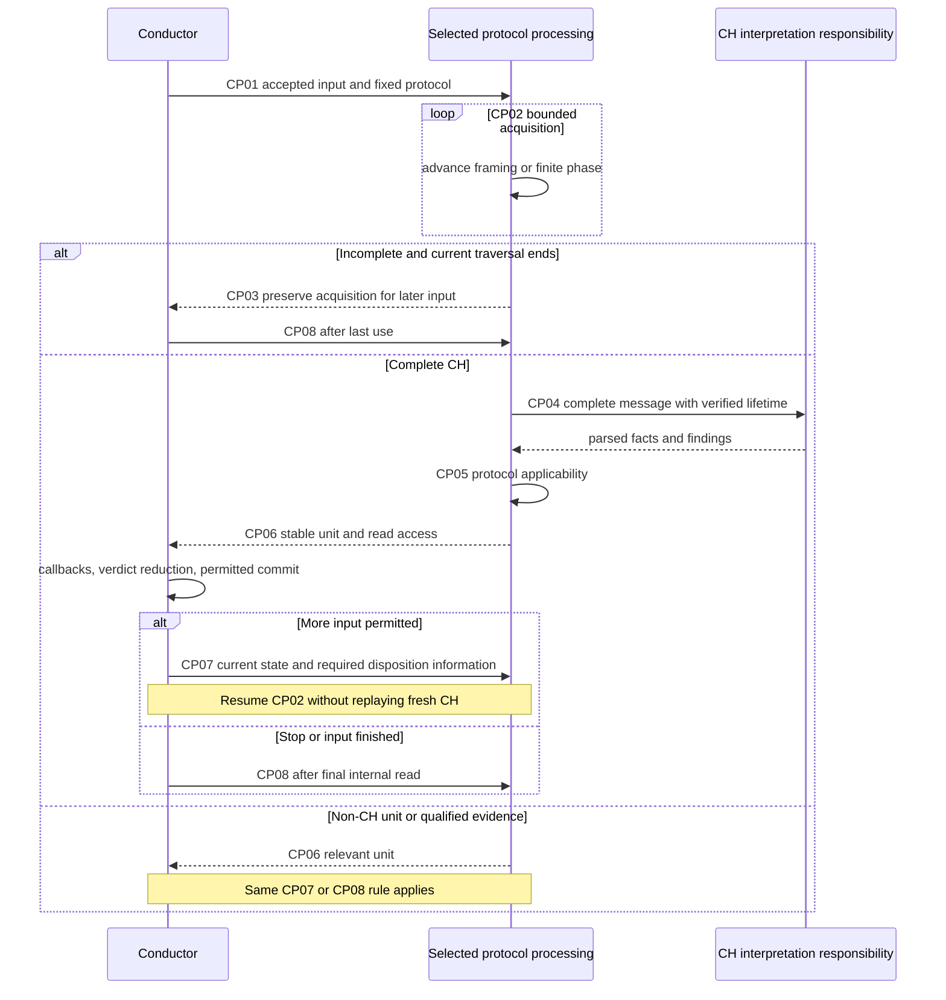

# TLS-Flow: Processing Continuation Points and Minimum Data V1

## 1. Scope and terminology

This is the next analysis stage after `tls_flow_template_method_analysis_summary_v1.md`. It defines logical boundaries before choosing a base class, protected hooks, public signatures or new data types.

A **continuation point** is a place where processing can pause, change responsibility, or resume with newly available input or feedback. It is not automatically a virtual function, a coroutine, a persistent object, or a public return value.

Three distinct kinds are used:
- **Internal boundary:** continue synchronously inside the selected processing responsibility; no Conductor feedback is needed yet.
- **Input boundary:** preserve only necessary acquisition state and resume on later input.
- **Semantic boundary:** return control before later processing can depend on callback feedback or an active-context disposition.

CP labels below are analysis IDs only. Data listed as minimum information can be borrowed or derived from existing storage. It is not a request to duplicate all fields into a context struct. No new C++ types, signatures, base classes or numerical capacities are selected.

## 2. Boundary map

| ID | Boundary | Kind | Why it exists |
| --- | --- | --- | --- |
| CP01 | Input accepted and protocol selected | Input entry | Select once without leaking previous selection. |
| CP02 | Advance protocol framing/acquisition | Internal | Transport-specific framing must produce bounded progress or a relevant boundary. |
| CP03 | Wait for later input | Input suspension | Partial headers/CH/CRYPTO survive without retaining expired packet pointers. |
| CP04 | Complete CH available for interpretation | Internal | Separate acquisition from message parsing; completeness is not semantic authority. |
| CP05 | CH facts available for protocol applicability | Internal | Apply protocol-specific checks before exposure, without creating violations. |
| CP06 | Current unit ready for Conductor | Semantic yield | Freeze relevant views, preserve event ordering and stop before feedback-dependent progress. |
| CP07 | Resume after feedback and disposition | Semantic resume | Use current committed state and explicit permission, not a stale snapshot. |
| CP08 | End current input after last use | Input exit | Invalidate current result while preserving valid cross-input support. |
| CP09 | Failure/resource/lifecycle interruption | Exceptional | Preserve cause distinctions and cleanup without synthetic violations. |

CP02 can reach CP06 without CH. CP03 is not required for every packet. CP04/CP05 run only for a newly complete CH. CP09 can interrupt any relevant stage. CP08 is required after every successfully opened input, including early Stop.

## 3. Minimum information by continuation point

### CP01. Input accepted and protocol selected

**Trigger:** new admitted frame enters the wrapper; no previous input remains open.

**Available information:** borrowed frame bytes and trusted transport metadata; current session identity; required arrival timestamp provenance; installed supported strategies; applicable admission decision. Use existing context rather than creating a second policy/configuration model.

**Produced information:** selected protocol/strategy, or explicit no-selection reason; valid input extent; input lifetime interval. Selection is fixed for this input. A QUIC candidate classification does not prove successful decryption, decoded protected fields, or attempt acceptance.

**Survives:** the borrowed current input and selection until CP08. No old selection survives a failed begin. A failed initialization unwinds transient claims even though no successful interval exists.

**Resume rule:** CP02 only after successful initialization. TCP is selected from transport metadata. UDP port alone is insufficient; insufficient/conflicting recognition remains unclassified. No QUIC-to-DTLS retry on decrypt failure.

**Not needed here:** complete CH, fingerprint, callback verdict, new SupportBinding, generic classifier registry, or all TLSData copied into a new context.

### CP02. Advance protocol framing and acquisition

**Trigger:** selected input has processable bytes or a finite pending internal phase, and the previous result is no longer in use.

**Common minimum:** current valid byte extent/cursor, protocol acquisition phase, association with the correct session/attempt, and current committed semantic facts needed for applicability. Each cursor belongs to its own framing domain.

| TCP-specific minimum | QUIC-specific minimum |
| --- | --- |
| Sequence position under the existing policy; partial record-header bytes and how many are known; current record type/version/declared extent once available; remaining record bytes; partial handshake-header bytes; CH declared/collected extent once known. | Datagram and packet extents; current packet/frame traversal position; version and classification confidence; Initial crypto context and authenticated plaintext validity where applicable; CRYPTO offset/range information; correct attempt association. |

These are semantic necessities, not a final storage inventory. Derive values rather than saving redundant counters. Do not expose keys, raw crypto workspace, TCP sequence internals or all fragment metadata to the shared CH parser.

**Produced information:** bounded internal progress, a real record/evidence unit for CP06, incomplete acquisition for CP03, a complete CH for CP04, or a qualified exceptional outcome for CP09.

**Progress rule:** consume bytes or advance a finite phase. Stop at the first feedback-dependent boundary. No unbounded scan, no fabricated record for QUIC, no new out-of-order/gap support for TCP.

### CP03. Wait for later input

**Trigger:** required data is incomplete and current traversal legitimately ends. A work-budget yield is not automatically this condition. Existing TCP full-continuation-retransmission behavior remains a distinct reason for ending traversal; do not claim it consumed new CH bytes.

**Minimum retained information:**
- Correct session/attempt association, valid across lookup and slot reuse under the existing lifecycle contract.
- Owned or otherwise verified-live partial bytes and their valid extent.
- Protocol phase and the information required to determine what remains missing.
- TCP sequence/record/handshake continuation information, or QUIC CRYPTO coverage/offset and applicable crypto context, only as needed by that protocol.
- Findings/facts that cannot be safely recomputed from retained bytes. Do not retain stale shared parser fields as implicit session state.

**Produced information:** incomplete status and reason; no complete CH publication. Persistent support survives CP08. The current frame pointer does not.

**Resume rule:** later input returns through CP01, revalidates association, then resumes CP02. A new datagram's arrival time must remain available so that the eventual completing datagram determines the QUIC CH timestamp. Do not freeze the first-fragment time as the completion time.

**Not selected:** pointer versus index, pool layout, generations, new reclaim mechanism, CH capacity, or a generic TCP/QUIC reassembly object. Existing session index alone is not proof that stale support belongs to a reused session.

### CP04. Complete CH available for interpretation

**Trigger:** acquisition has established one full CH message, not merely a full TLS record, a CRYPTO frame, or a packet.

**Minimum input:** read-only access to the exact complete message bytes and extent; completeness evidence; agreed framing convention; backing lifetime through interpretation and required later use. For a candidate attempt, interpretation must use isolated permitted acquisition and must not reset or overwrite the active context before its accepted disposition. Protocol/session/attempt provenance stays alongside the message, not embedded into its bytes.

**Representation still OPEN:** contiguous versus another bounded read representation; inclusion of the handshake header; maximum CH and its accounting. Recommendation remains to evaluate a full handshake message without TLS record/QUIC framing, but that is not yet approved. No new parser API is chosen here.

**Produced information:** structurally parsed CH facts, canonical FP result, findings and success/blocking classification. Facts include the information needed by existing readers and commit: version-related facts, optional SNI with explicit availability, counts and early-data indication. Existing FullString representation/access remain unchanged.

**Reset rule:** start evaluation from deterministic per-message facts. A missing extension cannot inherit a previous session's flag. A retained TCP CH result is not re-evaluated solely to repeat its callback.

**Resume rule:** successful parsing continues to CP05. Blocking structural failure goes to CP09 with no successful CH publication. Nonblocking findings permit full parsing and FP.

**Migration caveat:** complete-message parsing may delay detection of errors that the old incremental path found earlier. Preserving old supported-input behavior requires a separate error/event trace review, not a blanket equivalence claim.

### CP05. Protocol applicability after CH parsing

**Trigger:** parsed CH facts exist and no blocking structural failure prevents further interpretation.

**Minimum input:** parsed facts; source protocol; prior bounded findings; only the qualified protocol context needed for a concrete check. For the QUIC TLS-version check, advertised-version facts are sufficient; no Session object or full TLSData copy is needed for that check.

**Produced information:** protocol applicability findings with blocking/nonblocking meaning and any justified evidence qualification. No consumer verdict, violation mask, automatic drop or TLSData mutation.

**Example:** a QUIC CH that does not offer TLS 1.3 retains its complete parse and fingerprint and carries the accepted nonblocking finding. The same restriction is not silently applied to TCP.

**Resume rule:** attach the findings to the same CH unit and continue to CP06. Do not publish the CH first and discover applicability only after consumers have run. Do not dispatch findings as a separate earlier transaction that changes STOP/mask reduction.

**Placement not selected:** this logical boundary can become a narrow hook, a direct protocol operation, or protocol-owned orchestration around a shared parser. No three-hook base is approved merely because the logical order is clear.

### CP06. Current unit ready for Conductor

**Trigger:** a record, fresh CH, finding, or qualified semantic evidence requires external handling before further authority-sensitive progress. A unit can have no callback projection and still need a disposition.

**Minimum unit information:**
- Source protocol and association with the correct active or candidate attempt.
- Validity/availability of each projection; actual TCP record facts only for TCP.
- Ordered findings and their applicability to the same unit.
- CH availability distinguished from fresh-CH publication authority and TCP retained-view callback eligibility.
- Current read access to the same CH facts through the existing viewer, including nested public access where used.
- Completion arrival timestamp for a fresh QUIC CH.
- Evidence/cause for any requested semantic disposition, without a precommitted state.

No new owning result object is required by this list. A reference to verified-live data can carry the information. Consumers receive pre-current-unit-commit TLSData; new CH facts are available separately.

**Lifetime:** freeze current backing through callbacks, reduction, permitted commit and every final internal read. Neither another session nor a later unit can overwrite it during that interval. No reentrant input on the same workspace.

**Callback/commit distinction:** a TCP retained CH can be callback-eligible while the current record is not a fresh CH commit. Availability alone must not increment CH count or change CH timestamp. QUIC fresh CH is not a fabricated TLSRecord event and is not proof of Finished.

**Resume rule:** only CP07 decides whether another pull is allowed. end-of-input or Stop can instead lead to CP08. A candidate requiring acceptance must not overwrite active semantic state or its backing before disposition.

### CP07. Resume after feedback and disposition

**Trigger:** Conductor has completed applicable callbacks, actual-verdict reduction, permitted commit and last use for the current unit.

**Minimum continuation information:**
- Permission to continue this input, or an instruction to stop traversing it.
- Current committed TLSData facts needed by subsequent processing, read afresh.
- If a candidate/attempt disposition was required: whether it was accepted, rejected or deferred, and which context is now authoritative.
- Cursor/pending phase after the yielded unit and correct association of retained acquisition with the authoritative context.

For an ordinary unit, the next permitted pull with current TLSData may suffice. **For candidate acceptance, TLSData alone is not assumed sufficient:** two outcomes can leave indistinguishable semantic fields while requiring different acquisition ownership. This is a logical information requirement, not a newly approved acknowledgement API or handle.

**TCP reduction rules preserved:** within an event, Stop ends that event list. A current event Stop with nonzero accumulated mask ends later event dispatch immediately. A zero-mask Stop latches stop but permits later applicable events in the same record. A later Continue with a mask does not by itself trigger immediate exit solely because stop was previously latched. At final reduction, a nonzero mask suppresses normal commit and causes Error only if stop was latched; a zero final mask permits normal commit even with latched Stop. No further pull follows Stop.

**Resume rule:** CP02 only when feedback and lifecycle permit. Refresh any TLSData reference after context replacement. Never cache a packet-start snapshot or infer candidate acceptance from mere control return.

### CP08. End current input after last use

**Trigger:** normal input completion, legitimate wait for later input, unsupported/parser/resource termination, or observer Stop after permitted current-unit work.

**Minimum information:** selected strategy, live transient claims, which backing is still needed by persistent acquisition, and proof that current-result last use has ended. This is an ordering obligation, not necessarily a new refcount or pin token.

**Produced state:** current-result/viewer availability invalid; borrowed input references cleared; selected-strategy pointer cleared. Strategy and viewer objects remain alive. No consumer/getter for the ended result is called afterward.

**Retained state:** valid incomplete CH/CRYPTO/TCP continuation and accepted attempt support survive as required. If a view points into persistent backing, invalidate the view rather than erasing needed bytes.

**Resume rule:** a later input starts at CP01. Repeated end with no open input is harmless. Cleanup after failed initialization is handled by the failed initialization path; it cannot depend on a successful-input end that will not occur.

### CP09. Failure, resource or lifecycle interruption

**Trigger:** structural failure, unsupported cause, authentication failure, capacity exhaustion, aging, reclaim or attempt disposition interrupts the ordinary path. These are not one interchangeable error category.

**Minimum information:** exact cause category; affected input/unit/session/attempt; whether parsing can continue; valid findings/projections; last-use obligations; retained acquisition validity; and the actual selected reclaim victim when relevant. Include actual enforcement verdict only if one was produced, never inferred from a parser cause.

**Produced information/action:** qualified exceptional handling, no stale CH publication, and cleanup at the correct existing lifecycle point. No automatic Incomplete Handshake violation for resource eviction. Do not convert decrypt failure into a request to try another protocol.

**Reclaim boundary:** existing markReclaimable/allocate/reset already selects and resets a victim. Future support cleanup must attach to that actual ownership path if needed, not add a second victim selector. No backing is reused before its final reader completes.

**Resume rule:** resume only where the accepted cause-specific contract permits; otherwise finish an open current input through CP08 after final handling. Aging or reclaim with no open input does not manufacture a packet-end call. Persistent lifecycle cleanup is not implemented merely by endPacket.

## 4. Boundary sequence, without a class hierarchy

The sequence below is an analysis diagram, not a proposed hook list. Responsibilities are participants, not new components.

CP09 is an exceptional route from any applicable boundary; it is omitted from the diagram to keep the ordinary sequence readable. A blocking CP04 failure does not proceed to successful CP05/CP06 CH publication. CP05 does not need a separate virtual call merely because it is drawn separately.

## 5. TCP event mapping: analysis outcomes and open cases

| Scenario | Required boundary behavior | Minimum distinguishing information | Status |
| --- | --- | --- | --- |
| Previously supported ordinary record | CP06 before later feedback-dependent processing | Actual record facts, applicable findings, current state | Existing behavior to preserve. |
| Partial record or handshake header | CP03 when current traversal legitimately ends | Known header bytes, valid extent, sequence/phase | Approved new capability; storage representation open. |
| CH spans records | Yield each feedback-relevant record boundary; CP04 only when complete | Record completion separate from CH completion, ordered findings | Exact event/error timing still OPEN. |
| CH completes mid-packet | CP04 then CP05 then CP06; CP07 before later authority | Fresh CH, associated record context, current cursor | Required logical order; exact mapping to old events needs trace review. |
| Later record after Complete | CP06 may expose retained CH for callback, no fresh CH rehash/commit | Retained versus fresh classification and actual record | Existing distinction to preserve. |
| Parse failure after CH status became Complete | CP09 exception path must override successful CH exposure | Public processing outcome, findings and publication eligibility | Existing Stop path must not be inferred from CH status alone. |
| Observer Stop | Finish permitted same-unit events/commit, then CP08 | Actual Stop/mask reduction and last use | No extra CP07/pull. |

This is not a final before/after equivalence matrix. New complete-message parsing may change when errors become knowable. No silent change to previously supported TCP behavior is authorized by this analysis.

## 6. Minimal data discipline

| Data lifetime | Keep | Do not keep merely for convenience |
| --- | --- | --- |
| One input | Borrowed bytes, valid extent, arrival time, selected protocol and cursor | Expired packet pointers in persistent support. |
| One yielded unit | Stable facts/projections/findings, provenance and validity, relevant timestamp | Full packet/session copies or synthetic TCP records. |
| Across feedback | Current authoritative state and any necessary acceptance outcome | Cached precommit TLSData or an inferred acceptance flag. |
| Across inputs | Correct association, necessary partial bytes/coverage/phase | All Processor scratch members or another session's cached flags. |
| Across lifecycle | Ownership needed to release actual support safely | Parallel reclaim metadata without a demonstrated gap. |

Minimum information is semantic, not byte-minimal packing. Existing storage may represent this information, but suitability and capacity still require verification. A new field is justified only when the value cannot be safely derived at the required point. The actual count/width of findings, ranges and CH storage remains a capacity decision, not an invitation to use runtime-growing containers.

## 7. Review walkthroughs

The following are design walkthroughs, not executed packet tests:

1. **TCP A-partial, B-complete, A-resume:** CP03 must preserve A's own acquisition; CP04 must initialize/restore all A facts; CP06 cannot read B's SNI/version/digest. A shared base alone does not solve this.
2. **TCP CH across two records:** the first feedback-relevant record reaches CP06 before later authority; CP03 is used only if input really needs to end. The second record can complete CP04/CP05. Event timing remains an explicit gate.
3. **QUIC CH without TLS 1.3:** CP04 completes FP; CP05 adds the nonblocking applicability finding; CP06 exposes one unit; actual feedback governs commit, not the finding itself.
4. **Nested existing FullString read:** during CP06, the public viewer must reach the same strategy/result as the callback. No FullString payload change is introduced. CP08 ends that availability.
5. **Zero-mask Stop then later Continue with a mask:** preserve remaining applicable events of the same record unless a current Stop/nonzero condition occurs; final reduction selects Error; no CP07 pull follows.
6. **Candidate replacement with unchanged TLSData fields:** CP07 still needs the accepted/rejected/deferred outcome and correct association. Equal semantic fields cannot authorize a merge or reset.
7. **Resource loss or reclaim:** CP09 distinguishes resource cause from violation and uses the actual existing victim path; CP08 clears only transient borrowing after last use.
8. **Unknown UDP after a TCP packet:** CP01 has no stale selected strategy or current viewer; no TCP data is exposed on a failed UDP selection.

## 8. Outcome and next decision gate

**Completed in this stage:** nine logical continuation points, minimum information, lifetime/resume conditions, protocol-specific differences, and static walkthroughs. No base class or API signatures were chosen.

The logical post-parse check is now located at CP05, but its implementation placement remains open. CP04 states the information a complete-CH boundary needs without approving contiguous backing/header accounting. CP06-CP08 state viewer/event/lifetime obligations without claiming final public routing or TCP event mapping is complete.

Before choosing inheritance or signatures, review these boundaries and close the concrete remaining decisions: complete-message representation and maximum CH; cross-record TCP callback/error timing; public viewer routing; candidate disposition information; ownership/capacity/resource behavior. A single class may implement several boundaries; not every boundary should become a hook.

No DTLS implementation, new binding framework, generic reassembly engine, extra reclaim selector, FullString change, or runtime allocation is introduced. HLD V10 and previous discussion documents remain unchanged.

## 9. Evidence and limits

Accepted constraints come from the user's decisions in the current discussion. The wrapper/base documents are proposals, not independent authority for unapproved types. Existing TCP observations were checked against the supplied code and Step 1 analysis:

- `context/engine/src/Factory.cpp`: existing viewer wiring.
- `packet-flow/src/TLSFlowConductor.cpp`: analyzeProcessResult, onClientHello, updateTLSDataOnClientHello and commit paths.
- `processor/src/Processor.cpp`: beginPacket and resumeStepFromSegmentBuffer.
- Supplied `TLS-Consumers code.txt`: nested Application viewer FullString access.

This is a targeted static review, not an exhaustive implementation or all-caller audit. No C++ build, packet execution, allocation/performance validation or Mermaid rendering was performed.
