# TLS-Flow QUIC Support: R1 High-Level Design V10

**Status:** HLD draft V10 for selected R1. Provider/API fit, finite numeric capacities and runtime validation remain subject to the closure points in 7.3; this document does not authorize activation.

## 1. Introduction

### 1.1 References

- **SRS:** **Web DDoS TLS Fingerprinting over QUIC SRS**, supplied Draft dated 22/09/2026. Repository locator: [Web DDoS QUIC Support SRS](https://bitbucket.org/rdwr/defensepro_docs/src/dev/10_16_0_0/SRS/web-ddos-quic-support-srs.md?at=dev).
- **FRD:** [Web DDoS QUIC Support FRD](https://bitbucket.org/rdwr/defensepro_docs/src/dev/10_16_0_0/FRD/web-ddos-quic-support-frd.md). Background product reference; not sole authority for an active requirement.
- **Code:** supplied TLS-Flow implementation snapshot, especially TLSFlowConductor, Processor, SegmentBufferManager, Factory/Application and ClientHelloData; relevant symbols are named in this HLD. The snapshot establishes current behavior, not proof of future implementation correctness.
- **User Decision:** explicit decisions restated in this document: R1 selection and parsing/state-machine scope; client-to-server visibility; QUIC v1 Initial-only processing; completing-datagram CH timestamp; blocking/nonblocking findings and Enforcement-owned violations; protocol metadata for consumers; preservation of TCP except authorized corrections; KISS/YAGNI and no unrelated feature expansion.
- **DP Constraint:** startup allocation is allowed, but affected Engine runtime must use finite prepared storage with no allocation, growth or heap fallback, including transitive failure, aging, callback and diagnostic paths.
- **Design Decision:** engineering contracts selected and explained in this HLD, including shared semantic authority, protocol-specific acquisition, feedback/yield boundaries, attempt isolation, backing lifetime and safe retirement. This label does not imply an additional product requirement or an RFC mandate.

SRS citations refer to the supplied Draft, not an asserted live repository revision.

**How to read requirement sources:** SRS and FRD identify product intent; Code identifies preserved behavior; User Decision identifies explicit scope/policy choices; DP Constraint identifies platform/runtime constraints; Design Decision identifies the necessary realization of those requirements. Multiple categories can apply to one requirement. A reference to SRS/FRD does not imply that every detailed mechanism was specified there.

The product documents describe a wider feature than this parsing/state-machine HLD. Their broader scope does not silently activate Enforcement, mitigation, profile/port configuration or DTLS here. The SRS parsing and fingerprint sections are the relevant product basis; user decisions and the explicit design text govern the recorded scope and findings treatment.

### 1.2 Motivation and scope

Extend the existing TLS-Flow inspection pipeline with QUIC v1 acquisition and ClientHello (CH) processing while retaining TCP behavior and the canonical fingerprint algorithm. The system observes client-to-server traffic only. State describes inspection policy and available evidence, not verified endpoint handshake completion.

The design covers Conductor coordination, TCP preservation, QUIC datagram/packet/frame traversal, Initial decryption, CRYPTO reassembly, CH evaluation, state policy, views, ownership and bounded runtime. It does not implement a full QUIC endpoint.

Out of scope: QUIC Enforcement activation, violation definitions, mitigation generation and mitigation-only context, product profile/port integration, reporting redesign, statistics policy and informative-counter versus shared-baseline behavior, DTLS implementation, later encryption-level decryption, and unrelated TCP defect fixes. These exclusions must not reappear as hidden HLD prerequisites. Exposing protocol metadata and identifying the focused consumer changes needed to use it are in scope. Implementing QUIC CONNECTION_CLOSE mitigation, new statistics storage schemas and product activation remain separate integration work; the metadata contract does not claim those features are delivered.

### 1.3 Decision and source basis

R1 retains the existing Conductor, explicit TCP and QUIC paths, protocol-owned CH orchestration, common canonical CH/FP helpers, cohesive shared state-policy functions and startup-prepared QUIC support. A logical responsibility does not imply a class or virtual interface.

**U-HLD-PROTOCOL-01:** expose TCP versus QUIC through an explicit ClientHelloData enum value/getter (9.6). Downstream consumer behavior remains external to parsing/state-machine delivery.

Reference labels used throughout:

| Label | Active source | Relevant authority |
|---|---|---|
| PLAN | tls_flow_quic_r1_path_to_hld_v2.md, Section 5 | HLD organization and delivery scope |
| CODE | TLS-Flow-All-Code.txt | Existing behavior only; line anchors below refer to the supplied aggregate snapshot |
| P2 | phase2-state-machine.md, Sections 5-13 | Protocol-qualified state, association and attempt policy |
| P6 | phase6-architecture-selection-summary-v1.md, Section 7 | Selected responsibilities and architecture-level interfaces |
| PKG | phase7-pre-design-decision-package-v1.md, Sections 1-9 | Consolidated contracts and direct user overlays |
| SC | phase7_step2_focused_scenario_pack_v12.md | Existing scenario oracles; not executed tests |
| WF | phase7-step3-selected-design-walkthrough-v6.md | Existing selected-design walkthrough evidence |
| TC | phase7_step4_traceability_consistency_validation_v9.md | Requirement and defect dispositions |
| KY | phase7-step5-kiss-yagni-delivery-review-v1.md | Minimum delivery and deferred validation |

P3-P5 remain reserve authority for a concrete contract question. They are not replaced by this HLD. Current code establishes what exists, not necessarily correct target behavior. Later documents do not automatically override earlier accepted contracts.

### 1.4 Requirements

The following are concise allocations of already stated constraints and contracts, not new product requirements, except the explicitly identified user-approved protocol metadata overlay. HLD-local IDs support navigation and do not replace source IDs. Component-specific allocations appear in 3.1.1, 3.2.1 and 3.3.1. Source labels identify product intent, preserved code behavior, explicit user decisions and engineering contracts.

| ID | Requirement | Source basis | Realization |
|---|---|---|---|
| G01 | Process QUIC v1 Initial and CRYPTO/CH from client-to-server datagrams without assuming server visibility or later-level keys. | P2; PKG 4; SRS (1.1, 4.3.1); User Decision (visibility, v1 and Initial-only scope). | 3.3, 4, 8.3 |
| G02 | Preserve TCP results, staged continuation, callback eligibility and fingerprint output except explicitly authorized corrections. | PKG 2; CODE; Code (TCP Processor/Conductor and canonical FP); User Decision (preservation and authorized corrections). | 3.2, 3.4, 7.1, 8.2 |
| G03 | Keep one active semantic TLSData; protocol processing supplies evidence, shared policy owns semantic applicability and writes. | P6 7; PKG 3-5; Design Decision (one semantic writer and one active TLSData under R1). | 3.1, 3.5, 4, 9.1 |
| G04 | Separate parsing progress, success availability, findings, actual observer feedback, state and packet action. | PKG 4-5; U7-PARSE-01; Code (existing feedback distinctions); User Decision (findings are not violations); Design Decision (qualified results). | 3.3, 5.3, 8.3 |
| G05 | Permit full CH/FP evaluation with nonblocking findings; a blocking parse cannot publish successful CH/FP even with neutral feedback. | PKG 5.3; WF NF-12..14; User Decision (blocking/nonblocking findings, complete parsing and FP); Design Decision (success eligibility). | 3.4, 5.3, 8.4 |
| G06 | Use the completing datagram's arrival timestamp for a permitted fresh QUIC CH commit; retransmissions do not refresh it. | U7-TIME-01; PKG 3; User Decision (completing-datagram arrival timestamp). | 4.2, 8.3, 9.2 |
| G07 | Preserve distinct active and terminal replacement order, retired suppression, and no merge/reset on ambiguity. | P2 7-10; PKG 5.4; Design Decision (accepted attempt policy restated in 4.3 and 5.4). | 4.3, 5.4, 9.3 |
| G08 | Keep current-result backing valid through nested callback reads and independent commit reads; retire the actual victim before destructive reuse. | PKG 6; D6-02; Code (borrowed views and table lifecycle); Design Decision (current-producer lifetime and actual-victim retirement). | 3.7, 5.6, 6, 9.2-9.4 |
| G09 | Allocate storage at startup only; affected Engine runtime must not allocate, grow or fall back to heap. | User constraint; PKG 6; DP Constraint; User Decision (startup allocation permitted, runtime allocation prohibited). | 6.3-6.4, 9.5 |
| G10 | Bound bytes, metadata, claims and work, including replacement overlap; check extents and semantic arithmetic before affected consumers. | P5 handoff; PKG 6; DP Constraint; Design Decision (joint admission, checked extents and no-wrap). | 6.3-6.4, 7.3 |
| G11 | Preserve actual STOP/mask reduction and resolve feedback before processing the next authority-dependent unit. | CODE L3514-3585/L4008-4025; PKG 5.2; Code (TLSFlowConductor::notify/analyzeProcessResult); Design Decision (yield before dependent work). | 3.1, 5.3, 8.5 |
| G12 | Do not create violations from missing evidence, ambiguity, local capacity failure or resource eviction. | PKG 3, 5-6; User Decision (violation ownership); Design Decision (resource/ambiguity failure isolation). | 4.4, 5.5-5.6 |
| G13 | Prefer existing functions/infrastructure; do not introduce a universal record/result framework, full TCP buffering or speculative DTLS framework. | P6 7; KY; User Decision (R1, KISS/YAGNI and current scope); Design Decision (reuse before new abstractions). | 2-3, 8-9 |
| G14 | Keep provider/API, capacity, allocation and execution obligations visible at their original blocking points. | PKG 9 DF01..06; Design Decision (staged evidence and activation conditions in 7.3/9.5); DP Constraint (capacity/allocation evidence). | 7.3, 9.5 |
| G15 | Expose an explicit immutable producing-protocol value (TCP or QUIC) in every ClientHelloData callback, without changing canonical FP bytes or existing callback signatures. | U-HLD-PROTOCOL-01; SRS (2.2, 4.3.3, 4.3.4: consumer need); User Decision (explicit enum/field); Design Decision (construction/getter and lifetime). | 3.4, 3.7, 6.5, 9.6 |

**Presentation-readable requirements (same IDs):**

- **G01:** Process QUIC v1 Initial and CRYPTO/CH from client-to-server datagrams without assuming server visibility or later-level keys. **Sources:** SRS (1.1, 4.3.1); User Decision (visibility, v1 and Initial-only scope).
- **G02:** Preserve TCP results, staged continuation, callback eligibility and fingerprint output except explicitly authorized corrections. **Sources:** Code (TCP Processor/Conductor and canonical FP); User Decision (preservation and authorized corrections).
- **G03:** Keep one active semantic TLSData; protocol processing supplies evidence, shared policy owns semantic applicability and writes. **Sources:** Design Decision (one semantic writer and one active TLSData under R1).
- **G04:** Separate parsing progress, success availability, findings, actual observer feedback, state and packet action. **Sources:** Code (existing feedback distinctions); User Decision (findings are not violations); Design Decision (qualified results).
- **G05:** Permit full CH/FP evaluation with nonblocking findings; a blocking parse cannot publish successful CH/FP even with neutral feedback. **Sources:** User Decision (blocking/nonblocking findings, complete parsing and FP); Design Decision (success eligibility).
- **G06:** Use the completing datagram's arrival timestamp for a permitted fresh QUIC CH commit; retransmissions do not refresh it. **Sources:** User Decision (completing-datagram arrival timestamp).
- **G07:** Preserve distinct active and terminal replacement order, retired suppression, and no merge/reset on ambiguity. **Sources:** Design Decision (accepted attempt policy restated in 4.3 and 5.4).
- **G08:** Keep current-result backing valid through nested callback reads and independent commit reads; retire the actual victim before destructive reuse. **Sources:** Code (borrowed views and table lifecycle); Design Decision (current-producer lifetime and actual-victim retirement).
- **G09:** Allocate storage at startup only; affected Engine runtime must not allocate, grow or fall back to heap. **Sources:** DP Constraint; User Decision (startup allocation permitted, runtime allocation prohibited).
- **G10:** Bound bytes, metadata, claims and work, including replacement overlap; check extents and semantic arithmetic before affected consumers. **Sources:** DP Constraint; Design Decision (joint admission, checked extents and no-wrap).
- **G11:** Preserve actual STOP/mask reduction and resolve feedback before processing the next authority-dependent unit. **Sources:** Code (TLSFlowConductor::notify/analyzeProcessResult); Design Decision (yield before dependent work).
- **G12:** Do not create violations from missing evidence, ambiguity, local capacity failure or resource eviction. **Sources:** User Decision (violation ownership); Design Decision (resource/ambiguity failure isolation).
- **G13:** Prefer existing functions/infrastructure; do not introduce a universal record/result framework, full TCP buffering or speculative DTLS framework. **Sources:** User Decision (R1, KISS/YAGNI and current scope); Design Decision (reuse before new abstractions).
- **G14:** Keep provider/API, capacity, allocation and execution obligations visible at their original blocking points. **Sources:** Design Decision (staged evidence and activation conditions in 7.3/9.5); DP Constraint (capacity/allocation evidence).
- **G15:** Expose an explicit immutable producing-protocol value (TCP or QUIC) in every ClientHelloData callback, without changing canonical FP bytes or existing callback signatures. **Sources:** SRS (2.2, 4.3.3, 4.3.4: consumer need); User Decision (explicit enum/field); Design Decision (construction/getter and lifetime).

### 1.5 Terminology and evidence status

CH means ClientHello; FP means fingerprint, not false positive. A fresh CH is a qualified logical observation, not simply a repeated callback. An attempt may span several retained Initial contexts. A candidate is support under evaluation, not a second live TLSData. A current result is a synchronous unit of observable work, not an entire datagram transaction.

**Accepted contract** refers to the source decisions restated here. **CODE FACT** labels behavior directly checked in the supplied aggregate CODE snapshot. **HLD placement** specifies the proposed realization of those contracts. **Planned validation** is work not executed here. TLSFlowProtocol is the working name for the producing-protocol enum; its precise metadata and construction contract is defined in 9.6. Exact new C++ names and physical layouts remain implementation details.

## 2. Architecture Overview

### 2.1 Component model

The Conductor remains the session-facing coordinator. It selects the protocol before TCP-only input construction or terminal shortcuts. TCP uses the existing Processor contract. QUIC uses a separate processing boundary suited to datagrams and semantic dispositions. Both paths compose the same canonical CH/FP algorithms without sharing acquisition state.

The following Mermaid flowchart shows component responsibilities and dependencies. New role names are descriptive, not claims that matching classes already exist. Solid edges denote use or the explicitly labeled ownership relationship; dotted edges denote lifecycle coordination or a borrowed binding, not another owner.

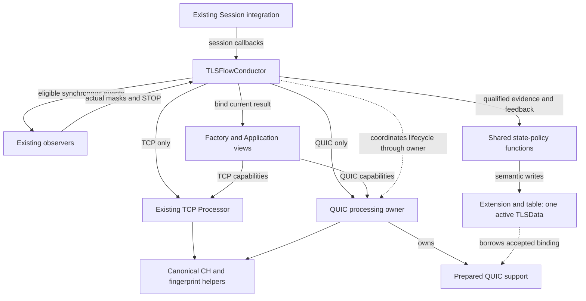

### 2.2 Object and ownership decisions

Retain the existing Conductor and TCP Processor. Introduce one long-lived QUIC processing owner because reassembly, contexts and prepared backing outlive individual packets. Keep its support storage as owned members or subordinate storage, not an independent global allocator service. Shared policy is cohesive functions, not a StateMachineManager. Common CH helpers are composed algorithms, not a mandatory universal CH evaluator interface.

The existing startup composition path prepares the new owner and dependencies before runtime exposure. The extension borrows a support binding; it does not own arenas. Existing table storage owns the active extension/TLSData. No new direct Packet Flow registration is introduced.

## 3. Components

### 3.1 TLSFlowConductor

#### 3.1.1 Requirements

| ID | Component-specific requirement | Parent / source | Verification focus |
|---|---|---|---|
| C01 | Select TCP/QUIC before TCP sequence/header access and before applying TCP-only terminal behavior. | G01-G02; P6 7; Code (TCP-specific header/sequence access); Design Decision (protocol branch before that access). | Protocol admission and interleaving |
| C02 | Preserve TCP SYN, RST, empty-payload and terminal ordering within the TCP branch. | G02; CODE L3393-3500; Code (TLSFlowConductor::prepareInboundExtension/process); User Decision (TCP preservation). | Differential TCP traces |
| C03 | Resolve each relevant unit's eligible callbacks and feedback before requesting dependent later work. | G11; PKG 5.1-5.2; Code (existing feedback-controlled loop); Design Decision (relevant-unit yield). | Multiple units; STOP variants |
| C04 | Use actual masks only, with current-unit accumulator initially zero; historical stored masks do not seed it. | G04/G11; CODE L3514-3539; Code (TLSFlowConductor::analyzeProcessResult). | Earlier/later mask combinations |
| C05 | Dispatch QUIC findings before eligible CH, with no synthetic Record or alert callback. | G04-G05; PKG 3-5; User Decision (findings without invented violations); Design Decision (QUIC has no TLS Record projection). | Findings and no-projection outcomes |
| C06 | Invoke the sole policy writer at the permitted time; do not duplicate protocol association or semantic predicates. | G03; P6 7; Design Decision (R1 shared semantic authority and qualified evidence). | Classification versus acceptance |
| C07 | Coordinate active evaluate/admit/reset/publish and terminal classify/adopt/reset/parse as distinct flows. | G07; P2 10; Design Decision (active/terminal replacement policy in 4.3). | Replacement failures and authority |
| C08 | Keep current-producer views valid through feedback and commit; invalidate before unsafe producer/result reuse. | G08; PKG 4/6; Code (callback and commit getters); Design Decision (current-producer binding and last use). | Nested reads and A/B isolation |
| C09 | Coordinate actual-victim retirement before reset/erase; failed required detach denies reuse. | G08; D6-02; Code (table destructive reuse); Design Decision (actual-victim retirement and safe failure). | Victim B versus requester A |
| C10 | Preserve SessionEnd-before-release on aging and ignored aging verdict; do not synthesize it for eviction. | G02/G12; PKG 6; Code (TLSFlowConductor::onAging); Design Decision (eviction is not session termination). | Aging versus resource eviction |
| C11 | Mark newly Finished only after commit and last use; marking is not immediate release. | G08; PKG 6; Code (newly Finished reclaim marking); Design Decision (last-use protection). | Repeated completion and reclaim |
| C12 | Perform all affected coordination using bounded prepared runtime storage. | G09-G10; DP Constraint; Design Decision (bounded coordination). | Failure/aging/callback allocation audit |

**Presentation-readable requirements (same IDs):**

- **C01:** Select TCP/QUIC before TCP sequence/header access and before applying TCP-only terminal behavior. **Sources:** Code (TCP-specific header/sequence access); Design Decision (protocol branch before that access).
- **C02:** Preserve TCP SYN, RST, empty-payload and terminal ordering within the TCP branch. **Sources:** Code (TLSFlowConductor::prepareInboundExtension/process); User Decision (TCP preservation).
- **C03:** Resolve each relevant unit's eligible callbacks and feedback before requesting dependent later work. **Sources:** Code (existing feedback-controlled loop); Design Decision (relevant-unit yield).
- **C04:** Use actual masks only, with current-unit accumulator initially zero; historical stored masks do not seed it. **Sources:** Code (TLSFlowConductor::analyzeProcessResult).
- **C05:** Dispatch QUIC findings before eligible CH, with no synthetic Record or alert callback. **Sources:** User Decision (findings without invented violations); Design Decision (QUIC has no TLS Record projection).
- **C06:** Invoke the sole policy writer at the permitted time; do not duplicate protocol association or semantic predicates. **Sources:** Design Decision (R1 shared semantic authority and qualified evidence).
- **C07:** Coordinate active evaluate/admit/reset/publish and terminal classify/adopt/reset/parse as distinct flows. **Sources:** Design Decision (active/terminal replacement policy in 4.3).
- **C08:** Keep current-producer views valid through feedback and commit; invalidate before unsafe producer/result reuse. **Sources:** Code (callback and commit getters); Design Decision (current-producer binding and last use).
- **C09:** Coordinate actual-victim retirement before reset/erase; failed required detach denies reuse. **Sources:** Code (table destructive reuse); Design Decision (actual-victim retirement and safe failure).
- **C10:** Preserve SessionEnd-before-release on aging and ignored aging verdict; do not synthesize it for eviction. **Sources:** Code (TLSFlowConductor::onAging); Design Decision (eviction is not session termination).
- **C11:** Mark newly Finished only after commit and last use; marking is not immediate release. **Sources:** Code (newly Finished reclaim marking); Design Decision (last-use protection).
- **C12:** Perform all affected coordination using bounded prepared runtime storage. **Sources:** DP Constraint; Design Decision (bounded coordination).

#### 3.1.2 Responsibility and behavior

The Conductor owns sequencing: participation, extension lookup/build, protocol branch, result dispatch, actual feedback reduction, policy invocation and retirement ordering. Product profile/port configuration remains external: UDP or a configured port alone is not proof of valid QUIC. It does not decrypt QUIC, reassemble CRYPTO, calculate fingerprints or define violations.

**CODE FACT:** the supplied process loop calls beginPacket/processRecord, dispatches the result and continues only for RecordParsed while the state is active. TCP parser Stop invokes anomaly handling without a normal record commit. The notifier ends its current listener list at the first STOP. These are distinct from QUIC's richer finding/result eligibility.

**HLD placement:** keep the TCP loop recognizable and add a separate QUIC loop beside it. Extract cohesive shared semantic functions from existing commit/update responsibilities. Keep event delivery/reduction in the Conductor; do not introduce a second verdict owner.

QUIC processing qualifies attempt evidence. Shared policy decides whether that evidence is applicable to current semantic state. The Conductor coordinates when adoption/reset/publication is safe. This separation does not grant QUIC processing authority to reset live TLSData. When constructing ClientHelloData, the Conductor supplies the explicit TLSFlowProtocol from the qualified current producing path. It does not ask a consumer to infer QUIC from UDP, ports or TLS version.

### 3.2 Processor: Existing TCP Processing

#### 3.2.1 Requirements

| ID | Component-specific requirement | Parent / source | Verification focus |
|---|---|---|---|
| T01 | Preserve IProcessor, PayloadParams and TLSStepResult semantics for TCP. | G02; CODE L4436-4478; Code (IProcessor, PayloadParams, TLSStepResult); User Decision (TCP preservation). | All five public results |
| T02 | Preserve beginPacket/processRecord staging and continuation modes without full-handshake buffering. | G02/G13; CODE L5410-5584; Code (Processor::beginPacket/processRecord); User Decision (TCP preservation); Design Decision (no full-handshake buffering). | Partial and resumed CH |
| T03 | Preserve opaque record tracking, CH extension reassembly and alert reassembly as distinct existing modes. | G02; CODE ContinuationMode; Code (Processor continuation modes). | Mode-specific support limits |
| T04 | Keep TCP record/CH callback eligibility, including retained Complete behavior and the local MultipleClientHello guard. | G02; PKG 2; CODE L6301-6306; Code (analyzeProcessResult Complete eligibility and Processor MultipleClientHello guard). | U05 and TCP-GUARD |
| T05 | Preserve canonical fingerprint order, normalization and digest output when extracting shared helpers. | G02; P6 7; Code (canonical cipher/extension/digest algorithms); SRS (4.3.2). | Byte-identical FP vectors |
| T06 | Restore the resumed session's own saved version/count/digest state and neutralize fresh fields under D6-01. | G02; PKG 2; User Decision (authorized restoration correction); Design Decision (own-session restoration before use). | TCP A / QUIC B / TCP A |
| T07 | Keep continuation backing and aging under the existing TCP support owner. | G08; PKG 6; Code (SegmentBufferManager ownership/aging); Design Decision (independent lifecycle). | Extension retirement versus continuation aging |
| T08 | Keep parser Stop distinct from observer STOP; do not import QUIC finding taxonomy or support-loss rules into TCP automatically. | G04; PKG 2/5; Code (parser Stop dispatch); User Decision (no automatic TCP taxonomy migration). | Anomaly-only TCP Stop |
| T09 | Expose current TCP views only while bound as current producer; no QUIC state may leak into resumed TCP evaluation. | G08; PKG 4; Design Decision (producer/session isolation); Code (existing borrowed viewer use). | Current-result isolation |
| T10 | Restrict changes to required extraction/integration and authorized corrections; do not silently fix suspected segmentation or encrypted-length defects. | G02; PKG 2; User Decision (limited scope and authorized corrections); Code (existing behavior). | Authorized-delta oracle |
| T11 | Audit affected helper/provider paths for runtime allocation and checked bounds without claiming the existing code already conforms. | G09-G10; D6-08; DP Constraint; Design Decision (checked representation and transitive validation). | Transitive audit and boundary tests |

**Presentation-readable requirements (same IDs):**

- **T01:** Preserve IProcessor, PayloadParams and TLSStepResult semantics for TCP. **Sources:** Code (IProcessor, PayloadParams, TLSStepResult); User Decision (TCP preservation).
- **T02:** Preserve beginPacket/processRecord staging and continuation modes without full-handshake buffering. **Sources:** Code (Processor::beginPacket/processRecord); User Decision (TCP preservation); Design Decision (no full-handshake buffering).
- **T03:** Preserve opaque record tracking, CH extension reassembly and alert reassembly as distinct existing modes. **Sources:** Code (Processor continuation modes).
- **T04:** Keep TCP record/CH callback eligibility, including retained Complete behavior and the local MultipleClientHello guard. **Sources:** Code (analyzeProcessResult Complete eligibility and Processor MultipleClientHello guard).
- **T05:** Preserve canonical fingerprint order, normalization and digest output when extracting shared helpers. **Sources:** Code (canonical cipher/extension/digest algorithms); SRS (4.3.2).
- **T06:** Restore the resumed session's own saved version/count/digest state and neutralize fresh fields under D6-01. **Sources:** User Decision (authorized restoration correction); Design Decision (own-session restoration before use).
- **T07:** Keep continuation backing and aging under the existing TCP support owner. **Sources:** Code (SegmentBufferManager ownership/aging); Design Decision (independent lifecycle).
- **T08:** Keep parser Stop distinct from observer STOP; do not import QUIC finding taxonomy or support-loss rules into TCP automatically. **Sources:** Code (parser Stop dispatch); User Decision (no automatic TCP taxonomy migration).
- **T09:** Expose current TCP views only while bound as current producer; no QUIC state may leak into resumed TCP evaluation. **Sources:** Design Decision (producer/session isolation); Code (existing borrowed viewer use).
- **T10:** Restrict changes to required extraction/integration and authorized corrections; do not silently fix suspected segmentation or encrypted-length defects. **Sources:** User Decision (limited scope and authorized corrections); Code (existing behavior).
- **T11:** Audit affected helper/provider paths for runtime allocation and checked bounds without claiming the existing code already conforms. **Sources:** DP Constraint; Design Decision (checked representation and transitive validation).

#### 3.2.2 Existing contract and changes

**CODE FACT:** public results are RecordParsed, NeedMoreData, Unsupported, EndOfPacket and Stop. Continuation modes are None, OpaqueRecordTracking, ClientHelloExtensionReassembly and AlertRecordReassembly. beginPacket copies scalar metadata and resumes or discards continuation. processRecord detects uninitialized state, continuation gap, exhaustion and retransmission before later processing.

**HLD placement:** retain these meanings and the staged TCP orchestration. Share canonical algorithms through narrow helpers rather than moving all TCP acquisition/evaluation into a new common processor. Preserve mode-specific digest/locator visibility. D6-01 restoration and D6-08 checked arithmetic are explicit target corrections, not assertions about existing implementation.

A TCP Complete view can remain callback-eligible on a later record under existing behavior. That does not make the later record a fresh QUIC CH. Do not unify those eligibility predicates for symmetry. Every retained Complete TCP callback still carries TLSFlowProtocol::TCP. Ending a current-view binding does not erase the Processor's retained Complete state or make QUIC freshness a common callback gate.

### 3.3 QUIC Processing

#### 3.3.1 Requirements

These are component allocations of the existing contracts, not new product requirements. Product references establish acquisition/fingerprint intent; the detailed mechanisms remain explicit Design Decisions.

| ID | Component-specific requirement | Parent / local contract | Source category |
|---|---|---|---|
| Q01 | Accept borrowed client-to-server datagrams only after QUIC-path selection; process the current v1 Initial scope without assuming server packets or later-level decryption keys. | G01; 3.3; 8.3 | SRS (1.1, 4.3.1); User Decision (scope and visibility). |
| Q02 | Traverse safely delimited coalesced packets and supported frames with checked extents; unknown boundaries terminate safe traversal rather than trigger resynchronization scans. | G01/G10; 5.1/5.5 | SRS (4.3.1, Initial/CRYPTO acquisition); Design Decision (safe bounded traversal). |
| Q03 | Qualify version/type/association evidence and remove Initial protection through a verified provider before using protected fields or decrypted content; readable headers are not authenticated payload evidence. | G01/G14; 3.3; DF01 | User Decision (Initial-only scope); Design Decision (provider qualification and evidence limits). |
| Q04 | Reassemble CRYPTO ranges across frames/datagrams using prepared bounded storage; handle out-of-order data, gaps and equal duplicates without synthesizing missing bytes or merging conflicting overlap. | G01/G10/G12; 4.4; 6.3 | SRS (4.3.1, CRYPTO/CH acquisition); Design Decision (range correctness); DP Constraint. |
| Q05 | Publish successful CH/FP availability only after complete valid evaluation through canonical helpers; protocol metadata must not change FP or FullString identity. | G02/G05/G15; 3.4; 9.6 | SRS (4.3.2); Code (canonical FP); User Decision (protocol metadata). |
| Q06 | Keep blocking findings separate from nonblocking findings: nonblocking older-only offers permit full parsing/FP, while a later structural failure removes affected success availability. | G04/G05; 3.4; 5.3 | User Decision (findings treatment); Design Decision (result eligibility). |
| Q07 | Return qualified evidence and explicit progress, success, findings, semantic/support disposition and exhaustion; yield before later authority-dependent work and never loop with unchanged progress. | G03/G04/G11; 8.3 | Design Decision (R1 result/yield contract); DP Constraint (bounded work). |
| Q08 | Classify retained-context retransmission, restart-compatible input, additional CH, candidates, retired input and ambiguity without independently resetting or committing live TLSData; changed DCID alone does not establish a new attempt. | G03/G07; 4.3; 9.3 | Design Decision (attempt policy and sole semantic authority). |
| Q09 | Support isolated complete-candidate evaluation for active replacement and attempt-level classification before CH parsing for terminal replacement; preserve old active authority on rejected candidate failure. | G07; 4.3; 5.4 | Design Decision (distinct replacement contracts). |
| Q10 | Carry the completing datagram arrival timestamp and qualified producer/session/attempt provenance through callback and commit last use; duplicates do not refresh CH authority or time. | G06/G08/G15; 6.5; 9.2 | User Decision (timestamp and protocol metadata); Design Decision (freshness and lifetime). |
| Q11 | Produce qualified completion/close facts and retain bounded same-attempt deferred evidence under the state policy in Section 4; do not infer server Retry/HRR/Finished or let 0-RTT/opaque 1-RTT advance state. | G01/G03/G07; 4/5.5 | User Decision (visibility/scope); Design Decision (completion/evidence policy, not endpoint completion proof). |
| Q12 | Distinguish candidate/trial failure, required accepted-support loss and optional retired-history loss; suppress affected projections before accepted Unsupported disposition and never manufacture a violation or packet action. | G04/G12; 4.4; 5.5 | User Decision (Enforcement owns violations); Design Decision (cause-specific safe failure). |
| Q13 | Own prepared support and keep borrowed result backing valid through nested callbacks and independent commit reads; unwind newly owned claims only and release retired claims exactly once after last use. | G08; 6/9.3 | Design Decision (ownership, rollback and retirement); DP Constraint. |
| Q14 | Use finite startup-prepared byte/range/context/candidate/retired/scratch/metadata capacities, account for simultaneous-live replacement peaks and perform checked arithmetic without runtime allocation, growth or heap fallback. | G09/G10/G14; 6.3/6.4; 9.5 | DP Constraint; Design Decision (joint admission and representation checks). |
| Q15 | Suppress repeat canonical FP evaluation and fresh CH publication for qualified same-attempt retransmission/duplicate delivery; process genuinely new CRYPTO ranges needed for first completion without treating UDP delivery alone as duplicate proof. | G01/G06/G07; 3.3.2, 4.2 | SRS (4.3.2: no TLSFP calculation for retransmitted input); Design Decision (QUIC range/attempt qualification). |

**Presentation-readable requirements (same IDs):**

- **Q01:** Accept borrowed client-to-server datagrams only after QUIC-path selection; process the current v1 Initial scope without assuming server packets or later-level decryption keys. **Sources:** SRS (1.1, 4.3.1); User Decision (scope and visibility).
- **Q02:** Traverse safely delimited coalesced packets and supported frames with checked extents; unknown boundaries terminate safe traversal rather than trigger resynchronization scans. **Sources:** SRS (4.3.1, Initial/CRYPTO acquisition); Design Decision (safe bounded traversal).
- **Q03:** Qualify version/type/association evidence and remove Initial protection through a verified provider before using protected fields or decrypted content; readable headers are not authenticated payload evidence. **Sources:** User Decision (Initial-only scope); Design Decision (provider qualification and evidence limits).
- **Q04:** Reassemble CRYPTO ranges across frames/datagrams using prepared bounded storage; handle out-of-order data, gaps and equal duplicates without synthesizing missing bytes or merging conflicting overlap. **Sources:** SRS (4.3.1, CRYPTO/CH acquisition); Design Decision (range correctness); DP Constraint.
- **Q05:** Publish successful CH/FP availability only after complete valid evaluation through canonical helpers; protocol metadata must not change FP or FullString identity. **Sources:** SRS (4.3.2); Code (canonical FP); User Decision (protocol metadata).
- **Q06:** Keep blocking findings separate from nonblocking findings: nonblocking older-only offers permit full parsing/FP, while a later structural failure removes affected success availability. **Sources:** User Decision (findings treatment); Design Decision (result eligibility).
- **Q07:** Return qualified evidence and explicit progress, success, findings, semantic/support disposition and exhaustion; yield before later authority-dependent work and never loop with unchanged progress. **Sources:** Design Decision (R1 result/yield contract); DP Constraint (bounded work).
- **Q08:** Classify retained-context retransmission, restart-compatible input, additional CH, candidates, retired input and ambiguity without independently resetting or committing live TLSData; changed DCID alone does not establish a new attempt. **Sources:** Design Decision (attempt policy and sole semantic authority).
- **Q09:** Support isolated complete-candidate evaluation for active replacement and attempt-level classification before CH parsing for terminal replacement; preserve old active authority on rejected candidate failure. **Sources:** Design Decision (distinct replacement contracts).
- **Q10:** Carry the completing datagram arrival timestamp and qualified producer/session/attempt provenance through callback and commit last use; duplicates do not refresh CH authority or time. **Sources:** User Decision (timestamp and protocol metadata); Design Decision (freshness and lifetime).
- **Q11:** Produce qualified completion/close facts and retain bounded same-attempt deferred evidence under the state policy in Section 4; do not infer server Retry/HRR/Finished or let 0-RTT/opaque 1-RTT advance state. **Sources:** User Decision (visibility/scope); Design Decision (completion/evidence policy, not endpoint completion proof).
- **Q12:** Distinguish candidate/trial failure, required accepted-support loss and optional retired-history loss; suppress affected projections before accepted Unsupported disposition and never manufacture a violation or packet action. **Sources:** User Decision (Enforcement owns violations); Design Decision (cause-specific safe failure).
- **Q13:** Own prepared support and keep borrowed result backing valid through nested callbacks and independent commit reads; unwind newly owned claims only and release retired claims exactly once after last use. **Sources:** Design Decision (ownership, rollback and retirement); DP Constraint.
- **Q14:** Use finite startup-prepared byte/range/context/candidate/retired/scratch/metadata capacities, account for simultaneous-live replacement peaks and perform checked arithmetic without runtime allocation, growth or heap fallback. **Sources:** DP Constraint; Design Decision (joint admission and representation checks).
- **Q15:** Suppress repeat canonical FP evaluation and fresh CH publication for qualified same-attempt retransmission/duplicate delivery; process genuinely new CRYPTO ranges needed for first completion without treating UDP delivery alone as duplicate proof. **Sources:** SRS (4.3.2: no TLSFP calculation for retransmitted input); Design Decision (QUIC range/attempt qualification).

#### 3.3.2 Responsibility and behavior

QUIC processing is a long-lived per-Engine role with prepared storage. It accepts a borrowed current datagram, arrival time and explicit session/support identity. It traverses safely delimited coalesced packets, qualifies v1 packet evidence, removes Initial protection through a conforming provider, processes supported frames, maintains CRYPTO ranges and orchestrates CH evaluation.

Its result boundary distinguishes progress, qualified success availability, finite findings and explicit semantic/support disposition. It yields before later work whose authority depends on current feedback. One result means one relevant yield, not one result for an entire datagram.

Attempt evidence includes same-context retransmission, Retry-compatible restart, same-attempt additional CH, independent candidate, retired input and ambiguity. These are qualified facts, not automatic live-state changes. A changed DCID alone does not prove or select a new attempt. Classification compares all retained contexts, not just the latest one. Non-Initial packet evidence is usable only after explicit version/type and attempt-association qualification; readable header evidence is not authenticated payload evidence. Protected fields require the applicable protection removal or a verified upstream contract. Provider-fit evidence is DF01, not an assumed implementation capability.

Qualified same-attempt retransmission or already accepted duplicate CH delivery does not invoke canonical FP evaluation again or publish another fresh CH/FP hit (Q15). A datagram containing both duplicate ranges and new CRYPTO bytes can still complete a CH for the first time. Byte-equivalent restart delivery follows the same-attempt policy; an independently accepted new attempt is not suppressed merely because its CH bytes match an earlier attempt. Duplicate classification uses qualified retained association/range evidence, not UDP headers alone. This is the Design Decision realizing SRS 4.3.2, not a claim that UDP supplies retransmission metadata.

CRYPTO insertion checks extents and capacity before modifying accepted backing. Equal accepted overlap is duplicate data; conflicting bytes are not merged and do not create a violation. Gaps do not become zero-filled CH bytes. A blocking parse invalidates affected success. Continue only at an independently known safe packet boundary; never scan ciphertext or CRYPTO holes to guess resynchronization.

Provider-specific packet/header qualification and scratch/failure behavior must be verified before dependent API/layout finalization. Initial keys do not authorize Handshake/1-RTT payload decryption. No claim about server Retry, HRR or Finished is inferred.

### 3.4 Shared ClientHello Parsing and Fingerprint Evaluation

Share canonical CH field parsing/normalization and fingerprint algorithms where their input semantics match. Keep protocol acquisition and staged orchestration with each protocol. TCP retains supported staged parsing; QUIC supplies qualified reassembled CH data from its own prepared backing.

Evaluation finishes required parsing and FP calculation before publishing a successful current result. A structurally valid CH whose decoded offer excludes TLS 1.3 and contains only known older versions carries a nonblocking finding in the accepted QUIC contract. A later structural failure removes successful CH/FP availability. Unknown/future advertised versions are not automatically older-only; a legacy_version value alone is not the offered-version decision.

Digest, locators and parser scratch are selected for the actual producer/session. Shared algorithms do not imply shared mutable acquisition state or a second fingerprint format. No synthetic TLSRecord is required for QUIC.

#### 3.4.1 ClientHelloData protocol metadata

The Conductor constructs ClientHelloData with an explicit copied producing-protocol value. Shared canonical evaluation does not hash protocol or alter FP/FullString identity. Construction, getter and lifetime contracts are defined in 9.6; downstream handoff is in 3.7.

### 3.5 Shared State Policy

Cohesive functions in TLS-Flow own semantic applicability, action selection and TLSData writes. They are not merely setters for decisions duplicated in the Conductor. Inputs are qualified evidence, current semantic state and actual reduced feedback.

The policy handles CH publication, protocol-qualified completion/close, Error, violation-only metadata, cause-specific Unsupported and reset. It does not own arenas, iterate observers or decrypt packets. No separate StateMachineManager or VerdictManager is selected.

### 3.6 QUIC Support Storage and Attempt Context

The QUIC owner holds prepared backing for Initial contexts, CRYPTO bytes/ranges, CH evaluation, candidate work, deferred evidence and retired claims. The extension holds a borrowed binding to its accepted support. There is one active semantic core, even when support retains multiple contexts or an isolated candidate.

Candidate admission is transactional with respect to accepted ownership: publish participation only after required claims are acquired; on failure return only newly acquired owned claims. Duplicate lookup is borrowing, not a new owned claim. Optional retired history and required active inspection association are different resources with different loss outcomes.

### 3.7 Existing Integration Points

The existing extension/table remains physical storage for TLSData. Its alloc/release paths require a pre-destructive actual-victim retirement seam. **CODE FACT:** the supplied release excerpt resets and erases storage directly; the required hook is not claimed implemented.

Factory/Application viewer routing selects the current producer and its valid capabilities. Record views remain TCP-only. CH/finding/digest/locator reads during callbacks and commit must refer to the same qualified producer/attempt.

Startup composition prepares the QUIC owner, provider scratch, capacities and table/view integration before runtime exposure. Existing SessionTable integration remains the entry path; no new Packet Flow registration or new infrastructure owner is introduced.

#### 3.7.1 Consumer handoff

Keep existing listener signatures, event ordinals, getter meanings and TCP side effects. ClientHelloData builders explicitly supply protocol; consumers needing protocol-dependent behavior read getProtocol() and copy the scalar with their prepared owned data rather than retaining the borrowed callback wrapper. The field identifies a route, not an action or authorization. Current-producer routing remains an in-scope requirement (9.2).

#### 3.7.2 External integration boundaries

These IDs identify external handoff obligations, not implementation prerequisites for drafting the parsing/state-machine design. Detailed product behavior remains in the referenced SRS and the respective consumer's integration design.

| ID | External owner obligation / TLS-Flow handoff | Source |
|---|---|---|
| I01 | Product admission owns the policy profile QUIC flag (default disabled) and QUIC Application Port destination group. These select candidate traffic, not proof of valid QUIC. | SRS 1.1, 2.1, 4.2, 4.3.1 |
| I02 | Statistics behavior, counter dimensions and shared/split detection or learning baseline policy are outside this HLD. TLS-Flow exposes producing-protocol metadata only; downstream statistics design and validation remain external. | User Decision (current HLD scope); SRS 2.2, 4.3.2, 4.3.4, 4.3.6 (external product context only) |
| I03 | Deliver eligible QUIC CH to TLS Visibility through the existing CH contract; preserve TCP collection. Downstream storage/display remains external; no new displayed protocol column is required here. | SRS 4.4.9 |
| I04 | Mitigation owns QUIC Initial CONNECTION_CLOSE/CONNECTION_REFUSED construction and validated connection context under SRS 4.3.3 (response DCID from the original client CH packet SCID; response SCID selected by DP). Protocol metadata supplies neither context nor packet action. Preserve TCP RESET for TCP; never route QUIC to TCP RESET. | SRS 4.3.3 |
| I05 | QUIC Enforcement remains excluded in this release. Parser findings do not define violations or independently commit Error/drop; nonblocking older-only offers still complete parsing/FP, while structural failure prevents successful CH publication. | SRS 4.4.8; accepted User Decision |

**Presentation-readable external scope boundaries and handoffs (same IDs):**

- **I01:** Product admission owns the policy profile QUIC flag (default disabled) and QUIC Application Port destination group. These select candidate traffic, not proof of valid QUIC. **Sources:** SRS 1.1, 2.1, 4.2, 4.3.1
- **I02:** Statistics behavior, counter dimensions and shared/split detection or learning baseline policy are outside this HLD. TLS-Flow exposes producing-protocol metadata only; downstream statistics design and validation remain external. **Sources:** User Decision (current HLD scope); SRS 2.2, 4.3.2, 4.3.4, 4.3.6 (external product context only)
- **I03:** Deliver eligible QUIC CH to TLS Visibility through the existing CH contract; preserve TCP collection. Downstream storage/display remains external; no new displayed protocol column is required here. **Sources:** SRS 4.4.9
- **I04:** Mitigation owns QUIC Initial CONNECTION_CLOSE/CONNECTION_REFUSED construction and validated connection context under SRS 4.3.3 (response DCID from the original client CH packet SCID; response SCID selected by DP). Protocol metadata supplies neither context nor packet action. Preserve TCP RESET for TCP; never route QUIC to TCP RESET. **Sources:** SRS 4.3.3
- **I05:** QUIC Enforcement remains excluded in this release. Parser findings do not define violations or independently commit Error/drop; nonblocking older-only offers still complete parsing/FP, while structural failure prevents successful CH publication. **Sources:** SRS 4.4.8; accepted User Decision

**Deferred source-attribution review:** I04 combines SRS QUIC mitigation requirements with existing TCP behavior and accepted user/design decisions. Detailed attribution is reserved for the final source-review chapter; this note does not reopen the mitigation design or block current HLD work.

Manual filters/reputation and on-demand integration remain external under SRS 4.3.5 and 4.4.7; the mixed-protocol on-demand algorithm is TBD. External activation requires its own evidence; exposing the enum does not deliver or certify those integrations.

## 4. State Machine

### 4.1 State meanings and qualified evidence

| State/action | TCP | QUIC |
|---|---|---|
| PreHandshake | Existing entry/reset behavior | Accepted attempt without authoritative CH |
| InProgress | Existing supported CH commit | Fresh complete qualified CH committed normally |
| ChangeCipherSpec | Existing record-driven TCP policy | Not synthesized for QUIC |
| Finished | Existing qualified TCP record predicates | Associated client v1 Handshake Long Header after authoritative CH under accepted product policy |
| TerminatedByAlert | Existing readable-alert predicate | Associated readable Initial CONNECTION_CLOSE type 0x1c, CRYPTO_ERROR 0x0100..0x01ff, including 0x015a |
| Error | Actual feedback under STOP/mask rules | Same actual-feedback predicate, not finding severity |
| Unsupported | Existing gap/PreHandshake/InProgress+Partial guard | Accepted cause-specific support disposition before affected consumers |
| Violation-only | Actual nonzero mask without final STOP | Same; normal semantic commit suppressed |

Finished is product-level observed progress, not proof of endpoint TLS Finished. Associated Handshake evidence before CH is retained boundedly and becomes authoritative only after the same attempt's first permitted CH commit. An encrypted close inside a Handshake packet cannot be read as an alert with Initial keys. Initial CRYPTO_ERROR close is a separate terminal observation, applicable in accepted nonterminal states including PreHandshake.

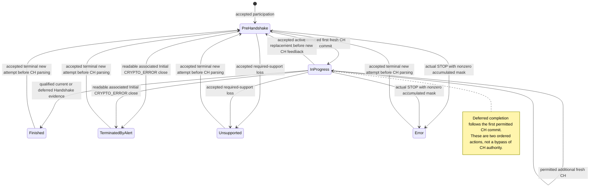

This diagram summarizes QUIC paths, not a replacement for all TCP predicates or the full P2 transition matrix. Deferred completion executes only after the first permitted CH commit has established InProgress; it is not a direct PreHandshake-to-Finished bypass. The active replacement arrow resets once before the adopted candidate's feedback-controlled CH publication; terminal replacement resets before CH parsing. Required support-loss handling in other eligible states follows the accepted cause-specific policy, not an inferred restriction to the two arrows shown.

### 4.2 CH authority, count and timestamp

A successful result becomes authoritative only on permitted normal commit. It updates CH count, fingerprint, version offer, early_data and timestamp coherently. Retransmission and Retry-compatible byte-equivalent delivery do not create another logical observation or refresh time. Fresh accepted message offsets can produce another CH, including a third; legality is not invented by the parser.

For QUIC the timestamp is the arrival time of the datagram completing the full CH, not the first byte or callback wall clock. Carry a stable scalar through the current-result lifetime unless an existing getter is proven to supply that exact stable value. Synchronous commit alone is not that proof.

### 4.3 Attempts and replacement

Retry-compatible restart remains the same attempt: distinct retained Initial context, token evidence, offset-zero CRYPTO start, equal overlap, no contradictory identity and consistent nonzero SCID when available. It does not prove a server Retry. Retain the original and accepted replacement contexts. HRR-compatible CH2 likewise does not prove an observed server HRR.

**Active replacement:** evaluate a complete candidate in isolation. Require offset-zero stream, a context distinct from all active contexts, exclusion of retransmission/restart, inconsistent known CH identity and no available retired match. Check joint admission and old last uses before sole-policy reset. Candidate failure leaves active authority intact.

**Terminal replacement:** classify before CH parsing using attempt-level evidence: distinct context from all terminal contexts, offset-zero stream, no late duplicate/retransmission, no restart and no available retired match. After acceptance retire available old identity, reset attempt-local semantic/support state and enter PreHandshake before CH parsing. A later failure belongs to the new attempt; do not restore old terminal authority.

Nonzero SCID is supporting evidence; zero-length SCID neither proves nor rejects a new attempt. Missing optional retired identity alone is not rejection. Ambiguous input neither merges nor resets.

### 4.4 Failure and conservative outcomes

| Condition | Outcome |
|---|---|
| Partial/gapped CH with required support intact | Retain admitted partial support; no CH authority |
| Duplicate/equal overlap | No count/time/finding refresh |
| Conflicting overlap or ambiguous association | No merge/reset or invented violation; preserve unrelated authority |
| Candidate-only capacity/trial failure | Return candidate-owned claims; preserve accepted active attempt |
| Loss of required accepted inspection support | Cause-specific Unsupported before every affected projection, even an internally available finding |
| Loss of optional retired history | Not automatically Unsupported; use remaining accepted policy |
| Blocking parse with neutral feedback | No successful CH/FP and no invented Error |
| Resource eviction | Safe retirement, not synthetic SessionEnd or IncompleteHandshake violation |

0-RTT and opaque 1-RTT traffic do not advance state. Missing mitigation-only context is not required inspection-support loss.

## 5. Runtime Flows

### 5.1 Normal CH and partial/multiple units

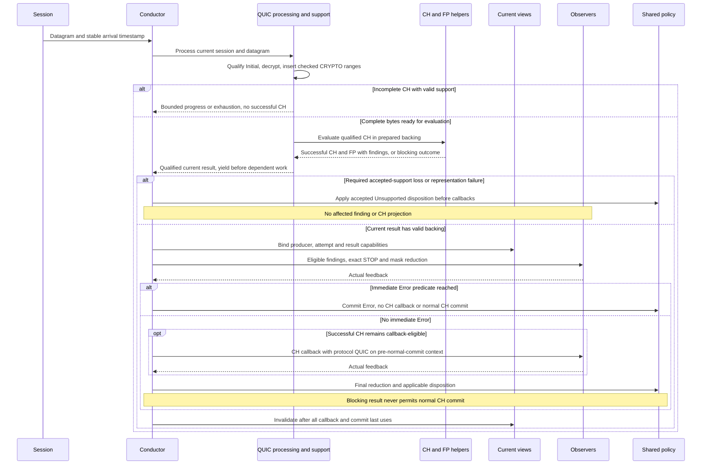

A CH spanning datagrams uses the completing datagram's time. Multiple CRYPTO frames/ranges can contribute to one CH. Coalesced packets can yield several relevant units; after each yield the Conductor resolves feedback/state before requesting more. Progressed IGNORE must consume input or change bounded traversal state. Exhaustion ends current safe traversal; it is not CH completion.

### 5.2 TCP processing and resumed continuation

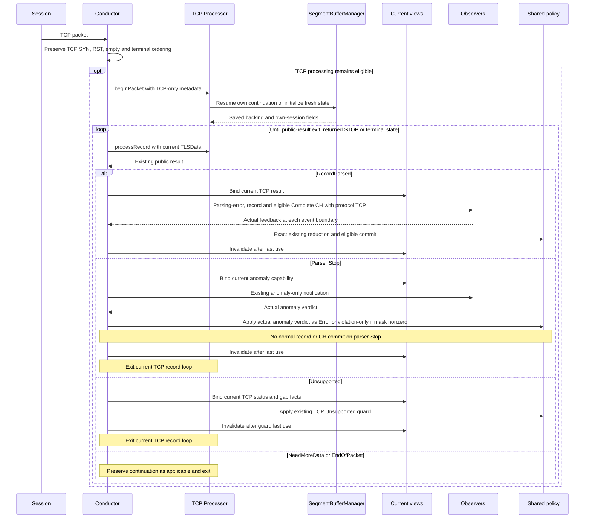

The loop separates RecordParsed dispatch from the distinct Stop, Unsupported, NeedMoreData and EndOfPacket exits. On TCP parser Stop, the actual anomaly verdict commits Error for STOP with nonzero mask, violation-only metadata for Continue with nonzero mask, and neither for zero mask; no normal record/CH commit occurs (CODE L3490-3501). D6-01 restores the resumed session's own fields before affected evaluation. Interleaving another TCP or QUIC session cannot replace its saved digest/version/locator provenance.

#### 5.2.1 Interleaved producers and resumed TCP

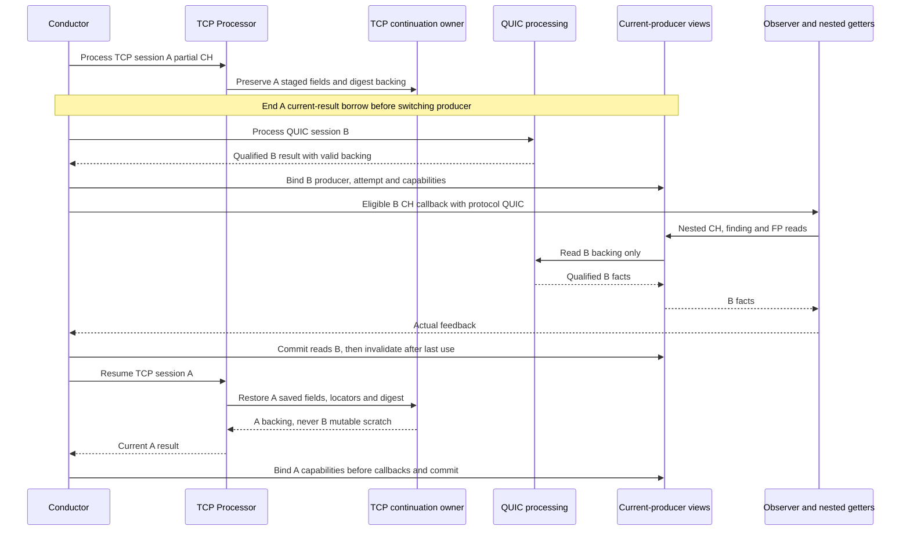

This is serial interleaving, not concurrent or reentrant packet processing. Nested getter calls are permitted reads of the bound producer. Session-indexed ownership alone is insufficient if a shared viewer or mutable digest still refers to the previous producer. Same-protocol A/B interleaving has the same provenance obligation (D6-01; PKG Sections 4/6; SC interleaving cases).

### 5.3 Actual STOP/mask reduction and blocking findings

| Current-unit feedback | Required behavior |
|---|---|
| No live listeners | Neutral feedback; no fabricated verdict |
| Current STOP and accumulated actual mask nonzero | Immediate Error; suppress later same-unit projections and normal commit; return STOP |
| STOP/0 while accumulated mask is zero | End current listener list; latch STOP; remaining eligible same-unit projections may run |
| Later Continue/nonzero after earlier STOP/0 | Do not stop immediately at that Continue event; final reduction produces Error if the mask remains nonzero |
| All Continue with final nonzero mask | Violation-only metadata; suppress normal commit; not automatic Error |
| Final zero mask | Normal commit only for qualified successful/applicable result; latched STOP still forbids later units |

QUIC finding projections precede CH and each supported current reason is delivered once in stable order using finite current storage. A blocking outcome has anomaly-only eligibility, no CH callback and no successful CH commit. STOP/0 does not create Error, but still prevents later units. A later actual mask combined with latched STOP can create Error at final reduction. Required accepted-support loss takes precedence before all affected callbacks.

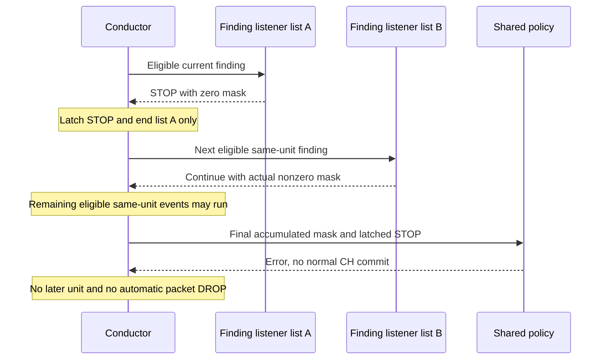

Earlier actual consumer side effects are not rolled back if a later independent packet trial fails. A datagram is not an all-or-nothing observer transaction.

### 5.4 Active versus terminal replacement

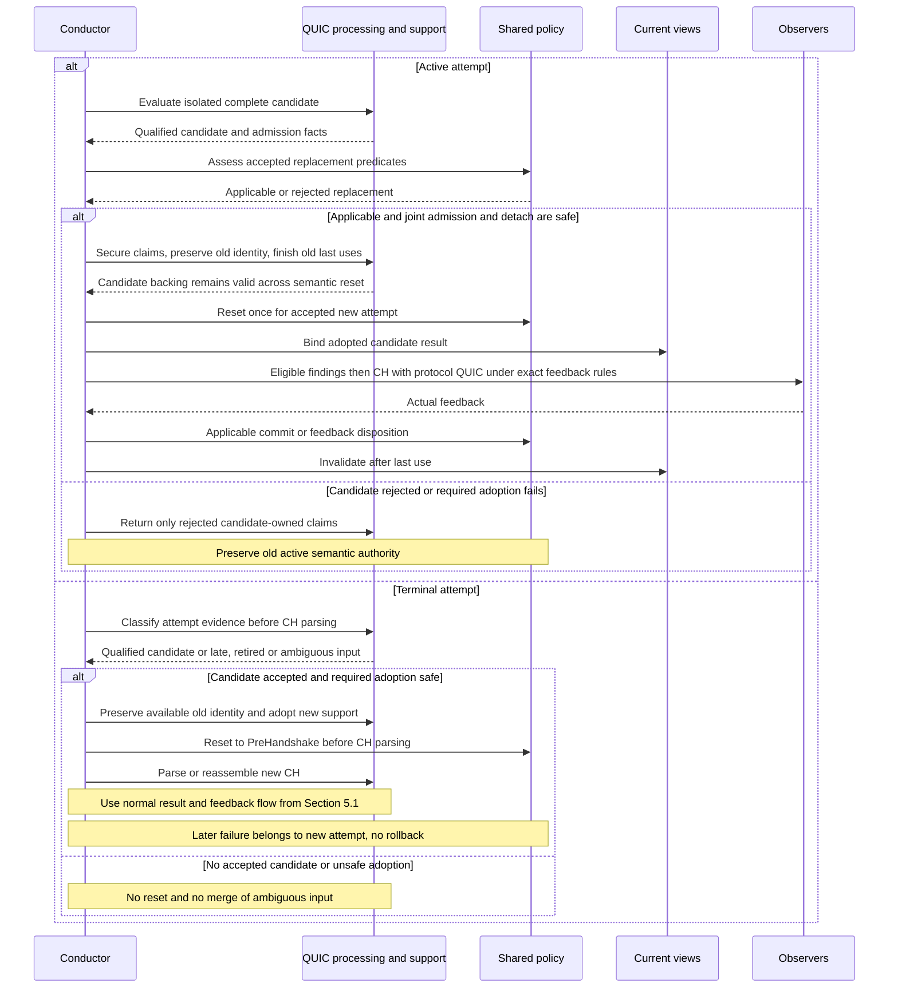

This is coordination, not two independent acceptance algorithms. Protocol facts come from QUIC; semantic applicability comes from policy. Terminal classification does not use a CH parsed before reset.

### 5.5 Completion, close and safe failure

Qualified associated Handshake evidence before CH is deferred in the same attempt's bounded support. After a permitted first CH commit, policy may apply that evidence in the same semantic cycle. If CH normal commit is suppressed by actual feedback, deferred evidence cannot manufacture authority. Handshake evidence after authoritative CH can produce a semantic-only Finished disposition with no synthetic Record callback.

Readable associated Initial CRYPTO_ERROR close produces the distinct TerminatedByAlert disposition. An unreadable encrypted close is not inferred. Repeated evidence does not repeat a transition or reclaim mark.

Blocking packet/frame/CH failure ends the affected parse. All-Continue feedback allows later work only if an independent next packet boundary is already known and the resulting state permits it. Unknown boundary exhausts safe current input. Capacity failure of a trial is not automatically loss of accepted support; required accepted-support loss suppresses all affected current consumers before Unsupported.

#### 5.5.1 No-projection completion and deferred evidence

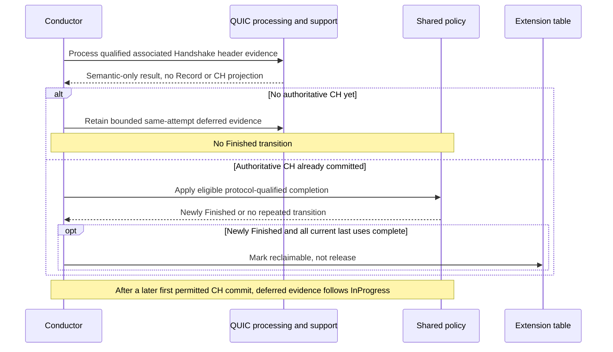

Readable associated Initial CRYPTO_ERROR close is a separate terminal disposition, not this Finished path. A suppressed CH commit cannot unlock deferred completion. Marking never authorizes destruction of live callback/commit backing.

### 5.6 Aging, eviction and reclaim

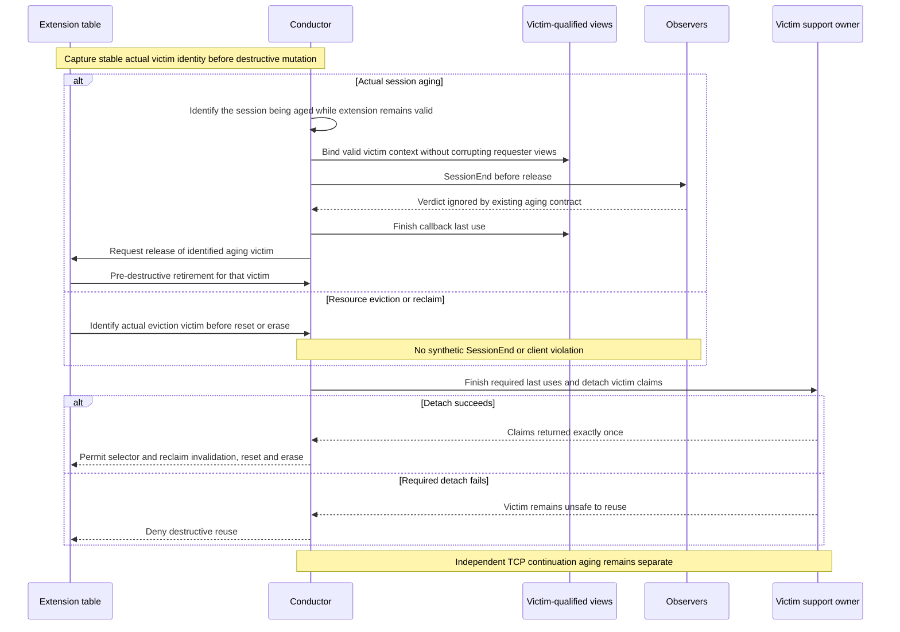

Requester A's current result remains valid while victim B is retired. Stable victim keys are captured before container mutations. A newly Finished mark is eligibility metadata, not immediate release or guaranteed insertion. Repeated cleanup after ownership is gone is a no-op. TCP continuation aging remains independently owned.

## 6. Data Ownership, Lifetime and Runtime Bounds

### 6.1 Ownership and last-use table

| Data | Owner | Borrowers / lifetime |
|---|---|---|
| Active TLSData | Existing extension/table storage | Policy writes; observers read valid precommit context |
| QUIC support arenas and contexts | Long-lived QUIC processing owner | Extension binding borrows accepted claims |
| Isolated candidate backing | QUIC owner | Not live semantic authority; retained only while admitted |
| Retired identity/deferred evidence | QUIC owner, bounded claims | Attempt-qualified, never a second TLSData |
| Datagram bytes | Existing packet owner | Borrowed synchronously; copy only required retained bytes into prepared backing |
| Current CH/finding/digest/locator backing | Producing protocol's prepared storage | Valid through nested callbacks, reduction and independent commit reads |
| Callback wrapper | Existing synchronous delivery scope | Wrapper lifetime does not define backing lifetime |
| TCP continuation | Existing SegmentBufferManager | Restored for its own session; independent aging |

No asynchronous retention or reentrant processing is assumed by the accepted serial contract. A consumer requiring longer ownership must satisfy its existing prepared-storage contract; it cannot retain a borrowed wrapper or pointer after invalidation.

### 6.2 Admission, rollback and release

Admission publishes a binding only after all required claims are secured. Partial failure unwinds newly owned claims only. Old accepted backing remains charged until its last callback/commit/detach use. A replacement must not free old backing early to make an otherwise impossible admission appear successful.

Retirement captures actual victim identity and ownership before destructive mutation, invalidates stale selectors and reclaim membership safely, and returns claims exactly once. Required detach failure denies reuse. Candidate expiry releases candidate claims without resetting accepted authority. Resource eviction does not masquerade as protocol termination.

### 6.3 Finite capacities and simultaneous-live peak

Numeric values are intentionally not invented. Each dimension requires a finite startup-approved value and an explicit Full/failure outcome.

| Symbolic dimension | Charged storage/work | Admission and failure rule |
|---|---|---|
| Datagram/plaintext/scratch bytes | Current packet, decrypt output and provider workspace | Reject unsafe extent or unavailable trial workspace before affected use |
| CRYPTO bytes and range descriptors | Accepted reassembly and insertion metadata | Check both byte and descriptor capacity; no hidden growth |
| Initial contexts and trials | Retained active/restart/candidate contexts | Finite context count and trial visits; no unbounded key search |
| CH/FP/locator/finding storage | Current and retained evaluation backing | Preflight representation; no partial successful publication |
| Candidate and retired claims | Isolated candidate plus suppression history | Separate optional history from required active association |
| Extension and reclaim metadata | Active bindings, registrations and victim coordination | Stable identity and safe detach before reuse |
| Observer/reason/lifecycle visits | Finite lists and claims | Bound visits and ensure progress or termination |

Joint admission accounts for **old still-live + candidate + destination + temporary/provider scratch + metadata** at the same instant. Charge aliased physical storage once, but do not assume two simultaneously live claims alias safely. Numeric/layout approval must prove this peak before activation.

### 6.4 Work bounds and arithmetic

Every traversal consumes checked bytes, advances a finite cursor/range/context/reason, yields for feedback, or terminates. A progress result cannot return forever with unchanged traversal state. Unknown packet boundaries terminate safe traversal; no resynchronization scan over arbitrary ciphertext.

Check offset/length extents, varint representability, range endpoints and destination sizes before pointer arithmetic, insertion or provider use. Preflight semantic counter representation before affected consumers; D6-08 forbids wraparound. Do not invent a new client violation for local representational exhaustion. The semantic count-overflow disposition is already decided: explicit local Unsupported before affected callbacks, preserving prior committed facts, with no wrap or invented violation (P5 D6-08; SC CAP-05; TC Section 6). Exact field widths, provider representations and broader narrowing require API evidence before dependent implementation finalization; they do not reopen that decided outcome.

Startup allocation is allowed. After startup there is no dynamic allocation, capacity growth or heap fallback in affected packet, aging, retirement, failure, provider, callback or diagnostic paths. Logical acquire/recycle is not evidence of no allocation. Transitive code and instrumentation must demonstrate conformance.

### 6.5 Isolation, current-producer correctness and continuation restoration

- **Cross-session/attempt isolation:** digest, FullString, locators, version/counts, SNI, findings, timestamp and protocol provenance belong to the qualified producing session/attempt/result. Reusable helper objects do not authorize reading another session's mutable scratch.
- **Current-producer correctness:** Conductor callback construction, Factory/Application nested getters and independent commit reads resolve the same binding. A cached viewer handle must resolve the current binding when read, not remain attached to the last producer. The callback's copied protocol is immutable; changing the routing selector cannot change an already constructed ClientHelloData value.
- **Continuation restore correctness:** under D6-01, restore the resumed TCP session's own saved fields/digest/locators before affected evaluation and neutralize fresh state. Restore/recompute only the required own-session fields and do not hash an already processed CH prefix twice. A QUIC callback between TCP segments must not change that continuation's data or protocol. TCP continuation ownership/aging stays independent.
- **Binding invalidation versus TCP retention:** invalidation ends the current borrow and prevents stale reads; it does not clear retained TCP Complete status or its existing callback eligibility. Rebind the next TCP result with its legitimate retained capabilities. Only the existing TCP predicates plus authorized deltas control parser/state resets.
- **Storage:** protocol is a fixed-size scalar in the existing synchronous callback envelope. It requires no runtime allocation or per-session protocol registry. Persisting it downstream uses that consumer's prepared owned storage and does not extend FP/SNI/FullString borrow lifetimes.

## 7. Existing-Code Changes and Delivery

### 7.1 Retain/change/extract/add map

| Existing symbol or role | Action | Target delta / preservation |
|---|---|---|
| TLSFlowConductor::prepareInboundExtension / process | Change narrowly | Protocol selection before TCP-only work; preserve TCP branch ordering |
| dispatchStepResult / analyzeProcessResult / notify | Retain TCP; add QUIC dispatch beside it | Exact TCP public-result behavior and actual feedback reduction |
| commitNormalCurrentRecord / commit* / updateTLSDataOn* | Extract cohesive policy responsibility | Single semantic applicability/write site; no duplicated setters-only policy |
| IProcessor / PayloadParams / TLSStepResult | Retain | No mandatory common TCP/QUIC interface |
| Processor::beginPacket / processRecord | Retain with authorized correction | D6-01 own-session restoration; preserve staged acquisition |
| Canonical CH parsing / digest helpers | Share narrowly | No FP format/order change or full TCP buffering |
| SegmentBufferManager | Retain | Independent continuation ownership/aging |
| Factory/Application viewers | Change | Current-producer qualification through both public nested getters and Conductor reads; Record stays TCP-only |
| Shared TLSFlowProtocol and ClientHelloData | Add enum; extend envelope | Required explicit protocol construction and getProtocol(); unchanged callback signatures and canonical FP |
| Protocol-aware consumer integration | Change narrowly | Carry protocol to required statistics/visibility/action selection; preserve TCP behavior; QUIC mitigation implementation remains external |
| Extension table alloc/release/reset paths | Change | D6-02 actual-victim pre-destructive retirement |
| QUIC processing and owned support | Add | Long-lived prepared acquisition/evaluation responsibility |
| Affected counters/extents | Correct explicitly | D6-08 no-wrap and checked representation |

CODE anchors checked against the currently available aggregate snapshot: Conductor L3393-3588; CH/state updates L3788-3853; notifier L4008-4025; IProcessor L4436-4478; TCP staging L5410-5584; local CH guard L6301-6306; table release L2898-2922. These anchors identify the supplied aggregate snapshot, not an inferred split-file repository commit.

Preserve suspected SD5/SD7 behavior pending a concrete authorized investigation. The HLD does not declare those suspected defects fixed. No optional flow hierarchy, generic allocator, common result adapter or DTLS framework is a delivery prerequisite.

### 7.2 Minimum coherent delivery order

| Slice | Work | Exit evidence / dependency |
|---|---|---|
| D1 Reference basis | Preserve input identities, active 84-case oracles/traces, exact TCP reference behavior and authorized D6-01/02/08 correction deltas. | Reference evidence, not activation or executed regression. |
| D2 Semantic actions | Depends on D1. Cohesive shared actions and applicability with preserved TCP contract; retain staged TCP and required restoration/no-wrap corrections. | Differential TCP evidence before using the refactor operationally. No QUIC activation. |
| D3 Support and retirement | Depends on D1. Prepared ownership/binding, joint admission, acquired-only rollback and actual-victim retirement before destructive reuse. | Exact detach/container/last-use behavior before the affected destructive integration is used. No QUIC activation. |
| D4 QUIC acquisition/evaluation | Depends on D1 and D3 ownership contract. v1 Initial, bounded CRYPTO/CH, canonical helpers, association/attempt policy and qualified finding/success facts. | Provider, safe progress, canonical FP and attempt/finding evidence. D3/D4 can develop against the same fixed ownership contract; neither enables a partial feature. |
| D5 Conductor/facade integration | Depends on D2-D4. Explicit result routing, actual feedback, sole policy invocation and current-producer nested views; include U7-PARSE-01 and U7-TIME-01. | Full in-scope callback/state/provenance/ownership traces and actual API conformance. No product profile/port or mitigation-context prerequisite. No QUIC activation. |
| D6 Integrated readiness | Depends on D2-D5. Approved finite startup capacities, checked simultaneous peaks, actual provider/API/borrow/detach fit, transitive no-allocation/work audit and regression evidence. | Only after all applicable exits and normal authorization for the affected in-scope path. Static design completion is not authorization. External feature integration remains its own scope. |

D3/D4 may develop against the same ownership contract; unsafe support must not be exposed before retirement is ready. D5 includes explicit enum/ClientHelloData construction, current-producer routing and focused protocol propagation. D6 requires the applicable closure evidence below; external consumer implementation remains separate.

### 7.3 Focused validation and remaining closure points

| Obligation | Required decision source / owner role | Blocking point |
|---|---|---|
| DF01 provider evidence, scratch and failure contract | Actual crypto/header/packet provider plus QUIC implementer | Before dependent API/layout finalization or provider use |
| DF02 current-producer and consumer fit | Actual Factory/Application/observer getters and Conductor integration | Before dependent interface finalization and D5 exit |
| DF03 retirement/container conformance | Table/support APIs and actual victim/detach behavior | Before dependent retirement finalization and D3/D5 exit |
| DF04 numeric finite capacities and peak | Engine/support/layout owner with design approval | Before D6 activation |
| DF05 transitive allocation/work audit | All affected Engine/provider/callback paths | Before D6 activation |
| DF06 executed regression/performance/platform evidence | TCP/QUIC validation and platform owners | Relevant slice exits and activation decision |

DF02 covers explicit ClientHelloData construction, unchanged listener signatures/event bits and cached/nested getter provenance. External consumer redesign is not required to close an unrelated global audit; affected downstream paths must satisfy their own no-allocation and integration obligations before enablement. No unavailable CPU/RAM budget is assumed. An API incompatibility affecting state, ownership or selected boundaries requires a design correction, not numeric tuning.

Validation reuses SC/WF oracles and distinguishes preserved TCP behavior from authorized corrections:
- TCP public results, retained Complete callbacks, partial/resumed CH and exact STOP/mask ordering: 3.2, 5.2-5.3, 8.2/8.4.
- QUIC coalescing, CRYPTO gaps/overlap/duplicates, safe traversal and one-time FP evaluation: 3.3, 4.4, 5.1/5.5.
- Additional CH, active/terminal replacement, retired suppression and deferred completion/close: 4.2-4.3, 5.4-5.5.
- Interleaved producers, own-session restoration without double hashing, timestamp, protocol and FP/FullString parity: 5.2.1, 6.5, 9.2/9.6.
- Capacity boundaries, simultaneous-live peaks, overflow, failed admission/detach, aging/eviction and actual-victim isolation: 5.6, 6, 9.3-9.5.
- Transitive allocation instrumentation and bounded-work/performance measurements: 6.4 and DF05-DF06.

These are planned validation obligations. I01-I05 are checked at their external integration boundaries, not claimed implemented by the metadata change.

## 8. Processing Interfaces

These are behavioral interfaces between responsibilities, not C++ declarations or a requirement for abstract base classes.

### 8.1 API Overview: TLSFlowConductor and Below

This subsection opens the three responsibilities in 2.1 at API level. The three UML views show callable operations and dependencies, not private fields, class layouts, inheritance or an implementation sequence. **API does not mean a pure abstract class.** A box can denote an existing concrete object, a group of existing callable APIs, or a proposed logical API boundary. Splitting boxes does not require splitting classes.

**Legend:** Existing = verified symbol in the supplied code; Changed = existing behavior with an authorized integration/extraction change; Proposed = operation vocabulary for discussion, not an accepted C++ declaration or an implemented capability. Existing I-prefixed names retain their actual code meaning; new role boxes do not mandate I-prefixed types, virtual dispatch or wrappers. New names in these diagrams are descriptive labels only. Ellipses omit arguments/getters for readability, not a complete signature. Existing exact contracts remain in 8.2-8.5 and 9; proposed QUIC API questions are collected in 8.6.

The drawing boundary starts at TLSFlowConductor and goes down into processing, parsing, support and state access. Session registration, Factory/Application composition and downstream consumers are not expanded here. Their existing contracts remain elsewhere in this HLD. Statistics/baseline policy and mitigation remain outside scope.

#### 8.1.1 TLSFlowConductor: TCP and QUIC API Map

```mermaid
classDiagram
    direction TB
    class TLSFlowConductor {
        select producing path
        coordinate current result and feedback
    }
    class TCPProcessingAPI {
        <<Existing>>
        beginPacket(PayloadParams)
        processRecord(TLSData) TLSStepResult
        isContinuationGap() bool
        getContinuationMode() ContinuationMode
    }
    class TCPReadAPI {
        <<Existing>>
        getLastRecord() Record
        getLastError() ParsingError
        getClientHelloParsingStatus() Status
        getFingerprint(out)
        getSni(out)
    }
    class QUICProcessingAPI {
        <<Proposed>>
        beginDatagram(datagramContext)
        nextUnit(semanticContext) qualifiedResult
        resolveCoordination(decision)
        retireSupport(victimBinding) outcome
    }
    class QUICReadAPI {
        <<Proposed>>
        readCurrentCH() qualifiedView
        readCurrentFindings() boundedView
        readCurrentEvidence() qualifiedFacts
    }
    class CurrentProducerBindingAPI {
        <<Changed>>
        bindCurrent(producerAndCapabilities)
        invalidateCurrentAfterLastUse()
    }
    class SharedPolicyAPI {
        <<Changed>>
        assessApplicability(evidence)
        applyPermittedDisposition(context)
    }
    class ExtensionTableAPI {
        <<Changed>>
        get(sessionId)
        alloc(sessionId)
        release(sessionId)
        markReclaimable(sessionId)
        retireActualVictimBeforeMutation()
    }
    TLSFlowConductor ..> TCPProcessingAPI : TCP calls
    TLSFlowConductor ..> TCPReadAPI : TCP facts
    TLSFlowConductor ..> QUICProcessingAPI : QUIC calls
    TLSFlowConductor ..> QUICReadAPI : QUIC facts
    TLSFlowConductor ..> CurrentProducerBindingAPI : bind and end borrow
    TLSFlowConductor ..> SharedPolicyAPI : sole semantic writer
    TLSFlowConductor ..> ExtensionTableAPI : extension lifecycle
```

TCPProcessingAPI denotes existing IProcessor operations; TCPReadAPI groups IClientHelloDataViewer, IRecordsDataViewer and IParsingErrorViewer. These groups are not new wrappers. The same TCP Processor supplies all four existing APIs. The CH getter group also includes version, counts, supported-version mask, early-data and FullString reads; see 9.2/9.6. Record reads remain TCP-only.

QUIC nextUnit is a proposed name for one relevant yield, not a datagram-wide transaction or a TLS Record. resolveCoordination denotes any necessary acceptance/adoption/resume handoff before dependent work; its necessity, grouping and arguments are to be discussed in 8.6. The QUIC owner returns qualified facts; shared policy, not that owner, decides semantic applicability and writes TLSData. Current binding remains valid through callback and independent commit reads. The table retirement operation is a required new seam, not an existing method claim; it must identify the actual victim and deny destructive reuse on failed detach.

**Basis:** Code: IProcessor, viewer headers, TLSFlowConductor::process/analyzeProcessResult and extension-table APIs. Target changes: 3.1, 3.5-3.7, 6.5 and 9.1-9.4. No new common TCP/QUIC processor API is selected.

#### 8.1.2 TCP API Mapping to Existing Processing and Shared Helpers

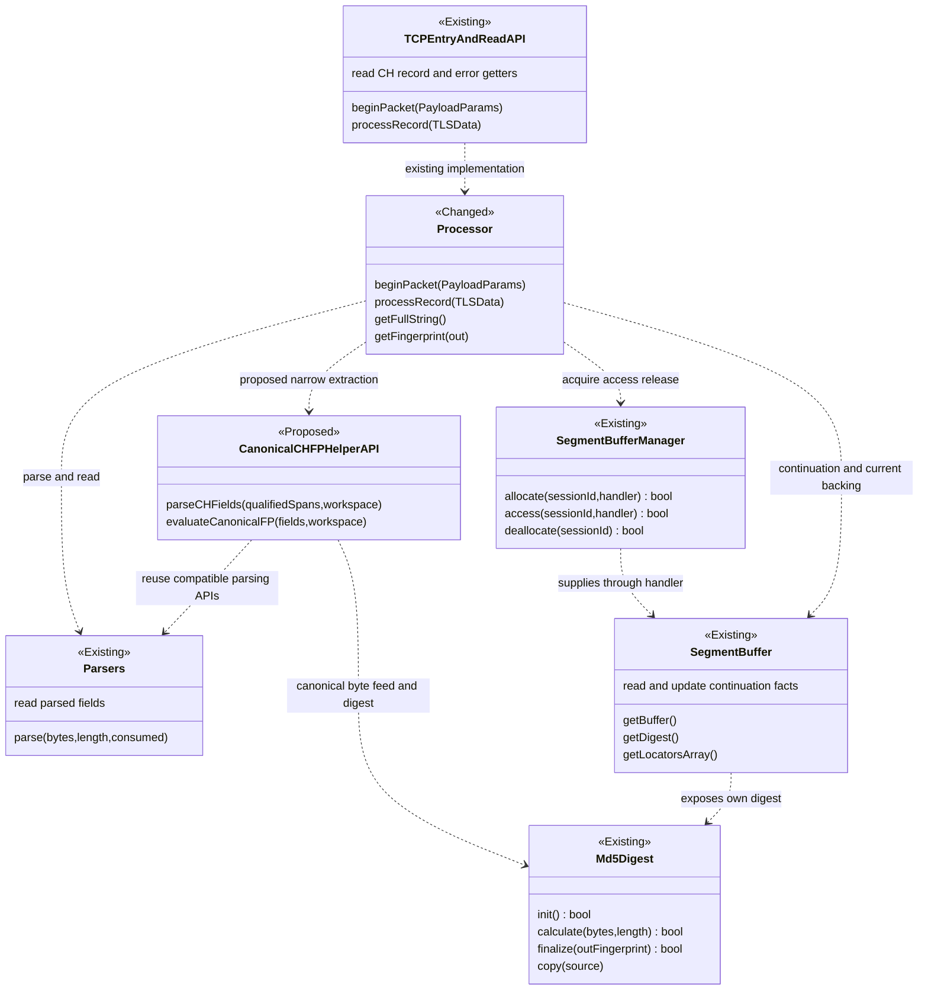

**New TCP-facing work is the narrow shared-helper seam and current-result integration, not a mandatory replacement for IProcessor.** The proposed helper operations label the callable extraction points; they are not new universal evaluators. Processor retains staged record/handshake/CH orchestration, existing public results and TCP continuation modes. No full-CH buffering is imposed on TCP. The helpers consume producer-selected spans and workspace; they do not own TCP continuation or live TLSData.

Parsers groups TLSRecordParser, TlsHandshakeParser, ClientHelloParser, ExtensionsParser, CipherSuitesParser, SniParser, SupportedVersionsExtensionParser, SupportedGroupsExtensionParser and TlsAlertParser. Their parse signatures differ: for example ClientHelloParser also takes expectedLength. The diagram's grouped parse notation does not replace those signatures. Record and alert parsing stay on TCP; only semantically compatible CH/FP operations are shared.

SegmentBufferManager supplies a session's SegmentBuffer through the existing handler API; Processor also uses its existing initial nonsegmented SegmentBuffer directly. The manager retains independent continuation aging. Digest and locator backing follow the actual selected buffer, not another producer's scratch. D6-01 own-session restoration remains an authorized correction, not an already proven guarantee.

**Basis:** Code: Processor.hpp/.cpp, ITLSParser.hpp, TlsParser.hpp, ISegmentBufferManager.hpp, SegmentBufferManager, SegmentBuffer and Md5Digest. Proposed extraction: 3.2/3.4 and 8.4. No new private members, class hierarchy or parser algorithm is specified here.

#### 8.1.3 QUIC API Map: Acquisition, CH Evaluation and Support

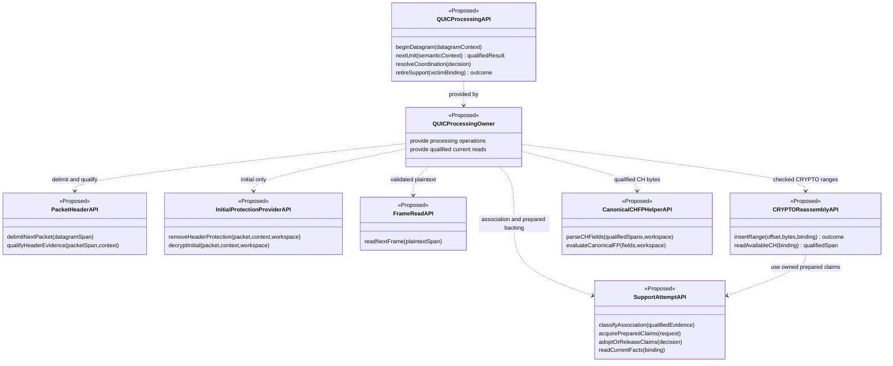

All new operation names above are **proposals for API discussion**, not claims about available crypto-provider methods. Packet delimitation uses safely readable extents; protected-field qualification depends on protection removal or a verified upstream contract. The diagram is a dependency map, not an assertion that every header fact is usable before decryption. DF01 must establish the actual provider operations, scratch and failure behavior before dependent API finalization.

The support and reassembly boxes may be functions/members within the same QUIC owner. They do not introduce a separate allocator service, attempt manager class or one class per parsing step. Acquisition and attempt classification return evidence, not permission to reset TLSData. Active-candidate and terminal-replacement ordering remains exactly 4.3/5.4. Support claims and CH/FP backing survive all required callback/commit last uses; local claim acquisition uses startup-prepared storage only.

CanonicalCHFPHelperAPI is the same logical helper seam shown for TCP, not necessarily the same mutable helper instance. Producer-owned workspace prevents TCP/QUIC or cross-session contamination. No TLSRecord, TCP sequence or SegmentBufferManager contract is imposed on QUIC.

**Basis:** accepted HLD responsibilities and contracts in 3.3-3.6, 5, 6, 8.3-8.4 and 9.1-9.5. This view proposes API decomposition only; actual method grouping, argument types and provider fit remain open in 8.6.

### 8.2 Conductor to TCP Processor

| Contract aspect | Definition |
|---|---|
| Caller / provider | Existing Conductor / existing TCP Processor |
| Input | Borrowed current TCP payload plus existing scalar length/session/sequence metadata; current TLSData for record processing |
| Preconditions | TCP selected; valid extents; own-session continuation restored before affected evaluation |
| Operations | Existing beginPacket followed by processRecord at the existing step boundary |
| Output | RecordParsed, NeedMoreData, Unsupported, EndOfPacket or Stop; current TCP views and continuation mode/gap facts |
| Side effects | Protocol acquisition and prepared continuation state, not independent semantic TLSData writes |
| Lifetime | Packet borrow synchronous; retained continuation owns prepared backing; current views remain valid through their existing consumer/commit last use |
| Failure | Preserve each public-result dispatch and exact Unsupported guard; parser Stop is anomaly-only, not an automatic Error or DROP |

### 8.3 Conductor to QUIC Processing

| Contract aspect | Definition |
|---|---|
| Caller / provider | Conductor / long-lived QUIC processing owner |
| Input | Borrowed current datagram, stable arrival timestamp, session identity, current semantic eligibility and explicit accepted support binding |
| Preconditions | QUIC path selected; prepared owner/provider initialized; extents checked before unsafe use |
| Output dimensions | Progress/blocking status; qualified fresh CH/FP availability; finite findings; explicit semantic/support disposition; safe traversal continuation/exhaustion |
| Yield | One relevant unit at a time before dependent later authority; not one universal datagram result |
| Progress | Consumes bytes or advances bounded state; otherwise yield/exhaust/fail, never unchanged infinite progress |
| Semantic-only result | Qualified completion/close/replacement-coordination/support disposition may require policy handling without an observer projection; no later authority-dependent parsing proceeds until the coordinator resolves it |
| Blocking outcome | No successful affected CH/FP; eligible bounded findings only; safe later work depends on actual feedback, state and known boundary |
| Ownership | Support owner retains backing through callback and commit last use; input packet is not retained by pointer beyond its valid lifetime |
| Failure | Distinguish local trial/candidate failure from required accepted-support loss; the latter suppresses all affected projections before Unsupported |

No-projection does not mean no policy work. Exhaustion does not mean success. Finding presence does not imply violation. Fresh success and retained TCP Complete eligibility are not the same predicate.

### 8.4 Protocol Acquisition to Canonical CH/FP Helpers

| Contract aspect | Definition |
|---|---|
| Caller / provider | TCP staged orchestration or QUIC CH orchestration / canonical helper algorithms |
| Input | Valid protocol-owned CH bytes or supported staged field spans, own digest/locators/scratch and explicit current availability |
| Preconditions | Checked extents and prepared capacity; no bytes synthesized across CRYPTO gaps |
| Output | Canonical parsed facts and FP on successful complete evaluation; finite finding facts with explicit blocking/success availability |
| Side effects | Producer-local evaluation backing only; no observer verdict, live TLSData write or attempt reset |
| Lifetime | Caller owns backing and controls last use; no hidden owned CH copy required for symmetry |
| Failure | Invalidate affected success; retain representable findings only when support remains valid; do not change TCP taxonomy automatically |

### 8.5 Conductor to Observer Delivery

Caller is the Conductor; providers are actual registered eligible listeners. Inputs are pre-normal-commit TLSData and producer-qualified current views. Eligible CH delivery constructs the extended ClientHelloData with explicit TLSFlowProtocol and existing parsed values, under 9.6; listener callback signatures and event ordinals remain unchanged. Outputs are actual dispatch/mask feedback. No listeners is neutral feedback.

The first STOP ends its current listener list. The Conductor's current-unit accumulator begins at zero, ORs actual masks and applies 5.3 exactly. QUIC emits eligible findings then eligible CH, without Record projection. TCP retains its existing parse-error/record/Complete-CH eligibility. Returned STOP gates later units; it is not an automatic packet DROP. Borrowed wrappers and backing may not be retained asynchronously. A consumer needing persistence must make its own permitted copy into prepared owned storage before the borrow expires; this is not permission for runtime allocation.

### 8.6 QUIC APIs: Focused Discussion Agenda

The following is the starting point for the next interface discussion, not a finalized API catalogue. The behavior already accepted in this HLD remains binding; only the minimum callable seams, operation grouping and data contracts are being worked out. Do not implement the diagram labels as new classes by default.

| API question | Minimum contract to settle | Existing authority |
|---|---|---|
| Conductor to QUIC owner | Datagram input extent, stable arrival timestamp, session/support identity; start/next-unit grouping; how feedback-dependent coordination is resumed or ended | 8.3; 5.1/5.3-5.5 |
| Qualified current result | Separate progress/exhaustion, successful CH availability, blocking/nonblocking findings, semantic-only facts and support-loss disposition; specify validity and last-use boundary | 8.3; 6.5; 9.2 |
| Packet/header and crypto provider | Which operations actually exist; readable versus protection-qualified fields; packet extents, output spans, scratch ownership, authentication/failure outcomes and no runtime allocation | Q02-Q03; DF01; 6.3-6.4 |
| Frame parsing to CRYPTO insertion | Bounded frame traversal and checked offset/span handoff; duplicate/conflicting overlap outcomes; safe exhaustion without guessed resynchronization | Q02/Q04/Q15; 4.4 |
| Reassembled CH to shared helpers | Exact handshake/body input boundary, completeness/length proof, producer-owned workspace, canonical output/finding availability and borrow lifetime; preserve staged TCP | 3.4; 8.4; 6.5 |
| Attempt/support coordination | Evidence classification versus semantic acceptance; isolated candidate admission, active versus terminal adoption ordering, acquired-only rollback and victim-qualified retirement | 4.3; 5.4/5.6; 9.3-9.4 |
| Current-result reads | Minimum CH/FP/SNI/version/count/FullString/finding access; stable protocol/time provenance; existing cached viewer handles must resolve the current producer | 9.2/9.6; DF02 |

For each selected API, record caller/provider, operation, input/output meaning, preconditions, permitted side effects, backing lifetime and failure outcome. Exact new C++ names/types are decided only after the necessary provider/consumer evidence. In particular, do not add a universal result object, shared TCP/QUIC processor interface, mandatory facade layer or speculative DTLS API for diagram symmetry.

**Review boundary for this revision:** the three diagrams expose APIs only, within TLSFlowConductor and below. They do not change state policy, callback signatures, TCP public results, ownership, numeric capacities or external product scope. Existing contract sections are retained below the overview (former 8.1-8.4 are now 8.2-8.5); references to those contracts are updated. Chapter 9 remains the authority for state/view/lifecycle details. Diagram-source structure and code-symbol consistency were checked; no Mermaid renderer, C++ build or runtime validation was executed in this revision.

## 9. State, Views and Lifecycle Interfaces

### 9.1 Conductor to Shared State Policy

| Contract aspect | Definition |
|---|---|
| Caller / provider | Conductor / cohesive shared policy functions |
| Input | Current TLSData, protocol-qualified evidence, explicit success/support eligibility and required timestamp. Supply actual reduced feedback for dispatched units; no-projection and pre-dispatch operations have no fabricated verdict. |
| Preconditions | Correct producer/attempt and valid required backing. Resolve actual feedback before feedback-dependent commit. Pre-dispatch reset/adoption applicability and required-support/representation preflight occur at their own earlier boundary; they do not require invented observer feedback. |
| Output | Applicable semantic disposition and coherent writes: normal CH, completion/close, Error, violation-only, cause-specific Unsupported or reset |
| Authority | Sole semantic applicability/action/write responsibility; coordinator does not duplicate predicates |
| Side effects | No arena allocation, observer iteration, decryption or direct destructive table reuse |
| Failure | No fabricated success/verdict; representational preflight before affected consumers; incompatible facts reopen the relevant contract |

### 9.2 Current-Producer Views and Commit Backing

Caller is existing Factory/Application access during synchronous callbacks and Conductor commit reads. Provider is the selected TCP or QUIC producer. Binding includes session/attempt/result qualification and capabilities; a stale success/error from B cannot become A's facts.

Bind only after current availability is established. Keep CH, FP, SNI, finding, digest and locator backing valid through nested reads and independent commit reads. Record capability is TCP-only. Invalidate current binding availability/selectors on producer/result changes and before backing reuse. This invalidation must not clear the TCP Processor's retained Complete state or change its legacy callback eligibility; rebind legitimate retained TCP capabilities on the next eligible result. QUIC freshness is not a common callback predicate. A wrapper's destruction is not permission to release backing still needed by commit.

The protocol value copied into ClientHelloData agrees with this same binding and its qualified processing path. Existing Application/Factory CH viewer access, including nested getFullString() and previously acquired interface handles, must resolve the current producer at read time without requiring consumers to select a different viewer API. A narrow startup-prepared routing implementation may realize this contract; no universal processor interface is required.

The completing-datagram timestamp is a stable result fact. Use an existing getter only after proving arrival provenance and stability; otherwise retain the scalar in prepared current storage. No new long-lived timestamp history is required.

### 9.3 Extension Binding to QUIC Support

| Contract aspect | Definition |
|---|---|
| Caller / provider | Conductor/extension integration / QUIC support owner |
| Input | Stable session/attempt identity and requested active/candidate/deferred/retired claims |
| Preconditions | Startup capacities established; no unsafe alias with still-live backing |
| Output | Borrowed accepted binding or explicit admission failure; ownership remains with support owner |
| Adoption | Required claims secured before publication; active replacement preserves old authority until accepted; terminal reset precedes CH parsing |
| Rollback | Return newly owned claims only; duplicate lookup is borrowed; candidate failure does not erase active state |
| Release | Finish all last uses and detach before return; repeated return after ownership is gone is a no-op |
| Failure | Optional history loss differs from required inspection-support loss; no synthetic violation or mitigation-only obligation |

### 9.4 Table to Retirement Coordination

Caller is the affected table path before destructive reset/erase/reuse. The Conductor coordinates with the actual victim's protocol/support owner, not the requester/current packet's owner.

Input is stable actual victim identity/binding while storage is still valid. Output is permission to destroy/reuse only after last use, selector invalidation and required detach succeed. Failed detach denies reuse. Capture cleanup keys before container mutation; clear stale reclaim membership safely. Actual aging delivers SessionEnd before release with the existing ignored verdict; eviction does not manufacture SessionEnd or IncompleteHandshake.

### 9.5 Startup Preparation and Enablement

The existing startup composition owner creates/prepares long-lived protocol owners, provider workspace and finite capacities. It publishes runtime participation only after required initialization succeeds. Partial startup failure unwinds owned resources and does not expose a half-initialized QUIC path; existing TCP availability is governed by its own established startup contract, not invented here.

Runtime admission acquires/recycles prepared claims only. The capacity contract includes every physical and metadata dimension in 6.3 and simultaneous-live replacement peak. The work contract includes provider trials, observer visits, aging and cleanup. Neither logical pool APIs nor a static design review prove absence of transitive allocations.

Before dependent API/layout finalization, close actual provider/consumer and retirement-fit obligations DF01-DF03. Before activation, close approved finite numeric capacities/peak, transitive allocation audit and executed validation DF04-DF06. If actual evidence changes a selected boundary or required behavior, revise the affected design in a new version rather than editing only a gate conclusion.

### 9.6 Shared TLSFlowProtocol and Protocol-Qualified ClientHelloData

#### 9.6.1 Shared enum

| Aspect | Selected contract |
|---|---|
| Name and placement | TLSFlowProtocol is the working HLD label; exact C++ type name and underlying representation are implementation details. Place the shared enum in common definitions accessible to ClientHelloData/consumers without a concrete Processor or QUIC provider dependency. |
| Current values | TCP and QUIC only. No speculative DTLS value, generic UDP value or silent Unknown-to-TCP conversion. Numeric wire/serialization values are not established by this HLD. |
| Meaning | Producing TLS acquisition path: TLS-over-TCP versus TLS-over-QUIC. It is distinct from TLS version, QUIC version and IP transport numbers. |
| Provenance | Conductor supplies the value from the qualified current processing path. UDP/port classification alone cannot label an arbitrary payload as a QUIC CH. |
| Storage and mutability | Fixed-size value copied into the CH callback envelope; no runtime allocation, mutable global last-protocol value or new per-session registry. |
| Authority | Metadata only: no violation, completion, action, mitigation eligibility or provider capability is implied. |

**Future DTLS:** if support is approved, extend the same enum in that future scope; no DTLS value or implementation is added now.

#### 9.6.2 ClientHelloData extension

| Aspect | Selected contract |
|---|---|
| Field and getter | Add a protocol value of TLSFlowProtocol type; getProtocol() returns it by value. The value is read-only for the callback envelope's lifetime. |
| Construction | Every builder passes protocol explicitly with the existing FP/SNI/version/count arguments. Update Conductor and test/fixture builders; no default TCP argument or legacy constructor that silently supplies TCP. |
| Existing API | Preserve existing getFingerprint(), getSni(), getTlsVersion() and count getters, and existing listener callback signatures/event ordinals. This is an intentional constructor/layout extension, not a binary-ABI compatibility claim. |
| TCP | Supply TCP for every TCP-produced CH callback, including retained Complete callbacks on later non-CH records. That metadata does not create another CH state commit or alter the existing local MultipleClientHello guard. |
| QUIC | Supply QUIC only for qualified successful CH delivery. A blocking result cannot manufacture ClientHelloData merely to expose protocol; no synthetic CH or Record event is introduced. |
| Backing | Protocol is copied; existing FP/SNI references and FullString views retain their synchronous lifetime rules. Owning the scalar does not make the wrapper or referenced bytes safe to retain. |
| Value meanings | Keep existing version/count/SNI meanings and canonical FP/FullString pairing. In particular, getTlsVersion() is not forced to TLS1.3 because the protocol is QUIC, nor redefined as negotiated/highest version. |
| Hash identity | Protocol is not included in canonical CH bytes, FullString or FP calculation. Downstream statistics and baseline policy are outside this HLD (I02); this contract defines canonical FP identity only. |
| Failure and mismatch | Missing/invalid provenance is an internal integration error, not a TCP default, successful CH or client violation. Do not dispatch a mislabeled envelope; fix or explicitly fail the affected integration under its existing support/error contract. |

#### 9.6.3 Consumer handoff

Consumers read the same protocol getter without a new callback type. Protocol-independent consumers may ignore it. A consumer needing persistence copies the scalar into its prepared owned data without extending borrowed CH/FP/SNI/FullString lifetimes. External scope boundaries and Visibility/mitigation handoffs are recorded in 3.7.2; adding metadata does not change feedback reduction, violation ownership or TCP state policy.
