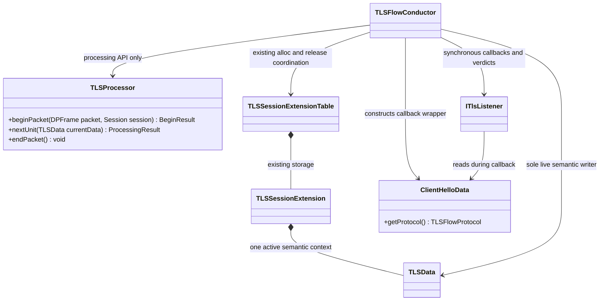
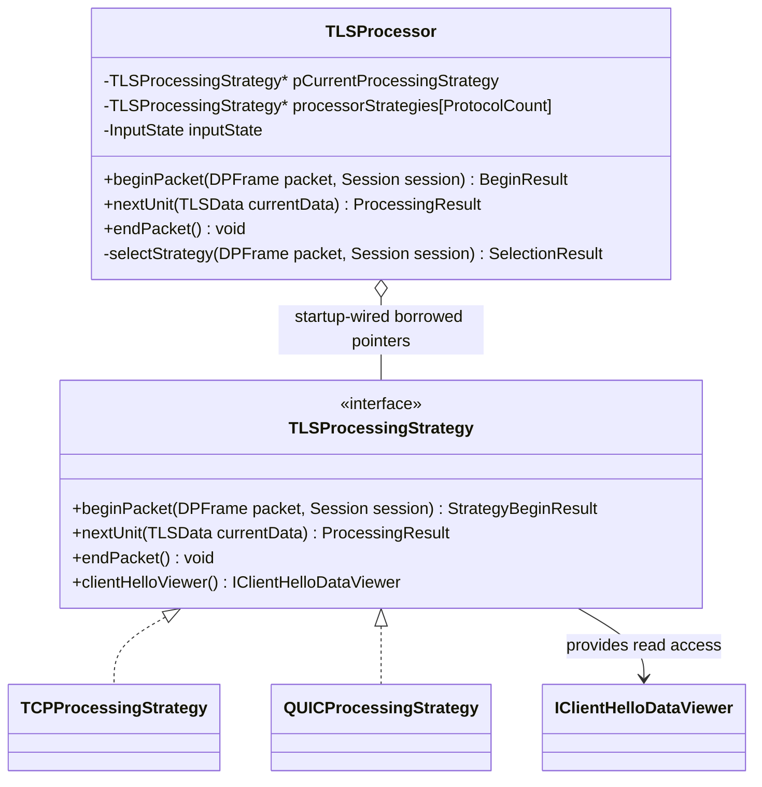
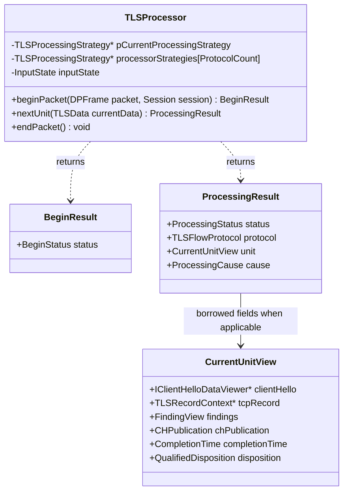
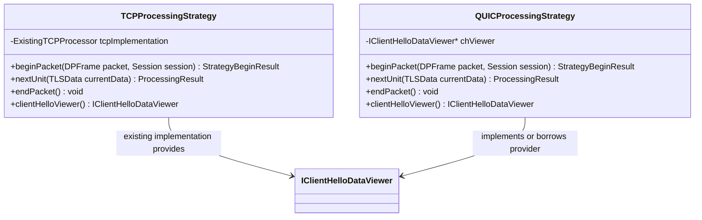
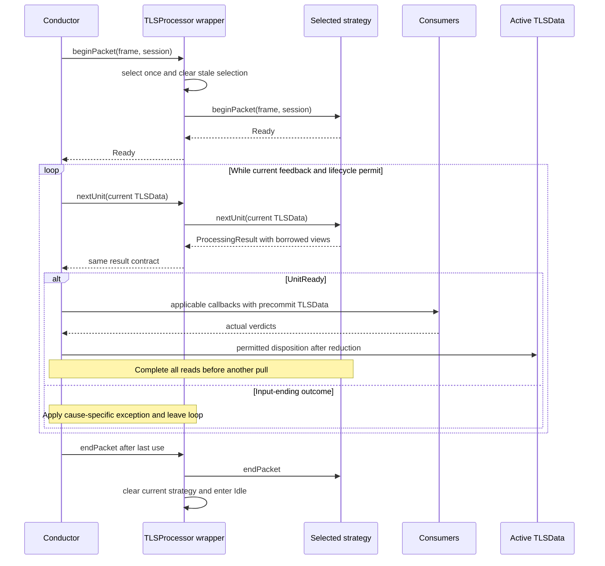
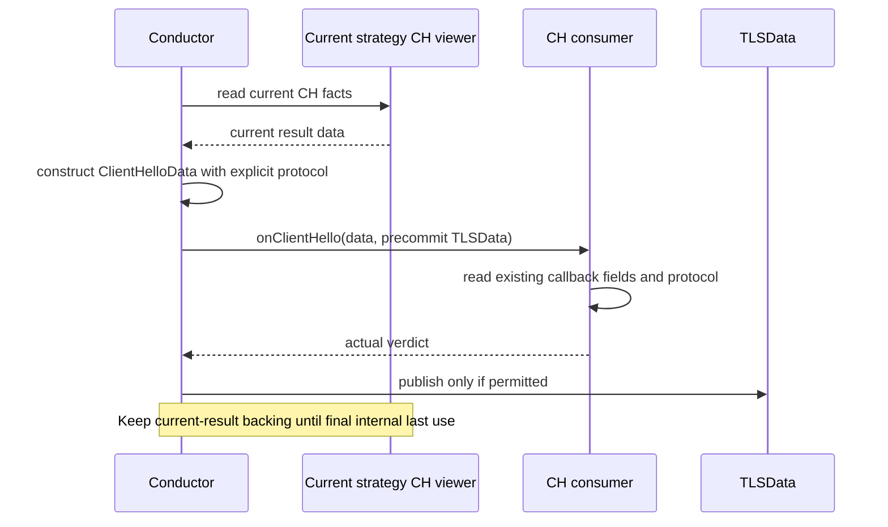

# TLS-Flow Strategy Processor Design V2

**Working name:** Strategy Processor. The wrapper is named **TLSProcessor** to distinguish it from the existing concrete TCP `Processor`. The common contract is **TLSProcessingStrategy**; implementations are **TCPProcessingStrategy** and **QUICProcessingStrategy**. “Protocol Processor” is a reasonable alternative document name. Names are proposed, not repository symbols.

**Status:** concrete design alternative for discussion, based on the latest user direction. This document does not replace official HLD V10, rerun architecture scoring, or claim implementation approval. The wrapper/strategy direction is the working proposal; exact signatures, result layout and lifecycle integration require review.

There are two main component chapters, followed by the requested Flows chapter. API declarations are descriptive signatures, not implementation code. UML is embedded as Mermaid. No algorithm inheritance base or Template Method hooks are introduced yet.

## 1. Conductor

### 1.1 Responsibility and relationships

Conductor sees one TLSProcessor. It does not select, downcast, or hold a protocol strategy. It remains responsible for participation, applicable callback dispatch, actual-verdict reduction, semantic TLSData updates, and coordination with existing extension lifecycle. Protocol applicability predicates can remain in Conductor; hiding strategy selection does not make all state rules protocol-neutral.

Composition denotes existing semantic storage, not ownership of protocol workspaces. Consumers do not acquire strategy ownership. Statistics algorithms and mitigation construction remain outside this document.

### 1.2 Processing transaction

For ordinary input, Conductor calls beginPacket once, then nextUnit repeatedly. For each relevant result it resolves applicable callbacks and permitted semantic dispositions before another pull. The next pull receives current committed TLSData, not a packet-start snapshot.

The following TCP rules are preservation obligations from the supplied source and Step 1:

1. Within an event, listeners run in priority order; masks are ORed and any Stop ends that listener list immediately.
2. Across a parsed TCP record, event order remains parsing error, TLSRecord, then eligible CH.
3. A **current event** Stop with nonzero accumulated mask commits Error immediately and prevents later events.
4. A current Stop with zero accumulated mask latches stop but allows later applicable events of this record.
5. A later Continue with violations does not cause immediate exit merely because Stop was previously latched.
6. At final reduction, a nonzero mask suppresses normal commit: Error if stop was latched, otherwise violation-only commit.
7. A zero final mask permits normal commit even if Stop was latched. Stop still prevents another pull.

ParserStopped is not observer Stop. No callback means no fabricated verdict. No result implies DROP. Unsupported follows cause-specific disposition rather than unconditional Error. Already committed earlier units are not rolled back.

TCP SYN/RST, terminal-payload and aging paths remain explicit lifecycle paths. They must not accidentally run on UDP. Conversely, terminal QUIC input must undergo accepted attempt classification rather than blindly taking TCP's terminal bypass. Exact integration of these entry gates is a migration obligation, not implemented by the wrapper diagram.

### 1.3 ClientHelloData and existing viewer access

Existing CH facts and the existing FullString API, representation, ownership and access path remain unchanged. This design does not add FullString to ClientHelloData, add a FullString accessor there, or require consumer migration for that field.

The protocol metadata addition remains independent of FullString:

| Operation | Input | Return | Meaning |
| --- | --- | --- | --- |
| getProtocol() const | None | TLSFlowProtocol by value | TCP or QUIC source of this CH; no implicit TCP default. |

TLSFlowProtocol is a proposed enum with TCP and QUIC only. DTLS is added only when supported. Conductor constructs ClientHelloData from the current result's CH viewer and explicit protocol. Existing reference-backed callback fields remain valid throughout synchronous notification; consumers cannot retain borrowed references beyond their valid interval without copying into appropriate prepared storage.

Existing viewer users retain their access contract. When a consumer uses the existing viewer path during a QUIC callback, the data must belong to that same current QUIC CH, not stale TCP data. How the existing public access path reaches the selected strategy is an explicit integration gap; no new binding API, viewer replacement, or consumer migration is selected here. Strategy-provided viewers alone do not resolve public Factory/Application wiring.

### 1.4 Conductor boundaries that remain open

- Mapping TCP CH completion across multiple records to existing record/error/CH events and commit timing.
- Qualification of any QUIC completion disposition. CH availability is not Finished; protected packet bits are not trusted classification.
- Accepted attempt replacement and support bookkeeping. Neither processor nor strategy can independently reset active TLSData.
- Table release/reclaim integration with future support ownership. Existing markReclaimable/alloc/reset paths are reused, not replaced by a parallel reclaim mechanism.

## 2. Processor

### 2.1 Wrapper and strategy structure

The array and current pointer are non-owning. Startup wiring owns the long-lived strategies and wrapper; their exact existing Factory placement remains to be determined. ProtocolCount is a compile-time count of implemented protocols, not a capacity number or DTLS reservation. Null/unavailable slots are never dereferenced. No strategy is constructed per packet or session.

#### 2.1.1 What InputState means

`InputState inputState` is proposed private bookkeeping in the wrapper for **one beginPacket/endPacket interval**. It is not an existing code symbol, TLSData handshake state, session state, protocol classifier, or cross-packet reassembly state. It does not create a separate state-machine component.

| Value | Meaning | Allowed next operations |
| --- | --- | --- |
| Idle | No successfully begun input is open; current strategy pointer is null. This is the startup state and the state after failed begin or endPacket. | beginPacket; harmless repeated endPacket. |
| Active | beginPacket returned Ready; the selected strategy is fixed. A returned unit may still be in use. | nextUnit only after the previous result's last use and permitted commit, or endPacket after last use. |
| Exhausted | nextUnit returned an input-ending outcome. No further pull is permitted, but the strategy and backing remain available for final handling/cleanup. | endPacket after last use. |

Transitions: successful begin changes Idle to Active; failed begin stays Idle; an input-ending nextUnit changes Active to Exhausted; endPacket changes Active or Exhausted to Idle and clears the selected pointer. Observer Stop after UnitReady calls endPacket directly after permitted current-unit handling; it does not require another pull or an Exhausted transition.

**Why a pointer alone is insufficient for this guard:** both Active and Exhausted retain a non-null strategy until cleanup. The enum distinguishes whether another pull is allowed. It does not itself track whether a callback is running or a view is still borrowed; synchronous non-reentrant caller discipline enforces that requirement. Calls outside the allowed order are local contract errors, never network violations.

This enum remains an implementation proposal, not a mandatory extra member if existing control flow can enforce the same contract without redundant state. No new runtime allocation is associated with it.

### 2.2 Detailed API and data model

UML omits reference/const syntax for readability. The prose signatures below are authoritative within this draft. The result layout is a **proposed contract sketch**, not a final struct or union. Optional fields have explicit validity rules; no dummy TLS record is supplied by QUIC.

| Type | Definition and validity |
| --- | --- |
| BeginStatus | Ready, NotApplicable, Unclassified, InvalidInput, ResourceUnavailable. No value is an enforcement verdict. |
| StrategyBeginResult | Ready, InvalidInput, ResourceUnavailable. Selection has already occurred; the strategy does not request fallback to another protocol. |
| SelectionResult | Internal value: Selected plus a non-null borrowed strategy pointer, or NotApplicable/Unclassified/InvalidInput. No live result views. |
| ProcessingStatus | UnitReady, NeedMoreData, EndOfInput, Unsupported, ParserStopped, ResourceUnavailable. |
| ProcessingCause | Bounded protocol/cause code, not a violation mask. Exact catalogue remains open; preserve distinctions such as TCP continuation gap versus other unsupported causes. |
| CurrentUnitView | Read-only borrowed current-result data, valid only for UnitReady, or applicable findings on exceptional outcomes. No owning packet/CH copy. |
| clientHello | Proposed IClientHelloDataViewer* with read-only usage contract; non-null only when CH data is available for this unit. The interface itself is not replaced. |
| tcpRecord | Proposed const TLSRecordContext*; valid only for an actual TCP record projection. Null for QUIC. |
| FindingView | Proposed pointer to const finding records plus uint32_t count over prepared backing. Catalogue, bounds and translation to existing callbacks remain open. |
| CHPublication | Proposed enum: None, RetainedTCPView, FreshClientHello. Separates TCP callback eligibility from authority to publish a new CH. |
| CompletionTime | Validity flag plus existing arrival timestamp type, exact C++ type/unit to be verified. For a fresh QUIC CH it is the completing datagram's arrival time. |
| QualifiedDisposition | Bounded evidence/cause description for a Conductor decision, not a precommitted state. Exact representation remains open. Can exist without any callback projection. |

No findings array may grow at runtime. Numeric bounds, CH maximum and workspace layout remain undecided. This V2 is therefore a reviewable API design, not a build-ready header.

### 2.3 TLSProcessor.beginPacket

**Proposed signature:** `BeginResult beginPacket(DPFrame& packet, Session& session)`.

| Parameter | Type | Meaning |
| --- | --- | --- |
| packet | DPFrame& | Current borrowed frame; strategies extract their protocol-specific input. No ownership transfer or permission to mutate packet action. |
| session | Session& | Current session and explicit lookup context. No hidden global session lookup and no semantic-write permission. |

References are non-const provisionally because the external APIs' const access is not established. This is not authorization to mutate either object. Timestamp provenance must be verified; add an explicit arrival timestamp parameter if neither object provides the required value reliably.

**Behavior:** require the previous input to have ended, clear the old selection, perform bounded selection, invoke the chosen strategy's beginPacket once, and enter Active only on Ready. Failed begin leaves no selected strategy or exposed old result. If a strategy partially acquires transient resources then fails begin, it must unwind those transient claims before returning; retained valid session support is not indiscriminately destroyed.

**Return:** BeginResult with the status meanings in 2.2. ResourceUnavailable is separate from invalid input and malformed network data. No callbacks or TLSData commits occur here.

**Lifetime:** frame/session references are borrowed through endPacket. Any bytes required across packets must be retained under a separately defined prepared-storage contract, not by saving an expired frame pointer.

### 2.4 TLSProcessor.nextUnit

**Proposed signature:** `ProcessingResult nextUnit(const TLSData& currentData)`.

**Input:** current committed semantic state, read-only and valid for this call. Rebind to the active context after an accepted replacement; do not retain a stale reference across replacement.

**Behavior:** require Active, delegate to the selected strategy, and expose its result without a second parser, verdict reducer or semantic writer. A previous result must have completed callbacks, permitted commit and last use before this call.

| Status | Conductor treatment |
| --- | --- |
| UnitReady | Resolve applicable projections and qualified dispositions. A result can require semantic analysis with zero callbacks. |
| NeedMoreData | End this input's traversal; preserve valid acquisition for future input. TCP also retains its existing full-continuation-retransmission use, so this is not universally proof of cursor exhaustion. |
| EndOfInput | End traversal; not handshake Finished. |
| Unsupported | Cause-specific disposition, no normal same-unit record/CH callbacks. |
| ParserStopped | Parsing-error exception with actual feedback; not observer Stop or automatic Error. |
| ResourceUnavailable | End traversal through the resource disposition path, without inventing a malformed-input or Incomplete Handshake violation. Exact reporting remains open. |

NeedMoreData, EndOfInput, Unsupported, ParserStopped and ResourceUnavailable set wrapper state Exhausted. Observer Stop after UnitReady also ends traversal through endPacket; no extra nextUnit is called.

Internal progress without a relevant result stays inside nextUnit, subject to bounded work. It must yield UnitReady before any feedback-dependent later semantic authority. A work-budget yield, if later required, needs an explicit result rather than pretending the input is exhausted. The same fresh CH cannot be returned twice.

Nonblocking findings associated with a CH accompany that CH in the **same unit**, preserving feedback reduction. They are not split into an earlier independent transaction. A blocking failure cannot expose a successful complete CH.

### 2.5 TLSProcessor.endPacket

**Additional proposed API:** `void endPacket()`.

**Input:** none. **Return:** void. Called by Conductor after all result reads and permitted state updates, on normal exhaustion and every early exit after Ready.

**Why it is explicit:** after observer Stop there may be no nextUnit. Required input cleanup cannot wait for the next packet. This method ends the borrowed input interval, clears the current pointer, and delegates transient cleanup to the strategy. It is not a second verdict/acknowledgement protocol and does not authorize attempt acceptance or TLSData mutation.

Repeated calls while Idle are harmless. endPacket must not discard valid incomplete CH support merely because the current packet ended. Persistent support cleanup belongs to existing lifecycle integration, still to be designed. Any commit-dependent support bookkeeping that cannot be derived synchronously remains an explicit gap; this no-argument method does not magically solve it.

### 2.6 Strategy selection rules

Selection is a private wrapper responsibility, not a consumer concern and not a dynamic plugin framework.

1. Require Idle; invalidate the previous current pointer and result availability.
2. Inspect trustworthy transport metadata. For TCP, choose the installed TCP strategy. TCP selection does not prove the payload is TLS.
3. For UDP, apply existing admission/configuration prerequisites before processing. UDP or destination port alone never identifies QUIC.
4. Use trusted upstream protocol classification or validated existing session association when available and consistent with the current input. A prior session label is not permission to merge an unrelated attempt or reclassify conflicting bytes.
5. Otherwise perform a bounded, non-destructive inspection of available datagram bytes using protocol-specific recognition rules. Classification may select a QUIC candidate without proving authentication or semantic authority. Protected packet-type/number/key-phase fields are not treated as decoded facts.
6. If exactly one supported strategy is safely selected, initialize it. If evidence is insufficient or conflicting, return Unclassified with no current strategy. If the input is known not applicable or its identified protocol is unsupported, return NotApplicable.
7. After selection, keep the same strategy for all nextUnit calls of this input. A decrypt/parse failure is not a request to try DTLS or another strategy.
8. Do not switch protocol inside a datagram because later bytes resemble another format. Coalesced QUIC packets are traversed by the QUIC strategy, not independently reselected by the wrapper.

Only TCP and QUIC strategies exist in this version. Future DTLS may use the same UDP destination port; its recognizer and strategy must be added together with conflict/short-input tests. No DTLS enum entry, reserved storage, classifier registry or fallback chain is implemented now. Exact byte recognition rules are deliberately not invented before the packet/header analysis.

**Private helper signature:** `SelectionResult selectStrategy(DPFrame& packet, Session& session)`. Inputs are the same borrowed frame/session as beginPacket. Output is the internal selection value defined in 2.2. It inspects only classification/admission evidence; it does not initialize strategies, acquire attempt authority, or write TLSData. beginPacket performs initialization after a successful selection.

### 2.7 TLSProcessingStrategy contract

This is a proposed interface contract. It can be realized through abstract interface inheritance as requested; a separate implementation base is not yet justified.

| Function | Parameters | Return | Contract |
| --- | --- | --- | --- |
| beginPacket | DPFrame& packet, Session& session | StrategyBeginResult | Initialize protocol cursor and explicit context for the selected input; no selection, callbacks or semantic writes. |
| nextUnit | const TLSData& currentData | ProcessingResult | Produce the next relevant bounded unit or terminal input outcome; do not overwrite prior live backing. |
| endPacket | None | void | End transient input borrowing after last use; preserve valid cross-input acquisition. |
| clientHelloViewer() | None | IClientHelloDataViewer* | Borrowed access to this strategy's CH reader when available; null otherwise. It is not a fresh-CH signal. |

Each strategy either implements the existing viewer or holds a provider. The returned pointer must match the current result. Its availability outside a live input/result is not assumed. The viewer pointer is non-const to preserve the existing getSni signature. Its contract still permits reading only; it does not authorize semantic mutation. No existing getter signature is changed by this draft.

Strategies can update acquisition state, never active TLSData. Instances are Engine-long-lived, not session objects. Session/attempt data stays isolated. Calls are synchronous and non-reentrant; a consumer cannot begin another input on the same workspace from inside a callback.

### 2.8 TCP and QUIC specialization

**TCPProcessingStrategy:** adapts the existing Processor. Preserve old valid-input FP/FullString, exact STOP/mask behavior, TCP-only record projections, opaque-record applicability, and retained Complete callback semantics. Extend collection to splits at every byte of record/handshake headers and CH body, including CH across records. No new out-of-order/gap support or automatic overlap/retransmission policy change. Maximum CH remains OPEN. Record completion and CH completion are different facts.

**QUICProcessingStrategy:** handles admitted QUIC v1 Initial processing, protection removal, frames and CRYPTO collection, and produces fresh CH data/findings. No fake TCP records, CCS or reset events. Missing TLS 1.3 is nonblocking for full CH/FP parsing under the accepted QUIC contract; violations remain Enforcement-owned. Attempt qualification, retired suppression, ambiguity and replacement remain required, not solved by protocol selection.

Both may use common CH/FP functions. A complete contiguous CH input boundary remains a proposal, not an automatic consequence of TCP segmentation approval. Template Method is considered only after actual common steps and their ordering are demonstrated; no empty hooks or speculative algorithm base are included.

### 2.9 Detailed viewer/member alternative

The TCP member is an illustrative migration option, not a mandatory permanent wrapper around the old Processor. Directly adapting/renaming the existing implementation may be simpler. The QUIC viewer pointer is borrowed; no ownership of backing is implied. No per-session members or pools are prescribed here.

## 3. Flows

### 3.1 Startup and wiring

Prepare strategy objects, wrapper table and bounded backing at startup. Wire borrowed pointers before enabling input. Conductor receives only the wrapper. Validate installed entries and lifetime ordering. No runtime registration or capacity growth is introduced.

### 3.2 Ordinary input and feedback

The loop exits on observer Stop, terminal lifecycle or input-ending outcome. The diagram's loop label is a permission gate, not permission to pull once more after Stop. The event reduction details are in 1.2; normal commit is not unconditional.

### 3.3 CH delivery and existing viewer access

Existing viewer reads remain available under their existing contract; this flow does not introduce a FullString field or accessor in ClientHelloData. Correct current-strategy routing of existing public viewer access remains to be resolved as stated in 1.3. Fresh CH publication and TCP retained-view callback eligibility remain separate. The same CH must not be rehashed merely because retransmitted bytes are seen. No statistics or mitigation implementation is prescribed.

### 3.4 Incomplete CH across inputs

The strategy collects permitted bytes into prepared support and returns NeedMoreData only when its current-input contract permits ending traversal. Conductor ends the input without publishing a complete CH. endPacket releases transient frame borrowing, not valid continuation. A later packet is selected again, finds the correct session/attempt support, and resumes. Completion yields a fresh result; QUIC timestamp is the completing datagram arrival time. Exact support identity, ownership and reclaim are deferred to the next analysis step.

### 3.5 Unknown UDP, malformed input and early exit

- Unclassified/NotApplicable begin: no strategy remains selected; do not call nextUnit or publish stale CH. Exact outer ObserverResult follows existing admission policy and is not invented here.
- Selected QUIC with crypto failure: surface the qualified finding/stop; do not retry as DTLS.
- Nonblocking CH finding: keep it with the CH unit and finish FP parsing; Conductor reduces applicable events in order.
- Blocking parsing failure: no successful complete CH; actual consumer feedback controls violation/Error disposition.
- Observer Stop: finish permitted current-unit work under 1.2, then endPacket without another pull.
- Resource loss: preserve semantic/attempt invariants and avoid synthetic Incomplete Handshake violations; exact support cleanup awaits ownership design.

### 3.6 Open gates and validation

Before implementation acceptance, resolve: exact result/finding/disposition layout; viewer availability outside callbacks; timestamp source/type; UDP recognizer rules; TCP cross-record event mapping; saved-data ownership and endPacket cleanup; candidate acceptance bookkeeping; existing public viewer routing without a FullString API change; maximum CH and dependent bounds. No numeric values are supplied.

Validate TCP traces against the source, including zero-mask Stop, retained Complete and interleaved continuation; validate unknown/short/conflicting UDP input and stale selection prevention; verify multiple QUIC units and feedback barriers; verify existing viewer/current-result lifetimes and allocation-free early exits. These are planned checks, not executed product tests.

**Source and review boundary:** current TCP behavior is grounded in TLS-Flow-All-Code.txt and the Step 1 analysis; the common-contract alternative is informed by Candidate2-V2.md. The latest user decisions intentionally extend the old staged-TCP scope. This is a static design draft; no C++ build, runtime equivalence, allocation/performance PASS or Mermaid rendering is claimed. Existing source and HLD V10 remain unchanged.
