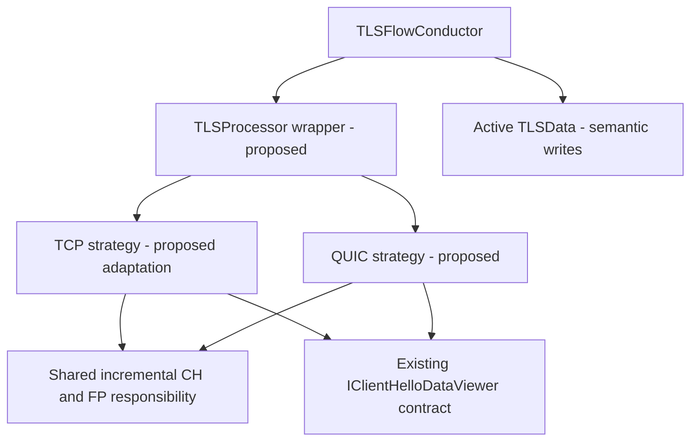
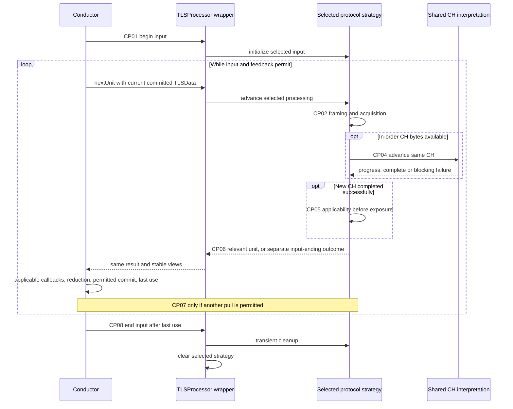

# TLS-Flow: Consolidated Strategy, Shared CH Processing and Continuation Design V6

## V6 focused coordination notice

**C-O03-01: coordinated publication boundary.** For the newly supported TCP ClientHello spanning eligible TLS records, contributing physical records are acquisition input, not individually published feedback units. Do not dispatch intermediate TLSRecord/CH callbacks or normal commits for them. Continue safe available acquisition, checking each record header and excluding it from CH bytes; missing input preserves continuation. On full successful CH/FP completion, expose the single D02 completion projection. For cross-record CH its recordLength is the final contributing actual record's declared payload length; for an existing single-record CH preserve its original payload length. This does not turn recordLength into total CH size or a byte offset into the current packet.

**Barrier retained:** once any semantic unit is yielded, finish all applicable callbacks, actual-verdict reduction, permitted commit and every final internal read before processing a later unit or reusing its backing. Do not parse a separate following record ahead of that barrier. An applicable diagnostic/Stop or unrelated-record interruption during acquisition follows O03's exceptional route, not successful completion; deferred success publication does not defer a known blocking error. Existing non-CH TCP routes and retained-Complete callback eligibility remain unchanged. This coordination does not create a QUIC TLSRecord projection, enforcement verdict, automatic Error/drop, new class/API, capacity value or reclaim mechanism.

This is the working projection selected for the user-authorized O04 review, not a claim of legacy cross-record success or migration equivalence. It supersedes the intermediate-record publication premise only for records contributing to this selected CH. It does not authorize processing past an already yielded unit, mixing unrelated records into CH input, or suppressing existing callbacks for separately processed records.

O01 E05 and O02 F03 references to required/applicable record feedback mean publishable units under this rule, not mandatory intermediate events for contributing records. Their original snapshots remain unchanged. All unrelated content below is inherited; historical V5 source identities identify the inherited analysis, not a newly rerun audit. Official HLD V10 is unchanged.

**Status: reviewed analysis draft, not an approved implementation design.**

This document consolidates the Strategy Processor V2, Template Method Proposal V1, analysis summary V1, continuation-points V1 and the latest incremental-CH discussion. It is the single working narrative for this analysis. Source snapshots remain preserved. Official HLD V10 is unchanged; neither this consolidation nor the wrapper/strategy proposal silently supersedes its accepted architecture.

V5 keeps the analysis strictly within Processor and Conductor, including their internal parsing/FP responsibilities and existing external interface contracts. SRS reconciliation does not amend the SRS or implement external consumers.

The latest direction is to support both a complete CH supplied at once and staged processing of the same logical message. A complete contiguous CH is not a mandatory entry condition. Sharing concerns the CH/FP algorithm, not transport framing. Base-class placement, protected hooks, exact new types, signatures and physical storage remain proposals unless explicitly identified as existing code or accepted constraints.

## 1. Scope, authority and references

### 1.1 Scope

Processor and Conductor only: protocol selection/delegation, TCP and QUIC acquisition, shared CH interpretation/FP, current-result readers, feedback barriers, Conductor callbacks and permitted TLSData commits, and the lifecycle obligations needed to keep their data valid. Existing Extension, Session, Factory/Application and consumer interfaces are referenced only where required to explain those contracts; their internal redesign is outside scope. No mitigation construction, configuration implementation, DTLS framework or consumer redesign is introduced.

### 1.2 Authority

- **Supplied SRS excerpt:** sections 4.3.1 and 4.3.2 as pasted by the user; explicit scope, traceability and deviations are recorded in section 1.4.
- **Existing code:** current behavior only, not automatic target correctness.
- **User decisions:** TCP supports splitting at any byte, including headers and CH across records; no new TCP out-of-order/gap support or automatic overlap/retransmission expansion. Shared CH processing and the existing viewer contract are desired. QUIC CH time is the arrival time of the completing datagram. Nonblocking QUIC findings permit complete CH/FP; Enforcement owns violations. Protocol metadata in ClientHelloData is required.
- **DP constraint:** startup allocation allowed; all affected Engine runtime uses prepared storage, without allocation, growth or heap fallback, including failure, callbacks, diagnostics and aging.
- **RFCs:** protocol structure and endpoint obligations. They do not select the product's state heuristic, allocation layout, classes or callback schedule.
- **Working proposals:** wrapper/strategy structure and any Template Method realization. Historical recommendations and PASS text are not acceptance of new hooks or storage.

### 1.3 Inputs

| Source | Role |
| --- | --- |
| tls_flow_strategy_processor_design_v2.md | Wrapper/strategy and Conductor proposal |
| tls_flow_template_method_proposal_v1.md | Earlier complete-CH/three-hook candidate, reconciled below |
| tls_flow_template_method_analysis_summary_v1.md | Prior seam analysis and evidence limits |
| tls_flow_processing_continuation_points_v1.md and the user-supplied text | Logical boundaries and minimum information, revised for incremental interpretation |
| TLS-Flow-All-Code.txt | Supplied current TCP snapshot; precise symbols and bundle lines in section 4 |
| TLS-Consumers code.txt | Previously inspected nested viewer use; no new all-consumer conformance claim |
| Official HLD V10 | Preserved baseline, not rewritten by this analysis |

Protocol references:
- [RFC 8446 section 4: handshake framing](https://www.rfc-editor.org/rfc/rfc8446.html#section-4), [section 4.1.2: ClientHello](https://www.rfc-editor.org/rfc/rfc8446.html#section-4.1.2), [section 4.2: extensions](https://www.rfc-editor.org/rfc/rfc8446.html#section-4.2), [section 5.1: record fragmentation](https://www.rfc-editor.org/rfc/rfc8446.html#section-5.1).
- [RFC 9001 section 4.1.3: handshake byte delivery](https://www.rfc-editor.org/rfc/rfc9001.html#section-4.1.3), [section 4.2: TLS version](https://www.rfc-editor.org/rfc/rfc9001.html#section-4.2), [sections 5.2-5.5: Initial and packet protection](https://www.rfc-editor.org/rfc/rfc9001.html#section-5.2), [section 7: Initial security](https://www.rfc-editor.org/rfc/rfc9001.html#section-7), [section 8.4: compatibility mode](https://www.rfc-editor.org/rfc/rfc9001.html#section-8.4).
- [RFC 9000 section 12.2: coalescing](https://www.rfc-editor.org/rfc/rfc9000.html#section-12.2), [section 17.2: long headers](https://www.rfc-editor.org/rfc/rfc9000.html#section-17.2), [section 19.6: CRYPTO](https://www.rfc-editor.org/rfc/rfc9000.html#section-19.6).

### 1.4 Current-scope SRS declaration and reconciliation

**Authority:** the user supplied SRS sections 4.3.1 (QUIC TLS Client Hello parser) and 4.3.2 (TLSFP calculation) in the current discussion. This section maps that supplied excerpt, not an inferred newer SRS revision. It does not modify the original SRS. Earlier source identities remain historical input identities.

**Scope declaration:** this design addresses admitted client-to-server QUIC v1 Initial acquisition, CRYPTO delivery of one logical CH across frames/packets/datagrams, shared staged or complete CH interpretation, canonical TCP-equivalent TLSFP, duplicate suppression, and the existing reader/consumer handoff. Enforcement decisions remain external; Processor reports findings and Conductor applies actual verdicts without defining violations. External SRS obligations are not waived or claimed implemented here. TCP segmentation expansion is an additional user-approved design requirement, not derived from these QUIC SRS clauses. Neither the SRS nor this reconciliation mandates inheritance or Template Method.

The following IDs are local traceability labels, not SRS requirement IDs. “Aligned” means a design obligation is stated; it is not runtime conformance evidence. The existing IDs are retained; S19-S20 are deliberately omitted from the in-scope table rather than renumbering S21.

**Out-of-scope note:** SRS 4.3.2 also requires statistics-table insertion and combined TCP/QUIC TOP TLSFP. Those downstream obligations are preserved but are not designed, reviewed, or used as acceptance gates here; S19-S20 from V4 are covered only by this note. The in-scope boundary ends at correct CH/FP availability, existing reader access and Conductor callback/verdict handling.

| ID | SRS clause / meaning | Current design treatment and locator | Assessment |
| --- | --- | --- | --- |
| S01 | QUIC packets use UDP datagrams | Sections 3.4, CP01-CP02: UDP input, selected QUIC strategy | Aligned. |
| S02 | One datagram can hold several QUIC packets | CP02 and section 7.1: bounded packet traversal, not only the first packet | Aligned; packet boundaries and feedback barriers preserved. |
| S03 | Packets contain one or more frames | CP02: frame traversal after valid packet processing | Aligned for relevant Initial packets; not a claim that every QUIC packet form has a frame payload. |
| S04 | Connection starts with TLS handshake | Shared CH acquisition is part of that handshake | Aligned; no full-handshake inspection or Finished trigger follows from this sentence. |
| S05 | TLS handshake messages use QUIC frames, not TLS records | Sections 2, 5.1 and CP02: no QUIC TLSRecord projection | Aligned. |
| S06 | Handshake messages use CRYPTO frames | QUIC acquisition supplies Initial-level CRYPTO bytes to shared interpretation | Aligned. |
| S07 | Handshake data can span CRYPTO frames | CP03-CP04 retain coverage and shared interpretation progress | Aligned; frame boundary is not a message boundary. |
| S08 | CH is carried in Initial | Initial-only CH acquisition; no Handshake/1-RTT key requirement added | Aligned. |
| S09 | CH can span several Initial packets | CP02-CP04 continue across packets and, where needed, datagrams | Aligned. |
| S10 | TLS 1.3 and newer | Parse advertised versions; preserve the lower-version finding contract in section 5.4 | Aligned at the minimum-version rule; no automatic support claim for unknown future TLS versions. |
| S11 | Lower TLS versions are a violation | Parser exposes the accepted nonblocking applicability finding; TLS-Enforcement owns violation definition/verdict | Justified scope separation, not deletion of the SRS rule. See D01. |
| S12 | Search for CH in Initial and CRYPTO | Version-aware Initial parsing, CRYPTO offset/length decoding, then logical handshake interpretation | Aligned; no byte-pattern scan through ciphertext. |
| S13 | Parse Initial for CH “which is a CRYPTO frame” | CH is a TLS handshake message carried by CRYPTO data, not itself a frame | Technical clarification of imprecise wording; consistent with S06-S09. See D03. |
| S14 | UDP destination port belongs to QUIC application port group | Mandatory QUIC admission gate before Initial decryption/CRYPTO/CH work; exact existing gate location is not redesigned | Explicitly clarified here; port membership is necessary, not sufficient protocol identification. |
| S15 | Check Initial header as 0xC0 | QUIC v1 long-header/fixed/type prefix recognition, version and bounds checks, then protection removal and AEAD verification | Literal full-byte equality is not adopted. Justified protocol correction; see D02. |
| S16 | CRYPTO frame type 0x06 | Decode frame type as a QUIC variable-length integer; process numeric type 0x06 at an actual frame boundary | Aligned; no raw scan for byte 0x06. |
| S17 | CH handshake type 0x01 | Check type 0x01 at the logical handshake header after in-order CRYPTO delivery, including split headers | Aligned; do not expect 0x01 at every CRYPTO fragment start. |
| S18 | QUIC TLSFP calculated the same way as TCP | Shared canonical CH/FP algorithm; protocol/framing excluded from FP input; old supported TCP output preserved | Aligned design obligation; equivalence tests still required. |
| S21 | Do not calculate TLSFP for UDP retransmitted packets | Do not re-feed processed CRYPTO bytes, re-finalize or fresh-publish the same CH solely because of retransmission | Aligned semantic interpretation; do not discard new bytes in a packet containing repeated ranges. See D04. |

#### D01. TLS-version finding versus violation enforcement

The product-level lower-version violation requirement remains. Current scope does not implement or transfer that responsibility into Processor, shared CH code or Conductor. A structurally parseable CH without the required TLS 1.3 offer continues through full parsing and FP and carries the accepted nonblocking finding. No automatic Error, DROP or synthetic violation is generated by parsing. An actual future/current Enforcement verdict is handled by the existing verdict contract.

This is a justified allocation of responsibility, not an assertion that lower TLS versions are acceptable. Absence of a current QUIC Enforcement implementation means that product enforcement remains undelivered by this parser-only scope. Do not mark the entire SRS clause implemented on the strength of a finding alone. Inspect supported_versions rather than legacy_version; advertising TLS 1.2 alongside TLS 1.3 is not by itself a lower-version-only CH. The one-way inspector does not claim to observe the negotiated server version. Unknown future version offers must not be silently relabeled as TLS 1.2 or promised full support; their exact applicability policy remains to be specified if needed.

#### D02. Initial recognition: why literal 0xC0 is incorrect

For the current QUIC v1 baseline, 0xC0 expresses the long-header/fixed/Initial high-nibble pattern. It is not the only valid complete first byte. RFC 9001 section 5.4 protects the low four bits of long-header packets; Packet Number Length bits also vary after protection removal. Therefore exact first-byte equality with 0xC0 would reject valid Initial packets. A high-nibble comparison is only a candidate recognition condition, not a complete parser or authentication check. Validate QUIC version 1, header extents, packet lengths, protection-removal prerequisites and AEAD before using payload frames. Do not interpret Packet Number or its length before header-protection removal.

This is a substantive correction to a literal reading of the SRS, justified by the protocol and necessary to satisfy its multi-packet CH parsing intent. It is documented as a design interpretation requiring SRS clarification, not a silently approved SRS amendment. Other QUIC versions are unsupported under the inherited v1 baseline; the TLS minimum-version sentence does not require all QUIC versions.

Protocol basis: [RFC 9000 section 17.2.2](https://www.rfc-editor.org/rfc/rfc9000.html#section-17.2.2) and [RFC 9001 section 5.4](https://www.rfc-editor.org/rfc/rfc9001.html#section-5.4).

#### D03. CRYPTO frame and CH are different layers

Decode frames only from the valid Initial plaintext, respecting frame type, offset, length and bounds. CRYPTO numeric type is 0x06. Its data contributes bytes to the Initial handshake stream; a frame can contain only a fragment of CH, including a partial handshake header. A CH is recognized by handshake type 0x01 at the correct logical message boundary. Do not require one CH per frame, one frame per packet, or one packet per datagram. Handle intervening supported frame types by their defined layout, not by scanning for 0x06/0x01.

Protocol basis: [RFC 9000 section 19.6](https://www.rfc-editor.org/rfc/rfc9000.html#section-19.6) and [RFC 9001 section 4.1.3](https://www.rfc-editor.org/rfc/rfc9001.html#section-4.1.3). This clarifies the SRS's own fragmentation requirements rather than expanding scope.

#### D04. Retransmission means duplicate logical data, not a UDP retransmission flag

UDP has no transport retransmission sequence contract equivalent to TCP. QUIC recovery can send previously carried CRYPTO data in new packets. Duplicate packet handling alone is insufficient to suppress duplicate digest contributions. Track processed/retained CRYPTO ranges under the correct attempt/encryption-level association using prepared bounded storage; do not infer retransmission from destination port or equal fingerprint.

For duplicate-only data, do not repeat shared CH parsing/FP work or fresh CH publication. For repeated plus new ranges, suppress repeated contributions and process the newly available bytes once. The packet that fills a gap can legitimately complete the first FP even if it retransmits data previously sent by the endpoint but never observed by this inspector. Different accepted logical CH messages are not deduplicated merely because their FP values match. Retry-compatible restart/CH2 handling must preserve the inherited attempt contract; this paragraph does not invent a new cross-attempt equality rule or overlap policy.

Protocol basis: [RFC 9000 section 13.3](https://www.rfc-editor.org/rfc/rfc9000.html#section-13.3) and [section 19.6](https://www.rfc-editor.org/rfc/rfc9000.html#section-19.6). This is a justified operational interpretation of S21, not permission to count retransmissions again. Exact range layout and capacities remain open.

#### Review conclusion for the supplied SRS excerpt

No unaddressed material conflict was identified at the analysis-contract level after making S14-S17 explicit. D01 is a justified scope split with an external enforcement obligation. D02 is a documented protocol correction to literal 0xC0 equality. D03-D04 resolve wording ambiguities while preserving the stated intent. Future-version behavior is not claimed implemented. All earlier open design gates remain; this section is not a product conformance PASS.

## 2. Responsibility map

| Responsibility | Placement in the working proposal | Boundary |
| --- | --- | --- |
| Participation, TCP SYN/RST/terminal paths, callbacks, actual verdict reduction, live TLSData writes | Conductor | No strategy may independently reset or commit active TLSData |
| Select one protocol for an input; delegate and clear selection | TLSProcessor wrapper | No CH parsing, fingerprinting or semantic writer |
| TLS records, sequence handling, opaque/Alert continuation and record projections | TCP strategy | Preserve current policy except approved corrections/expansions |
| QUIC packet traversal, Initial crypto, frames, CRYPTO ranges and attempt evidence | QUIC strategy | No fake TLS record, no inference of server-only evidence |
| Incremental CH structure interpretation, canonical FP and CH facts | Shared CH processing responsibility | Same algorithm for complete or staged input; physical placement not selected |
| Existing CH getter contract | Each strategy, directly or via an eventual shared implementation | Same current result, including nested existing public access |
| Post-parse protocol applicability | Protocol-specific responsibility | After shared facts are ready, before successful CH exposure |
| Persistent support cleanup | Existing lifecycle path plus actual protocol owner | No second victim selector or generic binding framework |

Boxes identify responsibilities, not one required class per box. Startup wiring owns long-lived objects; the wrapper borrows installed strategies. A base class is justified only if it implements a meaningful common algorithm, not merely three identical method names.

## 3. Public processing contract: proposed, not a new header

### 3.1 Input interval

| Operation | Input | Output | Meaning |
| --- | --- | --- | --- |
| beginPacket | Borrowed DPFrame and Session; reliable arrival timestamp from verified metadata or explicit parameter | Ready, NotApplicable, Unclassified, InvalidInput or ResourceUnavailable at wrapper level | Select once, initialize selected strategy, expose no stale previous result |
| nextUnit | Current committed TLSData, read-only for this call | A relevant unit or qualified input-ending outcome | Advance from stored input/cursor; do not pass the datagram again |
| endPacket | None; caller has completed every last use | None | End transient borrowing and clear current selection; preserve valid continuation |
| clientHelloViewer | None | Borrowed existing IClientHelloDataViewer pointer when eligible, otherwise unavailable | Read facts; availability is not freshness or commit permission |

These are the Strategy V2 proposal, not signatures extracted from the current TCP interface. Current TCP has beginPacket(const PayloadParams&) and processRecord(const TLSData&); it has no corresponding new endPacket contract in this proposal's form. The currentData argument is intentional: later processing sees committed state after prior feedback, not a packet-start snapshot. Do not cache the reference across replacement.

A failed begin leaves no selected strategy or old result and unwinds its own transient claims. A successful begin is always paired with endPacket after final use, including observer Stop. Repeated end while idle is harmless. endPacket is not attempt acceptance, session destruction or persistent-support retirement.

### 3.1.1 Signature sketches retained from Strategy V2

| Proposed operation | Parameter types | Return type sketch |
| --- | --- | --- |
| TLSProcessor.beginPacket | DPFrame& packet, Session& session | BeginResult |
| TLSProcessingStrategy.beginPacket | DPFrame& packet, Session& session | StrategyBeginResult: Ready, InvalidInput, ResourceUnavailable |
| nextUnit on wrapper/strategy | const TLSData& currentData | ProcessingResult |
| endPacket on wrapper/strategy | None | void |
| clientHelloViewer on strategy | None | IClientHelloDataViewer* borrowed, or null when unavailable |

DPFrame/Session non-constness is provisional because external const APIs were not established; it does not authorize packet action or TLSData mutation. Existing viewer getters remain unchanged, including non-const getSni. Usage remains read-only.

BeginResult, ProcessingResult and the internal SelectionResult are proposed contract names, not repository types. ProcessingResult can refer to prepared current-unit data rather than own a copy. The Strategy V2 metadata sketches remain optional representations: protocol TCP/QUIC; CHPublication None/RetainedTCPView/FreshClientHello; actual const TLSRecordContext* for TCP only; bounded finding view; qualified disposition; completion-time validity plus a verified existing timestamp type. No default TCP protocol, fabricated timestamp type, owning CH payload or runtime-growing findings array is selected. Exact layout, capacities and internal selection/result widths remain OPEN.

### 3.2 One owner per call-order invariant

The wrapper owns selection and whether another public pull is permitted. Strategy code owns protocol cursor and acquisition invariants. A shared implementation may centralize result lifetime, but must not duplicate the same Idle/Active/Exhausted machine in every layer. The enum remains optional if control flow enforces the contract.

Synchronous, non-reentrant calling is a precondition. A next pull is allowed only after callbacks, verdict reduction, permitted commit and final internal reads. No extra acknowledgement API is introduced merely to prove last use. Candidate ownership disposition is a separate information requirement (CP07).

### 3.3 Results and projections

Keep the Strategy V2 semantic distinctions; final enum/union layout is OPEN:
- **UnitReady:** stable applicable projections/findings or qualified evidence, including no-callback semantic units.
- **NeedMoreData:** legitimate end of this input traversal while preserving continuation. Preserve the existing TCP full-continuation-retransmission exception; this is not universally proof of newly consumed bytes.
- **EndOfInput:** input ended, not handshake Finished.
- **Unsupported:** cause-specific disposition; no ordinary same-unit CH/record dispatch.
- **ParserStopped:** qualified blocking parsing path, not observer Stop or automatic Error.
- **ResourceUnavailable:** local resource outcome, not malformed traffic or a manufactured violation.

Input-ending outcomes may carry applicable findings for their exceptional path; they never carry successful CH publication authority. A work-budget yield is not NeedMoreData unless the input contract really ends traversal. Internal progress consumes bytes or advances a finite phase.

A unit needs only the information actually used: protocol and attempt association; valid actual TCP record projection; findings; CH availability and fresh/retained eligibility; relevant arrival time; qualified disposition evidence. These do not mandate a large owning result object. Findings can coexist with successful CH. No record projection exists for QUIC. No result implies DROP.

### 3.4 Selection

QUIC admission requires UDP destination-port membership in the configured QUIC application port group before QUIC crypto/CH work. Select TCP from trusted transport metadata. For UDP, use admitted input plus trusted classification/valid association or bounded recognition; port alone is not proof of QUIC. Selection can identify a QUIC candidate without authenticating a peer or accepting an attempt. Keep selection fixed through coalesced packets. Failed decryption never triggers fallback to DTLS. No DTLS entry, registry or reserved storage is introduced.

## 4. Existing TCP mapping and explicit deltas

Bundle line anchors below are one-based for the supplied snapshot, not repository-wide line numbers. Symbols remain the primary locator.

| Stage | Current code anchor | Existing behavior | Shared-model consequence |
| --- | --- | --- | --- |
| Input and resume | Processor::beginPacket, L5410; resumeStepFromSegmentBuffer, L5619 | Separate fresh/resume paths; digest/locators can point into SegmentBuffer | Keep transport setup separate; restore the correct CH facts |
| Public step | Processor::processRecord, L5564 | Receives const TLSData& | Do not claim the existing operation has no semantic-state argument |
| Extension continuation | processSegmentedClientHelloContinuation, L5780 | Collects remaining extensions, restores counts/version, finalizes and builds record outcome | Split shared CH completion from TCP record reporting |
| New record and CH/FP sequence | processNewRecord, L6164, especially L6330-L6415 | Contains digest setup, cipher/extension processing and finalization | Extract actual algorithm, not just a method with a convenient name |
| Extensions | processExtensions, L6440 | Mixes Single/First/LastSegment byte selection/copying with parse/sort/feed | Keep acquisition outside shared extension interpretation |
| Cipher suites | processCiphers, L6776 | Parses and feeds canonical digest | Reuse logic, avoid feeding again on resume |
| CH body | processClientHello, L6810 | Calls parser; establishes TCP extension continuation; rejects other partial cases | New header/prefix/body continuation is an authorized capability expansion |
| Handshake header | processHandshake, L6881; TlsHandshakeParser::parse, L8501 | Header parsing and record cursor handling; parser expects available header | Shared header interpretation needs bounded partial-header acquisition |
| Body parser | ClientHelloParser::parse, L8544 | uint16_t bufferLen, uint32_t expectedLength; input starts at CH body | Do not silently pass a whole header+body or narrow a new wide length |
| Feedback | TLSFlowConductor::analyzeProcessResult, L3514 | Parsing error, record, eligible CH, then final reduction | Preserve event order and current-event Stop semantics |

The code currently supports a specific partial-extensions path, not arbitrary CH splits. It returns Unsupported for several earlier partial cases and cross-record fragmentation. Supporting them is an approved target change, not a claim that old code already did so. Do not silently expand TCP out-of-order, gap, overlap or retransmission policy.

### 4.1 Existing state to reuse or relocate carefully

- Digest and FullString backing, extension locators, fingerprint and CH parsing status.
- Cipher/compression/extension counts, lastVersion, supported-version mask and parsed flag, early-data indication, SNI and its availability.
- SegmentBuffer currently retains digest, locators, collected bytes and selected facts; the continuation path explicitly restores cipher/compression counts and lastVersion.
- A resumed session must not read another session's mutable parser fields. Copy/restore facts actually needed; do not blindly persist every Processor member.
- TCP sequence, record extent/type, opaque/Alert modes and record accounting remain transport-specific. Do not reuse SegmentBuffer wholesale as a universal QUIC reassembly object.

A pointer swap to digest/locators is not proof that every CH fact was restored. Missing-extension defaults and fallback version must derive from the current CH's own facts, not the most recent parser invocation.

### 4.2 Compatibility boundary

Preserve previously supported valid-input FP/FullString, viewer meanings, actual STOP/mask behavior, retained TCP Complete callbacks and qualified CH commits. Approved TCP fragmentation expansion does not authorize unrelated defect fixes. Changes to error timing or record projection require explicit trace disposition before implementation acceptance.

## 5. Shared CH algorithm: complete input and staged input

### 5.1 Input convention and progress

The shared responsibility interprets one logical TLS handshake message: its four-byte handshake header followed by its declared body. TLS record headers, QUIC packet/frame headers and CRYPTO offsets are not part of those bytes. Existing ClientHelloParser consumes the body only; an adapter must respect that fact. This logical convention does not approve a contiguous full-message buffer or a new parser signature.

The protocol path offers only the next available in-order bytes for the correct CH. A complete message can finish in one call; a partial message advances until it needs more bytes or reaches a required feedback barrier. QUIC ranges beyond a gap are retained by acquisition, not fed out of order. A local parser pause is not automatically a public NeedMoreData: more bytes may be available later in the same packet/datagram, unless a feedback boundary must be yielded first.

Distinguish three quantities: bytes offered; bytes accepted/retained for interpretation; fields already committed to the digest. Re-offering retained bytes is allowed only under an explicit replay contract that prevents duplicate side effects. Prefer advancing a semantic processing position once rather than restarting and rehashing prefixes.

### 5.2 Minimum logical checkpoints

| Checkpoint | Work and existing reuse | Necessary continuation information |
| --- | --- | --- |
| Handshake header | Interpret type and uint24 body length | Known header bytes until complete, declared body extent, correct message association |
| CH prefix and vectors before extensions | Reuse/adapt ClientHelloParser for fixed fields and length-prefixed vectors | Phase, unprocessed partial bytes, known vector extents, parsed facts that cannot be safely recomputed |
| Base FP and ciphers | Reuse processCiphers and existing normalization/feed order | Digest initialized once, whether each contribution was already fed, current CH counts/version |
| Extensions | Reuse parsing, extraction, locator ordering and FP feeding after required bytes are available | Declared/collected extension extent, backing for locators, relevant parsed facts/findings |
| Finalization | Existing canonical finalize and FullString semantics | Completion eligibility and finalized-once condition |

These are logical checkpoints, not a mandatory enum, one class per stage or one virtual hook per field. Start with bounded collection of a whole required vector/region where that preserves existing behavior; do not build a byte-by-byte parser merely for symmetry. Collecting the extension region before sorting remains a valid implementation candidate.

The shared model must not impose a universal TLS 1.3 extensions requirement on TCP. Preserve existing supported legacy TCP CH handling without an extensions field where applicable; this sentence does not authorize expanding unrelated parser acceptance. End-of-message after compression methods is not automatically malformed for all supported TLS versions. QUIC applicability remains separate. RFC 8446 section 4.1.2 explains the legacy distinction; preserving the existing parser's exact accepted/rejected cases still requires code-based trace checks.

### 5.3 Output and findings

Shared processing updates current CH facts/digest in verified-live prepared backing and returns progress/completion/failure information. Data is read through the existing viewer; no copied CH/FP payload is required as the return value. Exact types are OPEN.

A nonblocking finding can coexist with partial progress or a completed CH. A blocking structural failure ends the affected CH interpretation and prevents successful publication. Neither category creates an enforcement verdict. A later blocking failure overrides earlier partial facts; Complete status alone never bypasses an exceptional public outcome.

### 5.4 Post-parse applicability and publication

Once the whole CH is structurally interpreted and canonical FP is available, protocol-specific applicability runs before consumer exposure. For QUIC, absence of the required TLS 1.3 offer produces the accepted nonblocking finding; full CH/FP remain available. Inspect supported_versions, not merely legacy_version. The common parser must not impose QUIC restrictions on TCP.

Keep applicability findings and CH in the same feedback unit. No callback, semantic reset or TLSData write occurs inside shared interpretation. Candidate evaluation uses isolated permitted storage; terminal reset-before-CH and active isolated-evaluate-before-admit are distinct accepted policies, not one generic reset.

### 5.5 Template Method placement

The fixed logical sequence is: protocol acquisition -> shared CH progress -> repeat as needed -> post-completion protocol applicability -> stable unit -> Conductor feedback/commit -> permitted resume or end.

This is not yet a selected inheritance skeleton. Two viable realizations remain:
1. A meaningful implementation base coordinates shared CH progress and has a narrowly justified protocol-applicability step before publication.
2. Each protocol strategy calls the same CH functions, performs its applicability step, then yields; no processing-algorithm base is required.

The previous three-hook/base-owned-complete-evaluator candidate is not carried forward as a settled recommendation: it both required complete CH and lacked a closed post-parse protocol seam. Do not retain three hooks as a numerical design goal. If a base is selected, the existing viewer may be implemented through inheritance; no separately allocated viewer is required. Inheritance does not determine backing ownership or public viewer routing.

## 6. Continuation boundaries and minimum information

A continuation point can be an internal synchronous boundary, an input suspension, or a semantic yield. It is not automatically a virtual function, coroutine, public result or persistent object. CP identifiers are analysis IDs. Minimum information may be derived or borrowed from verified-live storage; it is not a demand for context structs.

| ID | Boundary | Kind | Purpose |
| --- | --- | --- | --- |
| CP01 | Input accepted and protocol selected | Input entry | One selection without stale state |
| CP02 | Advance protocol framing/acquisition | Internal | Bounded protocol progress and correct byte provenance |
| CP03 | Wait for later input | Input suspension | Preserve required acquisition and CH interpretation state |
| CP04 | Advance shared CH interpretation | Internal | Process available logical CH bytes, partial or complete |
| CP05 | Complete CH facts available for applicability | Internal | Protocol checks before exposure |
| CP06 | Current unit ready for Conductor | Semantic yield | Stable views and feedback barrier |
| CP07 | Resume after feedback/disposition | Semantic resume | Fresh authority and correct ownership association |
| CP08 | End current input after last use | Input exit | Clear transient borrowing, retain valid continuation |
| CP09 | Failure/resource/lifecycle interruption | Exceptional | Cause-specific handling and cleanup |

CP02 can reach CP06 without CH. CP04 can advance without completing CH, return internally for more bytes, reach a record feedback boundary, or require CP03. CP05 applies only to a newly completed CH, not a retained TCP callback. CP09 can interrupt any applicable stage. Every successfully opened input ends at CP08; a failed begin unwinds itself.

### CP01. Input accepted and protocol selected

**Trigger:** new admitted frame enters the wrapper; no previous input remains open.

**Available information:** borrowed frame bytes and trusted transport metadata; current session identity; required arrival timestamp provenance; installed supported strategies; applicable admission decision. Use existing context rather than creating a second policy/configuration model.

**Produced information:** selected protocol/strategy, or explicit no-selection reason; valid input extent; input lifetime interval. Selection is fixed for this input. A QUIC candidate classification does not prove successful decryption, decoded protected fields, or attempt acceptance.

**Survives:** the borrowed current input and selection until CP08. No old selection survives a failed begin. A failed initialization unwinds transient claims even though no successful interval exists.

**Resume rule:** CP02 only after successful initialization. TCP is selected from transport metadata. UDP port alone is insufficient; insufficient/conflicting recognition remains unclassified. No QUIC-to-DTLS retry on decrypt failure.

**Not needed here:** complete CH, fingerprint, callback verdict, new SupportBinding, generic classifier registry, or all TLSData copied into a new context.

### CP02. Advance protocol framing and acquisition

**Trigger:** selected input has processable bytes or a finite pending internal phase, and the previous result is no longer in use.

**Common minimum:** current valid byte extent/cursor, protocol acquisition phase, association with the correct session/attempt, and current committed semantic facts needed for applicability. Each cursor belongs to its own framing domain.

| TCP-specific minimum | QUIC-specific minimum |
| --- | --- |
| Sequence position under the existing policy; partial record-header bytes and how many are known; current record type/version/declared extent once available; remaining record bytes; partial handshake-header bytes; CH declared/collected extent once known. | Datagram and packet extents; current packet/frame traversal position; version and classification confidence; Initial crypto context and AEAD-verified plaintext validity where applicable (not peer authentication); CRYPTO offset/range information; correct attempt association. |

These are semantic necessities, not a final storage inventory. Derive values rather than saving redundant counters. Do not expose keys, raw crypto workspace, TCP sequence internals or all fragment metadata to the shared CH parser.

**Produced information:** bounded internal progress, a real record/evidence unit for CP06, incomplete acquisition for CP03, processable CH bytes for CP04, or a qualified exceptional outcome for CP09.

**Progress rule:** consume bytes or advance a finite phase. Stop at the first feedback-dependent boundary. No unbounded scan, no fabricated record for QUIC, no new out-of-order/gap support for TCP.

### CP03. Wait for later input

**Trigger:** required data is incomplete and current traversal legitimately ends. A work-budget yield is not automatically this condition. Existing TCP full-continuation-retransmission behavior remains a distinct reason for ending traversal; do not claim it consumed new CH bytes.

**Minimum retained information:**
- Correct session/attempt association, valid across lookup and slot reuse under the existing lifecycle contract.
- Owned or otherwise verified-live partial bytes and their valid extent.
- Protocol acquisition phase and shared CH interpretation checkpoint, including which digest contributions have already been applied and what remains missing.
- TCP sequence/record/handshake continuation information, or QUIC CRYPTO coverage/offset and applicable crypto context, only as needed by that protocol.
- Digest state and findings/facts that cannot be safely recomputed from retained bytes without replaying side effects. Do not retain stale shared parser fields as implicit session state.

**Produced information:** incomplete status and reason; no complete CH publication. Persistent support survives CP08. The current frame pointer does not.

**Resume rule:** later input returns through CP01, revalidates association, then resumes CP02. A new datagram's arrival time must remain available so that the eventual completing datagram determines the QUIC CH timestamp. Do not freeze the first-fragment time as the completion time.

**Not selected:** pointer versus index, pool layout, generations, new reclaim mechanism, CH capacity, or a generic TCP/QUIC reassembly object. Existing session index alone is not proof that stale support belongs to a reused session.

### CP04. Advance shared CH interpretation

**Trigger:** the protocol path has the next in-order logical handshake bytes, or the interpreter has a finite pending step it can perform. A whole CH is not required to enter.

**Minimum input:** valid read-only byte extent for this message, agreed handshake-header/body convention, correct session/attempt association, and restored CH progress/facts/digest. Transport framing is excluded. Previously accepted bytes are not fed twice. Candidate interpretation uses isolated permitted state and cannot overwrite active backing or reset live TLSData before the applicable accepted disposition.

**Produced information:** bounded parsing/FP progress, partial facts/findings, need for further bytes, blocking failure, or one completed canonical CH/FP. Partial facts are internal and do not authorize a complete CH callback. Nonblocking findings permit continued interpretation. No semantic TLSData writes occur.

**Survives suspension:** phase, necessary partial bytes, declared/processed extents, digest and per-message facts needed for correct resume. A complete CH supplied at once traverses the same stages without mandatory suspension. Storage may collect a vector/extension region before parsing it; the whole CH need not be contiguous at once.

**Reset rule:** initialize deterministic per-message facts only for a new CH; restore the same CH on resume. Missing extensions cannot inherit another session's flags. A retained TCP CH is not re-evaluated merely to repeat its callback.

**Resume rule:** continue internally through CP02/CP04 while safe bytes exist and no feedback boundary intervenes. Yield CP06 for a publishable semantic unit before processing later authority. For records contributing to one incomplete cross-record CH, apply C-O03-01: no intermediate record publication; continue eligible acquisition until completion, exceptional outcome or genuine input exhaustion. Use CP03 only when current traversal legitimately ends for missing input. Complete CH goes to CP05. Blocking failure goes to CP09, never successful CH publication.

**Still OPEN:** exact parser signatures, physical representation and maximum CH. Incremental capability is the working direction, not proof of existing support. Error/event timing for old supported cases remains a migration check; collecting a region must not silently delay an externally observable finding that must be preserved.

### CP05. Protocol applicability after CH parsing

**Trigger:** one new CH has completed structural interpretation and canonical FP finalization, and no blocking failure prevents successful publication. Partial facts alone do not enter CP05.

**Minimum input:** parsed facts; source protocol; prior bounded findings; only the qualified protocol context needed for a concrete check. For the QUIC TLS-version check, advertised-version facts are sufficient; no Session object or full TLSData copy is needed for that check.

**Produced information:** protocol applicability findings with blocking/nonblocking meaning and any justified evidence qualification. No consumer verdict, violation mask, automatic drop or TLSData mutation.

**Example:** a QUIC CH that does not offer TLS 1.3 retains its complete parse and fingerprint and carries the accepted nonblocking finding. The same restriction is not silently applied to TCP.

**Resume rule:** attach the findings to the same CH unit and continue to CP06. Do not publish the CH first and discover applicability only after consumers have run. Do not dispatch findings as a separate earlier transaction that changes STOP/mask reduction.

**Placement not selected:** this logical boundary can become a narrow hook, a direct protocol operation, or protocol-owned orchestration around a shared parser. No three-hook base is approved merely because the logical order is clear.

### CP06. Current unit ready for Conductor

**Trigger:** a record, fresh CH, finding, or qualified semantic evidence requires external handling before further authority-sensitive progress. A unit can have no callback projection and still need a disposition.

**Minimum unit information:**
- Source protocol and association with the correct active or candidate attempt.
- Validity/availability of each projection; actual TCP record facts only for TCP.
- Ordered findings and their applicability to the same unit.
- CH availability distinguished from fresh-CH publication authority and TCP retained-view callback eligibility.
- Current read access to the same CH facts through the existing viewer, including nested public access where used.
- Completion arrival timestamp for a fresh QUIC CH.
- Evidence/cause for any requested semantic disposition, without a precommitted state.

No new owning result object is required by this list. A reference to verified-live data can carry the information. Consumers receive pre-current-unit-commit TLSData; new CH facts are available separately.

**Lifetime:** freeze current backing through callbacks, reduction, permitted commit and every final internal read. Neither another session nor a later unit can overwrite it during that interval. No reentrant input on the same workspace.

**Callback/commit distinction:** a TCP retained CH can be callback-eligible while the current record is not a fresh CH commit. Availability alone must not increment CH count or change CH timestamp. QUIC fresh CH is not a fabricated TLSRecord event and is not proof of Finished.

**Resume rule:** only CP07 decides whether another pull is allowed. end-of-input or Stop can instead lead to CP08. A candidate requiring acceptance must not overwrite active semantic state or its backing before disposition.

### CP07. Resume after feedback and disposition

**Trigger:** Conductor has completed applicable callbacks, actual-verdict reduction, permitted commit and last use for the current unit.

**Minimum continuation information:**
- Permission to continue this input, or an instruction to stop traversing it.
- Current committed TLSData facts needed by subsequent processing, read afresh.
- If a candidate/attempt disposition was required: whether it was accepted, rejected or deferred, and which context is now authoritative.
- Cursor/pending phase after the yielded unit and correct association of retained acquisition with the authoritative context.

For an ordinary unit, the next permitted pull with current TLSData may suffice. **For candidate acceptance, TLSData alone is not assumed sufficient:** two outcomes can leave indistinguishable semantic fields while requiring different acquisition ownership. This is a logical information requirement, not a newly approved acknowledgement API or handle.

**TCP reduction rules preserved:** within an event, Stop ends that event list. A current event Stop with nonzero accumulated mask ends later event dispatch immediately. A zero-mask Stop latches stop but permits later applicable events in the same record. A later Continue with a mask does not by itself trigger immediate exit solely because stop was previously latched. At final reduction, a nonzero mask suppresses normal commit and causes Error only if stop was latched; a zero final mask permits normal commit even with latched Stop. No further pull follows Stop.

**Resume rule:** CP02 only when feedback and lifecycle permit. Refresh any TLSData reference after context replacement. Never cache a packet-start snapshot or infer candidate acceptance from mere control return.

### CP08. End current input after last use

**Trigger:** normal input completion, legitimate wait for later input, unsupported/parser/resource termination, or observer Stop after permitted current-unit work.

**Minimum information:** selected strategy, live transient claims, which backing is still needed by persistent acquisition, and proof that current-result last use has ended. This is an ordering obligation, not necessarily a new refcount or pin token.

**Produced state:** the ended input's current-result/viewer availability invalid; borrowed input references cleared; selected-strategy pointer cleared. Retained CH facts remain stored where the TCP policy requires them; they are not readable as the ended input's result. Strategy and viewer objects remain alive. No consumer/getter for the ended result is called afterward.

**Retained state:** valid incomplete CH/CRYPTO/TCP continuation and accepted attempt support survive as required. If a view points into persistent backing, invalidate the view rather than erasing needed bytes.

**Resume rule:** a later input starts at CP01. Repeated end with no open input is harmless. Cleanup after failed initialization is handled by the failed initialization path; it cannot depend on a successful-input end that will not occur.

### CP09. Failure, resource or lifecycle interruption

**Trigger:** structural failure, unsupported cause, authentication failure, capacity exhaustion, aging, reclaim or attempt disposition interrupts the ordinary path. These are not one interchangeable error category.

**Minimum information:** exact cause category; affected input/unit/session/attempt; whether parsing can continue; valid findings/projections; last-use obligations; retained acquisition validity; and the actual selected reclaim victim when relevant. Include actual enforcement verdict only if one was produced, never inferred from a parser cause.

**Produced information/action:** qualified exceptional handling, no stale CH publication, and cleanup at the correct existing lifecycle point. No automatic Incomplete Handshake violation for resource eviction. Do not convert decrypt failure into a request to try another protocol.

**Reclaim boundary:** existing markReclaimable/allocate/reset already selects and resets a victim. Future support cleanup must attach to that actual ownership path if needed, not add a second victim selector. No backing is reused before its final reader completes.

**Resume rule:** resume only where the accepted cause-specific contract permits; otherwise finish an open current input through CP08 after final handling. Aging or reclaim with no open input does not manufacture a packet-end call. Persistent lifecycle cleanup is not implemented merely by endPacket.

## 7. Flows and feedback preservation

### 7.1 Ordinary and incremental processing

Participants are logical responsibilities. This diagram does not select composition versus inheritance. A blocking CH outcome takes CP09, not the successful applicability/publication path. A TCP record boundary can yield even while CH remains partial. An observer Stop exits without another pull. CP03 preserves continuation only when current traversal legitimately ends.

### 7.2 Exact TCP feedback reduction

Preserve TLSFlowConductor::analyzeProcessResult:
1. Parsing-error event, actual TLSRecord event, then eligible CH event.
2. Within each event, Stop immediately ends that event's listener list; OR only actual masks.
3. A **current-event Stop** with nonzero accumulated mask commits Error and suppresses later events immediately.
4. A zero-mask Stop latches Stop but permits later applicable event types in the same record.
5. A later Continue with a mask does not itself trigger immediate exit solely because Stop was previously latched.
6. At final reduction: nonzero mask suppresses normal commit; Error if Stop was latched, otherwise violation-only commit. Zero mask permits normal commit even with latched Stop.
7. Stop prevents the next processing pull. ParserStopped is a separate path.

These rules describe the parsed-record path, not permission for a blocking parser failure to normal-commit CH. QUIC has no record event. Its findings and CH use the same qualified unit and actual feedback, without fabricating TLSRecord or enforcement.

### 7.3 Required walkthroughs

| Case | Required outcome and review focus |
| --- | --- |
| Complete CH at once | Same shared stages; one finalize and fresh publication, no mandatory intermediate suspension |
| TCP split handshake header/prefix/ciphers/extensions | Retain required partial region and phase; no rehash; approved capability expansion |
| TCP CH across two records | C-O03-01: retain contributing records without intermediate callbacks; publish one D02 completion projection, then finish feedback/commit/final reads before a separate later record |
| TCP A partial, B complete, A resumes | Restore A's digest, facts, missing-extension defaults and locators; no reads of B's parser scratch |
| TCP later record after Complete | Retained CH callback eligibility preserved; no fresh count/time update or rehash merely because callback repeats |
| Complete status followed by blocking/capacity failure | Public exceptional outcome overrides successful projection; no CH success inferred from status alone |
| QUIC gap filled by later datagram | Deliver newly contiguous bytes once; timestamp is arrival of the datagram completing the whole CH, not parser callback time |
| QUIC duplicate/retransmission | No repeat FP evaluation or fresh publication for already processed bytes; new bytes can advance the same CH |
| QUIC CH without TLS 1.3 offer | Complete parsing/FP plus nonblocking finding, one feedback unit; no parser-generated violation/Error |
| Nested existing FullString getter | Same current CH/strategy and verified-live digest backing through final use |
| Zero-mask Stop, later Continue with mask | Later applicable same-record events run; final Error; no extra pull |
| Candidate acceptance with unchanged TLSData fields | Explicit authoritative ownership outcome still needed; equal semantic fields are not acceptance |
| Terminal candidate versus active replacement | Preserve reset-before-CH versus isolated evaluation/admission ordering; no unified blind reset |
| Resource failure, aging or reclaim | Cause-specific disposition, actual victim cleanup, no manufactured incomplete-handshake violation |
| Unknown UDP after TCP | Failed selection exposes neither old strategy nor old CH; no fallback chain |

These are static oracles, not executed tests. Successful old-input FP equivalence does not prove old malformed-input error timing. Record projections for newly supported cross-record CH require an explicit trace contract rather than invented historical behavior.

## 8. Ownership, viewer and lifecycle

### 8.1 Lifetimes

| Lifetime | Necessary information | Forbidden shortcut |
| --- | --- | --- |
| One input | Borrowed bytes, arrival provenance, selected strategy and protocol cursor | Expired packet pointers retained for later input |
| One yielded unit | Stable findings/projections, CH facts, relevant timestamp and provenance | Overwrite backing during callback or before commit |
| Across feedback | Current authority and necessary candidate disposition | Cached precommit TLSData or inferred acceptance |
| Across inputs | Correct association, partial bytes, CH checkpoint/digest/facts, protocol coverage | Another session's shared scratch as implicit continuation |
| Across lifecycle | Actual owner and last-use/release obligations | Parallel victim selection or clearing needed support in endPacket |

### 8.2 Existing viewer contract

Each strategy implements IClientHelloDataViewer directly or through a justified shared implementation. Keep getter signatures and FullString representation/access unchanged. No FullString field is added to ClientHelloData. Its explicit TCP/QUIC protocol metadata remains required; it does not change FP bytes.

The existing Factory/Application path currently reaches the TCP Processor. Routing it to the selected current result is a concrete integration task, not solved by inherited getters alone. The user expects it to be straightforward; treat it as a targeted implementation/conformance check, not a reason to restart architecture selection. Do not prescribe a binding framework, replacement viewer or public API migration without need.

Invalidating an ended result does not erase persistent TCP CH facts. Retained callback eligibility is restored/exposed under TCP policy, not made universally readable outside a valid interval. Clearing the wrapper's selected pointer after final use is compatible with a live strategy object.

### 8.3 Existing reclaim path

Reuse markReclaimable, allocation/victim selection and reset/release. If QUIC adds externally owned backing, cleanup attaches to the actual selected victim's existing path before its ownership reference is lost. First verify whether existing cleanup already suffices. No new retireActualVictimBeforeMutation API or second reclaim mechanism is approved.

Aging with no open input performs lifecycle cleanup, not a manufactured endPacket. TCP SegmentBufferManager continuation ownership and aging remain independent unless a concrete accepted correction changes them.

### 8.4 Attempt and semantic invariants

One active TLSData context remains. Preserve retired-attempt suppression, ambiguity without merge/reset, Retry-compatible restart as the same attempt without claiming observed Retry, and HRR-compatible CH2 as the same attempt without claiming observed HRR. A complete new accepted attempt can replace the active attempt as session reuse in the same DP Session. These are inherited constraints, not new classifiers implemented here. No 0-RTT-driven state transition or automatic packet drop is introduced. Completion of CH and resource eviction do not create handshake-completion evidence or an Incomplete Handshake violation.

### 8.5 Bounds

Keep finite symbolic capacities for partial headers, retained CH regions, locators/findings, CRYPTO ranges, Initial contexts, candidates, retired history and scratch. Charge simultaneous old+candidate+destination+temporary backing where applicable. No numerical maximum is invented. Wide handshake lengths and narrower existing parser lengths require checked conversion or deliberate parser adaptation, not silent truncation.

Every loop consumes bytes or advances a finite bounded phase. Avoid repeated prefix rescans that turn incremental processing into unbounded or quadratic work. No affected Engine runtime allocation, growth or heap fallback, including callbacks/failure/diagnostics. Provider-fit and allocation instrumentation remain downstream evidence, not claimed PASS.

## 9. RFC alignment and limits

| Protocol fact | Source | Design consequence |
| --- | --- | --- |
| TLS handshake uses type plus uint24 body length; ClientHello has length-prefixed vectors | RFC 8446 sections 4, 4.1.2 | Message extent is distinct from record/frame extent; check arithmetic and vector bounds |
| TLS handshake messages can span records, subject to record/key-change alignment restrictions | RFC 8446 section 5.1 | TCP record acquisition removes framing without assuming one record equals one CH; no automatic new violation policy |
| QUIC carries handshake bytes in CRYPTO; TLS record protection is not used | RFC 9001 section 4.1.3 | No TLSRecord projection or record parser in QUIC CH interpretation |
| Incremental processing or buffering complete messages/flights is allowed | RFC 9001 section 4.1.3 | Shared staged interpretation and complete-input fast path are both compatible; RFC does not choose storage |
| CRYPTO offsets sequence data per encryption level; CRYPTO is absent from 0-RTT | RFC 9000 section 19.6; RFC 9001 section 4.1.3 | Do not mix encryption-level streams or treat gaps as malformed CH; scope remains Initial keys |
| Long-header packet type is visible; low four bits and packet number are protected | RFC 9000 section 17.2; RFC 9001 section 5.4 | Do not label every type bit protected. Packet Number and Packet Number Length bits require header-protection removal, as does short-header Key Phase. The separate long-header Length field is not header-protected; validate its bounds without treating it as authenticated evidence before AEAD verification |
| Initial secrets are publicly derivable | RFC 9001 sections 5.2, 7 | AEAD verification is not peer identity authentication or attempt-admission proof |
| Retry changes Initial secret derivation context | RFC 9001 section 5.2 | A DCID-change rule cannot universally reuse old keys; restart qualification stays protocol-specific |
| QUIC requires TLS 1.3 or later; legacy_version alone does not express the offer | RFC 9001 section 4.2; RFC 8446 section 4.2.1 | QUIC applicability uses advertised-version facts; inspection finding remains separate from endpoint enforcement |
| QUIC prohibits TLS compatibility CCS and uses empty legacy_session_id | RFC 9001 section 8.4 | Do not fabricate CCS or impose QUIC-only checks on TCP; this analysis does not add new enforcement requirements |
| CH completion is not TLS handshake completion or confirmation | RFC 9001 sections 4.1.1-4.1.2 | No new Finished trigger is introduced by this parser design |

This is a passive client-to-server inspector, not a QUIC endpoint. RFC endpoint requirements to close a connection do not authorize the Processor to create violations or DROP. Server Retry/HRR/Finished/HANDSHAKE_DONE are not assumed visible. Any existing product completion policy must retain its exact accepted authority and evidence qualification; these discussion documents alone do not settle it.

## 10. Reconciliation of the source drafts

| Earlier wording | Consolidated treatment | Reason |
| --- | --- | --- |
| CP04 requires complete CH before interpretation | CP04 advances partial or complete CH; CP05 follows completion | Align with latest incremental direction |
| Complete contiguous view as common evaluator entry | Optional full-input case, not mandatory contract | Avoid forced full TCP CH buffering |
| Three hooks plus base-owned evaluator recommended | Base and hook placement remain conditional | Post-parse applicability seam was not closed |
| CH processing mostly waits for complete message | Shared phases can process available complete regions | Preserve staged FP and avoid duplicate hashing |
| Wrapper and base both own lifecycle checks | One owner per invariant | Avoid redundant state machines |
| Protected packet-type fields treated uniformly | Distinguish visible long type from protected fields | RFC 9001 section 5.4 |
| Authenticate Initial | Verify AEAD, not peer identity | Public Initial secrets |
| Viewer inheritance solves consumer access | Existing public routing still checked | Factory/Application integration remains real |
| endPacket clears everything | Clear transient borrowing after last use, retain valid CH/support | Preserve continuation and TCP retained facts |
| All earlier behavior claimed equivalent | Existing behavior, approved expansion and unresolved trace decisions separated | Do not label new capability as current code fact |

This document replaces conflicting recommendations only within this working analysis. It does not edit preserved inputs, official HLD V10 or prior accepted contracts. No historical IN PROGRESS item becomes implementation PASS by consolidation.

## 11. Remaining decisions and next focused step

| ID | Decision/check | Closure point |
| --- | --- | --- |
| O01 | Exact shared-CH region API, accepted-byte accounting and checkpoint representation | Before parser/base signatures are fixed |
| O02 | Base-owned orchestration with applicability seam versus protocol-owned calls to shared CH functions | After O01 and representative flows; no fixed hook count |
| O03 | TCP cross-record record/error/CH timing, including malformed old-supported inputs | Before claiming behavioral equivalence or accepting migration |
| O04 | Existing public viewer routing and caller lifetime conformance | Before integrating consumers; targeted check, not architecture restart |
| O05 | Candidate accepted/rejected/deferred information and ownership handoff | Before final attempt/lifecycle API; TLSData alone not assumed sufficient |
| O06 | Maximum CH, finite capacities, widths and joint peaks | Before storage/layout implementation acceptance; no invented values |
| O07 | Provider-fit and allocation-free crypto/failure/callback paths | Before activation, with actual evidence |
| O08 | Concrete completion evidence/trigger if not established by accepted upstream contract | Before state-policy implementation; do not infer from this document |

**Next step:** close O01 with concrete examples at the header, prefix/cipher and extension checkpoints, including accepted/retained/hashed-byte accounting. Then choose O02. Do not block that analysis on numerical capacity values or reopen all product research. Viewer and TCP event checks remain focused integration obligations, not a request for exhaustive source extraction.

## 12. Review boundary

A targeted first static review reconciled source recommendations, code mapping, RFC facts and CP01-CP09. A second review checked incremental versus complete-input consistency, same-unit findings, feedback barriers, retained TCP CH, last-use/end behavior, source locators, widths and explicit migration deltas. Section 11 remains visible: this is a coherent analysis draft, not a build-ready or frozen design.

No C++ build, packet execution, all-caller audit, runtime allocation proof, measured performance or activation approval is claimed. Mermaid diagrams are explanatory. Code fences and participants were checked statically; Mermaid was not rendered.

### V3 focused double-check

A further static review checked the complete V2 narrative against the supplied TCP dispatch/resume paths, all twelve section-4 source-line anchors, all six recorded source identities, CP01-CP09, incremental versus complete input, findings-plus-CH feedback, retained TCP eligibility, and end-of-input lifetime. The review also rechecked the cited header-protection and legacy-CH distinctions against RFC 9001 section 5.4 and RFC 8446 section 4.1.2.

Two local clarifications were made: the RFC table now distinguishes protected Packet Number Length bits from the unprotected long-header Length field; the sequence label distinguishes CP06 units from separate input-ending outcomes. Neither clarification selects a base, hook, storage layout, new violation, or completion trigger. O01-O08 remain open as listed. No additional blocking inconsistency was identified within this targeted static review; this is not implementation acceptance or an exhaustive audit of inherited contracts. V2 and all source snapshots remain unchanged.

### V5 Processor/Conductor scope double-check

The scope review removed the two downstream-consumer rows from the in-scope SRS matrix and retained them only in the single note in section 1.4. They introduce no component, flow, data field, test gate or implementation task in this design. Existing callbacks, verdict handling and viewer lifetime remain in scope because they are Conductor/Processor contracts, not consumer implementation.

The static recheck covered S01-S18 and S21, CP01-CP09, partial versus complete CH progress, protocol-specific applicability before exposure, TCP event reduction, retained versus fresh CH, nested viewer access, endPacket after last use, port admission and duplicate CRYPTO suppression. The inherited code anchors and source hashes are preserved as prior-review evidence; the earlier source files were not all available for a fresh hash/code audit in this run. This run checks the attached V4 and its revised scope/contract consistency, not renewed source-level equivalence. No additional blocking inconsistency was identified in this targeted analysis review. O01-O08 remain explicitly open; no base class, hook list, numeric capacity or new FullString API is approved by this revision.

No C++ build, packet execution, runtime allocation/performance proof or Mermaid rendering was performed. V4, code and earlier baselines remain unchanged.

### Source snapshot identities

- `tls_flow_template_method_proposal_v1.md`: SHA-256 `269420b4c53d716103863fddb9b4e48c25f531ae2026177fb7a04e9fa91f12fa`.
- `tls_flow_strategy_processor_design_v2.md`: SHA-256 `a9be6392440531d1b137be2151c73ed82eb843dde4f2d1207c2b90434f444bfb`.
- `tls_flow_template_method_analysis_summary_v1.md`: SHA-256 `e6de747edb8e258b3f3466475a91ee8d4c29bb98bf2643095dbd1cf2e9f8fa4d`.
- `tls_flow_processing_continuation_points_v1.md`: SHA-256 `91f6df571d7636578aefd481a314099ed22824ad59b8a14b166de5eefec31700`.
- `TLS-Flow-All-Code.txt`: SHA-256 `70f6f63926a6f9426033aec6903951cc804b2225b153d20d3a3b8e13d2808f5b`.
- `tls_flow_quic_r1_hld_v10.md`: SHA-256 `c7e92cfca0fcc9913c420c2e93b04456beb956043b34d2ba5391917af2718ca1`.

The supplied continuation text is also part of the authority reconciliation; source file identity does not make superseded complete-CH wording current.
